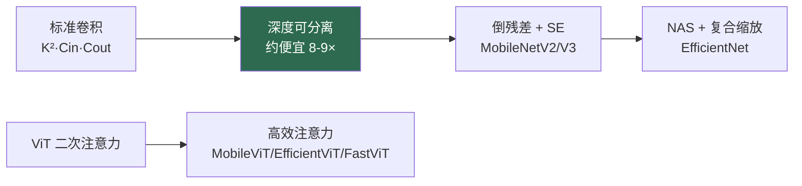

# 高效架构

> **英文原文：** [cv-knowledge-base/09_efficiency_and_deployment/01_efficient_architectures.md](../../cv-knowledge-base/09_efficiency_and_deployment/01_efficient_architectures.md)（本中文版供参考，内容以英文原文为准）

> **最后更新：** 2026年10月
> **难度级别：** 高级
> **相关章节：**
> - [模型压缩](./00_model_compression.md)
> - [硬件加速](./02_hardware_acceleration.md)
> - [混合架构](../03_architectures/02_hybrid_architectures.md)
> - [边缘部署](./03_edge_deployment.md)

> **🆕 2026年10月更新：**
> - 新增**高效实时检测器**一节：Ultralytics **YOLO26**（免 NMS 的端到端模式）和 **RF-DETR**（ICLR 2026；基于 DINOv2 骨干的神经架构搜索），并附上来自官方仓库的 COCO 精度/延迟数据。
> - 新增**面向 VLM 的高效编码器**一节：FastVLM/FastViTHD（CVPR 2025）、MobileCLIP2（TMLR 2025）、蒸馏得到的 DINOv3 学生模型，以及紧凑型开放 VLM（SmolVLM、Moondream、Gemma 4 E2B/E4B、Qwen3.5 0.8B–9B）。
> - 指出**线性注意力混合架构**（Qwen3.5 中的 Gated DeltaNet + MoE）作为多模态骨干效率手段的普及。

---

## 概述

高效架构是从一开始就为最大化单位算力、内存或延迟下的精度而设计的神经网络——这与压缩已有的大模型（见[模型压缩](./00_model_compression.md)）不同。这一区别很重要：压缩从一个重型模型出发并削减容量，而高效架构设计则把精简直接融入算子和拓扑本身。推动该领域的部署现实是：大部分推理并不发生在数据中心，而是在手机、相机、汽车和机器人上，在这些场景中功耗、内存带宽和实时延迟都是硬性约束（参见[边缘部署](./03_edge_deployment.md)和[机器人硬件平台](../06_robotics_and_embodied_ai/12_hardware_robot_platforms.md)）。

核心设计手段是用更廉价、但能保持表示能力的近似来替代稠密而昂贵的算子。开创性的思想是**深度可分离卷积（depthwise-separable convolution）**（MobileNet），它将标准卷积分解为逐通道的空间滤波加上 1×1 的逐点混合，使成本大约降低一个卷积核面积的倍数。后续工作加入了倒残差（MobileNetV2）、squeeze-and-excitation 与神经架构搜索（MobileNetV3、EfficientNet）、通道混洗（ShuffleNet），以及面向 ViT 的高效注意力（MobileViT、EfficientViT、FastViT）。一个反复出现的教训是：**FLOPs 不是延迟的良好代理指标**——内存访问模式、算子支持和并行度往往主导实际运行时间，因此高效设计必须面向真实硬件，而不仅仅是理论计算量。

---

## 核心技术

### 深度可分离卷积

卷积核为 `K×K`、输入通道 `C_in`、输出通道 `C_out` 的标准卷积，开销为 `K²·C_in·C_out·H·W`。**MobileNet** [Howard2017] 将其分解为：

```
# 深度卷积：每个输入通道一个 K×K 滤波器
cost_dw = K² · C_in · H · W
# 逐点卷积：1×1 卷积混合通道
cost_pw = C_in · C_out · H · W
# 加速比 ≈ 1/C_out + 1/K²  （K=3 时约 8-9×）
```

**MobileNetV2** [Sandler2018] 引入了带线性瓶颈的**倒残差（inverted residuals）**（扩展 → 深度卷积 → 投影）；**MobileNetV3** [Howard2019] 结合了 NAS、squeeze-and-excitation 和硬件感知调优。**ShuffleNet** 使用带通道混洗的分组 1×1 卷积；**SqueezeNet** 借助 fire 模块专门压缩参数量。

### 复合缩放与 NAS

**EfficientNet** [Tan2019]（ICML 2019）在 NAS 找到的基线（EfficientNet-B0）之上使用**复合缩放（compound scaling）**——用单一系数 `φ` 联合缩放深度、宽度和分辨率——取得了优秀的精度/FLOP 权衡（B7：84.4% top-1）。神经架构搜索（DARTS、MnasNet、Once-for-All）在延迟约束下实现了高效拓扑的自动发现。

### 高效视觉 Transformer

ViT 在高分辨率下代价高昂（注意力为二次复杂度）。**MobileViT** [Mehta2022] 将 MBConv 与轻量级全局注意力交错；**EfficientViT** 使用线性/级联注意力获得高吞吐；**FastViT** 使用结构重参数化和 token 混合器混合结构。这些方法将 Transformer 的精度带入移动端延迟预算（参见[混合架构](../03_architectures/02_hybrid_architectures.md)）。



### 高效实时检测器（2025–2026）

如今有两条设计路线界定了可部署检测的精度-延迟前沿（参见[目标检测](../02_core_tasks/01_object_detection.md)）：

- **YOLO26**（Ultralytics，2026）延续了 CNN YOLO 路线，采用边缘优先的设计，并提供**端到端、免 NMS** 的推理模式（以单独的 “e2e” mAP 列报告），去掉了在 NPU 上难以加速的后处理步骤。YOLO26n 以 240 万参数达到 40.9 COCO mAP（端到端 40.1），在 T4 + TensorRT 10 上耗时 1.7 ms。
- **RF-DETR** [Robinson2026]（Roboflow；ICLR 2026）是基于 DINOv2 骨干（最小的几个变体使用 PE-Core-T）的实时 DETR，其各尺寸模型通过在分辨率、patch 大小和解码器深度上进行**权重共享神经架构搜索**得到。RF-DETR-N 在 2.3 ms 下达到 48.4 COCO AP；RF-DETR-L 在 6.8 ms 下达到 56.5 AP（厂商测量）。它表明，强大的自监督基础骨干加上 NAS，可以在相近延迟下超越人工设计的 CNN 检测器，尤其是在迁移任务（RF100-VL）上。
- **YOLOE**（ICCV 2025）表明，开放词汇的文本/视觉提示可以被重参数化进标准 YOLO 头，且没有推理开销（参见[开放词汇检测](../05_multimodal_vision_language/03_open_vocabulary_detection.md)）。

### 高效编码器与紧凑型 VLM（2025–2026）

对于视觉-语言模型，瓶颈在于**视觉 token 的数量**以及编码器在高分辨率下的延迟，而不是 ImageNet FLOPs：

- **FastVLM / FastViTHD** [Vasu2025]（Apple，CVPR 2025）：一种混合卷积-Transformer 编码器，在高分辨率下输出远少于常规的 token；其最小变体以快 85× 的首 token 时间和小 3.4× 的编码器超越 LLaVA-OneVision-0.5B，并可在 iPhone 上运行。
- **MobileCLIP2**（Apple，TMLR 2025 Featured）：MobileCLIP2-S4 以少 2× 的参数达到 SigLIP-SO400M/14 的零样本精度，并在 iPhone 12 Pro Max 上以低 2.5× 的延迟超越 DFN ViT-L/14。
- **蒸馏得到的基础骨干**：DINOv3 的 7B 教师被蒸馏为 ViT-S/B/L/H+ 和 **ConvNeXt** 学生模型（ConvNeXt 蒸馏代码于 2025年11月发布），提供适合边缘分割和深度估计的稠密特征。
- **紧凑型 VLM**：SmolVLM（Hugging Face）、Moondream 0.5B/2B、Gemma 4 的端侧 E2B/E4B 变体（2026年4月）以及 Qwen3.5-0.8B/2B/4B/9B（2026年3月）将原生多模态模型带到手机和 Jetson 级设备上。
- **次二次复杂度的序列混合**：Qwen3.5 将 Gated DeltaNet 线性注意力与稀疏 MoE 相结合，以降低长上下文多模态推理成本；状态空间与线性注意力混合架构的讨论见[状态空间模型](../03_architectures/05_state_space_models.md)。

---

## 关键论文

| 论文 | 作者 | 年份 | 会议/期刊 | 主要贡献 |
|-------|---------|------|-------|-----------------|
| MobileNet | Howard et al. | 2017 | arXiv | 深度可分离卷积 |
| MobileNetV2 | Sandler et al. | 2018 | CVPR | 倒残差、线性瓶颈 |
| MobileNetV3 | Howard et al. | 2019 | ICCV | NAS + SE + 硬件感知设计 |
| EfficientNet | Tan, Le | 2019 | ICML | 复合缩放 |
| ShuffleNet | Zhang et al. | 2018 | CVPR | 分组卷积 + 通道混洗 |
| MobileViT | Mehta, Rastegari | 2022 | ICLR | 移动端友好的视觉 Transformer |
| FastVLM | Vasu et al. (Apple) | 2025 | CVPR | FastViTHD 混合编码器；更少 token、更快 TTFT |
| MobileCLIP2 | Faghri, Vasu, Koc, et al. | 2025 | TMLR | 面向移动端 CLIP 的改进多模态强化训练 |
| RF-DETR | Robinson, Robicheaux, Popov, Ramanan, Peri | 2026 | ICLR | 基于 DINOv2 骨干、经 NAS 设计的实时 DETR |

---

## 基准性能

| 模型 | 参数量 | FLOPs | ImageNet top-1 | 备注 |
|-------|--------|-------|----------------|-------|
| MobileNetV2 | 3.4M | 300M | 72.0% | 倒残差 |
| MobileNetV3-Large | 5.4M | 219M | ~75.2% | NAS + SE |
| EfficientNet-B0 | 5.3M | 390M | 77.1% | NAS 基线 |
| EfficientNet-B7 | 66M | 37G | 84.4% | 复合缩放 |
| MobileViT-S | 5.6M | 1.1G | 78.4% | 超越 MobileNetV3-L |

**实时检测（COCO val2017，官方仓库；延迟在 NVIDIA T4 + TensorRT 上测得，厂商测量）：**

| 模型 | 参数量 | COCO AP50:95 | 延迟 | 备注 |
|-------|--------|--------------|---------|-------|
| YOLO26n | 2.4M | 40.9（e2e 40.1） | 1.7 ms | 提供免 NMS 的端到端模式 |
| YOLO26s | 9.5M | 48.6（e2e 47.8） | 2.5 ms | 20.9 GFLOPs |
| YOLO26x | 55.7M | 57.5（e2e 56.9） | 11.8 ms | 194.4 GFLOPs |
| RF-DETR-N | 30.5M | 48.4 | 2.3 ms | 输入 384×384；Apache 2.0 |
| RF-DETR-L | 33.9M | 56.5 | 6.8 ms | 输入 704×704 |
| RF-DETR-2XL | 126.9M | 60.1 | 17.2 ms | 输入 880×880 |

*两个仓库的延迟测量协议不同（例如是否包含 NMS），因此跨系列比较仅为近似。*

---

## 优缺点

| 方面 | 优点 | 缺点 |
|--------|------|------|
| 深度可分离 | 卷积便宜约 8–9× | 每个算子的算术强度较低（受内存限制） |
| NAS 设计 | 在约束下最优 | 搜索成本高；依赖特定硬件 |
| 复合缩放 | 有原则的精度/FLOP 权衡 | 在并非所有硬件上 FLOPs 都等于延迟 |
| 高效 ViT | 以移动端延迟获得 Transformer 精度 | 更复杂；成熟度不及 CNN |
| 自监督骨干 + NAS（RF-DETR） | 在实时延迟下兼具高精度和强迁移能力 | 参数量大于 CNN YOLO；依赖重型预训练骨干 |
| token 高效的 VLM 编码器（FastViTHD） | 降低高分辨率下的首 token 时间 | 与编码器绑定；必须与 LLM 联合训练 |

---

## 开放问题与研究空白

- **FLOPs 与延迟不匹配。** 理论计算量难以预测真实延迟；硬件在环设计必不可少，但代价高昂。
- **内存受限场景。** 深度卷积受内存带宽限制，计算单元利用率不足。
- **高分辨率下的高效注意力。** 无精度损失的次二次注意力尚未解决（参见[状态空间模型](../03_architectures/05_state_space_models.md)）。
- **微型基础模型/VLA 模型。** 将多模态/VLA 能力压缩到 10 亿参数以下的端侧模型是一个开放前沿（参见[未来趋势](../12_research_frontier_2024_2026/07_future_trends.md)）。
- **NAS 成本。** 架构搜索仍然计算密集且依赖特定硬件。
- **精度上限。** 在困难任务上高效模型仍落后于大模型；帕累托前沿在不断移动。
- **延迟基准测试的规范性。** YOLO26、RF-DETR 等的厂商表格使用不同的输入尺寸、精度和 NMS 处理方式；缺少一个标准的、覆盖多种硬件的延迟测量协议。
- **编码器与 LLM 的协同设计。** 面向 VLM 的高效编码器必须最小化 *token 数*，而不仅是 FLOPs；对编码器、连接器和 token 预算的联合搜索基本尚未被探索。

---

## 延伸阅读

- [MobileNetV2 (arXiv:1801.04381)](https://arxiv.org/abs/1801.04381) — 倒残差
- [EfficientNet (arXiv:1905.11946)](https://arxiv.org/abs/1905.11946) — 复合缩放
- [MobileViT (arXiv:2110.02178)](https://arxiv.org/abs/2110.02178) — 高效视觉 Transformer
- [Once-for-All (arXiv:1908.09791)](https://arxiv.org/abs/1908.09791) — 一次训练，按需特化
- [FastViT (arXiv:2303.14189)](https://arxiv.org/abs/2303.14189) — 重参数化的高效 ViT
- [FastVLM (arXiv:2412.13303)](https://arxiv.org/abs/2412.13303) — 面向 VLM 的高效视觉编码
- [MobileCLIP2 (arXiv:2508.20691)](https://arxiv.org/abs/2508.20691) — 改进的多模态强化训练
- [RF-DETR (arXiv:2511.09554)](https://arxiv.org/abs/2511.09554) — 结合 NAS 的实时检测 Transformer
- [Ultralytics YOLO26 文档](https://docs.ultralytics.com/models/yolo26) — 免 NMS、面向边缘的 YOLO
