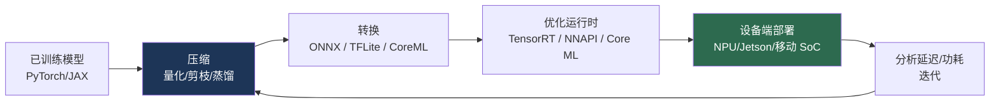
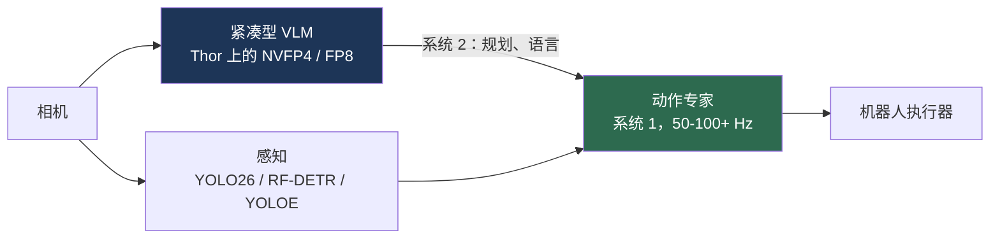

# 边缘部署

> **英文原文：** [cv-knowledge-base/09_efficiency_and_deployment/03_edge_deployment.md](../../cv-knowledge-base/09_efficiency_and_deployment/03_edge_deployment.md)（本中文版供参考，内容以英文原文为准）

> **最后更新：** 2026年10月
> **难度级别：** 高级
> **相关章节：**
> - [硬件加速](./02_hardware_acceleration.md)
> - [模型压缩](./00_model_compression.md)
> - [高效架构](./01_efficient_architectures.md)
> - [机器人硬件平台](../06_robotics_and_embodied_ai/12_hardware_robot_platforms.md)

> **🆕 2026年10月更新：**
> - **Jetson AGX Thor** 已正式上市（2025年8月）：JetPack 7、支持 NVFP4 的 Blackwell GPU，以及新的 **TensorRT Edge-LLM** 运行时，可在端侧运行 VLM（Qwen3-VL/3.5、Gemma 4）和实验性的 VLA 策略（π0.5）。
> - 新增 **2026 年端侧多模态模型**小节：Gemma 4 E2B/E4B、Qwen3.5 0.8B–9B、FastVLM、SmolVLM/Moondream，以及模型厂商发布的 NVFP4/FP8 检查点。
> - 运行时更新：ExecuTorch（Gemma 4 多模态、YOLO26 示例）、LiteRT-LM / LiteRT.js，以及简化 NPU 部署的免 NMS 检测器（YOLO26）。
> - 在关键参考文献和约束对比表中新增条目；修订了开放问题。

---

## 概述

边缘部署是指在*设备端*——手机、相机、车辆、无人机和机器人上——而非云端运行视觉模型的实践。这是应用计算机视觉真正落地的地方：在数据中心无关紧要的延迟、功耗、内存、隐私和连接性约束在这里变得至关重要；一个达到 SOTA 精度的模型，如果无法在几瓦功耗内满足 30 ms 的实时预算，就毫无用处。边缘部署在该领域中日益核心，因为最高价值的应用——自动驾驶、机器人、AR、智能相机——本质上是嵌入式的，且往往是安全攸关的，要求确定性的、可离线运行的推理（参见[机器人硬件平台](../06_robotics_and_embodied_ai/12_hardware_robot_platforms.md)和[自动驾驶](../07_autonomous_driving/00_overview.md)）。

这一学科融合了本章涵盖的三大支柱：**高效架构**（设计低成本模型；参见[高效架构](./01_efficient_architectures.md)）、**模型压缩**（量化、剪枝、蒸馏；参见[模型压缩](./00_model_compression.md)）以及**硬件加速**（通过优化的运行时映射到 NPU/Jetson；参见[硬件加速](./02_hardware_acceleration.md)）。2024–2026 年的标志性挑战是在边缘硬件上部署*基础模型规模*的模型——数十亿参数的 VLM 和 VLA——这推动了一波“微型”多模态与具身模型（MobileVLM、蒸馏后的 VLA），并催生了像 NVIDIA Jetson Thor 这样能够在机器人上承载数十亿参数双系统策略的强大边缘 SoC。

---

## 边缘部署流水线

模型从训练框架到端侧运行时，要经过一系列转换和优化：

### 端侧运行时

- **TensorFlow Lite（LiteRT）** —— 主流的移动端运行时；支持 INT8/INT4 量化和委托 API（GPU、NNAPI、Core ML、Hexagon）。
- **Core ML**（Apple）—— 运行于 Apple Neural Engine；与 iOS 深度集成。
- **ONNX Runtime Mobile**、**NCNN / MNN**（腾讯/阿里巴巴；在移动视觉中很流行）、**TVM**、**ExecuTorch**（PyTorch 的端侧运行时）。
- **TensorRT**（Jetson）—— NVIDIA 边缘机器人推理的标准；**TensorRT Edge-LLM**（2025–2026）通过“ONNX 导出 → C++ 引擎”路径，将其扩展到 Jetson Orin/Thor、DRIVE 和 DGX Spark 上的 LLM、VLM、语音和动作模型。
- **LiteRT-LM / LiteRT.js**（Google）—— 基于 LiteRT 构建的端侧生成式 AI 运行时以及 WebGPU/WASM 浏览器推理。
- **ExecuTorch** —— 截至 2026 年已提供多模态运行器（例如 Gemma 4 的文本+图像+音频）、检测器（YOLO26）和可提示分割示例，并为 Meta 旗下应用和 Ray-Ban Meta 眼镜中的端侧 AI 提供支持。

### 优化手段

边缘部署高度依赖 **INT8/INT4 量化**（通常是带校准的训练后量化）、**算子融合**、**静态形状**（避免动态形状开销）以及**硬件感知的架构选择**（目标 NPU 原生支持的算子）。由于边缘加速器支持的算子集合有限，模型往往必须*重新设计*，而不只是压缩。近期的一个例子是**免 NMS 的端到端检测器**趋势（YOLO26 的端到端模式、RF-DETR 等 DETR 系列模型）：去掉非极大值抑制，就消除了一个依赖数据、控制流繁重的后处理步骤，而许多 NPU 执行这一步骤效率低下，或者必须将其交回 CPU 处理。

---

## 边缘端的基础模型

前沿挑战是将 VLM/VLA 缩小到边缘预算之内。**MobileVLM** 及类似的紧凑多模态模型以轻量级投影器瞄准 30 亿参数以下的规模；**蒸馏/高效 VLA** 旨在在 Jetson Orin/Thor 上运行策略，实现机器人本体推理（参见[未来趋势](../12_research_frontier_2024_2026/07_future_trends.md)）。OpenVLA-OFT 实现 26× 的推理加速（达到约 110 Hz），体现了让 7B VLA 在受限硬件上实时运行所需的延迟工程（参见[VLA 与具身智能 2025–2026](../12_research_frontier_2024_2026/04_vla_embodied_2025_2026.md)）。

### 2026 年的端侧多模态模型

从 2025 年年中到 2026 年 10 月，局面发生了显著变化：

- **专门打造的小型多模态模型。** Google 的 **Gemma 4**（2026年4月，Apache 2.0）包含面向手机和笔记本电脑、支持图像和音频输入的 E2B/E4B 变体；阿里巴巴的 **Qwen3.5** 系列新增了原生多模态的 0.8B/2B/4B/9B 稠密模型（2026年3月）；Apple 的 **FastVLM**（CVPR 2025）展示了一个可在 iPhone 上运行、其高分辨率编码器只输出少量 token 的 VLM；**SmolVLM** 和 **Moondream**（0.5B/2B）面向 CPU 和低功耗边缘 SoC。
- **厂商发布的低精度检查点。** 越来越多的厂商直接发布 FP8 / NVFP4 / AWQ 检查点（Qwen3-VL FP8、olmOCR-2 FP8、Rex-Omni AWQ、NVIDIA Nemotron NVFP4），而不再由用户自行量化，这将上述部署流水线缩短为“下载 → 编译 → 运行”。
- **Jetson Thor 作为机器人本体上的 VLA 计算机。** 凭借最高约 2,070 稀疏 FP4 TFLOPS 和 128 GB 内存，Thor 可以在一个模组上同时承载数十亿参数的 VLM “系统 2” 和快速动作“系统 1”；NVIDIA 的 GR00T N1.6 使用原生分辨率的 Eagle VLM 骨干，TensorRT Edge-LLM 在 2026 年增加了对 π0.5 的实验性支持。Thor 专用的 NVFP4 内核和 FP8 KV 缓存（KV 内存减少约 50%）是主要手段。
- **更快的感知基础组件。** SAM 3.1 的 Object Multiplex（在 H100 上处理 128 个物体时多目标跟踪提速约 7 倍）和实时开放词汇检测器（YOLOE）让概念级感知在边缘预算下更加可行，不过完整的 SAM 3（约 8.48 亿参数）仍属于工作站/Thor 级别的模型。

---

## 关键参考文献

| 参考文献 | 机构/作者 | 年份 | 类型 | 主要贡献 |
|-----------|-------------|------|------|-----------------|
| TensorFlow Lite | Google | 2017 | 框架 | 移动端推理运行时 |
| MCUNet | Lin et al. | 2020 | NeurIPS | 微控制器上的深度学习（TinyML） |
| MobileVLM | Chu et al. | 2023 | arXiv | 面向移动/边缘的紧凑 VLM |
| OpenVLA-OFT | Kim, Pertsch, et al. | 2025 | arXiv | 26× VLA 推理加速 |
| Jetson Thor | NVIDIA | 2025 | 产品 | 面向机器人本体基础模型的边缘算力；2025年8月正式上市 |
| FastVLM | Vasu et al. (Apple) | 2025 | CVPR | 配有 token 高效高分辨率编码器的端侧 VLM |
| TensorRT Edge-LLM | NVIDIA | 2025–2026 | 运行时 | 在 Jetson、DRIVE、DGX Spark 上进行 LLM/VLM/VLA 推理 |
| Gemma 4 (E2B/E4B) | Google DeepMind | 2026 | 开放模型 | 端侧原生多模态模型，Apache 2.0 |
| YOLO26 | Ultralytics | 2026 | 模型系列 | 面向边缘、免 NMS 的端到端检测 |

---

## 基准 / 约束对比

| 目标平台 | 算力 | 功耗 | 典型预算 | 使用场景 |
|--------|---------|-------|----------------|----------|
| 移动 SoC（NPU） | ~5–50 TOPS | 1–5 W | 10–30 ms | 手机视觉、AR |
| Jetson Orin | 最高 275 TOPS | 15–60 W | 实时 | 机器人、相机 |
| Jetson Thor | ~2,070 FP4 TFLOPS（稀疏） | 40–130 W | 实时 VLA | 人形机器人本体推理 |
| DGX Spark（桌面边缘） | ~1 PFLOP FP4（稀疏），128 GB 统一内存 | 桌面电源 | 交互式 | 本地 VLM 开发与推理 |
| 微控制器（TinyML） | <1 TOPS | <0.1 W | 事件驱动 | 常开感知 |

---

## 优缺点（边缘推理 vs. 云端推理）

| 方面 | 边缘 | 云端 |
|--------|------|-------|
| 延迟 | 低、确定 | 取决于网络 |
| 隐私 | 数据留在设备上 | 数据离开设备 |
| 连接性 | 可离线运行 | 需要网络 |
| 模型规模 | 受限 | 实际上不受限 |
| 成本 | 按设备计硬件成本 | 按查询计算力成本 |

---

## 开放问题与研究空白

- **端侧基础模型。** 在边缘功耗/散热预算内运行数十亿参数的 VLM/VLA 在很大程度上尚未解决（参见[未来趋势](../12_research_frontier_2024_2026/07_future_trends.md)）。
- **激进量化下的精度。** INT4 及更低比特的量化可能会不可预测地降低视觉模型的精度。
- **算子集碎片化。** 各种 NPU 支持的算子不同，迫使针对每个目标平台重新设计和重新验证。
- **热降频。** 被动散热设备上的持续推理会触发热降频，而这无法从峰值 TOPS 指标中体现。
- **安全认证。** 在安全攸关的边缘系统（汽车、机器人）中部署学习模型，缺乏公认的验证标准。
- **端侧自适应。** 边缘端高效的持续学习/个性化学习仍不成熟。
- **面向多模态智能体的边缘基准。** 标准测试套件（MLPerf Edge 及较新的智能体类负载）才刚开始同时覆盖 VLM/VLA 的延迟、能耗和精度；厂商报告的加速比难以比较。
- **小模型上的 FP4。** NVFP4 在大型 LLM 上效果良好，但紧凑型 VLM 和视觉编码器（20 亿参数以下）的冗余较少，其 FP4 精度尚缺乏充分刻画。

---

## 延伸阅读

- [LiteRT / TensorFlow Lite](https://ai.google.dev/edge/litert) — 移动/边缘运行时
- [MCUNet (arXiv:2007.10319)](https://arxiv.org/abs/2007.10319) — 微控制器上的 TinyML
- [ExecuTorch](https://pytorch.org/executorch/) — PyTorch 端侧运行时
- [MobileVLM (arXiv:2312.16886)](https://arxiv.org/abs/2312.16886) — 紧凑型视觉-语言模型
- [NVIDIA Jetson](https://developer.nvidia.com/embedded-computing) — 边缘机器人平台
- [TensorRT Edge-LLM](https://github.com/NVIDIA/TensorRT-Edge-LLM) — 面向 Jetson Thor 和 DRIVE 的端侧 LLM/VLM/VLA 运行时
- [FastVLM (arXiv:2412.13303)](https://arxiv.org/abs/2412.13303) — 面向端侧 VLM 的高效视觉编码
- [LiteRT-LM](https://github.com/google-ai-edge/LiteRT-LM) — 端侧生成式 AI 运行时
- [jetson-containers](https://github.com/dusty-nv/jetson-containers) — 面向边缘 AI 的 JetPack 6/7 容器构建
