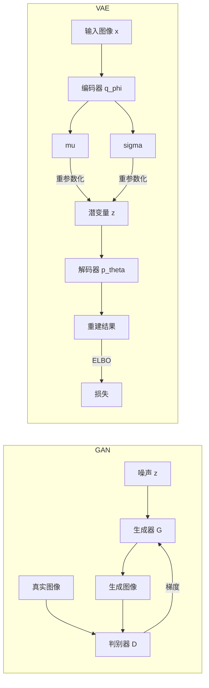

# GAN 与 VAE：深度生成式视觉的基础

> **英文原文：** [cv-knowledge-base/10_generative_vision/00_gans_and_vaes.md](../../cv-knowledge-base/10_generative_vision/00_gans_and_vaes.md)（本中文版供参考，内容以英文原文为准）

> **最后更新：** 2026年10月
> **难度级别：** 高级
> **相关章节：** [扩散模型](./01_diffusion_models.md) | [3D 生成](./03_3d_generation.md) | [评估与安全](./04_evaluation_and_safety.md) | [视频生成](./02_video_generation.md)

> **🆕 2026年10月更新：**
> - 新增一节，介绍 GAN 与 VAE 在 2024–2026 年的"余生"：现代 GAN 基线（R3GAN），以及对抗蒸馏 / 对抗后训练（ADD、LADD、Seaweed-APT）——这些方法如今已用于 Seedream 4.0 等生产级少步生成器。
> - 新增对"分词器复兴"（tokenizer renaissance）的介绍：高压缩率自编码器（DC-AE、Wan 2.2 VAE、开源的 FLUX.2 VAE）、表征对齐的潜空间（VA-VAE、REPA-E）与表征自编码器（Representation Autoencoders, RAE），以及像素空间的反向趋势（JiT）。
> - 相应扩充了关键论文、基准、开放问题与延伸阅读；并更正了"混合 GAN-扩散方法尚未在大规模上探索"这一过时说法。

---

## 概述

生成对抗网络（Generative Adversarial Networks, GAN）与变分自编码器（Variational Autoencoders, VAE）是扩散时代之前学习式生成建模的两大基础范式。二者在一年之内相继提出——VAE 由 [KingmaWelling2013] 提出，GAN 由 [Goodfellow2014] 提出——它们编码了根本不同的归纳偏置：VAE 将生成建立在贝叶斯推断与显式潜变量结构之上，而 GAN 则把生成表述为生成器与判别器之间的对抗博弈。二者共同推动了图像合成、压缩、视频预测和表征学习领域长达十年的进展。

GAN 框架通过训练生成器网络 $G$，使其生成的样本在判别器 $D$ 看来与真实数据无法区分，从而产生照片级逼真的输出。原始极小极大（minimax）目标的理论基础，加上 DCGAN [Radford2015]、渐进式增长（progressive growing）[KarrasLaine2018] 和基于风格的生成 [Karras2019] 等架构，到 2019 年已将 GAN 的输出从模糊的 64×64 数字提升到接近照片的 1024×1024 人脸。WGAN-GP [Gulrajani2017] 用 Wasserstein 距离取代 Jensen–Shannon 散度，并通过梯度惩罚施加 Lipschitz 约束，解决了灾难性的训练不稳定问题，实现了无模式崩溃（mode collapse）的稳定训练。BigGAN [Brock2019] 的规模化实验证明，借助精心设计的截断技巧（truncation trick），类别条件的 ImageNet 生成是可行的。条件图像到图像翻译（pix2pix [IsolaZhu2017]）和非配对域适应（CycleGAN [ZhuPark2017]）将 GAN 扩展到结构化视觉任务，产生了广泛的实际影响。

VAE 采用概率视角：编码器学习逼近真实后验 $q_\phi(\mathbf{z}|\mathbf{x})$，解码器学习 $p_\theta(\mathbf{x}|\mathbf{z})$。通过优化证据下界（Evidence Lower BOund, ELBO）对模型进行端到端（end-to-end）训练。关键在于，重参数化技巧（reparameterization trick）使随机采样节点可微。早期 VAE 的重建结果较为模糊（归因于 KL 约束下高斯分布的均值寻求行为），而 VQ-VAE 系列 [vanDenOord2017; Razavi2019] 用离散码本（codebook）取代连续瓶颈，实现了高保真重建，并天然适配自回归先验。VQGAN [Esser2021] 将 VQ-VAE 与图块判别器（patch discriminator）融合，提供了高质量的离散分词器，成为潜在扩散 / Stable Diffusion 系列的基础。

---

## GAN：极小极大目标

原始 GAN 博弈 [Goodfellow2014] 由以下极小极大价值函数定义：

```
V(D, G) = E_{x ~ p_data(x)} [log D(x)]
         + E_{z ~ p_z(z)} [log(1 - D(G(z)))]

判别器最大化 V(D, G)
生成器最小化 V(D, G)

最优判别器：D*(x) = p_data(x) / (p_data(x) + p_g(x))

在均衡点（p_g = p_data）：
  V(D*, G) = -log(4)
  C(G) = 2 * JSD(p_data || p_g) - log(4)
```

当 $p_g = p_{data}$ 时，该极小极大问题取得全局最小值，对应生成器完美捕获数据分布。实践中，非饱和（non-saturating）变体将生成器目标替换为最大化 $\log D(G(z))$，以避免训练初期的梯度消失。

---

## WGAN-GP 梯度惩罚

Wasserstein-1 距离能提供更稳定的梯度，但要求判别器（称为"评论家"，critic）满足 1-Lipschitz 条件。WGAN-GP 通过以下方式施加该约束：

```
L = E_{x~p_g}[D(x)] - E_{x~p_r}[D(x)]
  + lambda * E_{x~p_hat}[(||grad_x D(x)||_2 - 1)^2]

其中 x_hat = epsilon * x_real + (1 - epsilon) * x_fake,
      epsilon ~ U[0,1], lambda = 10（推荐值）

每个生成器步骤对应训练评论家 n_critic = 5 步。
```

该梯度惩罚取代了权重裁剪（weight clipping），并显著降低了对超参数的敏感性 [Gulrajani2017]。

---

## StyleGAN 架构家族

StyleGAN [Karras2019] 引入了**映射网络**（mapping network），将输入噪声 $z \in \mathcal{Z}$ 变换到中间潜空间 $w \in \mathcal{W}$，然后通过自适应实例归一化（AdaIN）注入到每个分辨率层级：

```
AdaIN(x_i, y) = y_{s,i} * (x_i - mu(x_i)) / sigma(x_i) + y_{b,i}

其中 y = (y_s, y_b) 是 w 的仿射变换，
      x_i 是第 i 个特征图的激活
```

StyleGAN2 [Karras2020] 用权重解调（weight demodulation）取代 AdaIN 以消除斑块伪影，并去掉渐进式增长，改用跳跃连接生成器 / 残差判别器架构。StyleGAN3 [Karras2021] 通过使用 sinc 滤波卷积强制实现对平移和旋转的连续等变性，解决了纹理粘连（texture sticking）问题——这对视频和动画应用十分重要。

---

## Pix2Pix 与 CycleGAN

pix2pix [IsolaZhu2017] 将条件图像到图像翻译形式化为一个使用配对数据集、PatchGAN 判别器和 L1 重建损失的 cGAN。PatchGAN 判别器对重叠的 70×70 图块而非整幅图像进行分类，从而鼓励高频细节的锐利度。CycleGAN [ZhuPark2017] 通过引入循环一致性损失将其扩展到非配对数据：

```
L_cyc(G, F) = E_{x~p(x)} [||F(G(x)) - x||_1]
             + E_{y~p(y)} [||G(F(y)) - y||_1]
```

其中 $G: X \to Y$ 和 $F: Y \to X$ 是两个生成器。该约束防止了模式崩溃，足以学习许多结构化映射（马→斑马、夏→冬、照片→绘画）。

---

## VAE：ELBO 推导

变分自编码器 [KingmaWelling2013] 最大化对数似然的下界：

```
log p(x) >= E_{q_phi(z|x)} [log p_theta(x|z)]
           - KL(q_phi(z|x) || p(z))
          = ELBO(x; phi, theta)

重参数化技巧：
  z = mu_phi(x) + sigma_phi(x) * epsilon,  epsilon ~ N(0, I)
  => 梯度经由 z 回传到 phi

KL 项（高斯先验、对角后验）：
  KL = -0.5 * sum_j (1 + log sigma_j^2 - mu_j^2 - sigma_j^2)
```

重建项促使解码器忠实地还原 $x$，而 KL 项将后验正则化到先验 $\mathcal{N}(0, I)$，确保潜空间插值平滑。

---

## VQ-VAE、VQ-VAE-2 与 VQGAN

向量量化 VAE（Vector-Quantized VAE）[vanDenOord2017] 用离散码本 $\{e_k\}_{k=1}^K$ 取代连续的高斯瓶颈：

```
z_q = e_k,   k = argmin_j ||z_e - e_j||_2

Loss = ||x - decoder(z_q)||^2
     + ||sg[z_e] - e_k||^2       （码本损失）
     + beta * ||z_e - sg[e_k]||^2  （承诺损失，beta=0.25）

直通梯度（straight-through）：partial L / partial z_e
  通过将 z_q 的梯度直接复制给 z_e 来近似。
```

VQ-VAE-2 [Razavi2019] 堆叠两级量化（对 256px 图像，底层 32×32，顶层 8×8），分别捕获局部与全局结构，然后在两个尺度上拟合 PixelSnail 自回归先验，取得了当时可与 BigGAN 竞争的 FID。

VQGAN [Esser2021] 在 VQ-VAE 训练中加入基于图块的判别器和感知损失，大幅提升了重建锐利度。由此得到的分词器将图像编码为 16×16 或 32×32 的离散图——这种表征后来被用作潜在扩散模型（Latent Diffusion Models）[Rombach2022] 中的"感知压缩"阶段。

---

## 为什么扩散模型超越了 GAN

到 2021–2022 年，扩散模型在大多数图像生成基准上超越了 GAN，这得益于若干结构性优势：

1. **训练稳定性**：没有对抗博弈；去噪目标是简单的 MSE/L2 回归，可随数据和算力可靠地扩展。
2. **模式覆盖**：GAN 存在模式崩溃问题——会丢失整个语义类别。扩散模型优化基于似然的目标，表现出更好的覆盖度。
3. **条件化灵活性**：无分类器引导（Classifier-free guidance）[Ho2022] 使模型无需重新训练判别器即可零样本地以任意文本为条件。GAN 则需要针对每种条件类型修改架构。
4. **多样性-保真度权衡**：引导尺度（guidance scale）这一旋钮可连续控制该权衡；GAN 则需要截断技巧，它会截去 $\mathcal{W}$ 的尾部。
5. **可扩展性**：DDPM→LDM→SDXL 展示了通过扩大模型规模和训练算力获得的持续质量提升，规律与 LLM 扩展相似。GAN 在非常大的规模下表现出训练不稳定。
6. **可编辑性**：DDIM 反演 [Song2021] 可对真实图像实现近乎精确的潜变量反演，从而支持精确的文本引导编辑。GAN 反演更困难，且在高分辨率下保真度较低。

GAN 在推理速度（单次前向传播 vs. 扩散模型的 20–1000 次函数评估 NFE）以及配对数据可支撑稳定判别器训练的结构化生成任务（医学图像合成、视频超分辨率）上仍有优势。源自 GAN 的组件——尤其是 VQGAN 分词器——仍是潜在扩散流程的核心。

---

## 2024–2026：GAN 与 VAE 在扩散时代的"余生"

尽管在 2025–2026 年的前沿系统中，GAN 和 VAE 都不再是主角生成器，但二者都作为**不可或缺的子组件**延续了下来：对抗损失成为蒸馏 / 后训练信号，而（KL 或 VQ）自编码器则是几乎所有扩散 / 流模型所依赖的潜空间分词器。

### 现代 GAN 基线：R3GAN

Huang 等人 [Huang2024R3GAN]（"The GAN is dead; long live the GAN!"，NeurIPS 2024）从第一性原理重新审视了 GAN 训练。他们推导出一个性质良好的**正则化相对论 GAN 损失**（RpGAN + 零中心梯度惩罚 R1 与 R2），具有局部收敛保证，从而不再需要自 DCGAN/StyleGAN 以来积累的大部分经验技巧。借助该损失，一个刻意保持简单的现代化 ResNet 风格骨干网络（分组卷积、倒置瓶颈、无归一化层）在 FFHQ、ImageNet、CIFAR-10 和 Stacked-MNIST 上可与 StyleGAN2 以及部分扩散基线相竞争，同时保持单步采样。

```
带零中心惩罚的相对论配对损失（R3GAN）：
  L_D = E_{x~p_d, z~p_z}[ f( D(G(z)) - D(x) ) ]
        + (gamma/2) * E_{x~p_d}[ ||grad_x D(x)||^2 ]      (R1)
        + (gamma/2) * E_{x~p_g}[ ||grad_x D(x)||^2 ]      (R2)
  L_G = E_{x~p_d, z~p_z}[ f( D(x) - D(G(z)) ) ]
  f(t) = softplus(t) = log(1 + e^t)
```

### 作为蒸馏与后训练信号的对抗损失

2024–2026 年判别器最重要的用途是**把多步扩散压缩为 1–4 步**：

- **ADD**（对抗扩散蒸馏，Adversarial Diffusion Distillation，即 SDXL-Turbo）[Sauer2023ADD] 将来自冻结教师模型的分数蒸馏损失与使用冻结 DINOv2 特征判别器的对抗损失相结合，实现 1–4 步的 SDXL 采样。
- **LADD** [Sauer2024LADD] 将判别器移入潜空间，以教师扩散模型自身的特征作为判别器骨干——这是 SD3-Turbo 的基础。
- **Seaweed-APT** [Lin2025APT]（"扩散对抗后训练"，Diffusion Adversarial Post-Training）在扩散预训练之后*针对真实数据*进行对抗训练，获得**单步**文本到视频以及 1024px 文本到图像生成。
- **生产应用**：字节跳动 Seedream 4.0 技术报告 [Seedream2025] 列出了对抗蒸馏，以及分布匹配、量化和推测解码（speculative decoding），从而实现每张 2K 图像约 1.4 秒的生成速度。DMD2 [Yin2024DMD2] 同样在分布匹配蒸馏中加入了 GAN 损失。完整的少步生成全景参见[扩散模型](./01_diffusion_models.md)。

### 分词器复兴

由于生成器的质量上限受制于自编码器的重建能力及其潜空间的*可学习性*，自编码器设计重新成为活跃的研究方向：

| 方向 | 代表性工作 | 思路 |
|-----------|--------------------|------|
| 高空间压缩率 | DC-AE [Chen2025DCAE]；Wan 2.2 VAE（16×16×4 时空压缩） | 借助残差"空间到通道"捷径实现 32–64× 空间下采样；为高分辨率图像/视频 DiT 减少 token 数 |
| 表征对齐的潜空间 | VA-VAE / LightningDiT [Yao2025VAVAE]；REPA-E [Leng2025REPAE] | 将 VAE 潜变量与冻结的视觉基础模型（Foundation Model，如 DINOv2）对齐，或将 VAE 与扩散模型端到端联合训练，从而化解高维潜空间中"重建 vs. 生成"的权衡 |
| 表征自编码器 | RAE [Zheng2025RAE] | 用*冻结的*预训练表征编码器（如 DINOv2、SigLIP）加一个训练得到的解码器取代 VAE 编码器；在这种语义潜空间中训练的 DiT 收敛更快，并取得优秀的 ImageNet FID |
| 开放、可复用的分词器 | FLUX.2 VAE（Apache-2.0）[BFL2025FLUX2] | 独立发布、采用宽松许可的自编码器，与（非商用的）生成器权重分开发布 |
| 无分词器的像素空间 | JiT [LiHe2025JiT] | 使用大图块的朴素 Transformer 直接在像素空间中预测干净图像（x 预测），质疑学习式分词器是否必不可少 |

其共同主题是：过去 VAE 中"重建保真度 vs. 平滑、易于建模的潜空间"之间的权衡，如今被显式地工程化处理，而不再仅仅交由 KL 权重 $\beta$ 决定。

---

## Mermaid：GAN 与 VAE 拓扑结构



---

## 关键论文

| 论文 | 作者 | 年份 | 会议/期刊 | 核心贡献 |
|-------|---------|------|-------|-----------------|
| Generative Adversarial Nets | Goodfellow et al. | 2014 | NeurIPS | 极小极大对抗框架；证明在 $p_g=p_{data}$ 处达到纳什均衡 |
| Unsupervised Representation Learning with DCGANs | Radford, Metz, Chintala | 2015 | arXiv/ICLR 2016 | 带 BN 的全卷积架构；稳定的大规模 GAN 训练 |
| Improved Training of WGANs | Gulrajani et al. | 2017 | NeurIPS | 梯度惩罚形式的 Lipschitz 约束；取代权重裁剪 |
| Large Scale GAN Training (BigGAN) | Brock et al. | 2019 | ICLR | 类别条件的 512px ImageNet 生成；截断技巧；正交正则化 |
| A Style-Based Generator Architecture (StyleGAN) | Karras et al. | 2019 | CVPR | 映射网络、AdaIN 注入、逐层噪声；FFHQ 上 FID 4.40 |
| Analyzing and Improving the Image Quality (StyleGAN2) | Karras et al. | 2020 | CVPR | 权重解调、路径长度正则化；消除伪影 |
| Alias-Free GAN (StyleGAN3) | Karras et al. | 2021 | NeurIPS | sinc 滤波卷积；平移/旋转等变性 |
| Image-to-Image Translation with cGANs (pix2pix) | Isola et al. | 2017 | CVPR | PatchGAN 判别器；用于配对翻译的 L1 + 对抗损失 |
| Unpaired Image-to-Image Translation (CycleGAN) | Zhu et al. | 2017 | ICCV | 循环一致性损失；无监督域迁移 |
| Auto-Encoding Variational Bayes | Kingma, Welling | 2013 | ICLR 2014 | VAE；ELBO；重参数化技巧 |
| Neural Discrete Representation Learning (VQ-VAE) | van den Oord et al. | 2017 | NeurIPS | 离散码本瓶颈；直通估计器 |
| Generating Diverse High-Fidelity Images (VQ-VAE-2) | Razavi et al. | 2019 | NeurIPS | 分层两级量化；PixelSnail 先验 |
| Taming Transformers (VQGAN) | Esser et al. | 2021 | CVPR | 在 VQ-VAE 上加入图块判别器 + 感知损失；为 Transformer 提供离散 token |
| Adversarial Diffusion Distillation (SDXL-Turbo) | Sauer et al. | 2023 | ECCV 2024 | 教师分数蒸馏 + DINOv2 特征判别器；1–4 步文本到图像 |
| The GAN is dead; long live the GAN! (R3GAN) | Huang et al. | 2024 | NeurIPS | 具有收敛保证的正则化相对论损失（RpGAN + R1 + R2）；无需技巧的现代 GAN 基线 |
| Fast High-Resolution Image Synthesis with LADD | Sauer et al. | 2024 | SIGGRAPH Asia | 以教师扩散模型特征为判别器的潜空间对抗蒸馏（SD3-Turbo） |
| Deep Compression Autoencoder (DC-AE) | Chen et al. | 2024 | ICLR 2025 | 32–128× 空间压缩自编码器，用于高效高分辨率潜在扩散 |
| Reconstruction vs. Generation (VA-VAE / LightningDiT) | Yao et al. | 2025 | CVPR | 与视觉基础模型对齐的 VAE 潜空间；化解高维潜空间的优化困境 |
| Diffusion Adversarial Post-Training (Seaweed-APT) | Lin et al. | 2025 | arXiv | 针对真实数据的对抗后训练，实现单步图像与视频生成 |
| Diffusion Transformers with Representation Autoencoders (RAE) | Zheng et al. | 2025 | arXiv | 以冻结表征编码器 + 训练所得解码器作为 DiT 的潜空间 |

---

## 基准性能

| 模型 | 数据集 | 指标 | 分数 | 备注 |
|-------|---------|--------|-------|-------|
| StyleGAN2 | FFHQ 1024px | FID | 2.84 | 截断 ψ=0.5 |
| StyleGAN3-T | FFHQ 1024px | FID | 2.79 | 平移等变 |
| BigGAN-deep | ImageNet 512px | FID | 3.24 | 截断阈值 0.5 |
| BigGAN-deep | ImageNet 128px | IS | 232.5 | 当时报告的最佳 IS |
| VQ-VAE-2 | ImageNet 256px | FID | 31.11 | 自回归先验 |
| VQGAN | ImageNet 256px | FID | 7.94 | Transformer 先验（GPT 风格） |
| CycleGAN | Horse→Zebra | AMT 欺骗率 | 25.5% | 人类感知评估 |
| DCGAN | CelebA 64px | FID | ~37 | 基线；不同现代实现结果有差异 |
| LightningDiT + VA-VAE | ImageNet 256px | FID | 1.35 | 在与基础模型对齐的 VAE 潜空间上做扩散 [Yao2025VAVAE]；表明分词器设计起主导作用 |

---

## 优缺点

| 方面 | 优点 | 缺点 |
|--------|------|------|
| **训练动态** | 单步推理速度快；工具链成熟 | 对抗训练不稳定；模式崩溃；对超参数敏感 |
| **样本质量（GAN）** | 细节锐利、高频丰富；1024px 以上人像达到当时最优水平 | 覆盖度问题；难以生成一致的 3D 结构（易产生幻觉） |
| **潜空间结构（VAE）** | 潜空间平滑、可解释；基于似然的训练稳定 | 标准 VAE 重建模糊；深层模型中存在后验崩溃 |
| **条件化** | pix2pix/CycleGAN 支持强空间条件 | 相比扩散模型中的 CFG，任意文本条件需要重新设计架构 |
| **计算成本** | 生成器只需一次前向传播；推理极快 | GAN 判别器使训练显存翻倍；VQ-VAE 分词器训练代价高 |
| **离散分词（VQ）** | 天然适配 Transformer 先验；将 $256^2$ 图像压缩为 $16^2$ 个 token | 码本崩溃；需调节承诺损失 |

---

## 开放问题与研究空白

- **GAN 的规模化**：尽管有 BigGAN，但在人脸/卧室之外的多样化数据集上，尚无 GAN 架构能在同等参数量下达到扩散模型的质量-多样性权衡。这究竟反映了归纳偏置还是数据课程的差异，仍是开放问题。
- **VAE 的锐利度**：在像素空间似然下 VAE 重建模糊的原因在理论上已被理解（均值寻求 vs. 模式寻求行为），但实际解决方案——感知损失、VQ 瓶颈、流式解码器——各自都引入了新的近似。
- **码本利用率**：VQ-VAE 码本经常出现崩溃（大量码字未被使用）。熵约束码本学习、EMA 更新和残差量化是活跃的研究方向。
- **混合 GAN-扩散**：对抗目标如今已在生产规模上用于少步蒸馏与后训练（ADD、LADD、DMD2、Seaweed-APT、Seedream 4.0）。仍然开放的是*理论*问题：对抗后训练何时能保持教师模型的多样性，何时又会悄然重新引入模式丢失；以及如何有原则地选择判别器特征空间（DINOv2、教师特征、视频编码器）。
- **分词器应当优化什么？**：VA-VAE、REPA-E 和 RAE 表明，潜空间的*可学习性*与重建 PSNR/rFID 同等重要，而 JiT 则提示有时可以完全去掉分词器。目前尚不存在一个能根据自编码器性质预测下游生成 FID 的统一准则。
- **反演质量**：GAN 反演（将真实图像投影到 $\mathcal{W}$ 或 $\mathcal{W+}$ 空间）在罕见人脸、复杂背景和配饰上仍有困难。没有任何反演方法能同时实现重建保真度与可编辑性。
- **生成中的等变性**：StyleGAN3 的等变性结果提示需要重新思考卷积作为生成器核心算子的地位。等变架构能否推广到视频、3D 和多模态场景仍是开放问题。
- **ELBO 紧致性的理论分析**：对于高维图像分布，VAE 中 ELBO 与真实对数似然之间的差距刻画不足；重要性加权下界能改进估计，但其对生成质量的实际影响尚未被充分理解。

---

## 延伸阅读

- [Goodfellow et al. (2014), "Generative Adversarial Nets," NeurIPS 2014](https://arxiv.org/abs/1406.2661)
- [Karras et al. (2020), "Analyzing and Improving the Image Quality of StyleGAN," CVPR 2020](https://arxiv.org/abs/1912.04958)
- [Kingma & Welling (2013), "Auto-Encoding Variational Bayes," ICLR 2014](https://arxiv.org/abs/1312.6114)
- [Esser et al. (2021), "Taming Transformers for High-Resolution Image Synthesis," CVPR 2021](https://arxiv.org/abs/2012.09841)
- [Rombach et al. (2022), "High-Resolution Image Synthesis with Latent Diffusion Models," CVPR 2022](https://arxiv.org/abs/2112.10752)
- [Bond-Taylor et al. (2021), "Deep Generative Modelling: A Comparative Review of VAEs, GANs, Normalizing Flows, Energy-Based and Autoregressive Models," TPAMI](https://arxiv.org/abs/2103.04922)
- [Huang et al. (2024), "The GAN is dead; long live the GAN! A Modern GAN Baseline," NeurIPS 2024](https://arxiv.org/abs/2501.05441)
- [Sauer et al. (2023), "Adversarial Diffusion Distillation"](https://arxiv.org/abs/2311.17042)
- [Lin et al. (2025), "Diffusion Adversarial Post-Training for One-Step Video Generation"](https://arxiv.org/abs/2501.08316)
- [Chen et al. (2024), "Deep Compression Autoencoder for Efficient High-Resolution Diffusion Models," ICLR 2025](https://arxiv.org/abs/2410.10733)
- [Yao et al. (2025), "Reconstruction vs. Generation: Taming Optimization Dilemma with Visual Foundation Model Aligned Latent Diffusion Models," CVPR 2025](https://arxiv.org/abs/2501.01423)
- [Zheng et al. (2025), "Diffusion Transformers with Representation Autoencoders"](https://arxiv.org/abs/2510.11690)
- [Li & He (2025), "Back to Basics: Let Denoising Generative Models Denoise"（JiT）](https://arxiv.org/abs/2511.13720)
