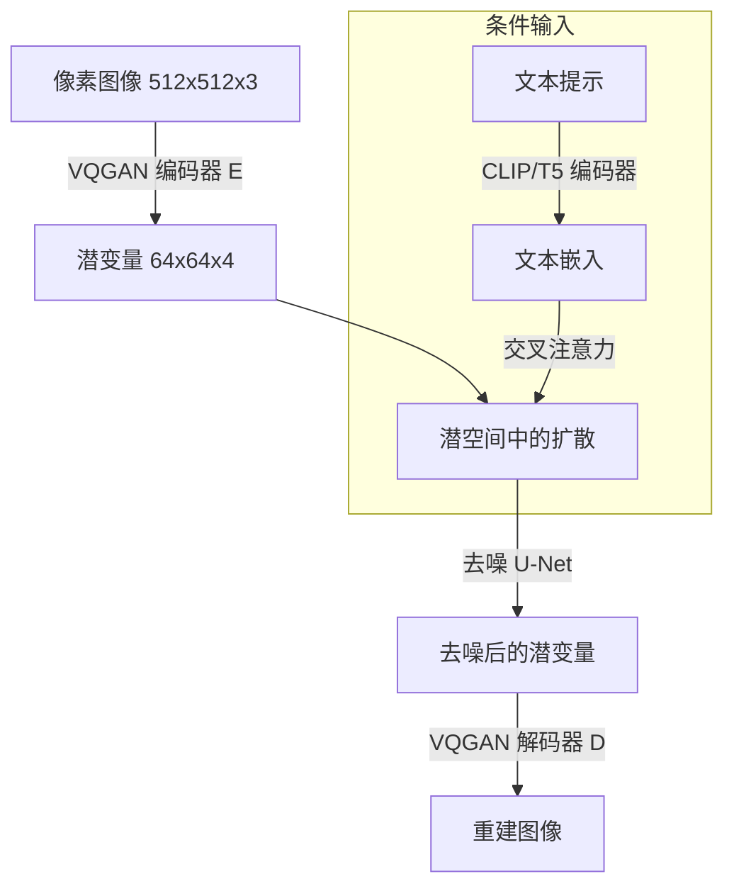

# 扩散模型：从 DDPM 到流匹配与 Stable Diffusion

> **英文原文：** [cv-knowledge-base/10_generative_vision/01_diffusion_models.md](../../cv-knowledge-base/10_generative_vision/01_diffusion_models.md)（本中文版供参考，内容以英文原文为准）

> **最后更新：** 2026年10月
> **难度级别：** 高级
> **相关章节：** [GAN 与 VAE](./00_gans_and_vaes.md) | [视频生成](./02_video_generation.md) | [评估与安全](./04_evaluation_and_safety.md) | [3D 生成](./03_3d_generation.md)

> **🆕 2026年10月更新：**
> - 新增一节，介绍 2025 年 8 月至 2026 年 9 月发布的前沿文本到图像 / 图像编辑系统：Nano Banana → Nano Banana Pro → Nano Banana 2（Google）、GPT Image 1.5 → GPT Image 2 → Images 2.5（OpenAI）、FLUX.2 / FLUX.2 [klein]（Black Forest Labs）、Qwen-Image、Seedream 4.0/5.0、HunyuanImage 3.0、Z-Image。
> - 新增一节介绍单步 / 少步生成（sCM、DMD2、捷径模型、MeanFlow、对抗后训练），并给出 MeanFlow 恒等式。
> - 新增一节介绍表征对齐训练与潜空间（REPA、VA-VAE、RAE、像素空间 JiT），以及流模型的强化学习后训练（Flow-GRPO、DanceGRPO）。
> - 更正了概述中关于"当前最先进水平"的说法；扩充了关键论文、基准、优缺点、开放问题与延伸阅读。

---

## 概述

扩散概率模型通过学习反转一个逐步用高斯噪声破坏数据的固定马尔可夫链来定义生成过程。Ho 等人 [Ho2020] 的奠基性工作将 [Sohl-Dickstein2015] 的分数匹配视角重新表述为一个易于处理的训练目标——对预测噪声的加权 MSE——并证明 DDPM 能够生成可与 GAN 竞争的图像，同时训练稳定、没有模式崩溃。短短两年内，扩散模型就成为图像、音频、视频和 3D 生成的主导范式。

从 DDPM 到现代系统的演进包含三次重大转变。第一，DDIM [Song2021] 表明，同一个训练好的 DDPM 模型可以仅用 20–50 步（而非 1000 步）进行确定性采样，使推理变得实用。第二，无分类器引导（Classifier-Free Guidance, CFG）[Ho2022] 通过联合训练条件模型与无条件模型并在推理时组合二者的分数估计，实现了高质量的文本条件生成。第三，潜在扩散模型（Latent Diffusion Model, LDM）框架 [Rombach2022] 将扩散过程移入预训练 VQGAN 分词器的潜空间，在保持感知质量的同时将像素空间计算量降低约 4–16 倍。最后这一步催生了 Stable Diffusion——首个开源的十亿参数级文本到图像模型——并带动了一系列微调方法（LoRA、DreamBooth、ControlNet）的生态，使生成式图像创作走向大众。

最近一波浪潮（2023–2025）用**流匹配**（flow matching）[Lipman2022; Liu2022] 取代分数匹配 / DDPM 框架：它在噪声与数据之间定义一条直线 ODE 而非弯曲的扩散路径，从而实现更快的采样和更好的扩展性。Stable Diffusion 3 [Esser2024] 和 FLUX.1 [BlackForest2024] 在多模态扩散 Transformer（MM-DiT）骨干上采用整流流（rectified flow）匹配，确立了 2024 年开源文本到图像生成的最先进水平。

从 2025 年中到 2026 年末，前沿又沿四个方向推进：(i) **以 VLM/LLM 为条件的生成器**——由大型视觉-语言模型取代 CLIP/T5 作为文本（及参考图像）编码器：Qwen-Image [QwenImage2025] 使用 Qwen2.5-VL，FLUX.2 [BFL2025FLUX2] 将 Mistral-3 24B VLM 与 32B 整流流 Transformer 相结合；(ii) 在单一模型中**统一生成 + 编辑 + 多参考图合成**（Nano Banana、Seedream 4.0、FLUX.2、GPT Image）；(iii) **"思考式"与联网检索增强的生成**——由推理模型在渲染前先规划布局、文字和事实（Nano Banana Pro、GPT Image 2 思考模式、FLUX.2 [max]、Seedream 5.0）；以及 (iv) 借助一致性 / 平均流目标和对抗蒸馏实现的**少步采样**，使 1–8 步生成成为已部署系统的标准配置。

---

## 前向与反向过程（DDPM）

前向过程在 $T$ 步（通常 $T=1000$）内逐步添加高斯噪声：

```
q(x_t | x_{t-1}) = N(x_t; sqrt(1 - beta_t) * x_{t-1}, beta_t * I)

闭式边缘分布（重参数化形式）：
  q(x_t | x_0) = N(x_t; sqrt(alpha_bar_t) * x_0, (1 - alpha_bar_t) * I)

其中：
  alpha_t = 1 - beta_t
  alpha_bar_t = prod_{s=1}^{t} alpha_s

采样捷径：
  x_t = sqrt(alpha_bar_t) * x_0 + sqrt(1 - alpha_bar_t) * epsilon,
  epsilon ~ N(0, I)
```

[Ho2020] 的简化训练目标（由 ELBO 去掉加权项推导而来）为：

```
L_simple = E_{t, x_0, epsilon} [|| epsilon - epsilon_theta(x_t, t) ||^2]

其中：
  t ~ U{1, ..., T}
  x_0 ~ q(x_0)
  epsilon ~ N(0, I)
  x_t = sqrt(alpha_bar_t) * x_0 + sqrt(1 - alpha_bar_t) * epsilon
```

推理时，学到的反向过程为：

```
p_theta(x_{t-1} | x_t) = N(x_{t-1}; mu_theta(x_t, t), sigma_t^2 * I)

mu_theta(x_t, t) = (1 / sqrt(alpha_t)) *
                   (x_t - (beta_t / sqrt(1 - alpha_bar_t)) * epsilon_theta(x_t, t))
```

---

## DDIM：确定性采样

Song 等人 [Song2021] 推导出前向过程的一种非马尔可夫推广，它与 DDPM 具有相同的边缘分布，但允许确定性的反向 ODE：

```
x_{t-1} = sqrt(alpha_bar_{t-1}) *
           ( (x_t - sqrt(1 - alpha_bar_t) * epsilon_theta(x_t, t))
             / sqrt(alpha_bar_t) )
         + sqrt(1 - alpha_bar_{t-1} - sigma_t^2) * epsilon_theta(x_t, t)
         + sigma_t * epsilon_t

sigma_t = 0（DDIM）：完全确定性，支持反演。
sigma_t = sqrt(beta_t)：退化为 DDPM。

关键结果：50 步 DDIM 可达到与 1000 步 DDPM 相当的 FID。
DDIM 反演：运行前向 ODE 由 x_0 得到 x_T（对真实图像近乎无损）。
```

---

## 无分类器引导

[Ho2022] 提出训练一个同时具备条件（$\epsilon_\theta(x_t, c)$）与无条件（$\epsilon_\theta(x_t, \emptyset)$）能力的单一模型，方法是以概率 $p_{uncond}$（通常为 0.1–0.2）随机丢弃条件 $c$。推理时：

```
epsilon_hat(x_t, c) = epsilon_theta(x_t, null)
                     + w * (epsilon_theta(x_t, c) - epsilon_theta(x_t, null))

其中 w = 引导尺度（SD1.5 通常为 7.5，SDXL 为 3.5-5.0）

w = 0：无条件样本
w = 1：标准条件样本
w > 1：高保真、低多样性的"锐化"样本
```

CFG 成为文本到图像对齐的通用机制。它实际上实现了一种无需单独分类器的隐式分类器引导，其引导尺度是所有已部署文本到图像系统中调节质量-多样性的主要旋钮。

---

## 潜在扩散模型（Stable Diffusion）

[Rombach2022] 将感知压缩与扩散学习解耦：



潜空间将 $512 \times 512 \times 3$ 的图像压缩为 $64 \times 64 \times 4$ 的特征（空间下采样 8 倍，并带有较小的 KL 正则惩罚或 VQ）。扩散 U-Net 在这些潜变量上运行，通过交叉注意力在多个分辨率层级注入文本条件。其结果是训练与推理的计算成本仅为像素空间的 1/64，而解码后仍保持完整的感知质量。

**Stable Diffusion 1.5**（Runway / CompVis，2022）：860M 参数 U-Net，CLIP ViT-L/14 文本编码器，在 LAION-5B 上训练。

**SDXL**（Stability AI，2023）：3.5B 参数双流 U-Net，双文本编码器（CLIP ViT-L 与 OpenCLIP ViT-bigG），原生 1024px 分辨率，带精修器（refiner）的两阶段流程。

**Stable Diffusion 3**（Esser 等，2024）：用多模态扩散 Transformer（MM-DiT）取代 U-Net；采用流匹配而非 DDPM；16 通道潜空间；参数规模从 800M 到 8B。

---

## ControlNet

Zhang 与 Agrawala [Zhang2023] 提出 ControlNet，通过复制编码器模块并以零初始化的 1×1 卷积连接，为冻结的扩散 U-Net 添加空间条件（边缘、深度图、姿态、分割掩码）：

```
c_f = trainable_conv_zero(c_raw)      # 零初始化 -> 训练开始时不产生作用
y = frozen_unet(x) + c_f             # 加性注入

训练：冻结原始 U-Net 权重，只训练复制出的编码器。
支持的条件：Canny 边缘、HED、深度、法线、姿态（OpenPose）、
  分割（ADE20K）、线稿、涂鸦、参考图像。
```

零初始化保证 ControlNet 起初等同于恒等映射，只会逐步学会引导生成，从而避免梯度爆炸。ControlNet 实现了单靠 CFG 无法提供的精确空间布局控制。

---

## DreamBooth 与 LoRA

**DreamBooth** [Ruiz2023] 对整个扩散 U-Net 进行微调，使一个罕见的文本 token 与特定主体概念相关联，并使用先验保持损失（prior-preservation loss）防止语言漂移：

```
L = E[||epsilon - epsilon_theta(x_t, f("a [V] dog"))||^2]
  + lambda * E[||epsilon - epsilon_theta(x'^_t, f("a dog"))||^2]

其中 [V] 是罕见标识符 token（如 "sks"），
      x = 主体图像（约 3-25 张照片），
      x' = 由原始模型生成的类别图像。
```

**LoRA**（低秩适配，Low-Rank Adaptation）[Hu2022] 向权重矩阵注入可训练的低秩分解，无需存储完整的微调权重：

```
W' = W_0 + delta_W = W_0 + B * A,
  B in R^{d x r}, A in R^{r x k}, 秩 r << min(d, k)

典型取值：r = 4-64，可训练参数减少 100-10000 倍。
LoRA + 扩散：应用于交叉注意力的 Q、K、V、Out 投影。
文件大小：约 4-144MB，而完整模型约 4GB。
```

---

## 流匹配（FLUX.1 与 SD3）

流匹配 [Lipman2022; Liu2022] 定义了一个从噪声 $p_0 = \mathcal{N}(0,I)$ 到数据 $p_1 = p_{data}$ 的条件 ODE，其路径为直线，得到比 DDPM 更简单的损失：

```
条件流匹配（Conditional Flow Matching, CFM）损失：
  L_CFM = E_{t, x_0, x_1} [|| v_theta(x_t, t) - (x_1 - x_0) ||^2]

其中：
  x_t = t * x_1 + (1 - t) * x_0,   t ~ U[0, 1]
  x_0 ~ N(0, I),  x_1 ~ p_data

推理 ODE：
  dx = v_theta(x, t) dt
  用 Euler / Heun / DPM-Solver 求解，最少只需 4-8 次函数评估。
```

与 DDPM 那种向低噪声步骤倾斜的二次加权相比，流匹配在各噪声水平上的损失加权更均匀，直线路径也降低了 ODE 求解器的截断误差。**FLUX.1** [BlackForestLabs2024] 在此基础上采用双流 MM-DiT 架构（文本 token 与图像 token 各自拥有独立的 Transformer 流，并通过注意力交互），在文本忠实度与照片级真实感上达到了最先进水平。

---

## DPM-Solver

DPM-Solver [Lu2022] 针对扩散模型 ODE 的半线性结构设计了高阶 ODE 求解器，相较朴素 Euler 采样实现 10–20 倍加速：

```
半线性 ODE：
  dx = [f(t)*x - g^2(t)*score(x,t)/2] dt

DPM-Solver-2 更新（二阶）：
  x_{t-h} = (alpha_{t-h}/alpha_t) * x_t
           - sigma_{t-h} * (e^h - 1) * D_theta(x_t, t)
           + sigma_{t-h} * (e^h - 1 - h) * (D1_theta) / h

典型情况：DPM-Solver++ 用 10-20 步即可达到与
         1000 步 DDPM 相当的质量。
```

---

## 前沿文本到图像与编辑系统（2025–2026）

| 模型 | 机构 | 发布时间 | 权重 | 备注 |
|-------|-------------|----------|---------|-------|
| GPT Image 1 | OpenAI | 2025 年 4 月（API） | 闭源 | GPT-4o 家族的原生图像生成（2025 年 3 月上线 ChatGPT）；指令遵循与文字渲染能力强 |
| Qwen-Image | 阿里巴巴 Qwen | 2025 年 8 月 | 开源（Apache-2.0） | 以 Qwen2.5-VL 为条件的 20B MMDiT；中英文文字渲染能力领先；有 Qwen-Image-Edit 系列变体 [QwenImage2025] |
| Gemini 2.5 Flash Image（"Nano Banana"） | Google DeepMind | 2025 年 8 月 | 闭源 | 对话式多轮编辑、多图融合、角色一致性 |
| Seedream 4.0 | 字节跳动 Seed | 2025 年 9 月 | 闭源 | 统一的文生图 + 编辑 + 多图合成；高压缩 VAE + DiT；原生 1K–4K；经对抗蒸馏、量化与推测解码后每张 2K 图像约 1.4 秒 [Seedream2025] |
| HunyuanImage 3.0 | 腾讯 | 2025 年 9 月 | 开源 | 原生多模态自回归 MoE（总参数约 80B，激活约 13B），统一理解与生成 |
| Gemini 3 Pro Image（"Nano Banana Pro"） | Google DeepMind | 2025 年 11 月 20 日 | 闭源 | 基于 Gemini 3 Pro 的推理能力；最高 4K 输出；可融合多达 14 张参考图；所有输出均带 SynthID |
| FLUX.2 [pro/flex/dev] | Black Forest Labs | 2025 年 11 月 | [dev] 开放权重（非商用） | 32B 整流流 Transformer + Mistral-3 24B VLM；最多 10 张参考图；4MP 编辑；VAE 采用 Apache-2.0 [BFL2025FLUX2] |
| Z-Image（Turbo） | 阿里巴巴通义 Tongyi-MAI | 2025 年 11 月 | 开源 | 6B 单流 DiT；蒸馏版 Turbo 面向消费级 GPU 上约 8 步采样 |
| GPT Image 1.5 | OpenAI | 2025 年 12 月 | 闭源 | 新的 ChatGPT Images 模型；速度约提升 4 倍，局部编辑更忠实，可渲染更密集的文字 |
| FLUX.2 [klein] 4B / 9B | Black Forest Labs | 2026 年初 | 4B 为 Apache-2.0；9B 为非商用 | 蒸馏模型，在消费级 GPU 上实现亚秒级生成与编辑 |
| Gemini 3.1 Flash Image（"Nano Banana 2"） | Google DeepMind | 2026 年 2 月 26 日 | 闭源 | 以 Flash 速度达到 Pro 级质量；512px–4K；联网的世界知识；图中文字翻译；SynthID + C2PA |
| Seedream 5.0 Lite | 字节跳动 | 2026 年 2 月（据报道） | 闭源 | 据报道是首个在渲染前进行推理、并可基于实时网络搜索进行生成的 Seedream 模型 |
| GPT Image 2（"ChatGPT Images 2.0"） | OpenAI | 2026 年 4 月 21 日 | 闭源 | "带思考的图像"模式（生成前先规划/完善）；最高 2K；多语言文字；图表/信息图；发布时位列 Image Arena 第一（厂商自报） |
| Nano Banana 2 Lite | Google DeepMind | 2026 年 6 月 30 日 | 闭源 | Gemini 系列中最快、最便宜的图像模型（gemini-3.1-flash-lite-image） |
| GPT Image 2.5（"ChatGPT Images 2.5"） | OpenAI | 2026 年 9 月 8 日 | 闭源 | 两个 API 档位（GPT-Image-2.5 Sunburst / Flare） |

从上表可以得出三点结构性观察。**第一**，闭源前沿日益转向*自回归或混合*架构（GPT Image 系列、HunyuanImage 3.0、Gemini 图像模型均由多模态 LLM 生成，解码器细节未公开），而开源前沿仍以 VLM 为条件的*流匹配 DiT* 为主。**第二**，文字渲染——直到 2024 年仍是典型的失败模式——对于拉丁文字和中日韩文字的短、中等长度文本已基本解决；评估重点已转向高密度信息图、多语言版式与事实正确性。**第三**，推理与检索被插入到生成器*之前*，使提示遵循与事实依据在一定程度上变成了 LLM 问题，而非扩散问题。

---

## 单步与少步生成

推理成本曾是扩散模型最主要的实际弱点。到 2025–2026 年，蒸馏与新的训练目标已将高质量采样降至 1–4 次网络评估（NFE）：

| 类别 | 代表方法 | 机制 |
|--------|------------------------|-----------|
| 一致性模型（Consistency models） | CM、LCM、**sCM** [LuSong2025sCM]、rCM | 学习沿每条 PF-ODE 轨迹保持一致的 $f_\theta(x_t,t)\approx x_0$；sCM 通过 TrigFlow 参数化稳定了连续时间训练，并扩展到 1.5B 参数 |
| 分布匹配（Distribution matching） | DMD、**DMD2** [Yin2024DMD2] | 通过两个分数函数之差使学生模型的输出分布匹配教师模型，并加入 GAN 损失 |
| 对抗蒸馏 | ADD、LADD、Seaweed-APT | 在 DINOv2 / 教师 / 真实数据特征上使用判别器（参见 [GAN 与 VAE](./00_gans_and_vaes.md)） |
| 流映射 / 捷径模型（Flow-map / shortcut） | 捷径模型 [Frans2025]、**MeanFlow** [Geng2025MeanFlow]、IMM | 学习两个时刻 $(r,t)$ 之间的*跳跃*而非瞬时速度，从而可从零训练并实现单步采样 |

**MeanFlow** [Geng2025MeanFlow] 是最简洁的例子。采用插值 $z_t=(1-t)\,x+t\,\epsilon$（因此 $t=1$ 对应噪声），它建模的是区间上的*平均*速度而非瞬时速度：

```
平均速度：
  u(z_t, r, t) = (1 / (t - r)) * integral_r^t v(z_tau, tau) d tau

MeanFlow 恒等式（对 (t - r) * u 关于 t 求导）：
  u(z_t, r, t) = v(z_t, t) - (t - r) * d/dt u(z_t, r, t)
  d/dt u = v(z_t, t) * partial_z u + partial_t u      （一次雅可比-向量积）

训练目标（停止梯度）：
  u_tgt = v_t - (t - r) * (v_t * partial_z u_theta + partial_t u_theta)
  L = E || u_theta(z_t, r, t) - sg(u_tgt) ||^2,  其中 v_t = epsilon - x

单步采样：
  x = z_1 - u_theta(z_1, r=0, t=1),   z_1 ~ N(0, I)
```

MeanFlow 报告在 ImageNet 256×256 上从零训练、不经蒸馏即可达到 1-NFE FID 3.43；sCM 报告在 ImageNet 512×512 上 2 步 FID 为 1.88。在生产中，Seedream 4.0、Z-Image-Turbo 和 FLUX.2 [klein] 都提供了蒸馏后的少步版本，NVIDIA 的 rCM 则将连续时间一致性蒸馏扩展到 10B 以上规模的文本到图像与文本到视频教师模型。

---

## 表征对齐、潜空间与强化学习后训练

**表征对齐。** REPA [Yu2025REPA] 增加一个辅助损失，将 DiT/SiT 的中间隐藏状态与干净图像的冻结 DINOv2 特征对齐，使训练加速一个数量级以上，并在 ImageNet 256 上（使用引导）达到 FID 1.42。VA-VAE [Yao2025VAVAE] 则是将*分词器*的潜空间与基础模型对齐（LightningDiT：FID 1.35），RAE [Zheng2025RAE] 直接以冻结的表征编码器作为潜空间。JiT [LiHe2025JiT] 走的是相反方向——在像素空间中用 x 预测训练使用大图块的朴素 Transformer——表明预测干净图像（而非噪声或速度）能使高维像素扩散保持良态。

```
REPA 辅助损失：
  L = L_FM + lambda * E[ - (1/N) * sum_n sim( y_n , h_phi(h_t^{[n]}) ) ]
  y_n      = 干净图像 x_0 第 n 个图块的冻结 DINOv2 特征
  h_t^{[n]} = 噪声水平 t 下 DiT 中第 n 个图块的隐藏状态（浅层）
  h_phi    = 小型可训练 MLP 投影头；sim = 余弦相似度
```

**流模型的强化学习后训练。** 借鉴 LLM 中的 RLHF，Flow-GRPO [Liu2025FlowGRPO] 与 DanceGRPO 将确定性的流 ODE 转换为等价的 SDE，使每一步的对数概率得以定义，然后用组相对策略优化（Group Relative Policy Optimization, GRPO）配合各类奖励（如 GenEval 风格的检测器、OCR 准确率或人类偏好模型）进行训练。Flow-GRPO 将 SD3.5-Medium 的 GenEval 分数从 0.63 提升到 0.95，既说明了强化学习后训练的威力，也说明了组合式基准已多么接近饱和（参见[评估与安全](./04_evaluation_and_safety.md)）。

---

## 关键论文

| 论文 | 作者 | 年份 | 会议/期刊 | 核心贡献 |
|-------|---------|------|-------|-----------------|
| Denoising Diffusion Probabilistic Models (DDPM) | Ho et al. | 2020 | NeurIPS | 简化的噪声预测损失；余弦调度；CIFAR-10 上 FID 3.17 |
| Denoising Diffusion Implicit Models (DDIM) | Song et al. | 2021 | ICLR | 确定性非马尔可夫采样；50 步推理；无损反演 |
| Diffusion Models Beat GANs on Image Synthesis | Dhariwal & Nichol | 2021 | NeurIPS | 分类器引导；U-Net 改进；ImageNet 256px 上 FID 3.94 |
| Classifier-Free Diffusion Guidance | Ho & Salimans | 2022 | NeurIPS Workshop | CFG；条件/无条件联合训练；引导尺度 |
| High-Resolution Image Synthesis with LDMs | Rombach et al. | 2022 | CVPR | 潜在扩散；交叉注意力条件化；Stable Diffusion |
| Adding Conditional Control (ControlNet) | Zhang & Agrawala | 2023 | ICCV | 通过零初始化复制编码器实现空间条件；可插拔控制 |
| DreamBooth | Ruiz et al. | 2023 | CVPR | 少样本主体定制微调；先验保持损失 |
| LoRA | Hu et al. | 2022 | ICLR | 低秩权重适配；参数量减少 100–10000 倍 |
| Flow Matching for Generative Modeling | Lipman et al. | 2022 | ICLR 2023 | CFM 损失；直线 ODE 路径；快速采样 |
| Scaling Rectified Flow (SD3) | Esser et al. | 2024 | ICML | MM-DiT + 流匹配；800M–8B 参数；多宽高比训练 |
| DPM-Solver | Lu et al. | 2022 | NeurIPS | 面向 DDPM 的高阶 ODE 求解器；10 步生成 |
| SDXL | Podell et al. | 2023 | ICLR 2024 | 3.5B 双 U-Net；1024px；两阶段精修器；CLIP+OpenCLIP |
| Improved Distribution Matching Distillation (DMD2) | Yin et al. | 2024 | NeurIPS | 双时间尺度 DMD + GAN 损失；少步 SDXL；ImageNet-64 FID 1.28 |
| Simplifying, Stabilizing and Scaling Continuous-Time Consistency Models (sCM) | Lu & Song | 2024 | ICLR 2025 | TrigFlow；稳定的连续时间一致性模型，扩展到 1.5B 参数；ImageNet-512 上 2 步 FID 1.88 |
| Representation Alignment for Generation (REPA) | Yu et al. | 2024 | ICLR 2025 | 将 DiT 隐藏状态与 DINOv2 对齐；训练加速超过 17 倍 |
| Mean Flows for One-step Generative Modeling (MeanFlow) | Geng et al. | 2025 | NeurIPS | 平均速度场 + MeanFlow 恒等式；从零训练在 ImageNet 256 上 1-NFE FID 3.43 |
| Flow-GRPO | Liu et al. | 2025 | NeurIPS | 通过 ODE→SDE 转换对流匹配模型进行在线强化学习（GRPO） |
| Qwen-Image Technical Report | Qwen Team | 2025 | arXiv | 20B MMDiT；Qwen2.5-VL 条件化；面向复杂文字渲染的课程学习；统一编辑 |
| Seedream 4.0 | ByteDance Seed | 2025 | arXiv | 统一文生图/编辑/多图；高效 DiT + 高压缩 VAE；1K–4K；对抗蒸馏 |
| Back to Basics: Let Denoising Generative Models Denoise (JiT) | Li & He | 2025 | arXiv | 在像素空间中用朴素大图块 Transformer 进行 x 预测 |

---

## 基准性能

| 模型 | 数据集 | 指标 | 分数 | 备注 |
|-------|---------|--------|-------|-------|
| DDPM | CIFAR-10 | FID | 3.17 | 1000 NFE；无条件 |
| DDIM | CIFAR-10 | FID | 3.24 | 50 NFE；确定性 |
| ADM-G (Dhariwal) | ImageNet 256px | FID | 3.94 | 分类器引导 |
| LDM-8 | ImageNet 256px | FID | 7.76 | 潜在扩散，8× 压缩 |
| SD 1.5 | MS-COCO 30K | FID | ~14 | CLIP ViT-L；开放权重 |
| SDXL | MS-COCO 30K | FID | ~11 | 原生 1024px；精修器 |
| DALL-E 3 | GenEval overall | 准确率 | 0.67 | 组合式生成基准 |
| FLUX.1-dev | GenEval overall | 准确率 | 0.66 | 流匹配；开放权重 |
| SD3-Medium | T2I-CompBench overall | 分数 | 未公开报告 | 8 通道潜空间；MM-DiT |
| FLUX.1-schnell | MS-COCO 30K | FID | ~8.5 | 4 步蒸馏模型 |
| SiT-XL/2 + REPA | ImageNet 256px | FID | 1.42 | 使用 CFG；表征对齐 |
| LightningDiT + VA-VAE | ImageNet 256px | FID | 1.35 | 与基础模型对齐的潜空间 |
| MeanFlow-XL/2 | ImageNet 256px | FID（1 NFE） | 3.43 | 单步，从零训练 |
| sCM (XXL) | ImageNet 512px | FID（2 NFE） | 1.88 | 连续时间一致性模型 |
| SD3.5-M + Flow-GRPO | GenEval overall | 准确率 | 0.95 | 强化学习后训练（基线 0.63）；表明基准趋于饱和 |
| GPT Image 2 | Image Arena (LMArena) | 排名 | 发布时第一 | 2026 年 4 月；厂商自报的人类偏好排名 |

---

## 优缺点

| 方面 | 优点 | 缺点 |
|--------|------|------|
| **训练稳定性** | 简单的 MSE 损失；无对抗不稳定；随数据/算力平稳扩展 | 训练非常慢（每个梯度涉及 1000+ 去噪步）；需要大规模数据集 |
| **样本质量与多样性** | FID、IS、人类偏好均达最优；完整覆盖训练分布 | 无分类器引导以多样性换保真度；高引导样本显得"过度打磨" |
| **推理速度** | DDIM/DPM-Solver 实现 10–50 NFE；蒸馏（LCM、SDXL-Turbo、DMD2、sCM）与 MeanFlow 类目标实现 1–4 步；亚秒级的 4B–6B 开源模型（FLUX.2 [klein]、Z-Image-Turbo） | 少步学生模型会损失部分多样性；生成前新增的推理/"思考"阶段又重新引入了数秒延迟 |
| **条件化灵活性** | CFG 对任意文本/类别零样本可用；ControlNet 无需重新训练即可增加空间控制 | 复杂的多概念组合仍具挑战；属性绑定错误常见 |
| **生态与微调** | 庞大的开源生态（LoRA、DreamBooth、ControlNet、IP-Adapter）；Hugging Face Diffusers | 微调可能导致灾难性遗忘；LoRA 合并可能降低基础模型质量 |

---

## 开放问题与研究空白

- **推理效率**：差距已大幅缩小（sCM 在 ImageNet 512 上 2 步 FID 1.88；MeanFlow 从零训练 1-NFE FID 3.43），但单步模型在多样性以及文字密集、高分辨率提示上仍落后于多步教师模型；关于流映射目标何时能匹敌多步质量，尚缺乏理论解释。
- **以推理为条件的生成**：前沿系统（Nano Banana Pro/2、GPT Image 2、FLUX.2 [max]、Seedream 5.0）在渲染之前插入了 LLM 规划或网络检索阶段。如何联合训练生成器与规划器、如何评估生成信息图的事实正确性、以及如何将错误归因于规划器还是渲染器，仍是开放问题。
- **一致的多轮编辑**：统一的生成-编辑模型在多轮编辑中仍会出现身份漂移、色彩偏移与分辨率损失；对 10 张以上参考输入的保真度尚无可靠的度量。
- **组合式生成**：文本到图像模型在计数、精确空间关系（左/右）和多主体属性绑定上仍会失败——而这些对人类而言轻而易举。T2I-CompBench 分数停滞在远低于人类水平的位置。
- **视频一致性**：将扩散扩展到视频（时间连贯性、相机运动、物理）需要超越逐帧生成的架构创新；参见[视频生成](./02_video_generation.md)。
- **训练数据效率**：最先进模型需要 LAION 规模（数十亿图像）的预训练。少样本微调（3 张图像的 DreamBooth）可行但泛化较差；数据高效的预训练尚未被充分探索。
- **反演忠实度**：DDIM 反演仅在空文本情形下近乎精确；通过反演进行真实的文本引导编辑会引入语义漂移。Null-text inversion [Mokady2022] 及其后续工作部分解决了这一问题，但仍很脆弱。
- **流匹配 vs. 分数匹配**：特定参数化下二者的理论等价性已被确立，但流匹配的经验优势（更少的 NFE、更好的扩展性）尚缺乏完整的理论解释；ODE 路径、调度与损失加权的设计空间仍在积极探索中。
- **记忆化与隐私**：扩散模型会以可测量的比率记忆训练样本，引发版权与隐私担忧。在不损害生成质量的前提下缓解记忆化是一个活跃的开放问题；参见[评估与安全](./04_evaluation_and_safety.md)。

---

## 延伸阅读

- [Ho et al. (2020), "Denoising Diffusion Probabilistic Models," NeurIPS 2020](https://arxiv.org/abs/2006.11239)
- [Song et al. (2021), "Denoising Diffusion Implicit Models," ICLR 2021](https://arxiv.org/abs/2010.02502)
- [Rombach et al. (2022), "High-Resolution Image Synthesis with Latent Diffusion Models," CVPR 2022](https://arxiv.org/abs/2112.10752)
- [Ho & Salimans (2022), "Classifier-Free Diffusion Guidance," NeurIPS 2022 Workshop](https://arxiv.org/abs/2207.12598)
- [Lipman et al. (2022), "Flow Matching for Generative Modeling," ICLR 2023](https://arxiv.org/abs/2210.02747)
- [Esser et al. (2024), "Scaling Rectified Flow Transformers for High-Resolution Image Synthesis," ICML 2024](https://arxiv.org/abs/2403.03206)
- [Qwen Team (2025), "Qwen-Image Technical Report"](https://arxiv.org/abs/2508.02324)
- [ByteDance Seed (2025), "Seedream 4.0: Toward Next-generation Multimodal Image Generation"](https://arxiv.org/abs/2509.20427)
- [Black Forest Labs (2025), "FLUX.2: Frontier Visual Intelligence"](https://bfl.ai/blog/flux-2) 以及 [FLUX.2 官方推理代码库](https://github.com/black-forest-labs/flux2)
- [Black Forest Labs (2026), "FLUX.2 [klein]: Towards Interactive Visual Intelligence"](https://bfl.ai/blog/flux2-klein-towards-interactive-visual-intelligence)
- [Google (2025), "Introducing Gemini 2.5 Flash Image"](https://developers.googleblog.com/en/introducing-gemini-2-5-flash-image/)、[Nano Banana Pro](https://blog.google/innovation-and-ai/products/nano-banana-pro/) 以及 [Nano Banana 2（2026）](https://blog.google/innovation-and-ai/technology/ai/nano-banana-2/)
- [OpenAI (2026), "Introducing ChatGPT Images 2.0"](https://openai.com/index/introducing-chatgpt-images-2-0/) 以及 ["Introducing ChatGPT Images 2.5"](https://openai.com/index/introducing-chatgpt-images-2-5/)
- [Geng et al. (2025), "Mean Flows for One-step Generative Modeling"](https://arxiv.org/abs/2505.13447)
- [Lu & Song (2024), "Simplifying, Stabilizing and Scaling Continuous-Time Consistency Models," ICLR 2025](https://arxiv.org/abs/2410.11081)
- [Yin et al. (2024), "Improved Distribution Matching Distillation for Fast Image Synthesis," NeurIPS 2024](https://arxiv.org/abs/2405.14867)
- [Yu et al. (2024), "Representation Alignment for Generation: Training Diffusion Transformers Is Easier Than You Think," ICLR 2025](https://arxiv.org/abs/2410.06940)
- [Liu et al. (2025), "Flow-GRPO: Training Flow Matching Models via Online RL"](https://arxiv.org/abs/2505.05470)
