# 3D 生成：从分数蒸馏到前馈重建

> **英文原文：** [cv-knowledge-base/10_generative_vision/03_3d_generation.md](../../cv-knowledge-base/10_generative_vision/03_3d_generation.md)（本中文版供参考，内容以英文原文为准）

> **最后更新：** 2026年10月
> **难度级别：** 高级
> **相关章节：** [扩散模型](./01_diffusion_models.md) | [3D 视觉与场景生成](../04_3d_vision_and_scene/04_3d_generation.md) | [视频生成](./02_video_generation.md) | [GAN 与 VAE](./00_gans_and_vaes.md)

> **🆕 2026年10月更新：**
> - 新增一节介绍主导 2025–2026 年的第三种范式：**原生 3D 潜在扩散**（Hunyuan3D 2.x、TRELLIS、TripoSG、Direct3D-S2、TRELLIS.2——其论文 "Native and Compact Structured Latents for 3D Generation" 获评 CVPR 2026 最佳学生论文）。
> - 新增一节介绍 **SAM 3D**（Meta，2025 年 11 月；CVPR 2026 荣誉提名），用于真实场景下的单图物体与人体重建。
> - 新增一节介绍**从物体到世界的生成**（World Labs Marble、HunyuanWorld 1.0，以及作为隐式替代方案的 Genie 3）。
> - 更新了范式图谱、关键论文、优缺点、开放问题与延伸阅读。

---

## 概述

从文本或图像生成 3D 物体和场景比 2D 生成困难得多：真实的 3D 监督数据稀缺且昂贵；输出空间（网格、点云、NeRF、高斯泼溅）维度高且非欧几里得；而且评估 3D 质量需要多视角一致性，而不是单张图像的 FID 分数。该领域分化为两大范式：**基于优化**的方法，利用 2D 扩散先验引导迭代式 3D 优化（DreamFusion、Magic3D）；以及**前馈**方法，训练大模型在一次前向传播中直接从一张或多张图像回归 3D 结构（LRM、TripoSR）。

基于优化的范式由 DreamFusion [Poole2022] 开创，它提出了分数蒸馏采样（Score Distillation Sampling, SDS）——将冻结的 2D 扩散模型用作可微分数函数来更新神经辐射场（NeRF）表示。SDS 速度慢（每个物体需数小时），且存在过饱和和"Janus 问题"（多面物体），但它不需要任何 3D 训练数据。后续工作（Magic3D [Lin2023]、ProlificDreamer [Wang2023]、Fantasia3D）通过由粗到精策略、变分蒸馏以及几何与外观解耦优化，逐步解决了这些问题。

前馈范式源于大型重建模型（Large Reconstruction Model, LRM）[Hong2023]，它证明在 Objaverse 上训练的 Transformer 可在约 5 秒内从单张图像重建 NeRF 或三平面（triplane）表示。TripoSR [Tochilkin2024] 是经过更好数据整理训练的改进版 LRM，将耗时缩短到 0.5 秒以内。DreamGaussian [Tang2023] 架起了两种范式之间的桥梁：用 2D 扩散生成图像，再用快速高斯泼溅（Gaussian Splatting）优化完成 3D 提升，实现分钟级的单物体生成速度。

自 2025 年以来，第三种范式已成为生产中的默认方案：**原生 3D 潜在扩散**。3D VAE 将大规模精选网格集合（Objaverse/Objaverse-XL 加上授权或内部资产）压缩为紧凑的潜变量（向量集、稀疏体素或结构化潜变量），再由以流匹配训练的 DiT 根据图像或文本直接生成该潜变量，随后由单独的纹理/PBR 阶段处理外观。Hunyuan3D 2.x [Hunyuan3D2025]、TRELLIS [Xiang2025] 和 TripoSG [Li2025TripoSG] 使这一方法开源且实用，商业工具（Hunyuan3D、Tripo、Meshy、Rodin）如今能在数十秒内生成可直接用于游戏的资产。与此同时，应用范围已从孤立物体扩展到**真实场景重建**（SAM 3D）和**可探索的世界**（World Labs Marble、HunyuanWorld）。

---

## 分数蒸馏采样（SDS）

DreamFusion [Poole2022] 提出 SDS，在没有 3D 监督的情况下将 2D 扩散模型 $\epsilon_\phi$ 中的知识蒸馏到 3D 表示 $\theta$（NeRF 参数）中：

```
SDS 损失：
  grad_theta L_SDS = E_{t, epsilon, c} [
    w(t) * (epsilon_phi(z_t; y, t) - epsilon) * (partial z / partial theta)
  ]

其中：
  z = g(theta)        -- 由当前 NeRF 参数渲染出的图像
  z_t = alpha_t*z + sigma_t*epsilon  -- 加噪版本
  epsilon_phi(z_t; y, t) -- 给定文本 y 时扩散模型的噪声预测
  w(t)                -- 加权函数（依赖于 SNR）

解释：
  将渲染图像推向由扩散模型分数函数定义的
  p(x|y) 的高概率区域。

问题：
  1. 过饱和：预测噪声 != 添加噪声 -> 颜色过度平滑
  2. Janus 问题：每个视角独立地最大化 p(x|y) -> 多面物体
  3. 速度：在 A100 上每个物体约 30-60 分钟
```

变分分数蒸馏（Variational Score Distillation, VSD，即 ProlificDreamer [Wang2023]）通过使用经 LoRA 微调的扩散模型作为变分后验（而非固定的基础模型），并将 3D 表示视为变分分布中的一个粒子，从而解决过饱和问题。

---

## Janus 问题

Janus 问题是基于优化的 3D 生成的标志性失败模式：由于 SDS 从随机视角渲染 3D 物体，且每个视角都由 2D 扩散模型独立评估，模型倾向于在物体的每一面都放置"正面"外观（例如长着两只眼睛的脸、正面身体），产生多头或多面的伪影，其名称来自罗马神话中的双面神 Janus。

```
根本原因：
  2D 扩散模型 p(x|"a dog") -- 不知道 3D 相机位姿上下文
  回传渲染：对所有方位角独立地优化 p(x|y)
  => 每个 90 度视角都收敛到"最可能"的正面外观

缓解方法：
  1. 视角相关提示："front view of a dog" / "side view of a dog"
     作为条件文本的一部分注入（DreamFusion）
  2. Zero-1-to-3 [Liu2023]：在 Objaverse 上训练的视角条件扩散模型；
     提供一致的多视角先验
  3. MVDiffusion / SyncDreamer：在 3D 优化之前，
     通过显式跨视角注意力联合生成 N 个一致视角
  4. 前馈模型：完全绕过优化
```

---

## Magic3D 与由粗到精流程

Magic3D [Lin2023]（CVPR 2023）建立了两阶段的由粗到精流程：
1. **粗阶段**：在低分辨率（64³ 网格）下对 NeRF 进行快速 SDS 优化，得到整体形状。
2. **精阶段**：提取显式网格（marching cubes），并用高分辨率扩散模型进行精修，借助可微网格渲染器（nvdiffrast）使梯度流经三角形光栅化。

```
阶段 1：NeRF theta <- 使用快速低分辨率扩散模型（Imagen）做 SDS
  在 A100 上约 45 分钟

阶段 2：theta -> 通过 marching cubes 得到网格 M
  M <- 使用高分辨率扩散模型（DeepFloyd IF）做 SDS
  可微渲染：L = LSDS(render(M)) + Lreg
  在 A100 上约 25 分钟

结果：分辨率比 DreamFusion 高 8 倍；纹理细节更锐利。
```

---

## Zero-1-to-3：视角条件扩散

Zero-1-to-3 [Liu2023]（ICCV 2023）对 Stable Diffusion 进行微调，使其能在给定参考图像和相机变换 $(R, T)$ 的条件下合成物体的新视角：

```
输入：  (x, R, T)  -- 参考图像 x，相对相机外参 (R, T)
输出：  x'         -- 同一物体的新视角

条件化：x 的 CLIP 图像特征 + 编码为 token 的 (R, T)
模型：在 Objaverse 渲染图 + 真实物体（CO3D）上微调的 SD1.5

用于 3D 生成的推理：
  1. 用 Zero-1-to-3 合成 N=8-64 个视角
  2. 在合成视角上使用多视角重建损失优化 NeRF
```

其关键贡献在于：在合成多视角数据上训练的 2D 扩散模型对真实世界物体保持了强大的零样本泛化能力，从而实现了无需 SDS 的单图 3D 生成。

---

## LRM 与 TripoSR：前馈重建

大型重建模型 [Hong2023] 训练一个 Transformer，将单张图像映射为三平面 NeRF 表示：

```
输入：  单张 RGB 图像 (x)
编码器：ViT 图像编码器 -> 图像 token [N_img 个 token]
解码器：Transformer 对图像 token 做交叉注意力 -> 三平面特征
  三平面：3 个 (H x W) 特征平面（XY、XZ、YZ），分辨率约 64x64
输出：  通过三平面插值查询 NeRF -> 体渲染

训练：约 100 万个 3D 物体（Objaverse）；每个物体渲染 32 个视角
损失：L2 渲染损失 + LPIPS
推理：在 V100 上约 5 秒

TripoSR [Tochilkin2024]：在 LRM 基础上
  - 更好的数据整理（更高质量的 Objaverse 子集 + 过滤）
  - 改进的渲染器（带背景掩码的体渲染）
  - 更快的推理：在 A100 上 <0.5 秒（batch=1）
  - 开放权重（MIT 许可）
```

---

## DreamGaussian

DreamGaussian [Tang2023] 使用 3D 高斯泼溅（3DGS）作为表示，实现约 3 分钟的文本/图像到 3D 生成：

```
阶段 1：生成式高斯泼溅
  - 由点云（CLIP 引导或随机）初始化 3DGS
  - 对 3DGS 渲染视角进行 SDS 优化
  - 3DGS 的渲染速度快于 NeRF（光栅化 vs. 光线步进）

阶段 2：网格提取与 UV 纹理精修
  - 通过 alpha 混合的 marching cubes 将 3DGS 转换为网格
  - 在 UV 空间中用扩散修复（inpainting）精修纹理
  - 输出：网格 + UV 纹理贴图（可导出为 .obj/.glb）

速度：约 3 分钟（DreamFusion 需 30-60 分钟）
```

---

## Shap-E 与 Point-E（OpenAI）

**Point-E** [Nichol2022] 使用两阶段流程，从文本或图像输入生成彩色 3D 点云：(1) 生成物体的单张渲染视图，(2) 以该渲染视图为条件，用扩散模型生成包含 4096 个点的 RGB 点云。速度快（约 1–2 分钟），但几何较粗糙。

**Shap-E** [Jun2023] 在 Point-E 的基础上改进，直接生成隐式函数（NeRF 或 SDF）的参数而非点云。一个 Transformer 编码器-解码器将 3D 资产映射为隐式函数参数，再在这些潜变量上训练扩散模型。Shap-E 能根据文本或图像条件生成网格、点云和 NeRF 表示。两者都是 OpenAI 的开源模型。

---

## MeshGPT

MeshGPT [Siddiqui2024]（CVPR 2024）使用自回归的仅解码器 Transformer 直接生成三角网格，将网格生成视为序列预测任务：

```
分词：
  - 按顶点位置对网格面排序（z 优先的 Morton 顺序）
  - 每个三角形 -> 9 个坐标值（3 个顶点 x 3D）
  - 量化为 K 位整数（K=7，每个轴 128 级）
  - 每个面 = 3 个 token（每个 token 编码一个顶点的 x,y,z）
  - 码本通过在面序列上训练 VQ-VAE 学得

自回归生成：
  p(mesh) = prod_{i=1}^{N} p(face_i | face_{1..i-1}, class_token)

以 ShapeNet-Core 类别标签为条件。
生成有效、紧凑、非水密的网格；无需 NeRF 渲染。
```

---

## 原生 3D 潜在扩散（2025–2026）

在物体生成上取代 SDS 和三平面 LRM 的方案分为两个阶段——先形状，后外观：

```
阶段 A：3D 形状 VAE
  输入：  表面点云 P（从水密网格采样，带法线）
  编码：E(P) -> 潜变量 z   （如约 1-4K 个 token 的向量集，或稀疏体素特征）
  解码：D(z, q) -> 查询点 q 处的 SDF / 占用值  -> marching cubes -> 网格

阶段 B：形状 DiT（潜空间中的流匹配）
  z_t = (1 - t) * z + t * eps
  L = E || v_theta(z_t, t, c_img) - (eps - z) ||^2
  c_img = 条件图像的 DINOv2 特征（交叉注意力）

阶段 C：纹理 / PBR
  以渲染的法线 + 位置为条件的多视角扩散
  -> 反投影 / UV 烘焙 -> 反照率、粗糙度、金属度贴图
```

| 系统 | 发布时间 | 潜表示 | 备注 |
|--------|----------|-----------------------|-------|
| Hunyuan3D 2.0 / 2.1 [Hunyuan3D2025] | 2025 年 1 月 / 6 月 | 向量集形状潜变量（ShapeVAE）+ 流 DiT | 开源；Hunyuan3D-Paint 负责纹理，2.1 增加开源的 PBR 材质生成 |
| TRELLIS [Xiang2025] | 2024 年 12 月（CVPR 2025） | 结构化潜变量（SLAT）：携带聚合 DINOv2 特征的稀疏体素 | 同一潜变量可解码为高斯、辐射场或网格 |
| TripoSG [Li2025TripoSG] | 2025 年 2 月 | 基于 SDF 的 VAE + 整流流 Transformer | 高保真的锐利几何；开放权重 |
| Direct3D-S2 | 2025 年 5 月 | 带空间稀疏注意力的稀疏 SDF 体 | 以适中训练成本实现超大规模（高分辨率）3D 生成 |
| TRELLIS.2 | 2025 年 12 月 | 原生、紧凑的结构化潜变量 | TRELLIS 的更大规模后继者，面向更高分辨率的几何与 PBR 外观；其论文 "Native and Compact Structured Latents for 3D Generation" 获 CVPR 2026 最佳学生论文奖 |

有两条经验从 2D 迁移而来：**潜空间设计起主导作用**（稀疏的、结构感知的潜变量比稠密三平面扩展性更好），以及一旦控制好数据质量，**DiT 上的流匹配可以平稳扩展**。薄弱环节在于数据：高质量、有授权的 3D 资产仅有数百万量级，比图像语料少三个数量级。

---

## SAM 3D：真实场景中的单图 3D

Meta 的 **SAM 3D**（2025 年 11 月，与 SAM 3 一同发布）包含两个模型：**SAM 3D Objects**，可从单张自然图像（包括遮挡和杂乱场景）重建物体的完整几何、纹理和布局；以及 **SAM 3D Body**，可恢复完整的人体网格与姿态。SAM 3D 并不只依赖合成的 Objaverse 渲染图，而是采用**模型在环（model-in-the-loop）数据引擎**：标注员为真实图像选择并排序候选 3D 重建结果，逐步构建出大规模的真实图像到 3D 训练集，再辅以合成数据预训练和偏好式后训练。Meta 报告其在真实世界输入上相对以往单图 3D 方法取得了大幅的人类偏好优势，并发布了权重、代码和评估基准。SAM 3D 获得了 CVPR 2026 最佳论文奖荣誉提名。它的意义在于把图像到 3D 从精心拍摄的影棚式物体照片推向日常照片——而这正是机器人、AR 和电商所关心的场景（参见 [3D 视觉与场景生成](../04_3d_vision_and_scene/04_3d_generation.md)）。

---

## 从物体到世界

- **World Labs Marble**（2025 年 11 月正式发布）：根据文本、图像、视频或粗略 3D 布局生成持久、可探索的 3D 世界，提供编辑工具，并可导出为高斯泼溅和网格——这是场景生成的显式 3D 方案。
- **HunyuanWorld 1.0**（腾讯，2025 年 7 月）：开源模型，先生成全景代理，再将其提升为分层、可探索的 3D 网格。
- **Genie 3**（Google DeepMind，2025 年 8 月）走的是*隐式*路线：一个没有显式 3D 表示的交互式视频世界模型，以几何精确性换取开放式的动力学（参见[视频生成](./02_video_generation.md)和[世界模型](../06_robotics_and_embodied_ai/02_world_models.md)）。

显式世界（泼溅/网格）可直接用于游戏引擎和仿真器，并且在构造上就保证几何一致性；隐式世界模型对动力学和交互的处理更自然，但会随时间漂移。在视频生成器内部缓存显式 3D 记忆的混合方案是一个活跃方向。

---

## Mermaid：3D 生成范式图谱

```mermaid
graph TD
    subgraph Optimization-Based["基于优化"]
        T1["文本提示"] --> SDS["分数蒸馏采样"]
        I1["单张图像"] --> Zero123["Zero-1-to-3 多视角"]
        SDS --> NeRF["NeRF 优化"]
        Zero123 --> NeRF
        NeRF --> Mesh["网格提取"]
    end

    subgraph Feed-Forward["前馈"]
        I2["单张图像"] --> LRM["LRM / TripoSR Transformer"]
        LRM --> Triplane["三平面 NeRF"]
        Triplane --> Render["体渲染"]
    end

    subgraph Hybrid["混合"]
        I3["图像/文本"] --> DG["DreamGaussian SDS"]
        DG --> 3DGS["3D 高斯泼溅"]
        3DGS --> Mesh2["网格 + UV 纹理"]
    end

    subgraph Discrete["离散"]
        T2["文本/类别"] --> MeshGPT["MeshGPT 自回归"]
        MeshGPT --> TriMesh["三角网格 token"]
    end

    subgraph Native3D["原生 3D"]
        I4["图像/文本"] --> DiT3D["3D 潜空间中的流 DiT"]
        DiT3D --> VAE3D["3D VAE 解码器"]
        VAE3D --> SDFMesh["SDF 网格"]
        SDFMesh --> PBR["多视角 PBR 纹理生成"]
    end
```



---

## 关键论文

| 论文 | 作者 | 年份 | 会议/期刊 | 核心贡献 |
|-------|---------|------|-------|-----------------|
| DreamFusion | Poole et al. | 2022 | ICLR 2023 | 分数蒸馏采样；无需 3D 数据的文本到 NeRF |
| Magic3D | Lin et al. | 2023 | CVPR | 由粗到精的 NeRF→网格；分辨率比 DreamFusion 高 8 倍 |
| Zero-1-to-3 | Liu et al. | 2023 | ICCV | 在 Objaverse 上训练的视角条件扩散；零样本图像到 3D |
| Large Reconstruction Model (LRM) | Hong et al. | 2023 | ICLR 2024 | 前馈 Transformer；5 秒内将单张图像转为三平面 NeRF |
| TripoSR | Tochilkin et al. | 2024 | arXiv | LRM 变体；推理 <0.5 秒；开放权重（MIT 许可） |
| DreamGaussian | Tang et al. | 2023 | ICLR 2024 | 以 3DGS 为优化目标；网格提取；每个物体 3 分钟 |
| Point-E | Nichol et al. | 2022 | arXiv | 两阶段点云生成；快速但粗糙 |
| Shap-E | Jun & Nichol | 2023 | arXiv | 生成隐式函数参数；文本/图像到网格/NeRF |
| MeshGPT | Siddiqui et al. | 2024 | CVPR | 自回归三角网格生成；VQ 分词 |
| SyncDreamer | Liu et al. | 2023 | ICLR 2024 | 带跨视角注意力的联合多视角扩散；缓解 Janus 问题 |
| Structured 3D Latents for Scalable and Versatile 3D Generation (TRELLIS) | Xiang et al. | 2024 | CVPR 2025 | 稀疏结构化潜变量（SLAT）；可解码为高斯、NeRF 或网格 |
| Hunyuan3D 2.0 | Tencent Hunyuan3D Team | 2025 | arXiv | 开源 ShapeVAE + 流 DiT 形状模型，配合独立的纹理合成 |
| TripoSG | Li et al. | 2025 | arXiv | SDF VAE + 大规模整流流 Transformer，生成高保真形状 |
| SAM 3D Objects / SAM 3D Body | Meta AI | 2025 | 技术报告（CVPR 2026 荣誉提名） | 通过模型在环数据引擎实现真实场景中的单图 3D |
| Native and Compact Structured Latents for 3D Generation (TRELLIS.2) | Microsoft Research et al. | 2025 | CVPR 2026（最佳学生论文） | 面向高分辨率 3D 生成的原生紧凑结构化潜变量 |

---

## 基准性能

| 模型 | 数据集 | 指标 | 分数 | 备注 |
|-------|---------|--------|-------|-------|
| DreamFusion | COCO（文本提示） | CLIP R-Precision | 74.9% | 渲染视图 vs. 文本 |
| Magic3D | COCO | CLIP R-Precision | 79.1% | 质量高于 DreamFusion |
| Zero-1-to-3 | GSO | PSNR | 21.3 | 新视角合成；Google Scanned Objects |
| LRM | GSO | PSNR | 22.6 | 单图重建 |
| TripoSR | GSO | CD（Chamfer） | 0.041 | 越低越好；推理 <0.5 秒 |
| Shap-E | ShapeNet-Core | FID（渲染图） | 未公开报告 | OpenAI 内部评估 |
| MeshGPT | ShapeNet-Core | 覆盖率（COV） | 56.8% | 自回归网格生成 |
| DreamGaussian | T3Bench | 质量分数 | 28.1 | T3Bench 上的人类评估 |

---

## 优缺点

| 方面 | 优点 | 缺点 |
|--------|------|------|
| **基于优化（SDS）** | 无需 3D 训练数据；可泛化到任意文本提示；几何平滑 | 非常慢（每个物体 30–60 分钟）；Janus 问题；过饱和伪影；NeRF 转网格有损 |
| **前馈（LRM/TripoSR）** | 接近实时（<0.5 秒）；3D 结构一致；无需逐物体优化 | 需要大规模 3D 训练数据（Objaverse）；仅限重建，对训练分布之外的外推能力差 |
| **高斯泼溅（DreamGaussian）** | 比基于 NeRF 的优化更快；可直接导出网格；适合资产生产流程 | 高斯到网格的转换仍不完美；导出网格中存在漂浮物和不连续 |
| **离散网格（MeshGPT）** | CAD 级拓扑；可直接用于下游 3D 应用 | 仅限单类别训练域；无法处理开放词汇（open-vocabulary）的文本提示 |
| **原生 3D 潜在扩散（Hunyuan3D 2.x、TRELLIS、TripoSG）** | 每个资产只需数秒；几何锐利、水密；开放权重；PBR 纹理流程 | 受限于稀缺且对授权敏感的 3D 数据；纹理阶段仍依赖 2D 多视角扩散；拓扑需重新拓扑后才能达到美术可用标准 |
| **真实场景重建（SAM 3D）** | 适用于杂乱、遮挡的真实照片；覆盖人体和物体 | 背面需要靠幻觉补全；单视角存在尺度/布局歧义 |

---

## 开放问题与研究空白

- **大规模下的 Janus 问题**：尽管有多种缓解策略（视角条件扩散、多视角联合生成），当 2D 先验对外观有强烈"偏好"时，Janus 问题会在细粒度细节层面重新出现。目前仍缺乏基于 3D 感知扩散的原则性解决方案。
- **开放词汇文本到 3D 的泛化**：前馈模型会过拟合到 Objaverse 的类别（玩具、家居物品）。要泛化到罕见物体、复杂场景组合或抽象 3D 概念，需要更大的数据集或更好的组合式表示。
- **动态 3D 生成**：生成可动画的 3D 资产（绑定骨骼的角色、物理驱动的物体）在很大程度上仍未解决。当前方法只产生静态几何；4D 生成（3D + 时间）正在兴起，但离实用还很远。
- **场景级 3D 生成**：物体生成在资产层面已基本解决，Marble 等产品也能生成可探索的世界，但从文本生成具有正确物理布局、关节结构、功能语义以及可用于仿真的碰撞几何（机器人所需）的场景仍是开放问题。
- **3D 数据规模与授权**：原生 3D 潜在模型受限于数百万量级的可用 3D 资产。模型在环数据引擎（SAM 3D）、从视频/世界模型蒸馏以及程序化合成数据是相互竞争的补救方案；哪种扩展性最好尚不清楚。
- **美术可用的拓扑**：生成的 SDF 网格需要重新拓扑和 UV 展开；自回归网格生成器（MeshGPT 的后继者）能产生干净的拓扑，但面数有限。如何将二者结合仍是开放问题。
- **高效的 3D 表示**：NeRF 表示紧凑但渲染慢；3DGS 速度快但网格导出有损；网格对应用友好但难以直接生成。没有任何单一表示能同时满足所有下游用例的需求。
- **评估空白**：3D 生成尚无一个类似 FID、被广泛采用并能联合衡量几何精度、纹理质量、3D 一致性和多样性的基准。T3Bench、ULIP-2 评估和人类偏好研究在不同论文之间并不一致。
- **材质与光照分离**：大多数生成的 3D 资产将光照烘焙进纹理，在新光照条件下外观错误。解耦的材质/光照表示（PBR 材质生成）仍是活跃的研究前沿。

---

## 延伸阅读

- [Poole et al. (2022), "DreamFusion: Text-to-3D using 2D Diffusion," ICLR 2023](https://arxiv.org/abs/2209.14988)
- [Liu et al. (2023), "Zero-1-to-3: Zero-shot One Image to 3D Object," ICCV 2023](https://arxiv.org/abs/2303.11328)
- [Hong et al. (2023), "LRM: Large Reconstruction Model for Single Image to 3D," ICLR 2024](https://arxiv.org/abs/2311.04400)
- [Tochilkin et al. (2024), "TripoSR: Fast 3D Object Reconstruction from a Single Image"](https://arxiv.org/abs/2403.02151)
- [Tang et al. (2023), "DreamGaussian: Generative Gaussian Splatting for Efficient 3D Content Creation," ICLR 2024](https://arxiv.org/abs/2309.16653)
- [Siddiqui et al. (2024), "MeshGPT: Generating Triangle Meshes with Decoder-Only Transformers," CVPR 2024](https://arxiv.org/abs/2311.15475)
- [Xiang et al. (2024), "Structured 3D Latents for Scalable and Versatile 3D Generation"（TRELLIS），CVPR 2025](https://arxiv.org/abs/2412.01506)
- [Tencent Hunyuan3D Team (2025), "Hunyuan3D 2.0: Scaling Diffusion Models for High Resolution Textured 3D Assets Generation"](https://arxiv.org/abs/2501.12202)
- [Li et al. (2025), "TripoSG: High-Fidelity 3D Shape Synthesis using Large-Scale Rectified Flow Models"](https://arxiv.org/abs/2502.06608)
- [TRELLIS.2 代码库（Microsoft）](https://github.com/microsoft/TRELLIS.2)
- [SAM 3D Objects 代码库（Meta）](https://github.com/facebookresearch/sam-3d-objects)
- [HunyuanWorld 1.0 代码库（腾讯）](https://github.com/Tencent-Hunyuan/HunyuanWorld-1.0)
