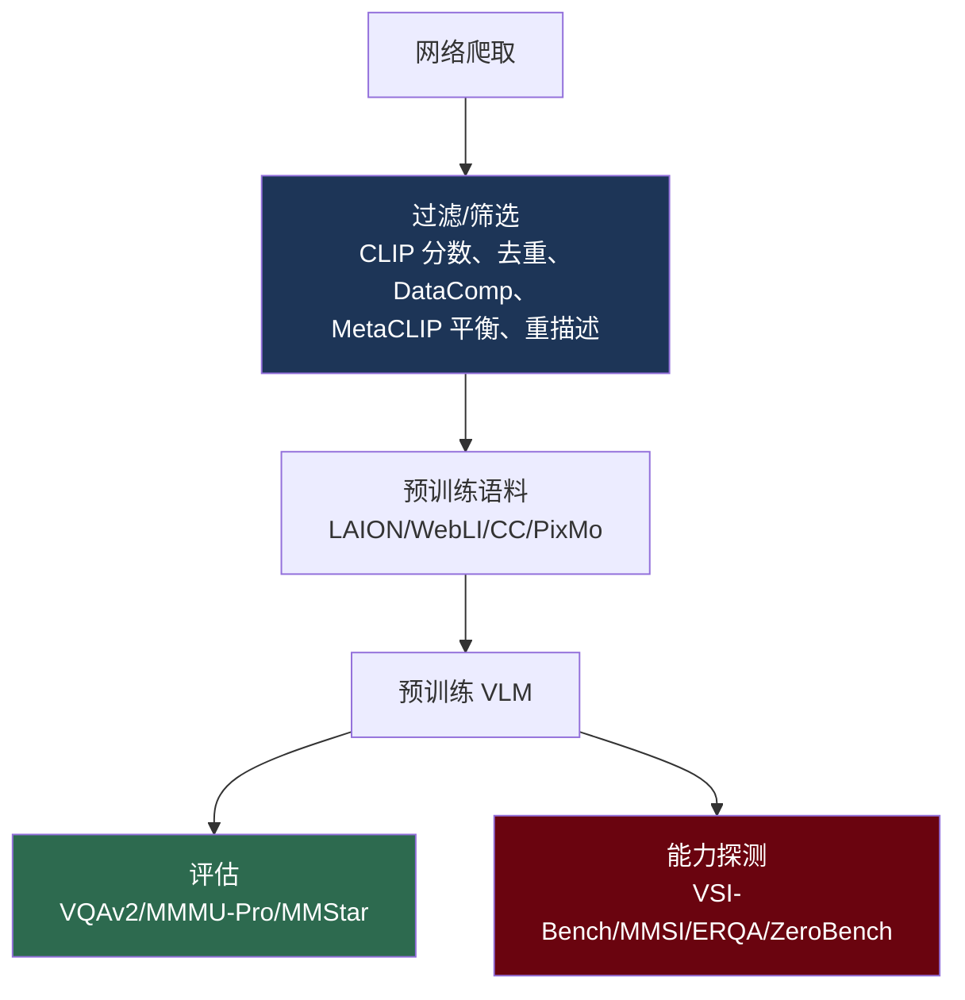

# 多模态数据集

> **英文原文：** [cv-knowledge-base/11_datasets_and_benchmarks/03_multimodal_datasets.md](../../cv-knowledge-base/11_datasets_and_benchmarks/03_multimodal_datasets.md)（本中文版供参考，内容以英文原文为准）

> **最后更新：** 2026年10月
> **难度级别：** 中级
> **相关章节：**
> - [大型视觉-语言模型](../05_multimodal_vision_language/02_large_vision_language_models.md)
> - [核心数据集](./00_core_datasets.md)
> - [评估指标](./04_evaluation_metrics.md)
> - [视觉中的缩放定律](../12_research_frontier_2024_2026/01_scaling_laws_vision.md)

> **🆕 2026年10月更新：**
> - **MMMU 实际上已经饱和。** 在官方排行榜上，GPT-5.1 在 MMMU-val 上达到 85.4（2025年11月），介于人类专家中等水平（82.6）与高水平（88.6）参考值之间。前沿实验室如今改为报告 **MMMU-Pro**：Gemini 3 Pro 81.0，GPT-5.4 Thinking 81.2（使用工具时 82.1），均为作者自报。MMMU **测试集答案已于 2026年2月公开发布**，因此测试分数不再是留出评估。
> - 新增**空间与具身推理基准**：VSI-Bench、MMSI-Bench（ICLR 2026；最佳模型 Gemini 3 Pro 为 49.2%，人类为 97.2%）以及 Google DeepMind 的 ERQA。
> - 新增**"抗饱和"与关注污染的基准**：MMStar（视觉不可或缺的样本、泄漏指标）和 ZeroBench。ZeroBench 发布时得分接近 0%，如今官方评估的最佳模型已达到 30.0% pass@5。
> - 新增**开放的预训练与指令数据**：Meta CLIP 2（全球化，NeurIPS 2025）、PixMo（Molmo）、LLaVA-OneVision-1.5 Mid-Training-85M、Molmo2 数据以及 LLaVA-OneVision-2 视频/空间数据（2026）。
> - 用 2025年末/2026年的前沿数字更新了基准快照表（图像、图表、视频）。

---

## 概述

多模态数据集（成对的图像-文本，以及越来越多的视频-文本和图文交错语料）是视觉-语言时代的燃料。其规模与质量决定了从 CLIP 到 GPT-4o 的每一个模型的能力（参见[大型视觉-语言模型](../05_multimodal_vision_language/02_large_vision_language_models.md)）。两类不同的数据集服务于不同阶段：**网络规模预训练语料**（LAION-5B、WebLI、DataComp）提供对比式和生成式预训练所需的数十亿条带噪图文对，而**精选基准数据集**（VQAv2、GQA、MMMU、MMBench）则提供更干净、带标注的评估以衡量进展。该子领域的核心张力（由 DataComp 和 MetaCLIP 通过实验确立）是：**数据质量与筛选往往比原始数量更重要**（参见[视觉中的缩放定律](../12_research_frontier_2024_2026/01_scaling_laws_vision.md)）。

一个关键但常被低估的问题是，最大的预训练语料都来自网络爬取，因此带有噪声、偏差、重复、NSFW 内容以及版权/隐私问题。LAION-5B 因问题内容被临时撤下，凸显了数据集治理如今是首要的研究与伦理问题，而非事后考虑。本文概述主要的预训练语料和评估基准、它们的规模与构建方式，以及数据筛选、污染和治理方面的开放问题。

到 2026 年末，该领域的评估侧被一个**基准半衰期问题**所定义。MMMU 从 GPT-4V 的 56%（2023年11月）到超过人类专家中等水平参考值，只用了大约两年。ZeroBench 被明确设计为"不可能完成"，但不到两年其 70% 的题目就已至少被解出一次。由此出现了两种应对方式。一种是*更难、视觉不可或缺*的套件（MMMU-Pro、MMStar、ZeroBench、CharXiv）。另一种是*针对特定能力*的套件，聚焦于前沿模型仍然表现很差的领域，尤其是**空间与具身推理**（VSI-Bench、MMSI-Bench、ERQA），在这些基准上最佳模型仍比人类低约 50 分。在数据侧，完全开放的方案（PixMo、LLaVA-OneVision-1.5/2、Molmo2、PerceptionLM）如今会公开其预训练与指令语料，减少了该领域对专有模型蒸馏的依赖。

---

## 网络规模预训练语料

- **LAION-400M / LAION-5B** [Schuhmann2022] — 开放的、经 CLIP 过滤的图文对（4 亿 / 58.5 亿）；开源 CLIP 和 Stable Diffusion 背后的语料。影响深远，但引发了内容治理问题（曾临时下架以重新过滤）。
- **Conceptual Captions (CC3M / CC12M)** — Google 清洗过的、源自替代文本的图像-描述对（300 万 / 1200 万）；质量更高，规模较小。
- **WebLI**（Google）— 约 100 亿+ 多语言图文对，支撑 PaLI/SigLIP（未公开）。
- **DataComp** [Gadre2023] — 不是固定数据集，而是一个*数据筛选基准*：固定的候选池加上多个过滤赛道，证明了筛选胜过规模。
- **WebVid / HowTo100M / VideoCC** — 用于视频-语言预训练的大型视频-文本语料（参见[视频数据集](./01_video_datasets.md)）。
- **Meta CLIP 2（worldwide）** [Chuang2025]（2025年7月；NeurIPS 2025 spotlight）— 将 MetaCLIP 基于元数据平衡的筛选从仅英文扩展到*全球*多语言网络数据。它表明英文与非英文数据可以相互促进，而非此消彼长。模型已在 open_clip 和 Hugging Face 上发布，原始语料未公开。
- **Recap-DataComp-1B** [Li2024] — 使用基于 LLaMA-3 的描述器对 DataComp-1B 重新生成描述。它是*合成重描述（re-captioning）*趋势的代表，这一做法如今已成为 CLIP 和文生图预训练的标准做法。
- **PixMo** [Deitke2025]（Ai2，2024年11月）— Molmo 背后的开放数据，采集时*未使用专有 VLM 蒸馏*。包括 PixMo-Cap（平均约 200 词的密集描述）、PixMo-Points（指点/计数）、PixMo-AskModelAnything、PixMo-Docs（合成图表与文档）和 PixMo-Clocks。**Molmo2**（2026）将发布扩展到视频、多图像指点和跟踪数据。
- **LLaVA-OneVision-1.5 / -2 数据**（EvolvingLMMs-Lab，2025–2026）— 一个完全开放的技术栈，包括一个 **8500 万样本的中期训练（mid-training）集**和指令数据（OV-1.5，2025年9月），以及随 LLaVA-OneVision-2（2026年4月）发布的视频描述和*空间*数据集。

## 评估基准

- **VQAv2** [Goyal2017] — 采用平衡答案对以抵消语言先验的视觉问答；标准的 VQA 基准。
- **GQA** — 基于场景图的组合式 VQA，检验对关系的推理。
- **Visual Genome** — 密集标注：物体、属性、关系、区域描述；场景图与视觉定位工作的基础。
- **COCO Captions** — 在 MS-COCO 上每张图像 5 条描述；描述生成/检索的标准。
- **MMMU** [Yue2024] — 大规模多学科多模态理解（大学水平），现代 LMM 的高难度推理基准。它包含 30 个学科、183 个子领域的 1.15 万道题（150 开发 / 900 验证 / 1.05 万测试）。**测试集答案已于 2026年2月公开**，因此可以在本地进行测试评估，但也无法再排除污染。
- **MMMU-Pro** [Yue2025]（ACL 2025）— 加固版 MMMU。它过滤掉仅凭文本即可作答的题目，扩充候选选项，并增加一个*纯视觉*设定，将题目嵌入图像中。发布时模型得分为 16.8–26.9%。截至 2026 年，它是前沿实验室报告的 MMMU 变体。
- **MMBench** — 系统构建、采用循环评估（circular evaluation）的多项选择多模态基准；**MathVista**（视觉数学）、**DocVQA**（文档）、**TextVQA**（场景文字）、**POPE**（幻觉）共同构成 LMM 评估套件。
- **MMStar** [Chen2024]（NeurIPS 2024）— 1,500 个人工挑选的*视觉不可或缺*样本，从来自现有基准的 22,401 个候选中筛选而来。其动机来自两个发现：许多基准题目无需图像即可回答，以及基准数据泄漏进 LLM/LVLM 训练。它引入了**多模态增益（multi-modal gain, MG）**和**多模态泄漏（multi-modal leakage, ML）**指标。
- **ZeroBench** [Roberts2025]（ICML 2026）— 100 道人工精选的视觉推理题，发布时经过校准，超出前沿模型的能力，并附带用于训练数据过滤的 canary 字符串。根据最新的官方评估，70% 的题目已至少被解出一次。最佳模型达到 **30.0% pass@5**，但 **pass^5** 仅为 **13.0%**（五次采样全部正确），能力与可靠性之间差距很大。
- **CharXiv** — 真实的科学图表理解。其推理题分数（CharXiv-RQ）是前沿模型的标准指标，Gemini 3 Pro 为 81.4（自报，2025年11月）。
- **空间 / 具身推理套件：**
  - **VSI-Bench** [Yang2025a]（CVPR 2025）— 基于 3D 扫描场景视频的视觉-空间智能（参见[视频数据集](./01_video_datasets.md)）。
  - **MMSI-Bench** [Yang2025c]（ICLR 2026，上海人工智能实验室）— 1,000 道完全由人工设计的多图像空间推理选择题，每道题都附有逐步推理过程，图像来自驾驶、机器人操作和场景扫描。排行榜：人类 97.2%，**Gemini 3 Pro 49.2%**，GPT-5 41.9%，随机 25%。大多数开源模型接近随机水平。
  - **ERQA**（Google DeepMind，2025年3月）— 与 Gemini Robotics 一同发布的*具身推理*多项选择基准，由图文交错题目组成。它涵盖机器人场景中的空间推理和世界知识，被用作 Gemini Robotics-ER 等具身推理 VLM 的标准评估维度。

---

## 关键数据集

| 数据集 | 作者/机构 | 年份 | 规模 | 用途 |
|---------|-------------|------|-------|---------|
| LAION-5B | Schuhmann et al. | 2022 | 58.5 亿对 | 开放 CLIP/扩散模型预训练 |
| Conceptual Captions | Sharma et al. | 2018 | 300 万/1200 万 | 更干净的描述预训练 |
| DataComp | Gadre et al. | 2023 | 基准 | 数据筛选评估 |
| VQAv2 | Goyal et al. | 2017 | 110 万问答 | 平衡 VQA |
| Visual Genome | Krishna et al. | 2017 | 10.8 万张图像 | 密集场景图标注 |
| MMMU | Yue et al. | 2024 | 1.15 万题 | 大学水平多模态推理 |
| MMMU-Pro | Yue et al. | 2025 | 过滤后的 MMMU + 纯视觉设定 | 加固版 MMMU（无文本捷径） |
| MMStar | Chen et al. | 2024 | 1,500 题 | 视觉不可或缺、关注泄漏的评估 |
| ZeroBench | Roberts et al. | 2025 | 100 题 | "不可能"的视觉推理；pass@5 / pass^5 |
| MMSI-Bench | Yang et al. (Shanghai AI Lab) | 2025 | 1,000 题 | 多图像空间推理 |
| ERQA | Google DeepMind | 2025 | 选择题集 | 面向机器人的具身推理 |
| Meta CLIP 2 | Chuang et al. (Meta) | 2025 | 全球网络图文对（方案） | 多语言 CLIP 数据筛选 |
| PixMo | Deitke et al. (Ai2) | 2024 | 多个子集 | 非蒸馏的开放 VLM 数据 |
| LLaVA-OneVision-1.5 Mid-Training | EvolvingLMMs-Lab | 2025 | 8500 万样本 | 完全开放的 LMM 中期训练 |

---

## 基准快照（LMM 参考分数）

| 基准 | 考察内容 | 强模型（近似值） |
|-----------|---------------|------------------------|
| MMMU (val) | 专家级推理 | ~85（GPT-5.1，2025年11月）；人类专家 82.6–88.6；2024 年约 70（InternVL2.5 / GPT-4o） |
| MMMU-Pro | 无文本捷径的专家级推理 | ~81–82（Gemini 3 Pro 81.0；GPT-5.4 Thinking 81.2，使用工具 82.1）；人类专家 80.8–85.4 |
| MMBench | 广泛感知 | ~85–88（2024–25；接近饱和） |
| MathVista | 视觉数学 | ~90（Kimi K2.5 90.1；Gemini 3 Pro 89.8，由 Moonshot 重新评估）；2024 年约 63–72 |
| CharXiv (RQ) | 科学图表推理 | ~81–82（Gemini 3 Pro 81.4；GPT-5.2 82.1） |
| DocVQA | 文档阅读 | ~92–96（已饱和） |
| ZeroBench（主集） | "不可能"的视觉推理 | 30.0 pass@5 / 13.0 pass^5（官方最佳，2026） |
| MMSI-Bench | 多图像空间推理 | 49.2（Gemini 3 Pro），人类为 97.2 |
| Video-MMMU | 从讲座视频中获取知识 | ~87.6（Gemini 3 Pro） |
| POPE | 幻觉 | 较高但不完美 |

*分数为近似值，取决于版本与协议。2025–2026 年的大多数前沿数字由模型开发者自报（常常启用了"思考"或工具使用），未经独立复现。*

---

## 优缺点

| 方面 | 优点 | 缺点 |
|--------|------|------|
| 网络规模语料 | 支撑基础模型规模的预训练 | 噪声、偏差、NSFW、版权/隐私 |
| 精选基准 | 干净、可比较的评估 | 饱和、污染、格式过拟合 |
| 组合式基准（GQA/MMMU） | 检验推理而非记忆 | 构建成本高；仍可被钻空子 |
| 视觉不可或缺 / "不可能"套件（MMStar、MMMU-Pro、ZeroBench） | 消除文本捷径；发布时提升空间大 | 规模小（100–1,500 题）→ 方差大；提升空间在约 1–2 年内被消耗殆尽 |
| 空间/具身套件（VSI-Bench、MMSI、ERQA） | 揭示巨大且持久的人机差距 | 场景分布狭窄；选择题格式允许猜测（需要循环评估） |
| 完全开放的数据方案（PixMo、LLaVA-OV、Molmo2） | 可复现；避免专有模型蒸馏 | 仍小于闭源语料；合成部分继承了生成模型的偏差 |

---

## 开放问题与研究空白

- **数据治理。** 网络规模语料中的知情同意、版权、隐私和有害内容问题尚未解决（LAION 撤下事件）。
- **筛选理论。** DataComp 表明筛选很重要，但缺乏关于*保留什么*的预测性理论（参见[视觉中的缩放定律](../12_research_frontier_2024_2026/01_scaling_laws_vision.md)）。Meta CLIP 2 增加了多语言维度：如何在不降低英文性能的前提下在多种语言之间平衡概念。
- **基准污染。** 测试数据泄漏进预训练会抬高分数；干净的留出评估很难实现。2026年2月 MMMU 测试集答案的公开，移除了 MMMU 最后一个留出划分。canary 字符串（ZeroBench）和泄漏指标（MMStar 的 ML）只能部分缓解。
- **饱和。** VQAv2/COCO 已接近饱和；更难、更稳健的基准（MMMU）也老化得很快。MMMU-val 如今已落入人类专家区间，前沿实验室已放弃它而改用 MMMU-Pro，而后者本身也正接近人类专家区间。
- **可靠性与能力。** ZeroBench 的 pass@5（30%）与 pass^5（13%）之间的差距表明，单次采样准确率掩盖了大量的运行间不一致。基准报告很少给出方差或"全部 k 次成功"的结果。
- **空间智能差距。** 在多图像和视频空间推理（MMSI-Bench、VSI-Bench）上，最佳模型仍比人类低约 50 分，大多数开源模型接近随机水平。这一差距是通过扩大规模、空间训练数据（VSI-590K、LLaVA-OV-2 空间数据）还是显式 3D 表征来弥合，仍是开放问题。
- **文化/语言偏差。** 以英语和西方为中心的数据使模型行为产生偏差。
- **多模态覆盖。** 在图文之外，成对的视频/音频/3D-文本数据仍然稀缺（参见[3D 与机器人数据集](./02_3d_and_robotics_datasets.md)）。
- **合成数据质量。** 随着模型生成的描述和图像越来越多地进入训练语料，控制模型崩溃（model collapse）效应并验证合成数据的保真度，是一个新兴且尚未解决的问题。
- **动态基准。** 面对快速进步的模型，静态排行榜老化很快；实时、抗污染、定期更新的评估仍是一个开放的基础设施问题。
- **自报数字。** 大多数前沿结果由作者在各不相同的设定（思考预算、工具、帧数）下自报。独立的重新评估（例如第三方模型报告中带星号的条目）常常相差数个点。

---

## 延伸阅读

- [LAION-5B (arXiv:2210.08402)](https://arxiv.org/abs/2210.08402) — 开放的网络规模图文数据
- [DataComp (arXiv:2304.14108)](https://arxiv.org/abs/2304.14108) — 数据筛选基准
- [VQAv2 (arXiv:1612.00837)](https://arxiv.org/abs/1612.00837) — 平衡视觉问答
- [MMMU (arXiv:2311.16502)](https://arxiv.org/abs/2311.16502) — 多学科多模态基准
- [Visual Genome (arXiv:1602.07332)](https://arxiv.org/abs/1602.07332) — 密集标注
- [MMMU / MMMU-Pro 仓库与排行榜数据](https://github.com/MMMU-Benchmark/MMMU) — [MMMU-Pro (arXiv:2409.02813)](https://arxiv.org/abs/2409.02813)
- [MMStar (arXiv:2403.20330)](https://github.com/MMStar-Benchmark/MMStar) — 视觉不可或缺的评估与泄漏指标
- [ZeroBench (arXiv:2502.09696)](https://github.com/jonathan-roberts1/zerobench) — "不可能"的视觉基准，pass@k / pass^k
- [MMSI-Bench (arXiv:2505.23764)](https://github.com/InternRobotics/MMSI-Bench) — 多图像空间智能
- [ERQA](https://github.com/embodiedreasoning/ERQA) — 具身推理问答（Gemini Robotics）
- [Meta CLIP 2 (arXiv:2507.22062)](https://github.com/facebookresearch/MetaCLIP) — 全球化 CLIP 数据筛选
- [Molmo / PixMo](https://github.com/allenai/molmo) · [Molmo2 (arXiv:2601.10611)](https://github.com/allenai/molmo2) — 开放 VLM 数据
- [LLaVA-OneVision-1.5 / 2 (arXiv:2509.23661)](https://github.com/EvolvingLMMs-Lab/LLaVA-OneVision-1.5) — 完全开放的 LMM 训练数据
