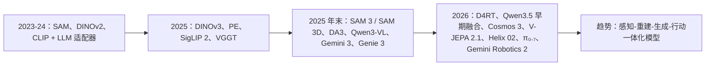

# 2024–2026 年计算机视觉研究：领域现状

> **英文原文：** [cv-knowledge-base/12_research_frontier_2024_2026/00_overview_latest.md](../../cv-knowledge-base/12_research_frontier_2024_2026/00_overview_latest.md)（本中文版供参考，内容以英文原文为准）

> **最后更新：** 2026年10月
> **难度级别：** 研究前沿
> **相关章节：**
> - [机器人与具身智能概览](../06_robotics_and_embodied_ai/00_overview_roadmap.md)
> - [未来趋势](./07_future_trends.md)
> - [VLA 模型](../06_robotics_and_embodied_ai/01_vla_models.md)
> - [面向机器人的世界模型](../06_robotics_and_embodied_ai/02_world_models.md)

> **🆕 2026年10月更新：**
> - 新增 **“变化综述：2025 年中 → 2026 年 10 月”** 一节，涵盖 DINOv3、SAM 3 / SAM 3.1 / SAM 3D、Depth Anything 3、前馈式 3D/4D 重建（VGGT → D4RT）、前沿多模态大模型（GPT-5、Gemini 3、Qwen3-VL、Qwen3.5）、VLA（π₀.₅、π\*₀.₆、π₀.₇、Gemini Robotics 1.5 → Gemini Robotics 2 / ER 2、Figure Helix 02、GR00T N1.6/N1.7）以及世界模型（Genie 3、Waymo World Model、Marble、Cosmos 3、V-JEPA 2.1）。
> - 新增 **会议亮点** 一节：CVPR 2026（丹佛；最佳论文 D4RT，最佳学生论文 TRELLIS.2，荣誉提名 NitroGen 与 SAM 3D）以及 ECCV 2026（马尔默；据报道最佳论文为 “Heat Kernel Textures”）。
> - 开源模型表新增 17 个 2025–2026 年发布的模型；关键论文表与基准表同步扩充。
> - 投资/产业背景更新至 2026 年（Skild AI、Apptronik、World Labs、AMI Labs、Physical Intelligence、Figure）。
> - 更正了一条过时说法：2024 年代的多模态大模型并未在 MMMU 上超过 80%（前沿模型直到 2025 年才突破 80%）。
> - 新增此前版本遗漏、现已由多个来源证实的三项 2026 年机器人发布：**Figure Helix 02**（2026 年 1 月；System 0/1/2 全身控制）、**π₀.₇**（2026 年 4 月；初步的组合泛化，据报道单个通用模型即可与 π\*₀.₆ 专用模型相当）以及 **Gemini Robotics 2 / ER 2 / On-Device 2**（2026 年 7 月；全身人形 VLA）。另补充了 Physical Intelligence 据报道于 2026 年 3 月进行的融资洽谈。

---

## 概述

2024 至 2026 年是自 2012 年 ImageNet 时刻以来计算机视觉领域最具决定性的转折期。其决定性转变不仅在于规模，更在于*范式*：该领域已从训练任务专用模型——每个模型孤立地擅长检测、分割、深度或跟踪——转向训练通用视觉表征，这些表征可以在开放的感知与控制任务空间中被提示（prompt）、组合与部署。这一时期由三个彼此独立又相互汇合的主战场刻画：（1）面向开放世界感知的 **视觉-语言模型（Vision-Language Models, VLMs）**，以 CLIP 家族模型和多模态大语言模型的爆发为代表；（2）面向物理控制的 **视觉-语言-动作模型（Vision-Language-Action, VLA）**，语言条件策略正在取代经典机器人流水线；（3）面向仿真与规划的 **世界模型（World Model）**，生成式视频模型开始充当可微物理引擎，用于训练具身智能体。

三个主战场共同的催化剂是一项基础设施层面的进步：出现了超大规模、公开可用的基础模型（Foundation Model），它们能以原始训练成本的一小部分被微调或组合用于下游任务。DINOv2 [Oquab2023] 证明，在精选的大规模图像数据上训练的纯自监督 ViT 编码器，在几乎所有视觉基准上都能达到或超过有监督表征。SAM [Kirillov2023] 证明，一个在 10 亿个掩码上训练的可提示分割模型，可以零样本泛化到其创建者从未设想过的领域。SAM2 [Ravi2024] 将其扩展到视频，实现了穿越遮挡的实时提示式跟踪。Depth Anything V2 [Yang2024] 表明，长期被认为在缺乏度量尺度监督时难以解决的单目深度估计，可以通过将标注数据与海量伪标注无标签图像相结合，达到接近激光雷达的质量。这些模型共同定义了 *any-model 范式*：一类通过轻量级提示而非任务专用再训练、在任意输入上工作的新型基础模型。

从 2025 年中到 2026 年末，这些趋势进一步巩固为第二代。DINOv3 [Simeoni2025] 将自监督学习扩展到在 17 亿张图像上训练的 70 亿参数 ViT；SAM 3 [Carion2025] 将“分割一切”变为根据名词短语或示例“分割某个*概念*的每一个实例”；前馈式几何 Transformer——VGGT [Wang2025]（CVPR 2025 最佳论文）、Depth Anything 3 [Lin2025]、MapAnything 以及 D4RT [Zhang2025]（CVPR 2026 最佳论文）——用一次网络前向传播取代了经典 SfM/MVS/跟踪流水线的大部分环节。前沿多模态大模型（GPT-5、Gemini 3）在 MMMU 类基准上突破 80%，而开放权重家族（Qwen3-VL、InternVL3.5、Qwen3.5）转向 MoE 主干，其中 Qwen3.5 还采用了早期融合（early-fusion）多模态预训练。交互式世界模型从研究演示（Genie 2）发展为实时产品（Genie 3、World Labs Marble）和工业级仿真器（Waymo World Model、NVIDIA Cosmos 3）。机器人基础模型从机械臂和上半身扩展到了人形机器人的全身（Figure Helix 02、Gemini Robotics 2），并首次出现了由公司报告的技能组合复用迹象（π₀.₇）。

经济背景不容忽视。2024–2025 年全球机器人与具身智能初创企业获得了超过 100 亿美元投资，仅 2025 年面向机器人的融资就超过了 2024 年全年总额；据 TechCrunch 统计，2025 年机器人初创企业融资接近 140 亿美元，高于 2024 年的 82 亿美元。Physical Intelligence（pi.ai）凭借其 π₀ [BlackEtAl2024] 通用机器人策略完成 6 亿美元 B 轮融资（2025 年 11 月），公司估值达 56 亿美元；2026 年 3 月，Bloomberg 报道其正洽谈以超过 110 亿美元的估值融资约 10 亿美元（尚未确认完成）。Figure AI 以 390 亿美元投后估值完成超过 10 亿美元的 C 轮融资（2025 年 9 月）。NVIDIA 通过 Isaac GR00T N1 [NVIDIA2025]——首个公开发布的人形机器人基础模型——以及用于物理感知合成数据生成的 Cosmos 世界基础模型家族，下了全面的平台赌注。2026 年节奏进一步加快：Skild AI 宣布以超过 140 亿美元的估值融资 14 亿美元（2026 年 1 月，TechCrunch 报道）；Apptronik 以约 50 亿美元估值融资 5.2 亿美元（2026 年 2 月，CNBC 报道）；李飞飞的 World Labs 完成 10 亿美元融资，Autodesk、NVIDIA 与 AMD 参投（2026 年 2 月，据报道）；Yann LeCun 于 2025 年 11 月离开 Meta 后创立、专注于 JEPA 式世界模型的巴黎公司 **AMI Labs**，以 35 亿美元投前估值融资 10.3 亿美元（2026 年 3 月，TechCrunch 报道），被称为欧洲史上最大的种子轮。这些投资反映出一种共识：长期被认为还需数十年的通用机器人智能，如今已成为近期的工程问题而非基础科学问题，前提是把视觉表征和世界模型做对。这也反映出一种对“仅靠 LLM”路线的显著反向押注：2026 年最大的两轮融资中有两轮（World Labs、AMI Labs）投给了“世界模型”公司。

---

## 三大主战场

### 1. 面向开放世界感知的 VLM

CLIP 家族经历了大幅扩展。EVA-CLIP-18B [Sun2024] 拥有 180 亿参数，是公开发布的最大对比式视觉-语言模型，在 27 个分类基准上平均取得 80.7% 的零样本 top-1 准确率。SigLIP 2 [Zhai2025] 是 Google 基于 sigmoid 损失的对比编码器的继任者，增加了多语言支持（109 种语言）、稠密特征改进以及强大的开放词汇（open-vocabulary）定位能力。DFN-5B——借助数据过滤网络（Data Filtering Networks）[Fang2023] 从 430 亿条噪声网络图文对中筛选出的 50 亿张图像子集上训练——表明过滤质量比原始数量更重要。MetaCLIP [Xu2024] 证明，按照 CLIP 自身的概念分布来精选训练数据（而非不透明的专有过滤），可在 10 亿规模下实现 72.4% 的 ImageNet 零样本准确率，并超越 OpenAI CLIP。2025 年，Meta 的 **Perception Encoder** [Bolya2025]（PE-Core-G：ImageNet 零样本 85.4%）表明，单个对比训练的编码器在其*中间*层中包含强大的稠密特征和语言对齐特征；而 **Meta CLIP 2** [Chuang2025]（NeurIPS 2025 spotlight）将数据精选扩展到全球范围的多语言网络数据。

将强大的语言模型主干与视觉编码器融合的多模态大语言模型（MLLM）的出现，开创了新的 SOTA 层级。2024 年代的模型（GPT-4V、Gemini 1.5 Pro、Claude 3.5、InternVL、LLaVA-NeXT、Qwen-VL）将 MMMU（Massive Multi-discipline Multimodal Understanding，大规模多学科多模态理解）——一个对 CLIP 家族模型而言接近随机水平的基准——从约 56%（GPT-4V）推高到约 70%；2025 年前沿模型突破 80%（GPT-5：84.2%），关注点转向更难的后继基准，如 MMMU-Pro 和 Video-MMMU（Gemini 3 Pro：81.0% 和 87.6%）。2024 代模型的关键架构模式是：一个冻结或轻度微调的视觉编码器（通常为 DINOv2 + SigLIP）通过可学习投影器（MLP 或 Q-Former）接入大语言模型；2025–2026 代则越来越多地联合训练视觉编码器、使用 MoE 语言主干，而 Qwen3.5 更采用了早期融合多模态预训练（参见 [多模态大模型 2025–2026](./03_multimodal_llm_2025_2026.md)）。

### 2. 面向物理控制的 VLA

视觉-语言-动作模型是 VLM 革命在机器人领域最直接的应用。其典型架构以语言指令 token 和图像 token 为输入，输出连续或离散化的机器人动作。RT-2 [BrohmanEtAl2023] 是转折点，它表明在机器人轨迹数据上对 550 亿参数的 PaLI-X VLM 进行联合微调会产生涌现推理能力——机器人可以通过数清场景中描述的物体来导航。OpenVLA [KimEtAl2024] 是一个 70 亿参数的开源替代方案，基于 Llama 2 并采用 DINOv2+SigLIP 视觉编码器，证明在 Open X-Embodiment（97 万条轨迹）上训练的开源 VLA 可以在标准操作基准上超越 RT-2。

Physical Intelligence 的 π₀ [BlackEtAl2024] 更进一步：这是一个流匹配（flow matching）扩散 VLA，在多样的灵巧机器人硬件（单臂、双臂、移动操作臂）上训练，以 PaliGemma 2B 作为语言主干。它能产生以往自回归离散动作 VLA 无法实现的流畅、柔顺的动作。发表于 RSS 2024 的 Octo [GhoshEtAl2024] 是一个在 80 万条轨迹上训练的开源 Transformer 策略，可在单 GPU 上用数小时微调到新的机器人平台。2025 年 3 月发布的 GR00T N1 [NVIDIA2025] 引入双系统架构：一个慢速 VLM“系统 2”对语言和场景进行推理，驱动一个快速扩散 Transformer“系统 1”进行实时动作生成；这个 22 亿参数的模型可在 L40 GPU 上用 63.9 ms 采样 16 个动作。

2025–2026 代 VLA 强调开放世界泛化和从经验中学习。**π₀.₅** [PI2025]（2025 年 9 月在 `openpi` 中开源）利用异构数据联合训练和“知识隔离”（knowledge insulation）泛化到未见过的家庭环境；**π\*₀.₆**（2025 年 11 月）加入了基于自主经验与纠正的强化学习（RECAP 方法）。Google DeepMind 的 **Gemini Robotics 1.5 / Gemini Robotics-ER 1.5**（2025 年 9 月）将具身推理与运动控制分离，并引入“先思考再行动”。NVIDIA 将 GR00T 迭代到 **N1.6**（Eagle VLM 主干、32 层扩散动作头）和 **N1.7**（30 亿参数，采用 Qwen3-VL 架构的 Cosmos-Reason2-2B 主干，132 维状态/动作空间，预训练加入 2 万小时第一人称人类视频）。参见 [VLA 与具身智能 2025–2026](./04_vla_embodied_2025_2026.md)。

2026 年的三项发布再次推动了前沿，使其从桌面操作走向全身控制与组合式控制：

- **Figure Helix 02**（2026 年 1 月下旬）是运行于 Figure 03 上的单一学习型系统，以三层结构统一了感知、平衡、运动与操作。System 2 负责语义推理，System 1 以高频将感知转化为全身运动，新增的 System 0 以约 1 kHz 运行，负责平衡与协调。Figure 演示了约 4 分钟的自主洗碗机卸载与装载，并声称可完成 8 小时无干预班次，但尚未公布吞吐量或错误率指标。
- **π₀.₇**（Physical Intelligence，2026 年 4 月）据报道将 Gemma 3 4B 主干与约 8.6 亿参数的动作专家相结合，并以子任务指令和子目标图像等更丰富的上下文进行训练。它展现出初步的组合泛化，例如在没有该机器人叠衣数据的情况下用 UR5e 叠 T 恤，以及在极少指导后使用空气炸锅。据报道，单个通用模型在叠衣、意式咖啡和纸箱组装任务上可与经强化学习微调的 π\*₀.₆ 专用模型相当，不过长任务仍需逐步指导，且尚无标准化的外部基准。
- **Gemini Robotics 2**（Google DeepMind，2026 年 7 月 30 日）是具备全身人形控制能力的 VLA（在推理的同时行走、下蹲和操作），而上一版本主要控制上半身。**Gemini Robotics ER 2** 是可在 Google AI Studio 中使用的具身推理/规划模型，在 ASIMOV-2 上是 Google 最安全的机器人模型，并随附新的 ASIMOV-Agentic 基准（例如在不确定时向人类求助）。**Gemini Robotics On-Device 2** 在本地运行，仅需数小时数据即可适配新具身。VLA 与 On-Device 模型仅向早期访问合作伙伴开放。

### 3. 面向仿真与规划的世界模型

世界模型——可用于规划和数据增强的环境动力学生成模型——在 2024–2025 年跨越了视觉真实感和物理合理性的门槛。Google DeepMind 于 2024 年 12 月发布的 Genie 2 [ParmarEtAl2024] 使用自回归潜在扩散模型从单张图像生成可交互的 3D 环境，可保持长达一分钟的物理一致性，从而支持强化学习环境的快速原型开发。NVIDIA Cosmos [NVIDIA2025] 于 CES 2025 发布并持续更新至 CoRL 2025，提供一系列开放的世界基础模型，可基于文本、图像、视频和机器人动作数据进行物理感知的视频预测；Cosmos Predict 2.5（2025 年 10 月；2B 与 14B）统一了 Text2World/Image2World/Video2World，并支持多视角输出和长时程自回归生成。V-JEPA 2 [Meta2025] 走的是非生成式路线：一个在 100 万小时视频上预训练的 12 亿参数潜空间预测模型，在 Something-Something v2 上达到 77.3% 的 top-1，并通过潜空间中的模型预测控制实现零样本机器人规划。

2025 年中以来：**Genie 3**（Google DeepMind，2025 年 8 月）可实时生成可导航的世界（720p、24 fps），保持数分钟的视觉一致性，并支持可提示的世界事件；它于 2026 年 1 月以 **Project Genie** 的形式向 Google AI Ultra 订阅用户开放，并被 Waymo 后训练为 **Waymo World Model**（2026 年 2 月），可为罕见事件驾驶仿真同时生成摄像头*和*激光雷达数据流。World Labs 推出了 **Marble**（2025 年末），一款可根据文本、图像或视频生成持久化、可导出的 3D 世界（高斯泼溅/网格）的商业产品。NVIDIA 发布了 **Cosmos 3**（2026 年 5 月），在同一架构上提供“推理器”（文本+视觉→文本）和“生成器”（文本、视觉、声音、动作 → 视觉、声音、动作），规模为 4B/16B/64B。Meta 发布了 **V-JEPA 2.1**（2026 年 3 月；80M–2B），具备时间一致的稠密特征。带同步音频的视频生成模型——**Veo 3**（2025 年 5 月）/ **Veo 3.1**（2025 年 10 月）以及 **Sora 2**（2025 年 9 月）——缩小了“视频生成器”与“世界模拟器”之间的差距，尽管其物理保真度仍有争议。参见 [面向机器人的世界模型](../06_robotics_and_embodied_ai/02_world_models.md)。

---

## 变化综述：2025 年中 → 2026 年 10 月

| 领域 | 2025 年中状态 | 2026 年 10 月状态 | 代表性证据 |
|---|---|---|---|
| 视觉主干 | DINOv2 / SigLIP 为默认编码器 | DINOv3（7B 教师模型，蒸馏出 21M–840M 的 ViT 与 ConvNeXt）、PE、SigLIP 2、Meta CLIP 2 | [Simeoni2025]、[Bolya2025]、[Chuang2025] |
| 分割 | 视觉提示（点/框/掩码） | 概念提示（名词短语或示例）→ 图像与视频中的全部实例；SAM 3.1 多路复用多目标跟踪（2026 年 3 月） | SAM 3 [Carion2025] |
| 从图像得到 3D | 优化方法（SfM/MVS、逐场景 NeRF/3DGS）占主导 | 前馈式任意视角几何（VGGT、DA3、MapAnything）以及单图像物体/人体 3D（SAM 3D） | CVPR 2025 与 2026 奖项 |
| 4D / 动态场景 | 深度、跟踪、位姿分属不同模型 | 单一基于查询的编码器–解码器统一处理深度、对应关系与位姿（D4RT，据作者称比以往工作快多达 300 倍） | CVPR 2026 最佳论文 |
| 3D 生成 | TRELLIS（2024） | TRELLIS.2（4B，O-Voxel，最高 1536³ 并带 PBR 材质） | CVPR 2026 最佳学生论文 |
| 多模态大模型 | Qwen2.5-VL / InternVL2.5 ≈ 70% MMMU | GPT-5 MMMU 84.2%；Gemini 3 Pro MMMU-Pro 81.0%；Qwen3-VL（256K→1M 上下文）、InternVL3.5、Qwen3.5（早期融合） | 官方模型报告 |
| VLA | π₀、GR00T N1、OpenVLA | π₀.₅（开源）、π\*₀.₆（从经验中进行强化学习）、π₀.₇（单个通用模型 ≈ π\*₀.₆ 专用模型；初步的组合泛化）、Gemini Robotics 1.5 → Gemini Robotics 2 / ER 2、GR00T N1.6/N1.7 | 参见 [04](./04_vla_embodied_2025_2026.md) |
| 人形机器人控制 | 学习型上半身 VLA 叠加在独立的运动/平衡控制器之上 | 单一学习型全身技术栈：Figure Helix 02（System 0/1/2，System 0 约 1 kHz）、Gemini Robotics 2 | 公司发布（2026 年 1 月 / 7 月） |
| 世界模型 | Genie 2、Cosmos 1、V-JEPA 2 | Genie 3 / Project Genie、Waymo World Model、Marble、Cosmos Predict 2.5 → Cosmos 3、V-JEPA 2.1 | 各实验室发布 |
| 像素空间中的智能体 | 游戏智能体多为任务专用 | NitroGen：基于互联网游戏视频训练的开放 500M DiT 手柄动作基础模型 | CVPR 2026 荣誉提名 |

---

## 开源时刻

2024–2026 年的一个决定性特征是：最具影响力的模型都是公开发布的：

| 模型 | 类型 | 发布时间 | 参数量 |
|---|---|---|---|
| DINOv2 [Oquab2023] | 自监督 ViT | 2023 年 4 月 | 1.1B（ViT-g） |
| SAM [Kirillov2023] | 可提示分割 | 2023 年 4 月 | ~630M |
| SAM2 [Ravi2024] | 视频分割 | 2024 年 8 月 | ~230M–450M |
| Depth Anything V2 [Yang2024] | 单目深度 | 2024 年 6 月 | 25M–1.3B |
| OpenVLA [KimEtAl2024] | 视觉-语言-动作 | 2024 年 6 月 | 7B |
| Octo [GhoshEtAl2024] | 机器人策略 | 2024 年 5 月 | 93M |
| GR00T N1 [NVIDIA2025] | 人形机器人 VLA | 2025 年 3 月 | 2.2B |
| VGGT [Wang2025] | 前馈式 3D 重建 | 2025 年 3 月 | 1B |
| Perception Encoder [Bolya2025] | 视觉编码器（CLIP / 空间 / 语言） | 2025 年 4 月 | T/16 – G/14 系列 |
| BAGEL [Deng2025] | 理解 + 生成一体化 | 2025 年 5 月 | 总计 14B / 激活 7B（MoT） |
| V-JEPA 2 [Meta2025] | 世界模型 | 2025 年 6 月 | 1.2B |
| DINOv3 [Simeoni2025] | 自监督 ViT | 2025 年 8 月 | 6.7B（ViT-7B）+ 蒸馏版 21M–840M |
| InternVL3.5 [Wang2025b] | 多模态大模型 | 2025 年 8 月 | 1B – 241B-A28B（MoE） |
| MapAnything | 前馈式度量 3D 重建 | 2025 年 9 月 | —（Apache-2.0 与 CC-BY-NC 两种版本） |
| π₀.₅（openpi）[PI2025] | VLA | 2025 年 9 月（权重） | 基于 PaliGemma |
| Qwen3-VL [Bai2025b] | 多模态大模型 | 2025 年 9–10 月 | 2B – 235B-A22B（MoE） |
| Cosmos Predict 2.5 | 世界基础模型 | 2025 年 10 月 | 2B / 14B |
| Depth Anything 3 [Lin2025] | 任意视角深度与位姿 | 2025 年 11 月 | 0.08B – 1.40B |
| SAM 3 [Carion2025] | 概念分割与跟踪 | 2025 年 11 月 | 848M |
| SAM 3D Objects / Body | 单图像 3D 物体 / 人体网格 | 2025 年 11 月 | — |
| TRELLIS.2 [Xiang2025] | 图像到 3D 生成 | 2025 年 12 月 | 4B |
| NitroGen [Magne2026] | 通用游戏智能体 | 2026 年 1 月 | 500M |
| Qwen3.5 | 早期融合多模态大语言模型 | 2026 年 2 月 | 0.8B – 397B-A17B（MoE） |
| V-JEPA 2.1 | 视频世界模型 / 稠密特征 | 2026 年 3 月 | 80M – 2B |
| Cosmos 3 | 统一世界推理器 + 生成器 | 2026 年 5 月 | 4B / 16B / 64B |
| GR00T N1.7 | 人形机器人 VLA | 2026 年 | 3B |

这一开源时刻并非出于利他——它反映了一种战略押注：该技术栈的价值在于平台层和部署层，而非模型权重本身。Meta、NVIDIA 和 Google DeepMind 发布权重以培育生态；Physical Intelligence 和 Figure AI 则将最好的模型保持专有，以守住与硬件深度集成部署的竞争壁垒。2025–2026 年出现了两点细微变化：（1）“开放”越来越多地意味着*以自定义许可证发布的开放权重*（例如 DINOv3 License 与 SAM License、需申请的下载、VGGT 与 MapAnything 单独的商用检查点），而非 OSI 认可的许可证；（2）中国实验室（阿里巴巴 Qwen、上海人工智能实验室 InternVL、智谱 GLM-V、OpenBMB MiniCPM-V、字节跳动 Seed）如今提供了大多数最强的开放权重多模态大模型，而 Meta 和 NVIDIA 主导开放的感知、3D 与世界模型发布。Physical Intelligence 部分开放了其技术栈（`openpi` 中的 π₀、π₀-FAST、π₀.₅），但 π\*₀.₆ 和 π₀.₇ 仍保持专有。Google DeepMind 的 Gemini Robotics 2 VLA 与 On-Device 2 仅向早期访问合作伙伴开放，只有 ER 2 规划器广泛可用（在 Google AI Studio 中）。

---

## 会议亮点 2025–2026

| 会议 | 事实 | 亮点 |
|---|---|---|
| **CVPR 2025**（纳什维尔） | — | 最佳论文：*VGGT: Visual Geometry Grounded Transformer*（牛津 VGG + Meta）——确立了前馈式 3D 重建作为前沿课题的地位 |
| **ICLR 2026** | — | SAM 3 [Carion2025] 被接收 |
| **CVPR 2026**（丹佛，2026 年 6 月 3–7 日） | 创纪录的 16,092 篇投稿（比 2025 年增长 24%）；约 4,089 篇论文展示（录用率约 25%） | **最佳论文：** *Efficiently Reconstructing Dynamic Scenes One D4RT at a Time*（Google DeepMind、UCL、牛津）。**最佳学生论文：** *Native and Compact Structured Latents for 3D Generation*（TRELLIS.2；清华大学与微软）。**最佳论文荣誉提名：** *NitroGen: An Open Foundation Model for Generalist Gaming Agents*；*SAM 3D: 3Dfy Anything in Images*。**最佳学生论文荣誉提名：** *ChordEdit: One-Step Low-Energy Transport for Image Editing* |
| **ECCV 2026**（马尔默，2026 年 9 月 8–12 日） | 据报道：10,473 篇有效投稿，录用 2,834 篇（27.1%），163 篇口头报告；90 多个研讨会；Kristen Grauman、Yann LeCun 和 Jamie Shotton 做主题演讲 | **最佳论文（据报道）：** *Heat Kernel Textures — the Geodesic Gaussians That Do Not Splat*（Foti、Korkmaz、Zafeiriou、Birdal；帝国理工学院）。据报道的荣誉提名：*LSRM*（通过扩展上下文窗口实现以物体为中心的重建）与 *Poppy*（偏振引导的表面法线估计）。据报道的 Koenderink 奖（ECCV 2016 时间检验奖）：Perceptual Losses（Johnson、Alahi、Fei-Fei）、SSD（Liu 等）、Learning without Forgetting（Li 与 Hoiem） |

**解读奖项。** 连续两年的最佳论文（VGGT → D4RT）都授予了*前馈式几何*：这类网络将以往逐场景的优化摊销为一次前向传播，并通过查询的方式暴露几何信息。CVPR 2026 的荣誉提名表明 any-model 范式正扩展到 3D（SAM 3D）和动作领域（NitroGen 从互联网视频中学习手柄动作，类似于从人类视频中进行 VLA 预训练）。ECCV 2026 再次奖励了表征层面的 3D 工作（一种不依赖泼溅、基于测地线的方法，作为 UV 纹理与高斯泼溅（Gaussian Splatting）的替代方案）。投稿量的增长（CVPR +24%；ECCV 从 2024 年的 8,585 篇增至 2026 年的 10,473 篇）持续给同行评审带来压力。

---

## 关键论文

| 论文 | 作者 | 年份 | 会议/期刊 | 核心贡献 |
|---|---|---|---|---|
| Segment Anything (SAM) | Kirillov et al. | 2023 | ICCV | 大规模可提示分割；SA-1B 数据集（10 亿掩码、1100 万图像） |
| SAM 2: Segment Anything in Images and Videos | Ravi et al. | 2024 | ICLR 2025 | 以流式记忆将 SAM 扩展到视频；在图像上比 SAM 快 6 倍 |
| Depth Anything: Unleashing the Power of Large-Scale Unlabeled Data | Yang et al. | 2024 | CVPR | 半监督深度基础模型；6200 万+ 无标签图像 |
| Depth Anything V2 | Yang et al. | 2024 | NeurIPS | 合成数据取代真实标签；DA-2K 上 97.1%；比扩散方法快 10 倍 |
| DINOv2: Learning Robust Visual Features without Supervision | Oquab et al. | 2023 | TMLR | 在所有基准上比肩有监督方法的自监督 ViT 特征 |
| OpenVLA: An Open-Source Vision-Language-Action Model | Kim et al. | 2024 | CoRL | 基于 97 万条机器人演示的 7B 开源 VLA；超越 RT-2 |
| Octo: An Open-Source Generalist Robot Policy | Ghosh et al. | 2024 | RSS | 基于 80 万条轨迹的 93M Transformer 策略；数小时内可微调 |
| π₀: A Vision-Language-Action Flow Model | Black et al. | 2024 | arXiv | 流匹配扩散 VLA；多机器人灵巧操作 |
| GR00T N1: An Open Foundation Model for Generalist Humanoid Robots | NVIDIA | 2025 | arXiv | 面向人形机器人的双系统 VLA；合成+真实数据带来 40% 提升 |
| V-JEPA 2 | Meta | 2025 | arXiv | 1.2B 潜空间世界模型；SSv2 77.3%；零样本机器人规划 |
| EVA-CLIP-18B: Scaling CLIP to 18 Billion Parameters | Sun et al. | 2024 | arXiv | 最大的开放 CLIP；27 个基准平均零样本 80.7% |
| SigLIP 2 | Zhai et al. | 2025 | arXiv | 多语言 CLIP（109 种语言）；稠密特征改进 |
| VGGT: Visual Geometry Grounded Transformer | Wang et al. | 2025 | CVPR（最佳论文） | 1B 前馈网络，从 1 到数百个视角预测相机、深度、点图与轨迹 |
| Perception Encoder: The best visual embeddings are not at the output of the network | Bolya et al. | 2025 | arXiv 2504.13181 | 对比编码器的中间层可媲美专用稠密/LLM 对齐特征；PE-Core-G ImageNet 零样本 85.4% |
| DINOv3 | Siméoni et al. | 2025 | arXiv 2508.10104 | 在 17 亿图像上训练的 7B 自监督 ViT；用于稠密特征的 Gram anchoring；蒸馏模型家族 |
| SAM 3: Segment Anything with Concepts | Carion et al. | 2025 | ICLR 2026 | 图像与视频中的可提示概念分割；SA-Co 基准（27 万个概念） |
| SAM 3D Objects / SAM 3D Body | Meta | 2025 | arXiv 2511.16624 / 2602.15989；CVPR 2026 荣誉提名 | 借助人在回路数据引擎实现单图像 3D 物体重建与可提示人体网格恢复 |
| Depth Anything 3: Recovering the Visual Space from Any Views | Lin et al. | 2025 | arXiv 2511.10647 | 基于朴素 Transformer 的深度-射线预测；据作者称单目超越 DA2、多视角超越 VGGT |
| Efficiently Reconstructing Dynamic Scenes One D4RT at a Time | Zhang et al.（Google DeepMind、UCL、牛津） | 2025 | CVPR 2026（最佳论文） | 基于查询的统一 4D 重建（深度、对应关系、位姿）；快达 300 倍 |
| Native and Compact Structured Latents for 3D Generation (TRELLIS.2) | Xiang et al. | 2025 | CVPR 2026（最佳学生论文） | 采用 O-Voxel 稀疏表示与 PBR 材质的 4B 图像到 3D 模型 |
| NitroGen: An Open Foundation Model for Generalist Gaming Agents | Magne et al. | 2026 | CVPR 2026（荣誉提名） | 从互联网游戏视频中行为克隆得到的像素→手柄动作模型 |
| Qwen3-VL Technical Report | Qwen Team | 2025 | arXiv 2511.21631 | 稠密 + MoE 多模态大模型；Interleaved-MRoPE、DeepStack；256K 原生上下文 |
| Heat Kernel Textures — the Geodesic Gaussians That Do Not Splat | Foti, Korkmaz, Zafeiriou, Birdal | 2026 | ECCV 2026（最佳论文，据报道） | 以表面上的热扩散测地高斯替代 UV 贴图与泼溅 |
| Helix 02 | Figure AI | 2026 | 公司博客 | Figure 03 上用于全身人形控制的单一学习型 System 0/1/2 技术栈 |
| π0.7: a Steerable Generalist Robotic Foundation Model | Physical Intelligence | 2026 | arXiv 2604.15483 | 富上下文提示（子任务、子目标图像）；初步的组合泛化；通用模型 ≈ π\*₀.₆ 专用模型 |
| Gemini Robotics 2 / ER 2 / On-Device 2 | Google DeepMind | 2026 | DeepMind 博客 + 模型卡 | 全身人形 VLA；ER 2 规划器（ASIMOV-2、ASIMOV-Agentic）；端侧具身适配 |

---

## 基准性能

| 模型 | 数据集 | 指标 | 得分 | 备注 |
|---|---|---|---|---|
| SAM2-L | SA-V（视频） | J&F | ~82 | 零样本；点击次数比以往 VOS 方法少 3 倍 |
| SAM2-L | MOSE | J&F | 76.4 | 在具有挑战性的遮挡物体上零样本 |
| Depth Anything V2-L | DA-2K | 准确率 | 97.1% | 对比 Marigold ≤88.1%；快 10 倍 |
| EVA-CLIP-18B | ImageNet-1K | 零样本 Top-1 | 80.7%（27 个数据集平均） | 18B 参数 |
| DINOv2 (ViT-g) | ImageNet-1K | 线性探测 Top-1 | 86.5% | 1.1B 参数，无标签 |
| OpenVLA-7B | BridgeV2 / RT-2 基准 | 任务成功率 | 超越 RT-2 | 对比 55B 的 RT-2 |
| Octo | WidowX 操作 | 任务成功率 | 比 RT-1-X 高 25% | 语言条件 |
| V-JEPA 2 | Something-Something v2 | Top-1 准确率 | 77.3% | 注意力探测，无微调 |
| GR00T N1 | 仿真操作（多具身） | 任务成功率 | 相对模仿学习基线 SOTA | 合成数据带来 +40% |
| SigLIP 2 B/16 (256px) | ImageNet-1K | 零样本 Top-1 | 79.1% | 对比 SigLIP 76.7% |
| PE-Core-G14-448 | ImageNet-1K | 零样本 Top-1 | 85.4% | ImageNet-A 亦达 92.6% [Bolya2025] |
| SAM 3 | SA-Co/Gold（图像） | cgF1 | 55.7 | 人类 74.0；在 SA-Co 上约为人类的 75–80% |
| SAM 3 | SA-V test（视频概念） | cgF1 | 30.3 | 人类 53.1 |
| V-JEPA 2-AC | Franka 抓取放置（杯子） | 成功率 | 80% | 对比 Octo 10%、Cosmos 0%；零样本，单目 RGB |
| VGGT-1B-Commercial | Co3D | AUC@30 | 90.37 | 前馈式相机位姿 |
| GPT-5 | MMMU | 准确率 | 84.2% | 闭源；2025 年 8 月 |
| Gemini 3 Pro | MMMU-Pro / Video-MMMU | 准确率 | 81.0% / 87.6% | 闭源；2025 年 11 月 |
| π₀.₇ | 叠衣 / 意式咖啡 / 纸箱组装（真实） | 任务性能 | ≈ 经强化学习微调的 π\*₀.₆ 专用模型 | 单个通用模型；公司报告；无标准化外部基准 |

---

## 优缺点

| 方面 | 优点 | 缺点 |
|---|---|---|
| 通用基础模型 | 单一预训练主干覆盖检测、分割、深度、跟踪——大幅减少逐任务研发 | 在窄领域微调时出现灾难性遗忘与任务干扰；计算开销巨大 |
| VLA 范式 | 支持自然语言任务描述；跨机器人形态泛化；受益于互联网规模预训练 | 动作空间离散化仍有损；低频控制限制精细灵巧性；安全性刻画不足 |
| 开源生态 | 加速研究；可复现；社区贡献将模型扩展到新领域 | 生产环境中开源与专有闭源模型存在质量差距；缺乏标准化安全审计流程；限制性自定义许可证日益增多 |
| 用于强化学习/规划的世界模型 | 无限的合成数据；安全探索；潜空间 MPC 无需显式展开即可规划 | 长时程下物理合理性崩溃；仿真到现实差距依然存在；照片级真实模型计算成本过高 |
| 数据引擎（SAM、Depth Anything） | 以互联网规模自举标注数据集；将标注成本降低数个数量级 | 伪标签噪声累积；合成分布与真实分布之间的领域差距难以量化 |
| 前馈式 3D/4D（VGGT、DA3、D4RT） | 以秒级取代数小时的逐场景优化；统一深度/位姿/跟踪；为机器人与 AR 提供强先验 | 度量尺度与长序列仍会漂移；在特殊几何/光学条件下精度不及优化方法；部分最强模型未公开发布（如 D4RT 权重） |
| 概念可提示感知（SAM 3） | 在单一模型中完成开放词汇检测 + 分割 + 跟踪；实例召回详尽 | 在 SA-Co 上 cgF1 仍比人类低约 20–25%；若无 MLLM 参与，难以处理冗长、组合式的指代表达 |

---

## 开放问题与研究空白

1. **VLA 的长时程任务泛化。** 当前 VLA 模型擅长 5–30 秒的操作基元，但在需要数分钟连贯多步执行的任务上失败。π₀ 和 OpenVLA 都尚未展示在无人工干预下可靠地从桌面任务扩展到完整厨房任务。π₀.₅（清洁未见过的住宅）与 π\*₀.₆（从部署经验中进行强化学习）提供了部分答案，但在精心设置的环境之外，鲁棒的小时级自主性仍未得到验证。2026 年，Helix 02 约 4 分钟的自主全身洗碗机动作序列和 π₀.₇ 在指导下完成的长任务进一步延长了时程，但二者均为公司报告，且 Figure 关于 8 小时班次的说法没有附带吞吐量或错误率指标。

2. **世界模型的物理保真度。** Genie 2/3、Cosmos 和 V-JEPA 2 能生成视觉上合理的未来，但尚不能准确建模接触力、可变形物体或流体动力学。Genie 3 将一致性从约 1 分钟延长到数分钟，但把这些模型作为灵巧操作训练的即插即用物理引擎仍是开放问题。

3. **组合泛化。** VLM 能描述包含新颖物体组合的场景，但在操作规划所需的 3D 层面组合式空间推理上失败（例如“把蓝色杯子放进那摞东西左边的红碗里”）。神经-符号混合方法仍研究不足；将 MLLM 与概念分割器配对的 SAM 3“智能体”流水线是一种新兴替代方案。在动作方面，π₀.₇ 报告了初步的组合泛化（在新机器人和新电器上重新组合技能），但在长任务上仍需逐步指导，且缺乏标准化的外部基准。

4. **以极少演示实现高效适配。** 对新任务和新机器人形态的少样本和单样本适配尚未解决。Octo 和 OpenVLA 都需要数百条微调轨迹才能可靠专门化；这对罕见任务部署而言不切实际。

5. **安全与不确定性量化。** 目前没有任何 VLA 或世界模型框架能提供校准的置信度分数或可证明的安全证书。在人类近旁部署这些系统，需要同时处理认知不确定性（新场景）和偶然不确定性（接触歧义）。Google 的 ASIMOV-2 与新的 ASIMOV-Agentic 基准（用于 Gemini Robotics ER 2）评估语义与智能体式安全，例如在不确定时向人类求助，但它们并不提供物理安全证书。

6. **标准化评估。** 该领域缺乏一个类似 ImageNet、被普遍接受的具身智能基准。LIBERO、BridgeV2 和 Open X-Embodiment 部分填补了这一空白，但未覆盖移动操作、人机协作或长时程任务。LIBERO 已接近被 π₀.₅ 级策略饱和。

7. **无标注持续学习。** 基础模型训练后即固定不变；在没有标注反馈或人工标注的情况下适应实际部署中的分布漂移基本未解决，尽管这在真实部署中是常态。

8. **MLLM 评测中的基准饱和与数据污染。** MMMU 从约 56%（GPT-4V，2023）升至 84% 以上（GPT-5，2025）；随着 MMMU 测试集答案公开发布（2026 年 2 月），留出评测越来越依赖更新、更难或私有的评测套件（MMMU-Pro、Video-MMMU、ScreenSpot-Pro）。

9. **获奖系统的可复现性。** 2026 年若干标志性系统（如 D4RT）发表时未公开权重，前沿多模态大模型也是闭源的。对其所宣称的加速比和 SOTA 数字的独立验证滞后于论文发表。

10. **资本集中与科学进展。** 机器人与世界模型初创企业（Figure、Skild AI、Physical Intelligence、World Labs、AMI Labs）的数十亿美元估值远远超前于已验证的部署收入；扩展数据和算力能否弥合剩余的泛化差距，仍是一个开放的经验问题（参见 [视觉中的缩放定律](./01_scaling_laws_vision.md)）。

---

## 延伸阅读

- [SAM2 论文（arXiv:2408.00714）](https://arxiv.org/abs/2408.00714) — Ravi et al. 2024
- [V-JEPA 2 论文（arXiv:2506.09985）](https://arxiv.org/abs/2506.09985) — Meta 2025
- [GR00T N1 论文（arXiv:2503.14734）](https://arxiv.org/abs/2503.14734) — NVIDIA 2025
- [Physical Intelligence π₀ 博客文章](https://www.pi.website/blog/pi0) — Black et al. 2024
- [NVIDIA Cosmos 概览](https://www.nvidia.com/en-us/ai/cosmos/) — NVIDIA 2025
- [OpenVLA 项目主页](https://openvla.github.io/) — Kim et al. 2024
- [DINOv3（arXiv:2508.10104）](https://arxiv.org/abs/2508.10104) 及 [代码](https://github.com/facebookresearch/dinov3) — Siméoni et al. 2025
- [SAM 3（arXiv:2511.16719）](https://arxiv.org/abs/2511.16719) 及 [代码（含 SAM 3.1）](https://github.com/facebookresearch/sam3) — Carion et al. 2025
- [SAM 3D Objects 代码](https://github.com/facebookresearch/sam-3d-objects) 与 [SAM 3D Body 代码](https://github.com/facebookresearch/sam-3d-body) — Meta 2025
- [Depth Anything 3（arXiv:2511.10647）](https://arxiv.org/abs/2511.10647) — Lin et al. 2025
- [VGGT（arXiv:2503.11651）](https://arxiv.org/abs/2503.11651) — Wang et al. 2025（CVPR 2025 最佳论文）
- [D4RT（arXiv:2512.08924）](https://arxiv.org/abs/2512.08924) — CVPR 2026 最佳论文
- [TRELLIS.2（arXiv:2512.14692）](https://arxiv.org/abs/2512.14692) — CVPR 2026 最佳学生论文
- [NitroGen（arXiv:2601.02427）](https://arxiv.org/abs/2601.02427) — CVPR 2026 荣誉提名
- [Heat Kernel Textures 代码](https://github.com/circle-group/hktex) — ECCV 2026
- [Qwen3-VL 技术报告（arXiv:2511.21631）](https://arxiv.org/abs/2511.21631) — Qwen Team 2025
- [openpi（π₀、π₀-FAST、π₀.₅）](https://github.com/Physical-Intelligence/openpi) — Physical Intelligence
- [Isaac GR00T N1.6/N1.7](https://github.com/NVIDIA/Isaac-GR00T) — NVIDIA
- [NVIDIA Cosmos 3](https://github.com/NVIDIA/Cosmos) — NVIDIA 2026
- [V-JEPA 2 / 2.1 代码](https://github.com/facebookresearch/vjepa2) — Meta
- [Genie 3 发布公告](https://deepmind.google/discover/blog/genie-3-a-new-frontier-for-world-models/) — Google DeepMind 2025
- [Waymo World Model](https://waymo.com/blog/2026/02/the-waymo-world-model-a-new-frontier-for-autonomous-driving-simulation) — Waymo 2026
- [CVPR 2026 闭幕新闻稿](https://cvpr.thecvf.com/Conferences/2026/News/Closing) — 奖项与统计数据
- [π0.7（arXiv:2604.15483）](https://arxiv.org/abs/2604.15483) — Physical Intelligence 2026
- [Gemini Robotics 2（DeepMind 博客）](https://deepmind.google/blog/gemini-robotics-2-brings-whole-body-intelligence-to-robots/) — Google DeepMind 2026
- [Figure Helix 02](https://figure.ai/news/helix-02) — Figure AI 2026
