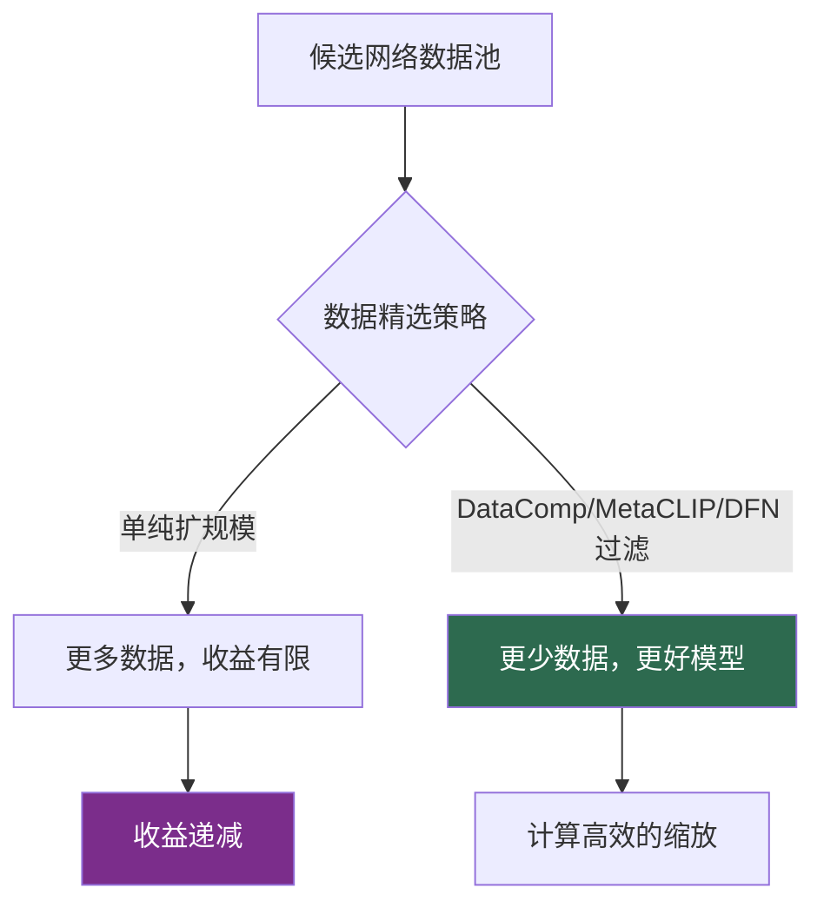

# 视觉中的缩放定律

> **英文原文：** [cv-knowledge-base/12_research_frontier_2024_2026/01_scaling_laws_vision.md](../../cv-knowledge-base/12_research_frontier_2024_2026/01_scaling_laws_vision.md)（本中文版供参考，内容以英文原文为准）

> **最后更新：** 2026年10月
> **难度级别：** 研究前沿
> **相关章节：**
> - [视觉 Transformer](../03_architectures/01_vision_transformers.md)
> - [自监督学习](../03_architectures/03_self_supervised_learning.md)
> - [多模态架构](../03_architectures/04_multimodal_architectures.md)
> - [概览：最新进展](./00_overview_latest.md)

> **🆕 2026年10月更新：**
> - 新增关于 **无语言监督的自监督缩放**（2025）的小节：Web-SSL（在 MC-2B 上训练 0.3B→7B 的 Web-DINO）与 DINOv3（7B ViT、17 亿张精选图像、Gram anchoring），二者共同削弱了“大规模下必须依赖语言监督”的假设。
> - 新增关于 **2025 年对比式/生成式编码器缩放** 的小节：SigLIP 2、Perception Encoder、Meta CLIP 2（全球数据；在 ViT-H/14 上打破“多语言诅咒”）、AIMv2。
> - 新增关于 **原生多模态模型缩放定律**（Shukor et al.，ICCV 2025 oral）的小节：早期融合与晚期融合表现相当，MoE 可学习模态专属权重。
> - 新增关于视频与机器人数据缩放（V-JEPA 2/2.1、π₀ 1 万+ 小时、GR00T N1.7 加入 2 万小时人类视频）以及 VLM 中测试时/强化学习缩放的说明。关键论文、基准、开放问题与延伸阅读均已扩充。

---

## 概述

缩放定律（scaling laws）——模型性能与参数、数据和算力等资源之间的经验幂律关系——通过 Kaplan et al.（2020）和 Chinchilla 计算最优分析（Hoffmann et al., 2022）重塑了语言建模。视觉领域的核心问题是这些定律能否迁移：更大的视觉主干、更多的数据和更多的算力，是否会带来同样平滑、可预测的回报？是否存在类似 Chinchilla 的计算最优参数/数据比？2022–2026 年的证据较为微妙：视觉模型*确实*可以扩展，但通常**比语言模型更慢、边际收益递减更明显**，并且**数据质量压倒原始数量**的程度是文本领域未曾见过的。

典型的论证包括 ViT-22B [Dehghani2023]，它将朴素 Vision Transformer 扩展到 220 亿参数，显示出持续但次线性的增益；CLIP/EVA-CLIP/SigLIP 的对比式视觉-语言缩放；以及 DataComp 和 MetaCLIP 的数据精选结果，表明*用哪些*图文对训练可能比用多少对更重要。本文形式化缩放关系、梳理经验证据，并解释为何视觉的缩放行为与语言不同——这一差异对 [优缺点与路线图](../06_robotics_and_embodied_ai/07_pros_cons_roadmaps.md) 中的具身智能缩放之争有直接影响。

2025–2026 年的结果带来三点重要修正。第一，**完全不使用语言监督的自监督视觉学习，其扩展效果与 CLIP 相当甚至更好**，前提是模型和数据足够大且数据经过精选（Web-SSL [Fan2025]、DINOv3 [Simeoni2025]）；大规模下真正的瓶颈是*长时间训练中稠密特征的退化*，DINOv3 用 Gram anchoring 解决了这一问题。第二，**目标函数与数据分布持续改变缩放常数**：sigmoid 损失、描述生成/自回归目标（AIMv2 [Fini2025]）、中间层对齐（Perception Encoder [Bolya2025]）以及全球多语言数据精选（Meta CLIP 2 [Chuang2025]）都带来了单纯扩大规模无法获得的增益。第三，**原生多模态模型**遵循与 LLM 相近的缩放定律，早期融合架构可与晚期融合（视觉编码器 + LLM）架构相媲美 [Shukor2025]。

---

## 缩放的数学

缩放定律将测试损失 `L` 表示为某项资源的幂律。对于资源 `X`（参数 `N`、数据 `D` 或算力 `C`）：

```
L(X) ≈ L_inf + (X_0 / X)^alpha
  L_inf : 不可约损失（贝叶斯误差 / 熵下限）
  alpha : 缩放指数（越大 ⇒ 回报越快）
```

Chinchilla 针对语言的计算最优结果，在计算预算 `C ≈ 6·N·D` 下最小化损失，得到 `N_opt ∝ C^a`、`D_opt ∝ C^b`，其中 `a ≈ b ≈ 0.5`——即参数与 token 应大致*同等*增长。视觉领域的经验发现是：指数 `alpha` 往往**更小**（回报更慢），并且在已饱和的基准上更早触及 `L_inf`（ImageNet top-1 在接近人类水平处趋于平台），因此额外的规模在分类上带来的收益逐渐减少，但仍有助于迁移与鲁棒性。

对于从零训练的原生多模态模型，Shukor et al. [Shukor2025] 拟合了 Chinchilla 形式的联合定律，报告称与 LLM 一样，计算最优的 `N` 与 `D` 以相近速率增长，而早期融合与晚期融合架构几乎位于同一条损失–算力前沿上：

```
L(N, D) ≈ E + A / N^alpha + B / D^beta
  N : 激活参数量，  D : 多模态训练 token 数
  发现 [Shukor2025]：在算力前沿上早期融合 ≈ 晚期融合；
  早期融合在小 N 时更优，训练/部署成本更低；
  稀疏 MoE 通过学习模态专属专家进一步提升二者
```

---

## 视觉中的经验证据

### 扩展主干：ViT-22B 与 ViT 缩放定律

Zhai et al.（2022）的 *Scaling Vision Transformers* 绘制了 ViT 性能随模型与数据规模的变化，刻画出一条饱和幂律；随后 **ViT-22B** [Dehghani2023] 推进到 220 亿参数，改善了公平性、鲁棒性和迁移能力，但在 ImageNet 上每 FLOP 回报明显递减。结论是：视觉从规模中获益最多的是*迁移和鲁棒性*，在已饱和的分布内准确率上获益较少。

### 对比式视觉-语言：CLIP、EVA-CLIP、SigLIP

CLIP [Radford2021] 确立了对比式图文预训练在零样本迁移上随数据和模型规模扩展的规律。**EVA-CLIP** 以掩码图像建模初始化，将 CLIP 高效扩展到数十亿参数；**SigLIP** [Zhai2023] 用 **sigmoid 损失** 取代 softmax 对比损失，使批量大小与损失归一化解耦，在小批量和大批量下都提升了缩放效率。这些表明*目标函数设计*会实质性地改变缩放常数。

### 质量胜于数量：DataComp、MetaCLIP、DFN

视觉领域最强的特有发现是**数据精选可与规模相匹敌甚至胜出**。**DataComp**（Gadre et al., 2023）将数据集设计作为实验变量，表明对固定候选池进行激进过滤比简单地使用更多数据得到更好的模型。**MetaCLIP** 逆向还原了 CLIP 的数据精选流程以使其可复现，**DFN（数据过滤网络，Data Filtering Networks）** 训练一个网络来挑选高质量图文对，得到的 DFN-2B/5B 优于规模大得多的未精选数据集。这是语言领域“优质 token”经验在视觉中的对应，但更为显著，因为网络图文对齐比纯文本噪声更大。



### 无语言的自监督缩放（2025）：Web-SSL 与 DINOv3

长期以来的一种观点认为，正是语言监督（CLIP）让视觉编码器得以扩展并服务于多模态大模型。**Web-SSL** [Fan2025]（*Scaling Language-Free Visual Representation Learning*，FAIR/NYU/普林斯顿）对此进行了检验：在与 CLIP 基线相同的网络数据（MC-2B）上训练 0.3B 到 7B 参数的 Web-DINO 模型以及最大 3B 的 Web-MAE 模型。性能随模型规模和数据稳步提升；在大规模下，一旦数据被过滤偏向富文本图像，纯视觉模型在广泛的 VQA 套件上——包括以往由 CLIP 主导的 OCR 和图表理解——达到或超过语言监督编码器。其含义是：CLIP 表观上的缩放优势在很大程度上是*数据分布*优势，而非*监督方式*优势。

**DINOv3** [Simeoni2025]（Meta，2025 年 8 月）将 DINO 式自监督学习（Self-Supervised Learning, SSL）扩展到 **70 亿参数 ViT（6.7B）**，在 **LVD-1689M**（约 17 亿张精选网络图像，DINOv2 约为 1.42 亿）上训练，另有一个在 SAT-493M 上训练的卫星图像版本。关键的缩放障碍在于：大模型长时间训练时，即便全局指标在提升，稠密（patch 级）特征质量却会*退化*；DINOv3 引入 **Gram anchoring**，一种使 patch 特征的 Gram 矩阵保持接近较早检查点的正则项，从而恢复稠密特征质量。随后将 7B 教师模型蒸馏为 ViT-S/B/L/H+（21M–840M）和 ConvNeXt（29M–198M）学生模型——这一“训练一个巨型模型、交付多个小模型”的做法日益成为标准，将缩放（只做一次）与部署成本解耦。

### 编码器目标再审视（2025）：SigLIP 2、Perception Encoder、Meta CLIP 2、AIMv2

- **SigLIP 2** [Zhai2025] 将 sigmoid 损失与基于描述生成的预训练、自蒸馏和掩码预测相结合，在每个模型规模上都改进了稠密特征和多语言覆盖。
- **Perception Encoder（PE）** [Bolya2025] 扩展了单一的对比式图像/视频编码器（PE-Core-G14-448：ImageNet 零样本 85.4%），并表明用于稠密预测和多模态大模型的最佳特征位于*中间*层；轻量级对齐（“PE-lang”“PE-spatial”）可将其显露出来。这意味着只衡量最终嵌入的缩放研究低估了大型编码器所学到的东西。
- **Meta CLIP 2** [Chuang2025]（NeurIPS 2025 spotlight）是首个在*全球*网络数据上从零训练 CLIP 的方案。多语言 CLIP 通常受“多语言诅咒”（curse of multilinguality）困扰（英文准确率低于仅英文训练）；Meta CLIP 2 按新增非英文数据的比例扩大所见样本对数量，并发现 ViT-H/14 是容量拐点，在该规模下全球数据可带来双向收益（ImageNet 零样本比仅英文版本高 0.8%，在 CVQA 上以 57.4% 达到 SOTA）。因此，容量成为从数据多样性中获益的*前提条件*。
- **AIMv2** [Fini2025]（CVPR 2025 highlight）以多模态自回归目标（解码器重建图像 patch 和描述 token）预训练视觉编码器。冻结主干的 ImageNet 准确率从 86.6%（0.3B，224px）单调提升到 88.5%（2.7B，224px）和 89.5%（2.7B，448px），在大多数多模态理解基准上优于 CLIP 和 SigLIP。

### 原生多模态模型的缩放定律（2025）

Shukor et al. [Shukor2025]（Apple/索邦大学；ICCV 2025 oral）对在图像描述、交错图文和文本数据上从零训练的*原生*多模态模型进行了数百次训练实验。他们发现晚期融合（独立的预训练视觉编码器 + LLM）相比早期融合（原始 patch 直接输入同一个 Transformer）并无内在优势；早期融合在较小参数量下更强、训练更便宜、部署更简单，而稀疏 **混合专家（Mixture-of-Experts, MoE）** 通过学习模态专属权重带来显著帮助。2025–2026 年的生产系统正朝这一方向发展：Qwen3.5（2026 年 2 月）描述其采用“在数万亿多模态 token 上的早期融合训练”，Emu3.5 / BAGEL 则在交错的视频-文本数据上训练理解与生成一体化模型（参见 [多模态大模型 2025–2026](./03_multimodal_llm_2025_2026.md)）。

### 视频、世界模型与机器人数据的缩放

- **视频自监督学习。** V-JEPA 2 将潜空间预测预训练扩展到 100 万小时以上的视频和 10 亿参数的 ViT-g，并以不到 100 小时的机器人数据进行动作条件后训练；V-JEPA 2.1（2026 年 3 月）将该家族扩展到 20 亿参数（ViT-G/16），其训练方案侧重于时间一致的稠密特征。
- **机器人数据。** 机器人策略的缩放受限于数据采集而非算力。π₀ 在 1 万+ 小时机器人数据上预训练；NVIDIA 的 GR00T N1.7（2026）用 **2 万小时第一人称人类视频**（EgoScale）扩充机器人数据，NitroGen（CVPR 2026 荣誉提名）则从互联网游戏视频中挖掘动作标签——这些都是用丰富的*人类/智能体视频*替代稀缺的机器人遥操作（teleoperation）数据的例子（参见 [VLA 与具身智能 2025–2026](./04_vla_embodied_2025_2026.md)）。
- **世界模型。** NVIDIA 的 Cosmos 3（2026 年 5 月）以 4B/16B/64B 规模发布，最大模型定位为蒸馏教师——同样是“一次扩展，蒸馏部署”。

### VLM 中的测试时与强化学习缩放

语言模型的“思考”能力在 2025 年延伸到了视觉。InternVL3.5 的 **Cascade RL**（先离线强化学习以稳定收敛，再在线强化学习）在 MMMU、MathVista 等推理基准上带来大幅提升；大多数前沿多模态大模型（GPT-5、Gemini 3、Qwen3-VL “Thinking”版本、GLM-4.5V）都提供推理模式。这引入了*第三个*缩放维度——推理算力——但其在感知密集型任务（计数、定位、OCR）上的回报远小于数学/图表推理任务。

---

## 关键论文

| 论文 | 作者 | 年份 | 会议/期刊 | 核心贡献 |
|-------|---------|------|-------|-----------------|
| Scaling Vision Transformers | Zhai, Kolesnikov, Houlsby, Beyer | 2022 | CVPR | ViT 的经验饱和缩放定律 |
| ViT-22B | Dehghani, Djolonga, Mustafa, et al. | 2023 | ICML | 22B 参数 ViT；鲁棒性/迁移有增益，但为次线性 |
| SigLIP (Sigmoid loss) | Zhai, Mustafa, Kolesnikov, Beyer | 2023 | ICCV | 用于高效缩放的 sigmoid 对比损失 |
| DataComp | Gadre, Ilharco, Fang, et al. | 2023 | NeurIPS | 以数据集设计作为缩放变量；精选 > 规模 |
| Data Filtering Networks (DFN) | Fang, Jose, Jain, et al. | 2023 | arXiv→ICLR | 可学习的数据过滤得到 DFN-2B/5B |
| Multimodal Autoregressive Pre-training of Large Vision Encoders (AIMv2) | Fini, Shukor, Li, et al. | 2025 | CVPR（Highlight） | 图像+文本自回归目标；单调增益至 2.7B；冻结主干 ImageNet 89.5% |
| SigLIP 2 | Tschannen, Gritsenko, Wang, et al. | 2025 | arXiv 2502.14786 | sigmoid 损失 + 描述生成 + 自蒸馏；多语言，稠密特征更好 |
| Scaling Language-Free Visual Representation Learning (Web-SSL) | Fan, Tong, Zhu, et al. | 2025 | arXiv 2504.01017 | 纯视觉自监督（0.3B–7B）在大规模下于 VQA 上比肩/超越 CLIP |
| Scaling Laws for Native Multimodal Models | Shukor, Fini, Turrisi da Costa, Cord, Susskind, El-Nouby | 2025 | ICCV（Oral） | 在算力前沿上早期融合 ≈ 晚期融合；MoE 有帮助 |
| Perception Encoder | Bolya, Huang, Sun, et al. | 2025 | arXiv 2504.13181 | 最佳嵌入位于中间层；PE-Core-G ImageNet 零样本 85.4% |
| Meta CLIP 2: A Worldwide Scaling Recipe | Chuang, Li, Wang, et al. | 2025 | NeurIPS（Spotlight） | 全球数据精选；容量阈值（ViT-H/14）打破多语言诅咒 |
| DINOv3 | Siméoni, Vo, Seitzer, et al. | 2025 | arXiv 2508.10104 | 在 17 亿图像上训练的 7B 自监督 ViT；Gram anchoring；蒸馏模型家族 |

---

## 基准性能

| 模型 | 参数量 | 设置 | 结果 | 备注 |
|-------|--------|---------|--------|-------|
| ViT-22B | 22B | ImageNet 迁移 | 鲁棒性/公平性 SOTA | 每 FLOP 增益为次线性 [Dehghani2023] |
| SigLIP | ~400M–1B | 零样本 ImageNet | 表现强，批量高效 | sigmoid 损失 [Zhai2023] |
| DFN-5B-CLIP | ViT 规模 | 零样本 ImageNet | 超越更大的未精选数据集 | 可学习过滤 |
| CLIP ViT-L/14 | ~300M | 零样本 ImageNet | 75–76% top-1 | 对比式缩放基线 |
| MetaCLIP ViT-bigG-14 v1.1 | bigG/14 | 零样本 ImageNet | 82.1% | 25 亿精选图文对 |
| Meta CLIP 2 ViT-bigG-14 (378px) | bigG/14 | CVQA-LOCAL（多语言） | 62.0% | 全球数据，所见样本对 290 亿 |
| PE-Core-G14-448 | G/14 | 零样本 ImageNet | 85.4% | ImageNet-A 92.6% [Bolya2025] |
| AIMv2-3B (448px) | 2.7B | ImageNet 冻结主干 | 89.5% | 从 0.3B/224px 的 86.6% 起 → 单调缩放 |
| DINOv3 ViT-7B | 6.7B | 稠密任务（分割、深度、跟踪） | 在自监督/弱监督编码器中达到 SOTA（据作者称） | 蒸馏得到的 ViT-L 在许多任务上接近持平 |
| V-JEPA 2 ViT-g | 1B | SSv2 注意力探测 | 77.3% | 100 万+ 小时视频 |

---

## 优缺点

| 方面 | 优点 | 缺点 |
|--------|------|------|
| 扩展主干 | 迁移/鲁棒性上的增益可预测 | 在饱和基准上边际收益递减明显 |
| 对比式缩放（CLIP/SigLIP） | 零样本迁移随数据扩展 | 对目标函数和批量设计敏感 |
| 数据精选（DataComp/DFN） | 计算高效；质量胜于数量 | 精选流程复杂；存在分布收窄风险 |
| Chinchilla 式计算最优 | 有原则的预算分配 | 视觉指数不同；方案不能直接照搬 |
| 大规模无语言自监督（Web-SSL、DINOv3） | 无需图像描述；稠密特征更优；可扩展到 7B | 需要超大精选数据池和长训练周期；稠密特征退化需要额外正则（Gram anchoring） |
| 巨型教师蒸馏 | 一次昂贵训练服务多种部署规模 | 学生继承教师的偏差；没有教师模型时缩放结论难以复现 |
| 原生早期融合多模态缩放 | 更简单，小 N 时更便宜；MoE 可按模态专门化 | 需要数万亿多模态 token；消融研究主要来自少数工业实验室 |

---

## 开放问题与研究空白

- **视觉版 Chinchilla。** 视觉主干尚无公认的计算最优 `N`/`D` 定律；指数随目标函数和基准而变。Shukor et al. 给出了*原生多模态*模型的定律，但并未覆盖在稠密任务上评估的纯视觉编码器。
- **基准饱和。** ImageNet top-1 已接近 `L_inf`；缩放研究缺乏未饱和、与迁移相关的指标。
- **质量与数量的形式化。** DataComp/DFN 属经验性结果；尚缺乏能预测数据质量如何影响缩放常数的理论。
- **自监督缩放。** MIM/对比式自监督学习（参见 [自监督学习](../03_architectures/03_self_supervised_learning.md)）是否像有监督/对比式视觉-语言方法那样扩展，仍缺乏充分刻画——DINOv2 表明数据精选再次占主导。Web-SSL 和 DINOv3 现已证明自监督学习*能够*扩展到 7B，但数据精选（LVD-1689M、富文本过滤）的作用仍与目标函数纠缠在一起。
- **稠密特征缩放。** 在长时间训练中，全局指标与稠密指标可能朝相反方向变化（即 Gram anchoring 所修补的问题）；目前缺乏针对 *patch 级* 表征的缩放理论。
- **多模态联合缩放。** VLM 中视觉编码器、连接器与 LLM 之间的最优资源分配（参见 [大型视觉-语言模型](../05_multimodal_vision_language/02_large_vision_language_models.md)）尚未解决；早期融合的结果表明编码器或许根本不必独立存在。
- **容量阈值。** Meta CLIP 2 表明数据多样性只有在超过某一模型规模阈值后才有帮助；如何提前预测这类阈值仍是开放问题。
- **具身缩放定律。** 机器人策略是否遵循类似定律仍在激烈争论中（参见 [优缺点与路线图](../06_robotics_and_embodied_ai/07_pros_cons_roadmaps.md)）；人类视频小时数与机器人遥操作小时数之间的“汇率”尚不清楚。
- **能耗/效率前沿。** 缩放定律忽略了日益上升的边际能耗成本，而这越来越成为实际规模的上限。

---

## 延伸阅读

- [Scaling Vision Transformers（arXiv:2106.04560）](https://arxiv.org/abs/2106.04560) — ViT 缩放行为
- [ViT-22B（arXiv:2302.05442）](https://arxiv.org/abs/2302.05442) — 将 ViT 扩展到 22B 参数
- [SigLIP（arXiv:2303.15343）](https://arxiv.org/abs/2303.15343) — 用于语言-图像预训练的 sigmoid 损失
- [DataComp（arXiv:2304.14108）](https://arxiv.org/abs/2304.14108) — 以数据集设计作为缩放变量
- [Chinchilla（arXiv:2203.15556）](https://arxiv.org/abs/2203.15556) — 计算最优缩放（语言参考）
- [Web-SSL: Scaling Language-Free Visual Representation Learning（arXiv:2504.01017）](https://arxiv.org/abs/2504.01017) — 7B 规模的纯视觉自监督
- [DINOv3（arXiv:2508.10104）](https://arxiv.org/abs/2508.10104) — 带 Gram anchoring 的 7B 自监督
- [Scaling Laws for Native Multimodal Models（arXiv:2504.07951）](https://arxiv.org/abs/2504.07951) — 早期融合 vs. 晚期融合
- [Perception Encoder（arXiv:2504.13181）](https://arxiv.org/abs/2504.13181) — 中间层特征
- [Meta CLIP 2（arXiv:2507.22062）](https://arxiv.org/abs/2507.22062) — 全球范围的 CLIP 缩放
- [AIMv2（arXiv:2411.14402）](https://arxiv.org/abs/2411.14402) — 多模态自回归编码器预训练
- [SigLIP 2（arXiv:2502.14786）](https://arxiv.org/abs/2502.14786) — 多语言、稠密特征增强的 SigLIP
