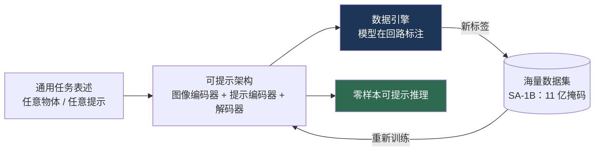
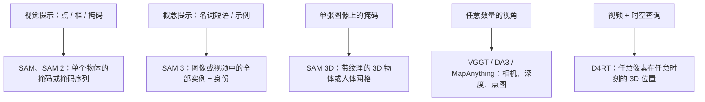

# “Anything”模型范式

> **英文原文：** [cv-knowledge-base/12_research_frontier_2024_2026/02_any_model_paradigm.md](../../cv-knowledge-base/12_research_frontier_2024_2026/02_any_model_paradigm.md)（本中文版供参考，内容以英文原文为准）

> **最后更新：** 2026年10月
> **难度级别：** 研究前沿
> **相关章节：**
> - [语义分割](../02_core_tasks/02_semantic_segmentation.md)
> - [深度估计](../02_core_tasks/05_depth_estimation.md)
> - [开放词汇检测](../05_multimodal_vision_language/03_open_vocabulary_detection.md)
> - [概览：最新进展](./00_overview_latest.md)

> **🆕 2026年10月更新：**
> - **SAM 3**（2025 年 11 月，ICLR 2026）：从视觉提示走向*概念*提示——检测、分割并跟踪某个名词短语或示例的每一个实例；SA-Co 基准（27 万个概念）；**SAM 3.1** Object Multiplex（2026 年 3 月）。
> - **SAM 3D Objects / SAM 3D Body**（2025 年 11 月；CVPR 2026 最佳论文荣誉提名）与 **Depth Anything 3**（2025 年 11 月）将该方法扩展到单图像 3D 与任意视角几何。
> - 新增关于 **前馈式几何 “anything” 模型** 的小节：VGGT（CVPR 2025 最佳论文）、MapAnything、D4RT（CVPR 2026 最佳论文）。
> - 该方法正扩展到视觉之外（SAM Audio）并融入统一世界模型（Cosmos 3）；关键论文、基准与开放问题已更新。

---

## 概述

“Segment Anything”式范式是 2023–2024 年计算机视觉最具影响的结构性转变：用**通过可提示推理通用地解决某一任务的单一基础模型**取代狭窄的、数据集专用的模型。由 SAM [Kirillov2023] 确立的这一模板包含三个可复现的要素：（1）**足够通用、可覆盖整类问题的任务表述**（任意物体、任意提示、任意图像）；（2）通过迭代“模型在回路”标注来自举海量标注数据集的**数据引擎**；（3）无需重新训练即可对新输入进行零样本推理的**可提示架构**。这一方法很快被移植到深度（Depth Anything）、识别（Recognize Anything）和跟踪（Track Anything），形成了一族“X-Anything”模型，它们如今作为现成的感知基元使用——包括在机器人领域提供场景表征（参见 [面向机器人的感知](../06_robotics_and_embodied_ai/08_perception_for_robotics.md)）。

使一个模型真正“通用”而不仅仅是“大”的，是**任务通用性**与**基于提示的零样本迁移**的结合。SAM 不做分类；它分割*指向的任何东西*，将几何任务（找到掩码）与语义任务（为其命名）解耦。这种分离是该范式的概念核心，也是这些模型能与开放词汇语义良好组合的原因（Grounded-SAM = Grounding DINO + SAM）。本文剖析这一方法、梳理主要实例，并考察通用性的局限。

2025–2026 年，该范式沿三个维度进入第二阶段。**语义维度**：SAM 3 [Carion2025] 接受*概念*提示，返回所有匹配实例及其在视频中的身份，在很大程度上弥合了“能分割却不能命名”的缺口。**几何维度**：“anything”的雄心从 2D 掩码扩展到 3D 与 4D——单图像物体和人体重建（SAM 3D）、任意视角深度与位姿（Depth Anything 3 [Lin2025]、VGGT [Wang2025]、MapAnything [Keetha2025]）以及动态场景重建（D4RT [Zhang2025]）。**模态维度**：该方法被应用到音频（SAM Audio），并被纳入兼具感知与生成能力的统一世界模型（NVIDIA Cosmos 3）。

---

## 方法配方

2025–2026 代保留了三个要素，但改变了“提示什么”和“预测什么”：

### Segment Anything（SAM、SAM2）

**SAM** [Kirillov2023]（ICCV 2023，Meta）由一个重量级 ViT 图像编码器、一个轻量级提示编码器（点、框、掩码）和一个快速掩码解码器组成，在 **SA-1B：1100 万张图像上的 11 亿个掩码** 上训练，该数据集由三阶段数据引擎构建（辅助手工 → 半自动 → 全自动）。它能在未见过的分布上执行**零样本可提示分割**。**SAM 2** [Ravi2024]（Meta，2024）通过流式记忆模块将其扩展到**视频**，可实时跨帧进行可提示分割与跟踪，并借助 SA-V 数据引擎在规模更大、更多样的视频语料上训练（参见 [语义分割](../02_core_tasks/02_semantic_segmentation.md)）。

### SAM 3：可提示概念分割（2025–2026）

**SAM 3** [Carion2025]（Meta，2025 年 11 月；ICLR 2026）定义了**可提示概念分割（Promptable Concept Segmentation, PCS）**：给定一个简短名词短语（如 “yellow school bus”）、图像示例或二者兼有，返回图像或视频中*每一个*匹配实例的掩码与持久身份。在架构上，一个图像级 DETR 式检测器和一个 SAM 2 式基于记忆的跟踪器共享同一个 Perception Encoder（PE）视觉主干（总计 8.48 亿参数）；一个**存在性头（presence head）**预测该概念是否出现，将识别（“它在这里吗？”）与定位（“每一个在哪里？”）解耦，减少了困难负样本上的误检。数据引擎——结合人类标注员、SAM 3 自身以及基于 MLLM 的校验器——产生了超过 **400 万个不同的概念标签**，发布的 **SA-Co** 基准涵盖 **27 万个不同概念**，比以往的开放词汇分割基准多 50 倍以上。SAM 3 在 SA-Co 上达到约人类水平的 75–80%（SA-Co/Gold 上 cgF1 55.7 对比人类 74.0），作者报告其在图像和视频概念分割上较以往系统提升约一倍。对于冗长、组合式的查询，“SAM 3 Agent”将 MLLM（负责分解查询）与 SAM 3（负责定位名词短语）配对使用。**SAM 3.1 Object Multiplex**（2026 年 3 月）引入了共享记忆的多目标联合跟踪方法，作者称其速度显著提升且不损失精度。

### SAM 3D：物体与人体（2025）

**SAM 3D Objects**（arXiv 2511.16624）可从单张自然图像中重建被掩码物体的完整 3D 形状、纹理与布局（在场景中的位姿）——明确针对遮挡和杂乱场景，而非干净、居中的商品图——并可导出高斯泼溅或网格。其方法与 SAM 一脉相承：采用渐进式训练与**人在回路数据引擎**，由标注员对模型提出的 3D 形状进行排序和修正，从而绕开真实图像缺乏 3D 真值的问题。**SAM 3D Body**（arXiv 2602.15989）是一个可提示（2D 关键点、掩码）的单图像全身人体网格恢复模型，使用 Momentum Human Rig（MHR）参数化模型，主干可选 DINOv3-H+ 或 ViT-H。SAM 3D 获得了 **CVPR 2026 最佳论文荣誉提名**。

### Depth Anything

**Depth Anything** [Yang2024a]（CVPR 2024）和 **Depth Anything V2** [Yang2024b] 将这一方法应用于**单目深度估计**，借助来自教师模型的伪标签利用大规模*无标签*数据并结合语义先验，扩展到约 6200 万+ 张图像。V2 在合成标注数据 + 伪标注真实数据上训练，生成锐利、鲁棒的相对深度，如今已成为默认的感知基元——包括用于 [空间智能](./06_spatial_intelligence.md) 中的空间数据流水线（参见 [深度估计](../02_core_tasks/05_depth_estimation.md)）。

**Depth Anything 3** [Lin2025]（字节跳动 Seed，2025 年 11 月）从单张图像推广到**任意数量的视角，相机位姿已知或未知均可**。它由两个刻意极简的选择定义：以单个朴素 Transformer（普通 DINO 编码器）作为主干，不使用任何 3D 专用架构；以单一的**深度-射线（depth-ray）**预测目标（逐像素深度加射线原点/方向）推导出相机与点云，避免多任务损失。DA3 仅在公开学术数据集上训练，据报道在单目深度上超越 DA2、在多视角深度与位姿上超越 VGGT；各版本参数从 0.08B 到 1.40B，并有度量版本和流式版本（DA3-Streaming，处理超长视频时 GPU 显存低于 12 GB）。

### 前馈式几何 “Anything” 模型（2025–2026）

另一条平行路线用单个可接受*任意*视角数量与输入的网络，取代了经典 SfM/MVS 与逐场景优化：

- **VGGT** [Wang2025]（牛津 VGG + Meta；**CVPR 2025 最佳论文**）：一个 10 亿参数的 Transformer，可在数秒内从一个到数百个视角预测相机内外参、深度图、点图与 3D 点轨迹。2026 年 5 月发布了 VGGT-Omega。
- **MapAnything** [Keetha2025]（Meta/CMU；3DV 2026）：一个用于*度量* 3D 重建的 Transformer，可在图像之外可选地接收内参、深度或位姿，并在单一模型中支持 12 种以上任务（SfM、MVS、单目度量深度、配准、深度补全）；同时发布 Apache-2.0 与非商用检查点。
- **D4RT** [Zhang2025]（Google DeepMind、UCL、牛津；**CVPR 2026 最佳论文**）：将视频一次性编码为全局场景表征；一个轻量解码器回答相互独立的查询：“第 *t* 帧中的像素 *p* 在时刻 *t′*、从相机 *c* 看去位于 3D 中何处？”。深度、点跟踪和相机位姿都成为同一查询的特例，据作者称，并行查询使推理速度比以往动态重建方法快多达 300 倍。这是将“可提示”思想移植到 4D：提示是一个时空查询，而不是一次点击。

### Recognize / Track / Grounded Anything

**Recognize Anything（RAM、RAM++）** [Zhang2023] 提供强大的开放集图像打标签能力。**Track Anything** 将 SAM 与视频跟踪器结合，用于交互式视频目标分割。**Grounded-SAM** 将 **Grounding DINO**（开放词汇检测，参见 [开放词汇检测](../05_multimodal_vision_language/03_open_vocabulary_detection.md)）与 SAM 组合，实现文本提示的“检测并分割一切”，体现了该范式的可组合性。SAM 3 如今在单一模型中涵盖了 Grounded-SAM 流水线的大部分功能，但对于推理密集的查询，仍需与 MLLM 组合。

### 超越视觉，迈向统一模型

**SAM Audio**（Meta，2025 年 12 月；arXiv 2512.18099）将可提示方法应用于声音分离：使用文本、视觉（视频中被掩码的物体）或时间区间提示，从混合音频中分离出任意声音。另一方面，“anything”编码器正被吸收进更大的统一模型：**NVIDIA Cosmos 3**（2026 年 5 月）在同一架构上提供*推理器*（文本+视觉→文本）与*生成器*（文本、视觉、声音、动作 → 视觉、声音、动作），而 DINOv3 [Simeoni2025] 已成为上述许多系统的默认冻结主干（例如 SAM 3D Body 的 DINOv3-H+ 版本）。

---

## 关键论文

| 论文 | 作者 | 年份 | 会议/期刊 | 核心贡献 |
|-------|---------|------|-------|-----------------|
| Segment Anything (SAM) | Kirillov, Mintun, Ravi, et al. | 2023 | ICCV | 可提示分割 + SA-1B（11 亿掩码）数据引擎 |
| SAM 2 | Ravi, Gabeur, Hu, et al. | 2024 | Meta / arXiv | 带记忆的视频可提示分割与跟踪 |
| Depth Anything | Yang, Kang, Huang, et al. | 2024 | CVPR | 借助大规模无标签数据的单目深度基础模型 |
| Depth Anything V2 | Yang, Kang, Huang, et al. | 2024 | NeurIPS | 通过合成数据 + 伪标签获得更锐利、鲁棒的深度 |
| Recognize Anything (RAM) | Zhang, Huang, Ma, et al. | 2023 | arXiv→CVPRW | 强大的开放集图像打标签基础模型 |
| VGGT: Visual Geometry Grounded Transformer | Wang, Chen, Karaev, Vedaldi, Rupprecht, Novotny | 2025 | CVPR（最佳论文） | 从 1 到数百个视角前馈预测相机、深度、点图与轨迹 |
| MapAnything: Universal Feed-Forward Metric 3D Reconstruction | Keetha et al. | 2025 | 3DV 2026 | 单一模型处理 12+ 种度量 3D 任务，可选几何输入 |
| SAM 3: Segment Anything with Concepts | Carion et al. | 2025 | ICLR 2026 | 可提示概念分割；存在性头；SA-Co（27 万概念） |
| SAM 3D Objects | Meta（SAM 3D Team） | 2025 | arXiv 2511.16624；CVPR 2026 荣誉提名 | 杂乱场景中单图像 3D 物体形状、纹理与布局 |
| SAM 3D Body | Meta（SAM 3D Team） | 2026 | arXiv 2602.15989 | 可提示的单图像全身人体网格恢复（MHR） |
| Depth Anything 3: Recovering the Visual Space from Any Views | Lin, Chen, Liew, et al. | 2025 | arXiv 2511.10647 | 朴素 Transformer 深度-射线预测，用于任意视角深度与位姿 |
| Efficiently Reconstructing Dynamic Scenes One D4RT at a Time | Zhang, Le Moing, Koppula, et al. | 2025 | CVPR 2026（最佳论文） | 基于查询的统一 4D 重建；快达 300 倍 |
| SAM Audio | Meta | 2025 | arXiv 2512.18099 | 文本/视觉/时间区间提示的声音分离 |

---

## 基准性能

| 模型 | 任务 | 数据集/指标 | 结果 | 备注 |
|-------|------|----------------|--------|-------|
| SAM | 零样本分割 | 23 个数据集 | 强零样本 mIoU/AR | 可提示，无需微调 [Kirillov2023] |
| SAM 2 | 视频分割 | SA-V / J&F | 交互式 VOS SOTA，实时 | 流式记忆 [Ravi2024] |
| Depth Anything V2 | 单目深度 | 零样本相对深度 | 鲁棒，边缘锐利 | 6200 万+ 图像，含无标签数据 |
| Grounded-SAM | 文本→掩码 | 开放词汇分割 | 组合式零样本 | Grounding DINO + SAM |
| SAM 3 | 概念分割（图像） | SA-Co/Gold / cgF1 | 55.7（人类 74.0） | 约为人类表现的 75–80% [Carion2025] |
| SAM 3 | 概念分割（视频） | SA-V test / cgF1；YT-Temporal-1B / pHOTA | 30.3；63.6 | 人类分别为 53.1 和 78.4 |
| SAM 3 | 视频实例分割 | LVVIS test / mAP；BURST test / HOTA | 36.3；44.5 | 单一模型，概念提示 |
| SAM 3D Body (DINOv3-H+) | 人体网格恢复 | 3DPW / MPJPE；FreiHAND / PA-MPJPE | 54.8；5.5 | 对比 CameraHMR、NLF、HMR2.0b（定性地声称有改进） |
| Depth Anything 3 (Nested-Giant-Large) | 位姿（射线头） | ScanNet++ / AUC3；HiRoom / AUC3 | 89.4；84.4 | 射线头在 5 个数据集中的 4 个上优于相机头 |
| VGGT-1B-Commercial | 相机位姿 | Co3D / AUC@30 | 90.37 | 原始检查点为 89.98 |
| D4RT | 动态 4D 重建 | 动态场景基准 | SOTA（据作者称）；快达 300 倍 | 截至撰写时权重未公开发布 |

---

## 优缺点

| 方面 | 优点 | 缺点 |
|--------|------|------|
| 可提示的通用性 | 在新分布上零样本；无需逐任务训练 | 仅限几何任务——SAM 能分割但不能命名（SAM 3 的概念提示部分解决了这一问题） |
| 数据引擎 | 低成本自举十亿级标签 | 伪标签噪声；教师偏差传播 |
| 可组合性 | 可接入开放词汇/LLM 流水线 | 组合模块间误差累积 |
| 现成感知基元 | 可在机器人/自动驾驶/医疗等领域复用 | 编码器笨重；实时/边缘场景延迟高 |
| 概念提示（SAM 3） | 单一模型中实现带身份的详尽实例召回；开放词汇检测、分割与跟踪一体化 | 仅支持短名词短语；复杂指代表达需要 MLLM 智能体；在 SA-Co 上与人类有约 20–25% 的差距 |
| 前馈式 3D/4D（VGGT、DA3、MapAnything、D4RT） | 以秒级替代数小时；统一输出（位姿、深度、轨迹）；为机器人/AR 提供强先验 | 度量尺度、超长序列和特殊光学条件仍有困难；许可证各异（商用与非商用检查点；部分权重未发布） |
| 人在回路 3D 数据引擎（SAM 3D） | 在缺乏真值的真实图像上扩展 3D 监督 | 基于偏好的标签带有标注员审美偏向；被遮挡几何的物理准确性无法验证 |

---

## 开放问题与研究空白

- **语义通用性。** SAM 在几何上是通用的，但在语义上是空白的；真正通用的*识别*（以 SAM 的覆盖度进行开放世界命名）尚未解决。SAM 3 的概念提示和 SA-Co（27 万个概念）是一大步，但长尾、细粒度和组合式概念仍落后于人类表现。
- **效率。** ViT 编码器很重；将“Anything”模型蒸馏到边缘/实时预算（MobileSAM、EfficientSAM）是以精度换速度。蒸馏后的 DINOv3 学生模型与 SAM 3.1 的多路复用跟踪是近期的效率改进。
- **3D 与 4D “Anything”。** 将该方法扩展到可提示的 3D/4D 场景理解（参见 [4D 与动态场景](./05_4d_and_dynamic_scenes.md)）在 2025–2026 年进展迅速（SAM 3D、DA3、VGGT、MapAnything、D4RT），但这些模型重建的是几何，而非对 3D/4D 场景进行*语义*分割与推理；支持概念提示的 “4D 版 SAM 3” 仍是开放问题。
- **数据引擎偏差。** 自动标注继承并放大了教师模型的偏差与失效模式。
- **度量定位。** Depth Anything 输出的是*相对*深度；通用*度量*深度仍更困难。MapAnything 与 DA3-Metric 缩小了部分差距，但在没有辅助输入时尺度歧义依然存在。
- **通用性的评估。** 尚无公认协议来衡量一个模型究竟有多“通用”，而非对基准分布过拟合。
- **可组合性保证。** 像 Grounded-SAM 这样的流水线在模块串联时缺乏误差界。
- **统一 vs. 专门化。** 目前尚不清楚各自独立的“anything”模型（分割、深度、3D、音频）会作为 MLLM 智能体调用的工具而长期存在，还是会被吸收进统一的感知-生成世界模型（Cosmos 3 式）。

---

## 延伸阅读

- [Segment Anything（arXiv:2304.02643）](https://arxiv.org/abs/2304.02643) — 奠基论文与 SA-1B
- [SAM 2（arXiv:2408.00714）](https://arxiv.org/abs/2408.00714) — 图像与视频中的分割一切
- [Depth Anything V2（arXiv:2406.09414）](https://arxiv.org/abs/2406.09414) — 鲁棒的单目深度基础模型
- [Grounded-SAM（arXiv:2401.14159）](https://arxiv.org/abs/2401.14159) — 开放词汇检测并分割
- [Recognize Anything（arXiv:2306.03514）](https://arxiv.org/abs/2306.03514) — 开放集打标签
- [SAM 3（arXiv:2511.16719）](https://arxiv.org/abs/2511.16719) 及 [代码（含 SAM 3.1）](https://github.com/facebookresearch/sam3) — 概念分割
- [SAM 3D Objects](https://github.com/facebookresearch/sam-3d-objects) 与 [SAM 3D Body](https://github.com/facebookresearch/sam-3d-body) — 单图像 3D
- [Depth Anything 3（arXiv:2511.10647）](https://arxiv.org/abs/2511.10647) — 任意视角深度与位姿
- [VGGT（arXiv:2503.11651）](https://arxiv.org/abs/2503.11651) — CVPR 2025 最佳论文
- [MapAnything（arXiv:2509.13414）](https://arxiv.org/abs/2509.13414) — 通用度量 3D 重建
- [D4RT（arXiv:2512.08924）](https://arxiv.org/abs/2512.08924) — CVPR 2026 最佳论文
- [SAM Audio（arXiv:2512.18099）](https://arxiv.org/abs/2512.18099) — 可提示的音频分离
