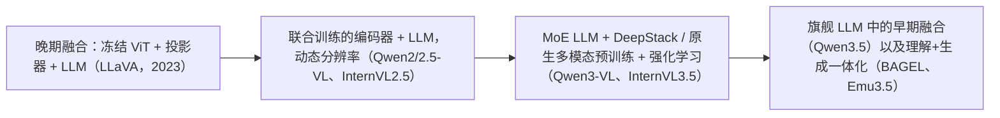
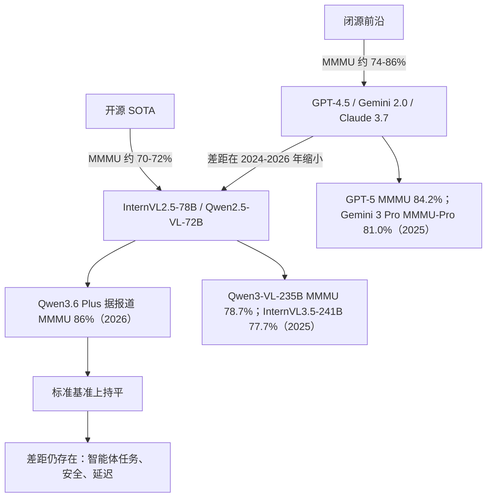

# 多模态大语言模型：2025–2026 年技术前沿

> **英文原文：** [cv-knowledge-base/12_research_frontier_2024_2026/03_multimodal_llm_2025_2026.md](../../cv-knowledge-base/12_research_frontier_2024_2026/03_multimodal_llm_2025_2026.md)（本中文版供参考，内容以英文原文为准）

> **最后更新：** 2026年10月
> **难度级别：** 研究前沿
> **相关章节：**
> - [大型视觉-语言模型](../05_multimodal_vision_language/02_large_vision_language_models.md)
> - [VLA 与具身智能前沿](./04_vla_embodied_2025_2026.md)
> - [未来趋势](./07_future_trends.md)

> **🆕 2026年10月更新：**
> - 补充 2025–2026 年前沿：**GPT-5**（MMMU 84.2%）、**Gemini 3 Pro**（MMMU-Pro 81.0%、Video-MMMU 87.6%、ScreenSpot-Pro 72.7%），以及评测重心从 MMMU 向 MMMU-Pro / Video-MMMU / GUI 定位的转移。
> - 新增开放模型简介：**Qwen3-VL**（2B–235B-A22B，Interleaved-MRoPE、DeepStack，256K→1M 上下文）、**InternVL3 / InternVL3.5**（Cascade RL，最大 241B-A28B）、**Qwen3.5 / Qwen3.6**（早期融合多模态预训练）、GLM-4.5V/4.6V、MiniCPM-V 4.5–4.7、PerceptionLM。
> - 新增架构家族：**早期融合以及理解+生成一体化模型**（Qwen3.5、BAGEL、Emu3.5），以及强化学习/“思考”式后训练。
> - 更正了“没有开放模型提供 1M token 多模态上下文”的开放问题表述（Qwen3-VL 原生支持 256K，可扩展至 1M）；对未经核实的第三方分数加以限定说明。

---

## 概述

2024 至 2026 年间，多模态大语言模型（MLLM）走向决定性的成熟：从在冻结语言模型上外挂视觉适配器，转向在文本、图像、音频和视频上端到端训练的原生多模态架构。当前的竞争前沿由四个维度定义：（1）感知广度——单一模型原生处理多少种模态与分辨率；（2）上下文长度——从 32 K token 到 1 M+ token，解锁小时级视频理解；（3）推理深度——基于视觉证据的数学与科学问题求解；（4）开放/闭源差距——开源社区能在多大程度上复现闭源模型的性能。

闭源模型在 2024 年一路领先。GPT-4o（2024 年 5 月）将文本、视觉和音频统一到单个端到端全模态解码器中，确立了新的参照点，在 MMMU 上达到 69.1%，显著超越其前身 GPT-4V。Google 的 Gemini 1.5 Pro 以稀疏混合专家架构开辟新局，支持多达 1 M token 的混合模态上下文——足以摄入并推理整部长片。到 2025 年初，Gemini 2.0 Flash 以更低推理成本在 MMMU 上达到 70.7%，延续了这一谱系；而 Anthropic 的 Claude 3.5/3.7 Sonnet 视觉版本将文档理解推到 DocVQA 接近 96%。

开源领域经历了平行的革命。InternVL2.5-78B 成为首个在 MMMU 上超过 70% 的开放模型（使用思维链时为 70.1%），Qwen2.5-VL-72B 在 MathVista（74.8）、MMBench（88.6）和 DocVQA（96.4）上达到或超过许多闭源基线。到 2026 年中，领先的开放与闭源模型在标准基准上的功能差距已大幅缩小，但闭源模型在智能体、长时程和安全敏感任务上仍保有优势。

自 2025 年中起，前沿再次推进。**推理（“思考”）模型**成为默认：GPT-5（2025 年 8 月）报告 MMMU 84.2%、MMMU-Pro 78.4%；Gemini 3 Pro（2025 年 11 月）报告 MMMU-Pro 81.0%、Video-MMMU 87.6%、ScreenSpot-Pro（GUI 定位）72.7%——因此 MMMU 本身已接近饱和，评测已转向更难的视频与智能体基准。在开放权重方面，**Qwen3-VL**（2025 年 9–11 月）与 **InternVL3.5**（2025 年 8 月）采用 MoE 语言主干（235B-A22B 和 241B-A28B）、强化学习后训练和长原生上下文；**Qwen3.5**（2026 年 2 月）转向**早期融合**训练，“在数万亿多模态 token 上”训练，使视觉成为旗舰 LLM 的原生模态，而非单独的 “-VL” 分支。中国实验室（阿里巴巴 Qwen、上海人工智能实验室、智谱、OpenBMB、月之暗面、字节跳动 Seed）如今提供了大多数最强的开放权重多模态大模型。

---

## 架构家族

### 端到端全模态（GPT-4o、Gemini）

GPT-4o 通过一个端到端训练的统一纯解码器 Transformer 处理文本、视觉和音频。该架构不使用独立的冻结视觉编码器；视觉 token 被投影到与文本相同的 token 空间，并在所有 Transformer 层中联合进行注意力计算。这使得实时语音-视觉交互成为可能，据报道延迟低于 300 ms。细节仍属专有，但相较 GPT-4V 的关键进步在于以联合预训练取代两阶段流水线（冻结视觉编码器 + 适配器）。

Gemini 1.5 Pro 使用稀疏混合专家（Mixture-of-Experts, MoE）Transformer。一个可学习的路由函数为每个 token 仅激活部分专家参数，使每 token 的 FLOPs 在总参数量增长时保持不变。多模态输入——图像帧、音频频谱图、文本——各自由模态专属的前端编码后进入 MoE 主干。1 M token 的上下文窗口通过修改注意力机制（环形注意力 / 线性注意力变体）并结合激进的 KV 缓存管理来实现。

### CLIP 适配器流水线（LLaVA、InstructBLIP）

较早的范式——在较小规模上仍极具竞争力——在冻结的 CLIP 式视觉编码器与冻结或部分冻结的 LLM 之间加入轻量级 MLP 或 Q-Former 桥接。投影器将稠密的空间视觉特征转换为一串软视觉 token，由 LLM 与文本一同处理。InternVL2 改进了这一范式，使用从零开始以高分辨率训练的 60 亿参数视觉编码器（InternViT-6B），大幅缓解了较小 ViT-L/14 编码器固有的信息瓶颈。

### 动态分辨率原生多模态（Qwen2-VL、InternVL2.5）

2024–2025 年的一项关键创新是**动态分辨率处理**：不再将所有图像缩放到固定的 336 × 336 网格，Qwen2-VL 等模型采用朴素动态分辨率（Naive Dynamic Resolution）机制，将图像切分为可变长度的 patch 序列。Qwen2-VL 的**多模态旋转位置编码（Multimodal Rotary Position Embedding, M-RoPE）**分别编码 2-D 空间位置和视频的时间位置，使同一模型能以单一统一的注意力栈处理静态图像和多帧视频。InternVL2.5 将 InternViT-6B（448 px 图块）与动态高分辨率模式结合——对文档图像可达 4K 分辨率——通过把图像分解为重叠图块实现。

**Qwen3-VL**（2025）在这条路线上做了三项改进：**Interleaved-MRoPE**，以交错、全频率的方式在时间、宽度和高度上分配旋转频率，用于长时程视频推理；**DeepStack**，将多层级 ViT 特征（而不仅是最后一层）注入 LLM 以获取细粒度细节；以及用于视频事件定位的**文本-时间戳对齐**，取代 T-RoPE。原生上下文为 256K token，借助 YaRN 可扩展到 1M。**InternVL3**（2025 年 4 月）引入*原生多模态预训练*——在单一阶段联合训练多模态与文本数据，而非对已完成的 LLM 进行适配——并采用可变视觉位置编码（Variable Visual Position Encoding, V2PE）；**InternVL3.5**（2025 年 8 月）加入视觉分辨率路由器（Visual Resolution Router, ViR），以近乎无损的精度将视觉 token 减半，并采用视觉-语言解耦部署（Decoupled Vision–Language Deployment, DvD），推理速度最高提升约 4 倍。

### 早期融合与理解+生成一体化（2025–2026）

缩放定律证据表明，在同等算力下早期融合（原始 patch 输入同一个 Transformer）可与晚期融合（独立编码器 + LLM）相当（参见 [视觉中的缩放定律](./01_scaling_laws_vision.md)），这一点如今已反映在生产模型中：

- **Qwen3.5**（2026 年 2 月；0.8B–397B-A17B）描述其为通过在数万亿多模态 token 上进行早期融合训练构建的“统一视觉-语言基础”；Qwen3.6（2026 年 4 月）随后推出，侧重智能体应用。智谱称 GLM-5.3-Flash（2026 年 8 月）是其首个开源的原生多模态模型。
- **BAGEL** [Deng2025]（字节跳动 Seed，2025 年 5 月；总计 14B / 激活 7B，Mixture-of-Transformers）统一了理解与生成（文生图、编辑、多视角合成、导航）；在 MMMU 上得分 55.3，在 GenEval 上得分 0.82（使用改写器时为 0.88）。
- **Emu3.5**（智源研究院 BAAI，2025 年 10 月）在超过 10T 交错的视频帧/转录文本 token 上以单一下一 token 预测目标训练，将多模态大模型定位为“世界学习者”；据报道，离散扩散适配（Discrete Diffusion Adaptation, DiDA）可使图像解码加速约 20 倍。



### 推理后训练：强化学习与“思考”模式

继纯文本推理模型之后，多模态大模型在 2025 年采用了强化学习后训练和显式思考预算。InternVL3.5 的 **Cascade RL** 先运行离线强化学习（MPO）以稳定收敛，再运行在线强化学习（GSPO 式）进行精修，将 MMMU 提升到 73.4（8B）和 77.7（241B-A28B）；据作者称，其所需 GPU 时数约为两轮在线强化学习的一半即可达到同等性能。智谱的 **GLM-4.1V-Thinking** 采用带课程采样的强化学习（RLCS），使 9B 模型在 18 个基准上达到或超过 Qwen2.5-VL-72B；Qwen3-VL 则分别发布 *Instruct* 与 *Thinking* 检查点。收益主要集中在数学/图示/图表推理上；纯感知任务（计数、小目标定位）获益要少得多。

---

## 基准概览

用于追踪前沿进展的关键基准：

- **MMMU**（Yue et al., 2023）：涵盖 6 个学科的 1.15 万道大学水平题目。需要对图像 + 文本进行真正的推理。
- **MathVista**（Lu et al., 2023）：6 141 道数学密集型视觉问答题。
- **MMBench**（Liu et al., 2023）：覆盖 20 个技能维度的约 3 000 道结构化 VQA 题目。
- **DocVQA**（Mathew et al., 2021）：文档图像问答；测试 OCR 与版面理解。
- **RefCOCO/+/g**（Yu et al., 2016）：指代表达理解；测试定位（grounding）能力。
- **MMMU-Pro**（Yue et al., 2024）：MMMU 的鲁棒版本（更多选项，以及将问题嵌入图像中的纯视觉设置），旨在杜绝仅靠文本的捷径。
- **Video-MMMU**（2025）：从专家级讲座视频中获取知识。
- **ScreenSpot-Pro**（2025）：在高分辨率专业软件界面上进行 GUI 元素定位——计算机使用智能体的代理指标。
- **CharXiv**（2024）：对 arXiv 论文中真实科学图表的推理。

```
基准难度（近似人类上限）：
MMMU: ~83%  |  MathVista: ~60%  |  MMBench: ~89%  |  DocVQA: ~98%
```

注意：MMMU 测试集答案已于 2026 年 2 月公开发布，因此此后在本地计算的 MMMU 测试集分数在数据污染方面需格外谨慎。

---

## 闭源与开源差距分析



到 2026 年中，最大的开放权重模型在静态基准上的差距已基本消除。第三方追踪平台报告 Qwen3.6 Plus 在 MMMU 上达到 86.0%，与早期闭源结果持平或超越（注意 Qwen3.6-Plus 是 API 模型；其开放权重的同系模型 Qwen3.6-27B/35B-A3B 报告分数较低）。然而，前沿闭源模型在多步智能体评测（GUI 定位、计算机使用）、1 M+ token 的真实世界视频理解以及低延迟部署上走得更远——在这些方面开放模型仍然落后。在更难的基准上差距更为明显：例如 Gemini 3 Pro 在 MMMU-Pro 上为 81.0%，而 Qwen3-VL-235B 报告约为 68–69%。

---

## 模型简介

### GPT-4o（OpenAI，2024 年 5 月）
端到端全模态 Transformer。原生语音、视觉和文本，延迟低于 300 ms。MMMU：69.1%。MathVista：63.8%。DocVQA：约 92.8%（截至 2025 年初）。后缀 “o” 表示真正的全模态（omni）训练，而非级联流水线。

### GPT-5（OpenAI，2025 年 8 月）
在快速模型与更深层“思考”模型之间路由的统一系统。OpenAI 报告（高推理强度下）MMMU 84.2%、MMMU-Pro 78.4%、CharXiv-Reasoning（启用 python）81.1%、Video-MMMU 84.6%（最多 256 帧）——这是首个被广泛引用的 MMMU 超过 80% 的结果。后续 GPT-5.x 小版本持续发布至 2026 年。

### Gemini 1.5 Pro / 2.0 Flash（Google DeepMind，2024–2025）
Gemini 1.5 Pro：稀疏 MoE，1 M token 上下文，在长视频上的“大海捞针”召回近乎完美。MMMU：65.8%。Gemini 2.0 Flash：更轻、更快的继任者，MMMU 70.7%、DocVQA 96.4%，在生产使用中具有出色的性价比。

### Gemini 2.5 / Gemini 3（Google DeepMind，2025–2026）
Gemini 2.5 Pro（2025 年 3 月）为 Gemini 系列引入了内置思考能力。**Gemini 3 Pro**（2025 年 11 月 18 日）报告 MMMU-Pro 81.0%、Video-MMMU 87.6%、ScreenSpot-Pro 72.7%，最后一项代表 GUI 定位能力的大幅跃升，与计算机使用智能体密切相关。Gemini 3.1 Pro 于 2026 年初推出，Gemini Flash 模型在 2026 年获得了智能体式视频分析能力（自主选择要检查的片段、帧率和模态）（据报道）。Gemini 系列也是 Gemini Robotics 1.5 / ER 1.5 的基础（参见 [VLA 与具身智能 2025–2026](./04_vla_embodied_2025_2026.md)）。

### Claude 3.5 / 3.7 Sonnet Vision 与 Claude 4.x（Anthropic，2024–2026）
文档与图表理解能力强。MMMU：68.3%（Claude 3.5 Sonnet）。后续的 Claude 4.x 模型（Opus 4.5，2025 年 11 月；Opus 4.6，2026 年初）继续侧重文档/图表理解、工具使用、计算机使用和智能体工作流；与其他实验室相比，Anthropic 公布的标准视觉基准数字较少。

### InternVL2 / InternVL2.5（OpenGVLab，CVPR 2024 Oral → 2024 年 12 月）
开源 SOTA。InternViT-6B 视觉编码器 + MLP 投影器 + InternLM2 或 Llama-3 LLM。三个渐进训练阶段：对比对齐、生成式训练、有监督微调。InternVL2.5-78B：MMMU 70.1%（思维链）、MMBench-EN 88.3%、RefCOCO val 90.3%。

### InternVL3 / InternVL3.5（OpenGVLab，2025 年 4 月 → 8 月）
InternVL3（1B–78B）引入原生多模态预训练与 V2PE；InternVL3-78B 达到 72.2% MMMU。InternVL3.5 涵盖稠密模型（1B–38B）与 MoE 模型（基于 GPT-OSS 的 20B-A4B、30B-A3B，以及采用 5.5B InternViT 编码器的 241B-A28B），并加入 Cascade RL、ViR 和 DvD。InternVL3.5-241B-A28B 报告 MMMU 77.7；据作者称，在其综合指标上通用多模态能力与 GPT-5 持平（74.1 对 74.0），总体差距约 3.9%。

### Qwen2-VL / Qwen2.5-VL（阿里巴巴达摩院，2024 年 9 月 → 2025 年 2 月）
动态分辨率 + M-RoPE。Qwen2.5-VL-72B：MMMU 70.2%、MathVista 74.8%、MMBench-EN 88.6%、DocVQA 96.4%。截至 2025 年初在文档理解方面领跑开源排行榜。

### Qwen3-VL（阿里巴巴 Qwen，2025 年 9–11 月）
稠密 2B/4B/8B/32B 与 MoE 30B-A3B/235B-A22B，每个都有 Instruct 与 Thinking 两个版本；技术报告为 arXiv 2511.21631（2025 年 11 月）。采用 Interleaved-MRoPE、DeepStack 与文本-时间戳对齐；原生 256K 上下文（借助 YaRN 可达 1M），据报道可分析两小时视频。Qwen3-VL-235B-A22B-Instruct 模型卡：MMMU 78.7、DocVQA 97.1、ChartQA 90.3；Thinking 版本据报道 MMMU 约 80.6。Qwen3-VL 还是 NVIDIA Cosmos-Reason2 的主干架构，因而也是 GR00T N1.7 的主干架构。

### Qwen3.5 / Qwen3.6（阿里巴巴 Qwen，2026 年 2–4 月）
Qwen3.5（2026 年 2 月 16 日，首发 397B-A17B；随后发布 122B-A10B、35B-A3B、27B 以及 0.8B–9B）通过早期融合多模态预训练，将 VL 系列并入主线 LLM。Qwen3.6（2026 年 4 月：开放的 35B-A3B 与 27B；API 版 Qwen3.6-Plus）侧重智能体编程与稳定性；第三方追踪平台报告 Qwen3.6-Plus 的 MMMU 为 86.0%，开放的 Qwen3.6-27B 约为 82.9%。阿里巴巴的代码仓库列出了 2026 年 8 月发布的 Qwen3.8。

### 其他值得关注的开放多模态大模型（2025–2026）
- **GLM-4.5V / GLM-4.6V**（智谱，2025 年 8 月 → 2025 年末）：GLM-4.5V（基于 GLM-4.5-Air）在 42 个基准上报告同规模 SOTA，并带有思考模式开关；GLM-4.6V（106B）与 GLM-4.6V-Flash（9B）将上下文扩展到 128K，并加入原生多模态函数调用。
- **MiniCPM-V / MiniCPM-o**（OpenBMB）：MiniCPM-o 4.5（9B，端到端全模态）在 8 个 OpenCompass 基准上平均 77.6；MiniCPM-V 4.6（2026 年 5 月）加入 4×/16× 混合视觉 token 压缩；MiniCPM-V 4.7（2026 年 10 月）是该系列首个端侧 MoE 模型（35B-A3B），据称在旗舰手机上约 3 GB 内存即可实现每秒 13+ token。
- **PerceptionLM（PLM）**（Meta，2025 年 4 月）：基于 Perception Encoder、数据完全开放的 1B/3B/8B 模型，同时发布 PLM-VideoBench；PLM-8B：DocVQA 94.6、VideoMME 58.3。
- **LLaVA-OneVision-1.5**（2025）：完全开放的训练框架（见下文）。
- **Kimi K2.5**（月之暗面，2026 年 1 月）：作为开放权重的原生多模态智能体模型，据报道 MMMU-Pro 78.5%、Video-MMMU 86.6%（报道数字）。

### LLaVA-OneVision（Haotian Liu et al., 2024）
LLaVA 谱系的集大成之作。单一模型处理单图、多图和视频，提供 0.5B/7B/72B 版本。LLaVA-OV-72B 在 47 个基准上取得有竞争力的结果。LLaVA-OV-1.5-8B 平均准确率 76.0%，对比 Qwen2.5-VL-7B 的 74.2%。

---

## 关键论文

| 论文 | 作者 | 年份 | 会议/期刊 | 核心贡献 |
|---|---|---|---|---|
| GPT-4V System Card | OpenAI | 2023 | 技术报告 | 首个具备视觉能力的 GPT-4 级模型；确立新的 VQA/推理基线 |
| Gemini 1.5: Unlocking multimodal understanding across millions of tokens of context | Team Gemini | 2024 | arXiv 2403.05530 | 稀疏 MoE + 1M token 多模态上下文窗口 |
| InternVL: Scaling up Vision Foundation Models and Aligning for Generic Visual-Linguistic Tasks | Chen et al. | 2024 | CVPR（Oral） | InternViT-6B；开源 VLM 的三阶段训练流程 |
| Expanding Performance Boundaries of Open-Source Multimodal Models with Model, Data, and Test-Time Scaling | Chen et al. | 2024 | arXiv 2412.05271 | InternVL2.5；首个 MMMU 超过 70% 的开放模型；VLM 测试时缩放 |
| Qwen2-VL: Enhancing Vision-Language Model's Perception of the World at Any Resolution | Wang et al. | 2024 | arXiv 2409.12191 | 动态分辨率 + M-RoPE；强大的定位与视频理解 |
| Qwen2.5-VL Technical Report | Bai et al. | 2025 | arXiv 2502.13923 | 72B 模型在 DocVQA 上比肩闭源；Qwen2.5-VL 系列概述 |
| LLaVA-OneVision: Easy Visual Task Transfer | Li et al. | 2024 | arXiv | 覆盖 47 个基准的单图/多图/视频统一模型 |
| LLaVA-OneVision-1.5 | Li et al. | 2025 | arXiv 2509.23661 | 完全开放的训练框架；通过离线并行打包将 GPU 利用率提升 3.5 倍 |
| InternVL3: Exploring Advanced Training and Test-Time Recipes for Open-Source Multimodal Models | Zhu et al. | 2025 | arXiv 2504.10479 | 原生多模态预训练；V2PE；72.2% MMMU（78B） |
| InternVL3.5: Advancing Open-Source Multimodal Models in Versatility, Reasoning, and Efficiency | Wang et al. | 2025 | arXiv 2508.18265 | Cascade RL、ViR、DvD；241B-A28B MoE；MMMU 77.7 |
| Qwen3-VL Technical Report | Bai et al.（Qwen Team） | 2025 | arXiv 2511.21631 | Interleaved-MRoPE、DeepStack、文本-时间戳对齐；256K→1M 上下文 |
| GLM-4.1V-Thinking / GLM-4.5V | GLM-V Team（智谱） | 2025 | arXiv 2507.01006 | 带课程采样的强化学习；9B 模型比肩 72B 模型 |
| PerceptionLM: Open-Access Data and Models for Detailed Visual Understanding | Cho et al. | 2025 | arXiv 2504.13180 | 基于 Perception Encoder 的完全开放多模态大模型；PLM-VideoBench |
| Emerging Properties in Unified Multimodal Pretraining (BAGEL) | Deng et al. | 2025 | arXiv 2505.14683 | 14B-A7B 理解 + 生成一体化 |
| Emu3.5: Native Multimodal Models are World Learners | BAAI Emu Team | 2025 | arXiv 2510.26583 | 在 >10T 交错视频 token 上进行下一 token 世界学习；DiDA |

---

## 基准性能

| 模型 | MMMU (val) | MathVista | MMBench-EN | DocVQA | 备注 |
|---|---|---|---|---|---|
| GPT-4o (0513) | 69.1 | 63.8 | ~83 | ~92.8 | 闭源；全模态 |
| GPT-4.5 | 74.4 | 未公开报告 | 未公开报告 | 未公开报告 | 闭源；2025 |
| GPT-5 (high) | 84.2 | 未公开报告 | 未公开报告 | 未公开报告 | 闭源；2025 年 8 月 |
| Gemini 1.5 Pro | 65.8 | 未公开报告 | 未公开报告 | 未公开报告 | 1M token 上下文 |
| Gemini 2.0 Flash | 70.7 | 未公开报告 | 未公开报告 | 96.4 | 高性价比闭源模型 |
| Claude 3.5 Sonnet | 68.3 | 未公开报告 | 未公开报告 | ~95+ | 文档 OCR 能力强 |
| InternVL2.5-78B | 70.1 (CoT) | 未公开报告 | 88.3 | 未公开报告 | 2024 年 12 月开源 SOTA |
| InternVL2.5-8B | ~65 | 未公开报告 | 84.6 | 未公开报告 | 开源；高效尺寸 |
| Qwen2.5-VL-72B | 70.2 | 74.8 | 88.6 | 96.4 | 2025 年 2 月开源 SOTA |
| Qwen2.5-VL-7B | ~68 | ~70 | ~85 | 95.7 | 高效开源模型 |
| LLaVA-OV-1.5-8B | 未公开报告 | 未公开报告 | 76.0（均值） | 未公开报告 | 完全开放训练 |
| InternVL3-78B | 72.2 | 未公开报告 | 未公开报告 | 95.4 | 开源；2025 年 4 月 |
| InternVL3.5-8B | 73.4 | 未公开报告 | 未公开报告 | 未公开报告 | 开源；Cascade RL |
| InternVL3.5-241B-A28B | 77.7 | 未公开报告 | 未公开报告 | 未公开报告 | 开源 MoE；2025 年 8 月 |
| Qwen3-VL-235B-A22B-Instruct | 78.7 | 未公开报告 | 未公开报告 | 97.1 | 开源 MoE；Thinking 版本 MMMU 约 80.6（据报道） |
| BAGEL (14B-A7B) | 55.3 | 未公开报告 | 未公开报告 | 未公开报告 | 理解 + 生成一体化 |
| PLM-8B | 未公开报告 | 未公开报告 | 未公开报告 | 94.6 | 数据与模型完全开放 |
| Qwen3.6 Plus | 86.0 | 未公开报告 | 未公开报告 | 未公开报告 | API 模型；MMMU 由第三方追踪平台报告（2026） |

**2025–2026 年更难的基准（闭源前沿）：**

| 模型 | MMMU-Pro | Video-MMMU | ScreenSpot-Pro | 其他 | 备注 |
|---|---|---|---|---|---|
| GPT-5 (high) | 78.4 | 84.6 | 未公开报告 | CharXiv-R 81.1 | OpenAI，2025 年 8 月 |
| Gemini 3 Pro | 81.0 | 87.6 | 72.7 | — | Google，2025 年 11 月 |
| Kimi K2.5 | 78.5（据报道） | 86.6（据报道） | 未公开报告 | OCRBench 92.3（据报道） | 开放权重，2026 年 1 月 |

---

## 优缺点

| 方面 | 优点 | 缺点 |
|---|---|---|
| 闭源模型（GPT-4o、Gemini 2.0） | 绝对性能最高；长上下文视频；实时全模态；企业级 SLA | 无权重；API 成本；无微调控制；隐私顾虑；架构不透明 |
| 开源 VLM（InternVL2.5、Qwen2.5-VL） | 完全获取权重；可针对领域任务微调；研究可复现；可本地部署 | 在长上下文/智能体任务上略逊于闭源模型；70B+ 模型显存需求高 |
| 动态分辨率（M-RoPE、基于图块） | 处理任意图像尺寸；高分辨率文档 OCR 能力强 | token 数增加；推理延迟可变；批处理复杂 |
| 长上下文（1M+ token）模型 | 整部电影问答；多文档推理；长期视频分析 | 无 MoE/环形注意力时注意力成本为二次方；KV 缓存内存大 |
| 思维链 / 测试时缩放 | 推理基准上显著提升精度（MMMU +3–7 分） | 延迟更高；token 消耗增加；在简单任务上不稳定 |
| MoE 开放多模态大模型（Qwen3-VL-235B-A22B、InternVL3.5-241B-A28B） | 以约 20–30B 激活参数达到前沿级质量；长原生上下文 | 权重达数百 GB；需多 GPU 部署；专家路由使微调更复杂 |
| 早期融合 / 一体化模型（Qwen3.5、BAGEL、Emu3.5） | 一个模型同时负责感知、文本以及（部分模型）生成；技术栈更简单；小规模下缩放更好 | 需要数万亿多模态 token；难以替换为更好的视觉编码器；某些场景下生成质量仍落后于专用扩散模型 |
| 强化学习训练的“思考”多模态大模型 | 在数学/图示/图表推理上大幅提升；推理预算可调 | 纯感知任务获益甚微（有时退化）；输出冗长；在模板化基准上存在奖励投机 |

---

## 开放问题与研究空白

1. **空间与 3-D 推理**：当前模型擅长 2-D 识别与 OCR，但在 3-D 场景理解、深度排序和物理推理上表现吃力。MMStar 和 SpatialBench 等基准暴露出一贯的弱点；更新的具身/空间评测套件（VSI-Bench、ERQA、OmniSpatial）显示，即便是 2025–2026 年的前沿模型也存在同样差距（参见 [空间智能](./06_spatial_intelligence.md)）。

2. **长视频定位**：尽管 Gemini 1.5 在合成长视频任务上实现了近乎完美的检索，稠密时间定位（例如在 2 小时视频中定位一个 3 秒事件）在高精度下仍未解决。Qwen3-VL 的文本-时间戳对齐和 Gemini 的智能体式片段选择是进展，但并非解决方案。

3. **组合式指令遵循**：需要同时满足空间、关系和语义约束的多步骤、多从句指令，仍是所有当前 VLM 的系统性失效模式。

4. **视觉问答中的幻觉**：模型经常虚构图像中不存在的物体属性、关系或数量。POPE 和 HallusionBench 对此进行了量化；缓解方法仍是活跃的研究方向。强化学习“思考”可能放大自信但缺乏视觉依据的论断。

5. **高效的长上下文开放模型**：Qwen3-VL 现已提供 256K 原生上下文并可扩展至 1M，但用开放 MoE 模型服务 1M token 多模态上下文的成本仍然高得令人却步；高效注意力、视觉 token 压缩（ViR、MiniCPM-V 的 4×/16× 压缩）和智能体式帧选择是活跃方向。

6. **基准饱和与过拟合**：MMMU 分数快速膨胀（从 2023 年 GPT-4V 的约 56% 到 2025–2026 年的 84–86%），加之 MMMU 测试集答案已公开（2026 年 2 月），引发了对训练数据污染以及该基准持续区分能力的担忧；社区正在迁移到 MMMU-Pro、Video-MMMU、ScreenSpot-Pro 以及私有评测。

7. **细粒度跨模态定位**：与自然语言绑定的像素级定位（指代分割、部件级属性）明显弱于粗粒度的边界框定位，尤其是在开放词汇设置下。将多模态大模型与概念分割器配对（例如 SAM 3 Agent；参见 [“Anything”模型范式](./02_any_model_paradigm.md)）是目前的权宜之计。

8. **理解与生成一体化**：单个早期融合模型能否同时在感知、推理和图像/视频生成上达到同类最佳，抑或仍需要专用生成器，尚无定论。

---

## 延伸阅读

- [InternVL GitHub 与技术博客](https://github.com/OpenGVLab/InternVL)
- [Qwen2.5-VL 技术报告 — arXiv 2502.13923](https://arxiv.org/abs/2502.13923)
- [Gemini 1.5 技术报告 — arXiv 2403.05530](https://arxiv.org/abs/2403.05530)
- [MMMU 基准排行榜](https://mmmu-benchmark.github.io/)
- [MathVista 排行榜 — llm-stats.com](https://llm-stats.com/benchmarks/mathvista)
- [LLaVA-OneVision-1.5 — arXiv 2509.23661](https://arxiv.org/abs/2509.23661)
- [Qwen3-VL 技术报告 — arXiv 2511.21631](https://arxiv.org/abs/2511.21631) 及 [GitHub](https://github.com/QwenLM/Qwen3-VL)
- [Qwen3.5 / Qwen3.6 GitHub](https://github.com/QwenLM/Qwen3.5)
- [InternVL3 — arXiv 2504.10479](https://arxiv.org/abs/2504.10479) 与 [InternVL3.5 — arXiv 2508.18265](https://arxiv.org/abs/2508.18265)
- [GLM-V（GLM-4.1V-Thinking、GLM-4.5V、GLM-4.6V）— arXiv 2507.01006](https://github.com/zai-org/GLM-V)
- [Perception Encoder 与 PerceptionLM](https://github.com/facebookresearch/perception_models)
- [BAGEL — arXiv 2505.14683](https://github.com/ByteDance-Seed/Bagel)
- [Emu3.5 — arXiv 2510.26583](https://github.com/baaivision/Emu3.5)
- [MiniCPM-V / MiniCPM-o](https://github.com/OpenBMB/MiniCPM-V)
- [Introducing GPT-5 — OpenAI](https://openai.com/index/introducing-gpt-5/)
- [Gemini 3 发布公告 — Google](https://blog.google/products/gemini/gemini-3/)
