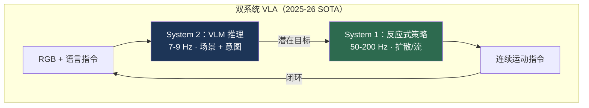
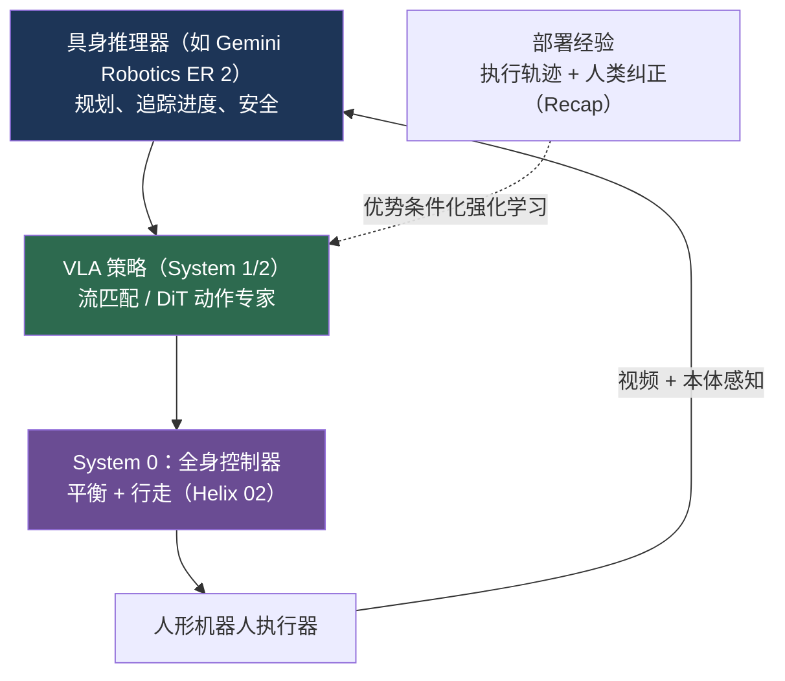

# VLA 与具身智能：2025–2026 年最新进展

> **英文原文：** [cv-knowledge-base/12_research_frontier_2024_2026/04_vla_embodied_2025_2026.md](../../cv-knowledge-base/12_research_frontier_2024_2026/04_vla_embodied_2025_2026.md)（本中文版供参考，内容以英文原文为准）

> **最后更新：** 2026年10月
> **难度级别：** 研究前沿
> **相关章节：**
> - [VLA 模型（基础）](../06_robotics_and_embodied_ai/01_vla_models.md)
> - [优缺点与路线图](../06_robotics_and_embodied_ai/07_pros_cons_roadmaps.md)
> - [通用模型与专用模型](../06_robotics_and_embodied_ai/11_generalist_vs_specialist.md)
> - [未来趋势](./07_future_trends.md)

> **🆕 2026年10月更新：**
> - 新增 2026 年前沿模型：**Gemini Robotics 2 / ER 2**（2026 年 7 月，人形机器人全身控制）、**Gemini Robotics-ER 1.6**（2026 年 4 月）、**π\*0.6 / Recap**（2025 年 11 月，从经验中进行强化学习）以及 **π0.7**（2026 年 4 月，初步的组合式泛化）。
> - 更新 NVIDIA 产品线：**GR00T N1.6**（Cosmos-Reason-2B VLM，32 层 DiT）与 **GR00T N1.7**（正式版 GA，Apache 2.0 许可，使用 2 万小时 EgoScale 人类视频预训练）。
> - 新增 **Figure Helix 02**（全身 System 0/1/2 架构）、**Generalist GEN-0 → GEN-1**（约 50 万小时数据），并新增开源 VLA 小节（SmolVLA、X-VLA、MolmoAct2、Qwen-VLA、LingBot-VLA、RDT2）。
> - 新增 **世界-动作模型**（World Action Models，WAM；DreamZero、Cosmos Policy、Cosmos 3）的兴起与真实世界评测（RoboArena），并指出 LIBERO 已趋于饱和（π0.5 为 96.85%，Qwen-VLA 为 97.9%）。
> - 扩充了关键论文、基准、优缺点、开放问题与延伸阅读。

---

## 概述

[VLA 模型](../06_robotics_and_embodied_ai/01_vla_models.md) 一文梳理了从 RT-1 到 GR00T N1 的架构谱系，而本文记录的是 **截至 2026 年末、达到部署级水平的最新进展**——即那些从研究演示走向真实世界试点的模型、界定当前前沿的基准数据，以及仍未解决的能力。2025 年的决定性转变是 **双系统架构**（慢速 VLM 推理 + 快速反应式控制）成熟为可交付的产品，以及来自前沿大模型实验室的视觉-语言-动作模型（Vision-Language-Action, VLA）（Google DeepMind 的 Gemini Robotics）登场，这些模型继承了旗舰多模态大语言模型的全部能力。

2025–2026 年有三个量化主题。第一，**推理效率追上了能力**：OpenVLA-OFT 实现 26 倍加速（3–5 Hz → 约 110 Hz），π₀ 实现 50 Hz 的流匹配（flow matching）控制，解决了困扰第一代 VLA 的时延问题。第二，**长时程灵巧操作变得可度量**：Gemini Robotics 在 2 分钟的午餐盒打包任务上报告了 100% 的成功率，在一套灵巧专用任务上平均成功率为 79%。第三，**真实世界部署时长不断积累**：Figure 的 Helix 协助生产了 30,000 多辆 BMW X3；1X NEO 与 Unitree 交付了数千台设备，开启了真正的数据飞轮（参见 [优缺点与路线图](../06_robotics_and_embodied_ai/07_pros_cons_roadmaps.md)）。

2026 年的前三个季度又带来了三项转变。(1) **从上半身控制到全身控制**：Figure 的 Helix 02 与 Google DeepMind 的 Gemini Robotics 2 都将单一学习策略从桌面/上半身操作扩展到行走、下蹲与操作一体化的系统。(2) **从模仿到经验**：Physical Intelligence 的 π\*0.6（Recap）表明，对自主执行轨迹加上人类纠正进行离线强化学习式的优势条件化，可使困难任务的吞吐量大约翻倍；π0.7 则报告了首批 *组合式* 任务泛化的迹象。(3) **从纯机器人数据到人类与视频数据**：GR00T N1.7 使用 2 万小时第一人称人类视频进行预训练，Generalist 的 GEN-1 使用约 50 万小时由人佩戴的"数据手"（data hands）采集的数据，而一类联合预测视频与动作的新型 **世界-动作模型**（WAM）登顶了真实世界排行榜。

这些结果都很新，且部分来自技术报告和公司博客而非同行评审会议；在适当情况下，应将其视为 **初步结果 / 有待独立复现**。

---

## 当前前沿模型

### Gemini Robotics（Google DeepMind，2025）

**Gemini Robotics** [GeminiRobotics2025]（arXiv:2503.20020，2025 年 3 月）是第一个构建在完整前沿多模态大语言模型（**Gemini 2.0**）之上、而非较小专用 VLM 之上的 VLA。报告结果：其泛化基准性能 **超过此前 VLA 的两倍**；专用变体在一套灵巧任务上平均成功率达 **79%**；一个长时程午餐盒打包任务（2 分钟以上）达到 **100%**。它支持 ALOHA 2、双臂 Franka 以及 Apptronik Apollo 人形机器人。配套的 **Gemini Robotics-ER**（具身推理，Embodied Reasoning）模型面向空间推理，在端到端控制上取得 Gemini 2.0 基线 **2–3 倍的成功率**。**Gemini Robotics On-Device**（2025 年 6 月）是本地运行的低时延变体。**Gemini Robotics 1.5**（arXiv:2510.03342，2025 年 9/10 月）加入了"先思考后行动"、通过 **Gemini Robotics-ER 1.5**（通过 Gemini API 向开发者开放）实现的高级具身推理，以及跨具身（cross-embodiment）的 **动作迁移**（motion transfer）。

### Gemini Robotics-ER 1.6 与 Gemini Robotics 2 / ER 2（Google DeepMind，2026）

**Gemini Robotics-ER 1.6**（2026 年 4 月中旬，Gemini API / Google AI Studio）聚焦于空间逻辑、多视角推理、更严格的安全指令遵循，以及与 Boston Dynamics 合作开发、面向工业巡检的新 **仪表读数** 能力（压力表、计量表、视镜）。独立评论指出，该版本发布本身几乎没有提供基准数据。

**Gemini Robotics 2** [GeminiRobotics2-2026]（2026 年 7 月 30 日发布）是一个由三个模型组成的套件：

- **Gemini Robotics 2** —— 一个控制 *整个* 人形机器人而不仅是上半身的 VLA；其演示平台为 Apptronik 的 **Apollo 2**，在杂乱场景中行走、下蹲并将物体放上货架。对 DeepMind 发布的报道称，例如地面拾取的成功率为 **45.7%**，拧下灯泡 **100 次中成功 92 次**；DeepMind 自己也承认动作速度仍需改进。向早期合作伙伴开放。
- **Gemini Robotics ER 2** —— 具身推理"高层大脑"（据其模型卡，基于 Gemini 3.5 Flash 构建），负责规划、依据连续视频追踪任务进度、协调多台机器人，并将运动执行交给任意底层 VLA。Google 报告其在进度分类上为 **57.4%**，在时刻定位（moment-finding）上准确率为 **91.3%**（平均绝对距离 0.96 秒），在安全指令遵循上为 **97.9%**，而 ER 1.6 为 **47.2%**。已在 Google AI Studio / Gemini API 公开预览。
- **Gemini Robotics On-Device 2** —— 用于快速适配新具身形态的本地模型（向早期合作伙伴提供）。

### π₀.5（Physical Intelligence，2025）

**π₀.5** [PI2025]（arXiv:2504.16054）将基于流匹配的 π₀（PaliGemma 主干 + 50 Hz 连续流匹配动作专家）扩展到 **开放世界泛化**——部署在 *训练中从未见过的新家庭* 中，具有更好的语言条件化能力和更长时程的移动操作（清洁厨房、整理床铺）。它是 VLA 泛化正在达到 [优缺点与路线图](../06_robotics_and_embodied_ai/07_pros_cons_roadmaps.md) 框架中第 3–4 级（环境与任务迁移）的最有力公开证据。**2025 年 9 月**，π₀.₅ 的基础权重与微调权重（采用 *知识隔离*（knowledge insulation）训练）连同 PyTorch 支持一起在开源 **openpi** 仓库中发布；openpi 的 π₀.₅-LIBERO 检查点在 LIBERO 上报告的平均成功率为 **96.85%**。

### π\*0.6 与 Recap：从经验中学习（Physical Intelligence，2025 年 11 月）

**π\*0.6** [PI2025b]（arXiv:2511.14759，2025 年 11 月 18 日）提出了 **Recap**（*RL with Experience and Corrections via Advantage-conditioned Policies*，基于经验与纠正、通过优势条件化策略的强化学习）。先用离线强化学习预训练一个通用 VLA，然后通过在机器人上采集数据进行专门化，这些数据混合了示范、自主的同策略（on-policy）执行轨迹，以及专家在自主执行过程中进行的遥操作（teleoperation）**干预**；一个学习得到的价值函数为动作打分，策略以优势为条件。在最困难的任务上（在真实家庭中叠衣服、组装纸箱、制作意式浓缩咖啡饮品），Recap **使吞吐量大约翻倍、失败率大约减半**。这是 2025 年最突出的论据，表明 VLA 可以从自身部署经验中改进，而不仅仅依赖更多模仿数据。其权重未开源。

### π0.7：具有初步组合式泛化能力的可引导通用模型（Physical Intelligence，2026 年 4 月）

**π0.7** [PI2026]（arXiv:2604.15483，2026 年 4 月 16 日）的训练提示不仅包含任务描述，还包含 **详细的语言、生成的子目标图像和回合元数据**，这使其能够吸收大量机器人与非机器人数据的混合。公司报告了 *组合式泛化的初步迹象*——把在不同任务上学到的技能重新组合以解决新问题，例如操作不熟悉的厨房电器，以及在一个没有任何叠衣数据的机器人平台上叠衣服——同时与专用模型相比仍具竞争力。团队自己也提醒，复杂任务仍需逐步引导，而非单条指令即可完成。

### GR00T N1 / N1.5 / N1.6 / N1.7（NVIDIA，2025–2026）

**GR00T N1** [GR00T2025]（arXiv:2503.14734）是开放权重的人形机器人双系统 VLA：一个基于 Eagle-2 的 VLM（System 2）加上一个以 **120 Hz** 运行的扩散 Transformer 动作专家（System 1），完整的 16 步动作块在 **L40 GPU 上耗时 63.9 ms**。评测在 RoboCasa Kitchen（24 个任务）、DexMimicGen（9 个跨具身任务）和真实的 Fourier GR-1 硬件上进行。**GR00T N1.5**（2025 年中）扩大了双臂与人形具身形态的训练数据，并通过 GitHub 和 Hugging Face 发布。

**GR00T N1.6**（2025 年末 / 2026 年初）换用内部的 **Cosmos-Reason-2B** VLM（支持原始宽高比），将 DiT 动作头加倍至 **32 层**，用解冻 VLM 顶部 4 层替代 VLM 之后的适配器，预测 **相对状态的动作块**，并新增数千小时遥操作数据（双臂 YAM、AgiBot Genie-1、BEHAVIOR 中仿真的 Galaxea R1 Pro、Unitree G1 上的全身移动操作）。**GR00T N1.7**（2026 年，**正式发布（GA）**，以 **Apache 2.0** 许可可商用）转向 **Cosmos-Reason2-2B（Qwen3-VL 架构）**，采用 **人类与机器人具身共享的相对末端执行器动作空间**，将动作时域从 16 扩展到 40，并在 **2 万小时 EgoScale 人类视频** 上预训练——NVIDIA 报告其性能与 N1.6 相当，但泛化与语言遵循能力更好。推理可在单块 16 GB 以上的 GPU 上运行，包括 **Jetson AGX Thor/Orin**。NVIDIA 还预告了下一代 **GR00T N2**（据报道；细节尚未公开）。

### Helix 与 Helix 02（Figure AI，2025–2026）

**Helix** [Figure2025] 是 Figure 02 人形机器人的量产级双系统控制器：一个经互联网预训练的 VLM（System 2）以 **7–9 Hz** 运行，向一个 **200 Hz** 的视觉运动策略（System 1）输送潜在目标，控制上半身 35 个自由度。它部署在 BMW Spartanburg 工厂，在为期 10 个月的试点中协助生产了 **30,000 多辆 X3**——这是公开记录中规模最大的真实世界人形机器人 VLA 部署。

**Helix 02** [Figure2026]（2026 年初，搭载于 Figure 03 人形机器人）将神经控制从上半身扩展到 **全身**，采用三级层次结构：在 200 Hz 的 System 1 与 VLM System 2 之下新增 **System 0**——一个基于 1,000 多小时人体运动数据加仿真到现实（sim-to-real）强化学习训练的学习型全身控制器。Figure 的旗舰演示是一个 **4 分钟的自主洗碗机卸载/装载** 任务，包含数十个移动与操作动作，全程无重置、无遥操作（公司声称这是迄今人形机器人自主完成的最长时程任务），此外还有借助触觉与掌心摄像头实现的精细操作。所有数据均为公司自报。

### Generalist AI：GEN-0 与 GEN-1（2025–2026）

**GEN-0**（Generalist AI，2025 年 11 月）被定位为 **机器人操作中缩放定律** 的概念验证，在约 **270,000 小时** 的真实世界操作数据上预训练，这些数据主要由人佩戴的可穿戴"数据手"夹爪采集。**GEN-1**（2026 年 4 月）在约 **50 万小时** 此类数据上从头训练；Generalist 报告，在以往模型仅达到 64% 的任务上，平均成功率提升至 **99%**，任务完成速度快约 **3 倍**，且每个任务只需约 1 小时的机器人数据。公司自己也指出，GEN-1 面向的是短时（通常不到一分钟）任务，并且"目前还不能解决所有任务"。

### OpenVLA-OFT（2025）

**OpenVLA-OFT**（Optimized Fine-Tuning，优化微调）通过并行解码和 8 步动作分块，解决了基础 OpenVLA 的主要弱点——**3–5 Hz 的自回归时延**，达到 **109.7 Hz**（每块 0.073 秒，**26 倍加速**），并在 **LIBERO 上平均达到 97.1%**（Spatial 97.6 / Object 98.4 / Goal 97.9 / Long 94.5）。它仍是在易用性和可微调性方面被广泛使用的 *开源* 基线，不过到 2026 年已有多个开源 VLA 在 LIBERO 上与之持平（见下文）。

### 开源 VLA 生态（2025–2026）

开源生态大幅扩展，并在很大程度上汇聚到 Hugging Face 的 **LeRobot** 中；到 2026 年，LeRobot 已通过统一接口提供 π₀/π₀-FAST/π₀.₅、GR00T N1.7、SmolVLA、X-VLA、MolmoAct2、WALL-OSS 等模型：

- **SmolVLA**（Hugging Face，arXiv:2506.01844，2025）—— 一个紧凑型（约 0.45B）VLA，面向低成本硬件和社区采集的 LeRobot 数据集。
- **X-VLA**（2025）—— 一种软提示（soft-prompted）流匹配 VLA，将每种机器人/数据集编码为可学习嵌入；X-VLA-0.9B 在来自七个平台的 29 万条轨迹上训练，在 LIBERO 和 Simpler-WidowX 上达到接近 π₀ 的性能，而适配新机器人时只需调优约 900 万参数。
- **MolmoAct2**（Ai2，arXiv:2605.02881，2026 年 5 月）—— 完全开放的"动作推理"模型，构建于 **Molmo2-ER** 具身推理 VLM 之上并配有流匹配动作专家；其 *Think* 变体在行动前对紧凑的深度 token 进行推理；随模型一起发布了数据集和训练代码。
- **Qwen-VLA**（Qwen 团队，arXiv:2605.30280，2026）—— **Qwen3.5-4B** 主干加上 **1.15B 的 DiT 流匹配** 动作解码器，通过具身感知的提示统一了操作、导航和轨迹预测；单一通用模型在 LIBERO 上报告 **97.9%**，并达到或超过按基准单独调优的专用模型。
- **LingBot-VLA**（蚂蚁集团，2026 年 1 月）—— 在来自九种双臂配置的 **2 万小时** 真实数据上预训练；**RDT2**（清华大学，arXiv:2602.03310）—— 扩大 UMI 手持夹爪数据规模，以实现零样本跨具身泛化。

### 世界-动作模型：将视频模型用作策略（2026）

2026 年一个鲜明的趋势是 **世界-动作模型（World Action Model, WAM）**：以视频生成模型为主干，联合预测未来帧与动作。**Cosmos Policy**（NVIDIA，arXiv:2601.16163）将 Cosmos 视频模型微调为输出动作、未来状态和价值，从而支持 best-of-N 式基于模型的规划。**DreamZero**（NVIDIA GEAR，arXiv:2602.15922）凭借一个从零训练的 DROID 模型，在 2026 年 2 月报告 **同时位列 RoboArena 和 MolmoSpaces 排行榜第一**，并能从约 30 分钟的自由交互（play）数据中进行少样本适配。NVIDIA 的 **Cosmos 3**（2026 年 5 月）在一个模型家族中统一了推理、世界预测、迁移与动作生成（64B Super / 16B Nano / 4B Edge）。这条路线将 VLA 与 [世界模型](../06_robotics_and_embodied_ai/02_world_models.md) 和 [4D 场景](./05_4d_and_dynamic_scenes.md) 文献直接联系了起来。

---

## 关键论文

| 论文 | 作者 | 年份 | 发表载体 | 主要贡献 |
|-------|---------|------|-------|-----------------|
| Gemini Robotics | Gemini Robotics Team (DeepMind) | 2025 | arXiv:2503.20020 | 以前沿大语言模型为基础的 VLA；专用任务 79%，午餐盒任务 100% |
| Gemini Robotics 1.5 | Gemini Robotics Team | 2025 | arXiv:2510.03342 | 具身推理 + 动作迁移 |
| π₀.5 | Physical Intelligence | 2025 | arXiv:2504.16054 | 向新家庭的开放世界泛化 |
| π\*0.6: a VLA That Learns From Experience | Physical Intelligence | 2025 | arXiv:2511.14759 | Recap：基于执行轨迹 + 人类纠正的优势条件化强化学习；吞吐量约 2 倍 |
| π0.7: a Steerable Generalist Robotic Foundation Model | Physical Intelligence | 2026 | arXiv:2604.15483 | 丰富的多模态提示；初步的组合式泛化 |
| GR00T N1 | NVIDIA | 2025 | arXiv:2503.14734 | 开源双系统人形 VLA；120 Hz 的 System 1 |
| OpenVLA-OFT | Kim, Pertsch, et al. | 2025 | arXiv:2502.19645 | 推理加速 26 倍；LIBERO 97.1% |
| SmolVLA | Shukor, Aubakirova, et al. (Hugging Face) | 2025 | arXiv:2506.01844 | 面向 LeRobot 社区数据的紧凑、低成本开源 VLA |
| Cosmos Policy | NVIDIA | 2026 | arXiv:2601.16163 | 将视频世界模型微调为策略 + 规划器 |
| DreamZero: World Action Models Are Zero-Shot Policies | NVIDIA GEAR | 2026 | arXiv:2602.15922 | 联合视频 + 动作预测；RoboArena 第一（2026 年 2 月） |
| MolmoAct2 | Ai2 | 2026 | arXiv:2605.02881 | 基于 Molmo2-ER 的完全开放动作推理 VLA |
| Qwen-VLA | Qwen Team | 2026 | arXiv:2605.30280 | 统一操作 + 导航的通用模型；LIBERO 97.9% |

---

## 基准性能

| 模型 | 基准 | 指标 | 得分 | 备注 |
|-------|-----------|--------|-------|-------|
| Gemini Robotics | 灵巧专用任务套件 | 平均成功率 | 79% | 初步结果 [GeminiRobotics2025] |
| Gemini Robotics | 午餐盒打包（2 分钟） | 成功率 | 100% | 长时程 |
| Gemini Robotics-ER | 端到端控制 | 相对 Gemini 2.0 | 2–3× | 具身推理变体 |
| Gemini Robotics ER 2 | 安全指令遵循 | 准确率 | 97.9% | ER 1.6 为 47.2%；Google 自报 |
| Gemini Robotics ER 2 | 时刻定位（视频） | 准确率 | 91.3% | 平均绝对距离 0.96 秒；Google 自报 |
| Gemini Robotics 2 | 全身地面拾取（Apollo 2） | 成功率 | 45.7% | 发布报道中的数据；初步结果 |
| π\*0.6 (Recap) | 叠衣 / 纸箱组装 / 浓缩咖啡 | 吞吐量、失败率 | 约 2× / 约 0.5× | 相对 Recap 之前的策略；公司自报 |
| OpenVLA-OFT | LIBERO（平均） | 成功率 | 97.1% | Spatial/Object/Goal/Long |
| π₀.₅（openpi，微调） | LIBERO（平均） | 成功率 | 96.85% | 98.8 / 98.2 / 98.0 / 92.4 |
| Qwen-VLA-Instruct | LIBERO（平均） | 成功率 | 97.9% | 单一通用模型，未按基准单独调优 |
| OpenVLA-OFT | 推理 | 控制频率 | 109.7 Hz | 每 8 步动作块 0.073 秒 |
| GR00T N1 | 推理（L40） | 时延 | 63.9 ms / 16 个动作 | System 1 运行于 120 Hz |
| π₀ | 真实灵巧任务 | 控制频率 | 50 Hz | 流匹配，平滑 |
| Helix | BMW Spartanburg 试点 | 协助生产车辆数 | 30,000+ 辆 X3 | 10 个月部署 |
| GEN-1 | Generalist 任务套件 | 平均成功率 | 99%（对比 64%） | 公司自报；短时任务 |
| DreamZero | RoboArena（真实世界、分布式） | 排行榜名次 | 第一（2026 年 2 月） | 同时位列 MolmoSpaces 第一 |

*LIBERO 现已基本饱和（多个模型 ≥ 97%）；像 RoboArena 这样的分布式真实世界评测正成为更有信息量的比较方式。*

---

## 优缺点

| 方面 | 优点 | 缺点 |
|--------|------|------|
| 前沿大语言模型 VLA（Gemini Robotics 1.5/2） | 继承完整多模态推理能力；泛化达到 SOTA；现已支持全身控制 | 权重闭源；算力需求巨大；难以复现；仅限早期访问 |
| 开源双系统（GR00T N1.6/N1.7） | 开放权重（N1.7 为 Apache 2.0）、针对人形优化、人类视频预训练、可部署于 Jetson Thor | 需要针对平台调优；在机器人基准上与 N1.6 性能相当而非更好 |
| 流匹配（π₀/π₀.5/π0.7） | 平滑的高频灵巧操作；开放世界泛化与初步组合式泛化 | 数据需求大；π\*0.6 与 π0.7 闭源 |
| 从经验中强化学习（π\*0.6 Recap） | 能从部署中持续改进；失败更少、吞吐量更高 | 需要人工干预，并需按任务族训练价值函数 |
| 开源模型（OpenVLA-OFT、SmolVLA、X-VLA、MolmoAct2、Qwen-VLA） | 易获取、可微调、速度快；在 LIBERO 上与闭源模型持平 | 在真实长时程任务上的灵巧性上限低于 π/Gemini |
| 世界-动作模型（DreamZero、Cosmos Policy） | 利用视频预训练；真实世界零样本结果强 | 推理开销大（未使用缓存时在 H100 上每步需数秒）；方法论尚新 |

---

## 开放问题与研究空白

- **第 5 级组合式推理**（需要世界知识的多步规划）在很大程度上仍未解决；已报告的成功大多属于 L1–L4（参见 [优缺点与路线图](../06_robotics_and_embodied_ai/07_pros_cons_roadmaps.md) 中的泛化框架）。π0.7 只展示了组合式任务泛化的 *初步* 迹象，仍需逐步提示。
- **公司自报数据的复现。** Gemini Robotics 2、π\*0.6/π0.7、Helix 02 和 GEN-1 的结果来自在专有硬件上的非同行评审报告；独立复现很少。
- **空间定位（spatial grounding）。** 即使是 SOTA VLA 也继承了其 VLM 主干的空间推理缺陷（参见 [空间智能](./06_spatial_intelligence.md)）。
- **端侧部署。** 前沿 VLA 需要服务器级 GPU；如何在不大幅损失精度的情况下将其压缩到 Jetson Thor 的预算内仍是开放问题（参见 [未来趋势](./07_future_trends.md)）。GR00T N1.7、Gemini Robotics On-Device 2 和 Cosmos3-Edge 是最初的尝试。
- **失败恢复与安全。** 长时程部署会暴露误差累积；稳健的恢复能力与经认证的安全性仍不成熟。ER 2 的高安全指令得分是自报结果，不能替代物理安全认证。
- **高速全身控制。** 全身 VLA（Helix 02、Gemini Robotics 2）比人类慢，在地面高度及高灵巧度的子任务上成功率急剧下降。
- **大规模从部署中学习。** Recap 式强化学习需要价值函数与人工干预；如何使其扩展到数千个任务和整个机器人集群仍是开放问题。
- **灵巧性与通用性的权衡。** 目前还没有单一模型能同时达到 π₀ 的灵巧性 *和* Gemini 的广泛推理能力——人们预期二者终将融合，但尚未得到证实。
- **评测标准化。** LIBERO/RoboCasa 偏向仿真且现已饱和；分布式真实世界评测平台（RoboArena）很有前景，但规模仍小且以 DROID 为中心。

---

## 延伸阅读

- [Gemini Robotics (arXiv:2503.20020)](https://arxiv.org/abs/2503.20020) —— 以前沿大语言模型为基础的 VLA
- [Gemini Robotics 1.5 (arXiv:2510.03342)](https://arxiv.org/abs/2510.03342) —— 会思考的 VLA、ER 1.5、动作迁移
- [Gemini Robotics 2 为机器人带来全身智能（DeepMind 博客）](https://deepmind.google/blog/gemini-robotics-2-brings-whole-body-intelligence-to-robots/) —— 2026 年 7 月发布的模型套件
- [Gemini Robotics ER 2 模型卡](https://deepmind.google/models/model-cards/gemini-robotics-er-2/) —— 具身推理模型
- [π₀.5 (arXiv:2504.16054)](https://arxiv.org/abs/2504.16054) —— 开放世界泛化
- [π\*0.6 / Recap (arXiv:2511.14759)](https://arxiv.org/abs/2511.14759) —— 从经验中学习的 VLA
- [π0.7 (arXiv:2604.15483)](https://arxiv.org/abs/2604.15483) 与 [博客](https://www.pi.website/blog/pi07) —— 具有涌现能力的可引导通用模型
- [openpi](https://github.com/Physical-Intelligence/openpi) —— 开源的 π₀ / π₀-FAST / π₀.₅ 权重
- [GR00T N1 (arXiv:2503.14734)](https://arxiv.org/abs/2503.14734) 与 [Isaac-GR00T（N1.7）](https://github.com/NVIDIA/Isaac-GR00T) —— 开源双系统人形 VLA
- [OpenVLA-OFT (arXiv:2502.19645)](https://arxiv.org/abs/2502.19645) —— 高效的开源 VLA
- [Figure Helix](https://www.figure.ai/news/helix) 与 [Helix 02](https://figure.ai/news/helix-02) —— 量产级双系统控制与人形机器人全身控制
- [Generalist GEN-1](https://generalistai.com/blog/gen-1) —— 扩大真实世界操作数据规模
- [LeRobot](https://github.com/huggingface/lerobot) —— 开源 VLA 策略（SmolVLA、X-VLA、MolmoAct2、GR00T、π）
- [MolmoAct2](https://github.com/allenai/molmoact2) 与 [Qwen-VLA](https://github.com/QwenLM/Qwen-VLA) —— 2026 年的开源 VLA
- [DreamZero](https://github.com/dreamzero0/dreamzero) 与 [Cosmos Policy (arXiv:2601.16163)](https://arxiv.org/abs/2601.16163) —— 世界-动作模型
- [RoboArena](https://robo-arena.github.io/) —— 通用机器人策略的分布式真实世界评测
