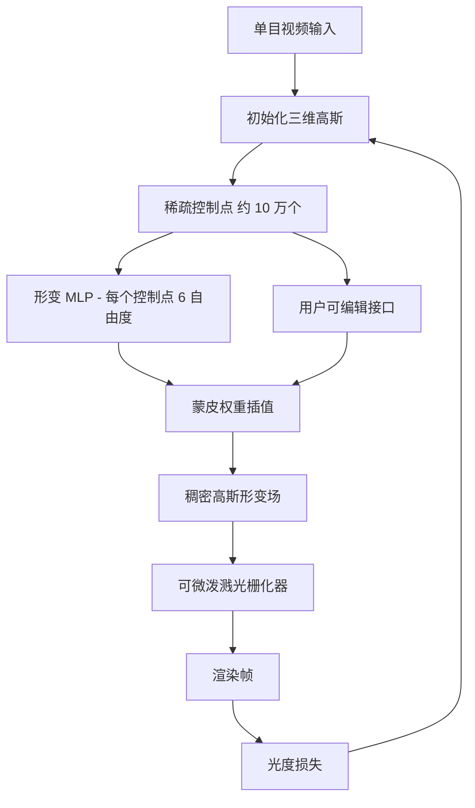
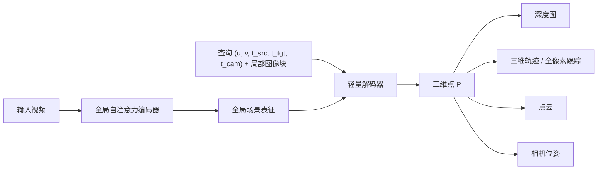

# 4D 与动态场景重建

> **英文原文：** [cv-knowledge-base/12_research_frontier_2024_2026/05_4d_and_dynamic_scenes.md](../../cv-knowledge-base/12_research_frontier_2024_2026/05_4d_and_dynamic_scenes.md)（本中文版供参考，内容以英文原文为准）

> **最后更新：** 2026年10月
> **难度级别：** 研究前沿
> **相关章节：**
> - [3D 高斯泼溅](../04_3d_vision_and_scene/02_gaussian_splatting.md)
> - [面向机器人的世界模型](../06_robotics_and_embodied_ai/02_world_models.md)
> - [机器人感知](../06_robotics_and_embodied_ai/08_perception_for_robotics.md)
> - [未来趋势](./07_future_trends.md)

> **🆕 2026年10月更新：**
> - 新增 **D4RT**（Google DeepMind / UCL / 牛津大学），即 **CVPR 2026 最佳论文**：一个前馈的、基于查询的模型，可从单段视频中联合恢复深度、三维对应关系和完整的相机参数。
> - 新增 **前馈式 4D 重建** 一节（MonST3R、CUT3R、MegaSaM、Stereo4D、St4RTrack、SpatialTrackerV2），以及其所依托的多视角几何基础模型（VGGT、π³、MapAnything、Depth Anything 3，以及 CVPR 2026 最佳论文入围作品 **VGGT-Ω**）。
> - 用 CAT4D 和 NVIDIA Lyra / Lyra 2.0 更新了 4D 生成部分，并将其与交互式世界模型（Genie 3、World Labs Marble、Cosmos 3）联系起来。
> - 相应扩充了关键论文、基准、优缺点、开放问题与延伸阅读。

---

## 概述

动态场景重建——从视频中同时恢复几何与运动——是计算机视觉中核心的未解问题之一。几十年来，解决方案要么局限于受控的多相机采集装置（例如 Technicolor 光场舞台或专业体积视频工作室），要么局限于可将世界建模为静态辐射场的刚性场景。面向动态内容的神经辐射场（NeRF）[ParkNerfies21, PumarolaD-NeRF21] 及其后继者高斯泼溅（Gaussian Splatting）的出现，从根本上改变了复杂度与质量之间的权衡，使得从稀疏甚至单目视频流中重建非刚性、可变形和铰接物体成为可能。

"4D"框架将三个空间维度与作为第四轴的时间统一起来，要求表征既在空间上连续，又在时间上一致。目前出现了两大类方法：(1) **形变场方法**，学习一个规范（canonical）三维表征以及一个以时间为条件、将观测映射到共享规范空间的形变场；(2) **原生 4D 表征**，联合建模全部四个维度，通常借助 4D 神经体素网格或 4D 高斯基元。前者能达到高保真度，但难以处理拓扑变化（例如双手分开）；后者能更从容地处理拓扑变化，但需要精心的正则化以避免退化解。

它与机器人和世界模型的联系直接且关系重大：一个操作物体、在人群中导航或在动态环境中规划的机器人，必须建模世界如何变化——既包括外部动态，也包括机器人自身动作带来的变化 [SzegedyWorldModel23]。可被查询未来状态、可编辑、可与物理仿真器组合的可微 4D 表征，是从被动场景重建通往主动世界建模的天然桥梁。截至 2025–2026 年，这一交叉领域——具备物理依据、可实时运行、可部署于机器人的神经 4D 表征——是最主要的开放前沿。

自 2024 年以来最大的方法论变化，是从 **逐场景优化**（为每段视频拟合形变场或 4D 高斯，每段需数分钟到数小时）转向 **前馈式 4D 重建**：在大量数据集上训练的大型 Transformer，只需一次前向传播即可为新视频回归深度、相机位姿和稠密三维运动。这一趋势由 DUSt3R 式点图（pointmap）开启，经 VGGT（CVPR 2025 最佳论文）加速，最终以 **D4RT** 荣获 **CVPR 2026 最佳论文奖** 达到高潮——这是 CVPR 最高奖连续第二年授予前馈式几何重建。基于优化的动态高斯仍是高保真新视角渲染的首选工具，而前馈模型正越来越多地为其提供初始化（相机、深度、轨迹）。

---

## 背景：动态 NeRF 谱系

### NeRFies [ParkNerfies21]

**Nerfies: Deformable Neural Radiance Fields**（Park et al., ICCV 2021）提出了"规范空间-形变"范式。在规范坐标系中训练单个 NeRF；第二个网络学习逐时间步的 SE(3) 形变场，将观测到的光线映射回规范空间。该方法在手持手机拍摄的自拍视频上进行了演示，可处理面部和头发的非刚性形变。主要局限：假设形变场是平滑的，无法处理大的拓扑变化。

### HyperNeRF [ParkHyperNeRF21]

**HyperNeRF**（Park et al., ACM TOG / SIGGRAPH Asia 2021）扩展了 Nerfies，将规范 NeRF 提升到更高维的"超空间"。三维中的每个点被映射到一个更高维的切片；网络学习每个时间步对应哪个切片，从而能表示单一三维流形无法表示的拓扑变化内容（例如张嘴）。其代价是内存增加、渲染变慢。

### D-NeRF [PumarolaD-NeRF21]

**D-NeRF: Neural Radiance Fields for Dynamic Scenes**（Pumarola et al., CVPR 2021）独立提出了双网络架构——一个形变 MLP 加一个规范 NeRF——完全基于单个移动相机进行训练。D-NeRF 成为后续动态方法的标准基准数据集提供者，提供了八个具有已知真值相机位姿的合成单目序列（开合跳、站起、勾拳等）。

---

## 4D 高斯泼溅（4D-GS）[Wu2024]

**4D Gaussian Splatting for Real-Time Dynamic Scene Rendering**（Wu et al., CVPR 2024, pp. 20310–20320）是将 3D 高斯泼溅 [Kerbl3DGS23] 扩展到时间域的奠基性论文。其核心洞见在于：与其逐帧独立地进行 3D-GS（存储开销大且时间上不一致），不如维护 **一组共享的 4D 高斯基元**，其空间属性由紧凑的时间编码进行调制。

**架构。** 该方法引入了一种联合表征：(1) 一组显式存储基础属性（位置、不透明度、协方差、颜色）的三维高斯；(2) 受 HexPlane [CaoHexPlane23] 启发、编码时变特征的 4D 神经体素网格。一个轻量 MLP 从 4D 体素网格读取特征，并在任意查询时间戳预测每个高斯的形变（位置偏移、旋转增量、尺度增量）。渲染采用标准的可微泼溅光栅化器，从而实现实时性能。

```
数学形式：

对于时间 t 时的第 i 个高斯：
  μ_i(t) = μ_i^0 + Δμ_i(t)         # 位置形变
  R_i(t) = R_i^0 · ΔR_i(t)          # 旋转形变
  s_i(t) = s_i^0 ⊙ Δs_i(t)          # 尺度形变

其中 [Δμ_i(t), ΔR_i(t), Δs_i(t)] = MLP(F_4D(μ_i^0, t))

F_4D 通过分解平面编码联合的 (x,y,z,t) 特征：
  F_4D(x,y,z,t) = F_XY(x,y) ⊗ F_ZT(z,t) ⊕ F_XT(x,t) ⊗ F_YZ(y,z) ⊕ ...
```

**训练。** 在 D-NeRF 序列上训练约需单 GPU 8 分钟，在 HyperNeRF 序列上约需 30 分钟。训练完成后可实现 30+ fps 的实时渲染。

**完整作者列表：** Guanjun Wu, Taoran Yi, Jiemin Fang, Lingxi Xie, Xiaopeng Zhang, Wei Wei, Wenyu Liu, Qi Tian, Xinggang Wang。

---

## 可形变 3D 高斯（Deformable 3D Gaussians）[Yang2024]

**Deformable 3D Gaussians for High-Fidelity Monocular Dynamic Scene Reconstruction**（Yang et al., CVPR 2024）以更简洁的形变场框架处理同一问题。它维护一个规范 3D-GS 场景；一个形变网络——通过正弦位置编码以时间为条件——预测每个高斯在位置、旋转四元数和尺度上的偏移向量。规范场景由第一帧的 SfM 重建初始化，从而在优化开始前提供稳定的几何。

使其区别于 4D-GS 的关键设计选择包括：(1) 直接使用时间嵌入而非神经体素网格，使模型更轻、在短序列上训练更快；(2) 对形变损失采用退火调度，在训练早期鼓励刚性；(3) 显式的正则化项，惩罚不合理的大形变。在 D-NeRF 基准上，该方法报告了 39.31 dB 的 PSNR，这是截至 2025 年中该数据集上已发表的最高结果，大幅超越此前基于 NeRF 的方法。

**作者：** Ziyi Yang, Xinyu Gao, Wen Zhou, Shaohui Jiao, Yuqing Zhang, Xiaogang Jin。

---

## SC-GS：稀疏控制的高斯泼溅 [Huang2024]

**SC-GS: Sparse-Controlled Gaussian Splatting for Editable Dynamic Scenes**（Huang et al., CVPR 2024, arXiv:2312.14937）针对逐高斯形变场的一个关键局限：它们稠密、高维，难以被人或下游控制器编辑。SC-GS 将场景动态分解为一小组 **稀疏控制点**（约 10 万个）和一大组 **稠密高斯**。控制点学习紧凑的 6 自由度 SE(3) 变换基，并通过学习到的蒙皮权重进行局部插值，从而为所有高斯生成运动场。

这一架构源于一个物理观察：真实世界的运动往往是 **局部刚性** 且 **空间连续** 的——这与人体混合形状（blend-shape）模型所利用的先验相同。学到的控制点表征直接暴露出一种可编辑的、具有语义意义的运动参数化：用户可以抓住一个控制点并拖动，以生成合理的新运动，从而支持内容编辑、动作重定向和动画合成等下游应用。



**作者：** Yi-Hua Huang, Yang-Tian Sun, Ziyi Yang, Xiaolong Jia, Xiaolong Wang, and Xiaojuan Qi。

---

## 4D 生成：从文本与视频出发

除了从真实拍摄的视频进行重建之外，另一条并行的研究路线致力于 **生成式 4D 合成**——在没有任何多视角监督的情况下，从文本提示或单目视频输入生成合理的动态三维场景。

**Make-A-Video3D / Text-to-4D**（Singer et al., 2023）开创性地从视频扩散模型（Make-A-Video）进行分数蒸馏（score distillation），以优化动态 NeRF，从文本描述生成简短的三维动画场景。

**4Dynamic**（2024）引入了混合先验，结合图像扩散模型与视频扩散模型，在保持时间一致性的同时获得更连贯的几何。

**4Real**（NeurIPS 2024）完全舍弃多视角生成先验，仅依靠在大规模真实视频语料上训练的视频扩散模型来指导动态 4D 重建。通过以自然视频统计为基础进行生成，得到了更逼真的结果。

**PaintScene4D**（2024 年 12 月）面向完整场景生成而非单个物体动画，从文本提示联合生成背景与前景物体。

**Vidu4D / Sync4D**（2024）探索单视频到 4D 的流水线：由视频扩散模型生成的单目视频借助高斯面元（Gaussian surfels）被"提升"为动态三维，从而打通二维视频生成与三维重建之间的闭环。

**CAT4D**（Wu et al., CVPR 2025）利用多视角视频扩散模型将单目视频转换为多视角视频，再据此重建动态三维高斯场景。**NVIDIA Lyra**（ICLR 2026）通过将 **视频扩散模型自蒸馏** 到一个显式三维高斯解码器中，实现从单张图像或视频进行前馈式三维 *与* 4D 场景生成；**Lyra 2.0**（2026 年 4 月）面向可探索的、长时程且三维一致的生成世界。

在整个环境的尺度上，生成式 4D 如今与 **交互式世界模型** 相互交叠：Google DeepMind 的 **Genie 3**（2025 年 8 月）以 720p / 24 fps 实时生成可导航的世界，并能在数分钟内保持一致；World Labs 的 **Marble**（2025 年 11 月推出）可从文本、图像、视频或粗略三维布局生成持久且可导出的三维世界（高斯泼溅、网格）；NVIDIA 的 **Cosmos 3**（2026 年 5 月）为物理 AI 统一了世界预测、迁移与动作生成（参见 [面向机器人的世界模型](../06_robotics_and_embodied_ai/02_world_models.md)）。

正在形成的共识（2025–2026）是：**视频扩散模型是首选的 4D 先验**：它们所训练的真实世界动态远比任何三维专用模型更多样，并且天然编码了物理规律与时间一致性。

---

## 单目动态重建：挑战与进展

单目重建——单个相机、无深度传感器、无多视角装置——是最困难的设定，也是与机器人和移动端拍摄最相关的设定。主要挑战包括：

1. **深度-运动歧义**：在单目透视下，若没有额外线索，一个朝相机移动的点与一个深度变化的静止点无法区分。
2. **初始化敏感性**：动态高斯方法需要合理的初始几何；初始化不佳会导致局部极小或"漂浮物"（floater）伪影。
3. **细小与快速运动的物体**：细小、快速的结构（手指、发丝）在视频中采样不足，往往在优化过程中坍缩。
4. **长序列**：大多数方法假设短片段；在数分钟长的拍摄中会累积时间漂移。

近期进展（2025）包括 **Prior-Enhanced Gaussian Splatting**（SIGGRAPH Asia 2025），它从预训练深度估计器（如 Depth Anything V2）和光流中注入单目深度先验来约束形变场，在 DyCheck 数据集上取得了可度量的提升。**ProDyG**（2025）引入渐进式重建，随时间逐步构建场景，以缓解初始化瓶颈。

---

## 前馈式 4D 重建（2025–2026）

### 从静态点图到动态视频几何

DUSt3R/MASt3R 系列从图像对回归逐像素的三维 *点图*。2025 年的一系列论文将这一思路扩展到动态视频：

- **MonST3R**（Zhang et al., ICLR 2025）在动态数据上微调 DUSt3R，以主要为前馈的方式估计随时间变化的点云以及逐帧相机位姿与内参，支持视频深度估计和静态/动态分割。
- **CUT3R**——*Continuous 3D Perception Model with Persistent State*（Wang, Zhang, Holynski, Efros, Kanazawa；CVPR 2025 Oral）——维护一个随每个新帧在线更新的循环状态，实现对静态和动态场景的流式重建。
- **MegaSaM**（Li, Tucker, Cole, Wang, Jin, Ye, Kanazawa, Holynski, Snavely；CVPR 2025）——一种混合方法，将学习得到的单目深度先验与可微光束法平差（bundle adjustment）相机跟踪器相结合，从随手拍摄的动态视频中获得准确、快速且稳健的结构与运动（包括焦距优化）。
- **Stereo4D**（CVPR 2025 Oral）——从互联网 *立体* 视频中挖掘数据，构建大规模真实世界三维运动轨迹数据集，以解决学习动态几何的数据瓶颈。
- **St4RTrack**（ICCV 2025）——通过为每对帧预测两个点图，在世界坐标系中同时进行 4D 重建 *与* 跟踪，并提出了新的 WorldTrack 基准。
- **SpatialTrackerV2**（Xiao et al., ICCV 2025）与 **Shape of Motion**（ICCV 2025 Highlight）——从单目视频中进行三维点跟踪并获得全局一致的 4D 运动。

### 多视角几何基础模型

静态的多视角"几何基础模型"成为动态方法的主干：

- **VGGT**（Wang, Chen, Karaev, Vedaldi, Rupprecht, Novotny；牛津 VGG + Meta；**CVPR 2025 最佳论文**）可在数秒内从一个到数百个视角推断相机内外参、深度图、点图和三维点轨迹。
- **π³**（上海人工智能实验室等，arXiv:2507.13347）采用完全 **置换等变**（permutation-equivariant）的架构，无需固定参考视角；**Pi3X**（2025 年 12 月）支持位姿/内参/深度的条件注入，并可进行近似度量尺度重建。
- **MapAnything**（Meta + CMU，arXiv:2509.13414，3DV 2026）——单个前馈 Transformer，从图像及可选的标定、位姿或深度进行 *度量* 三维重建，覆盖 12 种以上重建任务。
- **Depth Anything 3**（字节跳动 Seed，arXiv:2511.10647，2025 年 11 月）——采用普通 DINO Transformer 和单一的 **深度-射线**（depth-ray）表征，可从任意数量的视角恢复一致几何，无论是否已知位姿；其报告优于 DA2（单目）和 VGGT（多视角深度与位姿），DA3-Streaming 可在不到 12 GB 显存下处理超长视频。
- **VGGT-Ω**（牛津 VGG + Meta，arXiv:2605.15195，**CVPR 2026 最佳论文入围**）表明前馈重建质量 **随模型与数据规模可预测地增长**。寄存器 token 与 *寄存器注意力*（register attention）取代了大部分全局注意力，将训练显存降至 VGGT 的约 30%，从而能够使用 15 倍的监督数据以及大量无标注视频；它可处理静态与动态场景，并报告在 Sintel 上相机估计精度比此前最佳结果 **提升 77%**。其学到的寄存器还能提升 VLA 策略并可与语言对齐，从而将重建定位为空间理解的可扩展代理任务（参见 [空间智能](./06_spatial_intelligence.md)）。

### D4RT：动态 4D 重建与跟踪 [Zhang2026]

**Efficiently Reconstructing Dynamic Scenes One D4RT at a Time**（Zhang, Le Moing, Koppula, Rocco, Momeni, Xie, Sun, Sukthankar, Barral, Hadsell, Ghahramani, Zisserman, Zhang, Sajjadi；Google DeepMind、UCL 与牛津大学；arXiv:2512.08924，2025 年 12 月）荣获 **CVPR 2026 最佳论文奖**，从超过 16,000 篇投稿中脱颖而出。

**核心思想。** 早期的前馈模型通过多个任务专用头（深度头、位姿头、跟踪头）为每一帧解码稠密输出。D4RT 则用一个全局自注意力 Transformer **对视频只编码一次**，得到潜在的 *全局场景表征*（Global Scene Representation），然后使用一个轻量的 SRT 式解码器，该解码器可 **被独立查询任意像素在任意时刻、任意相机坐标系下的三维位置**：

```
编码器：   F = E_θ(V),              V = {I_1, ..., I_T}   （对所有帧做全局自注意力）

查询：     q = (u, v, t_src, t_tgt, t_cam) ⊕ patch_embed(I_{t_src}, u, v)

解码器：   P = D_φ(q, F) ∈ R^3       # 来自帧 t_src 的像素 (u,v)
                                     # 在时刻 t_tgt、以相机 t_cam 坐标表示的三维位置

同一查询接口的特例：
  深度          : t_src = t_tgt = t_cam            → 每帧的逐像素深度
  三维跟踪      : t_src 固定，t_tgt 变化           → 稀疏/稠密三维轨迹
  点云          : t_tgt = t_src，t_cam = 参考相机  → 世界坐标系重建
  相机位姿      : 在不同 t_cam 下解码的点集之间拟合刚体变换
```

由于查询彼此独立，它们可以并行批处理，并且只需解码所需数量的查询，这使训练和推理成本显著降低。DeepMind 称 D4RT 的效率比以往方法高出 **最多 300 倍**，论文报告其在深度、点云、相机位姿和三维点跟踪基准上均达到最先进精度。项目页面展示了 **全像素跟踪**（由每个像素的三维轨迹得到整体的世界坐标系 4D 重建）以及去重后的动态点云。截至本次更新，代码和权重尚未被确认公开，这限制了独立复现。

**意义。** D4RT 将深度估计、运动恢复结构（SfM）和三维跟踪统一为一个具有单一查询接口的模型——相当于 VGGT 统一静态三维任务在 4D 上的对应物——并使普通视频的稠密 4D 重建快到足以成为机器人感知和世界模型训练的实用输入。



---

## 关键论文

| 论文 | 作者 | 年份 | 发表载体 | 主要贡献 |
|-------|---------|------|-------|-----------------|
| D-NeRF: Neural Radiance Fields for Dynamic Scenes | Pumarola, Corona, Pons-Moll, Moreno-Noguer | 2021 | CVPR | 首个规范空间-形变 NeRF；提出 D-NeRF 基准数据集 |
| Nerfies: Deformable Neural Radiance Fields | Park, Sinha, Barron, Bouaziz, Goldman, Seitz, Martin-Brualla | 2021 | ICCV | 面向随手手持拍摄的 SE(3) 形变场 |
| HyperNeRF | Park, Sinha, Hedman, Barron, Bouaziz, Goldman, Martin-Brualla, Seitz | 2021 | ACM TOG (SIGGRAPH Asia) | 以更高维 NeRF 切片表示拓扑变化场景 |
| 4D Gaussian Splatting for Real-Time Dynamic Scene Rendering [Wu2024] | Wu, Yi, Fang, Xie, Zhang, Wei, Liu, Tian, Wang | 2024 | CVPR | 4D 神经体素 + 高斯形变；实时渲染 |
| Deformable 3D Gaussians [Yang2024] | Yang, Gao, Zhou, Jiao, Zhang, Jin | 2024 | CVPR | 逐高斯形变 MLP；D-NeRF 上 PSNR 39.31 dB |
| SC-GS: Sparse-Controlled Gaussian Splatting [Huang2024] | Huang, Sun, Yang, Jia, Wang, Qi | 2024 | CVPR | 稀疏控制点 + 蒙皮；支持交互式编辑 |
| 4Real: Towards Photorealistic 4D Scene Generation [Yang4Real24] | (4Real team) | 2024 | NeurIPS | 以视频扩散为先验的文本到 4D；无需多视角模型 |
| Prior-Enhanced Gaussian Splatting for Dynamic Scene Reconstruction | (SIGGRAPH Asia team) | 2025 | SIGGRAPH Asia | 为单目动态 GS 引入深度与光流先验；在 DyCheck 上取得提升 |
| MonST3R: A Simple Approach for Estimating Geometry in the Presence of Motion | Zhang, Herrmann, Hur, Jampani, Darrell, Cole, Sun, Yang | 2025 | ICLR | 动态点图 + 逐帧位姿，基本为前馈 |
| Continuous 3D Perception Model with Persistent State (CUT3R) | Wang, Zhang, Holynski, Efros, Kanazawa | 2025 | CVPR (Oral) | 以循环持久状态进行在线静态/动态重建 |
| MegaSaM | Li, Tucker, Cole, Wang, Jin, Ye, Kanazawa, Holynski, Snavely | 2025 | CVPR | 从随手拍摄的动态视频中获得稳健相机 + 一致深度 |
| Stereo4D: Learning How Things Move in 3D from Internet Stereo Videos | (Stereo4D team) | 2025 | CVPR (Oral) | 从立体视频中挖掘的大规模真实世界三维运动数据集 |
| VGGT: Visual Geometry Grounded Transformer | Wang, Chen, Karaev, Vedaldi, Rupprecht, Novotny | 2025 | CVPR (Best Paper) | 从 1 到数百个视角前馈预测相机、深度、点与轨迹 |
| St4RTrack | (St4RTrack team) | 2025 | ICCV | 世界坐标系下同时进行 4D 重建与跟踪 |
| Efficiently Reconstructing Dynamic Scenes One D4RT at a Time [Zhang2026] | Zhang, Le Moing, Koppula, Rocco, …, Zisserman, Zhang, Sajjadi | 2026 | CVPR (Best Paper) | 一次编码、随处查询的 4D 解码器：单一模型输出深度、轨迹与位姿 |
| VGGT-Ω | Wang, Chen, Zhang, Karaev, Schönberger, Labatut, Bojanowski, Novotny, Vedaldi, Rupprecht | 2026 | CVPR (Best Paper Finalist) | 前馈重建的缩放定律；寄存器注意力；静态 + 动态 |
| Lyra: Generative 3D Scene Reconstruction via Video Diffusion Self-Distillation | NVIDIA Spatial Intelligence Lab | 2026 | ICLR | 从单张图像或视频前馈生成三维/4D 高斯场景 |

---

## 基准性能

| 模型 | 数据集 | 指标 | 得分 | 备注 |
|-------|---------|--------|-------|-------|
| Deformable 3D Gaussians [Yang2024] | D-NeRF（合成） | PSNR (dB) | 39.31 | 截至 2025 年 D-NeRF 上已发表的最高结果 |
| 4D-Rotor Gaussian Splatting | D-NeRF（合成） | PSNR (dB) | 34.26 | 2024 年，可实时运行 |
| 4D-GS [Wu2024] | Plenoptic Video（多视角） | PSNR (dB) | 32.01 | 30+ fps 实时渲染 |
| SC-GS [Huang2024] | D-NeRF + HyperNeRF | PSNR/SSIM | 未公开报告单一数值 | 与 4D-GS 相当；主要收益在于可编辑性 |
| HyperNeRF | HyperNeRF 数据集 | PSNR (dB) | 约 23–26（随场景而异） | 比 GS 方法慢；可处理拓扑变化 |
| D-NeRF | D-NeRF（合成） | PSNR (dB) | 约 29–31 | 原始基线；基于 NeRF |
| Prior-Enhanced GS | DyCheck（单目真实） | PSNR (dB) | 未公开报告最终数值 | 相对此前单目 DGS 系统有提升 |
| VGGT-Ω | Sintel（动态） | 相机估计精度 | 相对此前最佳 +77% | 前馈；作者自报 |
| D4RT [Zhang2026] | 深度 / 位姿 / 三维跟踪套件 | 相对以往方法的效率 | 最多 300× | DeepMind 自报；声称在各项 4D 任务上达到 SOTA 精度 |
| Depth Anything 3 | 多视角深度 + 位姿（5 个数据集） | 相对 VGGT | 更优（作者自报） | 另有用于长视频的 DA3-Streaming（< 12 GB） |

*注：前馈式 4D 重建使用几何指标进行评测（相机 ATE/RPE、深度 AbsRel/δ<1.25、TAPVid-3D 式套件上的三维跟踪 APD/AJ），而非渲染 PSNR，因此上述各行不能与新视角合成的各行直接比较。*

---

## 优缺点

| 方面 | 优点 | 缺点 |
|--------|------|------|
| **高斯泼溅表征** | 实时渲染（30–120 fps）；显式几何；训练快（数分钟，而 NeRF 需数小时） | 对初始化敏感；在遮挡或快速运动区域，高斯可能产生漂浮物 |
| **形变场方法（规范空间）** | 紧凑的规范表征；天然地随时间保持物体身份；支持场景编辑 | 无法处理拓扑变化（物体分裂/合并）；形变网络可能过拟合训练时间戳 |
| **原生 4D 表征（时空联合）** | 可处理拓扑变化；单一统一模型；无需显式规范假设 | 内存占用更大；训练更难收敛；时间正则化对避免过拟合至关重要 |
| **4D 生成（文本/视频先验）** | 无需多视角采集；利用大型预训练视频模型；多样性高 | 缺乏度量精度；没有真值几何监督；容易出现时间不一致 |
| **单目重建** | 实用（单相机）；适用于既有影像和消费级拍摄素材 | 严重的深度-运动歧义；需要深度/光流辅助网络才能获得高质量结果 |
| **前馈式 4D 重建（D4RT、VGGT-Ω、CUT3R）** | 每段视频只需数秒；统一深度、位姿与跟踪；随数据规模扩展；可为高斯和世界模型提供良好初始化 | 仅输出几何（无照片级渲染）；训练算力大；关键模型（如 D4RT）缺少公开权重；长序列漂移依然存在 |

---

## 开放问题与研究空白

1. **可扩展的长序列重建。** 现有方法假设片段时长为数秒到数十秒。在数分钟乃至数小时的视频上进行场景级重建——其中物体会出现、消失、形变和交互——仍未解决。形变场中的时间漂移是关键瓶颈。流式前馈模型（CUT3R 的持久状态、DA3-Streaming）降低了内存需求，但仍会累积漂移，且缺乏针对动态内容的回环闭合。

2. **具备物理依据的动力学。** 学习得到的形变场完全由数据驱动，不遵守物理约束（牛顿定律、接触、惯性）。将可微物理仿真器（如 MPM、基于位置的动力学）与高斯基元相结合是一个活跃方向，但尚未达到生产级质量。

3. **开放词汇的铰接结构理解。** SC-GS 及类似方法以无监督方式学习运动结构，但还无法将控制点映射到语义关节（肘、腕、髋）。将铰接部件发现与以语言为基础的人体模型联系起来仍是开放问题。

4. **4D 生成的质量与一致性。** 文本到 4D 方法能生成合理的运动，但超过约 2 秒便缺乏时间一致性，并常在相机运动下出现几何坍缩。实现具有几何完整性、达到视频扩散质量的动态 NeRF 仍是未解问题。

5. **面向机器人部署的效率。** 利用单个机载相机和嵌入式算力（Jetson 级硬件）进行实时重建，尚未在有意义的场景复杂度下得到验证。面向机器人感知的动态高斯场景压缩与流式传输在很大程度上尚未被探索。

6. **交互与反事实建模。** 机器人不仅需要观察动态，还需要预测场景在新动作下会如何变化。学习以动作为条件的动态场景模型（即以机器人末端执行器位姿为条件的 4D 表征）处于该领域与具身智能世界模型的交叉点。

7. **真实世界动态场景的评测基准。** D-NeRF 基准是合成的；HyperNeRF 和 DyCheck 规模较小。对于动态场景，尚不存在可与静态场景的 ScanNet 相媲美、具有精确真值几何与运动的大规模、多样化真实世界基准。Stereo4D 和 WorldTrack 是向前迈出的一步，但前馈式 4D 模型的评测仍严重依赖 Sintel 式的合成数据。

8. **衔接前馈几何与照片级 4D 渲染。** 前馈模型（D4RT、VGGT-Ω）输出点、深度和轨迹；动态高斯方法输出可渲染的场景，但需要逐场景优化。能从随手拍摄的视频中直接产生可渲染、物理上合理的 4D 高斯的单一前馈模型仍有待实现。

9. **开放性与可复现性。** 2025–2026 年的若干标志性模型在发布时没有训练代码或权重（或仅限申请访问），VGGT-Ω 也不得不发布一个复现检查点，以回应对其原始基准检查点的质疑。随着领域转向大规模训练，可复现的基线至关重要。

---

## 延伸阅读

- [4D 高斯泼溅项目主页（Wu et al., CVPR 2024）](https://guanjunwu.github.io/4dgs/)
- [SC-GS 代码仓库与论文（CVPR 2024）](https://github.com/CVMI-Lab/SC-GS)
- [Awesome Dynamic NeRF：动态场景论文精选列表](https://github.com/pdaicode/awesome-dynamic-NeRF)
- [文本到 4D 动态场景生成（Make-A-Video3D）](https://make-a-video3d.github.io/)
- [HyperNeRF：项目主页与数据集](https://hypernerf.github.io/)
- [4DGaussians GitHub 仓库（Wu et al.）](https://github.com/hustvl/4DGaussians)
- [D4RT 项目主页（CVPR 2026 最佳论文）](https://d4rt-paper.github.io/) 与 [arXiv:2512.08924](https://arxiv.org/abs/2512.08924)
- [D4RT：教 AI 以四维视角看世界（Google DeepMind 博客）](https://deepmind.google/blog/d4rt-teaching-ai-to-see-the-world-in-four-dimensions/)
- [VGGT（CVPR 2025 最佳论文）](https://github.com/facebookresearch/vggt) 与 [VGGT-Ω (arXiv:2605.15195)](https://github.com/facebookresearch/vggt-omega)
- [MonST3R](https://github.com/Junyi42/monst3r)、[CUT3R](https://github.com/CUT3R/CUT3R)、[MegaSaM](https://github.com/mega-sam/mega-sam) —— 前馈式 / 混合式动态重建
- [Depth Anything 3 (arXiv:2511.10647)](https://github.com/ByteDance-Seed/Depth-Anything-3)、[π³ (arXiv:2507.13347)](https://github.com/yyfz/Pi3)、[MapAnything (arXiv:2509.13414)](https://github.com/facebookresearch/map-anything)
- [Stereo4D (arXiv:2412.09621)](https://stereo4d.github.io/) 与 [St4RTrack (arXiv:2504.13152)](https://st4rtrack.github.io/)
- [NVIDIA Lyra / Lyra 2.0](https://github.com/nv-tlabs/lyra) —— 通过视频扩散自蒸馏生成三维/4D 世界
