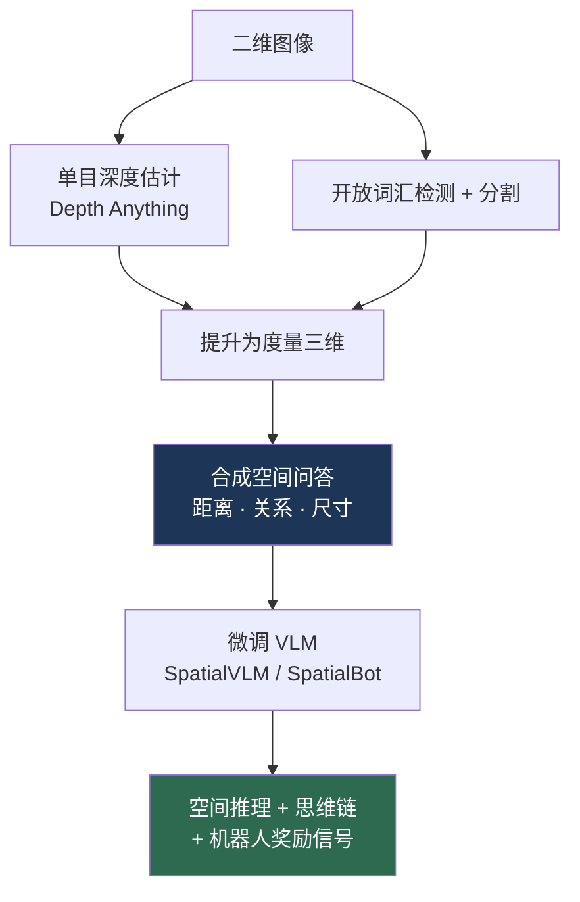
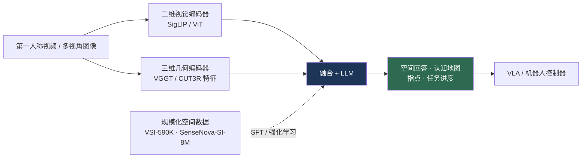

# 空间智能

> **英文原文：** [cv-knowledge-base/12_research_frontier_2024_2026/06_spatial_intelligence.md](../../cv-knowledge-base/12_research_frontier_2024_2026/06_spatial_intelligence.md)（本中文版供参考，内容以英文原文为准）

> **最后更新：** 2026年10月
> **难度级别：** 研究前沿
> **相关章节：**
> - [机器人感知](../06_robotics_and_embodied_ai/08_perception_for_robotics.md)
> - [大型视觉-语言模型](../05_multimodal_vision_language/02_large_vision_language_models.md)
> - [4D 与动态场景](./05_4d_and_dynamic_scenes.md)
> - [未来趋势](./07_future_trends.md)

> **🆕 2026年10月更新：**
> - 新增 2025–2026 年的基准浪潮：**VSI-Bench**（CVPR 2025 Oral）、**VSI-SUPER**、MMSI-Bench、MindCube、SITE、ViewSpatial 等，并附代表性得分表（GPT-5、Gemini 2.5 Pro、Qwen3-VL、Cambrian-S、SenseNova-SI）。
> - 新增小节：**数据规模化**（Cambrian-S / VSI-590K、SenseNova-SI-8M，CVPR 2026）、**几何感知的多模态大语言模型**（Spatial-MLLM、VLM-3R、SpatialLM、VST）以及 **将重建作为代理任务**（VGGT-Ω）。
> - 新增 **具身推理模型**（Gemini Robotics-ER 1.5 / 1.6 / ER 2、Molmo2-ER、Cosmos Reason），以及以世界生成体现空间智能的 **World Labs Marble**。
> - 新增关于基准中非视觉捷径和长时程"超感知"（supersensing）的开放问题。

---

## 概述

"空间智能"（spatial intelligence）指感知、表征并推理三维世界几何与物理结构的能力——相对位置（左/右、上/下、前/后）、度量距离与尺寸、遮挡与包含关系，以及这些关系如何随视角或动作而变化。它是原本表现出色的大型多模态模型的一个显著短板：一个能就一张图片写出十四行诗的 VLM，往往无法可靠地回答杯子在笔记本电脑的左边还是右边，或者两个物体中哪个离相机更近。李飞飞（Fei-Fei Li）将空间智能定位为 AI 的 *下一个前沿*，也是 World Labs 的创立理念，认为以语言为中心的智能若缺乏对空间的扎实建模，就从根本上是不完整的；她在 2025 年 11 月的文章 *From Words to Worlds* 中重申了这一观点，并以此论证需要具备生成性、多模态和交互性的"世界模型"（World Model）。

这一缺陷有明确的原因。对比式图文预训练（CLIP 式，是大多数 VLM 的主干——参见 [大型视觉-语言模型](../05_multimodal_vision_language/02_large_vision_language_models.md)）优化的是图像与描述之间的语义对齐。图像描述很少编码精确的空间关系（写的是"一只猫"，而不是"一只位于沙发左侧 1.2 米、比沙发更近的猫"），因此学到的表征对 *有什么* 的刻画远优于对 *在哪里* 以及 *有多大* 的刻画。更糟的是，二维图像 token 丢弃了空间推理所需的度量深度。结果是模型语义丰富而几何贫乏——这对具身智能（Embodied AI）而言是致命缺陷，因为每一次操作与导航决策从根本上都是空间性的（参见 [机器人感知](../06_robotics_and_embodied_ai/08_perception_for_robotics.md)）。

本文综述了对空间缺陷的诊断、2024–2026 年提出的数据层面与架构层面的补救方法（SpatialVLM、SpatialBot、3D-LLM、SpatialRGPT）、量化该缺陷的基准，以及为何解决这一问题是实用家用机器人的前提。

从 2025 年中到 2026 年末，这一领域在四个方面发生了性质变化。(1) **评测从单张图像转向视频与多视角**：VSI-Bench、MMSI-Bench、MindCube 和 VSI-SUPER 考察模型能否随时间、跨视角构建并维持空间表征。(2) **空间数据规模扩大了一个数量级**：Cambrian-S（VSI-590K）与 SenseNova-SI（800 万样本）表明，在精选空间数据上训练的 7–8B 开源模型，如今在多个空间基准上 *超过* 了 GPT-5 和 Gemini 2.5 Pro。(3) **三维几何进入了多模态大语言模型**：来自前馈重建模型（VGGT、CUT3R）的编码器被融合进 VLM，VGGT-Ω 更主张重建本身就是空间理解的一个可扩展代理任务。(4) **空间推理成为机器人的产品层**：具身推理模型（Gemini Robotics-ER 1.5 → ER 2、Molmo2-ER、Cosmos Reason）作为 VLA 控制器之上的"空间大脑"运行。

---

## 空间缺陷：诊断

空间推理失败可分为几类：**关系类**（左/右、上/下——由于训练数据的对称性以及破坏左右一致性的水平翻转增强，往往接近随机水平）、**度量类**（距离、物体尺寸）、**视角/自我中心类**（从机器人视角推理 vs. 基于他者中心地图推理）以及 **计数类**（随杂乱程度增加而退化）。**VSR**（Visual Spatial Reasoning）、**What'sUp**、**BLINK**、**SQA3D** 和 **EmbodiedScan** 等基准分别隔离了这些问题，并一致表明：即使前沿 VLM 在图像描述和 VQA 上表现出色，它们在关系类和度量类题目上的得分仍远低于人类水平。

**视频与多视角诊断（2025）。** *Thinking in Space* [Yang2025]（NYU/Yale/Stanford，CVPR 2025 Oral）提出了 **VSI-Bench**：从 288 段真实室内场景的第一人称视频（ScanNet、ScanNet++、ARKitScenes）中构建了 5,000 多个问答对，涵盖三大类共八项任务——*构型类*（相对方向、路线规划）、*测量类*（物体/房间尺寸、绝对距离）与 *时空类*（出现顺序）。在对 15 个视频多模态大语言模型进行零样本评测后，研究发现模型只能形成局部的"认知地图"，空间推理（而非感知或语言）是主要瓶颈，而标准的语言式思维链（chain-of-thought）提示 *并无* 帮助。后续基准拓宽了诊断范围：**MMSI-Bench**（多图像空间智能）、**MindCube**（从少量视角构建空间心理模型）、**SITE**（ICCV 2025）、**ViewSpatial-Bench**（多视角定位）、**OmniSpatial**、**SpaCE-10**（组合式空间智能）以及 **DSI-Bench**（动态空间智能）。2025 年 8 月的一项实证研究 *Has GPT-5 Achieved Spatial Intelligence?* 发现，GPT-5 在其中许多基准上是最强的通用模型，但在大多数空间任务上仍明显低于人类水平。

---

## 补救方法

### 数据生成：SpatialVLM

**SpatialVLM** [Chen2024]（Google，CVPR 2024）将这一缺陷主要归因于 *训练数据缺口*，而非架构限制。其补救方法是一条 **三维数据生成流水线**：利用单目深度估计（[Depth Anything](./02_any_model_paradigm.md) 式）、开放词汇（open-vocabulary）检测和分割，将互联网图像提升为度量三维表示，然后自动合成数百万个空间问答对（"椅子离桌子有多远？""杯子在盘子左边吗？"）。在这一合成语料上微调 VLM 能显著提升定量与定性的空间推理能力，而且值得注意的是，它使 **空间思维链推理** 成为可能，并可用作机器人的奖励信号。

### 深度增强架构：SpatialBot 与 SpatialRGPT

**SpatialBot** [Cai2024] 明确地同时向 VLM 输入 *RGB 与深度*，并在一个覆盖从低层到高层空间理解的 SpatialQA 数据集上训练，主张深度必须作为一种 *输入模态*，而非被隐式推断。**SpatialRGPT** 进一步引入区域级三维表征和灵活的深度插件，改进了相对方向和距离估计。

### 显式三维定位：3D-LLM

**3D-LLM** [Hong2023]（NeurIPS 2023）将三维点云及其特征直接注入 LLM，并在三维-语言任务（三维描述、三维问答、导航、具身对话）上训练。通过让语言模型立足于显式三维表征而非二维投影，它从根源上针对视角与度量缺陷——代价是需要并非总能获得的三维输入。**SpatialLM**（Manycore Research，NeurIPS 2025）是其实用化的后继者：一个小型（0.5–1B）三维 LLM，可将点云——包括由单目视频重建得到的点云——转化为结构化的场景布局（墙、门、窗以及有朝向的物体包围盒）。

### 空间数据规模化：Cambrian-S 与 SenseNova-SI（2025–2026）

**Cambrian-S** [YangS2025]（NYU 及合作者，包括 Yann LeCun、李飞飞和谢赛宁；arXiv:2511.04670，2025 年 11 月）将目标表述为 **空间超感知**（spatial supersensing）——超越"看见"和"描述"，走向在任意长度视频中构建、维持并 *预测* 空间世界状态。它贡献了空间视频指令微调数据集 **VSI-590K**、Cambrian-S 模型家族（Cambrian-S-7B 在 VSI-Bench 上达到 **67.5**），以及 **VSI-SUPER**——一个在超长视频上进行空间回忆与持续计数的长时程基准，在该基准上单纯扩展上下文长度的蛮力方法会失败。其变体 **Cambrian-S-7B-LFP** 加入了 *潜在帧预测*（latent frame prediction）：模型预测其下一个潜在观测，并利用 **惊奇度**（surprise，即预测误差）来决定记住什么以及如何切分事件——这是多模态大语言模型中预测式感知的早期实例。一篇配套论文（Brown et al.，arXiv:2511.04655）主张，基准设计者应有意地"在测试集上训练"，以暴露那些让模型无需观看图像就能回答空间问题的 **非视觉捷径**。

**SenseNova-SI** [Cai2026]（商汤科技及合作者；arXiv:2511.13719；**CVPR 2026**）系统地将空间数据扩展到 **SenseNova-SI-8M**（约 816 万样本，覆盖约 272 万张图像，按空间能力分类体系组织），并在多个基座（InternVL3、Qwen3-VL、BAGEL）上进行微调。其 8B 模型在八个空间基准（"EASI-8"：VSI、MMSI、MindCube、ViewSpatial、SITE、BLINK、3DSRBench、EmbSpatial）上创造了开源模型的最佳水平，并在其中若干基准上超过 GPT-5（见下表）。报告还记录了多样化数据带来的涌现泛化、过拟合与语言捷径的风险，以及空间思维链仅带来有限收益。

### 几何感知的多模态大语言模型与将重建作为代理任务

2025 年的第二条路线是为多模态大语言模型配备来自前馈重建模型的 **三维几何编码器**（参见 [4D 与动态场景](./05_4d_and_dynamic_scenes.md)）：**Spatial-MLLM**（NeurIPS 2025）将标准二维视觉编码器与一个由 VGGT 初始化的空间编码器配对，并采用空间感知的帧采样；**VLM-3R** 注入来自 CUT3R 式模型、与指令对齐的三维重建 token；**Visual Spatial Tuning（VST）** 借助强化学习构建了大规模的空间感知与推理语料。**VGGT-Ω**（牛津 VGG + Meta，CVPR 2026 最佳论文入围）把这一论点推得更远：其重建寄存器（register）可以 *与语言对齐* 并 *提升 VLA 策略性能*，这表明 **三维重建是空间理解的一个可扩展、标注高效的代理任务**。

### 具身推理模型：作为机器人"大脑"的空间智能

机器人实验室如今推出了位于动作策略之上的专用空间/具身推理 VLM（参见 [VLA 与具身智能 2025–2026](./04_vla_embodied_2025_2026.md)）。**Gemini Robotics-ER 1.5**（2025 年 9 月，Gemini API）提供指点（pointing）、二维/三维检测、轨迹与任务进度推理；**ER 1.6**（2026 年 4 月）强调空间逻辑、多视角推理与仪表读数；**Gemini Robotics ER 2**（2026 年 7 月）新增基于连续视频的进度追踪与多机器人协同。开源对应物包括 Ai2 的 **Molmo2-ER**（MolmoAct2 的具身推理主干，随其空间/三维训练数据一同发布）以及 NVIDIA 的 **Cosmos Reason / Cosmos-Reason2**——一个具备物理常识推理能力的 VLM，同时也是 GR00T N1.6/N1.7 的 VLM 主干。

### 以世界生成体现空间智能：World Labs Marble

World Labs 以生成方式将李飞飞的理念付诸实践。在发布 RTFM（*A Real-Time Frame Model*，2025 年 10 月）之后，它于 **2025 年 11 月** 正式商用推出 **Marble**：一个多模态世界模型，可将文本、图像、视频或粗略的三维布局转化为持久的、可编辑的三维世界，并可导出为高斯泼溅（Gaussian Splatting）、网格或视频（在网页端由其开源的、面向 THREE.js 的 **Spark** 高斯泼溅渲染器呈现）。Marble 并不参与推理基准评测，但它体现了同一个押注：一个能够 *构建* 一致三维空间的模型，是空间推理、仿真和机器人技术的基础。

---

## 关键论文

| 论文 | 作者 | 年份 | 发表载体 | 主要贡献 |
|-------|---------|------|-------|-----------------|
| SpatialVLM | Chen, Xu, Zheng, et al. (Google) | 2024 | CVPR | 基于三维的合成空间问答数据流水线 |
| SpatialBot | Cai, Liu, et al. | 2024 | arXiv→ICRA | 以 RGB+深度为输入，实现精确空间理解 |
| SpatialRGPT | Cheng, Yin, et al. | 2024 | NeurIPS | 区域级三维表征 + 深度插件 |
| 3D-LLM | Hong, Zhen, Chen, et al. | 2023 | NeurIPS | 将三维点云注入 LLM，用于三维-语言任务 |
| BLINK | Fu, Hu, Li, et al. | 2024 | ECCV | 揭示 VLM 感知/空间盲点的基准 |
| Thinking in Space (VSI-Bench) | Yang, Yang, Gupta, Han, Fei-Fei, Xie | 2025 | CVPR (Oral) | 视频空间智能基准；认知地图分析 |
| MMSI-Bench | Xu et al. | 2025 | arXiv:2505.23764 | 多图像空间智能基准 |
| Spatial Mental Modeling from Limited Views (MindCube) | (MindCube team) | 2025 | arXiv:2506.21458 | 测试从少量视角构建空间心理模型的能力 |
| Spatial-MLLM | (Spatial-MLLM team) | 2025 | NeurIPS | 为多模态大语言模型配备二维编码器 + VGGT 初始化的空间编码器 |
| SpatialLM | Manycore Research | 2025 | NeurIPS | 从点云生成结构化布局的三维 LLM |
| Cambrian-S: Towards Spatial Supersensing in Video | Yang, Yang, Huang, Brown, …, Fergus, LeCun, Fei-Fei, Xie | 2025 | arXiv:2511.04670 | VSI-590K、VSI-SUPER；预测式（潜在帧）感知 |
| Scaling Spatial Intelligence with Multimodal Foundation Models (SenseNova-SI) | Cai, Wang, Gu, …, Lin, Yang | 2026 | CVPR | 800 万样本的空间数据规模化；在 EASI-8 上达到开源 SOTA |
| VGGT-Ω | Wang, Chen, …, Vedaldi, Rupprecht | 2026 | CVPR (Best Paper Finalist) | 将重建作为空间理解的可扩展代理任务 |

---

## 基准性能

| 基准 | 考察内容 | 观察 |
|-----------|--------|-------------|
| VSR | 65 种空间关系 | 前沿 VLM 在许多关系类题目上接近随机水平 |
| BLINK | 感知/空间 | 尽管 VQA 得分高，人与模型之间差距仍大 |
| SQA3D | 情境化三维问答 | 自我中心/视角推理仍然薄弱 |
| EmbodiedScan | 三维定位 | 面向具身智能的多模态三维感知基准 |
| SpatialVLM 评测 | 距离/关系问答 | 合成数据微调带来大幅提升 |
| VSI-Bench | 视频构型 / 测量 / 时空 | 经空间数据微调的 7–8B 模型（约 67–69）现已超过 GPT-5（55.0） |
| MMSI-Bench | 多图像空间推理 | 仍然困难：最佳模型约 40–43 |
| MindCube | 从有限视角进行心理建模 | 对针对性数据非常敏感（经空间 SFT 后从约 30–57 升至约 90） |
| VSI-SUPER | 长时程空间回忆 + 计数 | 其设计使得仅靠更长上下文无法解决 |

**2025–2026 年代表性得分**（取自 SenseNova-SI 仓库在统一 EASI 评测下报告的数据；越高越好）：

| 模型 | VSI-Bench | MMSI | MindCube-Tiny | ViewSpatial | SITE |
|-------|-----------|------|---------------|-------------|------|
| GPT-5 (2025-08-07) | 55.0 | 41.8 | 56.3 | 45.5 | 61.8 |
| Gemini-2.5-Pro (2025-06) | 53.5 | 38.0 | 57.6 | 46.0 | 57.0 |
| Qwen3-VL-8B-Instruct | 57.9 | 31.1 | 29.4 | 42.2 | 45.8 |
| Cambrian-S-7B | 67.5 | 25.8 | 39.6 | 40.9 | 33.0 |
| VST-7B-SFT | 60.6 | 32.0 | 39.7 | 50.5 | 39.6 |
| SenseNova-SI-1.3-InternVL3-8B | 68.6 | 42.5 | 89.9 | 61.3 | 47.5 |

*排行榜的具体数字变化很快；请将具体得分视为初步结果，并查阅最新排行榜。专用模型在分布内格式（如 MindCube）上的提升，部分反映了训练数据在任务风格上的重叠；而在某些基准上通用模型仍然领先（例如 GPT-5 在 SITE 上）。*

---

## 优缺点

| 方面 | 优点 | 缺点 |
|--------|------|------|
| 合成三维数据（SpatialVLM） | 无需三维标注即可扩展；提升显著 | 质量受限于深度估计/检测器的精度 |
| 深度作为输入（SpatialBot） | 直接的度量定位 | 推理时需要深度传感器/估计器 |
| 显式三维（3D-LLM、SpatialLM） | 从根源上定位；具备视角感知 | 需要三维输入；流水线更重 |
| 纯二维 VLM | 便宜、普及 | 关系类/度量类失败持续存在 |
| 大规模精选空间数据（Cambrian-S、SenseNova-SI） | 7–8B 开源模型在多个基准上超过前沿闭源模型 | 存在格式过拟合和语言捷径风险；各基准上的提升不均衡 |
| 多模态大语言模型中的几何编码器（Spatial-MLLM、VLM-3R、VGGT-Ω） | 度量化、多视角一致的特征；重建可自监督 | 额外算力；动态场景与长视频仍然困难 |
| 具身推理模型（Gemini Robotics-ER、Molmo2-ER、Cosmos Reason） | 可直接供机器人使用（指点、进度、安全） | 多为厂商自评；闭源变体难以审计 |

---

## 开放问题与研究空白

- **自我中心 vs. 他者中心推理。** 机器人需要依赖视角的空间推理；而大多数基准和修复方法针对的是他者中心、第三人称的关系。ViewSpatial-Bench 和 MindCube 使这一点可度量，但换位思考（perspective-taking）仍是弱项。
- **基于单目输入的度量定位。** 在 VLM 规模上，从单张 RGB 图像可靠地获得绝对（而不只是相对）距离/尺寸仍未解决。
- **组合式空间语言。** 链式关系（"离窗户最近的那个最左侧杯子后面的盒子"）仍会出错。
- **动态空间推理。** 推理空间关系如何随机器人自身动作而变化，把空间智能与 [世界模型](../06_robotics_and_embodied_ai/02_world_models.md) 和 [4D 场景](./05_4d_and_dynamic_scenes.md) 联系起来——这在很大程度上尚未被研究；DSI-Bench 是早期探索。
- **长时程"超感知"。** 在数小时的视频中维持持久的空间记忆（VSI-SUPER）无法仅靠更长的上下文窗口解决；预测式、由惊奇度驱动的记忆是有前景但尚不成熟的方向。
- **基准饱和 vs. 泛化。** 在合成空间问答上微调可能会过拟合基准格式，而并未真正理解几何；Cambrian-S 和 SenseNova-SI 都记录了非视觉/语言捷径。
- **触觉/三维融合。** 将非视觉的空间线索（本体感知、触觉）融入 VLM 空间推理仍不成熟。
- **从空间问答到动作的迁移。** VSI-Bench 得分的提高尚未被证明能转化为更好的操作成功率；在空间推理模型与 VLA 控制器之间形成闭环仍是开放问题。
- **评估"真正的"空间理解** 与利用数据集模式之间的区分，仍是一个开放的方法论问题。

---

## 延伸阅读

- [SpatialVLM (arXiv:2401.12168)](https://arxiv.org/abs/2401.12168) —— 通过合成三维数据赋予 VLM 空间推理能力
- [SpatialBot (arXiv:2406.13642)](https://arxiv.org/abs/2406.13642) —— 借助深度输入实现精确空间理解
- [3D-LLM (arXiv:2307.12981)](https://arxiv.org/abs/2307.12981) —— 将三维信息注入大语言模型
- [BLINK (arXiv:2404.12390)](https://arxiv.org/abs/2404.12390) —— 多模态大语言模型的感知/空间盲点
- [World Labs（李飞飞）](https://www.worldlabs.ai/) —— 以空间智能为创立理念；Marble 世界模型
- [Thinking in Space / VSI-Bench (arXiv:2412.14171)](https://github.com/vision-x-nyu/thinking-in-space) —— 视频空间智能基准
- [Cambrian-S (arXiv:2511.04670)](https://github.com/cambrian-mllm/cambrian-s) —— 空间超感知、VSI-590K、VSI-SUPER
- [基准设计者应"在测试集上训练"(arXiv:2511.04655)](https://arxiv.org/abs/2511.04655) —— 暴露非视觉捷径
- [SenseNova-SI (arXiv:2511.13719)](https://github.com/OpenSenseNova/SenseNova-SI) —— 空间智能数据规模化（CVPR 2026）
- [Has GPT-5 Achieved Spatial Intelligence? (arXiv:2508.13142)](https://arxiv.org/abs/2508.13142) —— 跨空间基准的实证研究
- [MMSI-Bench (arXiv:2505.23764)](https://arxiv.org/abs/2505.23764) 与 [MindCube (arXiv:2506.21458)](https://arxiv.org/abs/2506.21458) —— 多图像与心理建模基准
- [SpatialLM](https://github.com/manycore-research/SpatialLM) —— 用于结构化室内场景理解的三维 LLM
- [VGGT-Ω](https://github.com/facebookresearch/vggt-omega) —— 将重建作为空间理解的代理任务
- [Gemini Robotics ER 2](https://deepmind.google/models/gemini-robotics/embodied-reasoning/) —— 面向机器人的具身推理模型
- [Awesome Spatial Intelligence in VLMs](https://github.com/mll-lab-nu/Awesome-Spatial-Intelligence-in-VLM) —— 精选论文与基准列表
