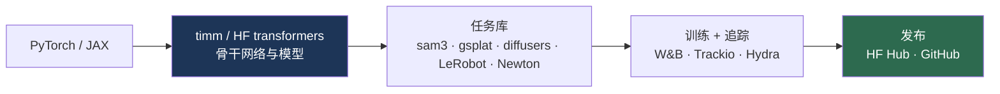

# 软件工具与框架

> **英文原文：** [cv-knowledge-base/13_resources_and_meta/03_software_tools.md](../../cv-knowledge-base/13_resources_and_meta/03_software_tools.md)（本中文版供参考，内容以英文原文为准）

> **最后更新：** 2026年10月
> **难度级别：** 基础
> **相关章节：**
> - [博士学习指南](./04_phd_study_guide.md)
> - [高效架构](../09_efficiency_and_deployment/01_efficient_architectures.md)
> - [边缘部署](../09_efficiency_and_deployment/03_edge_deployment.md)

> **🆕 2026年10月更新：**
> - 新增依据 PyPI 核对的**版本快照（2026年10月）**：PyTorch 2.14、Transformers 5.x（v5 于2026年1月正式发布）、timm 1.0.30、diffusers 0.41、JAX 0.11、LeRobot 0.6、Isaac Sim 6.2、MuJoCo 3.16、Newton 1.7、Genesis 1.4、Ultralytics 8.4（YOLO26）。
> - **机器人工具栈：** LeRobot 现已内置 π₀/π₀.₅、GR00T N1.7、SmolVLA、X-VLA、MolmoAct2 以及世界模型策略。**Newton**（Disney / Google DeepMind / NVIDIA；Linux 基金会）于 2026 年发布 1.0，以 MuJoCo Warp 为主要求解器。
> - **三维：** gsplat 仍是标准的高斯泼溅（Gaussian Splatting）核函数库（2026 年 main 分支加入稀疏和多 GPU 光栅化）。前馈式重建（VGGT、MapAnything）已成为 COLMAP 初始化的常见替代方案。nerfstudio 和 MMDetection 自 2024 年以来没有新的 PyPI 发布。
> - **实验追踪：** W&B（2025 年被 CoreWeave 收购）仍是默认选择；Hugging Face 的 **Trackio** 是免费的本地优先替代品。Papers With Code 已于2025年7月关停，其数据归档在 Hugging Face。

---

## 概述

计算机视觉研究者的生产力在很大程度上取决于一套成熟的软件栈：深度学习框架、模型中心、领域专用库和实验追踪工具。熟练掌握这一生态并非可有可无，它决定了实现一个想法、复现一个基线、扩展一个实验的速度。软件栈已经收敛到以下格局：**PyTorch** 是占主导地位的研究框架（JAX 在大规模和 TPU 工作中占有重要地位），**Hugging Face** 是模型/数据集分发中心，再加上一批任务专用库（timm、MMDetection、Detectron2、Open3D、nerfstudio），以简洁的 API 封装了最先进的实现。

第二个维度是**可复现性与基础设施工具**，它们本身已成为研究的“硬通货”：实验追踪器（Weights & Biases）、带版本管理的模型中心以及标准化的数据格式。通过这些渠道发布干净、可运行的代码和预训练权重，能实质性地提升论文的影响力和引用量（参见[博士学习指南](./04_phd_study_guide.md)）。本文概览核心工具、各自的用途，以及它们在现代 CV 研究工作流中如何协同。（工具生态演进很快；在依赖任何单一库之前，请先核实其当前维护状态。）

---

## 深度学习框架

- **PyTorch** — 默认的研究框架：即时执行（eager）、动态图、生态庞大。`torch.compile` 和 FSDP/DDP（FSDP2）支持大规模训练。几乎所有 CV 研究代码都用 PyTorch 编写。版本大约每两个月发布一次（2025年10月 2.9，2026年2月 2.10，此后到 2026年9月陆续发布 2.11–2.14），因此在每个发布的代码库中都应锁定精确版本。
- **JAX**（+ Flax/Haiku）— 函数式、可组合的变换（`grad`、`vmap`、`pmap`、`jit`）；在 TPU 和超大规模工作中占主导（ViT-22B、DeepMind 的大部分技术栈）。学习曲线较陡，扩展性极佳。2026 年的版本为 JAX 0.11 / Flax 0.12，它还驱动着用于仿真到现实（sim-to-real）强化学习的 GPU 并行仿真（MuJoCo MJX、MuJoCo Playground）。
- **TensorFlow / Keras** — 曾经占主导，如今主要用于生产/遗留系统和部分 Google 技术栈。Keras 3（2026 年为 3.15）支持多后端（JAX/PyTorch/TF）；TensorFlow 的发布已放缓（2026年3月发布 2.21）。

## 模型中心与骨干网络

- **Hugging Face Hub** — 预训练模型、数据集和 Spaces 的中心仓库；提供 `transformers`、`diffusers`、`datasets`、`accelerate` 等库，是基础模型（Foundation Model）事实上的分发渠道。**Transformers v5**（2026年1月正式发布）将该库重新定位为训练和推理引擎共享的“模型定义”层。DINOv3、SAM 3 以及较新的 VLM 均获原生支持。
- **timm**（PyTorch Image Models）— Ross Wightman 开发的库，包含数百种 CV 骨干网络（ViT、ConvNeXt、EfficientNet），提供预训练权重和统一 API；是分类/骨干网络基线不可或缺的工具（参见 [CNN 架构](../03_architectures/00_cnn_architectures.md)）。自 timm 1.0.20（2025年9月）起提供 DINOv3 骨干网络。

## 任务专用库

- **检测/分割** — **Detectron2**（FAIR）、**MMDetection / MMSegmentation / MMCV**（OpenMMLab）、**Ultralytics**（YOLO），提供标准实现和配置。各库的维护状况已出现分化：Ultralytics 非常活跃（2026年1月发布 8.4 / **YOLO26**；YOLO27 已作为预览公布）；MMDetection 的最后一个版本是 v3.3.0（2024年1月），Detectron2 更新缓慢。在分割方面，Meta 官方的 **`sam3`** 包（SAM 3 / SAM 3.1）已成为标准的开放词汇（open-vocabulary）分割与跟踪工具。
- **三维与渲染** — **Open3D**（点云/网格；2026年9月发布 0.20）、**PyTorch3D**、**COLMAP**（SfM/MVS）、**nerfstudio**（NeRF；最后一次 PyPI 发布为 1.1.5，2024年11月）、**gsplat / 3DGS 参考实现**（高斯泼溅；参见[高斯泼溅](../04_3d_vision_and_scene/02_gaussian_splatting.md)）。gsplat 最后一个打标签的版本是 1.5.3（2025年7月），但其 main 分支在 2026 年持续加入 3DGUT、稀疏与多 GPU 光栅化以及新的相机/LiDAR 模型，因此需要新功能时应从源码安装。**前馈式重建**模型（可导出 COLMAP 格式的 VGGT；MapAnything）越来越多地被用来替代或初始化 COLMAP（参见 [SfM 与 SLAM](../04_3d_vision_and_scene/03_sfm_and_slam.md)）。
- **生成式** — **diffusers**（Hugging Face；2026年10月发布 0.41）、ComfyUI/AUTOMATIC1111（Stable Diffusion 工具）；以及开放的三维生成器，如 **TRELLIS.2**（MIT 许可，含训练代码）和 **SAM 3D Objects**（参见[三维生成](../04_3d_vision_and_scene/04_3d_generation.md)）。
- **机器人** — **LeRobot**（Hugging Face 的机器人学习库）、**Isaac Lab**、**MuJoCo/MJX**、**robosuite**（参见[仿真与数据](../06_robotics_and_embodied_ai/05_simulation_and_data.md)）。
  - **LeRobot** 从 0.4（2025年10月）发展到 0.5（2026年3月）和 0.6（2026年7月）。它现在集成了模仿学习（ACT、Diffusion、VQ-BeT）、强化学习（HIL-SERL、TD-MPC）和 VLA 策略（π₀、π₀-FAST、π₀.₅、GR00T N1.7、SmolVLA、X-VLA、MolmoAct2、WALL-OSS 等），以及早期的世界模型策略（如 VLA-JEPA），因而成为开放 VLA 事实上的通用接口。
  - **NVIDIA Isaac Sim / Isaac Lab：** Isaac Sim 可通过 pip 安装（2026年3月 6.0，2026年10月 6.2）；Isaac Lab 2.3.x 已发布在 PyPI 上。
  - **Newton** — 开放的、GPU 加速的可微物理引擎，基于 NVIDIA Warp 构建并支持 OpenUSD。它由 Disney Research、Google DeepMind 和 NVIDIA 发起，现为 Linux 基金会项目，以 **MuJoCo Warp** 为主要后端（2026 年初发布 1.0，2026年10月发布 1.7）。
  - **MuJoCo**（3.16，2026年10月）配合 MuJoCo Warp / MJX 实现大规模并行 GPU 仿真；**Genesis**（2026年5月发布 1.0）是另一种 GPU 仿真器选择。

## 实验与可复现性工具

- **Weights & Biases (W&B)** — 实验追踪、超参数搜索（sweeps）、产物/版本管理、仪表盘；使用最广泛的追踪工具（2025 年被 CoreWeave 收购，产品继续运营）。**Trackio**（Hugging Face/Gradio，2025）是免费、本地优先、兼容 W&B API 的替代品，将日志记录到 HF Datasets/Spaces。
- **TensorBoard**、**MLflow**、**Hydra**（配置管理）、**DVC**（数据版本管理）。
- **Papers With Code** — 曾是标准的 SOTA/排行榜追踪网站。Meta 于2025年7月关停了原网站；其数据转储（论文、代码链接、评测表）归档在 Hugging Face（`pwc-archive`），其发现功能的很大一部分已由 Hugging Face 的 Daily/Trending Papers 接替。
- **Semantic Scholar / Connected Papers / arXiv** — 文献发现与引用图谱（参见[博士学习指南](./04_phd_study_guide.md)）。

---

## 工具对比

| 工具 | 类别 | 最适合 | 备注 |
|------|----------|----------|------|
| PyTorch | 框架 | 通用研究 | 占主导；eager + compile |
| JAX | 框架 | 大规模/TPU | 函数式；扩展性极佳 |
| Hugging Face | 中心/库 | 模型/数据分发 | 核心生态 |
| timm | 骨干网络 | 分类基线 | 数百个预训练模型 |
| Detectron2/MMDet | 检测 | 检测/分割 | 标准配置 |
| nerfstudio/gsplat | 三维 | NeRF/3DGS | 可复现的三维 |
| W&B | 追踪 | 实验/超参数搜索 | 行业标准 |
| Ultralytics | 检测 | 实时 YOLO 训练/部署 | YOLO26（8.4）；AGPL-3.0 许可 |
| LeRobot | 机器人 | 数据集 + VLA/模仿学习/强化学习策略 | 开放 VLA 的通用接口 |
| Isaac Lab / Newton / MuJoCo | 仿真 | GPU 并行强化学习、仿真到现实 | Newton 为 LF 项目；MuJoCo Warp 后端 |

### 版本快照（2026年10月）

| 软件包 | 最新版本（PyPI，2026年10月） | 2025–2026 年重要里程碑 |
|---------|-------------------------|-----------------------------|
| torch | 2.14.1 | 2.9（2025年10月）→ 2.14（2026年9月），约每两个月发布一次 |
| transformers | 5.20.x | v5.0 于 2026年1月26日正式发布 |
| timm | 1.0.30 | 自 1.0.20 起支持 DINOv3 |
| diffusers | 0.41.0 | 0.36（2025年12月）→ 0.41（2026年10月） |
| jax / flax | 0.11.2 / 0.12.x | jax 0.8（2025年10月）→ 0.11（2026年7月） |
| lerobot | 0.6.1 | 0.4（2025年10月）、0.5（2026年3月）、0.6（2026年7月） |
| isaacsim / isaaclab | 6.2.0 / 2.3.2 | Isaac Sim 6.0（2026年3月） |
| newton | 1.7.0 | 1.0（2026 年初），Linux 基金会 |
| mujoco / mujoco-warp | 3.16.0 / 3.16.0 | MuJoCo Warp 与 MuJoCo 版本号同步 |
| genesis-world | 1.4.x | 1.0（2026年5月） |
| gsplat | 1.5.3（2025年7月） | main 分支在最后一个标签之后仍活跃开发 |
| ultralytics | 8.4.x | 8.4.0 / YOLO26（2026年1月） |
| sam3 | 0.1.x | SAM 3（2025年11月）、SAM 3.1 检查点（2026年3月） |
| wandb / trackio | 0.31 / 0.42 | Trackio 于 2025 年推出 |

*版本变化很快；锁定版本前请先运行 `pip index versions <pkg>` 查看。*

---

## 优缺点（框架选择）

| 方面 | PyTorch | JAX |
|--------|---------|-----|
| 易用性 | 高；社区庞大 | 学习曲线较陡 |
| 扩展性 | 强（FSDP、compile） | 极佳（pmap、TPU） |
| 生态 | 庞大（timm、HF、Detectron2） | 较小但在增长 |
| 调试 | 即时执行，直观 | 函数式，较棘手 |

---

## 开放问题与研究空白（工具层面）

- **可复现性缺口。** 代码发布规范在改善但仍不一致；环境/版本漂移会破坏复现。
- **基准工具的脆弱性。** 排行榜基础设施（如 Papers With Code 的变化）脆弱且资源不足。
- **算力获取。** 工具默认用户能使用 GPU/TPU，而许多研究者并不具备；普惠化尚未完成。
- **评测标准化。** 缺乏可在各实验室间公平评测 CV/VLM 的通用评测框架。
- **边缘/部署鸿沟。** 从研究框架到优化后的边缘运行时的衔接仍需大量手工工作（参见[边缘部署](../09_efficiency_and_deployment/03_edge_deployment.md)）。
- **机器人工具不成熟。** 机器人学习软件（LeRobot、仿真接口）比核心 CV 工具更年轻、标准化程度更低。LeRobot 的策略库和 Newton 的多求解器设计正在推动工具栈趋同，但各 VLA 的检查点和动作空间格式仍不统一。
- **“弃坑”风险。** 曾经的标准库（nerfstudio、MMDetection、Detectron2）发布已放缓或停止，而研究正转向特定模型的代码库（sam3、TRELLIS.2、vggt）。在为一篇需要数年完成的博士论文选用某个库之前，请先查看它的最后发布日期。
- **多后端可移植性。** 针对 PyTorch CUDA 核函数编写的代码很少能不经修改地运行在 TPU、Apple Silicon 或边缘 NPU 上，被迫针对每个后端重写，拖慢了研究迭代。
- **依赖脆弱性。** 快速演进的库频繁引入破坏性变更，使多年后的复现变得困难；锁定环境和容器有所帮助，但在领域内的采用并不一致。

---

## 延伸阅读

- [PyTorch](https://pytorch.org/) — 占主导的研究框架
- [Hugging Face Hub](https://huggingface.co/) — 模型、数据集、Spaces
- [timm (PyTorch Image Models)](https://github.com/huggingface/pytorch-image-models) — 骨干网络库
- [nerfstudio](https://docs.nerf.studio/) — NeRF/3DGS 工具包
- [Weights & Biases](https://wandb.ai/) — 实验追踪
- [Trackio](https://github.com/gradio-app/trackio) — 基于 Hugging Face 的轻量级本地优先追踪工具
- [LeRobot](https://huggingface.co/docs/lerobot/index) — 机器人学习数据集与策略（VLA、模仿学习、强化学习）
- [gsplat](https://github.com/nerfstudio-project/gsplat) — CUDA 高斯泼溅光栅化库
- [Newton](https://github.com/newton-physics/newton) — 开放的 GPU 物理引擎（Linux 基金会）
- [SAM 3](https://github.com/facebookresearch/sam3) — 官方 SAM 3 / SAM 3.1 代码与检查点
