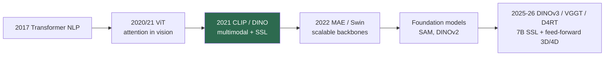

# The Transformer Era (2020–2023)

> **Last Updated:** October 2026
> **Level:** Foundational
> **Related Sections:**
> - [Generative Era](./04_generative_era.md)
> - [Vision Transformers](../03_architectures/01_vision_transformers.md)
> - [Self-Supervised Learning](../03_architectures/03_self_supervised_learning.md)
> - [Foundation Model Era](./06_foundation_model_era.md)

> **🆕 October 2026 update:**
> - Added the 2025 continuation of the self-distillation line: **DINOv3** (Aug 2025) scales DINO to a 7B-parameter ViT and fixes dense-feature degradation with Gram anchoring.
> - Noted that plain ViT backbones now underpin feed-forward 3D/4D reconstruction (VGGT, CVPR 2025 Best Paper; D4RT, CVPR 2026 Best Paper), extending the era's "one operator for everything" thesis to geometry.
> - Updated the Mermaid lineage, Key Papers (DINOv3) and Further Reading.

---

## Overview

The transformer era marks the migration of the attention mechanism—dominant in NLP since 2017—into computer vision, and with it a shift from architecture-specific inductive biases toward general-purpose, scalable sequence models. The pivotal claim, made by the Vision Transformer in 2020, was that the convolution is dispensable: a pure Transformer over image patches, given sufficient pretraining data, matches or beats the best CNNs. This was more than an architectural swap. It unified vision and language under one computational primitive (attention), enabling the multimodal models (CLIP) and self-supervised methods (MAE, DINO) that defined the period, and it set the trajectory toward the foundation models of [The Foundation Model Era](./06_foundation_model_era.md).

The era's intellectual content is twofold. First, **scalability**: ViT's smooth improvement with data and parameters—unlike CNNs' earlier saturation—made vision amenable to the scaling-law playbook that had transformed NLP (see [Scaling Laws in Vision](../12_research_frontier_2024_2026/01_scaling_laws_vision.md)). Second, **self-supervision**: the same attention backbone enabled label-free pretraining objectives—contrastive (CLIP, DINO) and masked-reconstruction (MAE, BEiT)—that produced representations with emergent properties (DINO's unsupervised object segmentation) impossible to obtain from supervised CNNs. A third, quieter consequence was **architectural unification**: because both modalities now used the same operator, multimodal fusion became a matter of concatenating token streams rather than engineering modality-specific bridges, a simplification that made the subsequent vision-language-action models architecturally natural. This file narrates the transition; technical depth lives in [Vision Transformers](../03_architectures/01_vision_transformers.md) and [Self-Supervised Learning](../03_architectures/03_self_supervised_learning.md).

---

## Attention Comes to Vision

The **Transformer** [Vaswani2017] introduced scaled dot-product self-attention, displacing recurrence in NLP. **ViT** [Dosovitskiy2021] (ICLR 2021) applied it to vision by tokenizing an image into 16×16 patches, prepending a `[CLS]` token, adding learned positional embeddings, and running a standard Transformer encoder—matching CNNs when pretrained on JFT-300M. **DeiT** [Touvron2021] recovered ImageNet-1K-only training via distillation; **Swin** [Liu2021] reintroduced hierarchy and locality through shifted-window attention, making Transformers viable dense-prediction backbones.

## Vision-Language and Contrastive Learning

**CLIP** [Radford2021] (ICML 2021) contrastively aligned image and text encoders on 400M web pairs, producing a vision backbone *semantically grounded in language* and enabling zero-shot classification by embedding class names as text. CLIP is arguably the single most influential model of the era: it became the perceptual front-end for text-to-image generation, open-vocabulary detection, and large VLMs (see [Multimodal Architectures](../03_architectures/04_multimodal_architectures.md)).

## Self-Supervised Pretraining

Two label-free families matured. **Masked image modeling**: **MAE** [He2022] (CVPR 2022) masks ~75% of patches and reconstructs pixels with an asymmetric encoder-decoder, scaling efficiently; **BEiT** predicts discrete visual tokens. **Self-distillation**: **DINO** [Caron2021] and **DINOv2** [Oquab2023] produce features with *emergent* semantic structure—attention maps that segment objects without any segmentation labels.

The self-distillation line reached a new scale with **DINOv3** [Simeoni2025] (arXiv:2508.10104, August 2025): a 7B-parameter ViT teacher trained on roughly 1.7B curated images, then distilled into smaller ViT and ConvNeXt students. Scaling exposed a problem the earlier papers had only hinted at — dense patch features *degrade* during long training even as global features improve — which DINOv3 addressed with **Gram anchoring**, a loss that keeps the Gram matrix of patch features close to that of an earlier checkpoint. The result partially settles the era's "best SSL objective" debate for dense tasks: a frozen, label-free backbone can be competitive on segmentation and depth as well as classification.

## Legacy: The Transformer as Universal Vision Operator (2025–2026)

The era's architectural-unification thesis extended to geometry in 2025–2026. **VGGT** [Wang2025] (CVPR 2025 Best Paper) uses a large transformer with alternating frame-wise and global attention to predict cameras, depth and point maps for many views in one feed-forward pass, and the CVPR 2026 Best Paper (*D4RT*, Google DeepMind, UCL, Oxford) extended feed-forward reconstruction to dynamic video. Combined with concept-promptable segmentation (SAM 3) and transformer-based VLA policies, essentially every major vision task in 2026 — recognition, segmentation, depth, multi-view geometry, generation and control — runs on the attention operator that ViT introduced to vision in 2020.

---

## Key Papers

| Paper | Authors | Year | Venue | Key Contribution |
|-------|---------|------|-------|-----------------|
| Attention Is All You Need | Vaswani, Shazeer, Parmar, et al. | 2017 | NeurIPS | The Transformer / self-attention |
| ViT | Dosovitskiy, Beyer, Kolesnikov, et al. | 2021 | ICLR | Pure Transformer for image recognition |
| CLIP | Radford, Kim, Hallacy, et al. | 2021 | ICML | Contrastive vision-language pretraining |
| MAE | He, Chen, Xie, et al. | 2022 | CVPR | Masked autoencoders; scalable SSL |
| DINO | Caron, Touvron, Misra, et al. | 2021 | ICCV | Self-distillation; emergent segmentation |
| Swin Transformer | Liu, Lin, Cao, et al. | 2021 | ICCV | Hierarchical shifted-window attention |
| DINOv3 | Siméoni et al. | 2025 | arXiv | 7B self-distilled ViT; Gram anchoring for dense features |

---

## Impact & Limitations

| Aspect | Impact | Limitation |
|--------|--------|------------|
| Attention backbone | Unified vision & language; scalable | Quadratic cost; data-hungry |
| CLIP | Zero-shot transfer; foundation front-end | Weak spatial/compositional reasoning |
| Self-supervision | Label-free, emergent features | Heavy compute; objective design open |
| Hierarchy (Swin) | Dense-prediction ready | Re-introduces inductive bias ViT removed |

---

## Open Problems & Research Gaps (what this era left unsolved)

- **Quadratic attention cost** at high resolution, motivating state-space models (see [State Space Models](../03_architectures/05_state_space_models.md)).
- **Spatial reasoning.** CLIP-grounded models inherit poor spatial/relational understanding (see [Spatial Intelligence](../12_research_frontier_2024_2026/06_spatial_intelligence.md)).
- **Data efficiency.** ViTs need large pretraining; small-data regimes still favor hybrids/CNNs.
- **Best SSL objective.** Contrastive vs. masked modeling trade-offs remain unsettled, although DINOv3 (2025) strengthened the case for self-distillation at scale for dense tasks.
- **Interpretability** of attention and emergent features is incomplete.
- **From representations to agents.** Bridging strong perception to action defined the next era (see [Foundation Model Era](./06_foundation_model_era.md)).

---

## Further Reading

- [ViT (arXiv:2010.11929)](https://arxiv.org/abs/2010.11929) — an image is worth 16×16 words
- [CLIP (arXiv:2103.00020)](https://arxiv.org/abs/2103.00020) — learning from natural language supervision
- [MAE (arXiv:2111.06377)](https://arxiv.org/abs/2111.06377) — masked autoencoders
- [DINOv2 (arXiv:2304.07193)](https://arxiv.org/abs/2304.07193) — robust self-supervised features
- [Attention Is All You Need (arXiv:1706.03762)](https://arxiv.org/abs/1706.03762) — the Transformer
- [DINOv3 (arXiv:2508.10104)](https://arxiv.org/abs/2508.10104) — self-distillation at 7B scale with Gram anchoring
- [VGGT (arXiv:2503.11651)](https://arxiv.org/abs/2503.11651) — transformer for feed-forward multi-view geometry
