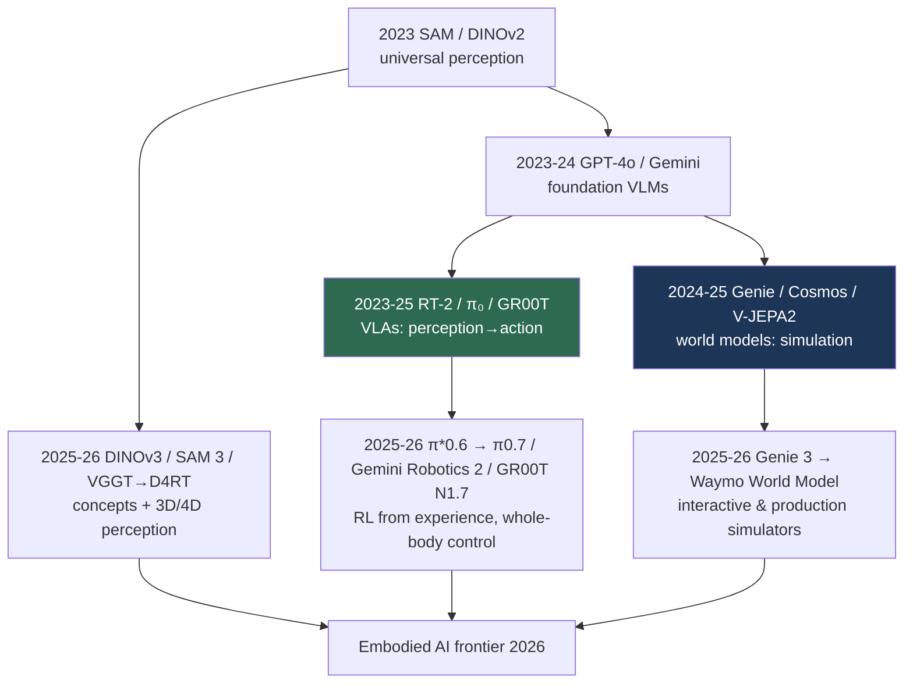

# The Foundation Model Era (2023–2026)

> **Last Updated:** October 2026
> **Level:** Foundational
> **Related Sections:**
> - [Transformer Era](./05_transformer_era.md)
> - [VLA Models](../06_robotics_and_embodied_ai/01_vla_models.md)
> - [Latest Developments](../12_research_frontier_2024_2026/00_overview_latest.md)
> - [The "Anything" Model Paradigm](../12_research_frontier_2024_2026/02_any_model_paradigm.md)

> **🆕 October 2026 update:**
> - Universal perception extended to **concepts** and **3D**: SAM 3 (Promptable Concept Segmentation, Nov 2025; ICLR 2026), SAM 3D, DINOv3 (7B SSL backbone, Aug 2025), and feed-forward 3D/4D reconstruction (VGGT → D4RT, CVPR 2025 and CVPR 2026 Best Papers).
> - Embodiment: π0.5 → π\*0.6 with RECAP (RL from on-robot experience, Nov 2025) → π0.7 (Apr 2026); Gemini Robotics 1.5 / ER 1.5 (Sep 2025) → Gemini Robotics 2 / ER 2 (Jul 2026, whole-body humanoid control); GR00T N1.6 → N1.7 with Cosmos-Reason backbones.
> - World models went interactive and industrial: V-JEPA 2 (Jun 2025), Genie 3 (Aug 2025) → Project Genie (Jan 2026) → Waymo World Model (Feb 2026); AMI Labs' $1.03B seed round (Mar 2026).
> - New subsection on 2025–2026 milestones, updated Mermaid lineage, six new Key Papers rows, two new Impact rows, three new open problems, and new Further Reading.

---

## Overview

The foundation model era is defined by a single organizing idea: instead of training task-specific models, train one large, broadly pretrained model that transfers—via prompting or light fine-tuning—to an open-ended range of tasks. In vision this manifested as **universal perceptual primitives** (SAM for segmentation, Depth Anything for depth, DINOv2 for features), **foundation vision-language models** (GPT-4V, Gemini, InternVL) that absorbed nearly all image-understanding tasks, and—most consequentially for the field's trajectory—the extension of foundation models from *perception* to *action* (VLAs) and *prediction* (world models). The era's center of gravity shifted from "recognize the world" to "act in and simulate the world," making robotics and embodied AI the frontier (see [VLA Models](../06_robotics_and_embodied_ai/01_vla_models.md) and [Latest Developments](../12_research_frontier_2024_2026/00_overview_latest.md)).

Three structural features distinguish this era. First, **promptability and zero-shot transfer**: SAM segments "anything" pointed at, decoupling the geometric task from semantics (see [The "Anything" Model Paradigm](../12_research_frontier_2024_2026/02_any_model_paradigm.md)). Second, **the data engine**: models and annotation co-evolve (SAM's SA-1B of 1.1B masks was bootstrapped model-in-the-loop), shifting the bottleneck from architecture to data. Third, **embodiment and convergence**: vision, language, and control collapsed into unified models (RT-2, π₀, Gemini Robotics), and generative video became a *world simulator* (Genie, Cosmos) for training agents. This file narrates the still-unfolding era as of October 2026; by then a fourth feature had become visible — **learning after deployment**, as VLAs began to be refined with reinforcement learning on their own experience and world models were adopted as production simulators.

---

## Universal Perceptual Primitives

**SAM** [Kirillov2023] (ICCV 2023) introduced promptable segmentation trained on a billion-mask data engine, performing zero-shot on new distributions; **SAM 2** extended it to video. **Depth Anything V1/V2** [Yang2024] applied the same recipe to monocular depth via large-scale unlabeled data. **DINOv2** [Oquab2023] provided general-purpose visual features usable across tasks without fine-tuning. Together these became off-the-shelf perceptual building blocks for downstream systems, including robotics (see [Perception for Robotics](../06_robotics_and_embodied_ai/08_perception_for_robotics.md)).

The second generation of primitives (2025–2026) widened *what can be prompted* and *what is predicted*:

- **DINOv3** [Simeoni2025] (arXiv:2508.10104, Aug 2025) scaled self-distillation to a 7B-parameter ViT teacher on roughly 1.7B curated images. *Gram anchoring* — regularising the Gram matrix of patch features towards an earlier, cleaner checkpoint — fixed the degradation of dense features under long training, making a single frozen backbone competitive on dense tasks; the teacher was distilled into ViT-S through ViT-H+ and ConvNeXt variants.
- **SAM 3** [Carion2026] (arXiv:2511.16719, Nov 2025; ICLR 2026) introduced *Promptable Concept Segmentation*: given a noun phrase and/or image exemplars, segment and track **every** matching instance in images and video. A shared backbone feeds an image-level detector and a memory-based tracker; a *presence head* separates "is the concept present?" from "where is it?". Its data engine produced ~4M unique concept labels (with hard negatives) and the SA-Co benchmark; the authors report roughly 2× the accuracy of prior systems on PCS. **SAM 3D**, released alongside, brought the promptable recipe to single-image 3D reconstruction of objects and human bodies.
- **Feed-forward geometry.** VGGT [Wang2025] (CVPR 2025 Best Paper) regressed cameras, depth, point maps and tracks for many views in one forward pass; the CVPR 2026 Best Paper, *Efficiently Reconstructing Dynamic Scenes One D4RT at a Time* (Google DeepMind, UCL, Oxford), extended this to dynamic 4D scenes. Geometry thereby joined segmentation and depth as a promptable/feed-forward primitive rather than an optimisation pipeline.

## Foundation Vision-Language Models

Large multimodal models—**GPT-4V → GPT-4o**, **Gemini 1.5/2.0** (1M-token video context), **InternVL**, **Qwen-VL**—subsumed VQA, captioning, OCR, grounding, and reasoning into single prompt-driven systems, closing the open–closed gap by 2025 (see [Large Vision-Language Models](../05_multimodal_vision_language/02_large_vision_language_models.md)). The 2025–2026 generation — **GPT-5** (Aug 2025), **Gemini 3** (Nov 2025) and the open-weight **Qwen3-VL** family — made long-video understanding, visual agents that operate GUIs, and "thinking" (test-time reasoning) over images standard capabilities, while generative video models (**Veo 3** with native audio, **Sora 2**) became the other half of the multimodal frontier.

## From Perception to Action and Simulation

The defining move of the era was extending foundation models to embodiment. **RT-2** [Brohan2023] showed a web-pretrained VLM fine-tuned on robot data transfers Internet knowledge to control; **π₀** added flow-matching action heads for dexterity; **Gemini Robotics** and **GR00T N1** (2025) brought frontier-model capability and dual-system architectures to robots. In parallel, **world models**—**Genie** (playable worlds from video), **Cosmos** (NVIDIA's physical-AI world foundation model), **V-JEPA 2**—turned generative video into simulators and predictive engines for embodied learning (see [World Models](../06_robotics_and_embodied_ai/02_world_models.md)).

### 2025–2026: Learning from Experience, Interactive Worlds

**Policies.** Physical Intelligence's **π0.5** (2025) targeted open-world generalisation to unseen homes via co-training on heterogeneous data, and **π\*0.6** (Nov 2025) added **RECAP** (*Reinforcement learning with Experience and Corrections via Advantage-conditioned Policies*), which folds demonstrations, expert corrections and autonomous rollouts into advantage-conditioned training of the π0.6 VLA; the company reports more than doubled throughput on hard tasks (espresso making, laundry folding, box assembly) and multi-hour autonomous runs — company figures, not independent evaluations. Google DeepMind's **Gemini Robotics 1.5** and **Gemini Robotics-ER 1.5** (Sep 2025) split control into an embodied-reasoning planner that can call tools such as search (ER 1.5, available via the Gemini API, reported state-of-the-art on 15 embodied-reasoning benchmarks) and a VLA executor available to selected partners. NVIDIA's **GR00T N1.6** (announced Oct 2025, released around CES 2026) replaced its VLM with an internal **Cosmos-Reason-2B** variant and doubled the depth of its diffusion-transformer action head (32 vs. 16 layers), targeting simultaneous locomotion and manipulation for humanoids. The first three quarters of 2026 continued all three lines: Physical Intelligence's **π0.7** (April 2026) reported early signs of compositional task generalisation; **GR00T N1.7** moved to a Cosmos-Reason2-2B backbone (Qwen3-VL architecture), pretrained additionally on about 20K hours of egocentric human video through a relative end-effector action space shared by humans and robots, and was released under Apache 2.0; and Google DeepMind's **Gemini Robotics 2** (announced 30 July 2026), with a new **Gemini Robotics-ER 2** planner, extended a single VLA from upper-body manipulation to *whole-body* humanoid control, demonstrated on Apptronik's Apollo 2 — DeepMind itself noted that movement speed still needs work.

**World models.** Meta's **V-JEPA 2** (Jun 2025) showed that a self-supervised video model predicting in representation space, post-trained on a small amount of robot interaction data, supports zero-shot planning; **V-JEPA 2.1** followed in March 2026. **Genie 3** (Aug 2025) generated navigable worlds in real time (reported ~24 fps at 720p); Google opened it to US Google AI Ultra subscribers as **Project Genie** on 29 Jan 2026, explicitly framed as a research prototype rather than a game engine. On 6 Feb 2026 Waymo announced the **Waymo World Model**, built on Genie 3 and adapted for driving, which produces controllable multi-sensor (camera and lidar) output and is used to simulate rare events absent from fleet data — a general-purpose world model repurposed as a production simulator for a safety-critical system. NVIDIA continued the **Cosmos** line (Predict, Transfer and the physical-reasoning VLM **Cosmos Reason**, which NVIDIA reported had passed one million downloads), and World Labs launched **Marble** for generating persistent, editable 3D worlds. The bet on non-generative world models also gained institutional weight: **AMI Labs**, founded by Yann LeCun (chairman) with Alexandre LeBrun as CEO, announced a $1.03B seed round on 10 Mar 2026 to build JEPA-style models that predict in abstract representation space.

---

## Key Papers

| Paper | Authors | Year | Venue | Key Contribution |
|-------|---------|------|-------|-----------------|
| Segment Anything (SAM) | Kirillov, Mintun, Ravi, et al. | 2023 | ICCV | Promptable segmentation + billion-mask data engine |
| DINOv2 | Oquab, Darcet, Moutakanni, et al. | 2023 | TMLR | General-purpose self-supervised visual features |
| Depth Anything V2 | Yang, Kang, Huang, et al. | 2024 | NeurIPS | Foundation monocular depth |
| RT-2 | Brohan, Brown, Carbajal, et al. | 2023 | CoRL | VLA: web knowledge transfers to robot control |
| Genie | Bruce, Dennis, Edwards, et al. | 2024 | ICML | Generative interactive environments from video |
| Cosmos | NVIDIA | 2025 | arXiv | World foundation model for physical AI |
| V-JEPA 2 | Assran et al. | 2025 | arXiv | Self-supervised video world model; zero-shot robot planning |
| VGGT | Wang, Chen, Karaev, et al. | 2025 | CVPR (Best Paper) | Feed-forward multi-view 3D geometry |
| DINOv3 | Siméoni et al. | 2025 | arXiv | 7B SSL backbone; Gram anchoring for dense features |
| SAM 3: Segment Anything with Concepts | Carion et al. | 2026 | ICLR | Promptable Concept Segmentation; SA-Co benchmark |
| π\*0.6 (RECAP) | Physical Intelligence | 2025 | Tech report | VLA improved by RL from on-robot experience and corrections |
| Efficiently Reconstructing Dynamic Scenes One D4RT at a Time | Google DeepMind, UCL, Oxford | 2026 | CVPR (Best Paper) | Feed-forward 4D reconstruction from video |

---

## Impact & Limitations

| Aspect | Impact | Limitation |
|--------|--------|------------|
| Promptable primitives | Zero-shot perception off-the-shelf | Geometric only (SAM); heavy encoders |
| Foundation VLMs | One model, all understanding tasks | Spatial reasoning, hallucination, compute |
| VLAs | Generalist robot control | Limited dexterity/long-horizon; replication |
| World models | Simulators & data engines for agents | Physical-plausibility evaluation immature |
| Concept-level perception (SAM 3) | Open-vocabulary detection + segmentation + tracking in one prompt | Ambiguous/compositional phrases; heavy model |
| Interactive & production world models (Genie 3, Waymo WM) | Rare-event simulation; real-time explorable worlds | Minute-scale consistency; no certification standard |

---

## Open Problems & Research Gaps

- **Spatial intelligence.** Foundation models still fail at metric/relational spatial reasoning (see [Spatial Intelligence](../12_research_frontier_2024_2026/06_spatial_intelligence.md)).
- **Embodied generalization.** Level-5 compositional, long-horizon robot tasks remain unsolved (see [Pros, Cons & Roadmaps](../06_robotics_and_embodied_ai/07_pros_cons_roadmaps.md)).
- **The robot-data bottleneck.** Unlike text/images, action data is scarce and costly (see [Robot Data & Teleoperation](../06_robotics_and_embodied_ai/09_robot_data_and_teleoperation.md)).
- **Evaluation of world models** for control (physical plausibility, not just FVD).
- **Efficiency.** Running foundation VLAs on edge robots is open (see [Edge Deployment](../09_efficiency_and_deployment/03_edge_deployment.md)).
- **Safety & alignment** for physically embodied agents.
- **Open vs. closed.** Tension between open-source momentum and frontier-lab consolidation.
- **RL on top of imitation.** π\*0.6-style post-deployment RL raises reward design, safe exploration and reproducibility questions with few shared benchmarks.
- **Certifying learned simulators.** When a world model generates the rare events a safety case relies on (Waymo World Model), its fidelity on precisely those events must be validated — an unsolved methodological problem.
- **Generative vs. representation-space world models.** Pixel-generating simulators (Genie, Cosmos) and JEPA-style latent predictors (V-JEPA 2, AMI Labs) embody competing bets; there is no agreed task on which to compare them for control.

---

## Further Reading

- [Segment Anything (arXiv:2304.02643)](https://arxiv.org/abs/2304.02643) — the foundation segmentation model
- [RT-2 (arXiv:2307.15818)](https://arxiv.org/abs/2307.15818) — vision-language-action models
- [Genie (arXiv:2402.15391)](https://arxiv.org/abs/2402.15391) — generative interactive environments
- [Cosmos (arXiv:2501.03575)](https://arxiv.org/abs/2501.03575) — world foundation models for physical AI
- [DINOv2 (arXiv:2304.07193)](https://arxiv.org/abs/2304.07193) — general-purpose visual features
- [DINOv3 (arXiv:2508.10104)](https://arxiv.org/abs/2508.10104) — 7B self-supervised backbone with Gram anchoring
- [SAM 3 (arXiv:2511.16719)](https://arxiv.org/abs/2511.16719) — segment anything with concepts
- [V-JEPA 2 (arXiv:2506.09985)](https://arxiv.org/abs/2506.09985) — self-supervised video models for understanding, prediction and planning
- [VGGT (arXiv:2503.11651)](https://arxiv.org/abs/2503.11651) — feed-forward visual geometry
- [The Waymo World Model (Feb 2026)](https://waymo.com/blog/2026/02/the-waymo-world-model-a-new-frontier-for-autonomous-driving-simulation) — Genie 3 as a driving simulator
- [Project Genie (Jan 2026)](https://blog.google/innovation-and-ai/models-and-research/google-deepmind/project-genie/) — Genie 3 research prototype
- [NVIDIA open robotics models, incl. GR00T N1.6 and Cosmos Reason (Oct 2025)](https://investor.nvidia.com/news/press-release-details/2025/NVIDIA-Accelerates-Robotics-Research-and-Development-With-New-Open-Models-and-Simulation-Libraries/default.aspx) — press release
- [Gemini Robotics 2 (Google DeepMind, Jul 2026)](https://deepmind.google/blog/gemini-robotics-2-brings-whole-body-intelligence-to-robots/) — whole-body humanoid VLA and ER 2 planner
- [Isaac GR00T repository](https://github.com/NVIDIA/Isaac-GR00T) — GR00T N1.5 / N1.6 / N1.7 code and release notes
- [AMI Labs raises $1.03B to train world models (SiliconANGLE, Mar 2026)](https://siliconangle.com/2026/03/10/yann-lecuns-new-startup-ami-labs-raises-1-03b-train-world-models/) — LeCun's world-model lab
