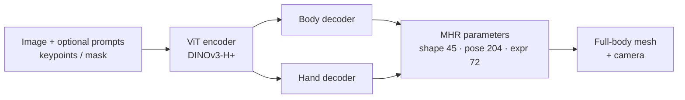

# Pose Estimation: 2D, 3D Human Mesh Recovery, and 6-DoF Object Pose

> **Last Updated:** October 2026
> **Level:** Advanced
> **Related Sections:** [Depth Estimation](./05_depth_estimation.md) | [Optical Flow & Tracking](./06_optical_flow_tracking.md) | [Perception for Robotics](../06_robotics_and_embodied_ai/08_perception_for_robotics.md) | [3D Vision and Scene Understanding](../04_3d_vision_and_scene/00_3d_representations.md)

> **🆕 October 2026 update:**
> - Added **SAM 3D Body** (Meta, Nov 2025; paper arXiv 2602.15989): promptable full-body HMR on the new **Momentum Human Rig (MHR)** body model, DINOv3-H+ backbone, 54.8 mm MPJPE on 3DPW and 61.7 mm on EMDB.
> - Added the 2024–2026 wave of **foundation-scale HMR**: NLF (NeurIPS 2024), Multi-HMR (ECCV 2024), GVHMR (SIGGRAPH Asia 2024), PromptHMR (CVPR 2025), SMPLest-X (TPAMI 2025), Human3R (2025), plus alternative body models (MHR, Anny).
> - Added **human-centric foundation models** Sapiens (ECCV 2024) and **Sapiens2** (ICLR 2026; 1 B human images, up to 5 B params), and real-time end-to-end 2D pose (YOLO26-pose with RLE; RF-DETR keypoint preview).
> - Added model-free 6-DoF pose **Any6D** (CVPR 2025); new benchmark rows, Key Papers, open problems and Further Reading.

---

## Overview

Pose estimation encompasses a family of closely related problems: inferring the spatial configuration of articulated bodies (human or animal) from 2D images or video, recovering full 3D mesh models of human bodies, and estimating the six-degree-of-freedom (6-DoF) pose of rigid objects. These problems share a core challenge: mapping observations in an inherently ambiguous 2D projection back to structured 3D quantities. Over the past decade, deep learning has transformed each sub-problem from hand-crafted feature pipelines into end-to-end trainable systems, with recent foundation-model approaches generalizing across object categories and scene types with minimal task-specific fine-tuning.

2D human pose estimation seeks to localize anatomical keypoints (joints) in image space. The dominant paradigm relies on **heatmap regression**: for each keypoint, a network predicts a Gaussian-blurred probability map over image locations, achieving sub-pixel accuracy through soft-argmax decoding. Two competing paradigms exist. **Top-down** methods first detect bounding boxes (person detections) and then estimate per-person keypoints within each crop, benefiting from strong per-instance context but adding detection latency and suffering when crops overlap. **Bottom-up** methods simultaneously detect all keypoints and group them into individual instances via part affinity fields or associative embedding vectors; they are faster at inference time but harder to train and historically less accurate at tight localization. State-of-the-art top-down methods dominate benchmarks: HRNet [Sun2019] by maintaining high-resolution feature maps throughout the network rather than encoding to a low-resolution bottleneck and recovering resolution through upsampling, and more recently plain-ViT estimators such as ViTPose [Xu2022] and human-centric foundation backbones (Sapiens) through large-scale pre-training.

3D human pose and shape recovery extends keypoint localization to full mesh-level reconstruction, typically parameterized by the SMPL body model [Loper2015]. SMPL factorizes the mesh into pose parameters (joint rotations in axis-angle form, θ ∈ ℝ^72) and shape parameters (PCA coefficients, β ∈ ℝ^10), enabling compact, differentiable optimization targets. The landmark HMR [Kanazawa2018] demonstrated end-to-end regression of SMPL parameters from a single RGB image using an adversarial prior over valid human shapes. Video-based methods such as VIBE [Kocabas2020] extend this by processing temporal sequences with GRUs and discriminating against motion-capture data to enforce temporal consistency. The fully transformer-based HMR 2.0 / 4D-Humans [Goel2023] replaces convolutional encoders with ViT-based backbones and achieves dramatically improved accuracy and generalization. For 6-DoF object pose, FoundationPose [Wen2024] represents a paradigm shift: a single unified model handles both model-based and model-free setups by learning neural object representations at test time, eliminating the need for category-specific re-training.

Since 2024 the field has been reshaped by **foundation-scale, promptable models**. Human-centric backbones pre-trained on hundreds of millions to a billion human images (Sapiens [Khirodkar2024], Sapiens2 [Khirodkar2026]) serve 2D pose, body-part segmentation, normals and pointmaps from one representation. For 3D, single-image HMR moved to large ViT/DINOv3 backbones, massive pseudo-labelled data engines and new body models: SAM 3D Body [Yang2026] predicts the Momentum Human Rig (MHR) mesh and accepts SAM-style keypoint and mask prompts. Meanwhile real-time 2D pose has gone NMS-free and end-to-end (YOLO26-pose).

---

## 2D Human Pose Estimation

### Heatmap Regression

The standard formulation predicts K heatmaps H ∈ ℝ^{K×H×W}, one per keypoint. The ground-truth heatmap for keypoint k at location (x_k, y_k) is:

```latex
H_k(x, y) = \exp\!\left(-\frac{(x - x_k)^2 + (y - y_k)^2}{2\sigma^2}\right)
```

The network is trained with pixel-wise MSE between predicted and ground-truth heatmaps. At inference, the keypoint location is decoded as:

```latex
\hat{p}_k = \arg\max_{(x,y)} H_k(x, y)
```

with sub-pixel refinement via Taylor expansion or soft-argmax aggregation.

### Top-Down vs. Bottom-Up

| Paradigm | Method Example | Pros | Cons |
|---|---|---|---|
| Top-down | HRNet [Sun2019], SimpleBaseline [Xiao2018] | Higher per-person accuracy | Depends on detector; scales with N persons |
| Bottom-up | OpenPose [Cao2019], HigherHRNet | Fast single-pass inference | Harder grouping step; less accurate in crowded scenes |

### HRNet Architecture

HRNet [Sun2019] is the most influential top-down backbone for pose estimation. The key innovation is **parallel multi-resolution branches**: starting from a single high-resolution branch, HRNet repeatedly adds lower-resolution branches connected through repeated multi-scale fusions. Unlike networks that reduce spatial resolution to build a semantic bottleneck, HRNet maintains a high-resolution representation throughout, recovering only through lightweight lateral connections. This avoids the precision loss inherent in standard encoder-decoder designs.

```
Stage 1:  [HR-branch]  (C channels, full res)
Stage 2:  [HR-branch] — [LR-branch × 2] with cross-scale fusion
Stage 3:  [HR-branch] — [LR-branch × 2] — [LR-branch × 4]
Stage 4:  [HR-branch] — ... — [LR-branch × 8]
Final:    Heatmap head on HR output
```

### OpenPose and Part Affinity Fields

OpenPose [Cao2019] introduced Part Affinity Fields (PAFs): 2D vector fields that encode the orientation and location of limbs, allowing greedy bipartite matching between detected keypoints across individuals. The PAF for limb (j1, j2) at point p is:

```latex
\mathbf{L}_{c}(p) = \begin{cases} \mathbf{v} & \text{if } p \text{ on limb segment} \\ 0 & \text{otherwise} \end{cases}
```

where **v** = (p_{j2} − p_{j1}) / ‖p_{j2} − p_{j1}‖ is the unit direction vector. Association scores integrate the PAF along candidate limb segments.

### Transformer and Human-Centric Foundation Models (2022–2026)

**ViTPose / ViTPose++** [Xu2022] (NeurIPS 2022 / TPAMI 2023) showed that a plain ViT with a simple deconvolution head is a strong top-down pose estimator; ViTPose++-H, trained jointly on COCO, AIC, MPII, AP-10K, APT-36K and COCO-WholeBody, reaches 79.4 AP on COCO val at 256×192 and transfers across human and animal keypoints.

**Sapiens** [Khirodkar2024] (Meta, ECCV 2024 best-paper candidate) pre-trains MAE ViTs (0.3 B–2 B params) natively at 1024×1024 on **300 M in-the-wild human images**, then fine-tunes for dense whole-body 2D pose, body-part segmentation, depth and surface normals. **Sapiens2** [Khirodkar2026] (ICLR 2026; released April 2026) scales pre-training to **1 B human images** and model sizes from 0.1 B to 5 B params (plus a 4K-resolution 1B variant), covering pose, body-part segmentation, surface normals, pointmaps and human matting.

**Real-time end-to-end 2D pose.** Ultralytics **YOLO26-pose** (2026) integrates Residual Log-Likelihood Estimation (RLE) for keypoint regression and NMS-free inference; YOLO26n–x-pose report **57.2–71.6 AP** (COCO keypoints val, OKS) at 1.8–12.2 ms on a T4, and Ultralytics reports up to +7.2 AP over YOLO11-pose. Roboflow's **RF-DETR keypoint** head (preview) reports 71.8 AP at 9.7 ms on a T4.

---

## SMPL Parametric Body Model

SMPL [Loper2015] defines a mesh M(β, θ) ∈ ℝ^{6890×3} with:
- **β ∈ ℝ^10**: shape PCA coefficients (body identity)
- **θ ∈ ℝ^{72}**: joint rotations as axis-angles (24 joints × 3)

```latex
M(\beta, \theta) = W\!\left(T_P(\beta,\theta),\, J(\beta),\, \theta,\, \mathcal{W}\right)
```

where T_P is the shaped+posed template, J(β) are joint locations regressed from shape, and W is the linear blend skinning function. SMPL-X extends SMPL to hands and face expression.

**Alternative body models (2025–2026).** **MHR — Momentum Human Rig** [MHR2025] (Meta, arXiv 2511.15586) decouples skeletal structure from surface shape and provides 45 identity (shape) parameters, 204 articulation parameters, 72 facial-expression parameters, seven levels of detail and neural-network pose-corrective deformations; it is the output representation of SAM 3D Body. **Anny** (NAVER LABS) is an open, differentiable body model derived from MakeHuman that spans infants to elders with a single topology; a Multi-HMR checkpoint predicting Anny was released in Feb 2026. The coexistence of SMPL(-X), MHR and Anny makes cross-model evaluation and conversion a practical concern.

---

## 3D Human Mesh Recovery

### HMR (Kanazawa 2018)

HMR [Kanazawa2018] regresses SMPL parameters (θ, β, camera π) from a ResNet-50 encoder using an iterative feedback loop (iterative error feedback, IEF). An adversarial discriminator D(θ, β) distinguishes regressed parameters from real motion-capture poses, providing a data-driven prior without requiring paired 3D annotations. The total loss is:

```latex
\mathcal{L}_{\text{HMR}} = \lambda_{\text{reproj}} \|\hat{x} - x\|_1 + \lambda_{\text{3D}} \|\hat{\Theta} - \Theta^*\|_2 - \lambda_{\text{adv}} \log D(\hat{\theta}, \hat{\beta})
```

### VIBE (Kocabas 2020)

VIBE [Kocabas2020] extends HMR to video by processing frame-level ResNet features with a GRU temporal encoder. A motion discriminator trained on the AMASS motion-capture dataset distinguishes between natural and regressed motion sequences, enforcing temporal plausibility. VIBE was a key step in learning coherent, artifact-free 3D human motion from in-the-wild video.

### HMR 2.0 / 4D-Humans (Goel 2023)

4D-Humans [Goel2023] (published as "Humans in 4D" at ICCV 2023) replaces convolutional encoders with a ViT-H/16 backbone pre-trained with MAE, achieving dramatically improved generalization. The transformer architecture attends over the entire image context, reducing systematic failures on occlusions and unusual viewpoints. The system jointly reconstructs and tracks multiple people through video, associating per-frame SMPL estimates with temporal consistency modules. HMR 2.0 achieves state-of-the-art PA-MPJPE on 3DPW and generalizes better to in-the-wild imagery than prior CNN-based methods.

### Foundation-Scale and Promptable HMR (2024–2026)

- **Multi-HMR** [Baradel2024] (ECCV 2024): single-shot multi-person whole-body (SMPL-X) recovery with camera-space placement from one image; won the 3D human reconstruction track of the RHOBIN challenge at CVPR 2024.
- **NLF — Neural Localizer Fields** [Sarandi2024] (NeurIPS 2024): learns a continuous field that can be queried for *any* point on the body surface or skeleton, unifying heterogeneous datasets with different keypoint/mesh conventions into one large-scale training mixture.
- **GVHMR** [Shen2024] (SIGGRAPH Asia 2024): world-grounded human motion recovery from monocular video using **gravity-view coordinates**, decoupling motion from camera rotation.
- **SMPLest-X** [Yin2025] (TPAMI 2025): extends SMPLer-X with "ultimate scaling" of data and model size for expressive (body + hands + face) human pose and shape estimation.
- **PromptHMR** [Wang2025b] (CVPR 2025): a promptable HMR model that conditions on spatial and semantic prompts (e.g. boxes and masks for the target person), improving robustness in crowded and interacting scenes.
- **Human3R** [Chen2025h] (arXiv 2510.06219): "Everyone Everywhere All at Once" — online, feed-forward joint reconstruction of multiple humans and the surrounding 4D scene from video, building on the CUT3R streaming 3D reconstruction model.

### SAM 3D Body (Meta, 2025)

**SAM 3D Body (3DB)** [Yang2026] (Meta Superintelligence Labs; released with checkpoints and data on 19 Nov 2025 alongside SAM 3D Objects; paper arXiv 2602.15989) is a **promptable single-image full-body HMR model**. It estimates body, feet and hands in the **MHR** parameterisation with an encoder–decoder architecture (a separate hand decoder can refine hands), and accepts auxiliary **2D keypoint and mask prompts** in the style of the SAM family. Training uses a multi-stage annotation pipeline combining differentiable optimisation, multi-view geometry, dense keypoint detection and a data engine that mines rare poses and viewpoints; the dataset is released. With a DINOv3-H+ (840 M) backbone it reports **54.8 mm MPJPE on 3DPW**, **61.7 mm on EMDB**, 60.3 mm PVE on RICH and 5.5 mm PA-MPJPE on FreiHAND hands, and qualitatively outperforms CameraHMR, NLF and HMR 2.0 under occlusion and unusual viewpoints.



---

## 6-DoF Object Pose Estimation

### Problem Formulation

Given an RGB(-D) image and object model (or reference images), estimate the rigid transformation T = (R, t) ∈ SE(3), where R ∈ SO(3) is the 3×3 rotation matrix and t ∈ ℝ³ is the translation vector, expressing the object's pose in camera coordinates.

### FoundationPose (Wen 2024)

FoundationPose [Wen2024], presented at CVPR 2024 as a highlight paper, is a unified foundation model for 6D pose estimation and tracking. Key innovations:

1. **Model-agnostic neural representation**: Given the object CAD model or a small set of reference RGBD images, a neural object field is learned at test time without re-training.
2. **Render-and-compare hypothesis testing**: Multiple pose hypotheses are rendered and scored by a transformer-based network comparing rendered vs. observed appearances.
3. **Pose tracking refinement**: Frame-to-frame motion is tracked via a dedicated refinement module, enabling smooth 6-DoF tracking in video.

FoundationPose supports both **model-based** (CAD model provided) and **model-free** (reference images only) setups, achieving near-parity between the two on standard benchmarks — a significant practical advance for robotics deployment. Its official repository reports first place on the BOP leaderboard for model-based pose estimation of unseen objects (as of March 2024).

```mermaid
graph LR
    A[Input RGB-D Frame] --> B[Object Segmentation]
    B --> C[Hypothesis Sampling: N poses from SE3]
    C --> D[Neural Renderer]
    D --> E[Render-vs-Observe Scorer Transformer]
    E --> F[Top-K Pose Refinement]
    F --> G[Final 6-DoF Pose T=(R,t)]
    G --> H[Temporal Tracker]
    H --> A
```

### Model-Free Novel-Object Pose (2025–2026)

**Any6D** [Lee2025] (CVPR 2025) removes the need for a CAD model or multi-view reference capture: from **a single RGB-D anchor image** of an unknown object it jointly estimates the object's 6-DoF pose *and metric size* in novel scenes, building on image-to-3D generation (InstantMesh) for a coarse object model and on FoundationPose-style render-and-compare pose refinement. In parallel, single-image 3D generators such as **SAM 3D Objects** (Meta, arXiv 2511.16624, Nov 2025) reconstruct shape, texture *and layout (pose)* of masked objects in cluttered natural scenes, blurring the line between 6-DoF pose estimation and image-to-3D reconstruction.

---

## Evaluation Metrics

### 2D Pose: PCK and OKS/AP

**PCK (Percentage of Correct Keypoints):** A predicted keypoint is "correct" if it falls within a threshold τ of the ground-truth location. The threshold is typically normalized by the torso size or head segment:

```latex
\text{PCK}@\tau = \frac{1}{NK} \sum_{n=1}^{N} \sum_{k=1}^{K} \mathbf{1}\!\left[\|\hat{p}_{nk} - p_{nk}\|_2 \leq \tau \cdot d_n\right]
```

**OKS (Object Keypoint Similarity):** Used in COCO AP evaluation. Analogous to IoU for bounding boxes:

```latex
\text{OKS} = \frac{\sum_k \exp\!\left(-d_k^2 / 2s^2 \sigma_k^2\right) \cdot \delta(v_k > 0)}{\sum_k \delta(v_k > 0)}
```

where d_k is the Euclidean distance between predicted and ground-truth keypoint k, s is the object scale, σ_k is a per-keypoint standard deviation, and v_k is the visibility flag. **AP** (Average Precision) is computed by sweeping OKS thresholds from 0.5 to 0.95 in steps of 0.05.

### 3D Pose: MPJPE

**MPJPE (Mean Per-Joint Position Error):** Average Euclidean distance between predicted and ground-truth 3D joint positions (in mm):

```latex
\text{MPJPE} = \frac{1}{NK} \sum_{n,k} \|\hat{J}_{nk} - J_{nk}\|_2
```

**PA-MPJPE (Procrustes-Aligned MPJPE):** Aligns the prediction to ground truth via rigid Procrustes transformation before computing error, isolating shape/joint-angle errors from global orientation errors.

### 6-DoF Object Pose: ADD and BOP Metrics

**ADD(-S):** Average Distance of Model Points — average distance between 3D model points transformed by the predicted vs. ground-truth pose. For symmetric objects, ADD-S uses the minimum-distance assignment. Typical threshold: 10% of model diameter.

**BOP benchmark** (Hodan 2018, ongoing): Uses VSD (Visible Surface Discrepancy), MSSD, and MSPD metrics that are better calibrated to rendering quality; AR_VSD is now the primary leaderboard metric.

---

## Key Papers

| Paper | Authors | Year | Venue | Key Contribution |
|---|---|---|---|---|
| OpenPose: Realtime Multi-Person 2D Pose Estimation Using Part Affinity Fields | Cao, Hidalgo, Simon, Wei, Sheikh | 2019 | IEEE TPAMI | Bottom-up PAF approach; first open-source real-time multi-person system |
| Deep High-Resolution Representation Learning for Human Pose Estimation (HRNet) | Sun, Xiao, Liu, Wang | 2019 | CVPR | Maintains high-resolution representation throughout; state-of-the-art top-down heatmap method |
| SMPL: A Skinned Multi-Person Linear Model | Loper, Mahmood, Romero, Pons-Moll, Black | 2015 | ACM ToG (SIGGRAPH Asia) | Parametric body model θ/β; foundational representation for mesh recovery |
| End-to-End Recovery of Human Shape and Pose (HMR) | Kanazawa, Black, Jacobs, Malik | 2018 | CVPR | First end-to-end SMPL regression with adversarial pose prior |
| VIBE: Video Inference for Human Body Pose and Shape Estimation | Kocabas, Athanasiou, Black | 2020 | CVPR | GRU temporal model + AMASS motion discriminator for video mesh recovery |
| Humans in 4D: Reconstructing and Tracking Humans with Transformers (HMR 2.0) | Goel, Pavlakos, Rajasegaran, Kanazawa, Malik | 2023 | ICCV | ViT-based HMR; joint video tracking; large-scale BEDLAM training data |
| FoundationPose: Unified 6D Pose Estimation and Tracking of Novel Objects | Wen, Yang, Kautz, Birchfield | 2024 | CVPR (Highlight) | Foundation model for model-based and model-free 6-DoF pose; render-and-compare |
| Sapiens: Foundation for Human Vision Models | Khirodkar et al. | 2024 | ECCV | 300 M human-image MAE pre-training; 1K-resolution pose/seg/depth/normals |
| Multi-HMR: Multi-Person Whole-Body Human Mesh Recovery in a Single Shot | Baradel et al. | 2024 | ECCV | Single-shot multi-person SMPL-X recovery |
| Neural Localizer Fields for Continuous 3D Human Pose and Shape Estimation (NLF) | Sárándi, Pons-Moll | 2024 | NeurIPS | Queryable continuous body field; unifies heterogeneous datasets |
| World-Grounded Human Motion Recovery via Gravity-View Coordinates (GVHMR) | Shen et al. | 2024 | SIGGRAPH Asia | Gravity-view coordinates for world-grounded video HMR |
| PromptHMR: Promptable Human Mesh Recovery | Wang, Sun, Patel, Daniilidis, Black, Kocabas | 2025 | CVPR | Promptable HMR with spatial/semantic prompts |
| Any6D: Model-free 6D Pose Estimation of Novel Objects | Lee et al. | 2025 | CVPR | 6-DoF pose + size from a single RGB-D anchor image |
| SMPLest-X: Ultimate Scaling for Expressive Human Pose and Shape Estimation | Yin et al. | 2025 | TPAMI | Data/model scaling for SMPL-X recovery |
| MHR: Momentum Human Rig | Meta | 2025 | arXiv | Parametric body model decoupling skeleton and surface; LODs; pose correctives |
| SAM 3D Body: Robust Full-Body Human Mesh Recovery | Yang, Kukreja, Pinkus et al. | 2026 | arXiv | Promptable full-body HMR on MHR; DINOv3 backbone; released Nov 2025 |
| Sapiens2 | Khirodkar, Wen, Martinez, Dong, Su, Saito | 2026 | ICLR | 1 B human-image pre-training; 0.1 B–5 B params |

---

## Benchmark Performance

| Model | Dataset | Metric | Score | Notes |
|---|---|---|---|---|
| HRNet-W48 (top-down) | COCO test-dev | AP (OKS) | 75.5 | Single-scale, no extra training data |
| ViTPose-H | COCO test-dev | AP (OKS) | 79.1 | ViT backbone, large-scale pre-training |
| HMR 2.0 | 3DPW test | PA-MPJPE (mm) | 44.5 | ViT-H backbone, BEDLAM training |
| VIBE | 3DPW test | PA-MPJPE (mm) | 56.5 | GRU temporal; state-of-the-art at publication |
| HMR (original) | Human3.6M | MPJPE (mm) | 88.0 | ResNet-50 backbone; single frame |
| FoundationPose (model-based) | YCB-V | AR_VSD | 84.0 | Reported in [Wen2024]; NVIDIA CUDA inference |
| FoundationPose (model-free) | YCB-V | AR_VSD | 76.0 | Reference-image-only setup |
| ViTPose++-H | COCO val | AP (OKS) | 79.4 | 256×192; multi-dataset training (official repo) |
| YOLO26x-pose | COCO val | AP (OKS) | 71.6 | End-to-end NMS-free; 12.2 ms T4 (Ultralytics) |
| RF-DETR Keypoint (preview) | COCO val | AP (OKS) | 71.8 | 9.7 ms T4 (Roboflow protocol) |
| SAM 3D Body (DINOv3-H+) | 3DPW | MPJPE (mm) | 54.8 | Single image; MHR output; official checkpoint |
| SAM 3D Body (DINOv3-H+) | EMDB | MPJPE (mm) | 61.7 | Same checkpoint; RICH PVE 60.3 mm |

*Note: exact FoundationPose BOP scores vary by split; reported values are from the original paper.*

---

## Pros & Cons

| Aspect | Pros | Cons |
|---|---|---|
| Top-down 2D pose | Highest per-instance accuracy; context crop isolates individual | Dependent on upstream detector; O(N) cost with person count |
| Bottom-up 2D pose | Single-pass; naturally handles crowds; lower latency | Grouping heuristics; lower accuracy on occluded/small instances |
| SMPL-based mesh recovery | Compact, physically-plausible parameterization; differentiable | SMPL does not model clothing, hair, or hands/face without extensions (SMPL-X) |
| Video mesh recovery (VIBE/HMR2.0) | Temporal smoothness; better handles single-frame ambiguities | Requires video input; memory scales with sequence length |
| FoundationPose (foundation model) | No category-specific re-training; handles novel objects; model-free option | Heavy render-and-compare inference; requires accurate segmentation |
| Human-centric foundation backbones (Sapiens/Sapiens2) | One high-resolution representation for pose, parts, normals, pointmaps; strong in-the-wild generalisation | 0.3–5 B params; high-resolution inference cost; human-only domain |
| Promptable foundation HMR (SAM 3D Body, PromptHMR) | Robust to occlusion/rare poses; user-guided correction via prompts; full body + hands | Large backbones; new body model (MHR) not directly comparable to SMPL benchmarks; single-image (no temporal model) |
| End-to-end real-time 2D pose (YOLO26-pose) | NMS-free; ms-level latency; simple deployment | ~8 AP below top-down ViT pose on COCO; 17 COCO keypoints only |

---

## Open Problems & Research Gaps

- **Clothing and deformable surfaces:** SMPL assumes a minimally-clothed body; extending parametric recovery to arbitrary clothing (SMPL+D, CAPE, ICON) remains unsolved at real-time rates.
- **Occlusion reasoning:** Both 2D and 3D methods degrade with heavy occlusion; learning occlusion-aware representations and cross-person depth ordering is an active area.
- **Egocentric and multi-camera fusion:** Estimating full-body pose from fisheye head-mounted cameras (EgoBody, EgoHMR) in real time for AR/VR is an underexplored but practically important setting.
- **Annotation-free 3D supervision:** Paired 2D-3D in-the-wild data is scarce; weakly-supervised and self-supervised approaches using multi-view geometry or neural rendering remain limited in scale.
- **6-DoF pose of deformable or transparent objects:** Rigid-body pose methods fail for soft bodies, cloth, liquids, or transparent objects; category-level 6-DoF estimation is nascent.
- **Real-time 6-DoF tracking on edge devices:** FoundationPose's render-and-compare pipeline is GPU-heavy; neural light-field or implicit-representation approaches must be distilled for embedded robotics.
- **Unified body+hand+face reconstruction:** SMPL-X recovery at video frame rates with accurate finger and facial expression estimation remains a significant challenge.
- **Body-model fragmentation:** SMPL/SMPL-X, MHR (SAM 3D Body) and Anny now coexist; benchmarks such as 3DPW/EMDB assume SMPL topology, so fair comparison requires lossy model-to-model fitting. Shared evaluation protocols or topology-agnostic metrics are needed.
- **From single-image foundation HMR to consistent 4D humans:** SAM 3D Body and Sapiens2 are per-image; combining their robustness with world-grounded temporal models (GVHMR, Human3R) and scene reconstruction without drift remains open.
- **Data engines and pseudo-label bias:** Modern HMR relies on pseudo-labels from optimisation and multi-view fitting; how annotation-pipeline biases (e.g. towards common shapes and camera models) propagate into foundation models is largely unmeasured.

---

## Further Reading

- [HRNet paper (arXiv:1902.09212)](https://arxiv.org/abs/1902.09212) — Deep High-Resolution Representation Learning [Sun2019]
- [4D-Humans / HMR 2.0 project page](https://shubham-goel.github.io/4dhumans/) — Full code, pretrained models, and demo [Goel2023]
- [FoundationPose project (NVLabs)](https://github.com/NVlabs/FoundationPose) — Official NVIDIA implementation [Wen2024]
- [SMPL model page (MPI-IS)](https://smpl.is.tue.mpg.de/) — Official SMPL downloads and extended models [Loper2015]
- [COCO Keypoints Challenge](https://cocodataset.org/#keypoints-2023) — Standard 2D pose benchmark and OKS metric definition
- [BOP Benchmark](https://bop.felk.cvut.cz/home/) — 6-DoF object pose leaderboard with VSD/MSSD/MSPD metrics
- [SAM 3D Body (arXiv:2602.15989)](https://arxiv.org/abs/2602.15989) · [code & checkpoints](https://github.com/facebookresearch/sam-3d-body) — Promptable full-body HMR [Yang2026]
- [MHR: Momentum Human Rig (arXiv:2511.15586)](https://arxiv.org/abs/2511.15586) — Parametric body model used by SAM 3D Body [MHR2025]
- [Sapiens (arXiv:2408.12569)](https://arxiv.org/abs/2408.12569) · [Sapiens2 (arXiv:2604.21681)](https://arxiv.org/abs/2604.21681) — Human-centric foundation models [Khirodkar2024, Khirodkar2026]
- [Neural Localizer Fields (arXiv:2407.07532)](https://arxiv.org/abs/2407.07532) — Continuous 3D human pose and shape [Sarandi2024]
- [PromptHMR (arXiv:2504.06397)](https://arxiv.org/abs/2504.06397) — Promptable human mesh recovery [Wang2025b]
- [Any6D (arXiv:2503.18673)](https://arxiv.org/abs/2503.18673) — Model-free 6D pose of novel objects [Lee2025]
- [Ultralytics YOLO26 technical report (arXiv:2606.03748)](https://arxiv.org/abs/2606.03748) — Includes YOLO26-pose with RLE
