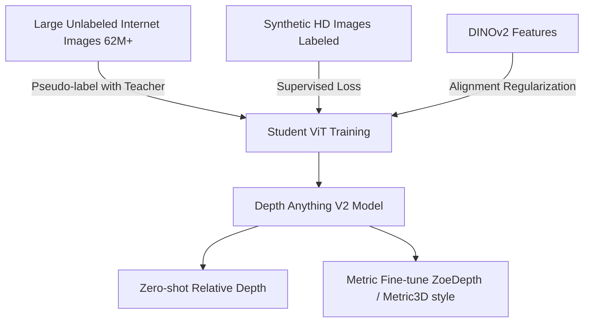
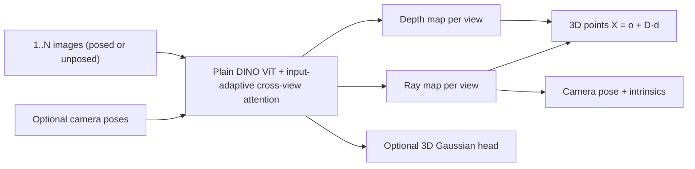

# Depth Estimation: Monocular, Stereo, and Foundation Models

> **Last Updated:** October 2026
> **Level:** Advanced
> **Related Sections:** [Pose Estimation](./04_pose_estimation.md) | [3D Vision and Scene Understanding](../04_3d_vision_and_scene/00_3d_representations.md) | [3D Reconstruction](./09_3d_reconstruction.md) | [Any-Model Paradigm](../12_research_frontier_2024_2026/02_any_model_paradigm.md) | [Perception for Robotics](../06_robotics_and_embodied_ai/08_perception_for_robotics.md)

> **🆕 October 2026 update:**
> - Added the 2024–2025 generation of depth foundation models the file was missing: Marigold (diffusion-based), UniDepth/UniDepthV2 and Depth Pro (intrinsics-free metric depth), MoGe/MoGe-2 (metric point maps), Video Depth Anything (long-video consistency) and FoundationStereo (zero-shot stereo, CVPR 2025 best-paper nominee).
> - New section on **Depth Anything 3** (ByteDance Seed, Nov 2025): one plain DINO transformer and a single depth-ray target for monocular, multi-view and posed/unposed inputs, plus DA3-Streaming for long videos.
> - 2026 releases: **MoGe-3** (Aug 2026, sparse volumetric refinement for fine detail) and **Fast-FoundationStereo** (Dec 2025, real-time stereo).
> - Monocular depth now overlaps with feed-forward multi-view geometry (VGGT, π³, MapAnything) and 4D reconstruction (D4RT, CVPR 2026 Best Paper); see [3D Reconstruction](./09_3d_reconstruction.md).
> - Updated Key Papers, Benchmark, Pros & Cons, Open Problems and Further Reading.

---

## Overview

Depth estimation — inferring the distance from a camera to scene surfaces — is a foundational CV task that bridges 2D imagery and 3D understanding. The problem exists in several forms depending on available input: **monocular** (single image or video), **stereo** (synchronized rectified image pair), and **multi-view** (overlapping views over time or space). Monocular depth is fundamentally ill-posed — a given 2D projection is consistent with infinitely many 3D scenes — so learned approaches must exploit photometric cues, occlusion patterns, and learned scene priors. Stereo depth estimation is more constrained by epipolar geometry but requires precise calibration and struggles with textureless and reflective surfaces.

The field has evolved through four distinct eras. The seminal deep-learning work of [Eigen2014] showed that a multi-scale CNN could predict pixel-wise depth from a single image by coupling a global-context network with a local-refinement network, fundamentally establishing data-driven depth estimation. The **self-supervised paradigm** emerged with Monodepth2 [Godard2019], which exploits view synthesis between consecutive or stereo frames as a free training signal, enabling large-scale training without LiDAR ground truth. **Dataset-mixing** approaches (MiDaS [Ranftl2020], DPT [Ranftl2021]) showed that training on diverse multi-source data with affine-invariant loss functions produces robust zero-shot generalization across scenes. Most recently, **large-scale foundation models** (Depth Anything V1/V2 [Yang2024], Metric3D [Wei2023], ZoeDepth [Bhat2023]) operate at web-scale training regimes, approaching universal depth estimation with or without metric scale recovery.

A **fifth era** took shape in 2024–2026. Depth became one output of broader **geometry foundation models**. Diffusion priors were repurposed for dense prediction (Marigold [Ke2024]). Metric depth was recovered without known intrinsics (UniDepth [Piccinelli2024], Depth Pro [Bochkovskii2025]). Monocular models began predicting full 3D point maps at metric scale (MoGe-2 [Wang2025b]). Single networks now handle one image, a video or an unordered image set with the same weights (Depth Anything 3 [Lin2025]). At this point the line between "monocular depth" and "feed-forward 3D reconstruction" (VGGT, π³, MapAnything; see [3D Reconstruction](./09_3d_reconstruction.md)) has largely dissolved.

Stereo depth occupies a complementary niche: given rectified stereo pairs, disparity estimation along horizontal epipolar lines is solvable with high precision. RAFT-Stereo [Lipson2021] transplants the recurrent correlation lookup idea from RAFT optical flow to stereo, achieving state-of-the-art accuracy with iterative refinement. While monocular models have improved dramatically, stereo remains preferred when hardware allows due to its more reliable metric scale and performance on textureless surfaces. Stereo has also gained its own foundation model: FoundationStereo [Wen2025] combines monocular depth priors with cost-volume matching and generalizes zero-shot across domains.

---

## Problem Formulation and Loss Functions

### Scale-Invariant Loss (Eigen 2014)

Early depth CNNs could not recover absolute metric scale from single images, motivating scale-invariant regression. The scale-invariant log loss [Eigen2014] is:

```latex
\mathcal{L}_{\text{SI}} = \frac{1}{n}\sum_i d_i^2 - \frac{\lambda}{n^2}\left(\sum_i d_i\right)^2, \quad d_i = \log \hat{y}_i - \log y_i
```

where y_i is the ground-truth depth at pixel i, ŷ_i is the prediction, and λ ∈ [0,1] controls the scale-invariance (λ=1 fully removes global scale). This loss was widely adopted in subsequent work and remains a standard component.

### Affine-Invariant Loss (MiDaS)

For cross-dataset training with heterogeneous depth sources (stereo, SfM sparse, LiDAR, depth sensors), depth values have inconsistent scale and shift. MiDaS [Ranftl2020] introduces an affine-invariant formulation by normalizing predictions and targets before computing loss:

```latex
\hat{d} = \frac{d - \text{median}(d)}{s(d)}, \quad \text{where} \quad s(d) = \frac{1}{n}\sum_i |d_i - \text{median}(d)|
```

Training minimizes the scale-shift-invariant MSE between normalized prediction and target, enabling joint training on data with incompatible depth scales.

### Photometric Reconstruction Loss (Monodepth2)

Monodepth2 [Godard2019] trains entirely from monocular video (or stereo) without ground-truth depth. For a source frame I_s and target frame I_t with relative pose T_{t→s}, the synthesized target view Î_t is computed by warping I_s using the predicted depth D_t:

```latex
\hat{I}_t(p) = I_s\!\left\langle K\, T_{t\to s}\, D_t(p)\, K^{-1}\, p \right\rangle
```

where ⟨·⟩ denotes bilinear sampling and K is the camera intrinsics matrix. The photometric loss combines L1 and SSIM:

```latex
\mathcal{L}_{\text{photo}} = \alpha \cdot \frac{1 - \text{SSIM}(\hat{I}_t, I_t)}{2} + (1 - \alpha) \cdot \|\hat{I}_t - I_t\|_1
```

Monodepth2 adds **auto-masking** (ignoring pixels that are better explained by the identity warp, i.e., static objects that don't move between frames) and **multi-scale smoothness** to stabilize training.

---

## Key Architectures

### MiDaS and DPT

MiDaS (Ranftl, Lasinger, Hafner, Schindler, Koltun; TPAMI 2022, arXiv 2019) trains a single depth network on a mixture of datasets with affine-invariant loss. Version 3.0 (DPT [Ranftl2021]) replaces the convolutional backbone with a Vision Transformer (ViT), assembling multi-scale tokens from different ViT stages into a dense feature pyramid decoded by a convolutional head. DPT-Large achieves a 28% relative improvement over its convolutional counterpart and sets new state-of-the-art on NYU Depth v2 and KITTI at the time of publication.

### Depth Anything V1 / V2 (Yang 2024)

Depth Anything V1 [Yang2024a] (CVPR 2024) scales monocular depth to large-scale internet data using a ViT backbone and semantic feature alignment from DINOv2 features, training on 1.5M labeled images plus 62M pseudo-labeled internet images. V2 [Yang2024b] (NeurIPS 2024) makes three key changes: (1) replaces real labeled images with **photorealistic synthetic images** from high-quality rendering engines to eliminate label noise; (2) scales the **teacher model** capacity; (3) distills to student models via large-scale pseudo-labeled real images. The result is finer boundary delineation and significantly improved robustness on challenging scenarios (night, fog, reflections). Depth Anything V2 models (ViT-S/B/L) have become the de-facto standard for zero-shot relative depth in downstream systems.



### ZoeDepth (Bhat 2023)

ZoeDepth [Bhat2023] combines relative and metric depth in a two-stage framework: first pre-training on 12 datasets with MiDaS-style affine-invariant loss, then fine-tuning lightweight metric bins heads (one per domain — indoor/outdoor) that predict absolute depth in meters. The metric bins module uses log-spaced bin centers with bin-widths predicted per image, achieving unprecedented zero-shot metric transfer across eight unseen datasets.

### Metric3D (Wei 2023)

Metric3D [Wei2023] (ICCV 2023) addresses metric depth estimation by introducing a **canonical camera space transformation** that normalizes images to a fixed focal length before depth prediction, resolving metric ambiguity arising from different camera intrinsics. This allows training a single model across datasets with wildly different sensor characteristics. Metric3D v2 (arxiv 2404.15506) extends this to a geometric foundation model predicting both metric depth and surface normals jointly with a ViT-L/ViT-g backbone.

### RAFT-Stereo (Lipson 2021)

RAFT-Stereo [Lipson2021] (3DV 2021, Best Student Paper) adapts the recurrent all-pairs field transforms architecture from RAFT optical flow to stereo matching. Key changes: (1) 1D cost volumes over horizontal disparities (exploiting epipolar rectification); (2) multi-level GRU architecture that propagates context across scales more efficiently than single-scale RAFT. RAFT-Stereo achieves sub-pixel accuracy on SceneFlow and significantly reduces error on ETH3D and KITTI stereo benchmarks.

### Marigold: Diffusion Priors for Depth (Ke 2024)

Marigold [Ke2024] (CVPR 2024 Oral, Best Paper Award Candidate) fine-tunes a pretrained latent diffusion model (Stable Diffusion) into an image-conditioned depth generator. The RGB latent is concatenated with the noisy depth latent, and only the U-Net is fine-tuned, using purely synthetic data. The rich image prior of the generator yields very sharp, detailed affine-invariant depth from small training sets. The cost is multi-step sampling and ensembling. Follow-ups distilled this to one or a few steps, for example with an LCM checkpoint. In May 2025 the authors released v1.1 depth and normals models and intrinsic image decomposition (albedo, roughness, metallicity, shading) models built with the same recipe ("Marigold: Affordable Adaptation of Diffusion-Based Image Generators for Image Analysis", arXiv 2505.09358).

### Metric Depth Without Known Intrinsics: UniDepth and Depth Pro

**UniDepth** [Piccinelli2024] (CVPR 2024) predicts metric 3D points directly from a single RGB image. A self-prompting **camera module** predicts a dense camera representation (ray directions), and the depth head is conditioned on it, which removes the need for test-time intrinsics. **UniDepthV2** (arXiv 2502.20110, Feb 2025) simplifies the design and adds an edge-guided loss for sharper boundaries, a confidence output, flexible aspect ratios, and non-pinhole camera models (e.g. fisheye).

**Depth Pro** [Bochkovskii2025] (Apple, ICLR 2025) targets *sharp* zero-shot metric depth. A multi-scale ViT applies a shared patch encoder to overlapping patches at several scales and fuses them into a 1536×1536 prediction. A separate head estimates focal length from the image alone. The authors report a 2.25-megapixel metric depth map in 0.3 s on a standard GPU, and state-of-the-art boundary accuracy measured with new edge-based metrics on matting and segmentation datasets.

### Monocular Geometry: MoGe, MoGe-2 and MoGe-3 (Microsoft, 2025–2026)

**MoGe** [Wang2025a] (CVPR 2025 Oral) reframes monocular depth as **affine-invariant point-map** prediction (a 3D point per pixel, up to a global scale and a z-shift). A robust, optimal alignment solver recovers the shift, and the camera field of view is computed from the point map. **MoGe-2** [Wang2025b] (NeurIPS 2025) adds **metric scale** without sacrificing relative geometry. It factors the prediction into a relative point map plus a global scale. A data-refinement pipeline filters and completes noisy real labels using sharp synthetic supervision, which recovers fine details. Variants range from ViT-S (35M) to ViT-L (≈330M) and include an optional normal head. Inference takes about 60 ms per image on an A100. **MoGe-3** (arXiv 2607.17967, released Aug 2026) adds **self-guided sparse volumetric refinement** for fine-detail point maps, with ViT-L (370M) and ViT-G (1.25B) checkpoints.

```latex
% Point-map formulation (MoGe family): per-pixel 3D points up to scale s and z-shift t_z
\hat{P}(u) \approx s \cdot P(u) + [0, 0, t_z]^\top
% MoGe-2 additionally predicts a global metric scale s_m so that P_metric = s_m \cdot \hat{P}_{rel}
```

### Depth Anything 3 (Lin 2025)

Depth Anything 3 [Lin2025] (ByteDance Seed, arXiv 2511.10647, Nov 2025) extends the Depth Anything line from single images to **any number of views, with or without known camera poses**. It makes two minimal design choices:

1. **A single plain transformer** (a vanilla DINO-pretrained ViT) serves as the backbone. An *input-adaptive cross-view self-attention* rearranges tokens across views when more than one image is given, so no specialized multi-view architecture is needed.
2. **A single depth-ray prediction target** replaces the separate depth, point-map and pose heads used by multi-task geometry models. Each pixel gets a depth and a ray (origin and direction), and the 3D point is their composition:

```latex
% Depth-ray representation: camera ray (origin o, direction d) and depth D per pixel u
X(u) = \mathbf{o}(u) + D(u)\, \mathbf{d}(u)
% Camera pose and intrinsics can be recovered from the predicted ray map,
% or a light camera head can be used for speed
```

Training follows the Depth Anything V2 teacher–student recipe on public academic datasets only. The paper reports that DA3 beats VGGT on a new visual-geometry benchmark (pose, any-view geometry, rendering), by roughly 35–44% in camera-pose accuracy and 24–25% in geometric accuracy on average, depending on the arXiv version. It also outperforms Depth Anything V2 on monocular depth. The released family includes Giant (1.15B), Large (0.35B), Base (0.12B) and Small (0.08B) any-view models, a monocular metric model, a monocular relative model, and a "Nested" Giant+Metric model for metric multi-view geometry. **DA3-Streaming** (Dec 2025) handles long videos in under 12 GB of GPU memory with sliding windows. Licenses differ: Giant, Large and Nested are CC BY-NC 4.0; Base, Small, Metric and Mono are Apache 2.0.



### Video Depth: Temporal Consistency at Scale

Applying single-image models frame by frame flickers. **Video Depth Anything** [Chen2025] (CVPR 2025 Highlight) adds a lightweight spatio-temporal head on top of Depth Anything V2 and a temporal-gradient consistency loss. With key-frame-based inference it handles arbitrarily long videos, and it is faster and smaller than diffusion-based video depth models such as DepthCrafter. 2025 updates added metric-depth video models, Small/Base variants, and a training-free streaming mode. Multi-view geometry models (CUT3R, VGGT, π³, DA3) and 4D models (D4RT) now also produce temporally consistent video depth as a by-product of joint camera and geometry estimation.

### Stereo Foundation Models: FoundationStereo (Wen 2025)

FoundationStereo [Wen2025] (NVIDIA, CVPR 2025 Oral, Best Paper nomination) brings the foundation-model recipe to stereo. It trains on a ~1M-pair synthetic dataset with automatic self-curation. A **side-tuning** adapter injects monocular priors from a frozen depth foundation model (Depth Anything V2) into the feature backbone, and long-range context reasoning filters the cost volume. It ranked first on the Middlebury and ETH3D leaderboards at release and generalizes zero-shot without per-domain fine-tuning. A real-time variant, **Fast-FoundationStereo**, followed in Dec 2025.

---

## Evaluation Metrics

### Standard Depth Metrics

Let d_i be the ground-truth depth and d̂_i be the predicted depth for pixel i, over N valid pixels:

**Absolute Relative Error (AbsRel):**
```latex
\text{AbsRel} = \frac{1}{N}\sum_{i} \frac{|\hat{d}_i - d_i|}{d_i}
```

**Root Mean Squared Error (RMSE):**
```latex
\text{RMSE} = \sqrt{\frac{1}{N}\sum_{i} (\hat{d}_i - d_i)^2}
```

**Threshold Accuracy (δ < threshold):**
```latex
\delta_t = \% \text{ of pixels where } \max\!\left(\frac{\hat{d}_i}{d_i},\, \frac{d_i}{\hat{d}_i}\right) < t, \quad t \in \{1.25,\, 1.25^2,\, 1.25^3\}
```

For relative depth evaluation (scale-ambiguous models), standard practice is to compute a per-image least-squares scale alignment before computing AbsRel and RMSE.

---

## Key Papers

| Paper | Authors | Year | Venue | Key Contribution |
|---|---|---|---|---|
| Depth Map Prediction from a Single Image using a Multi-Scale Deep Network | Eigen, Puhrsch, Fergus | 2014 | NeurIPS | First CNN-based monocular depth; scale-invariant log loss; multi-scale coarse-to-fine |
| Digging into Self-Supervised Monocular Depth Estimation (Monodepth2) | Godard, Mac Aodha, Firman, Brostow | 2019 | ICCV | Photometric self-supervision; auto-masking; minimum reprojection; no LiDAR required |
| Towards Robust Monocular Depth Estimation: Mixing Datasets for Zero-shot Cross-dataset Transfer (MiDaS) | Ranftl, Lasinger, Hafner, Schindler, Koltun | 2022 | IEEE TPAMI | Affine-invariant loss for multi-dataset training; zero-shot generalization |
| Vision Transformers for Dense Prediction (DPT) | Ranftl, Bochkovskiy, Koltun | 2021 | ICCV | ViT backbone for dense prediction; multi-scale token reassembly decoder |
| Depth Anything: Unleashing the Power of Large-Scale Unlabeled Data | Yang, Kang, Huang, Xu, Feng, Zhao | 2024 | CVPR | Large-scale semi-supervised depth; DINOv2 feature alignment; 62M pseudo-labeled images |
| Depth Anything V2 | Yang, Kang, Huang, Zhao, Xu, Feng, Zhao | 2024 | NeurIPS | Synthetic training images; scaled teacher; superior fine detail and robustness |
| ZoeDepth: Zero-shot Transfer by Combining Relative and Metric Depth | Bhat et al. | 2023 | arXiv | Two-stage: relative pre-train + lightweight metric heads; zero-shot metric transfer |
| Metric3D: Towards Zero-shot Metric 3D Prediction from A Single Image | Wei Yin, Chi Zhang et al. | 2023 | ICCV | Canonical camera normalization resolves multi-sensor metric ambiguity |
| RAFT-Stereo: Multilevel Recurrent Field Transforms for Stereo Matching | Lipson, Teed, Deng | 2021 | 3DV | Adapts RAFT to stereo via 1D cost volumes; multi-level GRU; Best Student Paper |
| Repurposing Diffusion-Based Image Generators for Monocular Depth Estimation (Marigold) | Ke, Obukhov, Huang, Metzger, Daudt, Schindler | 2024 | CVPR (Oral) | Fine-tuned Stable Diffusion as depth estimator; synthetic-only training; very sharp detail |
| UniDepth: Universal Monocular Metric Depth Estimation | Piccinelli, Yang, Sakaridis, Segu, Li, Van Gool, Yu | 2024 | CVPR | Self-prompting camera module; metric 3D points without test-time intrinsics (V2: arXiv 2502.20110) |
| Depth Pro: Sharp Monocular Metric Depth in Less Than a Second | Bochkovskii, Delaunoy, Germain, Santos, Zhou, Richter, Koltun | 2025 | ICLR | Multi-scale ViT; zero-shot metric depth + focal length; 2.25 MP in 0.3 s |
| MoGe: Unlocking Accurate Monocular Geometry Estimation for Open-Domain Images with Optimal Training Supervision | Wang, Xu et al. (Microsoft) | 2025 | CVPR (Oral) | Affine-invariant point maps; robust alignment solver; FoV recovery |
| Video Depth Anything: Consistent Depth Estimation for Super-Long Videos | Chen, Guo, Zhu, Zhang, Huang, Feng, Kang | 2025 | CVPR (Highlight) | Spatio-temporal head on DA-V2; temporal consistency for arbitrarily long videos |
| FoundationStereo: Zero-Shot Stereo Matching | Wen, Trepte, Aribido, Kautz, Gallo, Birchfield | 2025 | CVPR (Oral) | Stereo foundation model; 1M synthetic pairs; side-tuned monocular priors; best-paper nominee |
| MoGe-2: Accurate Monocular Geometry with Metric Scale and Sharp Details | Wang, Xu et al. (Microsoft) | 2025 | NeurIPS | Metric-scale point maps + sharp details via synthetic-guided label refinement |
| Depth Anything 3: Recovering the Visual Space from Any Views | Lin, Chen, Liew, Chen, Li, Shi, Feng, Kang | 2025 | arXiv 2511.10647 | Plain DINO transformer + depth-ray target; any-view depth and pose; beats VGGT and DA-V2 |
| Fine-Detail Monocular Geometry Estimation with Self-Guided Sparse Volumetric Refinement (MoGe-3) | Microsoft MoGe team | 2026 | arXiv 2607.17967 | Sparse volumetric refinement for fine-grained point-map geometry; ViT-G 1.25B |

---

## Benchmark Performance

| Model | Dataset | Metric | Score | Notes |
|---|---|---|---|---|
| Depth Anything V2-L | NYU Depth v2 | AbsRel ↓ | 0.066 | Zero-shot; ViT-L backbone |
| Depth Anything V2-L | KITTI Eigen split | AbsRel ↓ | 0.046 | Zero-shot; ViT-L backbone |
| Monodepth2 (M+S) | KITTI Eigen split | AbsRel ↓ | 0.090 | Self-supervised; mono+stereo training |
| ZoeDepth (NK model) | NYU Depth v2 | AbsRel ↓ | 0.075 | Metric depth; indoor |
| ZoeDepth (NK model) | KITTI | AbsRel ↓ | 0.053 | Metric depth; outdoor |
| DPT-Large | NYU Depth v2 | AbsRel ↓ | 0.110 | Relative depth (scale-aligned) |
| RAFT-Stereo | ETH3D stereo | Bad-1px ↓ | 0.86% | Stereo; recurrent refinement 32 iters |
| Metric3D v2 (ViT-L) | KITTI | AbsRel ↓ | 0.045 | Zero-shot metric; canonical camera |
| UniDepthV2 | NYU Depth v2 | δ₁ ↑ | 98.8 | Zero-shot metric; no GT intrinsics (repo README) |
| UniDepthV2 | KITTI | δ₁ ↑ | 98.9 | Zero-shot metric (repo README) |
| UniDepthV2 | ETH3D | δ₁ ↑ | 85.2 | Zero-shot metric; V1 scored 18.5, which shows the gain in camera robustness |
| FoundationStereo | Middlebury / ETH3D leaderboards | Rank | 1st | At release (early 2025); zero-shot stereo |
| Depth Pro | — | Runtime | 0.3 s / 2.25 MP | Metric depth + focal length on a standard GPU |
| Depth Anything 3 vs. VGGT | DA3 visual-geometry benchmark | Rel. gain ↑ | ~35–44% pose, ~24–25% geometry | Average relative improvement claimed in [Lin2025]; varies by arXiv version |

*Scores from respective papers or official repositories; some values depend on evaluation protocol details (cap, sparse vs. dense GT, scale alignment). Direct comparisons require identical protocols. Since 2025, depth models are increasingly compared on multi-dataset zero-shot suites (e.g. the MoGe and DA3 benchmark suites) rather than on NYU/KITTI alone.*

---

## Pros & Cons

| Aspect | Pros | Cons |
|---|---|---|
| Monocular depth (self-supervised) | No LiDAR/depth sensor needed; scalable to internet video; good generalization | Scale-ambiguous output; degrades on dynamic objects; limited metric accuracy |
| Foundation depth models (Depth Anything, MiDaS) | Excellent zero-shot generalization; single model for diverse scenes | Still relative depth; scale errors compound in downstream 3D tasks |
| Metric depth (ZoeDepth, Metric3D) | Absolute depth enables direct robotics/AR use; zero-shot metric across scenes | Sensitive to camera intrinsics estimation; indoor/outdoor domain split still challenging |
| Stereo depth (RAFT-Stereo) | Metric scale from geometry; very accurate on textured surfaces | Requires hardware stereo rig; fails on low-texture/transparent regions; calibration sensitivity |
| Diffusion-based depth (Marigold) | Exceptionally sharp details; strong prior from image generators; small synthetic training sets suffice | Multi-step sampling is slow without distillation; affine-invariant only; can hallucinate texture as geometry |
| Intrinsics-free metric / point-map models (UniDepth, Depth Pro, MoGe-2) | Metric 3D from one image with no calibration; FoV / focal estimated jointly | Scale can still collapse in unusual open-domain scenes; best checkpoints often non-commercial (CC BY-NC) |
| Any-view geometry models (Depth Anything 3) | One model for mono, video and multi-view; outputs depth, rays/poses and optional 3D Gaussians | Large models (up to 1.4B) for best quality; giant checkpoints non-commercial; global attention memory grows with views |
| Stereo foundation models (FoundationStereo) | Zero-shot cross-domain stereo; leaderboard-level accuracy | Heavier than classic stereo nets (real-time requires Fast-FoundationStereo / TensorRT) |

---

## Open Problems & Research Gaps

- **Metric depth from uncalibrated monocular cameras:** Metric3D and ZoeDepth need approximate intrinsics. UniDepth, Depth Pro and MoGe-2 now estimate the camera jointly, but a 2026 follow-up (arXiv 2606.02379) reports that even MoGe-2 suffers *scale collapse* in unconstrained open-domain scenes and needs targeted data to fix it. Reliable metric scale for arbitrary cameras and unusual scene scales (aerial, macro, tiny or giant objects) is not solved.
- **Dynamic scene handling in self-supervised depth:** Photometric loss violates the rigid-world assumption for moving objects; mask-based and 3D scene-flow methods partially address this but add complexity.
- **Night and adverse-weather depth:** Depth foundation models trained on daytime data exhibit significant domain gap in low-light, rain, fog, or snow; specialized training regimes and sensor fusion are needed.
- **Depth for transparent and specular surfaces:** Glass, water, mirrors, and metals violate the Lambertian assumption behind photometric losses; stereo, ToF, and structured light also fail; depth completion from complementary sensors is an active research direction.
- **Temporal consistency without video training:** Single-image models applied frame by frame produce flickering depth maps. Video Depth Anything and multi-view models (DA3, π³) largely fix this offline. *Causal, streaming* consistency at low latency on edge hardware is still open.
- **Unified monocular + stereo + multi-view models:** Depth Anything 3 and MapAnything unify monocular and multi-view (posed or unposed) geometry in one network. Rectified stereo with a known baseline still uses separate models (FoundationStereo). A single model that degrades gracefully from stereo to monocular remains an open architectural challenge.
- **Fine detail versus global accuracy:** Diffusion-based and refinement-based models (Marigold, MoGe-3) win on sharpness. Feed-forward regressors win on speed and global consistency. Getting both at video rate is unsolved.
- **Licensing and reproducibility:** Several of the strongest checkpoints (DA3-Giant/Large, UniDepth, π³) are released under non-commercial licenses, while training data mixtures differ widely. This complicates fair comparison and deployment.
- **Benchmark saturation and out-of-distribution generalization:** NYU and KITTI benchmarks are near-saturated; new evaluation protocols covering reflective, thin, and far-field objects are needed to expose remaining failure modes.

---

## Further Reading

- [Depth Anything V2 paper (arXiv:2406.09414)](https://arxiv.org/abs/2406.09414) — NeurIPS 2024 [Yang2024]
- [Depth Anything project page](https://depth-anything-v2.github.io/) — Models, demos, and leaderboard
- [MiDaS GitHub (isl-org)](https://github.com/isl-org/MiDaS) — Multi-dataset model with DPT variants
- [RAFT-Stereo (princeton-vl)](https://github.com/princeton-vl/RAFT-Stereo) — Official implementation [Lipson2021]
- [Metric3D v2 project](https://jugghm.github.io/Metric3Dv2/) — Zero-shot metric depth and surface normals
- [Monodepth2 GitHub (nianticlabs)](https://github.com/nianticlabs/monodepth2) — Self-supervised depth baseline [Godard2019]
- [Depth Anything 3 paper (arXiv:2511.10647)](https://arxiv.org/abs/2511.10647) and [code](https://github.com/ByteDance-Seed/Depth-Anything-3) — Any-view depth and pose [Lin2025]
- [MoGe / MoGe-2 / MoGe-3 GitHub (microsoft)](https://github.com/microsoft/MoGe) — Monocular metric point maps [Wang2025a, Wang2025b]
- [Video Depth Anything GitHub](https://github.com/DepthAnything/Video-Depth-Anything) — CVPR 2025 Highlight [Chen2025]
- [Depth Pro GitHub (apple)](https://github.com/apple/ml-depth-pro) — ICLR 2025 [Bochkovskii2025]
- [UniDepth / UniDepthV2 GitHub](https://github.com/lpiccinelli-eth/UniDepth) — Camera-conditioned metric depth [Piccinelli2024]
- [Marigold GitHub (prs-eth)](https://github.com/prs-eth/Marigold) — Diffusion-based depth, normals and intrinsics [Ke2024]
- [FoundationStereo GitHub (NVlabs)](https://github.com/NVlabs/FoundationStereo) — Zero-shot stereo foundation model [Wen2025]
