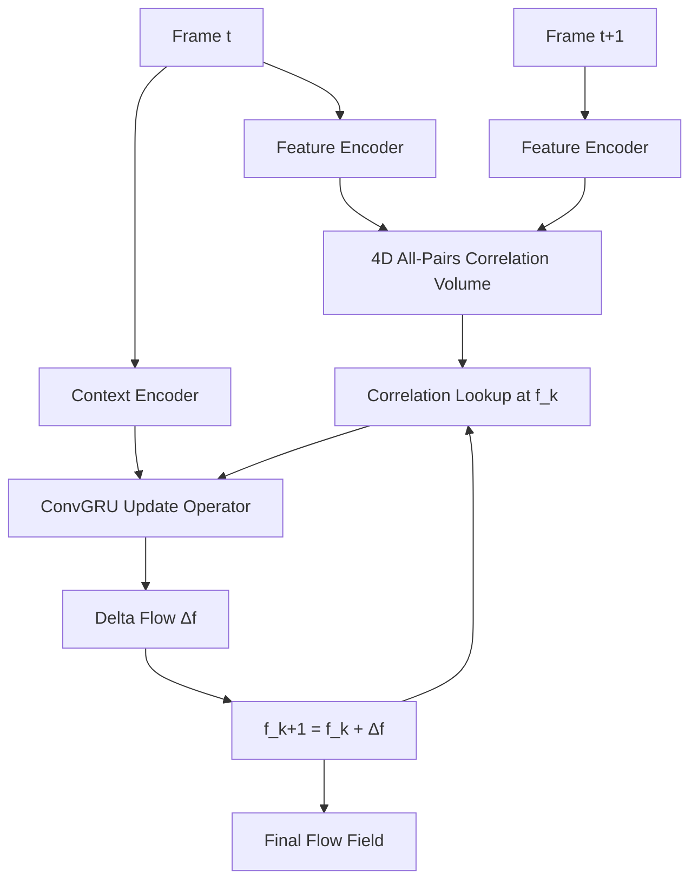
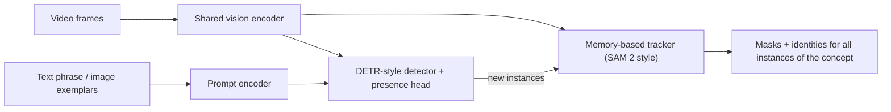

# Optical Flow and Visual Tracking

> **Last Updated:** October 2026
> **Level:** Advanced
> **Related Sections:** [Semantic Segmentation](./02_semantic_segmentation.md) | [Depth Estimation](./05_depth_estimation.md) | [Pose Estimation](./04_pose_estimation.md) | [3D Reconstruction](./09_3d_reconstruction.md) | [4D and Dynamic Scenes](../12_research_frontier_2024_2026/05_4d_and_dynamic_scenes.md) | [Perception for Robotics](../06_robotics_and_embodied_ai/08_perception_for_robotics.md)

> **🆕 October 2026 update:**
> - Optical flow: added **SEA-RAFT** (ECCV 2024 Oral, best-paper candidate) and **WAFT** (ICLR 2026 Oral), which drops the cost volume in favour of high-resolution warping and reports first place on Spring, Sintel and KITTI.
> - Point tracking: added **CoTracker3** (pseudo-labelling real videos with about 1000× less data), **BootsTAPIR/TAPNext/TAPNext++** (tracking as next-token prediction) and **AllTracker** (ICCV 2025, dense high-resolution long-range tracking).
> - 3D/4D tracking: **TAPVid-3D**, **SpatialTrackerV2** (ICCV 2025) and **D4RT** (Google DeepMind, CVPR 2026 Best Paper), which unifies depth, camera and 3D correspondence queries in one model.
> - Segmentation-tracking: **SAM 3** (Meta, Nov 2025) adds promptable *concept* segmentation and tracking from text/exemplars; **SAM 3.1 Object Multiplex** (Mar 2026) speeds up multi-object tracking.
> - MOT: added **MOTIP** (CVPR 2025, tracking as in-context ID prediction); updated tables, open problems and reading list.

---

## Overview

Optical flow and visual tracking are the two central primitives for understanding temporal dynamics in video. **Optical flow** estimates the instantaneous 2D displacement field between consecutive frames: for every pixel p in frame I_t, the flow vector f(p) ∈ ℝ² gives the corresponding pixel location in frame I_{t+1}. **Tracking** operates over longer temporal horizons, maintaining identities of objects or point trajectories through video sequences despite occlusion, deformation, and appearance changes.

These tasks are deeply interrelated. Flow is used as a tracking cue (point tracking is integration of flow over time), and tracked correspondences can bootstrap self-supervised flow training. Both underpin downstream applications including video stabilization, action recognition, autonomous driving, and video generation conditioning. The 2020s have seen a convergence of the two problems: modern methods like CoTracker [Karaev2023] track any point jointly through a shared transformer, while SAM2 [Ravi2024] unifies segmentation and tracking into a single streaming memory model.

Architecturally, the dominant paradigm shifted from classical variational methods (Lucas-Kanade, Horn-Schunck) to deep learning with FlowNet [Dosovitskiy2015], then to cost-volume architectures (PWC-Net [Sun2018], RAFT [Teed2020]), and now to transformer-based joint tracking (CoTracker, TAPIR [Doersch2023]). The key insight of RAFT — building all-pairs 4D correlation volumes and iterating over them with a recurrent update operator — fundamentally changed the field and remains the architectural template for most top-performing flow and stereo methods.

Between 2024 and 2026 three further shifts occurred. First, the RAFT template was simplified: SEA-RAFT [Wang2024] made it faster and more accurate, and WAFT [Wang2026] showed that the cost volume itself can be replaced by high-resolution feature warping. Second, point trackers moved from synthetic-only training to **pseudo-labelled real video** (CoTracker3 [Karaev2024], BootsTAPIR) and to sequence-model formulations (TAPNext). Third, tracking is merging with **4D reconstruction** and **concept-level segmentation**. D4RT [Zhang2026] (CVPR 2026 Best Paper) answers arbitrary space-time correspondence queries in 3D, and SAM 3 [Carion2025] detects, segments and tracks every instance of a text-specified concept in video.

---

## Classical Optical Flow

### Lucas-Kanade (1981)

The Lucas-Kanade (LK) algorithm assumes **spatial constancy** of brightness within a local window and linearizes the brightness constancy constraint:

```latex
I(p + \mathbf{f}, t+1) \approx I(p, t) + \nabla I \cdot \mathbf{f} + I_t = 0
```

For an N×N window, this yields an over-determined system solved by least squares:

```latex
\mathbf{f} = \left(\sum_{p \in \Omega} \nabla I \nabla I^\top\right)^{-1} \sum_{p \in \Omega} \nabla I \cdot I_t
```

The 2×2 matrix is the **structure tensor** (Harris matrix). LK fails at non-textured regions (rank-deficient matrix) and large displacements. Coarse-to-fine pyramid extension addresses large motion; the algorithm remains the backbone of classical feature trackers (e.g., KLT).

### Horn-Schunck (1981)

Horn-Schunck adds a global smoothness regularizer:

```latex
\mathcal{E}(\mathbf{f}) = \int \left[(I_x u + I_y v + I_t)^2 + \alpha^2(|\nabla u|^2 + |\nabla v|^2)\right] \, dp
```

minimized via Euler-Lagrange equations. This produces globally smooth flows but over-smooths motion discontinuities at object boundaries.

---

## Deep Optical Flow

### FlowNet / FlowNet2 (Dosovitskiy 2015, Ilg 2017)

FlowNet [Dosovitskiy2015] (ICCV 2015) introduced the first end-to-end trainable optical flow network, demonstrating that CNNs can learn to estimate flow from the FlyingChairs synthetic dataset. Two variants were proposed: FlowNetS (simple stacked two-frame encoder) and FlowNetC (explicit correlation layer between features at a central layer). FlowNet2 [Ilg2017] (CVPR 2017) dramatically improved accuracy by: (1) showing that **data curriculum** (training schedule) matters more than architecture; (2) stacking multiple FlowNet networks with intermediate warp-refinement. FlowNet2 reduced estimation error by over 50% versus FlowNetS while adding a faster lightweight variant (FlowNet2-s) running at 140 fps.

### PWC-Net (Sun 2018)

PWC-Net [Sun2018] (CVPR 2018 Oral) synthesized three inductive biases into a compact model:

1. **Learnable feature pyramid**: multi-scale features extracted by a shared encoder
2. **Warping**: the second frame's features are warped by the upsampled coarse flow estimate
3. **Cost volume**: a local correlation volume between warped features and first-frame features at each scale

```latex
\text{cv}(\mathbf{f}, d) = \mathbf{F}_1(p) \cdot \mathbf{F}_2(p + \mathbf{f} + d), \quad d \in [-D, D]^2
```

Flow is decoded from cost volumes hierarchically from coarse to fine. PWC-Net is 17× smaller than FlowNet2 and outperforms it on MPI Sintel and KITTI 2015, achieving roughly 35 fps on Sintel-resolution images.

### RAFT (Teed & Deng 2020)

RAFT [Teed2020] (ECCV 2020) is the most influential modern optical flow architecture. The three core ideas:

**All-pairs 4D correlation volume:** Unlike PWC-Net's local correlation, RAFT computes correlations between all pairs of pixels across both frames at a single scale, forming a 4D volume C ∈ ℝ^{H×W×H×W}. Multi-scale pooling creates a 4-level correlation pyramid without re-computing features:

```latex
C(\mathbf{f}_1^i, \mathbf{f}_2^j) = \langle \mathbf{f}_1^i, \mathbf{f}_2^j \rangle, \quad \forall (i, j) \in [H \times W] \times [H \times W]
```

**Recurrent iterative update:** A ConvGRU iteratively refines the flow field from an initial estimate of zero. At each iteration, the correlation lookup at the current estimated flow location retrieves a fixed neighborhood of correlation values, which together with flow and context features drive the GRU update:

```latex
\mathbf{f}^{k+1} = \mathbf{f}^k + \Delta\mathbf{f}^k, \quad \Delta\mathbf{f}^k = \text{GRU}(\mathbf{h}^k, \mathbf{c}^k, \text{lookup}(C, \mathbf{f}^k))
```

**Context network:** A separate encoder on only the first frame provides fixed context features injected at each GRU step.

RAFT achieved a 16% error reduction over prior state-of-the-art on KITTI 2015 (F1-all: 5.10%) and 30% on Sintel Final (EPE: 2.855 px) at publication. The RAFT architecture directly inspired RAFT-Stereo [Lipson2021] and FlowFormer [Huang2022].



### SEA-RAFT (Wang, Lipson & Deng 2024)

SEA-RAFT [Wang2024] (ECCV 2024 Oral, Best Paper Award candidate) is a "simple, efficient, accurate" revision of RAFT with three changes:

1. **Mixture-of-Laplace loss:** the network predicts flow together with a per-pixel uncertainty. It is trained with the negative log-likelihood of a two-component Laplace mixture instead of a plain L1 loss, which reduces overfitting to ambiguous pixels.
2. **Direct initial-flow regression:** the initial flow comes from a regression head instead of zero, so far fewer GRU iterations are needed.
3. **Rigid-flow pre-training** on TartanAir improves cross-dataset generalization.

```latex
% Schematic mixture-of-Laplace likelihood for flow component f with mean \mu
p(f) = \alpha \frac{1}{2b_1} e^{-|f-\mu|/b_1} + (1-\alpha)\frac{1}{2b_2} e^{-|f-\mu|/b_2}, \qquad \mathcal{L} = -\log p(f_{gt})
```

On the Spring benchmark SEA-RAFT reports 3.69 EPE and a 0.36 1-px outlier rate, which is 22.9% and 17.8% lower error than the best prior published results. It is at least 2.3× faster than methods of similar accuracy.

### WAFT: Warping-Alone Field Transforms (Wang & Deng 2025)

WAFT [Wang2026] (arXiv 2506.21526; ICLR 2026 Oral) asks whether the 4D cost volume is needed at all. It keeps RAFT's iterative-update meta-architecture but replaces the correlation lookup with **high-resolution warping** of second-frame features by the current flow estimate. The update network then compares the warped features with the first-frame features directly. This removes the memory cost that grows with resolution, allows high-resolution inputs, and works with pretrained backbones (Twins, Depth Anything V2, DINOv3). The authors report first place on the Spring, Sintel and KITTI benchmarks, the best zero-shot generalization on KITTI, and up to 4.1× faster inference than methods of similar accuracy.

---

## Flow Warping for Video Synthesis

A key application of optical flow is **feature/frame warping** for video tasks including video object segmentation, temporal consistency in depth, and video generation. Given source frame I_s and flow field f_{s→t}:

```latex
\hat{I}_t(p) = I_s(p + \mathbf{f}_{s \to t}(p))
```

implemented with bilinear sampling. In training of video models, flow warped features provide temporal correspondence without explicit attention over all past frames. The warping error (photometric consistency) also serves as a proxy for flow quality:

```latex
\mathcal{L}_{\text{warp}} = \|I_t - \hat{I}_t\|_1 \cdot (1 - M_{\text{occ}})
```

where M_occ is an occlusion mask estimated by forward-backward consistency.

---

## Multi-Object Tracking (MOT)

### SORT (Bewley 2016)

SORT [Bewley2016] (ICIP 2016) establishes the template for online MOT: for each frame, (1) predict tracklet locations forward via **Kalman filter** (constant velocity model), (2) associate detections to predicted tracklets via **Hungarian algorithm** on IoU cost matrix, (3) create/delete tracks by score thresholding. At 260 Hz SORT is orders of magnitude faster than contemporary methods while matching their accuracy on MOT2015.

### DeepSORT (Wojke 2017)

DeepSORT [Wojke2017] (ICIP 2017) extends SORT by replacing pure IoU association with a combined metric: IoU distance + appearance distance from a deep re-ID embedding. A CNN trained on the Market-1501 person re-ID dataset extracts 128-dimensional descriptors per detection crop. Association uses Mahalanobis distance in Kalman state space for motion and cosine distance in appearance space, combined via min-cost linear assignment. DeepSORT dramatically reduces ID switches on occlusions at modest computational overhead.

### ByteTrack (Zhang 2022)

ByteTrack [Zhang2022] (ECCV 2022) challenges the standard practice of discarding low-confidence detections. The key insight: **every detection box, including low-score ones**, carries useful information. ByteTrack performs two-pass association: first match high-confidence detections (score > τ_high) to existing tracks via IoU, then match **low-confidence detections** (τ_low < score < τ_high) to **unmatched tracks** from the first pass. This recovers occluded objects and improves recall without increasing false positives. ByteTrack achieves state-of-the-art HOTA/MOTA on MOT17/20 with essentially no additional computation over a base detector.

### MOTIP: Tracking as ID Prediction (Gao 2025)

Heuristic association (IoU + Kalman + re-ID thresholds) struggles on benchmarks with uniform appearance and non-linear motion such as DanceTrack and SportsMOT. MOTIP [Gao2025] (CVPR 2025) learns association end to end. The current trajectories, each tagged with a learnable **ID embedding** from a fixed dictionary, form an in-context prompt, and a transformer decoder classifies each new detection into one of the existing IDs or a "newborn" class. Tracking thus becomes in-context ID classification and needs no hand-tuned matching rules. Together with the end-to-end MOTR family, MOTIP represents the move from tracking-by-detection heuristics to learned association.

---

## Point Tracking (Track-Any-Point)

### CoTracker (Karaev 2023)

CoTracker [Karaev2023] (arXiv 2023, ECCV 2024) reformulates point tracking as a **joint transformer problem over multiple co-tracked points**. Standard methods track points independently, ignoring mutual correlations. CoTracker represents tracks as a grid of tokens (position, visibility, appearance, correlation features) and applies a transformer that jointly updates all tracks simultaneously. This enables physically consistent trajectories — e.g., points on a rigid body move coherently. CoTracker can track up to 70K points jointly and achieves state-of-the-art on TAP-Vid benchmarks.

### TAPIR (Doersch 2023)

TAPIR [Doersch2023] (ICCV 2023, Google DeepMind) introduces a two-stage tracking-any-point model: (1) **frame-independent initialization** that independently finds per-frame candidate matches for the query point using a learned appearance model; (2) **temporal refinement** that updates trajectory and query features based on local correlation context across time. TAPIR achieves an ~20% absolute AJ improvement over prior methods on TAP-Vid DAVIS and supports fast inference on long high-resolution videos.

### CoTracker3 and Pseudo-Labelled Real Video (Karaev 2024)

CoTracker3 [Karaev2024] (arXiv 2410.11831, Oct 2024) simplifies the CoTracker architecture and changes how it is trained. Synthetic-only training (Kubric) leaves a sim-to-real gap. CoTracker3 therefore runs several existing trackers as **teachers** on large amounts of unlabelled real video and trains the student on their pseudo-labels. It reaches state-of-the-art accuracy with about **1000× less data** than the previous best tracker trained on real data (BootsTAPIR). Online (sliding-window) and offline (whole-video) variants are provided; the offline model reports δ_avg^vis of 76.9 on TAP-Vid DAVIS.

### BootsTAPIR, TAPNext and TAPNext++ (Google DeepMind)

**BootsTAPIR** [Doersch2024] (ACCV 2024) bootstraps TAPIR on millions of unlabelled videos with a self-consistency objective under spatial and temporal transformations. **TAPNext** [Zholus2025] (arXiv 2504.05579) recasts tracking as **next-token prediction**. A causal sequence model (a ViT with recurrent state-space layers) reads frame tokens and query tokens and emits track tokens online, with no correlation volumes, windowing or test-time refinement. This removes most of the tracking-specific inductive biases. The bootstrapped variant (BootsTAPNext) reports 65.25 AJ on TAP-Vid DAVIS (first-frame protocol). **TAPNext++** improves long-term tracking, occlusion handling and re-detection, reaching 67.0 AJ on DAVIS at 512×512 according to the official repository.

### AllTracker: Dense Long-Range Tracking (Harley 2025)

AllTracker [Harley2025] (ICCV 2025) bridges optical flow and point tracking. It estimates **flow-like correspondence fields between a query frame and every other frame**, for all pixels and at high resolution. It uses a low-resolution recurrent grid refined by 2D convolutions and temporal attention, then upsamples. It is trained on a mix of point-tracking and optical-flow data. Accuracy grows with test resolution (reported δ_avg 76.3 at default, 80.6 at 768×1024). This makes dense tracking of every pixel over hundreds of frames practical.

### 3D Point Tracking and 4D Correspondence

Tracking points in 2D image space confounds object motion with camera motion and occlusion. **TAPVid-3D** [Koppula2024] (NeurIPS 2024 Datasets & Benchmarks) introduced a benchmark of more than 4,000 real videos with over 1M 3D trajectories. **SpatialTrackerV2** [Xiao2025] (ICCV 2025) tracks points in 3D from monocular video. It decomposes 3D motion into scene geometry, camera ego-motion and per-point object motion inside one feed-forward network trained end to end on synthetic, RGB-D and unlabelled video.

**D4RT** [Zhang2026] (Google DeepMind with UCL and Oxford; arXiv 2512.08924; **CVPR 2026 Best Paper**) unifies depth, correspondence and camera estimation behind a single **query interface**. An encoder turns the whole video into a global scene representation. A lightweight decoder then answers independent queries, each asking where the point seen at pixel (u, v) in a source frame is located in 3D at a target time, expressed in the coordinates of a chosen camera:

```latex
% D4RT query: source pixel (u,v), source time t_s, target time t_t, camera/reference time t_c
\mathbf{X} = \mathrm{Dec}_\theta\big(\mathcal{F}(\text{video}),\; q = (u, v, t_s, t_t, t_c)\big) \in \mathbb{R}^3
% t_t = t_s = t_c  -> depth / point map;   t_t \neq t_s -> 3D point track (scene flow);
% varying t_c      -> camera-relative coordinates, from which camera poses are recovered
```

Because queries are independent, training and inference cost scale linearly with the number of queried points. DeepMind reports 18–300× faster inference than prior 4D methods, about 5 s for a one-minute video on a single TPU chip, with state-of-the-art accuracy on dynamic-scene benchmarks. See [3D Reconstruction](./09_3d_reconstruction.md) for the reconstruction side.

### SAM2 for Video (Ravi 2024)

SAM 2 [Ravi2024] (arXiv 2408.00714, Meta AI) extends the Segment Anything Model to video by adding a **per-session streaming memory module** that propagates segmentation masks across frames. Given a user prompt (click, box, or mask) on any frame, SAM2 tracks the prompted object through the entire video in both forward and backward directions. The memory encoder stores object embeddings from past frames; the memory attention mechanism retrieves relevant memories when processing new frames. SAM2 unifies interactive image segmentation and video object tracking in a single architecture, achieving state-of-the-art performance on SA-V, MOSE, and LVOS video object segmentation benchmarks. SAM 2 appeared at ICLR 2025. Improved **SAM 2.1** checkpoints, training code and a web demo were released in Sep 2024, and per-object independent inference and `torch.compile` speedups followed in Dec 2024.

### SAM 3: Concept-Level Segmentation and Tracking (Meta, 2025)

SAM 3 [Carion2025] ("SAM 3: Segment Anything with Concepts", arXiv 2511.16719, Nov 2025) generalizes promptable segmentation from *one object per prompt* to **Promptable Concept Segmentation (PCS)**. Given a short noun phrase (e.g. "yellow school bus") or image exemplars, it detects, segments and **tracks every instance** of that concept across a video. Visual prompts (points, boxes, masks) are still supported. The 848M-parameter model couples a DETR-style **detector** and a SAM 2-style memory **tracker** that share one vision encoder. A *presence head* decouples recognition ("is the concept present?") from localization. A human+AI data engine annotated over 4M unique concepts, and the accompanying **SA-Co** benchmark covers about 270K concepts (over 50× more than earlier benchmarks). SAM 3 reaches about 75–80% of human performance on SA-Co, but the gap is larger on video. For example, on SA-V test it scores 30.3 cgF1 against 53.1 for humans. **SAM 3.1 Object Multiplex** (Mar 2026) adds a shared-memory scheme for joint multi-object tracking that is significantly faster at similar accuracy. A **SAM 3 Agent** pairs SAM 3 with a multimodal LLM for complex referring expressions.



---

## Evaluation Metrics

### Optical Flow: EPE

**End-Point Error (EPE):** Average Euclidean distance between predicted and ground-truth flow vectors:

```latex
\text{EPE} = \frac{1}{N}\sum_{i} \|\hat{\mathbf{f}}_i - \mathbf{f}_i\|_2
```

Reported as average EPE (AEE) in pixels. The **Fl-all** metric (KITTI) counts the percentage of pixels with EPE > 3px AND EPE > 5% of GT magnitude.

### MOT Metrics: MOTA and HOTA

**MOTA (Multiple Object Tracking Accuracy):**

```latex
\text{MOTA} = 1 - \frac{\sum_t (FN_t + FP_t + \text{IDSW}_t)}{\sum_t \text{GT}_t}
```

MOTA penalizes false negatives (FN), false positives (FP), and identity switches (IDSW) equally; it biases toward detection quality over association quality.

**HOTA (Higher Order Tracking Accuracy)** [Luiten2021]: Decomposes into detection accuracy (DetA) and association accuracy (AssA):

```latex
\text{HOTA} = \sqrt{\text{DetA} \cdot \text{AssA}}
```

HOTA averages over localization thresholds (α ∈ [0.05, 0.95]) and is considered a more balanced metric than MOTA.

**IDF1:** Ratio of correctly identified detections over the mean of total true and computed detections; measures re-identification quality.

---

## Key Papers

| Paper | Authors | Year | Venue | Key Contribution |
|---|---|---|---|---|
| An Iterative Image Registration Technique with an Application to Stereo Vision (Lucas-Kanade) | Lucas, Kanade | 1981 | IJCAI | Spatial-constancy optical flow via least-squares patch matching |
| FlowNet: Learning Optical Flow with Convolutional Networks | Dosovitskiy, Fischer, Ilg et al. | 2015 | ICCV | First end-to-end CNN optical flow; FlowNetS/C; FlyingChairs dataset |
| FlowNet 2.0: Evolution of Optical Flow Estimation with Deep Networks | Ilg, Mayer, Saikia, Keuper, Dosovitskiy, Brox | 2017 | CVPR | Stacked networks + data curriculum; 50%+ error reduction |
| PWC-Net: CNNs for Optical Flow Using Pyramid, Warping, and Cost Volume | Sun, Yang, Liu, Kautz | 2018 | CVPR (Oral) | Learnable pyramid + warping + cost volume; 17× smaller than FlowNet2 |
| RAFT: Recurrent All-Pairs Field Transforms for Optical Flow | Teed, Deng | 2020 | ECCV | All-pairs 4D correlation + ConvGRU iteration; new SOTA on Sintel and KITTI |
| Simple Online and Realtime Tracking (SORT) | Bewley, Ge, Ott, Ramos, Upcroft | 2016 | ICIP | Kalman filter + Hungarian algorithm; 260 Hz real-time MOT |
| Simple Online and Realtime Tracking with a Deep Association Metric (DeepSORT) | Wojke, Bewley, Paulus | 2017 | ICIP | Appearance re-ID embedding + Mahalanobis-IoU hybrid for reduced ID switches |
| ByteTrack: Multi-Object Tracking by Associating Every Detection Box | Zhang, Sun, Jiang et al. | 2022 | ECCV | Two-pass association using low-confidence boxes; state-of-the-art HOTA/MOTA |
| CoTracker: It is Better to Track Together | Karaev, Rocco, Graham, Neverova, Vedaldi, Rupprecht | 2023 | arXiv / ECCV 2024 | Joint transformer tracking of 70K+ points; correlation-aware co-tracking |
| TAPIR: Tracking Any Point with per-frame Initialization and temporal Refinement | Doersch, Yang, Vecerik et al. | 2023 | ICCV | Two-stage TAP model; ~20% AJ improvement on TAP-Vid DAVIS |
| SAM 2: Segment Anything in Images and Videos | Ravi et al. | 2024 | arXiv / ICLR 2025 | Streaming memory for video segmentation and object tracking; Meta AI |
| SEA-RAFT: Simple, Efficient, Accurate RAFT for Optical Flow | Wang, Lipson, Deng | 2024 | ECCV (Oral) | Mixture-of-Laplace loss; regressed initial flow; 3.69 EPE on Spring; best-paper candidate |
| CoTracker3: Simpler and Better Point Tracking by Pseudo-Labelling Real Videos | Karaev, Makarov, Wang, Neverova, Vedaldi, Rupprecht | 2024 | arXiv 2410.11831 | Teacher-ensemble pseudo-labels on real video; ~1000× less data; online/offline |
| BootsTAP: Bootstrapped Training for Tracking-Any-Point | Doersch et al. (Google DeepMind) | 2024 | ACCV | Self-supervised bootstrapping of TAPIR on unlabelled real video |
| TAPVid-3D: A Benchmark for Tracking Any Point in 3D | Koppula et al. (Google DeepMind) | 2024 | NeurIPS D&B | 4,000+ real videos, 1M+ 3D trajectories |
| MOTIP: Multiple Object Tracking as ID Prediction | Gao, Qi, Wang | 2025 | CVPR | Association as in-context ID classification; end-to-end learned MOT |
| TAPNext: Tracking Any Point as Next Token Prediction | Zholus et al. (Google DeepMind) | 2025 | arXiv 2504.05579 | Causal sequence-model tracker; no cost volumes; online |
| AllTracker: Efficient Dense Point Tracking at High Resolution | Harley et al. | 2025 | ICCV | All-pixel long-range correspondence fields; flow + tracking unified |
| SpatialTrackerV2: 3D Point Tracking Made Easy | Xiao, Wang, Xue, Karaev et al. | 2025 | ICCV | Feed-forward 3D tracking decomposing geometry, ego-motion and object motion |
| SAM 3: Segment Anything with Concepts | Carion et al. (Meta) | 2025 | arXiv 2511.16719 | Promptable concept segmentation + tracking; SA-Co benchmark (270K concepts) |
| WAFT: Warping-Alone Field Transforms for Optical Flow | Wang, Deng | 2025 | ICLR 2026 (Oral) | Cost-volume-free, high-resolution warping; #1 on Spring/Sintel/KITTI |
| Efficiently Reconstructing Dynamic Scenes One D4RT at a Time | Zhang, Le Moing et al. (Google DeepMind, UCL, Oxford) | 2025 | CVPR 2026 (Best Paper) | Query-based 4D depth, tracking and camera model; 18–300× faster |

---

## Benchmark Performance

| Model | Dataset | Metric | Score | Notes |
|---|---|---|---|---|
| RAFT | MPI Sintel Final | EPE ↓ | 2.855 | Generalization eval; 32 iters |
| RAFT | KITTI 2015 | F1-all ↓ | 5.10% | Fine-tuned on KITTI; 32 iters |
| PWC-Net | MPI Sintel Final | EPE ↓ | 5.04 | Without test-time augment |
| FlowNet2 | MPI Sintel Final | EPE ↓ | 6.02 | Stacked CNN; 8 fps |
| ByteTrack | MOT17 test | HOTA ↑ | 63.1 | YOLOX detector; standard protocol |
| ByteTrack | MOT17 test | MOTA ↑ | 80.3 | Standard MOT protocol |
| DeepSORT | MOT16 test | MOTA ↑ | 61.4 | DPM detector; 2017 baseline |
| TAPIR | TAP-Vid DAVIS | AJ ↑ | 61.3 | Reported in [Doersch2023] |
| CoTracker | TAP-Vid DAVIS | AJ ↑ | 60.6 | 70K joint points; [Karaev2023] |
| SEA-RAFT | Spring (test) | EPE ↓ / 1px ↓ | 3.69 / 0.36 | 22.9% / 17.8% lower than prior best [Wang2024] |
| BootsTAPIR | TAP-Vid DAVIS (first) | AJ ↑ | 62.4 | Official tapnet repo |
| BootsTAPNext | TAP-Vid DAVIS (first) | AJ ↑ | 65.25 | Official tapnet repo [Zholus2025] |
| TAPNext++ (512×512) | TAP-Vid DAVIS (first) | AJ ↑ | 67.0 | Official tapnet repo |
| CoTracker3 (offline) | TAP-Vid DAVIS | δ_avg^vis ↑ | 76.9 | Official repo [Karaev2024] |
| AllTracker | Point-tracking suite average | δ_avg ↑ | 76.3 / 80.6 | Default / 768×1024 test resolution [Harley2025] |
| SAM 3 | SA-V test (concept tracking) | cgF1 ↑ | 30.3 | Human: 53.1 [Carion2025] |

*Protocols differ: TAP-Vid "first" queries points in the first visible frame, "strided" every 5 frames; AJ and δ_avg^vis are not interchangeable. WAFT and D4RT headline claims (benchmark ranks, speed-ups) are reported in the text above rather than as table numbers.*

---

## Pros & Cons

| Aspect | Pros | Cons |
|---|---|---|
| RAFT-style all-pairs flow | Highly accurate; robust to large motions; strong generalization | Memory-intensive 4D correlation volumes; inference slower than PWC-Net |
| PWC-Net-style cost volume | Fast; memory efficient; explicit geometric reasoning | Local search radius limits large-displacement accuracy |
| Joint point tracking (CoTracker, TAPIR) | Physically consistent trajectories; handles occlusion via joint context | Higher compute than per-point; memory grows with tracked point count |
| Online MOT (SORT/ByteTrack) | Real-time; no re-training needed for new domains; simple implementation | Relies on external detector quality; no global trajectory optimization |
| Warping-only flow (WAFT) | No cost volume, so memory scales gently with resolution; plugs into strong pretrained backbones | Relies on good initial estimates for very large displacements; newer, less battle-tested |
| Sequence-model trackers (TAPNext) | Simple, online, few hand-crafted components; scales with data | Needs large (pseudo-)labelled data; long-horizon drift still possible |
| Concept-prompted segmentation-tracking (SAM 3) | Open-vocabulary detection + masks + identities for all instances from a text phrase | Large model (848M); video performance well below human; ambiguous phrases need an LLM agent |
| Query-based 4D models (D4RT) | One model for depth, 3D tracks and cameras; linear cost in number of queries; very fast | Proprietary-scale training (TPU); dense outputs require many queries; dynamic-scene GT scarce |
| Learned association MOT (MOTIP) | Handles uniform appearance and non-linear motion; no hand-tuned thresholds | Needs tracking-annotated training data; heavier than SORT-style trackers |

---

## Open Problems & Research Gaps

- **Long-range flow and large displacement:** Standard RAFT with 32 iterations can still fail on fast-moving small objects or scene cuts; scaling all-pairs correlation to high-resolution video remains expensive.
- **Occlusion-aware flow:** Pixels that become occluded between frames violate brightness constancy; producing reliable confidence/occlusion masks alongside flow is still imperfect.
- **Unsupervised/self-supervised flow from video:** Photometric supervision works but breaks on dynamic illumination changes; combining with optical physics models is an open area.
- **Unified flow + depth + ego-motion:** Joint estimation of scene flow (3D motion), depth, and camera ego-motion from monocular video is theoretically elegant but difficult to train robustly.
- **Long-term point tracking:** Both CoTracker and TAPIR degrade on videos longer than a few hundred frames. Online sequence-model trackers (TAPNext++) and all-pixel trackers (AllTracker) extend the horizon, but robust re-detection after long occlusions in multi-minute video remains open.
- **Multi-object tracking with appearance-free re-ID:** ByteTrack's two-pass IoU approach fails on crowded scenes without appearance. Learned association (MOTIP) helps on DanceTrack-style data, but stronger, cheap re-ID for edge deployment is still needed.
- **Open-vocabulary tracking:** SAM 3 makes text-prompted detection, segmentation and tracking of all instances practical. Video concept tracking is still far below human level (cgF1 30.3 vs 53.1 on SA-V test), and compositional or relational prompts need an LLM in the loop (SAM 3 Agent).
- **World-frame 3D/4D tracking:** Separating camera motion from object motion and tracking points in metric 3D through occlusions (TAPVid-3D, SpatialTrackerV2, D4RT) is a fast-moving frontier. Real-world dynamic-scene ground truth is scarce, so most methods still depend on synthetic data.
- **Is the cost volume needed?** WAFT suggests high-resolution warping can replace all-pairs correlation for flow. Whether the same holds for stereo, scene flow and long-range tracking is an open architectural question.

---

## Further Reading

- [RAFT paper (arXiv:2003.12039)](https://arxiv.org/abs/2003.12039) — ECCV 2020 best paper [Teed2020]
- [ByteTrack GitHub (FoundationVision)](https://github.com/FoundationVision/ByteTrack) — Official implementation [Zhang2022]
- [TAPIR project page (DeepMind)](https://deepmind-tapir.github.io/) — Models and TAP-Vid benchmark [Doersch2023]
- [CoTracker GitHub (facebookresearch)](https://github.com/facebookresearch/co-tracker) — CoTracker and CoTracker3 [Karaev2023]
- [SAM2 GitHub (facebookresearch)](https://github.com/facebookresearch/sam2) — Official SAM2 implementation [Ravi2024]
- [PWC-Net GitHub (NVLabs)](https://github.com/NVlabs/PWC-Net) — Official NVIDIA implementation [Sun2018]
- [SEA-RAFT GitHub (princeton-vl)](https://github.com/princeton-vl/SEA-RAFT) — ECCV 2024 Oral [Wang2024]
- [WAFT GitHub (princeton-vl)](https://github.com/princeton-vl/WAFT) — ICLR 2026 Oral [Wang2026]
- [TAPNet repo (google-deepmind)](https://github.com/google-deepmind/tapnet) — TAPIR, BootsTAPIR, TAPNext, TAPNext++, TAPVid-3D
- [AllTracker GitHub](https://github.com/aharley/alltracker) — ICCV 2025 [Harley2025]
- [SpatialTrackerV2 GitHub](https://github.com/henry123-boy/SpaTrackerV2) — ICCV 2025 [Xiao2025]
- [SAM 3 GitHub (facebookresearch)](https://github.com/facebookresearch/sam3) — Concept segmentation and tracking; SAM 3.1 [Carion2025]
- [D4RT paper (arXiv:2512.08924)](https://arxiv.org/abs/2512.08924) — CVPR 2026 Best Paper [Zhang2026]
- [MOTIP GitHub (MCG-NJU)](https://github.com/MCG-NJU/MOTIP) — CVPR 2025 [Gao2025]
