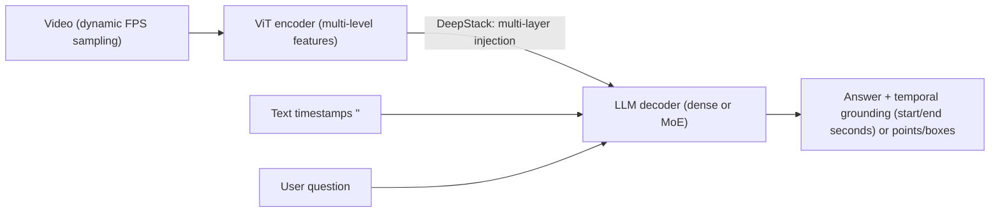

# Video Understanding: Action Recognition, Temporal Localization, and Video-Language Models

> **Last Updated:** October 2026
> **Level:** Advanced
> **Related Sections:** [Self-Supervised Learning](../03_architectures/03_self_supervised_learning.md) | [Optical Flow & Tracking](./06_optical_flow_tracking.md) | [Image Generation](./07_image_generation.md) | [Multimodal Vision-Language](../05_multimodal_vision_language/00_overview.md) | [Multimodal LLMs 2025–2026](../12_research_frontier_2024_2026/03_multimodal_llm_2025_2026.md)

> **🆕 October 2026 update:**
> - Self-supervised video: **V-JEPA 2** (Meta, Jun 2025; 1B ViT-g, 77.3% SSv2 frozen probe, action-conditioned V-JEPA 2-AC for zero-shot robot planning) and **V-JEPA 2.1** (Mar 2026; dense, temporally consistent features).
> - Open video-LLMs: **Qwen2.5-VL → Qwen3-VL** (Sep–Oct 2025; native 256K context expandable to 1M, Interleaved-MRoPE, text-timestamp alignment) and **Qwen3.5** (Feb 2026, early-fusion multimodal), **InternVL3/3.5**, **PerceptionLM** + PLM-VideoBench, and **Molmo2** (video pointing and tracking).
> - Proprietary long-video: Gemini 2.5 Pro reports 84.8% on Video-MME; Gemini 3 Pro (Nov 2025) also uses Video-MME as its headline video benchmark.
> - Benchmarks: Video-MME (CVPR 2025) is now the de facto long-video QA standard; added MLVU, LongVideoBench, TempCompass and PLM-VideoBench to the benchmark table.
> - Updated Key Papers, Benchmark Performance, Pros & Cons and Open Problems.

---

## Overview

Video understanding encompasses a broad family of tasks — action recognition, temporal action localization, video question answering, dense video captioning, and retrieval — all requiring models to jointly reason over spatial appearance and temporal dynamics. Unlike static image understanding, video models must handle temporal redundancy (adjacent frames are highly correlated), long-range dependencies (an action's meaning may depend on events minutes earlier), and multiple semantically relevant temporal granularities simultaneously.

The dominant architectural evolution follows three phases. The **3D CNN era** began with C3D [Tran2015] and was transformed by I3D [Carreira2017], which "inflated" proven 2D ImageNet architectures (Inception-V1) into 3D by expanding all 2×2 convolutional filters to 2×2×2 temporal-spatial kernels, enabling weight transfer from ImageNet pre-training and establishing the Kinetics dataset as the standard benchmark. SlowFast [Feichtenhofer2019] exploited temporal-frequency separation: a Slow pathway processes sparse frames at high semantic resolution while a Fast pathway processes dense frames at low channel count, capturing both appearance and fine-grained motion. The **transformer era** arrived with TimeSformer [Bertasius2021], which showed that pure self-attention ("divided space-time attention") could match or exceed 3D CNNs, enabling much longer clips at test time. The **self-supervised/masked modeling era** is exemplified by VideoMAE [Tong2022] and V-JEPA [Assran2024], which apply masked autoencoding to video tokens, demonstrating data-efficient pre-training that transfers strongly to downstream recognition tasks.

Large-scale **video-language models** (InternVideo [Wang2022], Video-LLaMA, VideoChat) extend vision-language contrastive learning (CLIP) and instruction tuning to video, enabling open-ended video QA. The most dramatic advance for long-video understanding is **Gemini 1.5 Pro** [Google2024], which processes up to 1 million tokens — approximately 1 hour of video at standard resolution — in a single forward pass via Mixture-of-Experts and efficient attention, enabling retrieval from extremely long video without segmentation or re-encoding. This multi-million-token context paradigm represents a fundamentally different approach to long-video understanding compared to hierarchical or sliding-window video models.

Since 2025 this paradigm has spread to open-weight models. Qwen3-VL [Bai2025] supports a native 256K-token context, expandable to 1M, with explicit timestamp tokens for second-level temporal grounding over hours of video. InternVL3.5, PerceptionLM and Molmo2 provide fully or partly open alternatives, and Gemini 2.5/3 push proprietary accuracy on Video-MME above 80%. On the representation side, V-JEPA 2 [Assran2025] showed that a 1B-parameter self-supervised video encoder trained on internet-scale video can match or beat image-text encoders on motion-centric recognition. It also supports planning for robot manipulation after action-conditioned post-training, linking video understanding to world models.

---

## Action Recognition: Architectural Families

### Two-Stream and 3D CNN Background

The two-stream network [Simonyan2014] established that optical flow provides complementary motion information to RGB frames; fusing RGB and flow streams substantially improves action recognition. I3D [Carreira2017] generalizes this: two I3D networks (one on RGB, one on optical flow) are fused at the prediction level.

### I3D: Inflated 3D ConvNets (Carreira & Zisserman 2017)

I3D [Carreira2017] (CVPR 2017) addresses the data scarcity problem in video by bootstrapping from ImageNet:

- All 2D conv filters N×N → N×N×N (temporal dimension added, weights replicated and rescaled by 1/N)
- Max-pooling and batch normalization also inflated to 3D
- Inception-V1 (GoogLeNet) architecture inflated, pre-trained on ImageNet, fine-tuned on Kinetics-400

I3D achieves 80.2% on HMDB-51 and 97.9% on UCF-101 (with optical flow stream), establishing Kinetics-400 as the central pre-training dataset. The paper also introduced and published the Kinetics-400 dataset (400 classes, ~240K clips from YouTube).

```latex
\text{3D conv output: } z[t, h, w, c] = \sum_{\tau, i, j, c'} W[\tau, i, j, c', c] \cdot x[t+\tau, h+i, w+j, c']
```

### SlowFast Networks (Feichtenhofer 2019)

SlowFast [Feichtenhofer2019] (ICCV 2019) draws biological inspiration from the primate visual cortex (P and M cells) to design two parallel pathways:

- **Slow pathway:** Samples T=8 frames, large channel width C, captures semantic/appearance content at low temporal frequency
- **Fast pathway:** Samples 8T=64 frames, small channel width C/8 (≈ 8× fewer parameters), captures fine temporal dynamics at high frame rate

Lateral connections from Fast → Slow fuse temporal context into the semantic stream:

```latex
\mathbf{f}_{\text{fused}} = \mathbf{f}_{\text{slow}} \| \text{Conv}(\mathbf{f}_{\text{fast}})
```

SlowFast achieves 79.8% top-1 on Kinetics-400 and demonstrates strong action detection performance on AVA. The separable-pathway design is computationally efficient: the fast pathway contributes ~20% of parameters but provides most of the temporal discrimination gain.

### TimeSformer (Bertasius 2021)

TimeSformer [Bertasius2021] (ICML 2021) applies the Vision Transformer to video by decomposing self-attention over space and time. Five attention schemes are evaluated; the best is **divided space-time attention**: temporal attention first (across all spatial patches at one location), then spatial attention (across all locations at one timestep). This reduces the O(T²·HW) cost of joint space-time attention to O(T² + (HW)²):

```latex
\tilde{z}^{(\ell)} = \text{MSA}_{\text{time}}(z^{(\ell-1)}) \quad \text{then} \quad z^{(\ell)} = \text{MSA}_{\text{space}}(\tilde{z}^{(\ell)})
```

TimeSformer-L (long) processes 96-frame clips at 224×224 and achieves 80.7% on Kinetics-400. Being convolution-free allows applying the model to clips of 1+ minute at test time without architectural changes, a significant practical advantage over 3D CNNs.

---

## Self-Supervised Video Pre-Training

### VideoMAE (Tong 2022)

VideoMAE [Tong2022] (NeurIPS 2022 Spotlight) applies masked autoencoding to video by masking **3D spatiotemporal tubes** of tokens (not individual frames) at extreme masking ratios (90–95%). The key findings:

- Temporal redundancy in video means spatial masking alone is insufficient; tube masking that removes contiguous space-time patches forces the model to predict non-trivially
- 90% masking is optimal; at 75% the task is too easy
- VideoMAE pre-trained on just 3,400 videos (SSv2) achieves competitive performance to models pre-trained on millions of images
- Asymmetric encoder-decoder: ViT encoder processes only unmasked tokens; lightweight decoder reconstructs all pixel values

VideoMAE sets new state-of-the-art on Kinetics-400 (81.5% with ViT-L), Something-Something v2 (70.8%), and AVA action detection, demonstrating that self-supervised pre-training can match or exceed supervised ImageNet pre-training for video tasks.


### V-JEPA (Assran 2024)

V-JEPA [Assran2024] (Meta AI, 2024) argues against pixel reconstruction as a pre-training objective. Instead, it predicts in **abstract feature space**: given a masked video context, predict the ViT features of masked regions rather than raw pixels. The predictor is conditioned on masked token positions and must hallucinate plausible abstract content.

The JEPA (Joint Embedding Predictive Architecture) objective avoids trivial solutions via an EMA target encoder (no stop-gradient needed for the predictor path):

```latex
\mathcal{L}_{\text{JEPA}} = \mathbb{E}\!\left[\|s_\theta(z_{\text{context}}, \text{mask}) - \text{sg}(z_{\text{target}})\|^2\right]
```

V-JEPA uses multi-block masking (multiple contiguous blocks removed). Unlike VideoMAE, it does not reconstruct pixels. Pre-trained V-JEPA models transfer extremely well to label-efficient settings (few-shot, frozen backbone) and achieve 81.9% on Kinetics-400 with a frozen ViT-H backbone. V-JEPA 2 (2025) scales to internet-scale video data and also enables planning in robotics settings.

### V-JEPA 2 and V-JEPA 2.1 (Meta, 2025–2026)

**V-JEPA 2** [Assran2025] (arXiv 2506.09985, Jun 2025) scales the JEPA objective along four axes: data (over 1M hours of internet video plus images), model size (ViT-L 300M to ViT-g 1B), training length, and resolution and clip length (via progressive training). With a frozen encoder and attentive probe it reports **77.3% on SSv2** (previous best 69.7%), **90.2% on Diving-48**, and **39.7 recall@5 on Epic-Kitchens-100 action anticipation** (previous best 27.6). Aligned with an LLM, it reaches 76.9% on TempCompass and 44.5% on MVP video QA. **V-JEPA 2-AC** is an action-conditioned predictor post-trained on under 62 hours of unlabelled DROID robot video. Used for model-predictive control with image goals, it performs zero-shot reaching, grasping and pick-and-place on Franka arms in new labs, outperforming Octo and Cosmos baselines in the authors' tests.

```latex
% V-JEPA 2-AC: energy-based planning in representation space (CEM over action sequences a_{1:T})
a^*_{1:T} = \arg\min_{a_{1:T}} \big\| P_\phi(a_{1:T}; E_\theta(x_{t}), s_t) - E_\theta(x_{\text{goal}}) \big\|_1
```

**V-JEPA 2.1** (arXiv 2603.14482, Mar 2026) targets **dense, temporally consistent features**. It adds a dense predictive loss on all tokens, deep self-supervision at multiple layers and multi-modal tokenizers, with models from ViT-B (80M) to a 2B ViT-G. The aim is JEPA features that serve dense video tasks (e.g. tracking, segmentation, depth) and not only clip-level recognition.

---

## Temporal Action Localization

Temporal action localization (TAL) requires detecting the start and end times of action instances in untrimmed video, typically outputting proposals (t_start, t_end, class, confidence). The field has evolved from sliding-window classifiers to dense anchor-free methods:

- **Two-stage methods** (BSN [Lin2018], BMN) generate temporal proposals then classify each
- **One-stage/anchor-free** (AFSD [Lin2021]) directly regress start/end times without explicit proposals
- **Transformer-based** (ActionFormer [Zhang2022], TemporalMaxer) process multi-scale temporal features with self-attention, achieving state-of-the-art on THUMOS-14 and ActivityNet

**Metrics:** Average mAP over IoU thresholds [0.3:0.1:0.7] for THUMOS, [0.5, 0.75, 0.95] for ActivityNet. THUMOS-14 mAP at 0.5 IoU is the most commonly cited single number.

---

## Video-Language Models

### InternVideo (Wang 2022)

InternVideo [Wang2022] (arXiv Dec 2022) is a video foundation model that unifies two complementary self-supervised objectives:

1. **Masked Video Modeling** (VideoMAE-style): generative understanding of spatial appearance
2. **Video-Language Contrastive Learning** (CLIP-style): discriminative alignment with text

A learnable **cross-modal coordinator** learns to blend the two representation types for downstream tasks. InternVideo achieves state-of-the-art on 39 video datasets spanning recognition, retrieval, QA, and moment retrieval at the time of publication. InternVideo2 (2024) scales further with a 6B parameter model and multi-stage training.

### Long-Video Understanding: Gemini 1.5 Pro

Gemini 1.5 Pro [Google2024] (announced Feb 2024) processes up to 1 million tokens (expanded to 2 million in later API versions) in a single forward pass, corresponding to approximately 1 hour of video at default resolution. The architecture uses **Mixture-of-Experts (MoE)** to manage the parameter budget efficiently. Key video capabilities:

- Processing of hour-long videos without segmentation
- Near-perfect needle-in-a-haystack retrieval from 10.5-hour videos (99.8% recall for 2M-token context)
- Instruction following over full-movie content
- Cross-modal reasoning between audio, subtitles, and visual frames simultaneously

This contrasts with prior approaches that segment long videos into overlapping windows or build hierarchical summaries. The monolithic context approach simplifies pipelines and avoids information loss at segment boundaries, though it requires significantly more compute per query than hierarchical methods. Its successors, Gemini 2.5 Pro (reported 84.8% on Video-MME) and Gemini 3 Pro (Nov 2025), keep this long-context design and add stronger reasoning ("thinking") over video.

### Open Video-LLMs (2025–2026)

**Qwen2.5-VL** (Feb 2025) introduced dynamic-FPS sampling and **absolute-time** encoding in multimodal RoPE, so the model can localise events to the second. **Qwen3-VL** [Bai2025] (Sep–Oct 2025; tech report arXiv 2511.21631) comes in dense (2B–32B) and MoE (30B-A3B, 235B-A22B) sizes, each with Instruct and "Thinking" editions. Its video-relevant changes are:

- **Interleaved-MRoPE:** temporal, height and width frequencies are interleaved across the full rotary spectrum rather than assigned to contiguous bands, which improves long-horizon video reasoning.
- **Text–timestamp alignment:** explicit textual timestamps interleaved with frame tokens replace the earlier T-RoPE, for precise temporal grounding.
- **DeepStack:** multi-level ViT features are injected into several LLM layers.
- **Native 256K context, expandable to 1M** (YaRN), with claimed full recall over hours-long video at second-level indexing.

**Qwen3.5** (Feb 2026; 0.8B to 397B-A17B) moves to **early-fusion** training on trillions of multimodal tokens, making vision native to the base LLM rather than an adapter.

**InternVL3** (Apr 2025) and **InternVL3.5** (Aug 2025, arXiv 2508.18265; up to 241B-A28B) from Shanghai AI Lab add native multimodal pre-training, Cascade RL and a visual resolution router for efficient video inference. Meta's **PerceptionLM** [Cho2025] (Apr 2025, arXiv 2504.13180; 1B/3B/8B) is trained on fully open, partly human-annotated fine-grained video data. It ships **PLM-VideoBench**, which tests fine-grained activity, "what/where/when/how" video QA and spatio-temporally grounded captioning. AI2's **Molmo2** (arXiv 2601.10611; 4B/8B) adds **video pointing and tracking**: the model emits points in space and time to ground its answers, and is evaluated on referring video segmentation and tracking (MeViS, Ref-YT-VOS).



---

## Evaluation Benchmarks

### Kinetics

Kinetics-400/600/700 [Carreira2017, Smaira2020] is the dominant action recognition benchmark, consisting of 10-second YouTube clips across 400/600/700 action classes. **Top-1 accuracy** is the standard metric. Kinetics-700-2020 has ~650K training clips. Models are typically pre-trained on Kinetics and fine-tuned for other tasks.

### Something-Something v2 (SSv2)

SSv2 [Goyal2017] contains 220K short (2–6 second) crowd-sourced video clips labeled with 174 fine-grained temporal relationship labels (e.g., "moving something from left to right"). SSv2 emphasizes **temporal reasoning** over appearance: objects are intentionally generic ("something"), so models cannot use object identity shortcuts. Top-1 accuracy on SSv2 is considered a harder test of temporal understanding than Kinetics.

### Additional Benchmarks

| Benchmark | Task | Primary Metric |
|---|---|---|
| THUMOS-14 | Temporal Action Localization | mAP @ IoU 0.5 |
| ActivityNet-1.3 | TAL + Dense Captioning | Avg. mAP |
| TAP-Vid (DAVIS, Kinetics) | Point Tracking | Average Jaccard (AJ) |
| EgoSchema | Long-video QA (egocentric) | Accuracy |
| Video-Bench | Video QA (multi-task) | Accuracy |
| MVBench | 20 video understanding subtasks | Accuracy |
| Video-MME (CVPR 2025) | Multi-domain video QA; 900 videos (254 h), 2,700 QA; 11 s–1 h | Accuracy (w/ and w/o subtitles) |
| MLVU | Multi-task long-video understanding | M-avg accuracy |
| LongVideoBench | Long-context interleaved video-language QA | Accuracy |
| TempCompass | Temporal perception (speed, direction, order) | Accuracy |
| PLM-VideoBench | Fine-grained QA, spatio-temporal grounded captioning | Task-specific |

---

## Key Papers

| Paper | Authors | Year | Venue | Key Contribution |
|---|---|---|---|---|
| Quo Vadis, Action Recognition? A New Model and the Kinetics Dataset (I3D) | Carreira, Zisserman | 2017 | CVPR | Inflated 3D ConvNets; Kinetics-400 dataset; two-stream I3D |
| SlowFast Networks for Video Recognition | Feichtenhofer, Fan, Malik, He | 2019 | ICCV | Dual-pathway slow/fast temporal sampling; lateral fusion |
| Is Space-Time Attention All You Need for Video Understanding? (TimeSformer) | Bertasius, Wang, Torresani | 2021 | ICML | Divided space-time attention; convolution-free video ViT |
| VideoMAE: Masked Autoencoders are Data-Efficient Learners for Self-Supervised Video Pre-Training | Tong, Song, Wang, Wang | 2022 | NeurIPS (Spotlight) | 90% masked tube reconstruction; data-efficient video SSL |
| V-JEPA: Video Joint-Embedding Predictive Architecture | Assran et al. (Meta AI) | 2024 | Meta AI Tech Report | Feature-space prediction (not pixel); frozen backbone SOTA |
| InternVideo: General Video Foundation Models via Generative and Discriminative Learning | Wang et al. (Shanghai AI Lab) | 2022 | arXiv | Unified masked modeling + contrastive; SOTA on 39 datasets |
| Gemini 1.5: Unlocking Multimodal Understanding Across Millions of Tokens | Google DeepMind | 2024 | Google Technical Report | 1M+ token context; MoE architecture; hour-long video understanding |
| Video-MME: The First-Ever Comprehensive Evaluation Benchmark of Multi-modal LLMs in Video Analysis | Fu et al. | 2025 | CVPR | 900 videos / 2,700 expert QA across durations; de facto long-video benchmark |
| Qwen2.5-VL Technical Report | Qwen Team (Alibaba) | 2025 | arXiv 2502.13923 | Dynamic FPS + absolute-time MRoPE; second-level event localisation |
| PerceptionLM: Open-Access Data and Models for Detailed Visual Understanding | Cho et al. (Meta) | 2025 | arXiv 2504.13180 | Fully open video-LLM recipe; PLM-VideoBench |
| V-JEPA 2: Self-Supervised Video Models Enable Understanding, Prediction and Planning | Assran et al. (Meta) | 2025 | arXiv 2506.09985 | 1B JEPA encoder; SSv2 77.3% probe; V-JEPA 2-AC zero-shot robot planning |
| InternVL3.5: Advancing Open-Source Multimodal Models in Versatility, Reasoning, and Efficiency | Shanghai AI Lab | 2025 | arXiv 2508.18265 | Cascade RL; up to 241B-A28B; efficient visual token routing |
| Qwen3-VL Technical Report | Qwen Team (Alibaba) | 2025 | arXiv 2511.21631 | 256K→1M context; Interleaved-MRoPE; text-timestamp alignment; DeepStack |
| Molmo2 | Allen Institute for AI | 2026 | arXiv 2601.10611 | Open video-LLM with spatio-temporal pointing and tracking |
| V-JEPA 2.1: Unlocking Dense Features in Video Self-Supervised Learning | Meta FAIR | 2026 | arXiv 2603.14482 | Dense predictive loss + deep self-supervision; up to 2B ViT-G |

---

## Benchmark Performance

| Model | Dataset | Metric | Score | Notes |
|---|---|---|---|---|
| I3D (RGB+Flow) | Kinetics-400 | Top-1 Acc ↑ | 75.7% | Two-stream; 2017 baseline |
| SlowFast R101 (8×8) | Kinetics-400 | Top-1 Acc ↑ | 79.8% | No extra data; [Feichtenhofer2019] |
| TimeSformer-L | Kinetics-400 | Top-1 Acc ↑ | 80.7% | 96 frames; ImageNet-21K pre-train |
| VideoMAE ViT-L/16 | Kinetics-400 | Top-1 Acc ↑ | 85.2% | MAE pre-train; fine-tune |
| VideoMAE ViT-H/14 | Something-Something v2 | Top-1 Acc ↑ | 75.4% | Temporal reasoning benchmark |
| V-JEPA ViT-H/16 | Kinetics-400 | Top-1 Acc ↑ | 81.9% | Frozen backbone probe (linear) |
| V-JEPA ViT-H/16 | Something-Something v2 | Top-1 Acc ↑ | 71.4% | Frozen backbone fine-tuned head |
| InternVideo-V2 (6B) | Kinetics-400 | Top-1 Acc ↑ | 92.1% | Full fine-tune; large-scale pre-train |

| V-JEPA 2 ViT-g | Something-Something v2 | Top-1 Acc ↑ | 77.3% | Frozen encoder + attentive probe [Assran2025] |
| V-JEPA 2 ViT-g | Diving-48 | Top-1 Acc ↑ | 90.2% | Frozen encoder + attentive probe |
| V-JEPA 2 ViT-g | Epic-Kitchens-100 anticipation | Recall@5 ↑ | 39.7 | Previous best 27.6 |
| V-JEPA 2 + LLM | TempCompass | Accuracy ↑ | 76.9% | Video QA with an 8B LLM |
| GPT-4o | Video-MME | Accuracy ↑ | 71.9% | Official Video-MME repo (Jun 2024 refresh) |
| Gemini 2.5 Pro | Video-MME | Accuracy ↑ | 84.8% | Reported by Google (May 2025) |

*V-JEPA frozen scores from Meta AI 2024 tech report; V-JEPA 2 numbers from the official repository. InternVideo2 scores may include test-time augmentation. Video-LLM scores are vendor-reported and depend on frame budget, resolution and whether subtitles are used.*

---

## Pros & Cons

| Aspect | Pros | Cons |
|---|---|---|
| 3D CNN (I3D, SlowFast) | Strong inductive temporal bias; computationally efficient via 2D inflation | Limited receptive field in time; fixed clip length; poor scaling to long videos |
| Video Transformer (TimeSformer, ViT-based) | Global temporal attention; scales to longer clips; better transfer from image ViTs | Quadratic attention cost with T×H×W tokens; high memory for dense temporal sampling |
| Self-supervised video pre-training (VideoMAE, V-JEPA) | No labeled video required; excellent few-shot transfer; can train on in-domain data | Large compute for pre-training; V-JEPA's abstract prediction harder to diagnose |
| Long-context video LLMs (Gemini 1.5) | Handles full-length video without segmentation; multi-modal reasoning (audio, text, video) | Enormous compute/memory per query; proprietary; not suitable for real-time applications |
| Open video-LLMs (Qwen3-VL, InternVL3.5, Molmo2) | Open weights; 256K–1M context; timestamp/point grounding; fine-tunable | Large MoE models costly to serve; vendor-reported benchmarks; hallucinated temporal details |
| Action-conditioned video world models (V-JEPA 2-AC) | Zero-shot planning from latent predictions; little robot data needed | Short horizons; sensitive to camera placement; slow sampling-based planning |

---

## Open Problems & Research Gaps

- **Efficient long-video understanding:** Transformers with O(T²) attention are prohibitive for hour-long video. Open models now reach 256K–1M tokens (Qwen3-VL), but at high serving cost. Token compression, linear attention, hierarchical memory and retrieval-augmented or agentic approaches (tool calls that seek and re-watch segments) remain active alternatives.
- **Benchmark saturation and leakage:** Proprietary models exceed 80% on Video-MME, and MCQ benchmarks can often be partly solved from single frames or language priors. Newer suites stress fine-grained temporal grounding (PLM-VideoBench, TempCompass), but robust, contamination-free long-video evaluation is still lacking.
- **Dense spatio-temporal grounding:** Answering *where* and *when* (points, boxes, masks over time) rather than only *what* is emerging (Molmo2, SAM 3-based agents). Unifying video-LLMs with dense trackers and segmenters is open.
- **Fine-grained temporal reasoning:** Current models still struggle with counting, duration estimation, and order-sensitive actions (e.g., "A then B then C within 5 seconds"); Something-Something remains partially unsolved.
- **Multi-granularity video understanding:** A unified model that handles clip-level, shot-level, and episode-level semantics simultaneously — without separate decoders — is not yet well defined.
- **Egocentric and first-person video:** Epic-Kitchens and Ego4D expose systematic failures in egocentric action recognition; the hand-object interaction domain remains harder than third-person benchmarks.
- **Causal and counterfactual video reasoning:** Models answer "what happened" but not "why" or "what would have happened if..."; probing datasets like STAR and CausalVid are exposing these limitations.
- **Video generation and understanding unification:** Generative video models (Sora, CogVideoX) and understanding models share temporal representations; a unified architecture that benefits both remains an open architectural question.
- **Evaluation of open-ended video QA:** Benchmarks relying on MCQ saturate quickly due to trained answer biases; free-form generation evaluation with LLM judges introduces its own calibration challenges.

---

## Further Reading

- [I3D paper (arXiv:1705.07750)](https://arxiv.org/abs/1705.07750) — CVPR 2017, Kinetics dataset [Carreira2017]
- [VideoMAE GitHub (MCG-NJU)](https://github.com/MCG-NJU/VideoMAE) — NeurIPS 2022 Spotlight [Tong2022]
- [V-JEPA paper and code (Meta AI)](https://github.com/facebookresearch/jepa) — Feature-space predictive architecture [Assran2024]
- [InternVideo2 GitHub (OpenGVLab)](https://github.com/OpenGVLab/InternVideo) — Video foundation model suite [Wang2022]
- [SlowFast GitHub (facebookresearch)](https://github.com/facebookresearch/SlowFast) — Official implementation [Feichtenhofer2019]
- [Gemini 1.5 Technical Report (Google)](https://arxiv.org/abs/2403.05530) — Long-context multimodal model [Google2024]
- [V-JEPA 2 / 2.1 GitHub (facebookresearch)](https://github.com/facebookresearch/vjepa2) — Self-supervised video world model [Assran2025]
- [Qwen3-VL GitHub (QwenLM)](https://github.com/QwenLM/Qwen3-VL) — Open video-LLM; tech report arXiv:2511.21631 [Bai2025]
- [Video-MME benchmark](https://github.com/MME-Benchmarks/Video-MME) — CVPR 2025 long-video QA benchmark
- [Perception Models (PE + PLM)](https://github.com/facebookresearch/perception_models) — Perception Encoder, PerceptionLM, PLM-VideoBench [Cho2025]
- [InternVL GitHub (OpenGVLab)](https://github.com/OpenGVLab/InternVL) — InternVL3 / 3.5
- [Molmo2 GitHub (allenai)](https://github.com/allenai/molmo2) — Video pointing and tracking VLM
