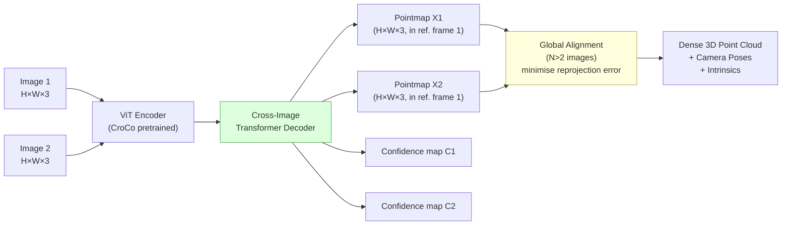
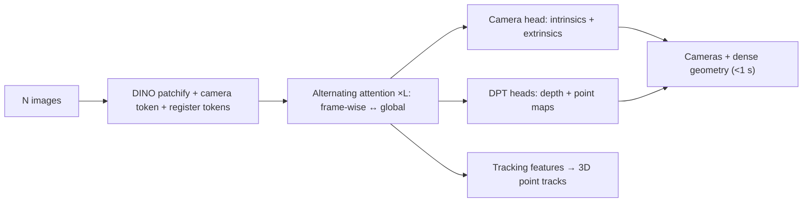

# 3D Reconstruction

> **Last Updated:** October 2026
> **Level:** Advanced
> **Related Sections:** [Structure-from-Motion & SLAM](../04_3d_vision_and_scene/03_sfm_and_slam.md) · [Neural Radiance Fields](../04_3d_vision_and_scene/01_nerf_and_variants.md) · [Gaussian Splatting](../04_3d_vision_and_scene/02_gaussian_splatting.md) · [Depth Estimation](./05_depth_estimation.md) · [3D Generation](../04_3d_vision_and_scene/04_3d_generation.md) · [4D and Dynamic Scenes](../12_research_frontier_2024_2026/05_4d_and_dynamic_scenes.md) · [Research Frontier](../12_research_frontier_2024_2026/00_overview_latest.md)

> **🆕 October 2026 update:**
> - **Feed-forward multi-view transformers** have replaced pairwise pointmaps as the state of the art. Added Fast3R and CUT3R (CVPR 2025); **VGGT** (CVPR 2025 Best Paper); its successors **π³** (ICLR 2026, reference-free), **MapAnything** (3DV 2026, metric, accepts optional priors), **Depth Anything 3** (Nov 2025) and Tencent's **WorldMirror**; and 2026 scaling work, **VGGT-Ω** (CVPR 2026 Oral) and **VGG-T³** (CVPR 2026, linear-time, 1k images in 54 s).
> - **Dynamic/4D reconstruction:** MonST3R (ICLR 2025), MegaSaM (CVPR 2025) and **D4RT** (Google DeepMind, **CVPR 2026 Best Paper**), a query-based model for depth, 3D tracks and cameras that is 18–300× faster than prior methods.
> - **Single-image / generative 3D:** **SAM 3D** (Meta, Nov 2025; CVPR 2026 honorable mention) and **TRELLIS.2** ("Native and Compact Structured Latents for 3D Generation", **CVPR 2026 Best Student Paper**).
> - Fixed broken cross-links; updated Key Papers, benchmark tables, Pros & Cons, Open Problems and Further Reading.

---

## Overview

3D reconstruction is the problem of inferring the geometry of a physical scene or object from one or more 2D images, recovering a representation—point cloud, mesh, voxel grid, signed distance field, or radiance field—that encodes shape, depth, and often appearance. The field spans a spectrum from classical multi-view geometry pipelines that require calibrated cameras and dense image overlap, to neural implicit representations that recover surface geometry from photometric supervision alone, to feedforward transformer-based models that infer 3D structure from a handful of uncalibrated images in a single forward pass.

The dominant classical approach—**Structure from Motion (SfM)** [Schönberger2016] followed by **Multi-View Stereo (MVS)** [Seitz2006]—solves reconstruction in two stages: (1) estimate camera poses by matching sparse local features (SIFT, SuperPoint) across images; (2) estimate dense depth maps by photometric consistency across multiple views. COLMAP [Schönberger2016] is the de facto gold-standard SfM+MVS pipeline. The learning-based MVS paradigm, initiated by MVSNet [Yao2018], replaces hand-crafted photometric consistency with learned cost volumes and recurrent regularisation, improving accuracy and robustness.

**Neural implicit representations** transformed reconstruction quality in 2020–2022. NeRF [Mildenhall2020] optimises a continuous radiance function (density + colour) for novel-view synthesis; NeuS [Wang2021] and VolSDF [Yariv2021] recast NeRF-style volume rendering around signed distance functions, enabling accurate surface extraction via marching cubes. These per-scene optimisation methods require tens to hundreds of images and hours of compute per scene.

The most significant recent advance is the emergence of **feedforward geometric models**. DUSt3R [Wang2024] reformulates all pairwise geometric problems—depth, pose, intrinsics—as **pointmap regression**: given a pair of images, a ViT encoder–decoder directly regresses two aligned 3D point clouds (one per image) expressed in a common coordinate frame, without any camera calibration input. MASt3R [Leroy2024] augments DUSt3R with dense local feature outputs, enabling simultaneous metric reconstruction and image matching. These models represent a paradigm shift analogous to DETR in detection: eliminating hand-crafted geometric pipelines in favour of end-to-end learning.

From 2025 the pairwise formulation gave way to **multi-view feed-forward transformers** that process tens to hundreds of images jointly. VGGT [Wang2025] (CVPR 2025 Best Paper) regresses cameras, depth, point maps and tracks for all views in under a second. π³, MapAnything and Depth Anything 3 removed the reference-view bias, added metric scale and optional geometric priors, and simplified the prediction targets. In 2026 the frontier moved to **scaling and long sequences** (VGGT-Ω, VGG-T³) and to **dynamic 4D scenes**: D4RT [Zhang2026], the CVPR 2026 Best Paper, reconstructs depth, 3D motion and cameras from video through a single query interface. In parallel, **generative single-image 3D** (SAM 3D, TRELLIS.2) now produces complete, textured object assets and scene layouts from one photograph.

---

## Evaluation Metrics

**Chamfer Distance (CD):** measures bidirectional point-cloud proximity:

```latex
% Chamfer Distance between predicted set P and ground truth Q:
\text{CD}(P, Q) = \frac{1}{|P|} \sum_{p \in P} \min_{q \in Q} \|p - q\|_2
                + \frac{1}{|Q|} \sum_{q \in Q} \min_{p \in P} \|p - q\|_2

% Lower is better; measured in mm on DTU / cm on ShapeNet
% Symmetric; does not penalise topology errors
```

**F-Score at threshold τ:** precision–recall tradeoff for surface completeness and accuracy:

```latex
% Precision: fraction of predicted points within τ of any GT point
\text{Prec}(\tau) = \frac{1}{|P|}\sum_{p \in P} \mathbb{1}\bigl[\min_{q \in Q}\|p-q\|_2 < \tau\bigr]

% Recall: fraction of GT points within τ of any predicted point
\text{Rec}(\tau)  = \frac{1}{|Q|}\sum_{q \in Q} \mathbb{1}\bigl[\min_{p \in P}\|p-q\|_2 < \tau\bigr]

% F-Score
F(\tau) = \frac{2 \cdot \text{Prec}(\tau) \cdot \text{Rec}(\tau)}{\text{Prec}(\tau) + \text{Rec}(\tau)}

% Common thresholds: \tau = 1mm (DTU), 1% of diagonal (ShapeNet)
```

---

## Classical Multi-View Stereo

### COLMAP

**COLMAP** [Schönberger2016] (CVPR 2016): incremental SfM + patch-based MVS pipeline. SfM stage: SIFT feature extraction → exhaustive or vocabulary-tree matching → RANSAC-based Essential/Fundamental matrix estimation → bundle adjustment. MVS stage: depth maps estimated per image via photometric consistency over neighbouring views, then fused with geometric consistency filtering. COLMAP remains the reference method for 3D Gaussian Splatting and NeRF training pipelines. Authors: Johannes L. Schönberger, Jan-Michael Frahm.

**Limitations:** requires ≥20–50 images with sufficient overlap; fails under low texture, reflective surfaces, or repetitive patterns; hours of compute for large scenes.

### MVSNet

**MVSNet** [Yao2018] (ECCV 2018): the first end-to-end learning-based MVS. Backbone CNN extracts feature maps from N=5 input views; a differentiable **cost volume** is built by warping all source views into the reference-view camera frustum using homography planes at D=256 depth hypotheses; 3D CNNs regularise and regress the cost volume into a depth map. Key contributions: (1) differentiable homography warping; (2) variance-based cost metric across views. Achieves SOTA on DTU benchmark; generalises to Tanks and Temples without fine-tuning. Authors: Yao Yao, Zixin Luo, Shiwei Li et al.

**RNN-MVSNet / PatchmatchNet** [Wang2021b] replace 3D CNN regularisation with recurrent (GRU) or iterative PatchMatch, enabling higher resolutions and lower memory.

---

## Single-View 3D Reconstruction

**Pixel2Mesh** [Wang2018] (ECCV 2018): predicts a 3D triangular mesh from a single RGB image by iteratively deforming an icosphere using graph convolutional networks that fuse image features via perspective projection. A coarse-to-fine cascade deforms at three resolutions. Evaluated on ShapeNet with Chamfer Distance and F-Score@1 %. Authors: Nanyang Wang, Yinda Zhang et al.

**Occupancy Networks** [Mescheder2019]: learn a continuous implicit occupancy function f: ℝ^3 → [0,1] conditioned on image features; extract surface via Marching Cubes. More topology-flexible than mesh deformation.

**LRM — Large Reconstruction Model** [Hong2023] (ICLR 2024): the first large-scale single-image 3D reconstruction model. A ViT image encoder extracts features from a single input image; a multi-layer Transformer decoder with camera-conditioned cross-attention regresses a triplane NeRF representation (three axis-aligned 2D feature planes) from which geometry and appearance are decoded. Trained on ~1 M multi-view objects from Objaverse and MVImgNet. Achieves photorealistic novel-view synthesis and extractable mesh (TSDF fusion) from a single image in ~5 seconds on a single GPU. 500 M parameters. Authors: Yicong Hong, Kai Zhang, Jiuxiang Gu, Sai Bi et al. arXiv 2311.04400.

**TRELLIS and TRELLIS.2** [Xiang2025] (Microsoft Research with Tsinghua and USTC). TRELLIS (CVPR 2025) introduced **structured 3D latents**: sparse voxels carrying features, decoded to Gaussians, radiance fields or meshes. **TRELLIS.2** ("Native and Compact Structured Latents for 3D Generation", arXiv 2512.14692, **CVPR 2026 Best Student Paper**) replaces iso-surface fields (SDF, FlexiCubes) with **O-Voxel**, a field-free sparse "omni-voxel" structure. O-Voxel encodes geometry together with PBR material attributes and handles open, non-manifold and enclosed surfaces. A sparse compression VAE downsamples 16×, so a fully textured 1024³ asset becomes about **9.6K latent tokens**. A **4B-parameter flow-matching** generator trained on public 3D data outputs PBR-textured meshes at 512³–1536³.

**SAM 3D** [SAM3DTeam2025] (Meta, "SAM 3D: 3Dfy Anything in Images", arXiv 2511.16624, Nov 2025; listed among CVPR 2026 Best Paper honorable mentions) targets **in-the-wild, occluded, cluttered** single images rather than clean object renders. **SAM 3D Objects** predicts per-object geometry, texture and pose/layout from a masked object, enabling full-scene reconstruction from one photo. **SAM 3D Body** recovers human body shape and pose. Training combines synthetic pre-training with real-world alignment through a human- and model-in-the-loop data engine, which annotated about 3.14M meshes over nearly 1M images according to secondary reports. Meta reports at least a 5:1 human-preference win rate over prior methods on real-world objects and scenes.

---

## Neural Implicit Surface Reconstruction

**NeRF** [Mildenhall2020] (ECCV 2020): a MLP f_θ(x, d) → (c, σ) maps 3D point position **x** and view direction **d** to colour **c** and volume density σ. Volume rendering integrates c·σ along each ray to produce a 2D pixel colour; backpropagation through the rendering equation trains the MLP solely on posed RGB images. Geometry can be extracted as the surface where σ is maximal, but NeRF's density field is not a proper surface representation.

**NeuS** [Wang2021] (NeurIPS 2021): replaces volume density with a **Signed Distance Function (SDF)**: f_θ(x) → s ∈ ℝ where s = 0 is the surface. A logistic function converts SDF to density, ensuring the weight function in volume rendering peaks unbiasedly at the zero-level set. This allows accurate surface extraction via Marching Cubes. NeuS achieves mean Chamfer distance **0.77 mm** (with mask) and **0.84 mm** (without mask) on DTU, significantly outperforming IDR (0.90) and NeRF (1.54). Authors: Peng Wang, Lingjie Liu, Yuan Liu et al.

```latex
% NeuS density from SDF (simplified):
\sigma(t) = \frac{d}{dt}\Phi_s(f(p(t)))

% \Phi_s(x) = \text{sigmoid}(-x/s) is the CDF of the logistic distribution
% s is a learnable scale parameter (decreases during training)
% The weight function w(t) = T(t) \cdot \sigma(t) peaks at the SDF zero-crossing
% without bias even under occlusion, unlike prior NeRF-based approaches
```

**VolSDF** [Yariv2021] (NeurIPS 2021): independently proposes volume rendering of SDFs with a Laplace distribution density. Achieves Chamfer distance **0.86 mm** on DTU. Introduces an opacity approximation enabling analytical ray sampling without fine/coarse networks.

**HF-NeuS** [Wang2022]: adds high-frequency detail by disentangling coarse geometry (SDF) from fine texture displacement, improving reconstruction of thin structures.

**3DGS-based surface reconstruction** (2024): SuGaR [Guédon2024] and 2DGS [Huang2024] extend 3D Gaussian Splatting with surface constraints (binding Gaussians to mesh faces, or flattening Gaussians to 2D discs), enabling fast surface reconstruction from multi-view images at NeRF-comparable quality. Surface-bound Gaussian representations remained an active topic in 2026. The reported ECCV 2026 Best Paper, "Heat Kernel Textures — the Geodesic Gaussians That Do Not Splat" (Foti, Korkmaz, Zafeiriou, Birdal; Imperial College London), proposes a texture representation defined on the surface via heat-kernel (geodesic) Gaussians rather than splatted 3D primitives.

---

## Feedforward Geometric Foundation Models

### DUSt3R

**DUSt3R** [Wang2024] (CVPR 2024): "Dense and Unconstrained Stereo 3D Reconstruction." Given two images (I_1, I_2), a ViT encoder (CroCo-pretrained [Weinzaepfl2022]) separately processes each image; a cross-image Transformer decoder produces two **pointmaps** X_1 ∈ ℝ^(H×W×3) and X_2 ∈ ℝ^(H×W×3) expressed in the reference frame of image 1. Each pixel in each image is mapped to a 3D point with confidence. No camera intrinsics, extrinsics, or overlap knowledge is required. For N>2 images, a global alignment procedure minimises reprojection between all pairwise pointmaps under a shared global frame via fast gradient descent. Camera poses and intrinsics are then analytically recovered from the pointmaps. arXiv 2312.14132. Authors: Shuzhe Wang, Vincent Leroy, Yohan Cabon, Boris Chidlovskii, Jérôme Revaud (NAVER LABS Europe).



### MASt3R

**MASt3R** [Leroy2024] (ECCV 2024): "Grounding Image Matching in 3D with MASt3R." Augments DUSt3R with a **dense local feature head** that outputs descriptor maps alongside pointmaps. The matching loss maximises feature similarity at corresponding 3D-consistent points, enabling simultaneous metric 3D reconstruction and visual matching. MASt3R outperforms DUSt3R on multiple pose estimation and visual localisation benchmarks, and provides a complete SfM pipeline (MASt3R-SfM) without requiring any prior feature matcher. Achieves camera rotation error within 2–3° and translation error within 1–2 % on standard benchmarks. Authors: Vincent Leroy, Yohan Cabon, Jérôme Revaud.

### Multi-View Feed-Forward: Fast3R, CUT3R and VGGT (2025)

**Fast3R** [Yang2025] (CVPR 2025) generalizes DUSt3R to N views. All images are processed jointly by one transformer, which removes the O(N²) pairwise inference and global alignment, and the model scales to over 1,000 images in one forward pass. **CUT3R** [Wang2025c] (CVPR 2025; Wang, Zhang, Holynski, Efros, Kanazawa) takes the opposite, **online** route. A stateful recurrent model updates a persistent scene state with each new frame and outputs metric point maps and camera poses per frame. It handles video and unordered photo collections, static or dynamic, and can query virtual unseen views to infer unobserved regions.

**VGGT** [Wang2025] (Visual Geometry Grounded Transformer; Wang, Chen, Karaev, Vedaldi, Rupprecht, Novotny; Oxford VGG and Meta AI; **CVPR 2025 Best Paper**) is a ~1B-parameter transformer. From one, a few or hundreds of views it directly infers **camera extrinsics and intrinsics, depth maps, point maps and 3D point tracks**, typically in under a second, with no global alignment step. Each frame is patchified by DINO and augmented with a **camera token** and register tokens. The network then **alternates frame-wise self-attention with global self-attention** across all frames. A camera head regresses intrinsics and extrinsics from the camera tokens, and DPT heads produce dense depth, point maps and tracking features. The first frame defines the world coordinate frame. VGGT's predictions are good enough to initialize bundle adjustment and 3D Gaussian Splatting directly (COLMAP export), and a commercially licensed VGGT-1B-Commercial checkpoint was released in July 2025.



### Reference-Free, Metric and Universal Models (2025–2026)

- **π³** [Wang2026a] (Shanghai AI Lab / ZJU; arXiv 2507.13347; **ICLR 2026**) argues that anchoring to a designated reference view is a harmful inductive bias. A fully **permutation-equivariant** transformer predicts affine-invariant camera poses and scale-invariant *local* point maps for every view without a reference frame. This makes it robust to input order and gives state-of-the-art camera pose, monocular and video depth, and point-map accuracy. **Pi3X** (Dec 2025) adds a convolutional head (fewer grid artifacts), optional pose, intrinsics and depth conditioning, continuous confidence, and approximate metric scale.
- **MapAnything** [Keetha2026] (Meta Reality Labs and CMU; arXiv 2509.13414; **3DV 2026**) is a "universal" metric model. It takes images plus any optional subset of intrinsics/rays, poses and depth, and regresses a **factored** representation of per-view depth, ray maps, poses and one global **metric scale factor**. One model covers more than 12 tasks: uncalibrated SfM, calibrated MVS, monocular metric depth, localization, depth completion and more. It is released under both CC BY-NC and Apache 2.0 checkpoints.
- **Depth Anything 3** [Lin2025] (ByteDance Seed, Nov 2025) uses a plain DINO ViT with input-adaptive cross-view attention and a single **depth-ray** target, and reports average gains over VGGT of roughly 35–44% in pose accuracy and 24–25% in geometric accuracy. See [Depth Estimation](./05_depth_estimation.md).
- **WorldMirror** (HunyuanWorld-Mirror, Tencent, arXiv 2510.10726, Oct 2025) adds **any-prior prompting**: available poses, intrinsics and depth are tokenized and injected. A single forward pass outputs point clouds, multi-view depth, cameras, surface normals and **3D Gaussians**.

```latex
% MapAnything factored output for view i (schematic):
X_i(u) = s \cdot \big( R_i\, ( D_i(u)\, \mathbf{r}_i(u) ) + \mathbf{t}_i \big)
% D_i: up-to-scale depth along ray r_i(u); (R_i, t_i): pose; s: single global metric scale
```

### Scaling and Long Sequences (2026)

Global attention over all tokens makes VGGT-style models quadratic in the number of views. Two CVPR 2026 papers address scale:

- **VGGT-Ω** [Wang2026b] (arXiv 2605.15195; CVPR 2026 Oral; Wang, Chen, Zhang, Karaev, Schönberger, Labatut, Bojanowski, Novotny, Vedaldi, Rupprecht) shows that feed-forward reconstruction **scales predictably** with model capacity and data. It enables this with an annotation pipeline that handles dynamic scenes, a self-supervised training protocol, a single dense prediction head, and efficient scene tokens that replace much of the global attention. It uses about 30% of VGGT's training memory, trains on 15× more supervised data, and improves camera estimation on Sintel by 77% over the previous best.
- **VGG-T³** [Elflein2026] (NVIDIA, Vector Institute, U. Toronto; arXiv 2602.23361; CVPR 2026) replaces global attention with **test-time training**. The growing key-value memory is compressed into a fixed-size MLP, which makes offline reconstruction **linear** in the number of views. It reconstructs a 1,000-image collection in **54 s** (11.6× faster than softmax-attention baselines), with point-map error comparable to VGGT, and supports localizing new images by querying the learned scene MLP.

Streaming variants (CUT3R's recurrent state, causal VGGT-style transformers with KV caches, DA3-Streaming's sliding windows, and chunk-and-align pipelines) trade some accuracy for bounded memory on long-video or large-area input. A CVPR 2026 line of work (e.g. KV-cache compression for causal VGGT models, test-time-training reconstruction of long sequences) targets the memory growth of such caches.

### Dynamic Scenes and 4D Reconstruction

- **MonST3R** [Zhang2025a] (ICLR 2025) extends DUSt3R to dynamic video by estimating a point map **per timestep**. It fine-tunes on scarce posed dynamic data and outputs time-varying point clouds, per-frame cameras, video depth and motion masks.
- **MegaSaM** [Li2025] (Google DeepMind, UC Berkeley, U. Michigan; CVPR 2025 Oral) is an optimization pipeline. A differentiable bundle-adjustment system (DROID-SLAM lineage), initialized with monocular depth priors, estimates cameras, focal length and consistent video depth from casual dynamic videos, robustly and quickly.
- **D4RT** [Zhang2026] (Zhang, Le Moing et al.; Google DeepMind, UCL, Oxford; arXiv 2512.08924; **CVPR 2026 Best Paper**) is fully feed-forward. A video encoder builds a global scene representation, and a lightweight decoder answers independent **space-time queries** (source pixel, source time, target time, camera time) with a 3D position. The same interface yields depth maps, point clouds, dense 3D tracks (including through occlusion) and full camera parameters for static and dynamic scenes. Cost is linear in the number of queries. DeepMind reports 18–300× faster inference than previous methods (about 5 s for a one-minute video on one TPU chip) with state-of-the-art accuracy on dynamic benchmarks. See [Optical Flow & Tracking](./06_optical_flow_tracking.md) for the query formulation.

---

## Key Papers

| Paper | Authors | Year | Venue | Key Contribution |
|-------|---------|------|-------|-----------------|
| COLMAP (SfM + MVS) | Schönberger, Frahm | 2016 | CVPR | Gold-standard incremental SfM + patch-based MVS |
| MVSNet | Yao, Luo, Li et al. | 2018 | ECCV | Differentiable cost volume; learned MVS |
| Pixel2Mesh | Wang, Zhang et al. | 2018 | ECCV | GCN mesh deformation from single image |
| NeRF | Mildenhall, Tancik et al. | 2020 | ECCV | Volume rendering neural radiance fields |
| NeuS | Wang, Liu et al. | 2021 | NeurIPS | Unbiased SDF volume rendering; 0.77mm DTU |
| VolSDF | Yariv, Gu et al. | 2021 | NeurIPS | Laplace density from SDF; 0.86mm DTU |
| LRM: Large Reconstruction Model | Hong, Zhang et al. | 2023 | ICLR 2024 | Single-image triplane NeRF; 500M params; 5s |
| DUSt3R | Wang, Leroy et al. | 2023 | CVPR 2024 | Pointmap regression; no camera calibration needed |
| MASt3R | Leroy, Cabon, Revaud | 2024 | ECCV 2024 | DUSt3R + dense matching; SfM pipeline |
| MonST3R | Zhang, Herrmann et al. | 2024 | ICLR 2025 | Per-timestep pointmaps for dynamic video; cameras + motion masks |
| Fast3R | Yang, Sax, Liang et al. | 2025 | CVPR 2025 | N-view DUSt3R in one pass; 1000+ images |
| CUT3R | Wang, Zhang, Holynski, Efros, Kanazawa | 2025 | CVPR 2025 | Recurrent persistent-state online 3D/4D perception |
| MegaSaM | Li et al. | 2025 | CVPR 2025 (Oral) | Robust cameras + consistent depth from casual dynamic video |
| TRELLIS (Structured 3D Latents) | Xiang et al. | 2025 | CVPR 2025 | Sparse structured latents decodable to GS/NeRF/mesh |
| VGGT | Wang, Chen, Karaev, Vedaldi, Rupprecht, Novotny | 2025 | CVPR 2025 (Best Paper) | Alternating-attention transformer; cameras, depth, points, tracks in <1 s |
| π³ | Wang, Zhou, Zhu et al. (Shanghai AI Lab) | 2025 | ICLR 2026 | Permutation-equivariant, reference-free geometry; Pi3X update |
| MapAnything | Keetha, Müller, Schönberger et al. (Meta, CMU) | 2025 | 3DV 2026 | Universal metric reconstruction with optional priors; 12+ tasks |
| WorldMirror (HunyuanWorld-Mirror) | Liu et al. (Tencent) | 2025 | arXiv 2510.10726 | Any-prior prompting; points, depth, cameras, normals, 3DGS |
| Depth Anything 3 | Lin, Chen, Liew et al. (ByteDance Seed) | 2025 | arXiv 2511.10647 | Plain ViT + depth-ray target; beats VGGT on pose and geometry |
| SAM 3D: 3Dfy Anything in Images | SAM 3D Team (Meta) | 2025 | arXiv 2511.16624; CVPR 2026 HM | In-the-wild single-image object/scene and body reconstruction |
| Efficiently Reconstructing Dynamic Scenes One D4RT at a Time | Zhang, Le Moing et al. (Google DeepMind) | 2025 | CVPR 2026 (Best Paper) | Query-based 4D reconstruction + tracking; 18–300× faster |
| Native and Compact Structured Latents for 3D Generation (TRELLIS.2) | Xiang et al. (Tsinghua, MSR, USTC) | 2025 | CVPR 2026 (Best Student Paper) | O-Voxel; 16× compression VAE; 4B flow model; PBR meshes |
| VGG-T³ | Elflein et al. (NVIDIA, Vector, U. Toronto) | 2026 | CVPR 2026 | Test-time-training global attention; linear in views; 1k images in 54 s |
| VGGT-Ω | Wang, Chen, Zhang et al. (Oxford, Meta) | 2026 | CVPR 2026 (Oral) | Predictable scaling of feed-forward 3D; 30% training memory; 15× data |

---

## Benchmark Performance

### DTU Dataset — Chamfer Distance (mm, lower is better)

| Method | CD (with mask) | CD (without mask) | Type |
|--------|---------------|-----------------|------|
| COLMAP | 0.50 | — | Classical MVS |
| MVSNet | ~0.45 | — | Learned MVS (dense) |
| NeRF | 1.54 | 1.49 | Neural implicit |
| IDR | 0.90 | — | Neural implicit |
| NeuS | **0.77** | 0.84 | SDF volume rendering |
| VolSDF | 0.86 | — | SDF Laplace density |
| HF-NeuS | 0.76 | — | SDF + high-freq |
| DUSt3R | not publicly reported | — | Feedforward pointmap |

### ShapeNet — Single-Image 3D (Chamfer Distance × 10^3, lower is better)

| Method | Mean CD | F@1% | Notes |
|--------|---------|------|-------|
| Pixel2Mesh | 0.591 | — | Mesh deformation; 13 ShapeNet categories |
| Occupancy Networks | 0.551 | — | Implicit function |
| LRM | not publicly reported per-class | — | NeRF-based; qualitative SOTA |

### Tanks and Temples — F-Score (%, higher is better)

| Method | Intermediate | Advanced | Notes |
|--------|-------------|---------|-------|
| COLMAP | 42.1 | 27.2 | Classical MVS |
| MVSNet | 43.5 | — | Generalised without fine-tuning |
| PatchmatchNet | 53.2 | 32.6 | Iterative PatchMatch |
| DUSt3R | not publicly reported on Tanks | — | Architecture targets unconstrained scenes |

### Feed-Forward Camera Pose — AUC@3° (higher is better)

| Method | HiRoom | ETH3D | DTU | 7Scenes | ScanNet++ | Notes |
|--------|--------|-------|-----|---------|-----------|-------|
| DA3-Nested-Giant-Large (ray head) | 84.4 | 52.6 | 93.9 | 29.5 | 89.4 | Official DA3 repo evaluation pipeline |
| DA3-Nested-Giant-Large (camera head) | 80.3 | 48.4 | 94.1 | 28.5 | 85.0 | Faster camera head; slightly lower accuracy |

*The DA3 README states that DA3-Large reaches results comparable to VGGT on this suite. Cross-paper pose numbers (VGGT, π³, MapAnything) use different frame sampling and are not directly comparable.*

### Efficiency of Feed-Forward and 4D Models

| Method | Setting | Reported speed | Notes |
|--------|---------|----------------|-------|
| VGGT | Tens of views | < 1 s per scene | Official repo; memory grows quadratically with views |
| VGG-T³ | 1,000 images | 54 s | 11.6× faster than softmax-attention baseline; linear in views |
| D4RT | 1-minute video | ~5 s on one TPU chip | 18–300× faster than prior 4D methods (DeepMind) |
| VGGT-Ω | Training | ~30% of VGGT training memory | +77% camera accuracy on Sintel vs. previous best |

---

## Pros & Cons

| Aspect | Pros | Cons |
|--------|------|------|
| Classical MVS (COLMAP) | Well-understood; no training data; complete pipeline; high accuracy | Requires calibrated cameras; fails on low-texture / reflective surfaces; slow |
| Learned MVS (MVSNet) | Better robustness to appearance variation; generalises across scenes | Still needs posed cameras from SfM; depth map fusion artifacts |
| Neural implicit (NeuS/VolSDF) | Accurate thin structures; differentiable; single-scene over-fitting | Per-scene optimisation (hours); requires calibrated posed images; no real-time |
| Feedforward (DUSt3R/MASt3R) | Uncalibrated; fast inference; handles sparse views; generalises zero-shot | Coarser reconstruction than per-scene methods; limited large-scene scalability |
| Single-image (LRM/Pixel2Mesh) | No multi-view requirement; fast; large-scale training | Ambiguous depth from single view; hallucination of occluded geometry |
| Multi-view feed-forward transformers (VGGT, π³, MapAnything, DA3) | Cameras + dense geometry for 1–100s of unposed images in seconds; good BA/3DGS initialisation | Quadratic attention memory; drift on very long sequences; best weights often non-commercial |
| 4D feed-forward (D4RT, MonST3R, CUT3R) | Handles moving objects; joint depth, tracks and cameras from casual video | Dynamic ground truth scarce; accuracy on fast non-rigid motion still limited |
| Generative single-image 3D (SAM 3D, TRELLIS.2) | Complete textured assets / PBR meshes from one image; plausible occluded parts | Hallucinated geometry is not measurement; scale and layout ambiguous; heavy models |

---

## Open Problems & Research Gaps

- **Large-scale outdoor reconstruction:** DUSt3R and MASt3R were designed for object-level and room-scale scenes. Fast3R, VGG-T³ (1k images in 54 s) and streaming models push to thousands of frames. Globally consistent, drift-free feed-forward reconstruction of city-scale or driving logs, without falling back to bundle adjustment, remains open.
- **Feed-forward vs. optimization:** Feed-forward models (VGGT, π³, DA3) now often initialise or replace COLMAP, yet the most accurate pipelines still refine with bundle adjustment. Whether pure scaling (VGGT-Ω) closes the remaining accuracy gap is an open empirical question.
- **Dynamic and non-rigid 4D reconstruction:** D4RT, MonST3R and MegaSaM handle moving objects, but real-world 4D ground truth is scarce, evaluation relies heavily on synthetic data (e.g. Sintel), and highly non-rigid or fast motion is still hard.
- **Reconstruction vs. generation:** Generative models (SAM 3D, TRELLIS.2) hallucinate unseen geometry convincingly. Calibrated uncertainty that separates observed from imagined surfaces is needed before such outputs can be used for measurement or robotics.
- **Accurate surface normals and thin structures:** Neural SDFs struggle to reconstruct thin objects (grass, hair, wires) because the zero-level set degenerates; hybrid representations combining NeRF density near surfaces with SDF for boundaries are being explored but not standardised.
- **Real-time neural reconstruction:** 3D Gaussian Splatting enables real-time rendering but reconstruction still requires minutes to hours of optimisation; truly real-time neural reconstruction (e.g., for robotics or AR) at scene scale is unsolved.
- **Material and appearance disentanglement:** Most reconstruction methods conflate geometry with surface appearance; separating intrinsic albedo, surface normals, and illumination from multi-view images (inverse rendering) without known lighting is still an open problem.
- **Generalisation to in-the-wild textures:** Learned MVS and feedforward models trained on synthetic/curated data can fail on real scenes with unusual materials; domain randomisation and self-supervised adaptation strategies are incomplete.
- **Uncertainty quantification:** Surface reconstruction models rarely provide per-point uncertainty estimates; calibrated 3D confidence maps would be critical for robotic manipulation and AR scene understanding where erroneous geometry is dangerous.
- **Integration with scene semantics:** Most geometric reconstruction pipelines are class-agnostic; jointly reconstructing geometry and semantic labels (panoptic 3D reconstruction) at scale, particularly in open-vocabulary settings, is an emerging research area.

---

## Further Reading

- [COLMAP: Structure-from-Motion Revisited (Schönberger & Frahm, 2016)](https://openaccess.thecvf.com/content_cvpr_2016/papers/Schonberger_Structure-From-Motion_Revisited_CVPR_2016_paper.pdf)
- [MVSNet: Depth Inference for Unstructured Multi-view Stereo (Yao et al., 2018)](https://arxiv.org/abs/1804.02505)
- [NeuS: Learning Neural Implicit Surfaces by Volume Rendering (Wang et al., 2021)](https://arxiv.org/abs/2106.10689)
- [LRM: Large Reconstruction Model for Single Image to 3D (Hong et al., 2023)](https://arxiv.org/abs/2311.04400)
- [DUSt3R: Geometric 3D Vision Made Easy (Wang et al., 2024)](https://arxiv.org/abs/2312.14132)
- [MASt3R: Grounding Image Matching in 3D (Leroy et al., 2024)](https://arxiv.org/abs/2406.09756)
- [VGGT: Visual Geometry Grounded Transformer (Wang et al., CVPR 2025 Best Paper)](https://github.com/facebookresearch/vggt) — code, VGGT-1B-Commercial, link to VGGT-Ω
- [π³: Permutation-Equivariant Visual Geometry Learning (arXiv:2507.13347)](https://github.com/yyfz/Pi3) — ICLR 2026; Pi3X
- [MapAnything: Universal Feed-Forward Metric 3D Reconstruction (arXiv:2509.13414)](https://github.com/facebookresearch/map-anything) — 3DV 2026
- [Depth Anything 3 (arXiv:2511.10647)](https://github.com/ByteDance-Seed/Depth-Anything-3) — Any-view depth-ray geometry
- [D4RT: Efficiently Reconstructing Dynamic Scenes One D4RT at a Time (arXiv:2512.08924)](https://arxiv.org/abs/2512.08924) — CVPR 2026 Best Paper
- [VGGT-Ω (arXiv:2605.15195)](https://arxiv.org/abs/2605.15195) — CVPR 2026 Oral
- [VGG-T³: Offline Feed-Forward 3D Reconstruction at Scale (arXiv:2602.23361)](https://arxiv.org/abs/2602.23361) — CVPR 2026
- [CUT3R: Continuous 3D Perception Model with Persistent State (arXiv:2501.12387)](https://arxiv.org/abs/2501.12387) — CVPR 2025
- [Fast3R: Towards 3D Reconstruction of 1000+ Images in One Forward Pass (arXiv:2501.13928)](https://arxiv.org/abs/2501.13928) — CVPR 2025
- [SAM 3D Objects (facebookresearch)](https://github.com/facebookresearch/sam-3d-objects) — paper arXiv:2511.16624
- [TRELLIS.2 (microsoft)](https://github.com/microsoft/TRELLIS.2) — CVPR 2026 Best Student Paper; arXiv:2512.14692
