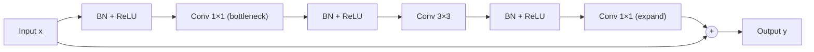
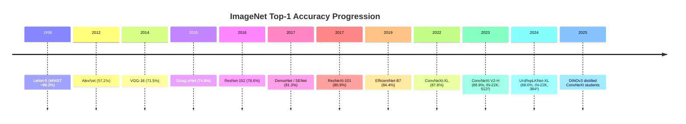

# CNN Architectures: From LeNet to ConvNeXt

> **Last Updated:** October 2026
> **Level:** Intermediate → Advanced
> **Related Sections:**
> - [Image Classification](../02_core_tasks/00_image_classification.md)
> - [Vision Transformers](./01_vision_transformers.md)
> - [Hybrid Architectures](./02_hybrid_architectures.md)
> - [Efficient Architectures](../09_efficiency_and_deployment/01_efficient_architectures.md)

> **🆕 October 2026 update:**
> - New section **Post-ConvNeXt Developments (2023–2026)**: ConvNeXt V2 (FCMAE + GRN), large-kernel UniRepLKNet, DenseNets Reloaded (RDNet), OverLoCK (CVPR 2025 Oral) and MambaOut (CVPR 2025).
> - ConvNets as **distillation students of foundation models**: DINOv3 (Meta, Aug 2025) ships ConvNeXt-T/S/B/L backbones distilled from its 7B ViT teacher (distillation code released Nov 2025).
> - Key Papers, Benchmark and timeline extended (ConvNeXt V2-H 88.9%, UniRepLKNet-XL 88.0%); CNN-specific SSL open problem updated (FCMAE, LeJEPA on ConvNeXt V2).

---

## Overview

Convolutional Neural Networks (CNNs) constitute the foundational backbone family of modern computer vision, tracing a continuous lineage from Yann LeCun's LeNet-5 (1998) to the ConvNeXt family (Liu et al., CVPR 2022). Over this span, the dominant design vocabulary has converged on a small set of orthogonal principles: **receptive field management** (stride, dilation, pooling), **skip/residual connectivity** (He et al., 2016), **normalization strategies** (Batch Norm, Layer Norm, Group Norm), **channel attention** (Hu et al., 2018), **depthwise-separable convolutions** (Howard et al., 2017), and **compound scaling** (Tan & Le, 2019). Each era's breakthrough architecture can largely be understood as a disciplined combination of these primitives under a given parameter/FLOP budget.

The ImageNet Large Scale Visual Recognition Challenge (ILSVRC) served as the defining benchmark from 2010 through 2017, compressing more than a decade of architectural progress into eight competition cycles. AlexNet's 2012 victory demonstrated that GPU-trained deep CNNs could shatter prior handcrafted-feature baselines; VGGNet showed that depth with 3×3 convolutions alone was a powerful scaling axis; GoogLeNet proved that multi-scale parallel branches (Inception modules) could reduce parameters while increasing depth; ResNet resolved the vanishing-gradient barrier through identity shortcut connections and made 100+-layer networks routinely trainable. The subsequent post-ResNet era — DenseNet, ResNeXt, SENet, EfficientNet, ConvNeXt — can be read as systematic ablations exploring width, cardinality, channel recalibration, and the alignment of CNN inductive biases with Transformer-derived training recipes.

A critical and still-active research question concerns whether CNNs and Vision Transformers occupy the same fundamental representation class or whether their inductive biases (local spatial connectivity vs. global self-attention) produce qualitatively different learned representations [Liu2022]. The ConvNeXt result, which matches Swin Transformer accuracy after modernizing a ResNet-50 training recipe without any attention mechanism, suggests that much of the observed ViT advantage in the 2021–2022 period was attributable to training recipe differences rather than architectural necessity. This observation motivates continued hybrid and purely convolutional research alongside the Transformer mainstream. Since 2023 that research has produced masked-autoencoder pre-training for ConvNets (ConvNeXt V2), large-kernel and dynamic-kernel designs (UniRepLKNet, OverLoCK), and a pointed challenge to state-space vision models (MambaOut). By 2025–2026, convolutional backbones are increasingly obtained by **distilling ViT foundation models** such as DINOv3 into ConvNeXt students for efficient deployment.

---

## Core Design Principles

### Receptive Fields

The effective receptive field of a unit in layer $l$ of a CNN with uniform kernel size $k$ and unit stride is:

```
RF(l) = 1 + l * (k - 1)
```

With strided convolutions or pooling of stride $s$, receptive field growth accelerates. In practice, deeper layers have large theoretical receptive fields but their effective receptive fields (the region that actually influences a unit's output via gradient magnitude) are considerably smaller [Luo2016]. Dilated (atrous) convolutions with dilation rate $d$ expand the receptive field to:

```
RF_dilated(l) = 1 + l * d * (k - 1)
```

without increasing parameter count, enabling dense prediction without spatial resolution loss.

### Skip Connections and Residual Learning

The core ResNet identity shortcut [He2016] is:

```
y = F(x, {W_i}) + x
```

where $F$ represents the residual mapping to be learned. When input and output dimensions differ, a linear projection $W_s$ is applied:

```
y = F(x, {W_i}) + W_s * x
```

This formulation ensures gradient flow through an identity path, making the optimization landscape smoother and enabling networks of 50–1000+ layers to train without degeneration.

### Depthwise-Separable Convolutions

Standard convolution with kernel $K \in \mathbb{R}^{k \times k \times C_{in} \times C_{out}}$ has cost $O(k^2 \cdot C_{in} \cdot C_{out} \cdot H \cdot W)$. Depthwise-separable factorization [Howard2017] replaces this with:

1. Depthwise conv (one filter per input channel): cost $O(k^2 \cdot C_{in} \cdot H \cdot W)$
2. Pointwise (1×1) conv: cost $O(C_{in} \cdot C_{out} \cdot H \cdot W)$

Reduction ratio: $\frac{1}{C_{out}} + \frac{1}{k^2}$, typically ~8–9× for $k=3$.

### Compound Scaling (EfficientNet)

[Tan2019] formalized scaling along three axes — depth $d$, width $w$, and resolution $r$ — via a compound coefficient $\phi$:

```
d = alpha^phi
w = beta^phi
r = gamma^phi

subject to: alpha * beta^2 * gamma^2 ≈ 2
            alpha >= 1, beta >= 1, gamma >= 1
```

The constraint ensures that total FLOPs scale as approximately $2^\phi$ per doubling. Constants $\alpha, \beta, \gamma$ are found by a small grid search at $\phi = 1$.

---

## Architecture Lineage

### LeNet-5 (LeCun et al., 1998)
Seminal architecture for handwritten digit recognition (MNIST). Used $5\times5$ conv layers, average pooling, tanh activations, and a fully-connected classifier. Established the conv → pool → FC pipeline that remained canonical for over a decade. Top-1 on MNIST: ~99.2%.

### AlexNet (Krizhevsky et al., 2012)
Won ILSVRC 2012 with a top-5 error of 15.3% (runner-up: 26.2%). Key innovations: ReLU activations (replacing tanh/sigmoid), dropout for regularization, data augmentation (random crops, flips, color jitter), training on two GTX 580 GPUs via model-parallel split. Architecture: 5 conv layers + 3 FC layers, ~60M parameters. This result catalyzed the modern deep learning era in computer vision.

### VGGNet (Simonyan & Zisserman, 2014/ICLR 2015)
Systematic study showing that depth with exclusively $3\times3$ convolutions achieves competitive accuracy. VGG-16 and VGG-19 achieved 71.5% top-1 on ImageNet. Key insight: two stacked $3\times3$ convolutions have the same receptive field as one $5\times5$ convolution but with fewer parameters and an extra nonlinearity. VGG's uniform design made it the go-to transfer learning backbone for several years, despite ~138M parameters.

### GoogLeNet / Inception-v1 (Szegedy et al., 2015)
Introduced the Inception module: parallel branches of $1\times1$, $3\times3$, $5\times5$ convolutions and $3\times3$ max-pooling, concatenated along the channel dimension. $1\times1$ convolutions are used as dimensionality-reduction bottlenecks before wider convolutions. Achieved 74.8% top-1, 6.67% top-5 on ImageNet with only ~6.8M parameters vs. AlexNet's 60M. The Inception family continued with v2 (Batch Norm), v3 (factorized convolutions), and Inception-ResNet variants.

### ResNet (He et al., CVPR 2016)
Introduced identity shortcut connections, enabling training of networks up to 1000+ layers. ResNet-152 won ILSVRC 2015 with 3.57% top-5 error (ensemble), 78.57% top-1 (single model). ResNet-50 achieves ~77.15% top-1. The bottleneck design (1×1→3×3→1×1 convolutions) reduces computation in deeper variants. Arguably the most impactful CNN architecture, still widely used as a backbone in detection, segmentation, and self-supervised learning.

### DenseNet (Huang et al., CVPR 2017, Best Paper Award)
Extends residual connectivity to dense connections: each layer receives feature maps from all preceding layers in the dense block. For a network with $L$ layers, there are $L(L+1)/2$ direct connections. Advantages: feature reuse, vanishing-gradient mitigation, reduced parameter count. DenseNet-201 achieves comparable ImageNet accuracy to ResNet-152 with substantially fewer parameters. DenseNet-BC (bottleneck + compression) reduces FLOPs further.

### ResNeXt (Xie et al., CVPR 2017)
Introduces **cardinality** (number of parallel transformation paths) as a third dimension of scaling alongside depth and width. A ResNeXt block with cardinality $C$ aggregates $C$ independent transformations:

```
y = sum_{i=1}^{C} T_i(x) + x
```

This is mathematically equivalent to grouped convolutions. ResNeXt-101 (32×4d) achieves 80.9% top-1, outperforming ResNet-101 by ~1.5% with similar FLOP cost. ResNeXt formed the basis of the ILSVRC 2016 runner-up entry.

### SENet (Hu et al., CVPR 2018)
Squeeze-and-Excitation (SE) blocks introduce channel-wise attention via a two-step process: (1) **squeeze**: global average pooling to produce a channel descriptor; (2) **excitation**: two FC layers with sigmoid to produce per-channel scaling weights. SE-ResNet-154 achieves 81.32% top-1 on ImageNet. The SE block won 1st place in ILSVRC 2017, reducing top-5 error to 2.251%. The SE mechanism adds minimal overhead (<1% extra parameters) and is routinely embedded in modern architectures.

### EfficientNet (Tan & Le, ICML 2019)
Proposed neural architecture search (NAS) to find a base architecture (EfficientNet-B0) followed by compound scaling. EfficientNet-B7 achieves **84.4% top-1 / 97.1% top-5** on ImageNet, while being 8.4× smaller and 6.1× faster than the then-best ConvNet (GPipe). The compound coefficient formulation allows a single family to cover the full mobile-to-server spectrum (B0–B7). EfficientNetV2 [Tan2021] further incorporates Fused-MBConv blocks and progressive training, reaching 87.3% top-1.

### ConvNeXt (Liu et al., CVPR 2022)
"A ConvNet for the 2020s" progressively modernizes a ResNet-50 by adopting Swin Transformer training recipes and architectural micro-decisions: (1) patchify stem (4×4 non-overlapping conv), (2) depth-wise 7×7 convolutions, (3) inverted bottleneck, (4) GELU activations, (5) Layer Norm instead of Batch Norm, (6) fewer normalization layers, (7) separating downsampling layers. ConvNeXt-XL achieves **87.8% top-1** on ImageNet (with ImageNet-22K pre-training), matching or exceeding Swin-L, while retaining the simplicity of ConvNets. This result demonstrated that CNN–Transformer performance gaps in 2021 were largely recipe artifacts.

---

## Post-ConvNeXt Developments (2023–2026)

After 2022 the frontier of *general-purpose* backbones moved decisively to ViTs (see [Vision Transformers](./01_vision_transformers.md)), but pure ConvNets remained an active research line along four axes: self-supervised pre-training adapted to convolution, very large kernels, revisiting older connectivity patterns, and serving as compact **students** of ViT foundation models.

### ConvNeXt V2 (Woo et al., CVPR 2023)
ConvNeXt V2 [Woo2023] co-designs the architecture with a **fully convolutional masked autoencoder (FCMAE)**: masked regions are handled with sparse convolutions during pre-training so the ConvNet sees only visible pixels, mirroring MAE's asymmetric encoder. The authors observed *feature collapse* (many dead/redundant channels) when applying MAE to ConvNeXt, and added **Global Response Normalization (GRN)**, a parameter-light layer that amplifies inter-channel feature competition:

```
G(X)_c = || X_c ||_2                      # global L2 aggregation per channel
N(X)_c = G(X)_c / mean_c' G(X)_c'         # divisive normalization across channels
X_c    <- gamma * (X_c * N(X)_c) + beta + X_c
```

The family spans Atto (3.7M, 76.7%) to Huge (660M, 86.3% IN-1K only); ConvNeXt V2-H reaches **88.9% top-1 at 512²** with ImageNet-22K fine-tuning, the strongest result in the ConvNeXt line. FCMAE is the first widely adopted answer to the "MIM is ViT-specific" problem listed in the open problems below.

### Large-Kernel ConvNets: UniRepLKNet (Ding et al., CVPR 2024)
Following RepLKNet and SLaK, **UniRepLKNet** [Ding2024] argues that large kernels "see wide without going deep" and proposes four design guidelines for large-kernel ConvNets, using structural re-parameterization (dilated re-param blocks that merge parallel small/dilated branches into one large kernel at inference). UniRepLKNet-XL reaches **88.0%** ImageNet top-1 (384², IN-22K), 55.6 mIoU on ADE20K and 56.4 box AP on COCO, and the same architecture with modality-specific preprocessing transfers to audio, video, point clouds and time series. A journal extension appeared in IEEE TPAMI (2025).

### DenseNets Reloaded: RDNet (Kim et al., ECCV 2024)
RDNet [Kim2024] revisits DenseNet with a modern training recipe and block redesign, arguing that **concatenation** was under-exploited rather than inferior to addition. RDNet-L reaches 84.8% (224², IN-1K) and 85.8% at 384², competitive with Swin, ConvNeXt and DeiT-III at similar FLOPs.

### Top-Down Attention in a Pure ConvNet: OverLoCK (Lou & Yu, CVPR 2025 Oral)
OverLoCK [Lou2025] adds a biologically inspired *overview-first, look-closely-next* pathway: a Base-Net encodes low/mid features, a lightweight Overview-Net produces coarse global context used as top-down guidance, and a Focus-Net performs fine perception with **ContMix**, a context-mixing dynamic convolution that injects long-range dependencies while preserving locality. OverLoCK-B reaches 85.1% top-1 at 16.7 GFLOPs.

### MambaOut: Gated CNNs vs. SSMs (Yu & Wang, CVPR 2025)
MambaOut [Yu2025] removes the SSM from the Mamba block, leaving a **Gated CNN** block (gated MLP with a depthwise-conv token mixer), and shows that this purely convolutional family outperforms visual Mamba models on ImageNet (MambaOut-Small: 84.1%, 48.5M params), arguing SSMs are unnecessary for short-sequence classification but potentially useful for long-sequence/dense tasks (see [State Space Models](./05_state_space_models.md)).

### ConvNets as Distilled Students of Foundation Models
At foundation-model scale, a 2023 study from Google DeepMind ("ConvNets Match Vision Transformers at Scale") reported that NFNets pre-trained on JFT-4B follow compute–accuracy scaling comparable to ViTs, with the largest model reaching about 90.4% ImageNet top-1 after fine-tuning [Smith2023]. In practice, however, the more common role for CNNs in 2025–2026 is as **deployment-friendly students**: **DINOv3** [Simeoni2025] (Meta, Aug 2025) releases ConvNeXt-Tiny/Small/Base/Large backbones (29M–198M params) distilled from its 6.7B-parameter ViT-7B teacher trained on LVD-1689M, with the ConvNeXt distillation code released in November 2025. CNN features distilled from a ViT teacher inherit much of its dense-feature quality while keeping convolution's latency advantages on edge hardware (see [Efficient Architectures](../09_efficiency_and_deployment/01_efficient_architectures.md)). Agglomerative ViT/hybrid students (RADIO) are covered in [Hybrid Architectures](./02_hybrid_architectures.md).

---

## Architecture Diagrams

### ResNet Residual Block



### CNN Architecture Evolution Timeline



---

## Key Papers

| Paper | Authors | Year | Venue | Key Contribution |
|-------|---------|------|-------|-----------------|
| Gradient-Based Learning Applied to Document Recognition | LeCun, Bottou, Bengio, Haffner | 1998 | Proc. IEEE | LeNet-5: foundational conv-pool-FC pipeline for digit recognition |
| ImageNet Classification with Deep CNNs (AlexNet) | Krizhevsky, Sutskever, Hinton | 2012 | NeurIPS | Deep CNN + GPU training + ReLU + dropout; broke ILSVRC 2012 |
| Very Deep Convolutional Networks (VGGNet) | Simonyan, Zisserman | 2015 | ICLR | Systematic depth study with 3×3 convolutions; strong transfer baseline |
| Deep Residual Learning for Image Recognition (ResNet) | He, Zhang, Ren, Sun | 2016 | CVPR | Identity shortcuts enabling 152-layer nets; 3.57% top-5 ILSVRC 2015 |
| Densely Connected Convolutional Networks (DenseNet) | Huang, Liu, van der Maaten, Weinberger | 2017 | CVPR | Dense connectivity for feature reuse; CVPR 2017 Best Paper |
| Aggregated Residual Transformations (ResNeXt) | Xie, Girshick, Dollár, Tu, He | 2017 | CVPR | Cardinality as a new scaling dimension; grouped convolutions |
| Squeeze-and-Excitation Networks (SENet) | Hu, Shen, Sun | 2018 | CVPR | Channel-wise attention via squeeze-excitation; ILSVRC 2017 winner |
| EfficientNet: Rethinking Model Scaling | Tan, Le | 2019 | ICML | Compound scaling of depth/width/resolution; B7: 84.4% top-1 |
| A ConvNet for the 2020s (ConvNeXt) | Liu, Mao, Wu, Feichtenhofer, Darrell, Xie | 2022 | CVPR | Modernized ResNet matches Swin Transformer; 87.8% top-1 |
| ConvNeXt V2: Co-designing and Scaling ConvNets with Masked Autoencoders | Woo, Debnath, Hu, Chen, Liu, Kweon, Xie | 2023 | CVPR | FCMAE self-supervised pre-training + GRN; V2-H 88.9% top-1 |
| ConvNets Match Vision Transformers at Scale | Smith, Brock, Berrada, De | 2023 | arXiv | NFNets on JFT-4B scale like ViTs; ~90.4% top-1 after fine-tuning |
| UniRepLKNet: A Universal Perception Large-Kernel ConvNet | Ding, Zhang, Ge, Zhao, Song, Yue, Shan | 2024 | CVPR | Large-kernel design guidelines; universal across modalities |
| DenseNets Reloaded (RDNet) | Kim, Heo, Han | 2024 | ECCV | Modernized dense concatenation competitive with Swin/ConvNeXt |
| MambaOut: Do We Really Need Mamba for Vision? | Yu, Wang | 2025 | CVPR | Gated CNN (Mamba minus SSM) beats visual Mamba on ImageNet |
| OverLoCK | Lou, Yu | 2025 | CVPR (Oral) | Top-down attention ConvNet with context-mixing dynamic kernels |
| DINOv3 | Siméoni, Vo, Seitzer, et al. | 2025 | arXiv | 7B SSL ViT teacher distilled into ConvNeXt-T/S/B/L students |

---

## Benchmark Performance

| Model | Dataset | Metric | Score | Notes |
|-------|---------|--------|-------|-------|
| AlexNet | ImageNet-1K | Top-1 Acc. | 57.2% | Trained from scratch, single model |
| VGG-16 | ImageNet-1K | Top-1 Acc. | 71.5% | Center crop evaluation |
| GoogLeNet / Inception-v1 | ImageNet-1K | Top-1 Acc. | 74.8% | ~6.8M parameters |
| ResNet-50 | ImageNet-1K | Top-1 Acc. | 77.15% | Standard training recipe |
| ResNet-152 | ImageNet-1K | Top-5 Err. | 3.57% | Ensemble; ILSVRC 2015 winner |
| SENet-154 | ImageNet-1K | Top-1 Acc. | 81.32% | 224×224 center crop |
| ResNeXt-101 (32×4d) | ImageNet-1K | Top-1 Acc. | 80.9% | Grouped convolutions, cardinality=32 |
| EfficientNet-B7 | ImageNet-1K | Top-1 Acc. | 84.4% | NAS base + compound scaling |
| EfficientNetV2-L | ImageNet-1K | Top-1 Acc. | 85.7% | With ImageNet-21K pre-training |
| ConvNeXt-XL | ImageNet-1K | Top-1 Acc. | 87.8% | ImageNet-22K pre-training + fine-tune |
| ConvNeXt V2-H | ImageNet-1K | Top-1 Acc. | 86.3% | FCMAE pre-training, IN-1K only, 224² |
| ConvNeXt V2-H | ImageNet-1K | Top-1 Acc. | 88.9% | FCMAE + IN-22K fine-tune, 512² |
| UniRepLKNet-XL | ImageNet-1K | Top-1 Acc. | 88.0% | IN-22K pre-training, 384² |
| RDNet-L | ImageNet-1K | Top-1 Acc. | 84.8% | IN-1K, 224²; 85.8% at 384² |
| OverLoCK-B | ImageNet-1K | Top-1 Acc. | 85.1% | IN-1K, 224², 16.7 GFLOPs |
| MambaOut-Small | ImageNet-1K | Top-1 Acc. | 84.1% | Gated CNN, no SSM, 48.5M params |

---

## Pros & Cons

| Aspect | Pros | Cons |
|--------|------|------|
| Inductive Bias | Strong locality and translation equivariance; excellent on small datasets | Fixed local receptive fields limit global context modeling; quadratic receptive field growth requires many layers |
| Computational Efficiency | Highly optimized CUDA kernels; excellent hardware utilization; structured sparsity | Large models (VGG, ResNet-152) have high parameter counts; depthwise convs may be memory-bandwidth limited |
| Scalability | Compound scaling (EfficientNet) provides principled FLOPs/accuracy tradeoff | Public ImageNet results plateau around 88–89% even with IN-22K pre-training (ConvNeXt V2-H 88.9%); ViTs dominate the billion-param foundation-model regime, with CNNs mostly used as distilled students |
| Training Stability | Batch Norm + residual connections make optimization straightforward; well-understood hyperparameter landscape | Batch Norm requires sufficiently large batch sizes; performance degrades under very small batches |
| Transfer Learning | Rich, general-purpose features; widely supported in frameworks | Pre-trained CNN features may generalize less well than ViTs on tasks requiring long-range context |

---

## Open Problems & Research Gaps

1. **Global Context Without Attention**: Can purely convolutional architectures capture long-range dependencies as effectively as self-attention without the quadratic cost? Large-kernel ConvNets (RepLKNet, SLaK) with kernels up to 51×51 explore this direction but have not yet closed the performance gap on dense prediction tasks at scale.

2. **Effective Receptive Field Utilization**: The gap between theoretical and effective receptive fields in deep CNNs remains poorly understood. At what depth and width does increasing the theoretical receptive field yield diminishing returns, and how can architectural choices be made to maximize effective receptive fields?

3. **CNN Scaling Laws**: EfficientNet provides a heuristic compound scaling rule, but the field lacks rigorous theoretical scaling laws comparable to those derived for Transformers. Characterizing CNN performance as a function of parameters, data, and compute at billion-parameter scale is an open empirical challenge.

4. **Batch Normalization Alternatives**: Batch Norm introduces undesirable train/test discrepancy and batch-size dependence. Layer Norm and Group Norm partially address this, but their performance lags on certain CNN architectures. Principled alternatives that retain BN's optimization benefits without its limitations are an active research area.

5. **Robustness and Out-of-Distribution Generalization**: CNNs are notoriously susceptible to texture bias [Geirhos2019] and distribution shift. While data augmentation (AugMix, RandAugment) and adversarial training improve robustness, the fundamental causes of CNN brittleness and strategies for principled mitigation remain open.

6. **CNN-Specific Self-Supervised Pre-Training**: Masked image modeling methods (MAE, BEiT) primarily benefit ViTs due to their patch-level processing. ConvNeXt V2's FCMAE (sparse convolutions over visible pixels + GRN) showed that MIM *can* work for ConvNets, and heuristic-free objectives such as LeJEPA (Balestriero & LeCun, Nov 2025) report results with ConvNeXt V2-H backbones. However, at the largest scales (DINOv3, Web-SSL) self-supervised training is still done on ViTs and transferred to CNNs by distillation; native CNN SSL at billion-parameter scale remains largely unexplored.

7. **Architecture Search Beyond Compound Scaling**: NAS methods that found EfficientNet-B0 are computationally expensive and may not generalize across domains. Hardware-aware, differentiable NAS that discovers new motifs (beyond inverted bottlenecks and depthwise separable convolutions) for diverse deployment constraints (edge TPU, mobile NPU, server GPU) remains a frontier.

8. **Distillation from ViT Foundation Models into CNNs**: DINOv3 shows that ConvNeXt students can inherit much of a 7B ViT teacher's quality, but how much of the teacher's *dense* feature quality (segmentation, depth, correspondence) survives the change of inductive bias, and what student architectures are optimal targets for such distillation, is not well characterized.

9. **When Is Global Mixing Necessary?** MambaOut and OverLoCK show that gated or dynamic convolutions match or beat SSM/attention token mixers on ImageNet classification. Identifying the tasks (long video, high-resolution dense prediction, multimodal fusion) where true global mixing is indispensable is an open empirical question.

---

## Further Reading

- [He et al., Deep Residual Learning for Image Recognition (arXiv:1512.03385)](https://arxiv.org/abs/1512.03385)
- [Tan & Le, EfficientNet: Rethinking Model Scaling for CNNs (ICML 2019)](https://proceedings.mlr.press/v97/tan19a.html)
- [Liu et al., A ConvNet for the 2020s (CVPR 2022 / arXiv:2201.03545)](https://arxiv.org/abs/2201.03545)
- [Hu et al., Squeeze-and-Excitation Networks (CVPR 2018)](https://openaccess.thecvf.com/content_cvpr_2018/html/Hu_Squeeze-and-Excitation_Networks_CVPR_2018_paper.html)
- [Aman's AI Journal – CNN Architectures (cs231n survey)](https://aman.ai/cs231n/cnn-arch/)
- [Papers With Code – ImageNet Benchmark](https://paperswithcode.com/sota/image-classification-on-imagenet)
- [Woo et al., ConvNeXt V2 (arXiv:2301.00808) and code](https://github.com/facebookresearch/ConvNeXt-V2)
- [Ding et al., UniRepLKNet (arXiv:2311.15599) and code](https://github.com/AILab-CVC/UniRepLKNet)
- [Kim et al., DenseNets Reloaded / RDNet (arXiv:2403.19588)](https://github.com/naver-ai/rdnet)
- [Yu & Wang, MambaOut: Do We Really Need Mamba for Vision? (arXiv:2405.07992)](https://github.com/yuweihao/MambaOut)
- [Lou & Yu, OverLoCK (arXiv:2502.20087)](https://github.com/LMMMEng/OverLoCK)
- [Smith et al., ConvNets Match Vision Transformers at Scale (arXiv:2310.16764)](https://arxiv.org/abs/2310.16764)
- [DINOv3 repository, incl. distilled ConvNeXt backbones (arXiv:2508.10104)](https://github.com/facebookresearch/dinov3)
