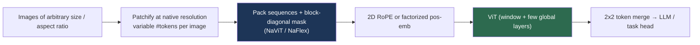

# Vision Transformers

> **Last Updated:** October 2026
> **Level:** Intermediate
> **Related Sections:**
> - [CNN Architectures](./00_cnn_architectures.md)
> - [Self-Supervised Learning](./03_self_supervised_learning.md)
> - [State Space Models](./05_state_space_models.md)
> - [Scaling Laws in Vision](../12_research_frontier_2024_2026/01_scaling_laws_vision.md)

> **🆕 October 2026 update:**
> - New section **The Modern ViT Recipe (2023–2026)**: registers (trained and test-time), 2D RoPE, SwiGLU, and simplified hierarchical ViTs (Hiera).
> - **Native-resolution ViTs**: NaViT patch packing, Qwen2-VL/2.5-VL/3-VL dynamic-resolution encoders, SigLIP 2 NaFlex and AIMv2's native-resolution variant.
> - **7B-scale vision encoders**: DINOv3 ViT-7B (Aug 2025), Web-DINO 7B, Perception Encoder G (intermediate-layer features), with a new reference architecture table.
> - Key Papers, Benchmark (AIMv2-3B 89.5% frozen trunk, PE-Core G 85.4% zero-shot, SigLIP 2 g 85.0% zero-shot), Open Problems and Further Reading updated.

---

## Overview

The Vision Transformer (ViT) [Dosovitskiy2021] demonstrated that the convolution is not a necessary inductive bias for state-of-the-art image recognition: a pure Transformer encoder applied to a sequence of image patches matches or exceeds CNNs *when pretrained at sufficient scale*. This was a conceptual rupture. CNNs hard-code locality and translation equivariance into every layer; ViT discards them, treating an image as an unordered set of 16×16 patch tokens and learning spatial structure from data and learned positional embeddings. The cost is sample efficiency—ViT underperforms CNNs when trained on ImageNet-1K alone—and the benefit is *scalability*: ViT's performance keeps climbing with data and parameters along a smoother curve than CNNs, the property that made it the substrate of foundation models (see [Scaling Laws in Vision](../12_research_frontier_2024_2026/01_scaling_laws_vision.md)).

The architectural story since 2020 has two threads. The first is **reintroducing inductive bias** for efficiency and small-data performance: DeiT recovered ImageNet-1K-only training via distillation; Swin reintroduced hierarchy and locality via shifted-window attention, making Transformers viable dense-prediction backbones. The second is **scale and self-supervision**: BEiT and EVA applied masked image modeling; ViT-22B pushed to 22 billion parameters with architectural modifications (parallel attention/MLP, QK-normalization) needed for stable training at that scale. This file traces both threads, grounds the attention mechanism mathematically, and delineates where ViTs win over CNNs and where the convolution still competes.

A third thread dominates 2023–2026: **the ViT as the universal encoder for foundation models and VLMs**. The architecture itself has changed little at the macro level, but the reference recipe now includes register tokens, 2D rotary position embeddings, SwiGLU feed-forward layers and, for VLM front-ends, **native-resolution** variable-length patch sequences. Openly released encoders reached the multi-billion-parameter scale in 2025 under three different supervision signals: self-distillation (DINOv3 ViT-7B), language-free web-scale SSL (Web-DINO 7B) and contrastive image-text training (Perception Encoder, SigLIP 2).

---

## The Core Mechanism

ViT splits a `H×W` image into `N = HW/P²` non-overlapping `P×P` patches (P=16 by default → 196 patches at 224×224), linearly projects each flattened patch to a `D`-dimensional token, prepends a learnable `[CLS]` token (whose final state is the classification feature, à la BERT), and adds **learned 1D positional embeddings** (an ablation in [Dosovitskiy2021] found 2D/relative encodings gave no meaningful gain). The token sequence passes through a standard Transformer encoder. The heart is scaled dot-product self-attention [Vaswani2017]:

```
Attention(Q, K, V) = softmax( Q Kᵀ / √d_k ) V
  Q = X W_Q,  K = X W_K,  V = X W_V    (per head)
  √d_k scaling keeps logits in the high-gradient region of softmax
```

Multi-head attention runs `h` such operations in parallel and concatenates. Crucially, self-attention is **global**—every token attends to every other—giving an O(1)-hop receptive field but O(N²) complexity in token count, the bottleneck that later variants attack.

```mermaid
graph LR
    A[Image 224x224] --> B[Patchify 16x16<br/>→ 196 tokens]
    B --> C[Linear projection → D=768]
    C --> D[+ [CLS] token<br/>+ learned pos embeddings]
    D --> E[Transformer encoder<br/>L× MHSA + MLP]
    E --> F[[CLS] state → MLP head]
    style E fill:#2d6a4f,color:#fff
```

ViT-B/16 uses 12 layers, D=768, 12 heads, ~86M params; ViT-L/16 has 24 layers, D=1024, 16 heads, ~307M; ViT-H/14 reaches ~632M.

---

## The Evolution

### Data Efficiency: DeiT

**DeiT** [Touvron2021] (ICML 2021) showed ViT-scale models *can* train competitively on ImageNet-1K alone (1.2M images) with aggressive augmentation (RandAugment, Mixup, CutMix) and a novel **distillation token**: a second learnable token trained via hard-label distillation from a CNN teacher (RegNet). DeiT-B reaches 81.8% top-1 (no distillation) and 85.2% with token distillation—erasing ViT's dependence on JFT-300M.

### Hierarchy & Locality: Swin

**Swin Transformer** [Liu2021] (ICCV 2021, Marr Prize) computes self-attention within local non-overlapping windows (e.g., 7×7), shifting windows by `⌊M/2⌋` in alternating layers to allow cross-window flow. This makes complexity **linear in image size** and produces a **hierarchical** multi-scale feature pyramid (4×/8×/16×/32×), making Swin a drop-in backbone for detection and segmentation where plain ViT's single scale is awkward. Swin-L reaches 87.3% at 384². **PVT** and **MViT** independently introduced pyramidal Transformers with spatial-reduction/pooling attention for dense prediction and video.

### Self-Supervision & Scale: BEiT, EVA, ViT-22B

**BEiT** [Bao2022] (ICLR 2022) adapted BERT's masked-token objective: mask ~40% of patches and predict their discrete visual tokens (from a dVAE), reaching 88.6% with 22k fine-tuning at 512². **EVA** [Fang2023] (CVPR 2023) scaled a vanilla ViT to ~1B parameters by reconstructing masked *CLIP features*, hitting 89.6% at 336². **ViT-22B** [Dehghani2023] (ICML 2023) scaled to 22 billion parameters using **parallel attention+MLP**, **QK-normalization** (LayerNorm on queries/keys to stabilize training), no biases, and multi-head attention pooling—achieving 89.5% linear-probe and large gains in robustness/fairness, though with clearly sublinear per-FLOP returns (see [Scaling Laws](../12_research_frontier_2024_2026/01_scaling_laws_vision.md)).

---

## The Modern ViT Recipe (2023–2026)

By 2025 the "plain" ViT used inside foundation models had quietly changed in several places. None of these changes alters the core attention mechanism, but together they define the reference backbone of the DINOv3 / SigLIP 2 / Perception Encoder generation.

### Registers and High-Norm Artifact Tokens

**Vision Transformers Need Registers** [Darcet2024] (ICLR 2024) found that large, well-trained ViTs (DINOv2, CLIP, DeiT-III) repurpose a few low-information background patch tokens as global "scratch" storage. These tokens have abnormally high norms and create artifacts in attention maps and dense features. Appending a handful of learnable **register tokens** (which are discarded at the output) gives the model dedicated storage, removes the artifacts, and improves dense prediction and object discovery. DINOv2 with registers reaches 87.1% ImageNet linear probe (ViT-g/14). **Test-time registers** [Jiang2025] (NeurIPS 2025 Spotlight) trace the artifacts to a sparse set of "register neurons" and shift their activations into an extra untrained token at inference, recovering most of the benefit **without retraining**. The same phenomenon appears in vision SSMs (Mamba®, CVPR 2025; see [State Space Models](./05_state_space_models.md)). DINOv3 uses 4 register ("storage") tokens by default.

### Positional Encoding: From Learned Absolute to 2D RoPE

Learned 1D absolute embeddings must be interpolated when resolution changes, which hurts extrapolation. **Rotary position embeddings (RoPE)**, extended to 2D by rotating query/key feature pairs with separate frequencies for the row and column coordinates (RoPE-ViT [Heo2024], ECCV 2024), make attention depend on *relative* offsets:

```
q'_(x,y) = R(θ_x · x) R(θ_y · y) q_(x,y)      # axial 2D rotation of feature pairs
<q'_(x1,y1), k'_(x2,y2)> depends only on (x1 − x2, y1 − y2)
```

2D/axial RoPE is now standard in large encoders: DINOv3 uses RoPE with normalized, rescaled patch coordinates, and Qwen2-VL introduced **M-RoPE** (multimodal RoPE that decomposes positions into temporal, height and width components), refined as **Interleaved-MRoPE** in Qwen3-VL.

### Other Block-Level Changes

- **SwiGLU feed-forward** layers (from LLMs) replace GELU MLPs in the largest encoders (e.g., DINOv3 ViT-7B; Qwen2.5-VL's ViT also uses SwiGLU and RMSNorm).
- **LayerScale** and **QK-normalization** (from CaiT and ViT-22B) stabilize training beyond ~1B parameters.
- **Patch size 16** with higher input resolution has largely replaced /14 in the newest encoders (DINOv3 uses /16; Qwen3-VL moved from patch 14 to 16).

### Simplified Hierarchy: Hiera

**Hiera** [Ryali2023] (ICML 2023 Oral) argues that the specialized modules of hierarchical ViTs (Swin, MViT) add latency, and instead *teaches* spatial bias through MAE pre-training, leaving a plain multi-stage Transformer with pooling. Hiera is reported to be faster than prior hierarchical ViTs at comparable accuracy and serves as the image encoder of SAM 2, making it the most widely deployed hierarchical ViT for promptable segmentation.

---

## Native-Resolution ViTs

Classical ViTs resize every image to a fixed square (e.g., 224² or 384²), which distorts aspect ratios and wastes or destroys detail. That is especially harmful for documents, charts, OCR and high-resolution VLM inputs. Native-resolution ViTs treat the patch sequence as **variable-length**:

- **NaViT** [Dehghani2023b] (NeurIPS 2023, "Patch n' Pack") packs patches from multiple images of arbitrary resolution and aspect ratio into one sequence, with attention masks that prevent cross-image attention and factorized positional embeddings. This improves training efficiency and lets one model be served at many resolutions.
- **Qwen2-VL** (2024) introduced *Naive Dynamic Resolution*: images are processed at native resolution into a variable number of tokens, merged 2×2 before the LLM, and combined with M-RoPE. **Qwen2.5-VL** (Jan 2025) re-engineered the ViT with **windowed attention in most layers** (only a few layers use full attention) so that cost grows roughly linearly with pixel count. **Qwen3-VL** (Sep–Oct 2025, tech report Nov 2025) uses patch 16 with 32× spatial compression to LLM tokens and adds **DeepStack**, which injects multi-level ViT features into the LLM rather than only the last layer.
- **SigLIP 2 NaFlex** [Tschannen2025] (Feb 2025) supports multiple sequence lengths at native aspect ratio within a single contrastive encoder (B/16 and So400m/16 checkpoints).
- **AIMv2** [Fini2025] (CVPR 2025) provides a native-resolution AIMv2-L variant fine-tuned to accept 112–4096 patches with 2D sinusoidal positional embeddings.



---

## Scaling Vision Encoders to Billions of Parameters (2025)

2025 saw three independently trained, openly released vision encoders at the 2–7B scale, each with a different supervision signal:

| Encoder | Supervision | Scale | Notable architectural detail |
|---|---|---|---|
| **DINOv3 ViT-7B/16** [Simeoni2025] (Meta, Aug 2025) | Self-distillation (DINO + iBOT) + **Gram anchoring** | 6.7B params; 40 layers, width 4096, 32 heads; LVD-1689M images | Patch 16, SwiGLU FFN, 4 register tokens, 2D RoPE; distilled into ViT-S/B/L/H+ and ConvNeXt students |
| **Web-DINO 7B** [Fan2025] (Meta/NYU, Apr 2025) | DINOv2-style SSL, no language | 0.3B→7B on MC-2B (2B web images) | Shows vision-only SSL keeps improving with scale and matches CLIP on VQA |
| **Perception Encoder G/14** [Bolya2025] (Meta, Apr 2025) | Contrastive vision-language | Largest "G" scale, patch 14, 448²; family from T/16 to G/14 | Best general features lie in **intermediate layers**; alignment tuning yields PE-Lang (for LLMs) and PE-Spatial (for dense tasks) |

The Perception Encoder finding is architecturally important: a contrastively trained ViT's *output* layer is specialized for the image-text objective, while intermediate layers carry stronger features for OCR, VQA, detection and depth. "Which layer to read" thus becomes a design choice alongside "which backbone", and it is the motivation behind multi-layer feature fusion in VLMs (e.g., Qwen3-VL DeepStack). DINOv3's **Gram anchoring** addresses a complementary failure: with very long training, global (classification) metrics keep improving while dense patch features degrade; regularizing the patch-similarity (Gram) matrix toward an earlier checkpoint fixes this (see [Self-Supervised Learning](./03_self_supervised_learning.md)).

---

## Key Papers

| Paper | Authors | Year | Venue | Key Contribution |
|-------|---------|------|-------|-----------------|
| An Image is Worth 16×16 Words (ViT) | Dosovitskiy, Beyer, Kolesnikov, et al. | 2021 | ICLR | Pure Transformer for image recognition at scale |
| Training data-efficient image transformers (DeiT) | Touvron, Cord, Douze, et al. | 2021 | ICML | Distillation token; ImageNet-1K-only training |
| Swin Transformer | Liu, Lin, Cao, Hu, et al. | 2021 | ICCV (Marr Prize) | Shifted-window attention; hierarchical backbone |
| BEiT | Bao, Dong, Piao, Wei | 2022 | ICLR | Masked image modeling with discrete visual tokens |
| ViT-22B | Dehghani, Djolonga, Mustafa, et al. | 2023 | ICML | 22B-param ViT; parallel attn+MLP, QK-norm |
| EVA | Fang, Wang, Xie, et al. | 2023 | CVPR | 1B-param ViT via masked CLIP-feature reconstruction |
| Patch n' Pack (NaViT) | Dehghani, Mustafa, Djolonga, et al. | 2023 | NeurIPS | Sequence packing for any resolution/aspect ratio |
| Hiera | Ryali, Hu, Bolya, et al. | 2023 | ICML (Oral) | Hierarchical ViT without bells-and-whistles; MAE teaches spatial bias |
| Vision Transformers Need Registers | Darcet, Oquab, Mairal, Bojanowski | 2024 | ICLR | Register tokens remove high-norm artifact tokens |
| Rotary Position Embedding for ViT (RoPE-ViT) | Heo, Park, Han, Yun | 2024 | ECCV | 2D RoPE for resolution extrapolation |
| SigLIP 2 | Tschannen, Gritsenko, Wang, et al. | 2025 | arXiv | Multilingual sigmoid encoder + NaFlex native-resolution variant |
| Perception Encoder | Bolya, Huang, Sun, et al. | 2025 | arXiv | Best features in intermediate layers; PE-Core/Lang/Spatial |
| Vision Transformers Don't Need *Trained* Registers | Jiang, Dravid, Efros, Gandelsman | 2025 | NeurIPS (Spotlight) | Training-free test-time registers via register neurons |
| DINOv3 | Siméoni, Vo, Seitzer, et al. | 2025 | arXiv | 7B SSL ViT with Gram anchoring; RoPE + registers |

---

## Benchmark Performance

| Model | Pretraining | Resolution | ImageNet top-1 | Notes |
|-------|-------------|-----------|----------------|-------|
| ViT-H/14 | JFT-300M | 224 | 88.55% | Largest ViT in original paper |
| DeiT-B (distil.) | IN-1K | 224 | 85.2% | No external data |
| Swin-L | IN-22K→1K | 384 | 87.3% | Hierarchical backbone |
| BEiT-L | self-sup + 22K FT | 512 | 88.6% | Masked image modeling |
| EVA | masked CLIP feat. | 336 | 89.6% | ~1B params |
| ViT-22B | JFT | 224 | 89.5% (linear probe) | Frozen features |
| DINOv2 ViT-g/14 + registers | LVD-142M (SSL) | 224 | 87.1% (linear probe) | Registers variant [Darcet2024] |
| AIMv2-3B | Multimodal autoregressive | 448 | 89.5% (frozen trunk) | [Fini2025], CVPR 2025 |
| AIMv2-L native-res. | Multimodal autoregressive | 112–4096 patches | 87.3% (frozen trunk) | Variable resolution/aspect ratio |
| PE-Core G/14 | Contrastive image-text | 448 | 85.4% (zero-shot) | [Bolya2025] |
| SigLIP 2 g-opt/16 | Sigmoid image-text + decoder/SSL losses | 384 | 85.0% (zero-shot) | [Tschannen2025] |
| SigLIP 2 So400m/16 NaFlex | Same, native aspect ratio | seq. len. 256 | 83.5% (zero-shot) | NaFlex variant |

---

## Pros & Cons

| Aspect | Pros | Cons |
|--------|------|------|
| Global attention | O(1)-hop receptive field; long-range context | O(N²) cost; poor high-res scaling without windowing |
| Scalability | Smooth gains with data/params; foundation-model substrate | Data-hungry; weak on small datasets from scratch |
| Hierarchy (Swin/PVT) | Multi-scale; dense-prediction-ready; linear cost | More engineered; loses ViT's simplicity |
| Self-supervision (BEiT/EVA) | Leverages unlabeled data; strong transfer | Heavy compute; tokenizer/teacher dependence |
| Native resolution (NaViT/NaFlex/Qwen-VL) | No aspect-ratio distortion; strong OCR/document input; flexible compute | Variable-length batching and masking complicate kernels and serving |
| Registers + RoPE (modern recipe) | Clean dense features; better resolution extrapolation | Extra tokens; RoPE frequency/scaling choices add hyperparameters |

---

## Open Problems & Research Gaps

- **Quadratic attention at high resolution.** Window/linear-attention and state-space models (see [State Space Models](./05_state_space_models.md)) mitigate but don't fully resolve the cost.
- **Small-data training.** ViTs still trail CNNs/hybrids without large-scale pretraining (see [Hybrid Architectures](./02_hybrid_architectures.md)).
- **Positional encoding for variable resolution.** 2D RoPE and native-resolution packing (NaViT, NaFlex, Qwen-VL) have largely replaced fixed-grid learned embeddings, but robust extrapolation far beyond training resolutions/aspect ratios, and the right RoPE frequency allocation across axes (cf. Interleaved-MRoPE), remain imperfect.
- **Artifact tokens and dense-feature degradation.** Registers (trained or test-time) and DINOv3's Gram anchoring treat symptoms of how large ViTs allocate global information to patch tokens; a mechanistic account of why this happens at scale is missing.
- **Which layer to read out.** Perception Encoder shows that the best general-purpose features of contrastive ViTs lie in intermediate layers; principled multi-layer readout for VLMs and dense heads (DeepStack-style fusion vs. alignment tuning) is unsettled.
- **Interpretability.** Attention maps are not faithful explanations; mechanistic understanding of ViT features is immature.
- **Compute-optimal scaling.** No agreed vision Chinchilla law; exponents differ from language.
- **Inductive-bias balance.** The optimal amount of convolutional prior to inject is unresolved—ConvNeXt shows CNNs can match ViTs, blurring the dichotomy.

---

## Further Reading

- [ViT (arXiv:2010.11929)](https://arxiv.org/abs/2010.11929) — the original Vision Transformer
- [DeiT (arXiv:2012.12877)](https://arxiv.org/abs/2012.12877) — data-efficient training & distillation
- [Swin Transformer (arXiv:2103.14030)](https://arxiv.org/abs/2103.14030) — shifted-window hierarchical attention
- [ViT-22B (arXiv:2302.05442)](https://arxiv.org/abs/2302.05442) — scaling to 22 billion parameters
- [EVA (arXiv:2211.07636)](https://arxiv.org/abs/2211.07636) — billion-scale masked visual representation learning
- [Vision Transformers Need Registers (arXiv:2309.16588)](https://arxiv.org/abs/2309.16588) — register tokens and artifact removal
- [Test-time registers (arXiv:2506.08010)](https://github.com/nickjiang2378/test-time-registers) — training-free registers, NeurIPS 2025
- [NaViT / Patch n' Pack (arXiv:2307.06304)](https://arxiv.org/abs/2307.06304) — any-resolution ViT via sequence packing
- [Hiera (arXiv:2306.00989)](https://github.com/facebookresearch/hiera) — hierarchical ViT without bells-and-whistles
- [SigLIP 2 (arXiv:2502.14786)](https://github.com/google-research/big_vision/blob/main/big_vision/configs/proj/image_text/README_siglip2.md) — NaFlex and multilingual encoders
- [Perception Encoder (arXiv:2504.13181)](https://github.com/facebookresearch/perception_models) — intermediate-layer features, PE-Core/Lang/Spatial
- [DINOv3 (arXiv:2508.10104)](https://github.com/facebookresearch/dinov3) — 7B ViT, Gram anchoring, distilled family
- [Qwen3-VL (arXiv:2511.21631)](https://github.com/QwenLM/Qwen3-VL) — native-resolution VLM encoder with DeepStack and Interleaved-MRoPE
