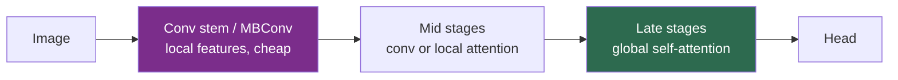

# Hybrid CNN-Transformer Architectures

> **Last Updated:** October 2026
> **Level:** Intermediate
> **Related Sections:**
> - [Vision Transformers](./01_vision_transformers.md)
> - [CNN Architectures](./00_cnn_architectures.md)
> - [State Space Models](./05_state_space_models.md)
> - [Efficient Architectures](../09_efficiency_and_deployment/01_efficient_architectures.md)

> **🆕 October 2026 update:**
> - New section **Hybrids in the Foundation-Model Era (2023–2026)**: hybrid encoders for VLMs (FastViT → FastViTHD in FastVLM, CVPR 2025), the hierarchical Hiera, and conv + Mamba + attention backbones (MambaVision, CVPR 2025).
> - **Agglomerative hybrids**: AM-RADIO → C-RADIOv3 (Jun 2025) → C-RADIOv4 (Jan 2026), which distill SigLIP 2, DINOv3 and SAM 3 into one student. C-RADIOv4-H is the vision encoder of NVIDIA's Nemotron 3 Nano Omni.
> - Key Papers, Benchmark (MambaVision up to 88.1% with IN-21K) and Open Problems updated.

---

## Overview

Hybrid CNN-Transformer architectures occupy the pragmatic middle ground in the post-2021 backbone landscape: they fuse the **local inductive bias and hardware efficiency of convolutions** with the **global receptive field of self-attention**. The motivation is empirical. Pure ViTs lack locality and translation equivariance and therefore underperform CNNs when trained on small or medium datasets and at high resolution; pure CNNs aggregate long-range context only slowly through stacked layers. Hybrids resolve this tension by using convolution where it helps most—early layers, where low-level features are local and abundant—and attention where it helps most—later layers, where global semantic context matters. The result is a family of models (CvT, CoAtNet, LeViT, MobileViT, MaxViT) that consistently match or beat both pure paradigms at a given compute budget, especially on small data.

The deepest lesson of this line is the **convergence of CNN and Transformer design**. ConvNeXt [Liu2022] is a *pure CNN* derived by progressively modernizing a ResNet with Transformer-inspired choices (patchify stem, depthwise 7×7 kernels, inverted bottleneck, GELU, LayerNorm, Swin-matched stage ratios) until it matches Swin's accuracy—demonstrating that much of the Transformer's advantage was the *training recipe and macro design*, not attention per se. This file surveys the principal hybrids, the mechanisms by which they combine the two operators, and the small-data and efficiency regimes where they dominate. It also covers how the hybrid idea evolved in 2023–2026: hybrid high-resolution encoders that cut VLM latency (FastViTHD), backbones that mix convolution, Mamba and attention (MambaVision), and "agglomerative" students such as C-RADIOv4 that fuse several foundation models (SigLIP 2, DINOv3, SAM 3) into one network.

---

## Mechanisms of Combination

Hybrids differ in *how* and *where* they inject convolution:

- **Convolutional tokenization/stem** — replace ViT's linear patch projection with overlapping convolutions (CvT, LeViT's 4-conv stem) for richer low-level features and implicit positional information.
- **Convolution in the projection** — depthwise-separable conv for Q/K/V projections (CvT's convolutional projection), eliminating explicit positional encodings.
- **Staged conv→attention** — convolution (MBConv) in early stages, attention in late stages (CoAtNet: S0 conv stem, S1–S2 MBConv, S3–S4 Transformer).
- **Attention-as-convolution** — fold global attention inside a conv-style block (MobileViT unfolds patches, applies attention across corresponding positions, folds back).
- **Multi-axis attention** — combine blocked local + dilated grid attention for linear-complexity global reach (MaxViT).

---

## Principal Architectures

### CvT — Convolutional Vision Transformer
**CvT** [Wu2021] (ICCV 2021, Microsoft) introduces **convolutional token embedding** (overlapping convs across a 3-stage hierarchy) and **convolutional projection** (depthwise-separable conv for Q/K/V), and *eliminates positional encodings* because convolution encodes position implicitly. CvT-13 (20M) reaches 81.6%; CvT-W24 (277M, IN-22K) reaches 87.7%.

### CoAtNet — Convolution + Attention
**CoAtNet** [Dai2021] (NeurIPS 2021, Google) unifies depthwise convolution and self-attention via **relative attention**, stacking MBConv early and Transformer late. CoAtNet-2 reaches 84.1% (IN-1K) / 87.1% (IN-21K); the largest variant reaches 88.56% with IN-21K and 90.88% with JFT-3B pretraining—among the highest reported. It explicitly frames the convolution-for-generalization / attention-for-capacity trade-off.

### LeViT — ViT in ConvNet's Clothing
**LeViT** [Graham2021] (ICCV 2021, Meta) targets **inference speed**: a 4-layer conv stem, attention-based downsampling, learned per-head **attention bias** replacing positional embeddings, and shrinking head counts. LeViT-128S matches DeiT-Tiny's 76.6% with ~4× fewer FLOPs.

### MobileViT — Mobile-Friendly Hybrid
**MobileViT** [Mehta2022] (ICLR 2022, Apple) treats the Transformer as a convolution: it unfolds non-overlapping patches, applies global attention across corresponding inter-patch positions, then folds back, interleaved with MBConv blocks. MobileViT-S (5.6M) reaches 78.4%, beating MobileNetV3-Large (~75.2%) at similar size and DeiT-S (79.8%) with ~4× fewer parameters.

### MaxViT — Multi-Axis Vision Transformer
**MaxViT** [Tu2022] (ECCV 2022, Google + UT Austin) alternates **blocked local attention** (within P×P windows) and **dilated grid attention** (over a sparse global grid), both linear-complexity, preceded by MBConv. MaxViT-Base reaches 85.0% (224²) / 86.7% (512²); MaxViT-XLarge reaches 88.7% with IN-21K.

### ConvNeXt — The CNN that Converged
**ConvNeXt** [Liu2022] (CVPR 2022) is a pure CNN modernized with Transformer design choices; ConvNeXt-XL reaches 87.8% (IN-22K, 384²) and runs ~35% faster than Swin-B at comparable accuracy—evidence that the architecture dichotomy is largely a recipe dichotomy.

---

## Hybrids in the Foundation-Model Era (2023–2026)

After 2022 the "conv early, attention late" template migrated from ImageNet classifiers into three new roles: latency-critical **VLM vision encoders**, **three-operator backbones** that mix convolution, state-space layers and attention, and **agglomerative students** that distill several foundation models into one network.

### Hybrid Encoders for VLMs: FastViT → FastViTHD
**FastViT** [Vasu2023] (ICCV 2023, Apple) combines a structurally re-parameterized convolutional token mixer (RepMixer) in early stages with attention in late stages for mobile latency. **FastVLM** [Vasu2025] (CVPR 2025) scales this into **FastViTHD**, a hybrid encoder designed to emit *fewer tokens* at high resolution, so VLM time-to-first-token (TTFT) is no longer dominated by the vision encoder. The authors report that the 0.5B FastVLM outperforms LLaVA-OneVision-0.5B with 85× faster TTFT and a 3.4× smaller vision encoder. The underlying lesson is that convolutional downsampling stages are the cheapest way to cut visual token counts *before* the quadratic layers of both the encoder and the LLM.

### Hierarchical ViT with Learned Bias: Hiera
**Hiera** [Ryali2023] (ICML 2023 Oral) is a counterpoint to hand-engineered hybrids. Rather than adding convolutions or specialized modules, it strips MViT-style hierarchy down to plain attention + pooling and relies on MAE pre-training to *teach* the spatial biases that convolutions would otherwise hard-code. It is the image encoder of SAM 2 (see [Vision Transformers](./01_vision_transformers.md)).

### Conv + Mamba + Attention: MambaVision
**MambaVision** [Hatamizadeh2025] (CVPR 2025, NVIDIA) is a hierarchical hybrid: convolutional residual stages at high resolution, then stages that combine a redesigned Mamba mixer (with an added non-SSM symmetric branch for global context) and **self-attention blocks placed in the final layers** of the low-resolution stages. It defines a new top-1/throughput Pareto front on ImageNet: MambaVision-B reaches 84.2% at 3,670 img/s, and the IN-21K-pretrained MambaVision-L3 reaches **88.1% at 512²**. It also transfers to COCO (Cascade Mask R-CNN, 52.8 box AP for B) and ADE20K (up to 53.2 mIoU). See [State Space Models](./05_state_space_models.md) for the SSM side of this design.

### Agglomerative Hybrids: RADIO
**AM-RADIO** [Ranzinger2024] (CVPR 2024, NVIDIA) distills multiple heterogeneous teachers (CLIP variants, DINOv2, SAM) into one student with teacher-specific adaptor heads, reporting gains over its teachers on zero-shot, k-NN and segmentation probes. The line has continued:

| Release | Date | Teachers / adaptors | Notes |
|---|---|---|---|
| RADIOv2.5 | 2024 (CVPR 2025) | CLIP, SigLIP, DINOv2, SAM | PHI-S distribution balancing; B/L/H/g |
| C-RADIOv3 | Jun 2025 | SigLIP2-g, DINOv2, SAM, CLIP | Commercial license; FeatSharp (ICML 2025) upsampling |
| C-RADIOv4 | Jan 2026 | SigLIP2-g-384, **DINOv3-7B**, **SAM 3** | SO400M and H variants; strongest RADIO to date |

Agglomerative models are "hybrid" in the *supervision* sense: one backbone combines the language-aligned semantics of SigLIP, the dense geometry of DINO and the boundary precision of SAM. They are increasingly used as VLM front-ends. NVIDIA's Nemotron 3 Nano Omni uses **C-RADIOv4-H** as its vision encoder in front of a hybrid Mamba-Transformer LLM, and Nemotron 3.5 Super uses a C-RADIO encoder (see [Multimodal Architectures](./04_multimodal_architectures.md)).

### Convergence, Revisited
The ConvNeXt lesson ("the recipe matters more than the operator") was reinforced in 2025 from the other direction. **DINOv3** distills a 7B ViT into ConvNeXt students, and **MambaOut** shows that a Gated-CNN block without any SSM beats visual Mamba models on ImageNet (see [CNN Architectures](./00_cnn_architectures.md)). In 2026 practice the choice of operator is mostly driven by deployment constraints such as token count, latency and memory. The representation quality comes from the teacher and the data.

---

## Key Papers

| Paper | Authors | Year | Venue | Key Contribution |
|-------|---------|------|-------|-----------------|
| CvT | Wu, Xiao, Codella, et al. | 2021 | ICCV | Convolutional token embedding & projection; no pos-enc |
| CoAtNet | Dai, Liu, Le, Tan | 2021 | NeurIPS | Unify MBConv + relative attention; staged stacking |
| LeViT | Graham, El-Nouby, Touvron, et al. | 2021 | ICCV | Fast inference; conv stem + attention bias |
| MobileViT | Mehta, Rastegari | 2022 | ICLR | Attention-as-convolution for mobile |
| MaxViT | Tu, Talebi, Zhang, et al. | 2022 | ECCV | Multi-axis (block + grid) linear-complexity attention |
| ConvNeXt | Liu, Mao, Wu, Feichtenhofer, et al. | 2022 | CVPR | Pure CNN matching Swin via modernized design |
| FastViT | Vasu, Gabriel, Zhu, Tuzel, Ranjan | 2023 | ICCV | Re-parameterized conv mixer + late attention for mobile latency |
| Hiera | Ryali, Hu, Bolya, et al. | 2023 | ICML (Oral) | Simple hierarchical ViT; MAE teaches spatial bias |
| AM-RADIO | Ranzinger, Heinrich, Kautz, Molchanov | 2024 | CVPR | Multi-teacher agglomerative distillation into one backbone |
| FastVLM (FastViTHD) | Vasu, Faghri, Li, et al. | 2025 | CVPR | Hybrid high-res VLM encoder emitting fewer tokens |
| MambaVision | Hatamizadeh, Kautz | 2025 | CVPR | Conv stages + Mamba mixer + final-layer self-attention |

---

## Benchmark Performance

| Model | Params | FLOPs | ImageNet top-1 | Notes |
|-------|--------|-------|----------------|-------|
| CvT-13 | 20M | 4.5G | 81.6% | IN-1K, 224² |
| CoAtNet-2 | 75M | 15.7G | 84.1% / 87.1% | IN-1K / IN-21K |
| LeViT-128S | 7.8M | 0.3G | 76.6% | ~4× fewer FLOPs vs DeiT-Ti |
| MobileViT-S | 5.6M | 1.1G | 78.4% | Beats MobileNetV3-L |
| MaxViT-Base | 119M | 24.2G | 85.0% / 86.7% | 224² / 512² |
| ConvNeXt-XL | 350M | 60.9G | 87.8% | IN-22K, 384² |
| MambaVision-T | 31.8M | 4.4G | 82.3% | IN-1K, 224²; 6,298 img/s |
| MambaVision-B | 97.7M | 15.0G | 84.2% | IN-1K, 224²; 3,670 img/s |
| MambaVision-L3-512-21K | 739.6M | 489.1G | 88.1% | IN-21K, 512² |

---

## Pros & Cons

| Aspect | Pros | Cons |
|--------|------|------|
| Conv inductive bias | Strong small-data performance; sample-efficient | Adds architectural complexity vs plain ViT |
| Global attention (late) | Long-range context where it matters | Still costly at high resolution without windowing |
| Hardware efficiency | Conv ops highly optimized; MaxViT/LeViT linear cost | FLOPs ≠ latency; gains hardware-dependent |
| Design convergence (ConvNeXt) | CNN simplicity + ViT accuracy | Shows attention may be unnecessary—muddies "hybrid" rationale |
| Hybrid VLM encoders (FastViTHD) | Fewer visual tokens at high resolution; much lower TTFT | Less community tooling than plain ViT/SigLIP encoders |
| Agglomerative students (RADIO) | One backbone with CLIP-, DINO- and SAM-like features | Inherits teacher licenses/biases; balancing teachers is delicate |

---

## Open Problems & Research Gaps

- **Optimal conv/attention ratio.** No principled rule for how much convolution to inject at which depth; current designs are empirical.
- **Small-data theory.** The sample-efficiency advantage of conv bias is documented empirically but lacks predictive theory.
- **Latency vs. FLOPs.** Reported FLOP savings often don't translate to wall-clock speedups across diverse hardware (see [Efficient Architectures](../09_efficiency_and_deployment/01_efficient_architectures.md)).
- **Scaling behavior.** Whether hybrids retain their edge at foundation-model scale, or converge to plain ViT/ConvNeXt, is unsettled. The largest 2025 encoders (DINOv3, PE, SigLIP 2) are plain ViTs, while hybrids win mainly on latency (FastViTHD) or as distilled students (RADIO).
- **Unification with state-space models.** MambaVision shows a three-operator (conv + SSM + attention) hierarchy can set a Pareto front, but MambaOut shows the SSM may be dispensable for classification. Which component is actually responsible for the gains on high-resolution dense tasks is open (see [State Space Models](./05_state_space_models.md)).
- **Multi-teacher distillation.** How to weight and reconcile teachers with conflicting feature geometry (SigLIP vs. DINO vs. SAM) without washing out each one's strengths, and how far a student can surpass its teachers, lacks theory.
- **Dense-prediction transfer.** Best practices for adapting hybrids to detection/segmentation backbones are less mature than for Swin.

---

## Further Reading

- [CoAtNet (arXiv:2106.04803)](https://arxiv.org/abs/2106.04803) — marrying convolution and attention
- [MaxViT (arXiv:2204.01697)](https://arxiv.org/abs/2204.01697) — multi-axis linear-complexity attention
- [MobileViT (arXiv:2110.02178)](https://arxiv.org/abs/2110.02178) — mobile-friendly hybrid
- [ConvNeXt (arXiv:2201.03545)](https://arxiv.org/abs/2201.03545) — a ConvNet for the 2020s
- [CvT (arXiv:2103.15808)](https://arxiv.org/abs/2103.15808) — convolutions in vision transformers
- [MambaVision (arXiv:2407.08083)](https://github.com/NVlabs/MambaVision) — hybrid Mamba-Transformer backbone, CVPR 2025
- [FastVLM / FastViTHD (arXiv:2412.13303)](https://github.com/apple/ml-fastvlm) — efficient hybrid vision encoding for VLMs
- [Hiera (arXiv:2306.00989)](https://github.com/facebookresearch/hiera) — hierarchical ViT without bells-and-whistles
- [RADIO family (AM-RADIO, RADIOv2.5, C-RADIOv3/v4)](https://github.com/NVlabs/RADIO) — agglomerative vision foundation models
