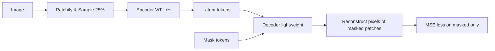
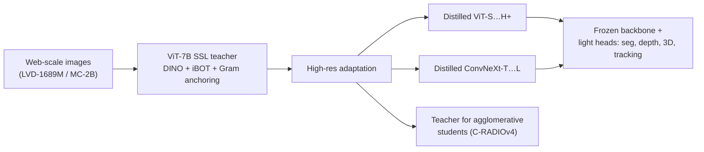

# Self-Supervised Learning for Visual Representations

> **Last Updated:** October 2026
> **Level:** Advanced
> **Related Sections:**
> - [Vision Transformers](./01_vision_transformers.md)
> - [Multimodal Architectures](./04_multimodal_architectures.md)
> - [World Models](../06_robotics_and_embodied_ai/02_world_models.md)
> - [Large Vision-Language Models](../05_multimodal_vision_language/02_large_vision_language_models.md)

> **🆕 October 2026 update:**
> - **DINOv3** (Meta, Aug 2025): 7B ViT trained on LVD-1689M with **Gram anchoring**, distilled into a ViT/ConvNeXt family, plus satellite (SAT-493M) models and 2026 follow-ups (CHMv2, metadata-guided adaptation).
> - **Scaling language-free SSL**: Web-SSL / Web-DINO (0.3B→7B on 2B web images) matches CLIP-style encoders on VQA, including OCR and charts with text-rich data.
> - New section **SSL at Scale and Beyond (2025–2026)**: Franca (fully open data), LeJEPA (heuristic-free SIGReg), V-JEPA 2 (Jun 2025) and V-JEPA 2.1 (Mar 2026), and generative AIMv2 as a competing pre-training route.
> - Key Papers, Benchmark, the contrastive-vs-MIM debate and Open Problems updated.

---

## Overview

Self-supervised learning (SSL) has emerged as the dominant paradigm for pre-training visual representations at scale, circumventing the need for expensive human annotation. The core intuition is to define a *pretext task* whose supervision signal derives purely from the data itself, compelling the network to learn semantically meaningful features as a byproduct. Unlike fully supervised approaches, SSL representations generalize across a broader distribution of downstream tasks, and models trained at sufficient scale often rival or surpass supervised baselines on linear probing, fine-tuning, and transfer benchmarks.

The field has bifurcated into two broad families. **Contrastive methods** explicitly push representations of augmented views of the same image together in embedding space while repelling representations of different images. The InfoNCE objective formalises this with a noise-contrastive estimation framework. Contrastive methods require careful handling of negatives—either through large batch sizes (SimCLR), memory banks / momentum encoders (MoCo), or cluster assignments (SwAV). **Non-contrastive methods** (BYOL, SimSiam, Barlow Twins, VICReg) eliminate negative pairs entirely, relying instead on architectural asymmetries, exponential moving average (EMA) teachers, or covariance regularisation to prevent representational collapse. A third family, **masked image modeling (MIM)**, takes inspiration from BERT and learns by reconstructing masked patches, decoupling the pretext task from augmentation-driven consistency.

The emergence of **self-distillation** methods (DINO, DINOv2) blurs the boundary: they combine knowledge-distillation from a momentum teacher with a self-supervised contrastive-style objective, producing representations with remarkable emergent properties such as object-aware attention maps. More recently, **joint-embedding predictive architectures** (I-JEPA) predict abstract latent representations of masked regions rather than raw pixels, avoiding the tendency of pixel-space MIM models to focus on low-level texture. The ongoing debate between contrastive methods and MIM centres on the observation that MIM representations require fine-tuning to unlock their quality (poor linear probing), whereas contrastive and self-distillation features separate classes linearly but may underfit holistic scene understanding required for dense prediction tasks.

In 2025–2026 the frontier became a question of **scale**. DINOv3 trains a 7B-parameter ViT on ~1.7B curated images and uses *Gram anchoring* to keep dense features from degrading. Web-SSL shows that language-free SSL scaled to 7B parameters and 2B web images matches CLIP-style encoders inside VLMs. V-JEPA 2/2.1 carry latent prediction to internet-scale video and robot planning. In parallel, LeJEPA revisits the theory and removes the collapse-prevention heuristics altogether, and Franca shows that competitive SSL is possible with fully open data.

---

## Contrastive Methods

### InfoNCE Loss

The InfoNCE (Noise-Contrastive Estimation) loss is the mathematical backbone of most contrastive SSL methods. Given a query embedding $q$ and a set of keys $\{k_0, k_1, \ldots, k_K\}$ where $k_0$ is the positive (same-image) key:

```latex
L_{\text{InfoNCE}} = -\log \frac{\exp(q \cdot k_0 / \tau)}{\sum_{i=0}^{K} \exp(q \cdot k_i / \tau)}
```

Here $\tau$ is a temperature hyperparameter. The loss is equivalent to maximising a lower bound on the mutual information between the two views [Oord2018]. The number of negatives $K$ critically determines the quality of the gradient signal.

### MoCo (Momentum Contrast)

[He2020] MoCo decouples the dictionary size from the batch size via a **momentum encoder** and a **FIFO queue**. The momentum encoder parameters $\theta_k$ are updated as an exponential moving average of the query encoder $\theta_q$:

```latex
\theta_k \leftarrow m \cdot \theta_k + (1 - m) \cdot \theta_q, \quad m \approx 0.999
```

MoCo v2 added projection heads and stronger augmentations; MoCo v3 adapted the framework to Vision Transformers with patch-based inputs, achieving 76.5% linear probing on ImageNet with ViT-B/16 [Chen2021MoCov3].

### SimCLR

[Chen2020] SimCLR uses a large batch (up to 8192) without a memory bank. A nonlinear projection head $g(\cdot)$ maps representations to a contrastive loss space:

```latex
L_{i,j} = -\log \frac{\exp(\text{sim}(z_i, z_j)/\tau)}{\sum_{k=1}^{2N} \mathbf{1}_{[k \neq i]} \exp(\text{sim}(z_i, z_k)/\tau)}
```

SimCLR established that (1) projection heads matter, (2) augmentation diversity is critical (random crop + color jitter + Gaussian blur), and (3) larger batches yield better representations.

### SwAV

[Caron2020] SwAV introduces **online clustering** via Sinkhorn-Knopp assignment, mapping views to a set of prototypes and enforcing consistency across views in the code space rather than the embedding space. This enables multi-crop training (many small crops in addition to two global views), reaching 75.3% ImageNet top-1 with ResNet-50 under linear probing.

---

## Non-Contrastive Methods

Non-contrastive methods avoid explicit negative pairs, which simplifies training but requires mechanisms to prevent **mode collapse** (all outputs mapping to the same vector).

### BYOL

[Grill2020] BYOL (Bootstrap Your Own Latent) uses **two asymmetric networks**: an online network $f_\theta$ with a predictor head, and a target network $f_\xi$ updated by EMA. The online network is trained to predict the target network's representation of a differently-augmented view:

```latex
L_{\text{BYOL}} = \|q_\theta(z_\theta) - \text{sg}(z'_\xi)\|_2^2
```

where $\text{sg}(\cdot)$ is stop-gradient. BYOL with ResNet-50 achieves 74.3% top-1; scaled to ResNet-200×2 it reaches 79.6%. The momentum target is the key collapse-prevention mechanism.

### SimSiam

[Chen2021SimSiam] SimSiam removes the EMA teacher, using a stop-gradient on one branch. The analysis shows it implicitly performs EM: the predictor finds the mean of the target distribution, preventing collapse without momentum. Achieves 71.3% top-1 on ImageNet with ResNet-50.

### Barlow Twins

[Zbontar2021] Barlow Twins encourages the cross-correlation matrix between representations of two augmented views to be close to the identity:

```latex
L_{\text{BT}} = \sum_i (1 - C_{ii})^2 + \lambda \sum_i \sum_{j \neq i} C_{ij}^2
```

This decorrelation objective naturally avoids collapse. Achieves 73.2% top-1, comparable to VICReg.

### VICReg

[Bardes2022] VICReg separates the objective into three terms: variance regularisation (maintains per-dimension std > threshold), invariance (minimises MSE between augmented views), and covariance (off-diagonal covariance terms to zero). Explicit and interpretable; also achieves 73.2% top-1 with ResNet-50. Published at ICLR 2022.

---

## Self-Distillation Methods

### DINO

[Caron2021] DINO (Self-DIstillation with NO labels) applies knowledge distillation where both teacher and student are the same architecture but the teacher's weights are an EMA of the student. A centering operation on teacher logits and sharpening on student logits prevent collapse. **Emergent property**: ViT self-attention heads trained with DINO spontaneously segment foreground objects without any segmentation supervision. Achieves 80.1% top-1 with ViT-S/8 under k-NN evaluation.

### DINOv2

[Oquab2023] DINOv2 scales DINO with (1) a curated 142M image dataset (LVD-142M) filtered by a clustering-based pipeline, (2) ViT-g/14 backbone, and (3) mixed DINO + iBOT objectives. Achieves **86.5% top-1** on ImageNet-1k under linear probing—surpassing weakly supervised methods. Features transfer with minimal adaptation across depth estimation, semantic segmentation, and instance retrieval. A later variant trained with **register tokens** (see [Vision Transformers](./01_vision_transformers.md)) removes high-norm artifact tokens and reaches 87.1% linear probe with ViT-g/14.

### DINOv3

[Simeoni2025] DINOv3 (Meta FAIR, August 2025) scales the DINOv2 recipe from a 1.1B-parameter ViT-g on 142M images to a ~6× larger model on ~12× more data. It trains a **ViT-7B/16** (6.7B params; 40 layers, width 4096, SwiGLU FFN, 4 register tokens, 2D RoPE) on **LVD-1689M**, a curated set of ~1.7B web images. The key obstacle at this scale is that **dense features degrade during long training**: global metrics such as ImageNet linear accuracy keep rising while patch-level features become noisy and lose locality. DINOv3 introduces **Gram anchoring**, which regularizes the student's patch-similarity structure toward that of an earlier "Gram teacher" checkpoint whose dense features were still clean:

```latex
L_{\text{Gram}} = \left\| X_S X_S^{\top} - X_G X_G^{\top} \right\|_F^2
```

Here $X_S, X_G \in \mathbb{R}^{P \times d}$ are the L2-normalized patch features of the student and the Gram teacher. Only the *second-order* structure (which patches are similar to which) is constrained, so global features remain free to improve. A short high-resolution adaptation phase follows, and the 7B teacher is then **distilled** into ViT-S/S+/B/L/H+ (21M–840M) and ConvNeXt-T/S/B/L students. The headline claim is that a **frozen** DINOv3 backbone with lightweight heads matches or exceeds specialized and weakly supervised encoders (DINOv2, SigLIP 2, Perception Encoder) on dense tasks such as segmentation, depth, 3D correspondence and video tracking. A separate ViT-7B and ViT-L are trained on **SAT-493M** satellite imagery. Follow-ups in the official repository include Canopy Height Maps v2 (Mar 2026) and metadata-guided adaptation recipes ("Who Needs Labels?", Jun 2026). DINOv3 backbones also serve as teachers for agglomerative models such as C-RADIOv4 (see [Hybrid Architectures](./02_hybrid_architectures.md)).

---

## Masked Image Modeling

### BEiT

[Bao2022] BEiT (Bidirectional Encoder Representations from Image Transformers) tokenises images via a discrete VAE (dVAE) and trains a ViT to predict the visual tokens of masked patches—directly analogous to BERT. Achieves 56.7% linear probing accuracy on ImageNet (requiring fine-tuning to shine).

### MAE

[He2022] Masked Autoencoders use an **asymmetric encoder-decoder**: a heavy ViT encoder processes only visible patches (typically 25% of tokens), and a lightweight decoder reconstructs raw pixel values of masked patches. The asymmetry makes training efficient despite a high masking ratio (75%). Achieves 68.0% linear probing / **87.8% fine-tuning** with ViT-H. MAE fundamentally challenges the belief that pixel-level targets are uninformative.



### I-JEPA

[Assran2023] I-JEPA (Image Joint-Embedding Predictive Architecture) predicts **abstract latent representations** of target blocks (not raw pixels). A context encoder sees un-masked patches; a predictor conditioned on block position predicts the target encoder's representation of masked blocks. The stop-gradient on the target encoder prevents collapse:

```latex
L_{\text{I-JEPA}} = \sum_{b} \|\hat{s}_b - \text{sg}(s_b)\|_2^2
```

I-JEPA outperforms MAE in linear probing and few-shot settings while training 5× faster on ViT-H. Published at CVPR 2023.

---

## SSL at Scale and Beyond (2025–2026)

### Scaling Language-Free Visual Representation Learning (Web-SSL)

[Fan2025] Web-SSL (Meta FAIR / NYU / Princeton, April 2025) asks whether the advantage of CLIP-style encoders inside VLMs comes from *language supervision* or simply from *web-scale data*. It trains DINOv2-style **Web-DINO** models from 0.3B to 7B parameters (and Web-MAE up to 3B) on **MC-2B**, 2B web images drawn from the MetaCLIP pool, with no text. Its findings:

1. Vision-only SSL keeps improving with both model size and data, with no saturation observed up to 7B.
2. At sufficient scale, Web-DINO matches or surpasses language-supervised encoders on a broad VQA suite when used as a VLM vision encoder.
3. Filtering pre-training data toward **text-rich images** (a "light" subset of ~50% of images containing text, and a "heavy" ~1.3% subset of charts/documents) substantially improves OCR and chart understanding. This suggests the OCR gap of SSL models was a *data distribution* gap, not a language gap.

### Franca: Fully Open Vision Foundation Model

[Venkataramanan2025] Franca (valeo.ai / UTN / UvA, July 2025) is presented as the first vision foundation model with fully open data, code and weights. It trains on public ImageNet-21K and LAION-600M and introduces **nested Matryoshka clustering** (multi-granularity prototype heads), **RASA** (Relative-Absolute Spatial Attention, which removes positional bias from dense features) and **CyclicMask** masking. The repository reports Franca matching or exceeding DINOv2 at B and L scales (e.g., ViT-L/14: 85.2% IN-1K linear at 518² with RASA), although the comparison is not data-matched.

### LeJEPA: Provable, Heuristic-Free JEPA

[Balestriero2025] LeJEPA (Balestriero & LeCun, Nov 2025) argues that JEPA-style SSL should not need its usual stack of heuristics (stop-gradient, EMA teacher, predictor asymmetry). It proves that an **isotropic Gaussian** embedding distribution minimizes downstream prediction risk and enforces it with **SIGReg** (Sketched Isotropic Gaussian Regularization), which matches 1D random projections of the embeddings to a Gaussian:

```latex
L_{\text{LeJEPA}} = L_{\text{pred}} + \lambda \cdot \frac{1}{M}\sum_{m=1}^{M} T\!\left(\{a_m^{\top} z_i\}_{i=1}^{N},\ \mathcal{N}(0,1)\right)
```

Here $a_m$ are random unit directions and $T$ is a univariate goodness-of-fit statistic. The method has a single trade-off hyperparameter $\lambda$, linear time and memory, and works across ViTs and ConvNets (ConvNeXt V2). On an 8-dataset linear-probe average, a ViT-L pretrained on IN-1K for 100 epochs outperforms an I-JEPA ViT-H trained for 300 epochs.

### Video SSL: V-JEPA 2 and V-JEPA 2.1

[Assran2025] **V-JEPA 2** (Meta, June 2025) scales latent-prediction pre-training on internet video to ViT-g (1B). It reports new best results on motion understanding (77.3% on Something-Something v2 with a frozen-backbone probe, vs. 69.7% for InternVideo2-1B) and action anticipation (39.7% on Epic-Kitchens-100, vs. 27.6% previous best). With a small amount of robot interaction data, the action-conditioned **V-JEPA 2-AC** performs zero-shot pick-and-place planning on a Franka arm (see [World Models](../06_robotics_and_embodied_ai/02_world_models.md)). **V-JEPA 2.1** (March 2026) targets the classic weakness of JEPA features for *dense* tasks with a Dense Predictive Loss and Deep Self-Supervision, releasing ViT-B to ViT-G (2B) models at 384².

### Generative and Agglomerative Alternatives

Two non-SSL routes now compete with SSL for the "general vision encoder" role. **AIMv2** [Fini2025] (Apple, CVPR 2025 Highlight) pre-trains a ViT with a *multimodal autoregressive* objective: a causal decoder reconstructs image patches and then generates the caption. AIMv2-3B reaches 89.5% ImageNet top-1 with a frozen trunk. **Agglomerative distillation** (RADIO; see [Hybrid Architectures](./02_hybrid_architectures.md)) treats SSL models like DINOv3 as one teacher among several. Meanwhile, Perception Encoder shows that contrastive image-text training alone can yield strong dense features in *intermediate* layers (see [Multimodal Architectures](./04_multimodal_architectures.md)).



---

## Contrastive vs. MIM: The Core Debate

The tension between contrastive/self-distillation methods and MIM centres on the **linear separability vs. representation completeness** trade-off:

| Property | Contrastive (DINO, SimCLR) | MIM (MAE, BEiT) |
|---|---|---|
| Linear probing | Strong (80%+) | Weak (56-68%) |
| Fine-tuning ceiling | Good | Excellent (87.8%) |
| Dense prediction (seg, depth) | Good (DINO attention maps) | Very good |
| Training efficiency | Moderate (large batch or EMA) | High (sparse encoder) |
| Pretext task | View invariance | Local pixel/token reconstruction |
| Emergent segmentation | Yes (DINO) | Weaker |

DINOv2 partially resolves this by combining DINO + iBOT (a MIM-style objective applied per-token), getting strong linear probing **and** dense prediction.

**2025–2026 status.** The debate has largely shifted from "contrastive vs. MIM" to "**which supervision signal scales best into a single frozen encoder**". DINOv3 shows that the self-distillation + MIM hybrid scales to 7B parameters once dense-feature degradation is controlled (Gram anchoring). Web-SSL shows that language supervision is not required for VLM-grade features at scale. Perception Encoder and SigLIP 2 show that image-text encoders can recover dense quality through intermediate layers or by adding self-distillation and masked-prediction losses. The recipes are converging: SigLIP 2 adds SSL losses to a contrastive objective, while DINOv3 is evaluated against contrastive encoders on their own benchmarks.

---

## Key Papers

| Paper | Authors | Year | Venue | Key Contribution |
|---|---|---|---|---|
| MoCo v2 | He, Fan, Wu, Xie, Girshick | 2020 | arXiv | Momentum encoder + queue decouples batch/dict size |
| SimCLR | Chen, Kornblith, Norouzi, Hinton | 2020 | ICML | Large-batch contrastive with projection head |
| BYOL | Grill, Strub, Altché et al. | 2020 | NeurIPS | EMA teacher, no negatives required |
| SwAV | Caron, Misra, Mairal et al. | 2020 | NeurIPS | Online clustering + multi-crop training |
| SimSiam | Chen, He | 2021 | CVPR | Stop-gradient sufficient to prevent collapse |
| Barlow Twins | Zbontar, Jing, Misra et al. | 2021 | ICML | Cross-correlation identity regularisation |
| DINO | Caron, Touvron, Misra et al. | 2021 | ICCV | Self-distillation; emergent segmentation in ViTs |
| VICReg | Bardes, Ponce, LeCun | 2022 | ICLR | Explicit variance/invariance/covariance terms |
| MAE | He, Chen, Xie, Li et al. | 2022 | CVPR | Asymmetric encoder-decoder, 75% masking ratio |
| BEiT | Bao, Dong, Piao, Wei | 2022 | ICLR | Discrete visual token prediction (BERT for images) |
| I-JEPA | Assran, Duval, Misra et al. | 2023 | CVPR | Predict abstract latent reps, not pixels |
| DINOv2 | Oquab, Darcet, Moutakanni et al. | 2023 | TMLR | Curated 142M dataset + DINO+iBOT; 86.5% linear |
| ConvNeXt V2 (FCMAE) | Woo, Debnath, Hu et al. | 2023 | CVPR | Fully convolutional masked autoencoder + GRN |
| Vision Transformers Need Registers | Darcet, Oquab, Mairal, Bojanowski | 2024 | ICLR | Register tokens remove artifact tokens in SSL ViTs |
| Scaling Language-Free Visual Representation Learning (Web-SSL) | Fan, Tong, Zhu et al. | 2025 | arXiv | Web-DINO 0.3B→7B on MC-2B; vision-only SSL matches CLIP in VQA |
| AIMv2 | Fini, Shukor, Li et al. | 2025 | CVPR (Highlight) | Multimodal autoregressive pre-training; 89.5% frozen trunk |
| V-JEPA 2 | Assran, Bardes, Fan et al. | 2025 | arXiv | Video JEPA at 1B scale; action-conditioned planning |
| Franca | Venkataramanan, Pariza, Salehi et al. | 2025 | arXiv | Fully open SSL; nested Matryoshka clustering, RASA |
| DINOv3 | Siméoni, Vo, Seitzer et al. | 2025 | arXiv | 7B ViT on LVD-1689M; Gram anchoring; distilled family |
| LeJEPA | Balestriero, LeCun | 2025 | arXiv | SIGReg isotropic-Gaussian regularization; no heuristics |
| V-JEPA 2.1 | Meta FAIR | 2026 | arXiv | Dense predictive loss + deep self-supervision for video |

---

## Benchmark Performance

| Model | Dataset | Metric | Score | Notes |
|---|---|---|---|---|
| SimCLR (RN-50) | ImageNet | Linear Top-1 | 69.3% | Batch 4096 |
| MoCo v3 (ViT-B/16) | ImageNet | Linear Top-1 | 76.5% | [He2021MoCov3] |
| BYOL (RN-50) | ImageNet | Linear Top-1 | 74.3% | EMA teacher |
| BYOL (RN-200×2) | ImageNet | Linear Top-1 | 79.6% | Wider/deeper |
| SwAV (RN-50) | ImageNet | Linear Top-1 | 75.3% | Multi-crop |
| Barlow Twins (RN-50) | ImageNet | Linear Top-1 | 73.2% | [Zbontar2021] |
| VICReg (RN-50) | ImageNet | Linear Top-1 | 73.2% | ICLR 2022 |
| DINO (ViT-S/8) | ImageNet | k-NN Top-1 | 78.3% | No linear head |
| BEiT (ViT-B/16) | ImageNet | Linear Top-1 | 56.7% | Fine-tune: 83.2% |
| MAE (ViT-H/14) | ImageNet | Linear Top-1 | 68.0% | Fine-tune: 87.8% |
| DINOv2 (ViT-g/14) | ImageNet | Linear Top-1 | 86.5% | LVD-142M pretrain |
| I-JEPA (ViT-H/14) | ImageNet | Linear Top-1 | ~77% | 5× faster than MAE |
| DINOv2 + registers (ViT-g/14) | ImageNet | Linear Top-1 | 87.1% | [Darcet2024] |
| Franca (ViT-L/14, 518², RASA) | ImageNet | Linear Top-1 | 85.2% | Public data (LAION-600M) |
| AIMv2-3B (448²) | ImageNet | Frozen-trunk Top-1 | 89.5% | Autoregressive multimodal pre-training |
| V-JEPA 2 (ViT-g) | Something-Something v2 | Probe Top-1 | 77.3% | Prev. best 69.7% (InternVideo2-1B) |
| V-JEPA 2 (ViT-g) | Epic-Kitchens-100 | Action anticipation | 39.7% | Prev. best 27.6% |
| LeJEPA (ViT-L, IN-1K, 100 ep.) | 8 transfer datasets | Avg. linear probe | 79.48 | vs. 78.50 for I-JEPA ViT-H (300 ep.) |

---

## Pros & Cons

| Aspect | Pros | Cons |
|---|---|---|
| Contrastive (MoCo/SimCLR) | Strong linear probing; well-understood theory; no collapse risk with negatives | Needs large batches or memory banks; sensitive to augmentation choice |
| Non-contrastive (BYOL/SimSiam) | No need for negatives; simpler training loop | Fragile to architectural changes; collapse risk without careful tuning |
| MIM (MAE/BEiT) | Excellent fine-tuning ceiling; scalable; efficient (sparse encoder) | Poor linear probing; representations may encode low-level texture |
| Self-distillation (DINO/DINOv2) | Best all-round transfer; emergent segmentation; strong out-of-box | Slow training with EMA; sensitive to centering/sharpening temperatures |
| Non-contrastive redundancy reduction (Barlow/VICReg) | Interpretable objectives; no negatives, no momentum | Slightly below top contrastive methods on linear probing |
| Billion-scale self-distillation (DINOv3/Web-DINO) | Best frozen dense features; no labels or captions; distillable into small models | Very large compute and curated data; needs Gram anchoring/registers to keep dense features clean |
| Heuristic-free JEPA (LeJEPA) | One hyperparameter; theory-backed; architecture-agnostic | Not yet demonstrated at billion-parameter/web scale |

---

## Open Problems & Research Gaps

1. **Collapse theory for non-contrastive methods**: Formal proofs of why stop-gradient + predictor prevents collapse in SimSiam remain incomplete; empirical instabilities occur with ViTs at large scale [Chen2021SimSiam].

2. **Linear probing vs. fine-tuning discrepancy in MIM**: MAE shows a ~20 percentage-point gap between linear probing (68%) and fine-tuning (87.8%), suggesting the representations are non-linearly separable. Understanding this geometric structure theoretically is an open problem.

3. **Optimal masking strategy**: MAE uses random masking; structured masking (e.g., block masking in BEiT, semantic masking) may better capture compositional structure. Principled selection of mask patterns remains unsolved.

4. **SSL for video and 3D**: Extending MIM and contrastive methods to spatio-temporal volumes (video) and point clouds is active; naive extension fails to capture temporal dynamics or 3D geometry efficiently.

5. **Data curation vs. scaling**: DINOv2 showed that curated 142M data outperforms uncurated billions. DINOv3 (LVD-1689M) and Web-SSL (MC-2B) show that curation *at* billion scale keeps paying off, and that the data distribution (e.g., text-rich images) determines which capabilities emerge. The optimal data selection strategy, particularly for domain-specific applications (satellite, medical, robotics), is not well understood.

6. **Integration with language supervision**: The boundary between SSL (no labels) and weakly supervised VLP (noisy captions) is blurring. Web-SSL shows language is not *necessary* for VLM-grade features at scale, while SigLIP 2 adds SSL losses to contrastive training. How to best combine image-only SSL signals with image-text signals without sacrificing either one's unique supervision signal is unresolved.

7. **Theoretical understanding of emergent properties**: DINO's spontaneous foreground segmentation is empirically striking but lacks a theoretical explanation. Why exactly does the ViT's [CLS] token attention self-organize into object-level maps remains an open question.

8. **Dense-feature degradation at scale**: DINOv3 documents that long SSL training at 7B scale improves global metrics while degrading patch-level features, and fixes it empirically with Gram anchoring. Why the degradation happens, and whether objectives exist that avoid it by construction, is open.

9. **Theory-first SSL at scale**: LeJEPA gives a provable, heuristic-free objective, but its competitiveness at web scale and 7B parameters against heavily engineered recipes (DINOv3) is untested.

10. **Dense video SSL**: V-JEPA 2 excels at motion understanding and planning but needed a dedicated follow-up (V-JEPA 2.1) to obtain dense, temporally consistent features. A single objective that yields both strong global video semantics and dense spatio-temporal features is still missing.

---

## Further Reading

- [He et al., *Masked Autoencoders Are Scalable Vision Learners*, CVPR 2022](https://arxiv.org/abs/2111.06377)
- [Oquab et al., *DINOv2: Learning Robust Visual Features without Supervision*, TMLR 2023](https://arxiv.org/abs/2304.07193)
- [Assran et al., *Self-Supervised Learning from Images with a Joint-Embedding Predictive Architecture*, CVPR 2023](https://arxiv.org/abs/2301.08243)
- [Caron et al., *Emerging Properties in Self-Supervised Vision Transformers (DINO)*, ICCV 2021](https://arxiv.org/abs/2104.14294)
- [Zbontar et al., *Barlow Twins: Self-Supervised Learning via Redundancy Reduction*, ICML 2021](https://arxiv.org/abs/2103.03230)
- [A Survey on Self-Supervised Representation Learning, arXiv 2023](https://arxiv.org/abs/2308.11455)
- [Siméoni et al., *DINOv3*, arXiv 2025 (2508.10104)](https://github.com/facebookresearch/dinov3)
- [Fan et al., *Scaling Language-Free Visual Representation Learning* (Web-SSL), arXiv 2025 (2504.01017)](https://github.com/facebookresearch/webssl)
- [Venkataramanan et al., *Franca: Nested Matryoshka Clustering for Scalable Visual Representation Learning*, arXiv 2025 (2507.14137)](https://github.com/valeoai/Franca)
- [Balestriero & LeCun, *LeJEPA: Provable and Scalable Self-Supervised Learning Without the Heuristics*, arXiv 2025 (2511.08544)](https://github.com/rbalestr-lab/lejepa)
- [Assran et al., *V-JEPA 2*, arXiv 2025 (2506.09985), and V-JEPA 2.1 (2603.14482)](https://github.com/facebookresearch/vjepa2)
- [Fini et al., *Multimodal Autoregressive Pre-training of Large Vision Encoders* (AIMv2), CVPR 2025](https://github.com/apple/ml-aim)
