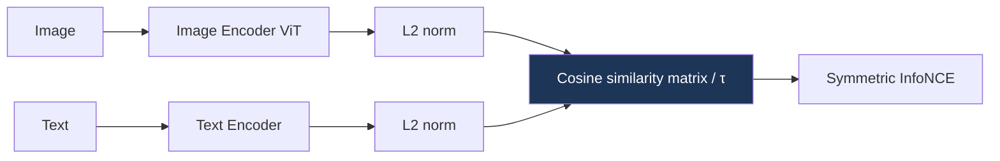
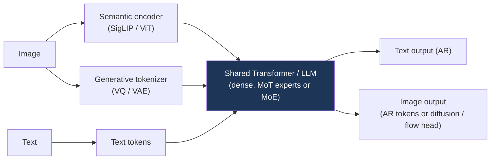

# Multimodal Architectures

> **Last Updated:** October 2026
> **Level:** Intermediate
> **Related Sections:**
> - [Large Vision-Language Models](../05_multimodal_vision_language/02_large_vision_language_models.md)
> - [Self-Supervised Learning](./03_self_supervised_learning.md)
> - [VLP Models](../05_multimodal_vision_language/01_vlp_models.md)
> - [VLA Models](../06_robotics_and_embodied_ai/01_vla_models.md)

> **🆕 October 2026 update:**
> - **Second-generation contrastive encoders**: SigLIP 2 (Feb 2025; multilingual, NaFlex, decoder + SSL losses), Perception Encoder (Apr 2025; best features in intermediate layers) and MetaCLIP 2 (NeurIPS 2025 Spotlight; worldwide data).
> - New section **Unified Understanding + Generation**: Chameleon → Transfusion, Show-o/Show-o2, Janus-Pro (decoupled encoders), BAGEL (MoT, May 2025), Emu3/Emu3.5 (pure next-token prediction).
> - New section **Native Multimodal Backbones (2025–2026)**: native-resolution ViT + MLP connector + DeepStack (Qwen3-VL), early-fusion hybrid-linear-attention LLMs (Qwen3.5, Feb 2026), and hybrid Mamba-Transformer omni models (Nemotron 3 Nano Omni).
> - Key Papers, Benchmark, Pros & Cons and Open Problems updated.

---

## Overview

Multimodal architectures learn joint representations across modalities—most prominently vision and language—by aligning their embedding spaces through one of three mechanisms: **contrastive alignment** (pull matched image-text pairs together, push mismatched apart), **cross-attention fusion** (let one modality attend to another inside a Transformer), or **early fusion** (concatenate modality tokens into one sequence). The choice of mechanism determines what the model is good at: contrastive dual-encoders (CLIP) excel at retrieval and zero-shot classification but cannot generate text; cross-attention models (Flamingo) and early-fusion models (GPT-4o) support open-ended generation and reasoning. These architectures are the foundation of the large VLMs in [Large Vision-Language Models](../05_multimodal_vision_language/02_large_vision_language_models.md) and, with an action head, the VLAs in [VLA Models](../06_robotics_and_embodied_ai/01_vla_models.md).

The pivotal work is **CLIP** [Radford2021], which showed that contrastive training on 400M noisy web image-text pairs yields a vision encoder whose representations are *semantically aligned with language*, enabling zero-shot transfer by simply embedding class names as text prompts. CLIP reframed recognition from "predict a fixed label set" to "match against arbitrary text," and its image encoder became the default perceptual front-end for downstream VLMs. This file develops the contrastive objective, contrasts the three fusion paradigms, and surveys the connector designs (Q-Former, Perceiver Resampler) that bridge frozen encoders to LLMs. It then covers the 2025–2026 landscape. Second-generation contrastive encoders (SigLIP 2, Perception Encoder, MetaCLIP 2) add multilinguality, native resolution and dense features. **Unified** models (Janus-Pro, BAGEL, Show-o2, Emu3.5) both understand and generate images. **Natively multimodal** backbones (Qwen3.5, Nemotron 3 Nano Omni) fuse modalities from pre-training onward and increasingly use hybrid linear-attention or Mamba-Transformer layers.

---

## Contrastive Alignment

CLIP and ALIGN [Jia2021] train a dual encoder—an image encoder `f` (ViT or ResNet) and a text encoder `g` (Transformer)—to maximize cosine similarity of matched pairs in a batch and minimize it for mismatches, via a symmetric InfoNCE loss over the `N×N` similarity matrix:

```
# image and text embeddings L2-normalized; τ = learned temperature
logits = (I_emb @ T_embᵀ) / τ           # N×N
loss_i2t = cross_entropy(logits, labels=arange(N))      # rows
loss_t2i = cross_entropy(logits.T, labels=arange(N))    # cols
loss = (loss_i2t + loss_t2i) / 2
```

The contrastive objective scales with batch size (more negatives) and data, but the softmax normalization couples batch size to the loss; **SigLIP** [Zhai2023] replaces it with a per-pair **sigmoid** loss that decouples the two and improves efficiency at both small and large batches.



CLIP ViT-L/14 reaches ~75–76% zero-shot ImageNet top-1—remarkable for a model that saw no ImageNet labels.

### Second-Generation Contrastive Encoders (2025)

The contrastive dual encoder remains the default VLM front-end, but 2025 encoders add auxiliary objectives, multilinguality and native resolution:

- **SigLIP 2** [Tschannen2025] (Google, Feb 2025) keeps the sigmoid loss and adds a **captioning/referring-expression decoder loss** (LocCa-style), **self-distillation and masked-prediction** losses (SSL inside a VL model) and **online data curation**. It uses a multilingual Gemma tokenizer (256k vocabulary) and de-biased data. It comes in B (86M), L (303M), So400m and g (1B) sizes, plus **NaFlex** variants that keep the native aspect ratio at variable sequence lengths. The g-opt/16 model reaches 85.0% zero-shot ImageNet at 384², and dense/localization quality improves over SigLIP.
- **Perception Encoder (PE)** [Bolya2025] (Meta, Apr 2025) shows that a carefully scaled *contrastive-only* image/video encoder (PE-Core, up to G/14, 85.4% zero-shot ImageNet) already contains strong OCR, VQA, detection and depth features, but in **intermediate layers**, not at the output. Two **alignment-tuning** variants surface them: **PE-Lang** (aligned to an LLM for VLM use, paired with PerceptionLM) and **PE-Spatial** (aligned for dense prediction). Audio-visual PE-AV followed in Dec 2025.
- **MetaCLIP 2** [Chuang2025] (Meta, NeurIPS 2025 Spotlight) is the first recipe for training CLIP on **worldwide (non-English) web data** from scratch. It addresses the "curse of multilinguality", where multilingual CLIP underperforms English-only CLIP on English tasks, so that English and non-English data help each other. Its ViT-bigG-14 reaches 62.0 on the culturally diverse CVQA-LOCAL zero-shot benchmark.

A generative alternative, **AIMv2** [Fini2025] (Apple, CVPR 2025), replaces the contrastive loss with a *multimodal autoregressive* decoder that reconstructs image patches and then caption tokens, reaching 89.5% ImageNet top-1 with a frozen 3B trunk (see [Self-Supervised Learning](./03_self_supervised_learning.md)).

---

## Cross-Attention Fusion

**Flamingo** [Alayrac2022] (NeurIPS 2022) connects a frozen vision encoder to a frozen LLM via two trainable components: a **Perceiver Resampler** that compresses a variable number of visual features into a fixed set of tokens, and **gated cross-attention** layers interleaved into the LLM that let text tokens attend to visual tokens. This preserves the LLM's language ability while grounding it in images, enabling few-shot in-context multimodal learning. **BLIP-2** [Li2023] uses a lightweight **Q-Former**—a set of learned query tokens that cross-attend to frozen image features and feed the LLM—as an efficient connector, the dominant adapter pattern for open VLMs.

---

## Early Fusion & Unified Encoders

**CoCa** [Yu2022] combines contrastive and captioning objectives in one encoder-decoder. **ImageBind** [Girdhar2023] aligns *six* modalities (image, text, audio, depth, thermal, IMU) to a shared space using only image-paired data, enabling emergent cross-modal retrieval. Natively multimodal models (GPT-4o, Gemini) push early fusion to the limit, training on interleaved image-text-audio token streams end-to-end. The taxonomy—adapter vs. cross-attention vs. early-fusion—maps directly onto the cost/capability trade-off in [Large Vision-Language Models](../05_multimodal_vision_language/02_large_vision_language_models.md).

---

## Unified Understanding + Generation

A single model that both *understands* and *generates* images must resolve a representational tension. Understanding wants **semantic, abstract** visual features (CLIP/SigLIP-like), while generation wants **pixel-faithful, compressive** latents (VQ tokens or VAE latents). The 2024–2026 designs differ mainly in how they resolve it:

| Design | Visual representation | Generation mechanism | Representative models |
|---|---|---|---|
| Early-fusion discrete tokens | One VQ tokenizer for both directions | Autoregressive next-token prediction | Chameleon (2024), Emu3 (2024), Emu3.5 (2025) |
| AR text + diffusion image in one Transformer | Continuous VAE latents | Diffusion / flow matching inside the same Transformer | Transfusion (ICLR 2025), Show-o (ICLR 2025, discrete diffusion), Show-o2 (NeurIPS 2025, flow matching on 3D causal VAE latents) |
| Decoupled encoders | Semantic encoder for understanding, VQ tokenizer for generation | Autoregressive (or rectified flow, JanusFlow) | Janus (2024), Janus-Pro (Jan 2025) |
| Mixture-of-Transformers experts | ViT features + VAE latents, separate expert weights over a shared sequence | Flow matching in the generation expert | BAGEL (May 2025) |

- **Emu3** [Wang2024] trains one Transformer from scratch purely with next-token prediction over tokenized images, video and text. **Emu3.5** [BAAI2025] (BAAI, Oct 2025) scales this to more than 10T interleaved vision-language tokens (largely video frames + transcripts), frames the model as a "world learner", and proposes **Discrete Diffusion Adaptation (DiDA)** to turn sequential token decoding into parallel bidirectional prediction for about 20× faster image inference.
- **Janus / Janus-Pro** [Chen2025] (DeepSeek) argue that one visual encoder cannot serve both roles, and *decouple* visual encoding (SigLIP-style for understanding, VQ tokenizer for generation) behind a single autoregressive Transformer.
- **BAGEL** [Deng2025] (ByteDance Seed, May 2025; 7B active / 14B total parameters) uses a Mixture-of-Transformer-Experts over interleaved sequences and reports *emergent* abilities from large-scale interleaved pre-training: free-form image manipulation, multiview synthesis and world navigation. It reports MMMU 55.3 and GenEval 0.82 (0.88 with prompt rewriting).



---

## Native Multimodal Backbones (2025–2026)

On the understanding side, the open-VLM "adapter" template has converged on **native-resolution ViT → lightweight MLP merger → LLM** (the Q-Former has largely fallen out of use). Two refinements are now common:

- **Multi-level visual features.** Qwen3-VL (Sep–Oct 2025) adds **DeepStack**, which feeds features from several ViT layers into the LLM. This is consistent with Perception Encoder's finding that intermediate layers hold the best general features. It also uses **Interleaved-MRoPE** for joint time/height/width positions and textual timestamps for video grounding (see [Vision Transformers](./01_vision_transformers.md)).
- **Early fusion at frontier scale.** Llama 4 (Meta, Apr 2025) and **Qwen3.5** (Alibaba, Feb 2026) are trained as *natively* multimodal models rather than bolting vision onto a finished LLM. Qwen3.5 describes "early fusion training on trillions of multimodal tokens" and reports beating the separate Qwen3-VL line. Qwen3.5 is built on **Gated DeltaNet** linear-attention layers combined with sparse MoE, in a hybrid layout that follows Qwen3-Next (Sep 2025). The multimodal backbone itself is therefore a hybrid linear/full-attention model (see [State Space Models](./05_state_space_models.md)).
- **Hybrid Mamba-Transformer omni models.** NVIDIA's **Nemotron 3 Nano Omni** (30B total / 3B active, hybrid Mamba-Transformer MoE) handles text, image, video and audio, using C-RADIOv4-H as the vision encoder, Parakeet for audio and Efficient Video Sampling for long video. This brings linear-time sequence layers to long multimodal contexts.

---

## Key Papers

| Paper | Authors | Year | Venue | Key Contribution |
|-------|---------|------|-------|-----------------|
| CLIP | Radford, Kim, Hallacy, et al. | 2021 | ICML | Contrastive image-text pretraining; zero-shot transfer |
| ALIGN | Jia, Yang, Xia, et al. | 2021 | ICML | Scaling contrastive VL to 1.8B noisy pairs |
| Flamingo | Alayrac, Donahue, Luc, et al. | 2022 | NeurIPS | Perceiver Resampler + gated cross-attention; few-shot |
| BLIP-2 | Li, Li, Savarese, Hoi | 2023 | ICML | Q-Former connector to frozen LLM |
| ImageBind | Girdhar, El-Nouby, Liu, et al. | 2023 | CVPR | Bind 6 modalities via image-paired alignment |
| SigLIP | Zhai, Mustafa, Kolesnikov, Beyer | 2023 | ICCV | Sigmoid contrastive loss for efficient scaling |
| Chameleon | Chameleon Team (Meta) | 2024 | arXiv | Early-fusion token-based mixed-modal model |
| Emu3: Next-Token Prediction is All You Need | Wang et al. (BAAI) | 2024 | arXiv | Single Transformer, next-token prediction for image/video/text |
| Transfusion | Zhou, Yu, Babu, et al. | 2025 | ICLR | AR text + diffusion images in one Transformer |
| Show-o / Show-o2 | Xie, Mao, Bai, et al. / Xie, Yang, Shou | 2025 | ICLR / NeurIPS | One Transformer for AR understanding + diffusion/flow generation |
| Janus-Pro | Chen, Wu, Liu, et al. (DeepSeek) | 2025 | arXiv | Decoupled visual encoders for understanding vs. generation |
| SigLIP 2 | Tschannen, Gritsenko, Wang, et al. | 2025 | arXiv | Multilingual sigmoid encoder + decoder/SSL losses; NaFlex |
| Perception Encoder | Bolya, Huang, Sun, et al. | 2025 | arXiv | Contrastive encoder whose best features are intermediate; PE-Lang/Spatial |
| AIMv2 | Fini, Shukor, Li, et al. | 2025 | CVPR (Highlight) | Multimodal autoregressive encoder pre-training |
| BAGEL (Emerging Properties in Unified Multimodal Pretraining) | Deng et al. (ByteDance Seed) | 2025 | arXiv | MoT unified model; emergent editing and world-navigation abilities |
| Meta CLIP 2: A Worldwide Scaling Recipe | Chuang et al. (Meta) | 2025 | NeurIPS (Spotlight) | CLIP from scratch on worldwide multilingual data |
| Emu3.5: Native Multimodal Models are World Learners | BAAI Emu team | 2025 | arXiv | 10T+ interleaved tokens; DiDA parallel decoding |
| Qwen3-VL Technical Report | Qwen Team | 2025 | arXiv | DeepStack multi-level features; Interleaved-MRoPE |

---

## Benchmark Performance

| Model | Task | Metric | Score | Notes |
|-------|------|--------|-------|-------|
| CLIP ViT-L/14 | Zero-shot ImageNet | Top-1 | ~75–76% | No ImageNet labels [Radford2021] |
| SigLIP | Zero-shot ImageNet | Top-1 | Strong, batch-efficient | Sigmoid loss [Zhai2023] |
| Flamingo-80B | Few-shot VQAv2 | Accuracy | SOTA (2022) | In-context multimodal |
| BLIP-2 | Zero-shot VQAv2 | Accuracy | Strong, efficient | Q-Former + frozen LLM |
| ImageBind | Cross-modal retrieval | Recall | Emergent zero-shot | 6 modalities |
| SigLIP 2 g-opt/16 (384²) | Zero-shot ImageNet | Top-1 | 85.0% | COCO T→I 56.1 / I→T 72.8 [Tschannen2025] |
| SigLIP 2 So400m/16 NaFlex | Zero-shot ImageNet | Top-1 | 83.5% | Native aspect ratio, seq. len. 256 |
| PE-Core G/14 (448²) | Zero-shot ImageNet | Top-1 | 85.4% | Contrastive only [Bolya2025] |
| MetaCLIP 2 ViT-bigG-14 (378²) | Zero-shot CVQA-LOCAL | Accuracy | 62.0 | Worldwide data, 29B seen pairs |
| AIMv2-3B (448²) | ImageNet (frozen trunk) | Top-1 | 89.5% | Autoregressive pre-training [Fini2025] |
| BAGEL (7B active) | MMMU / GenEval | Acc. / score | 55.3 / 0.82 (0.88 w/ rewriter) | Unified understanding + generation |

---

## Pros & Cons

| Aspect | Pros | Cons |
|--------|------|------|
| Contrastive dual-encoder (CLIP) | Fast retrieval, zero-shot, scalable | Cannot generate; weak compositional/spatial reasoning |
| Cross-attention (Flamingo) | Generative, few-shot, preserves LLM | More parameters; heavier training |
| Adapter/Q-Former (BLIP-2) | Efficient, reuses frozen models | Connector can bottleneck visual detail |
| Early fusion (GPT-4o/Gemini) | Richest interleaved reasoning | Massive compute; closed; hard to study |
| Native-res. ViT + MLP + multi-level features (Qwen3-VL) | Simple, strong on OCR/documents/video; open weights | Visual token count grows with resolution; LLM context cost |
| Unified understanding + generation (BAGEL, Janus-Pro, Show-o2) | One model for VQA, T2I and editing; emergent world-modeling skills | Semantic vs. pixel representation conflict; generation still trails specialist diffusion models at the top end |
| Natively multimodal hybrid backbones (Qwen3.5, Nemotron 3 Omni) | Linear-time layers make long video/audio contexts affordable | Newer, less-studied architectures; kernel/tooling maturity |

---

## Open Problems & Research Gaps

- **Compositional & spatial reasoning.** Contrastive embeddings entangle attributes and miss relations (see [Spatial Intelligence](../12_research_frontier_2024_2026/06_spatial_intelligence.md)).
- **Connector design.** Open VLMs have largely converged on MLP projectors over native-resolution ViTs, with multi-level feature injection (DeepStack). Whether this is optimal, and how to read out intermediate encoder layers (cf. Perception Encoder), is still debated, as is how to compress visual tokens for long video.
- **Modality balance.** Joint training tends to favor the dominant modality; principled balancing is unsolved.
- **Beyond image-text.** Scaling ImageBind-style many-modality alignment without paired data for every pair is hard.
- **Negative sampling & data quality.** Contrastive performance is highly sensitive to batch composition and curation (see [Scaling Laws in Vision](../12_research_frontier_2024_2026/01_scaling_laws_vision.md)).
- **Unified generation+understanding.** Unified models (BAGEL, Janus-Pro, Show-o2, Emu3.5) are now competitive, but there is no consensus on a shared visual representation: one tokenizer vs. decoupled encoders vs. MoT experts. Whether joint training actually produces *synergy* between understanding and generation, rather than mere co-existence, is unresolved.
- **Multilingual and cultural coverage.** MetaCLIP 2 and SigLIP 2 show that worldwide data need not hurt English performance, but evaluation of culturally diverse concepts (e.g., CVQA) remains thin.
- **Linear-time multimodal backbones.** Hybrid linear-attention or Mamba-Transformer LLMs (Qwen3.5, Nemotron 3 Omni) cut long-context cost. How well recurrent-state layers retain fine-grained visual detail over very long interleaved sequences is not well measured (see [State Space Models](./05_state_space_models.md)).

---

## Further Reading

- [CLIP (arXiv:2103.00020)](https://arxiv.org/abs/2103.00020) — learning transferable visual models from language supervision
- [Flamingo (arXiv:2204.14198)](https://arxiv.org/abs/2204.14198) — few-shot visual language model
- [BLIP-2 (arXiv:2301.12597)](https://arxiv.org/abs/2301.12597) — Q-Former bootstrapping
- [ImageBind (arXiv:2305.05665)](https://arxiv.org/abs/2305.05665) — one embedding space for six modalities
- [SigLIP (arXiv:2303.15343)](https://arxiv.org/abs/2303.15343) — sigmoid loss for language-image pretraining
- [SigLIP 2 (arXiv:2502.14786)](https://github.com/google-research/big_vision/blob/main/big_vision/configs/proj/image_text/README_siglip2.md) — multilingual encoders with NaFlex
- [Perception Encoder & PerceptionLM (arXiv:2504.13181, 2504.13180)](https://github.com/facebookresearch/perception_models) — intermediate-layer features, PE-AV
- [Meta CLIP 2 (arXiv:2507.22062)](https://github.com/facebookresearch/metaclip) — worldwide CLIP scaling recipe
- [BAGEL (arXiv:2505.14683)](https://github.com/ByteDance-Seed/Bagel) — emerging properties in unified multimodal pretraining
- [Janus / Janus-Pro / JanusFlow](https://github.com/deepseek-ai/Janus) — decoupled visual encoding for unified models
- [Show-o / Show-o2 (arXiv:2408.12528, 2506.15564)](https://github.com/showlab/Show-o) — one Transformer for understanding and generation
- [Emu3.5 (arXiv:2510.26583)](https://github.com/baaivision/Emu3.5) — native multimodal models as world learners
- [Qwen3-VL (arXiv:2511.21631)](https://github.com/QwenLM/Qwen3-VL) and [Qwen3.5](https://github.com/QwenLM/Qwen3.5) — native-resolution VLM and early-fusion hybrid backbone
