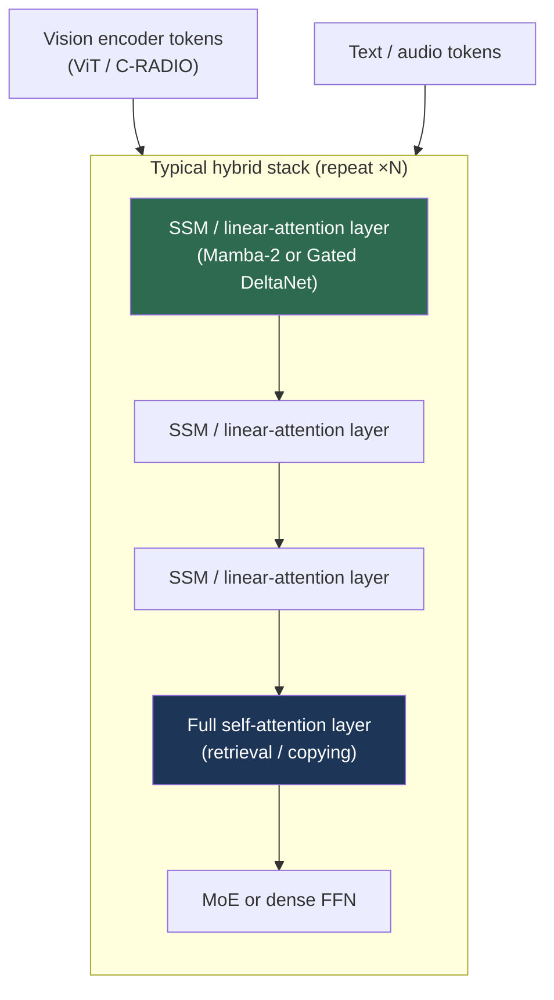

# State Space Models for Vision

> **Last Updated:** October 2026
> **Level:** Advanced
> **Related Sections:**
> - [Vision Transformers](./01_vision_transformers.md)
> - [Hybrid Architectures](./02_hybrid_architectures.md)
> - [Efficient Architectures](../09_efficiency_and_deployment/01_efficient_architectures.md)

> **🆕 October 2026 update:**
> - New subsection on **Mamba-2 / SSD** (ICML 2024; state-space duality with attention), **Gated DeltaNet** (ICLR 2025) and **Mamba-3** (arXiv, Mar 2026, "inference-first" SSM).
> - New section **Vision SSMs, 2025: Hybrids, Critiques and Registers**: MambaVision (CVPR 2025), MambaOut (CVPR 2025), Mamba® registers (CVPR 2025), Vision-LSTM.
> - New section **Hybrid Mamba/Attention at Foundation Scale**: Jamba, Nemotron-H → Nemotron 3 (hybrid Mamba-Transformer MoE incl. the Nano Omni multimodal model), Qwen3-Next/Qwen3.5 (Gated DeltaNet hybrids, natively multimodal).
> - Key Papers, Benchmark, Pros & Cons and Open Problems updated.

---

## Overview

State space models (SSMs) are the principal challenger to self-attention for long-sequence and high-resolution vision, offering **linear-time sequence modeling** in place of attention's quadratic cost. An SSM maps an input sequence to an output through a latent recurrent state governed by continuous-time linear dynamics, discretized for digital computation. The breakthrough that made SSMs competitive was **S4** [Gu2022], which combined a principled HiPPO initialization with an efficient diagonal-plus-low-rank parameterization, and **Mamba** [Gu2023], which added *input-dependent (selective)* parameters and a hardware-aware parallel scan—closing the long-standing quality gap to Transformers on language while retaining O(N) complexity and O(1) per-token inference memory.

For vision, the appeal is acute: self-attention's O(N²) cost in token count is the dominant bottleneck at high resolution, exactly where dense-prediction and robotics perception need to operate. Vision SSMs (Vim, VMamba) adapt Mamba's inherently 1D, causal scan to the 2D, non-causal structure of images via bidirectional and multi-directional scanning, achieving accuracy comparable to Swin at substantially lower memory and faster high-resolution throughput. This file develops the SSM mathematics, the selective-scan innovation, the vision adaptations, and the regime where linear-time models beat attention.

By 2025–2026 the picture had become more nuanced. On ImageNet-scale classification, a Gated CNN without any SSM (MambaOut) matches visual Mamba, and the strongest vision SSM backbones are **hybrids** with attention (MambaVision). At foundation scale, however, **hybrid Mamba/linear-attention + attention stacks** have become a mainstream LLM and multimodal design: NVIDIA's Nemotron-H and Nemotron 3 families, including the Nemotron 3 Nano Omni vision-audio model, and Alibaba's natively multimodal Qwen3.5 built on Gated DeltaNet. In these models the linear-time layers process long interleaved sequences of image, video and text tokens.

---

## The Mathematics

An SSM models a continuous system with latent state `h(t)`:

```
h'(t) = A h(t) + B x(t)
y(t)  = C h(t) + D x(t)        (D often = 0, the direct feedthrough)
```

To apply it to discrete tokens with step size Δ, **zero-order-hold (ZOH) discretization** gives:

```
Ā = exp(ΔA)
B̄ = (ΔA)⁻¹ (exp(ΔA) − I) (ΔB)
hₜ = Ā hₜ₋₁ + B̄ xₜ
yₜ = C hₜ
```

This admits a **dual view**: a *recurrence* (O(1) memory per step, ideal for inference) and an equivalent *global convolution* with a structured kernel (parallelizable for training, like a Transformer). S4 [Gu2022] (ICLR 2022, Outstanding Paper Honorable Mention) made the convolution efficient by initializing `A` with the **HiPPO-LegS** matrix (principled long-range memory via orthogonal-polynomial projection) and decomposing it as **diagonal-plus-low-rank (DPLR)**, reducing the kernel cost from O(N²) to O(N log N).

### Selectivity: Mamba

S4 is **linear time-invariant (LTI)**—`A, B, C` are fixed, so the model cannot condition its memory on content. **Mamba** [Gu2023] makes `B`, `C`, and `Δ` functions of the input (only `A` stays fixed):

```
Bₜ = Linear_B(xₜ);  Cₜ = Linear_C(xₜ);  Δₜ = softplus(Linear_Δ(xₜ))
```

Selectivity in `Δ` lets the model *ignore* irrelevant tokens (Δ→0, no state update) or *memorize* important ones. But input-dependent parameters break the time-invariance the convolution relied on, forcing a recurrent scan. Mamba keeps this fast with a **hardware-aware parallel scan**: an associative prefix scan (O(log N) depth), **kernel fusion** (discretization + scan + projection in one CUDA kernel, avoiding materializing the expanded state in HBM), and **recomputation** during backprop. The result is ~5× higher inference throughput than comparable Transformers with O(1) memory per token.

```mermaid
graph LR
    A[Input tokens] --> B[Selective params<br/>B,C,Δ = f(x)]
    B --> C[Hardware-aware parallel scan<br/>associative prefix scan]
    C --> D[Linear-time output<br/>O(N) train, O(1)/token infer]
    style C fill:#1d3557,color:#fff
    style D fill:#2d6a4f,color:#fff
```

### Mamba-2, Gated DeltaNet and Mamba-3

**Mamba-2** [Dao2024] (ICML 2024) restricts `A` to a scalar-times-identity per head, which makes the selective SSM exactly equivalent to a form of **masked linear attention**. The authors call this *Structured State Space Duality (SSD)*:

```
y = (L ∘ C Bᵀ) x,    L_ij = Π_{k=j+1..i} a_k  for i ≥ j, else 0
  (L is a 1-semiseparable causal decay mask; C Bᵀ plays the role of Q Kᵀ)
```

The duality lets the model use matrix-multiply-heavy chunked algorithms (tensor cores) for training while keeping the recurrent form for inference, and supports much larger state dimensions (typically 64–128 vs. 16 in Mamba-1). **Gated DeltaNet** [Yang2025] (ICLR 2025, NVIDIA) combines Mamba-2-style gating (fast forgetting) with the **delta rule** (targeted overwrite of key-value associations in the state), improving in-context recall over Mamba-2. It has since been adopted in Qwen3-Next (Sep 2025), Qwen3.5 (Feb 2026) and Olmo Hybrid (Mar 2026). **Mamba-3** [Lahoti2026] (arXiv, March 2026; Lahoti, Li, Chen, Wang, Bick, Kolter, Dao, Gu) revisits SSM design from an *inference-first* perspective, aiming at better quality per unit of decoding compute and memory. Its implementation is in the official `state-spaces/mamba` repository.

---

## Vision Adaptations

Images are 2D and non-causal, but Mamba's scan is 1D and causal. The two leading vision SSMs solve this differently:

**Vision Mamba (Vim)** [Zhu2024] (ICML 2024) patchifies the image (ViT-style), adds position embeddings, and processes tokens through **bidirectional** Vim blocks (forward + backward scans combined), so no token has asymmetric context. Vim is **2.8× faster than DeiT** and uses **86.8% less GPU memory** at 1248×1248 resolution. Vim-S (26M) reaches 80.5% top-1, edging DeiT-S (79.8%) at similar size.

**VMamba** [Liu2024] (NeurIPS 2024 Spotlight) introduces **2D Selective Scan (SS2D)** with a **Cross-Scan** module: the feature map is unfolded into *four* 1D sequences (the two diagonal directions and their reverses), each run through a selective SSM, then merged—so every patch receives context from all four spatial directions, analogous to a 2D convolution. VMamba-T (~31M) reaches 82.5%, beating Swin-T (81.2%) at comparable FLOPs, with consistent +0.4–1.3 pp margins across scales.

---

## Vision SSMs, 2025: Hybrids, Critiques and Registers

The 2025 literature (much of it at CVPR 2025) tempered the early enthusiasm for pure vision SSMs:

- **MambaVision** [Hatamizadeh2025] (CVPR 2025, NVIDIA) concludes that the best vision backbone is a *hybrid*. It uses convolutional stages at high resolution, then a redesigned Mamba mixer (with an extra non-SSM symmetric branch to recover global context lost by causal scanning) followed by **self-attention blocks in the final layers** of each late stage. It sets a top-1/throughput Pareto front (MambaVision-T 82.3% at 6,298 img/s; L3 with IN-21K: 88.1% at 512²) and transfers to COCO and ADE20K (see [Hybrid Architectures](./02_hybrid_architectures.md)).
- **MambaOut** [Yu2025] (CVPR 2025) removes the SSM entirely and keeps the Gated-CNN block. It argues conceptually that SSMs suit tasks that are **long-sequence and autoregressive**, which ImageNet classification is not, and shows empirically that MambaOut beats visual Mamba models on ImageNet (MambaOut-Small 84.1%). It concedes that SSMs may still help detection/segmentation, which use long token sequences at high resolution.
- **Mamba® ("Vision Mamba ALSO Needs Registers")** [Wang2025] (CVPR 2025) finds high-norm artifact tokens in Vision Mamba feature maps, analogous to ViTs. Evenly inserted register tokens remove them and improve accuracy (Mamba®-B 83.0%, -L 83.6% in the official repo), which also enables larger stable vision SSMs.
- **Vision-LSTM (ViL)** [Alkin2024] applies the xLSTM matrix-memory recurrent block with alternating scan directions per block pair. It is a competing linear-time recurrent backbone (ViL-B 82.4%), which shows that the "1D recurrence over 2D patches" design space is broader than Mamba alone.

The net 2025 consensus is that pure SSMs bring **no accuracy advantage at 224² classification**. Their value lies in the high-resolution, long-video and long-context multimodal regimes where O(N) cost matters, and it is usually realized in **hybrids** with a minority of attention layers.

---

## Hybrid Mamba/Attention at Foundation Scale

The decisive 2024–2026 development happened in large language and multimodal backbones, which then feed back into vision. Pure SSM LLMs lag Transformers on in-context retrieval and copying. A small number of full-attention layers fixes this, while the SSM/linear layers keep most of the compute and KV-cache savings:

| Model (date) | Sequence mixers | Notes |
|---|---|---|
| Jamba (AI21, Mar 2024) | Mamba + attention (1 attention : 7 Mamba layers) + MoE | First production-grade hybrid; long context |
| Nemotron-H (NVIDIA, Apr 2025) | Mostly Mamba-2, few self-attention layers | Hybrid Mamba-Transformer family replacing the majority of attention layers |
| Nemotron Nano 2 VL (NVIDIA, 2025) | Hybrid Mamba-Transformer LLM + vision encoder | 12B VLM for documents and video, Efficient Video Sampling |
| Qwen3-Next-80B-A3B (Alibaba, Sep 2025) | Gated DeltaNet + full attention + ultra-sparse MoE | Hybrid attention for long-context efficiency |
| Qwen3.5 (Alibaba, Feb 2026) | Gated DeltaNet hybrid + sparse MoE | **Natively multimodal** (early fusion on trillions of multimodal tokens); 0.8B to 397B-A17B |
| Nemotron 3 Nano / Super / Ultra (NVIDIA, 2025–2026) | Hybrid Mamba-Transformer (Latent) MoE | Nano 31.6B/3.6B active; Super 120.6B/12.7B active; Ultra 550B/55B active announced at GTC 2026, 1M context |
| Nemotron 3 Nano Omni (NVIDIA, 2026) | Hybrid Mamba-Transformer MoE, 30B/3B active | Text, image (C-RADIOv4-H encoder), video and audio input |



For vision, the implication is that **the SSM has moved from the image encoder into the multimodal sequence model**. Image encoders remain ViTs or hybrids (C-RADIO, SigLIP), while the long interleaved token stream of images, video frames and audio is processed by hybrid Mamba/linear-attention backbones with O(1)-per-token state for most layers.

---

## Key Papers

| Paper | Authors | Year | Venue | Key Contribution |
|-------|---------|------|-------|-----------------|
| Efficiently Modeling Long Sequences (S4) | Gu, Goel, Ré | 2022 | ICLR (Outstanding HM) | HiPPO init + DPLR; efficient long-range SSM |
| Mamba | Gu, Dao | 2023 | arXiv→COLM 2024 | Selective SSM + hardware-aware parallel scan |
| Vision Mamba (Vim) | Zhu, Liao, Zhang, et al. | 2024 | ICML | Bidirectional SSM for non-causal vision |
| VMamba | Liu, Tian, Zhao, et al. | 2024 | NeurIPS (Spotlight) | 2D Selective Scan (Cross-Scan, SS2D) |
| HiPPO | Gu, Dao, Ermon, Rudra, Ré | 2020 | NeurIPS | Polynomial-projection memory theory underlying S4 |
| Jamba | Lieber, Lenz, et al. (AI21) | 2024 | arXiv | Production hybrid Transformer-Mamba MoE |
| Transformers are SSMs (Mamba-2) | Dao, Gu | 2024 | ICML | Structured State Space Duality; tensor-core-friendly SSM |
| Vision-LSTM (ViL) | Alkin, Beck, Pöppel, Hochreiter, Brandstetter | 2024 | arXiv | xLSTM as a generic vision backbone |
| Gated Delta Networks | Yang, Kautz, Hatamizadeh | 2025 | ICLR | Gating + delta rule; adopted by Qwen3-Next/Qwen3.5 |
| MambaVision | Hatamizadeh, Kautz | 2025 | CVPR | Hybrid conv + Mamba + attention vision backbone |
| MambaOut | Yu, Wang | 2025 | CVPR | Gated CNN without SSM beats visual Mamba on ImageNet |
| Mamba®: Vision Mamba ALSO Needs Registers | Wang, Wang, Ren, et al. | 2025 | CVPR | Registers remove artifacts in vision SSMs |
| Nemotron-H | NVIDIA | 2025 | arXiv | Hybrid Mamba-Transformer LLM family |
| Mamba-3 | Lahoti, Li, Chen, et al. | 2026 | arXiv | Inference-first state space model |

---

## Benchmark Performance

| Model | Params | ImageNet top-1 | Efficiency note | Reference |
|-------|--------|----------------|-----------------|-----------|
| Vim-S | 26M | 80.5% | 2.8× faster, −86.8% memory vs DeiT @1248² | [Zhu2024] |
| Vim-B | 98M | 81.9% | — | [Zhu2024] |
| VMamba-T | 31M | 82.5% | +1.3 pp over Swin-T @ comparable FLOPs | [Liu2024] |
| VMamba-S | 50M | 83.6% | — | [Liu2024] |
| VMamba-B | 89M | 83.9% | +0.4 pp over Swin-B | [Liu2024] |
| MambaVision-T | 31.8M | 82.3% | 6,298 img/s; hybrid conv+Mamba+attention | [Hatamizadeh2025] |
| MambaVision-B | 97.7M | 84.2% | 3,670 img/s | [Hatamizadeh2025] |
| MambaVision-L3-512-21K | 739.6M | 88.1% | IN-21K pretraining, 512² | [Hatamizadeh2025] |
| MambaOut-Small (no SSM) | 48.5M | 84.1% | Gated CNN control | [Yu2025] |
| Mamba®-B | — | 83.0% | Vim + registers (repo, improved recipe) | [Wang2025] |
| ViL-B (Vision-LSTM) | — | 82.4% | xLSTM-based recurrent backbone | [Alkin2024] |

*Complexity: self-attention is O(N²); SSMs are O(N) in sequence length (O(N·D²) training with the parallel scan, D≪N).*

---

## Pros & Cons

| Aspect | Pros | Cons |
|--------|------|------|
| Linear complexity | O(N) vs attention O(N²); scales to high resolution | Quadratic in state dim D (usually small) |
| Inference memory | O(1) per token (recurrent state) | Selective scan needs custom CUDA kernels |
| Long-range modeling | HiPPO-grounded memory; strong on long sequences | Less mature tooling/ecosystem than Transformers |
| Vision accuracy | Beats Swin at comparable FLOPs (VMamba) | Multi-directional scan adds design complexity |
| Hybrid SSM + attention | Keeps retrieval/copying ability with most of the linear-time savings; now standard in Nemotron 3 and Qwen3.5 | Layer-ratio and placement are empirical; two kernel stacks to maintain |
| Necessity for classification | — | MambaOut shows a Gated CNN without SSM matches or beats visual Mamba at 224² |

---

## Open Problems & Research Gaps

- **Canonical 2D scan.** No consensus on the best way to impose 1D ordering on 2D images; Cross-Scan is effective but ad hoc.
- **Pretraining at scale.** Whether vision SSMs match Transformers under large-scale self-supervised pretraining (MAE/DINO-style, see [Self-Supervised Learning](./03_self_supervised_learning.md)) is under-explored.
- **Hardware support.** SSM kernels are less optimized across accelerators than attention; portability and on-device support lag.
- **Hybrid SSM-attention.** In LLM/multimodal backbones, hybrids with a minority of full-attention layers have become the default (Jamba, Nemotron-H/3, Qwen3-Next/3.5). For *vision encoders* the optimal ratio and placement are still empirical: MambaVision puts attention at the end of late stages (cf. [Hybrid Architectures](./02_hybrid_architectures.md)).
- **Where SSMs actually help in vision.** MambaOut argues SSMs are unnecessary for short-sequence classification. Rigorous evidence for their advantage in high-resolution dense prediction, long video and long multimodal contexts, controlled for recipe and compute, is still limited.
- **Artifacts and registers.** Mamba® shows that vision SSMs develop high-norm artifact tokens like ViTs do. Why recurrent models also allocate global information to background tokens is unexplained.
- **Dense prediction.** SSM backbones for detection/segmentation are promising but less validated than Swin.
- **Theoretical understanding** of what selectivity learns, and its expressivity relative to attention, remains incomplete.
- **Multimodal SSMs.** Hybrid Mamba-Transformer and Gated DeltaNet backbones now ship as multimodal models (Nemotron Nano 2 VL, Nemotron 3 Nano Omni, Qwen3.5). How much fine visual detail a fixed-size recurrent state retains over long interleaved image/video sequences, and how to benchmark it, remains open.

---

## Further Reading

- [Mamba (arXiv:2312.00752)](https://arxiv.org/abs/2312.00752) — selective state spaces, linear-time sequence modeling
- [S4 (arXiv:2111.00396)](https://arxiv.org/abs/2111.00396) — structured state spaces for long sequences
- [Vision Mamba / Vim (arXiv:2401.09417)](https://arxiv.org/abs/2401.09417) — bidirectional SSM for vision
- [VMamba (arXiv:2401.10166)](https://arxiv.org/abs/2401.10166) — 2D selective scan visual state space model
- [HiPPO (arXiv:2008.07669)](https://arxiv.org/abs/2008.07669) — the memory theory underlying S4/Mamba
- [Mamba-2 (arXiv:2405.21060) and Mamba-3 (arXiv:2603.15569)](https://github.com/state-spaces/mamba) — SSD duality and inference-first SSMs
- [Gated DeltaNet (arXiv:2412.06464)](https://github.com/NVlabs/GatedDeltaNet) — gating + delta rule, used in Qwen3-Next/Qwen3.5
- [MambaVision (arXiv:2407.08083)](https://github.com/NVlabs/MambaVision) — hybrid Mamba-Transformer vision backbone
- [MambaOut (arXiv:2405.07992)](https://github.com/yuweihao/MambaOut) — do we really need Mamba for vision?
- [Mamba® (arXiv:2405.14858)](https://github.com/wangf3014/Mamba-Reg) — vision Mamba also needs registers
- [Vision-LSTM (arXiv:2406.04303)](https://github.com/NX-AI/vision-lstm) — xLSTM as a generic vision backbone
- [NVIDIA Nemotron models](https://github.com/NVIDIA-NeMo/Nemotron) — hybrid Mamba-Transformer MoE LLMs and omni/VL models
