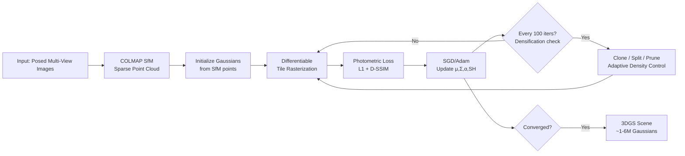

# 3D Gaussian Splatting: Real-Time Novel View Synthesis

> **Last Updated:** October 2026
> **Level:** Advanced
> **Related Sections:** [NeRF and Variants](./01_nerf_and_variants.md) · [3D Representations](./00_3d_representations.md) · [4D and Dynamic Scenes](../12_research_frontier_2024_2026/05_4d_and_dynamic_scenes.md)

> **🆕 October 2026 update:**
> - **Feed-forward 3DGS** matured: AnySplat (SIGGRAPH Asia 2025) predicts Gaussians and poses from unposed images. Depth Anything 3 and WorldMirror (ICML 2026) add Gaussian heads to universal geometry models. Apple's SHARP (Dec 2025) produces metric 3D Gaussians from a single photo in under a second.
> - **Beyond splatting**: NVIDIA's 3DGRT (ray tracing) and 3DGUT (CVPR 2025 Oral) support distorted/rolling-shutter cameras and secondary rays. 3DGUT ships in `gsplat`, which by 2026 also offers MCMC densification (3DGS-MCMC, NeurIPS 2024 Spotlight), multi-GPU rendering and LiDAR rasterization.
> - **Standardization**: the Khronos `KHR_gaussian_splatting` glTF extension was ratified, and web renderers such as World Labs' Spark support it.
> - **ECCV 2026 Best Paper** (HKTex) carries the Gaussian-primitive idea onto mesh surfaces as non-splatting "geodesic Gaussians". CVPR 2026 Best Paper D4RT advances feed-forward dynamic 4D reconstruction.
> - New section, Key Papers rows, Benchmark rows, Open Problems and Further Reading added.

---

## Overview

3D Gaussian Splatting (3DGS), introduced by Bernhard Kerbl, Georgios Kopanas, Thomas Leimkühler, and George Drettakis (INRIA Sophia Antipolis) at SIGGRAPH 2023, represents the most significant practical advance in novel view synthesis since NeRF. The method achieves real-time rendering (100+ FPS at 1080p) while matching or exceeding NeRF-quality photorealism, by representing scenes as collections of millions of anisotropic 3D Gaussian primitives rendered via differentiable tile-based rasterization. Unlike NeRF's implicit MLP, 3DGS is an explicit representation — Gaussians are geometrically interpretable, directly editable, and rendered without any ray marching.

The 3DGS paper won immediate acclaim in the computer vision community and spawned an extraordinarily rapid ecosystem. Within a year of publication, hundreds of papers extended it to dynamic scenes (4D-GS, SC-GS), semantic understanding (LangSplat), surface reconstruction (2DGS), anti-aliasing (Mip-Splatting), robotics grasping, medical imaging, and autonomous driving. The speed advantage over NeRF (~100× faster at inference) makes it the de-facto standard for interactive 3D scene representations as of 2024–2026.

The core trade-off relative to NeRF is: 3DGS trades memory efficiency (millions of Gaussians × ~60 bytes each = hundreds of MB per scene) for rendering speed, and trades surface quality (Gaussians do not explicitly model surfaces) for perceptual image quality. These trade-offs motivate the active variant literature: 2DGS for better surfaces, Mip-Splatting for anti-aliasing, Scaffold-GS for structured representation.

---

## Mathematical Foundation: Anisotropic 3D Gaussians

Each Gaussian primitive $\mathcal{G}_k$ is defined by:
- **Mean** $\mu_k \in \mathbb{R}^3$ — 3D position
- **Covariance** $\Sigma_k \in \mathbb{R}^{3\times3}$ (positive semi-definite) — shape and orientation
- **Opacity** $\alpha_k \in [0, 1]$ — transparency
- **Color** $c_k$ represented as **Spherical Harmonic (SH) coefficients** — view-dependent appearance

```
# 3D Gaussian density function
G_k(x) = exp(-0.5 * (x - μ_k)^T Σ_k^{-1} (x - μ_k))

# Covariance parameterization (ensures positive semi-definiteness):
Σ_k = R_k S_k S_k^T R_k^T

where:
  R_k ∈ SO(3) — rotation matrix (stored as quaternion q_k)
  S_k = diag(s_x, s_y, s_z) — axis-aligned scale matrix

# 2D projection (splatting) to camera plane:
Σ'_k = J W Σ_k W^T J^T

where W ∈ R^{3x3} is the world-to-camera rotation
      J ∈ R^{2x3} is the Jacobian of the projective transform

# View-dependent color via Spherical Harmonics:
c_k(d) = Σ_{l=0}^{L} Σ_{m=-l}^{l}  f_k^{lm} · Y_l^m(d)

where Y_l^m are real spherical harmonics basis functions
      L=3 (degree-3 SH, 16 coefficients per color channel = 48 floats per Gaussian)
```

---

## Tile-Based Differentiable Rasterization

NeRF renders by marching rays; 3DGS renders by **splatting** — projecting each 3D Gaussian to a 2D ellipse on screen and compositing them front-to-back. This maps to GPU rasterization hardware:

```mermaid
flowchart TD
    A[3D Gaussians\n{μ_k, Σ_k, α_k, c_k}] --> B[Project to 2D\nΣ'_k = J W Σ_k W^T J^T]
    B --> C[Compute 2D bounding box\nper Gaussian]
    C --> D[Divide screen into 16×16 tiles]
    D --> E[Assign Gaussians to tiles\nbased on bounding boxes]
    E --> F[Sort Gaussians by depth\nper tile — GPU radix sort]
    F --> G[Tile-parallel alpha compositing\nfront-to-back per pixel]
    G --> H[Rendered Image]
    H --> I[Photometric Loss\n||C_rendered - C_gt||^2]
    I --> J[Backward through rasterizer\nGradients to μ, Σ, α, SH]
    J --> K[Adaptive Density Control\n- Clone small Gaussians with large gradients\n- Split large Gaussians\n- Prune transparent Gaussians]
```

The alpha compositing formula for pixel $p$ viewing Gaussians in sorted depth order:

```
# Alpha compositing (front-to-back)
C(p) = Σ_{i=1}^{N} c_i · α̃_i · Π_{j=1}^{i-1} (1 - α̃_j)

where α̃_i = α_i · exp(-0.5 (p - μ'_i)^T (Σ'_i)^{-1} (p - μ'_i))
             ← Gaussian weight of projected ellipse at pixel p
```

**Adaptive Density Control (ADC):** During training, 3DGS monitors the magnitude of position gradients $||\nabla_{\mu_k} \mathcal{L}||$. Gaussians with large gradients in under-reconstructed regions are either:
- **Cloned** (copied with slight perturbation) if they are small — covering more space
- **Split** (replaced by two smaller Gaussians sampled from the PDF) if they are large — improving detail
Gaussians with opacity below a threshold $\epsilon$ are **pruned**. This adaptive procedure grows the representation from the SfM initialization (typically ~100k points) to 1–6M Gaussians over training.

---

## Training Pipeline



Training typically takes 30–60 minutes on a single RTX 3090 for a bounded indoor scene.

---

## Key Variants

### Scaffold-GS [Lu2023, CVPR 2024 Highlight]

Lu, Yu, Xu, Xiangli et al. introduce **anchor points** as a structured scaffold. Instead of free-floating Gaussians, neural Gaussians are predicted on-the-fly from a sparse set of learned anchor points via MLPs conditioned on viewing direction and distance. This reduces redundancy, improves view-dependent effects, and is more robust to sparse viewpoints. The anchor growing/pruning strategy is analogous to ADC but operates on anchors rather than individual Gaussians.

### Mip-Splatting [Yu2024, CVPR 2024 Best Student Paper]

Zehao Yu, Anpei Chen, Binbin Huang, Torsten Sattler, and Andreas Geiger (MPI Tübingen) address aliasing in 3DGS. Standard 3DGS uses a 2D dilation filter that causes artifacts at extreme zoom levels (Gaussians become too small or too large). Mip-Splatting introduces:
1. A **3D smoothing filter** constraining each Gaussian's size to be no smaller than the maximum sampling frequency of the training views
2. A **2D Mip filter** (box filter approximation) replacing the dilation filter

Result: clean zoom-in and zoom-out without floaters or jaggies. Won CVPR 2024 Best Student Paper.

### 2DGS [Huang2024, SIGGRAPH 2024]

Huang, Yu, Chen, Geiger, Gao propose **2D Gaussian Splatting**: instead of volumetric 3D Gaussians, use **2D planar Gaussian disks** (surfels) that are tangent to surfaces. A 2D Gaussian is defined in a local tangent plane (u, v axes) and has zero thickness along the normal. This provides:
- View-consistent geometry (unlike 3DGS whose density is view-independent but appearance is view-dependent)
- Natural surface normals from the disk orientation
- Better mesh extraction (100× faster than SDF-based methods at comparable quality)
Requires perspective-correct ray-splat intersection during rasterization.

### LangSplat [Qin2023]

Minghan Qin, Wanhua Li, Jiawei Zhou, Haoqian Wang, and Hanspeter Pfister embed **CLIP language features** into 3DGS. Each Gaussian carries an additional feature vector in a scene-specific compressed CLIP space (trained via scene autoencoder). Open-vocabulary 3D queries (e.g., "find the coffee mug") are answered by rendering the language field at query scale and computing similarity with text embeddings. Applications include robotic manipulation, scene understanding, and object retrieval.

---

## Dynamic 3DGS Variants

### 4D Gaussian Splatting [Wu2023]

Guanjun Wu et al. extend 3DGS to dynamic scenes by introducing a **4D deformation field**: a canonical set of 3D Gaussians is maintained, and a learned network predicts time-conditioned deformation $(\delta\mu, \delta R, \delta S)$ for each Gaussian at time $t$. This avoids storing separate Gaussians per frame, achieving ~80 FPS rendering of monocular dynamic scenes. The deformation network is an MLP with spatial-temporal encoding.

### SC-GS: Sparse-Controlled Gaussian Splatting [Huang2024b, CVPR 2024]

Yi-Hua Huang, Yang-Tian Sun et al. (CVMI Lab / Ant Research) propose a more structured dynamic model. Rather than deforming all Gaussians independently (which struggles with temporal coherence), SC-GS uses **sparse control points** that learn compact 6-DoF transformation bases. Dense Gaussians interpolate their deformations from nearby control points via learned weights. This produces temporally coherent, editable dynamic scenes — users can manipulate control point trajectories to edit the motion.

---

## 2025–2026 Advances

### Optimization: 3DGS as MCMC [Kheradmand2024, NeurIPS 2024 Spotlight]

Kheradmand, Rebain, Sharma, Sun, Tseng, Isack, Kar, Tagliasacchi and Yi reinterpret the heuristic clone/split/prune rules of Adaptive Density Control as **Stochastic Gradient Langevin Dynamics** sampling. The Gaussians are treated as samples from a distribution proportional to scene evidence. Densification becomes "relocation" of low-opacity Gaussians to high-opacity locations, governed by a hard cap on the number of Gaussians, and noise is injected into positions.

```
# 3DGS-MCMC update (schematic)
μ_k ← μ_k - λ_lr ∇_{μ_k} L  +  λ_noise · σ(α_k) · ε ,   ε ~ N(0, Σ_k)
# σ(α_k): noise gated to dead / low-opacity Gaussians
# Dead Gaussians (α_k < ε) are relocated to sampled live Gaussians; total N ≤ N_max
```

The result is robustness to initialization (random init works), an explicit memory budget, and fewer floaters. By 2026, MCMC densification is a standard strategy in `gsplat` alongside the original ADC.

### Rendering: Ray Tracing and Unscented Transforms (NVIDIA)

- **3DGRT** [MoenneLoccoz2024, SIGGRAPH Asia 2024]: ray-traces Gaussian particles using bounding meshes and hardware BVH traversal. This enables reflections, refractions, shadows and arbitrary camera models, at a cost in speed relative to rasterization.
- **3DGUT** [Wu2025, CVPR 2025 Oral]: replaces the EWA-style local-affine projection $\Sigma' = J W \Sigma W^T J^T$ with an **unscented transform**. Sigma points of each 3D Gaussian are projected through the exact (possibly non-linear, time-dependent) camera model, and a 2D Gaussian is re-fitted to them. Rasterization speed is kept, while fisheye, strong lens distortion and **rolling-shutter** sensors (critical for autonomous-driving and robotics data) are supported. A hybrid "3DGRUT" renders primary rays by 3DGUT and secondary rays by 3DGRT.

```
# Unscented projection of a 3D Gaussian N(μ, Σ) through camera model π(·)
Sigma points: x_0 = μ ;  x_{±i} = μ ± sqrt((n+λ) Σ)_i ,  i = 1..n (n = 3)
Project:      y_j = π(x_j)              ← any distortion / rolling-shutter model
Refit:        μ' = Σ_j w_j y_j ;  Σ' = Σ_j w_j (y_j - μ')(y_j - μ')^T
```

3DGUT was integrated into `gsplat` in April 2025. Through 2026, `gsplat` (Apache-2.0) added orthographic 3DGUT, multi-GPU dense rendering, sparse active-tile rasterization, LiDAR rasterization and new pinhole/fisheye/FTheta camera models. It has effectively become the reference training library for the field.

### Feed-Forward Gaussian Splatting

Per-scene optimization (30–60 min) is increasingly replaced, or initialized, by networks that output Gaussians directly:

- **AnySplat** [AnySplat2025, SIGGRAPH Asia 2025 / ACM TOG]: takes a set of *uncalibrated, unposed* images. A transformer geometry encoder with three heads predicts Gaussian parameters, depth and camera poses. A differentiable voxelization module merges pixel-aligned Gaussians into voxelized ones, and geometry is supervised with pseudo-labels from a pretrained VGGT. Earlier pose-free work includes NoPoSplat.
- **Depth Anything 3** [Lin2026, ICLR 2026] (ByteDance Seed) and **WorldMirror** [WorldMirror2025, ICML 2026] (Tencent Hunyuan) add 3D-Gaussian outputs to universal any-view geometry models. Cameras, depth, normals and splats come out of one forward pass, and WorldMirror can additionally accept optional pose, intrinsics or depth priors.
- **SHARP** [Apple, arXiv 2512.10685, "Sharp Monocular View Synthesis in Less Than a Second"] regresses a *metric* 3D Gaussian scene from a single photograph in one forward pass (<1 s on a standard GPU), renderable in real time for nearby viewpoints. The authors report 25–34% lower LPIPS and 21–43% lower DISTS than the best prior model, with zero-shot generalization across datasets.

This connects 3DGS directly to the feed-forward reconstruction wave described in [03_sfm_and_slam.md](./03_sfm_and_slam.md). VGGT-style backbones provide geometry, and light heads turn it into splats.

### Standardization and Deployment

The Khronos Group ratified the **`KHR_gaussian_splatting`** glTF 2.0 extension, with contributors from Cesium, Niantic Spatial, Esri, NVIDIA, Huawei, Autodesk and independent developers. Splats are stored as a `POINTS` primitive with `POSITION`, quaternion `ROTATION`, linear `SCALE`, linear `OPACITY` and SH coefficients of degree 0–3, so 3DGS assets can move between geospatial (Cesium, Esri), AR and DCC tools. On the web, World Labs' open-source **Spark** renderer (THREE.js, MIT) renders PLY/SPZ/SPLAT/KSPLAT/SOG splats alongside meshes, including on mobile GPUs.

### Gaussians That Do Not Splat: HKTex (ECCV 2026 Best Paper)

**Heat Kernel Textures** [Foti2026] (Foti, Korkmaz, Zafeiriou, Birdal; Imperial College London) won the ECCV 2026 Best Paper Award. Its idea mirrors 3DGS: an adaptively densified and pruned set of learnable Gaussian-like primitives fitted from images. The primitives, however, live *intrinsically on a triangle mesh* as anisotropic heat kernels (geodesic Gaussians) and are never splatted to the image plane. This removes UV unwrapping, seams and texel-density distortion for mesh textures. See [00_3d_representations.md](./00_3d_representations.md) for the formulation.

### Dynamic Scenes: Towards Feed-Forward 4D

The CVPR 2026 Best Paper, **"Efficiently Reconstructing Dynamic Scenes One D4RT at a Time"** (Google DeepMind, UCL, Oxford), trains a single transformer to jointly infer depth, spatio-temporal correspondence and camera parameters from a video of a dynamic scene. This points toward replacing per-clip 4D-GS optimization with feed-forward 4D reconstruction. Details are in [4D and Dynamic Scenes](../12_research_frontier_2024_2026/05_4d_and_dynamic_scenes.md).

---

## Robotics: LangSplat and Spatial Reasoning

The combination of 3DGS's real-time rendering with semantic features has opened new avenues for embodied AI. LangSplat enables robots to perform open-vocabulary 3D spatial queries without needing to re-render the scene. Follow-on works embed additional features: affordance fields for grasping, instance segmentation (Gaussian Grouping), and occupancy for navigation. The explicit Gaussian primitive structure also enables physical simulation integration — Gaussians can be associated with rigid or deformable body parts for manipulation planning.

---

## Key Papers

| Paper | Authors | Year | Venue | Key Contribution |
|-------|---------|------|-------|-----------------|
| 3D Gaussian Splatting for Real-Time Radiance Field Rendering | Kerbl, Kopanas, Leimkühler, Drettakis | 2023 | SIGGRAPH | Anisotropic 3D Gaussians + tile rasterization; real-time NVS at 100+ FPS |
| Scaffold-GS: Structured 3D Gaussians for View-Adaptive Rendering | Lu, Yu, Xu, Xiangli et al. | 2023 (CVPR 2024 Highlight) | CVPR 2024 | Anchor-based neural Gaussians; reduced redundancy, better view-dependent effects |
| Mip-Splatting: Alias-free 3D Gaussian Splatting | Yu, Chen, Huang, Sattler, Geiger | 2024 | CVPR (Best Student Paper) | 3D smoothing + 2D Mip filter; eliminates zoom aliasing |
| 2D Gaussian Splatting for Geometrically Accurate Radiance Fields | Huang, Yu, Chen, Geiger, Gao | 2024 | SIGGRAPH | 2D planar surfels; view-consistent geometry; clean mesh extraction |
| LangSplat: 3D Language Gaussian Splatting | Qin, Li, Zhou, Wang, Pfister | 2023 | arXiv/CVPR | CLIP language features per Gaussian; open-vocabulary 3D queries |
| 4D Gaussian Splatting for Real-Time Dynamic Scene Rendering | Wu, Yi, Fang, Xie, Zhang et al. | 2023 | arXiv (CVPR 2024) | Temporal deformation field over canonical Gaussians; ~80 FPS dynamic scenes |
| SC-GS: Sparse-Controlled Gaussian Splatting for Editable Dynamic Scenes | Huang, Sun, Yang, Lyu, Cao, Qi | 2024 | CVPR | Sparse control points + dense Gaussian interpolation; editable dynamic scenes |
| DreamGaussian: Generative Gaussian Splatting for Efficient 3D Content Creation | Tang, Ren et al. | 2023 | ICLR 2024 Oral | 3DGS as optimization target for text/image-to-3D; 2-min generation |
| 3D Gaussian Splatting as Markov Chain Monte Carlo | Kheradmand, Rebain, Sharma, Sun, Tseng, Isack, Kar, Tagliasacchi, Yi | 2024 | NeurIPS (Spotlight) | SGLD view of densification; relocation + Gaussian budget; robust to init |
| 3D Gaussian Ray Tracing (3DGRT) | Moenne-Loccoz et al. (NVIDIA) | 2024 | SIGGRAPH Asia | Hardware ray tracing of Gaussian particles; secondary rays |
| 3DGUT: Enabling Distorted Cameras and Secondary Rays in Gaussian Splatting | Wu et al. (NVIDIA) | 2025 | CVPR (Oral) | Unscented-transform projection; fisheye and rolling-shutter in rasterization |
| AnySplat: Feed-forward 3D Gaussian Splatting from Unconstrained Views | InternRobotics group (authors per repo) | 2025 | SIGGRAPH Asia (TOG) | Pose-free feed-forward Gaussians + cameras from uncalibrated image sets |
| Sharp Monocular View Synthesis in Less Than a Second (SHARP) | Apple | 2025 | arXiv | Single image → metric 3D Gaussians in <1 s; 25–34% lower LPIPS vs prior best |
| Heat Kernel Textures: the Geodesic Gaussians That Do Not Splat | Foti, Korkmaz, Zafeiriou, Birdal | 2026 | ECCV (Best Paper) | Intrinsic heat-kernel "Gaussians" on meshes; UV-free textures |

---

## Benchmark Performance

| Model | Dataset | Metric | Score | Notes |
|-------|---------|--------|-------|-------|
| 3DGS | Mip-NeRF 360 | PSNR | 27.21 dB | 100+ FPS at 1080p; 30–60 min training |
| 3DGS | Tanks & Temples | PSNR | 23.14 dB | Outdoor large scenes |
| Mip-Splatting | Mip-NeRF 360 | PSNR | 27.92 dB | +0.71 dB vs vanilla 3DGS |
| Scaffold-GS | Mip-NeRF 360 | PSNR | 27.70 dB | Better on texture-less regions |
| 2DGS | DTU | Chamfer Distance | 0.48 mm | Surface reconstruction; better than NeRF-based methods |
| LangSplat | LERF Benchmark | Relevancy@1 | not publicly reported | Qualitative improvements over LERF |
| 4D-GS (Wu et al.) | Neural 3D Video | PSNR | 31.97 dB | Dynamic; ~80 FPS |
| SHARP | Multiple datasets (zero-shot) | LPIPS / DISTS | −25–34% / −21–43% vs best prior | Single image; <1 s; authors' claim |
| EVER (ray-traced ellipsoids) | Zip-NeRF dataset | — | SOTA among real-time methods (authors' claim) | ~30 FPS at 720p, RTX 4090 |

---

## Pros & Cons

| Aspect | Pros | Cons |
|--------|------|------|
| Speed and Quality | Real-time 100+ FPS at 1080p; PSNR comparable to Mip-NeRF 360; fast 30–60 min training | Per-scene optimization; large memory (hundreds of MB to GB per scene) |
| Geometry | Explicit primitives; editable; easy to integrate with physics; anchoring to surfaces possible | No explicit surface normals by default; floaters and needle Gaussians in textureless areas |
| Extensibility | Rich ecosystem; easy to attach semantic/language features; dynamic extensions well-developed | Aliasing at different zoom levels (addressed by Mip-Splatting); limited topology handling |
| Feed-forward 3DGS (AnySplat, DA3, SHARP) | Seconds or less; pose-free; scalable to casual capture | Lower fidelity than per-scene optimization; view extrapolation limited; pixel-aligned redundancy |
| Interoperability (2026) | Ratified glTF extension; mature libraries (gsplat) and web renderers (Spark) | Compression/LOD/streaming not yet standardized; SH-heavy files remain large |

---

## Open Problems & Research Gaps

- **Memory compression:** A typical 3DGS scene with 3M Gaussians stores ~60 bytes per Gaussian = ~180 MB uncompressed. For AR/VR streaming, this is prohibitive. Compact representations (vector quantization, pruning, neural compression) are active research.
- **Surface quality:** While 2DGS improves surface reconstruction, the Gaussian primitive is fundamentally a density not a surface. Tight coupling of 3DGS to mesh topology (e.g., Gaussian Mesh Splatting) remains an open problem.
- **Generalizable 3DGS:** Like NeRF, 3DGS requires per-scene optimization. Feed-forward 3DGS prediction (Splatter Image, pixelSplat, MVSplat) began as an emerging direction. By 2025–2026, pose-free and single-image variants (AnySplat, DA3, WorldMirror, SHARP) produce usable splats in seconds or less. Remaining gaps: matching per-scene optimized fidelity, handling large view extrapolation, and avoiding redundant pixel-aligned Gaussians.
- **Camera-model generality:** 3DGUT/3DGRT handle distorted and rolling-shutter cameras. Jointly calibrating such models while training, and doing so in feed-forward predictors, is still open.
- **Long-duration dynamic scenes:** Current dynamic 3DGS methods (4D-GS, SC-GS) work on short clips (seconds). Hours-long or streaming scene recording requires online/incremental Gaussian management.
- **Semantic field integration:** LangSplat and related methods are beginning to answer open-vocabulary spatial queries, but combining semantics, physics, and real-time rendering in a single Gaussian field remains challenging.
- **Multi-scale rendering:** Rendering a 3DGS scene at very different zoom levels (from satellite to centimeter) without quality degradation requires hierarchical Gaussian representations analogous to mipmaps.
- **Topology-aware representation:** Gaussians cannot easily represent topology changes (e.g., splitting objects, occlusion boundaries). Handling such transitions for dynamic editing is largely unsolved.

---

## Further Reading

- [3DGS Official Repository (INRIA)](https://github.com/graphdeco-inria/gaussian-splatting) — reference implementation and pretrained models
- [3DGS Project Page](https://www-sop.inria.fr/reves/Basilic/2023/KKLD23/) — paper, supplemental, and videos
- [Awesome 3D Gaussian Splatting (GitHub)](https://github.com/MrNeRF/awesome-3D-gaussian-splatting) — curated list of 3DGS papers
- [Mip-Splatting GitHub (Autonomous Vision)](https://github.com/autonomousvision/mip-splatting) — code and CVPR 2024 Best Student Paper materials
- [LangSplat Project Page](https://langsplat.github.io/) — language-embedded Gaussian splatting
- [4DGS Project Page (Wu et al.)](https://guanjunwu.github.io/4dgs/) — dynamic Gaussian splatting with videos
- [gsplat (nerfstudio)](https://github.com/nerfstudio-project/gsplat) — reference CUDA library; 3DGUT, MCMC, multi-GPU
- [3DGRUT GitHub (NVIDIA)](https://github.com/nv-tlabs/3dgrut) — 3DGRT and 3DGUT implementations
- [3DGS-MCMC GitHub (UBC)](https://github.com/ubc-vision/3dgs-mcmc) — NeurIPS 2024 Spotlight code
- [AnySplat GitHub](https://github.com/InternRobotics/AnySplat) — pose-free feed-forward Gaussians
- [SHARP GitHub (Apple)](https://github.com/apple/ml-sharp) — single-image metric Gaussians in <1 s
- [KHR_gaussian_splatting (Khronos glTF)](https://github.com/KhronosGroup/glTF/tree/main/extensions/2.0/Khronos/KHR_gaussian_splatting) — ratified interchange format
- [Spark (World Labs)](https://github.com/sparkjsdev/spark) — THREE.js Gaussian splat renderer
- [HKTex GitHub](https://github.com/circle-group/hktex) — ECCV 2026 Best Paper code
