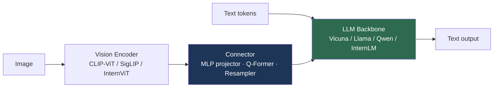
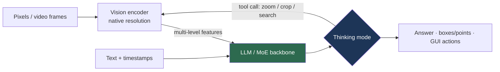

# Large Vision-Language Models (LMMs)

> **Last Updated:** October 2026
> **Level:** Advanced
> **Related Sections:**
> - [Multimodal Architectures](../03_architectures/04_multimodal_architectures.md)
> - [Multimodal LLMs 2025–2026](../12_research_frontier_2024_2026/03_multimodal_llm_2025_2026.md)
> - [VLA Models](../06_robotics_and_embodied_ai/01_vla_models.md)
> - [Document & OCR](./04_document_and_ocr.md)

> **🆕 October 2026 update:**
> - New section **"The 2025–2026 Generation"**: Qwen3-VL (Interleaved-MRoPE, DeepStack, text–timestamp alignment, 256K→1M context), InternVL3/3.5 (Cascade RL, Visual Resolution Router, decoupled deployment), Qwen3.5 (native early-fusion multimodality), NVIDIA Eagle 2.5, and Gemma 4 open models.
> - Proprietary frontier updated: GPT-5 / GPT-5.5, Gemini 3 Pro / 3.1 Pro, Claude Opus 4.5 / 4.7 (first Claude with high-resolution image input).
> - Added the **"thinking VLM"** pattern: RL-tuned reasoning modes, thinking-with-images tool calls, and GUI/computer-use agents.
> - New 2025–2026 benchmark table (MMMU, MMMU-Pro, Video-MMMU, ScreenSpot-Pro, OSWorld; vendor-reported), new Key Papers and Open Problems.

---

## Overview

Large multimodal models (LMMs, or large vision-language models) extend the autoregressive LLM to accept interleaved image (and increasingly video/audio) inputs, producing free-form text grounded in visual content. They are the perceptual front-end of modern AI systems and the direct ancestors of the VLAs in [VLA Models](../06_robotics_and_embodied_ai/01_vla_models.md)—RT-2 and Gemini Robotics are LMMs with an action head. The field organizes around a key architectural axis: **CLIP-adapter (modular) models**, which bolt a pretrained vision encoder onto a pretrained LLM via a lightweight connector (LLaVA, InstructBLIP), versus **natively multimodal models** trained on interleaved data from the start (Flamingo, GPT-4o, Gemini).

The 2023–2026 trajectory is one of rapid convergence between open and closed models. The LLaVA lineage demonstrated that a *simple* projection between a frozen CLIP encoder and an open LLM, trained on modest instruction data, could approach proprietary quality at a fraction of the cost; InternVL then scaled the open vision encoder to 6B parameters to close the gap further. Meanwhile closed models (GPT-4o, Gemini 1.5/2.0) pushed native multimodality, real-time audio-vision, and million-token video context. This file maps the architecture taxonomy, traces the major model families, and compares them on the standard LMM benchmark suite (MMBench, MMMU, MathVista, DocVQA, RefCOCO).

Between mid-2025 and October 2026 three further shifts happened. (1) **Native multimodality reached open models**: Qwen3.5 (Feb 2026) is trained with early fusion on text, image and video tokens rather than bolting a vision tower onto a finished LLM, and its release notes claim it outperforms the dedicated Qwen3-VL line. (2) **Reasoning via reinforcement learning** became standard: almost every frontier VLM ships an "Instruct" and a "Thinking" variant, and RL stages (MPO/GSPO in InternVL3.5, large-scale agentic RL in Qwen3.5) drive MMMU-class gains. (3) **Agentic perception**: VLMs now operate GUIs, emit grounded boxes/points, and call tools on images (zoom, crop, search) during reasoning. Saturation of MMBench/DocVQA moved evaluation to MMMU-Pro, Video-MMMU, ScreenSpot-Pro and OSWorld.

---

## Architecture Taxonomy



**CLIP-adapter (modular).** A frozen (or lightly tuned) vision encoder produces visual tokens that a **connector** maps into the LLM's embedding space. Connector designs range from a simple **MLP projector** (LLaVA-1.5) to a **Q-Former** (BLIP-2, a learned set of query tokens that cross-attend to image features) to a **Perceiver Resampler** (Flamingo). Training is typically two-stage: (1) connector pretraining on image-caption data to align modalities, then (2) visual instruction tuning on multimodal dialogues.

**Natively multimodal.** Models like Flamingo [Alayrac2022] interleave cross-attention layers into a frozen LLM to attend to images, trained on web-scale interleaved image-text; GPT-4o and Gemini are trained multimodally end-to-end, enabling interleaved image-text reasoning and (for GPT-4o) real-time audio-vision. See [Multimodal Architectures](../03_architectures/04_multimodal_architectures.md) for the fusion-mechanism details.

---

## Major Model Families

### The LLaVA Lineage

**LLaVA** [Liu2023] (NeurIPS 2023) introduced *visual instruction tuning*: GPT-4-generated multimodal instruction data + a simple linear projection from CLIP-ViT to Vicuna. **LLaVA-1.5** swapped the linear projector for a two-layer MLP, added academic-task data and higher resolution, and became a strong, cheap baseline. **LLaVA-1.6 / LLaVA-NeXT** added dynamic high-resolution ("AnyRes" tiling) and stronger LLMs. **LLaVA-OneVision** unified single-image, multi-image, and video understanding in one model with transfer across modalities. The lineage's significance is methodological: it proved competitive LMMs can be built cheaply and reproducibly.

### InternVL

**InternVL** [Chen2024c] (CVPR 2024) scaled the *vision* side, pairing a 6B-parameter **InternViT-6B** with an LLM via a progressive alignment strategy. **InternVL 1.5 / 2 / 2.5** became the leading open-source LMMs, with InternVL2.5 matching or surpassing some proprietary models on MMMU and MMBench—the clearest evidence that the open–closed gap had largely closed by 2025.

### Proprietary Frontier

**GPT-4V → GPT-4o** (OpenAI) moved from vision-capable GPT-4 to a natively multimodal "omni" model with interleaved image-text and real-time audio-vision. **Gemini 1.5 Pro** (Google) introduced a **1M-token context window** enabling long-video understanding (validated by needle-in-a-haystack video retrieval), extended in **Gemini 2.0 Flash**. **Qwen-VL / Qwen2-VL** (Alibaba) are strong on document understanding and Chinese content with dynamic-resolution encoding. The 2025–2026 frontier is tracked in [Multimodal LLMs 2025–2026](../12_research_frontier_2024_2026/03_multimodal_llm_2025_2026.md).

---

## The 2025–2026 Generation

### Open-Weight Models

**Qwen3-VL** [Bai2025] (Alibaba Qwen Team; released Sept–Oct 2025, technical report Nov 2025) spans dense 2B/4B/8B/32B and MoE 30B-A3B / 235B-A22B models, each in Instruct and Thinking editions, with a native **256K-token** interleaved context expandable to 1M. Three architectural changes target long video and fine detail:

```
Qwen3-VL architecture updates (per the official repo / tech report):
  1. Interleaved-MRoPE: rotary frequencies allocated across time, height and
     width in an interleaved way (vs. contiguous blocks in Qwen2-VL's M-RoPE)
     -> better long-horizon video position encoding
  2. DeepStack: visual features from several ViT depths are injected into
     successive LLM layers, not only the final ViT layer at the input
     -> finer detail, tighter image-text alignment
  3. Text-timestamp alignment: explicit textual timestamps interleaved with
     frame tokens (replacing T-RoPE) -> second-level event localisation
```

It also expands OCR to 32 languages, adds 2D/3D grounding, and ships "thinking with images" cookbooks in which the model calls an image-zoom tool mid-reasoning. The technical report gives MMMU 78.7 (Instruct) and 80.6 (Thinking) for the 235B-A22B model.

**InternVL3 / InternVL3.5** [Wang2025] (Shanghai AI Lab; Apr / Aug 2025). InternVL3 introduced *native multimodal pre-training* and variable visual position encoding. InternVL3.5 adds **Cascade RL** (offline MPO warm-up followed by online GSPO), a **Visual Resolution Router (ViR)** that picks a per-patch token-compression rate, and **Decoupled Vision-Language Deployment (DvD)**, which places the vision encoder and LLM on different GPUs. The authors report up to a 4.05× inference speedup over InternVL3 and MMMU 77.7 for InternVL3.5-241B-A28B, the best open-source result at release; a GPT-OSS-20B-based variant is also provided.

**Qwen3.5 → Qwen3.6 → Qwen3.8** (Feb–Aug 2026). Qwen3.5-397B-A17B (16 Feb 2026) unifies the LLM and VLM lines: early-fusion training on "trillions of multimodal tokens", a hybrid **Gated DeltaNet (linear attention) + sparse MoE** backbone, 201 languages, and RL across agentic environments. Smaller dense/MoE sizes (0.8B–122B-A10B) followed in Feb–Mar 2026; Qwen3.6 (Apr 2026) and Qwen3.8 (Aug 2026; 27B and 2.4T-A95B) build on the same architecture with an emphasis on agentic tasks.

**Other open families.** NVIDIA **Eagle 2.5** (NeurIPS 2025) targets long-context video/image understanding and is the VLM backbone of GR00T N1.5, with a native-resolution variant in GR00T N1.6 (see [VLA Models](../06_robotics_and_embodied_ai/01_vla_models.md)). Google **Gemma 4** (Apr 2026, Apache 2.0) provides natively multimodal open models from on-device E2B/E4B variants up to a 31B dense model. Compact encoders also matured: SigLIP 2, Meta's Perception Encoder / PerceptionLM (1B/3B/8B, open data) and DINOv3 are common vision towers (see [VLP Models](./01_vlp_models.md)).

### Proprietary Frontier (2025–2026)

| Model | Developer | Release | Vision-relevant notes (vendor-reported) |
|-------|-----------|---------|-----------------------------------------|
| GPT-5 | OpenAI | Aug 2025 | Unified reasoning model; MMMU 84.2 (high reasoning) |
| Gemini 3 Pro | Google DeepMind | Nov 2025 | MMMU-Pro 81%, Video-MMMU 87.6%, ScreenSpot-Pro 72.7% |
| Claude Opus 4.5 | Anthropic | Nov 2025 | OSWorld 66.3% (computer use); MMMU 80.7% |
| Gemini 3.1 Pro | Google DeepMind | Feb 2026 | Successor to Gemini 3 Pro; ~1M-token multimodal context |
| Claude Opus 4.7 | Anthropic | Apr 2026 | First Claude with high-resolution images: long edge raised from 1,568 px to 2,576 px (~3.75 MP) |
| GPT-5.5 | OpenAI | Apr 2026 | MMMU-Pro 81.2% (no tools) / 83.2% (with tools) in OpenAI's launch tables |

The qualitative trend is convergence: frontier closed models and the best open models (Qwen3.5/3.8, InternVL3.5) now differ by a few points on MMMU-class benchmarks, while the larger remaining gaps are in GUI agency, long video and high-resolution fine detail.



---

## Key Papers

| Paper | Authors | Year | Venue | Key Contribution |
|-------|---------|------|-------|-----------------|
| Flamingo | Alayrac, Donahue, Luc, et al. | 2022 | NeurIPS | Interleaved image-text via Perceiver Resampler + gated cross-attn |
| BLIP-2 | Li, Li, Savarese, Hoi | 2023 | ICML | Q-Former connector bridging frozen encoder & LLM |
| LLaVA | Liu, Li, Wu, Lee | 2023 | NeurIPS | Visual instruction tuning; simple projector + Vicuna |
| InternVL | Chen, Wu, Wang, et al. | 2024 | CVPR | InternViT-6B; scaling the open vision encoder |
| Qwen2-VL | Wang, Bai, Tan, et al. | 2024 | arXiv | Dynamic-resolution encoding; strong doc/multilingual |
| Eagle 2.5 | Chen et al. (NVIDIA) | 2025 | NeurIPS | Long-context VLM; backbone of GR00T N1.5 |
| InternVL3.5 | Wang et al. (Shanghai AI Lab) | 2025 | arXiv | Cascade RL; Visual Resolution Router; decoupled deployment |
| Qwen3-VL | Bai et al. (Qwen Team) | 2025 | arXiv | Interleaved-MRoPE, DeepStack, text–timestamp alignment; 256K context |

---

## Benchmark Performance

| Model | MMBench | MMMU | MathVista | DocVQA | Notes |
|-------|---------|------|-----------|--------|-------|
| LLaVA-1.5-13B | ~67 | ~36 | ~27 | — | Cheap reproducible baseline |
| InternVL2.5-78B | ~88 | ~70 | ~72 | ~95 | Open-source frontier (approx.) |
| Qwen2-VL-72B | ~86 | ~64 | ~70 | ~96 | Strong document understanding |
| GPT-4o | ~83 | ~69 | ~63 | ~92 | Native multimodal, real-time |
| Gemini 1.5 Pro | ~80 | ~62 | ~63 | ~93 | 1M-token video context |

*Scores are approximate, vary by eval protocol/version, and move quickly—treat as indicative and consult current leaderboards. RefCOCO (referring grounding) is reported separately for grounding-capable variants.*

**2025–2026 models (harder benchmarks).** MMBench and DocVQA are near saturation for frontier models, so reporting moved to MMMU / MMMU-Pro (expert multi-discipline reasoning), Video-MMMU, ScreenSpot-Pro (GUI grounding) and OSWorld (computer use).

| Model | MMMU | MMMU-Pro | Video-MMMU | GUI / agent | Notes |
|-------|------|----------|------------|-------------|-------|
| InternVL3.5-241B-A28B | 77.7 | — | — | — | Open weights; developer-reported |
| Qwen3-VL-235B-A22B (Thinking) | 80.6 | — | — | — | Open weights; tech report |
| GPT-5 (high) | 84.2 | — | — | — | Vendor-reported |
| Claude Opus 4.5 | 80.7 | — | — | OSWorld 66.3% | Vendor-reported |
| Gemini 3 Pro | — | 81% | 87.6% | ScreenSpot-Pro 72.7% | Vendor-reported |
| GPT-5.5 | — | 81.2% (no tools) | — | — | Vendor-reported; independent harnesses (e.g. Vals.ai) report different absolute numbers |

*Not directly comparable: reasoning budgets, tool use, prompt formats and benchmark versions differ across vendors.*

---

## Pros & Cons

| Aspect | Pros | Cons |
|--------|------|------|
| CLIP-adapter (LLaVA) | Cheap, reproducible, fast to iterate | Bounded by frozen encoder; weaker fine-grained perception |
| Native multimodal (GPT-4o/Gemini) | Interleaved reasoning, real-time, long context | Closed weights; massive compute; opaque |
| Scaled open encoder (InternVL) | Closes gap to proprietary; open weights | Heavy 6B encoder; expensive to train |
| Q-Former (BLIP-2) | Compresses visual tokens efficiently | Harder to train; can bottleneck detail |
| Native early fusion (Qwen3.5, Gemini) | No separate VLM line; text ability preserved; strong agents | Requires training from scratch on mixed data; very expensive |
| RL "thinking" modes | Large gains on MMMU/MathVista-type reasoning | Higher latency and cost; reasoning faithfulness hard to verify |

---

## Open Problems & Research Gaps

- **Spatial and fine-grained perception.** LMMs still fail at precise spatial relations and small-object/text detail (see [Spatial Intelligence](../12_research_frontier_2024_2026/06_spatial_intelligence.md)).
- **Hallucination.** Object and attribute hallucination persists; grounding and faithfulness remain unsolved.
- **Visual token efficiency.** High-resolution images explode token counts; optimal compression (Q-Former vs. tiling vs. pooling) is unsettled.
- **Video at scale.** Long-video understanding beyond keyframe sampling, with true temporal reasoning, is immature even at 1M-token context.
- **Evaluation integrity.** Benchmark contamination and format-overfitting inflate scores; robust evaluation is an open methodological problem.
- **Connector design.** No consensus on the best encoder→LLM connector; the choice materially affects perception fidelity.
- **Unified any-to-any.** Truly unified models handling image, video, audio, and action (toward VLAs) remain early.
- **Grounded reasoning.** RL-tuned "thinking" improves benchmark scores, but whether reasoning chains are visually grounded rather than language-prior driven is poorly measured.
- **Adaptive visual compute.** Routers such as InternVL3.5's ViR and token pruning (see [Model Compression](../09_efficiency_and_deployment/00_model_compression.md)) decide token budgets heuristically; principled, query-aware allocation is open.
- **Cross-vendor evaluation.** Vendor-reported MMMU-Pro / OSWorld numbers use different harnesses and tool settings, so independent, reproducible evaluation is a growing need.

---

## Further Reading

- [LLaVA (arXiv:2304.08485)](https://arxiv.org/abs/2304.08485) — visual instruction tuning
- [BLIP-2 (arXiv:2301.12597)](https://arxiv.org/abs/2301.12597) — Q-Former connector
- [InternVL (arXiv:2312.14238)](https://arxiv.org/abs/2312.14238) — scaling the open vision encoder
- [Flamingo (arXiv:2204.14198)](https://arxiv.org/abs/2204.14198) — interleaved few-shot multimodal learning
- [Qwen2-VL (arXiv:2409.12191)](https://arxiv.org/abs/2409.12191) — dynamic-resolution multimodal model
- [Qwen3-VL Technical Report (arXiv:2511.21631)](https://arxiv.org/abs/2511.21631) — Interleaved-MRoPE, DeepStack, 256K context
- [InternVL3.5 (arXiv:2508.18265)](https://arxiv.org/abs/2508.18265) — Cascade RL, Visual Resolution Router, decoupled deployment
- [Eagle 2.5 (arXiv:2504.15271)](https://arxiv.org/abs/2504.15271) — long-context frontier VLM from NVIDIA
- [Qwen3.5 / 3.6 / 3.8 repository](https://github.com/QwenLM/Qwen3.5) — native multimodal open models (2026)
- [Qwen3-VL repository and cookbooks](https://github.com/QwenLM/Qwen3-VL) — grounding, GUI agents, thinking-with-images
