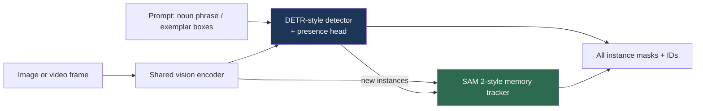

# Open-Vocabulary Detection & Segmentation

> **Last Updated:** October 2026
> **Level:** Advanced
> **Related Sections:**
> - [Object Detection](../02_core_tasks/01_object_detection.md)
> - [The "Anything" Model Paradigm](../12_research_frontier_2024_2026/02_any_model_paradigm.md)
> - [VLP Models](./01_vlp_models.md)
> - [Large Vision-Language Models](./02_large_vision_language_models.md)

> **🆕 October 2026 update:**
> - New section on **SAM 3** (Meta, Nov 2025; ICLR 2026): Promptable Concept Segmentation of *every* instance of a noun phrase or exemplar in images and video, the SA-Co benchmark (270K concepts), and SAM 3.1 Object Multiplex (Mar 2026).
> - Added 2025 detectors: **LLMDet** (CVPR 2025 highlight, LLM-caption supervision), **YOLOE** (ICCV 2025, real-time text/visual/prompt-free), **DINO-X**, and MLLM-as-detector models (**Rex-Omni**, Qwen3-VL grounding, NVIDIA LocateAnything, ECCV 2026).
> - Benchmark table extended with LVIS / COCO / SA-Co numbers from the SAM 3, LLMDet and YOLOE releases; Open Problems revised (segmentation parity largely reached; concept-level human gap remains).

---

## Overview

Open-vocabulary detection (OVD) and segmentation aim to localize and recognize object categories *not seen during training*, specified at inference time by arbitrary text. This breaks the fundamental constraint of classical detectors (R-CNN, YOLO, DETR—see [Object Detection](../02_core_tasks/01_object_detection.md)), which can only predict from a fixed label set defined at training time. The enabling idea is to replace the closed-set classification head with **alignment to a language embedding space**: a region's visual feature is matched against text embeddings (typically from CLIP), so any concept expressible in language becomes a candidate class. This reframes detection as a vision-language grounding problem and is the localization counterpart to the universal segmentation models in [The "Anything" Model Paradigm](../12_research_frontier_2024_2026/02_any_model_paradigm.md).

The field splits along two strategies. **Embedding-alignment methods** (ViLD, RegionCLIP, OWL-ViT) distill or align region features to CLIP's text space, inheriting CLIP's open-vocabulary knowledge. **Grounding-pretraining methods** (GLIP, Grounding DINO) reformulate detection as phrase grounding and pretrain on large-scale detection + grounding + caption data, unifying detection and referring expression comprehension. A third practical line (Detic, YOLO-World) emphasizes scaling vocabulary via image-level labels or real-time efficiency. This file surveys these approaches, their benchmarks (LVIS, ODinW), and the open challenges of localization quality versus semantic coverage.

Since 2025 two further lines have reshaped the field. **Concept-prompted segmentation foundation models**, led by SAM 3, merge open-vocabulary detection, instance segmentation and video tracking into one promptable model trained on a data engine with millions of concept labels. **MLLM-based detectors** (Rex-Omni, Qwen3-VL, LocateAnything) treat boxes or points as tokens emitted by a vision-language model, trading speed for richer language understanding (referring expressions, reasoning about attributes).

---

## Embedding-Alignment Methods

**ViLD** [Gu2021] (ICLR 2022) distills CLIP image embeddings into a two-stage detector: a class-agnostic region proposal network generates boxes, and region features are trained to match CLIP's image embeddings (ViLD-image) and text embeddings of category names (ViLD-text). At inference, novel categories are detected by embedding their names. **RegionCLIP** extends CLIP to region-level alignment via region-text pretraining. **OWL-ViT** [Minderer2022] (ECCV 2022) and **OWLv2** take a ViT-based one-stage approach: a CLIP-pretrained ViT with detection heads, fine-tuned on detection data, enabling efficient open-vocabulary and one-shot (image-conditioned) detection. OWLv2 scales via self-training on pseudo-annotations.

```mermaid
graph LR
    I[Image] --> R[Region proposals /<br/>per-patch features]
    R --> V[Region visual embeddings]
    T[Text prompts<br/>'a photo of a {category}'] --> TE[CLIP text encoder]
    V --> M[Cosine similarity]
    TE --> M
    M --> O[Open-vocab boxes + labels]
    style M fill:#1d3557,color:#fff
```

---

## Grounding-Pretraining Methods

**GLIP** [Li2022b] (CVPR 2022) unifies object detection and phrase grounding: it reformulates detection as aligning region features with words in a text prompt, pretraining on 27M grounding pairs (including image-text with self-trained boxes). This gives strong zero-shot transfer and a single model for detection and referring. **Grounding DINO** [Liu2023b] marries the DINO DETR-style detector with grounded pretraining, achieving strong open-set detection from arbitrary text and becoming the detection half of **Grounded-SAM** (text → boxes → masks via SAM). These models excel at language-driven localization but are heavier than embedding-alignment detectors.

---

## Scaling and Efficiency

**Detic** [Zhou2022] (ECCV 2022) expands the detectable vocabulary to ~21k classes by training the *classifier* on image-level labels (ImageNet-21k), decoupling localization from classification and sidestepping the need for box annotations on rare classes. **YOLO-World** [Cheng2024] (CVPR 2024) brings open-vocabulary detection to **real-time** by re-parameterizing CLIP text embeddings into a YOLO detector with a vision-language path aggregation network, achieving high LVIS zero-shot AP at YOLO speeds—important for robotics and edge deployment.

**YOLOE** [Wang2025b] (ICCV 2025) unifies detection and segmentation under three prompt types in one real-time YOLO: *Re-parameterizable Region-Text Alignment* (RepRTA) for text prompts, a *Semantic-Activated Visual Prompt Encoder* (SAVPE) for visual prompts, and *Lazy Region-Prompt Contrast* (LRPC) for a prompt-free mode with a built-in large vocabulary. After re-parameterisation it behaves like a closed-set YOLO with zero extra inference cost; the authors report YOLOE-v8-S beating YOLO-Worldv2-S by 3.5 AP on LVIS with 3× less training cost and 1.4× faster inference. **LLMDet** [Fu2025] (CVPR 2025 highlight) co-trains a Grounding-DINO-style detector with an LLM that generates region-level short captions and image-level long captions (GroundingCap-1M), improving rare-class AP; it is merged into Hugging Face `transformers` (v4.55). **DINO-X** (IDEA Research, 2024–2025) scales the Grounding DINO line into a unified open-world model with a prompt-free "detect everything" mode.

---

## Concept-Level Segmentation: SAM 3 (2025–2026)

**SAM 3** [Carion2026] (Meta, released 20 Nov 2025; ICLR 2026) defines **Promptable Concept Segmentation (PCS)**: given a short noun phrase ("yellow school bus"), image exemplars, or both, return masks and identities for *all* matching instances in an image or video. This is exactly the open-vocabulary detection-plus-segmentation problem, but with exhaustive instance recall and tracking.

- **Architecture (848M parameters):** a detector and a tracker share one vision encoder. The detector is DETR-based and conditioned on text, geometry and exemplars; the tracker inherits SAM 2's memory-based encoder-decoder. A **presence token/head** first decides *whether* the concept is present before localising it, which helps separate close prompts ("a player in white" vs. "a player in red").
- **Data:** a human + model-in-the-loop data engine annotated over **4M unique concepts**, including hard negatives. The new **SA-Co** benchmark has **270K unique concepts**, over 50× more than earlier open-vocabulary benchmarks.
- **Results (official repo):** 48.5 mask AP on LVIS and 53.6 box AP on LVIS, 56.4 AP on COCO, and 54.1 mask cgF1 on SA-Co/Gold versus 72.8 for humans, i.e. roughly 75–80% of human performance.
- **SAM 3.1 (27 Mar 2026):** *Object Multiplex* groups tracked objects into fixed-capacity buckets processed jointly, giving ~7× speed-up at 128 objects on one H100 compared with the November 2025 release.
- **Related:** SAM 3D (Meta, Nov 2025) lifts objects and bodies from a single image to 3D; DINOv3's `dino.txt` head provides zero-shot open-vocabulary segmentation from a frozen SSL backbone. See [The "Anything" Model Paradigm](../12_research_frontier_2024_2026/02_any_model_paradigm.md).



## MLLMs as Open-Vocabulary Detectors

A parallel trend lets a multimodal LLM output coordinates directly. **Rex-Omni** (IDEA Research, Oct 2025) is a 3B MLLM that "detects anything via next point prediction", casting detection, pointing, keypoints and OCR boxes as next-token prediction with SFT followed by GRPO. **Qwen3-VL** emits relative-coordinate boxes and points and supports 3D grounding. NVIDIA's **LocateAnything** (built on Eagle; accepted to ECCV 2026) is a generalist vision-language grounding model. These models handle long, compositional referring expressions far better than CLIP-embedding detectors, but are slower and generally behind specialised detectors on dense, exhaustive LVIS-style evaluation (compare Gemini 2.5's low SA-Co numbers in the SAM 3 tables).

---

## Key Papers

| Paper | Authors | Year | Venue | Key Contribution |
|-------|---------|------|-------|-----------------|
| ViLD | Gu, Lin, Kuo, Cui | 2021 | ICLR 2022 | Distill CLIP embeddings into a detector |
| GLIP | Li, Zhang, Zhang, et al. | 2022 | CVPR | Unify detection & phrase grounding pretraining |
| OWL-ViT | Minderer, Gritsenko, Stone, et al. | 2022 | ECCV | ViT-based open-vocab & one-shot detection |
| Detic | Zhou, Girdhar, Joulin, et al. | 2022 | ECCV | 21k-class detection via image-level labels |
| Grounding DINO | Liu, Zeng, Ren, et al. | 2023 | arXiv→ECCV 2024 | Grounded DETR; basis of Grounded-SAM |
| YOLO-World | Cheng, Song, Ge, et al. | 2024 | CVPR | Real-time open-vocabulary detection |
| LLMDet | Fu et al. | 2025 | CVPR (highlight) | Co-training a detector with LLM-generated region and image captions |
| YOLOE | Wang, Liu, Chen, et al. | 2025 | ICCV | Real-time detection+segmentation with text, visual, or no prompts |
| Rex-Omni | IDEA Research | 2025 | arXiv | 3B MLLM detection via next-point prediction |
| SAM 3 | Carion, Gustafson, Hu, et al. | 2025 | ICLR 2026 | Promptable Concept Segmentation; presence head; SA-Co benchmark |

---

## Benchmark Performance

| Model | Benchmark | Metric | Score | Notes |
|-------|-----------|--------|-------|-------|
| ViLD | LVIS | AP_rare (novel) | ~16.1 | Two-stage distillation [Gu2021] |
| GLIP-L | LVIS / ODinW | zero-shot AP | strong | Grounding pretraining [Li2022b] |
| OWLv2 | LVIS | zero-shot AP | SOTA (2023) | Self-training scaling |
| Detic | LVIS | AP_rare | ~24+ | Image-level supervision [Zhou2022] |
| YOLO-World-L | LVIS | zero-shot AP | ~35 AP @ real-time | Edge-friendly [Cheng2024] |
| YOLOE-v8-L | LVIS minival | fixed AP (text) | 35.9 (AP_r 33.2) | 102.5 FPS on T4/TensorRT [Wang2025b] |
| LLMDet Swin-L | LVIS minival | fixed AP | 51.1 (AP_r 45.1) | LLM-supervised [Fu2025] |
| DINO-X | LVIS / COCO | box AP | 52.4 / 56.0 | As tabulated in the SAM 3 release |
| OWLv2 | LVIS / COCO | box AP | 45.5 / 46.1 | Partially trained on LVIS (SAM 3 table) |
| SAM 3 | LVIS / COCO | box AP | 53.6 / 56.4 | 848M params [Carion2026] |
| SAM 3 | LVIS | mask AP | 48.5 | Zero-shot instance segmentation |
| SAM 3 | SA-Co/Gold | mask cgF1 | 54.1 (human 72.8) | Concept-level, 270K-concept benchmark |

*Numbers approximate; LVIS rare-class AP is the standard open-vocab metric. Newer rows are taken from the official repositories; evaluation splits (minival vs. val) and training-data overlap with LVIS differ between rows.*

---

## Pros & Cons

| Aspect | Pros | Cons |
|--------|------|------|
| Embedding alignment (ViLD/OWL) | Inherits CLIP knowledge; simple | Localization quality bounded by proposals/CLIP |
| Grounding pretraining (GLIP/G-DINO) | Strong language-driven localization; referring | Heavy; slower; data-intensive |
| Image-level scaling (Detic) | Huge vocabulary cheaply | Weaker localization on rare classes |
| Real-time (YOLO-World) | Edge/robotics deployable | Lower ceiling than heavy grounders |
| Concept segmentation (SAM 3) | Exhaustive instances + masks + video tracking from one prompt | ~0.85B params; short noun phrases only; out-of-domain terms weaker |
| MLLM detectors (Rex-Omni, Qwen3-VL) | Rich language and reasoning; referring and pointing | Slow autoregressive decoding; weaker exhaustive recall |

---

## Open Problems & Research Gaps

- **Localization vs. recognition gap.** Open-vocab recognition outpaces open-vocab *localization*; novel-class boxes are still imprecise.
- **CLIP's limitations propagate.** Spatial and compositional weaknesses of CLIP (see [Spatial Intelligence](../12_research_frontier_2024_2026/06_spatial_intelligence.md)) bound detector performance.
- **Long-tail and rare classes.** LVIS rare-class AP remains far below common-class AP.
- **Segmentation parity.** Open-vocabulary *segmentation* (OV-Seg, OpenSeeD) long lagged detection in maturity; SAM 3 largely closes this gap for short noun phrases, but long, compositional descriptions still require pairing it with an MLLM (the official repo shows SAM 3 used as a tool by an MLLM).
- **Human gap at concept level.** On SA-Co/Gold SAM 3 reaches 54.1 cgF1 versus 72.8 for humans, and its authors report weaker generalisation to out-of-domain concept terms (e.g. specialist vocabularies).
- **Unifying MLLM and detector strengths.** Combining the language understanding of MLLM detectors with the speed and recall of DETR/YOLO-style detectors is unresolved.
- **Prompt sensitivity.** Performance varies with prompt phrasing; robust prompting is unsolved.
- **Real-time heavy models.** Bringing GLIP/Grounding-DINO accuracy to real-time edge budgets is open (relevant to [Perception for Robotics](../06_robotics_and_embodied_ai/08_perception_for_robotics.md)).

---

## Further Reading

- [ViLD (arXiv:2104.13921)](https://arxiv.org/abs/2104.13921) — open-vocab detection via vision-language distillation
- [GLIP (arXiv:2112.03857)](https://arxiv.org/abs/2112.03857) — grounded language-image pretraining
- [Grounding DINO (arXiv:2303.05499)](https://arxiv.org/abs/2303.05499) — open-set detection transformer
- [Detic (arXiv:2201.02605)](https://arxiv.org/abs/2201.02605) — detecting twenty-thousand classes
- [YOLO-World (arXiv:2401.17270)](https://arxiv.org/abs/2401.17270) — real-time open-vocabulary detection
- [SAM 3 (arXiv:2511.16719)](https://arxiv.org/abs/2511.16719) and [official repository](https://github.com/facebookresearch/sam3) — Segment Anything with Concepts; SAM 3.1 release notes
- [LLMDet (arXiv:2501.18954)](https://arxiv.org/abs/2501.18954) — open-vocabulary detection under LLM supervision
- [YOLOE (arXiv:2503.07465)](https://arxiv.org/abs/2503.07465) — real-time seeing anything
- [DINO-X (arXiv:2411.14347)](https://arxiv.org/abs/2411.14347) — unified open-world object detection and understanding
- [Rex-Omni (arXiv:2510.12798)](https://arxiv.org/abs/2510.12798) — detect anything via next point prediction
