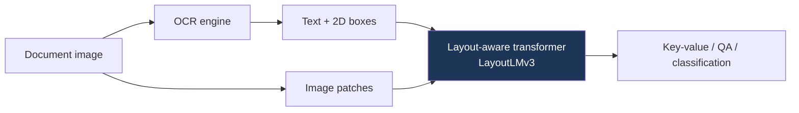
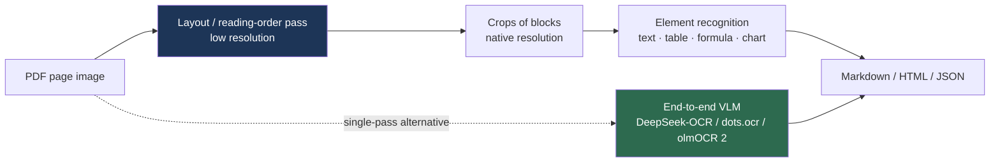

# Document Understanding & OCR

> **Last Updated:** October 2026
> **Level:** Advanced
> **Related Sections:**
> - [Large Vision-Language Models](./02_large_vision_language_models.md)
> - [Overview: Vision-Language](./00_overview.md)
> - [Multimodal LLMs 2025–2026](../12_research_frontier_2024_2026/03_multimodal_llm_2025_2026.md)

> **🆕 October 2026 update:**
> - New section on the **2025–2026 wave of compact end-to-end document parsers**: DeepSeek-OCR (optical context compression) and DeepSeek-OCR 2, PaddleOCR-VL 0.9B (→ 1.5 → 1.6), dots.ocr / dots.mocr, olmOCR 2 (RL with unit-test rewards), and MinerU2.5.
> - New benchmarks: **OmniDocBench** (v1.5/v1.6, page-level parsing) and **olmOCR-Bench** (7,000+ unit tests); added a verified olmOCR-Bench comparison table.
> - General VLM update: Qwen3-VL expands OCR to 32 languages and long-document structure parsing.
> - Revised the "dedicated pipelines disappear" claim: specialised ~1–3B parsers now beat much larger general VLMs on page-level parsing at a fraction of the cost.

---

## Overview

Document AI sits at the intersection of vision, language, and layout: the task is to read and reason over structured visual documents—forms, invoices, receipts, scientific papers, tables, charts, and infographics—where *spatial layout* carries semantic meaning that plain OCR text discards. The field has moved through three paradigms. First, **OCR-then-language** pipelines fed recognized text (and 2D positions) into layout-aware transformers (LayoutLM family). Second, **OCR-free** end-to-end models (Donut, Pix2Struct) read pixels directly and generate structured output, eliminating the brittle, error-propagating OCR stage. Third, **general VLMs** (Qwen2-VL, InternVL, GPT-4o) absorbed document understanding as one capability among many, using high-resolution encoding to read dense text natively—now the dominant approach (see [Large Vision-Language Models](./02_large_vision_language_models.md)).

The central technical challenge is **high-resolution dense-text perception**: a document page may contain thousands of characters that demand far higher effective resolution than natural-image VLMs typically use, forcing tiling/dynamic-resolution schemes and exploding visual-token counts. A second challenge is *structured output*: documents require reading order, table structure, and key-value extraction, not just free text. This file surveys the layout-aware, OCR-free, and VLM-based approaches, the benchmarks (DocVQA, ChartQA, InfographicVQA, OCRBench), and the unresolved problems of robust structure extraction.

---

## Layout-Aware Models

**LayoutLM** [Xu2020] (KDD 2020, Microsoft) augmented BERT with **2D positional embeddings** (token bounding-box coordinates), pretraining on the IIT-CDIP document corpus. **LayoutLMv2** added image embeddings and a spatial-aware self-attention; **LayoutLMv3** [Huang2022b] (ACM MM 2022) unified text and image masking with a single multimodal transformer over patch + text tokens, dropping the dependence on a separate CNN, and became a strong backbone for form/receipt understanding (FUNSD, CORD). These models still require an upstream OCR engine, inheriting its errors.

---

## OCR-Free End-to-End Models

**Donut** [Kim2022] (ECCV 2022) is an OCR-free encoder-decoder: a Swin vision encoder reads the raw page and a transformer decoder generates structured output (JSON) directly, trained with synthetic document generation (SynthDoG). **Pix2Struct** [Lee2023] (ICML 2023) pretrains by parsing webpage screenshots into simplified HTML, a screenshot-to-structure objective that transfers strongly to charts, UIs, and documents. **Nougat** [Blecher2023] (Meta) targets academic PDFs, converting page images to markup (LaTeX/Markdown) for scientific documents. **GOT-OCR2.0** (2024) is a compact general OCR-2.0 model handling text, formulas, tables, and sheet music in a unified end-to-end manner.

---

## VLM-Based Document Understanding

Modern general VLMs now lead document benchmarks by treating reading as a special case of multimodal reasoning. **Qwen2-VL** uses **naive dynamic resolution** (variable visual tokens per image) and excels at dense-text and multilingual documents; **InternVL** uses dynamic high-resolution tiling; **GPT-4o** and **Gemini** read documents natively. The trend is the *disappearance of a dedicated document pipeline* into the general VLM—though specialized OCR-free models remain valuable for structured extraction and on-device use. **Qwen3-VL** (2025) extends OCR to 32 languages (from 10), robustness to blur/tilt/low light, rare and ancient characters, and long-document structure parsing into an HTML-style layout format.

---

## The 2025–2026 Wave: Compact End-to-End Document Parsers

The prediction that general VLMs would absorb document AI proved only half true. From mid-2025 a cluster of **small (0.9B–7B), document-specialised VLMs** appeared that read a whole page and emit structured Markdown/HTML/JSON (text, tables, formulas, reading order) in one pass, and that outperform much larger general VLMs on page-level parsing benchmarks while being cheap enough to process millions of PDFs (e.g. to build LLM pre-training corpora).

- **DeepSeek-OCR** [Wei2025] (DeepSeek-AI, Oct 2025). A *DeepEncoder* (window attention for high-resolution local perception → 16× convolutional token compressor → global attention) feeds a DeepSeek3B-MoE-A570M decoder. Framed as "contexts optical compression": ~97% OCR precision when text tokens are within 10× the vision tokens and ~60% at 20×. On OmniDocBench it outperforms GOT-OCR2.0 and MinerU2.0 while using fewer than 800 vision tokens per page. **DeepSeek-OCR 2** ("Visual Causal Flow", Jan 2026) revisits the encoder toward a more human-like ordering of visual tokens.
- **PaddleOCR-VL** [Cui2025] (Baidu, Oct 2025). A 0.9B VLM pairing a NaViT-style dynamic-resolution encoder with the ERNIE-4.5-0.3B language model, supporting 109 languages and text, tables, formulas and charts; a separate layout stage feeds element-level recognition. **PaddleOCR-VL-1.5** (Jan 2026) reports 94.5% on OmniDocBench v1.5, and **PaddleOCR-VL-1.6** (May 2026) reports 96.3% on OmniDocBench v1.6 with the same architecture.
- **dots.ocr** (rednote hilab, Jul 2025). A single VLM on a 1.7B LLM that performs layout detection and content recognition by switching prompts, preserving reading order; strong on low-resource languages. Rebranded/extended as **dots.mocr** (Mar 2026, ~3B), with a **dots.mocr-svg** variant that converts charts and diagrams to SVG code.
- **olmOCR 2** [Poznanski2025] (Ai2, Oct 2025). olmOCR-2-7B-1025 fine-tunes Qwen2.5-VL-7B and then applies **GRPO reinforcement learning with binary unit-test rewards** (text presence/absence, reading order, table cells, math rendering), generated from synthetic HTML re-renderings of real pages. It scores 82.4 on olmOCR-Bench, with the largest gains on math, tables and multi-column layouts; model, code and data are fully open.
- **MinerU2.5** [Niu2025] (Shanghai AI Lab / OpenDataLab, Sep 2025). A ~1.2B **decoupled coarse-to-fine** parser: global layout analysis on a down-sampled page, then native-resolution recognition on cropped regions, avoiding the token cost of encoding the full page at high resolution; a "MinerU2.5 Pro" report followed in 2026.

**New benchmarks.** **OmniDocBench** (OpenDataLab, CVPR 2025) evaluates page-level parsing of diverse PDFs (text edit distance, table TEDS, formula CDM, reading order), with v1.5 and v1.6 revisions used for 2026 claims. **olmOCR-Bench** (Ai2, May 2025) contains over 7,000 binary unit tests across about 1,400 documents (arXiv papers, old scans, tables, headers/footers, multi-column, tiny text), checking facts rather than edit distance.

---

## Key Papers

| Paper | Authors | Year | Venue | Key Contribution |
|-------|---------|------|-------|-----------------|
| LayoutLM | Xu, Li, Cui, et al. | 2020 | KDD | 2D positional embeddings for documents |
| LayoutLMv3 | Huang, Lv, Cui, et al. | 2022 | ACM MM | Unified text-image masking; patch-based |
| Donut | Kim, Hong, Yim, et al. | 2022 | ECCV | OCR-free image-to-JSON document parsing |
| Pix2Struct | Lee, Joshi, Turc, et al. | 2023 | ICML | Screenshot-to-HTML pretraining |
| Nougat | Blecher, Cucurull, Scialom, Stojnic | 2023 | arXiv (Meta) | Academic PDF → markup |
| Qwen2-VL | Wang, Bai, Tan, et al. | 2024 | arXiv | Dynamic resolution; SOTA doc understanding |
| MinerU2.5 | Niu et al. | 2025 | arXiv | Decoupled coarse-to-fine 1.2B document parser |
| PaddleOCR-VL | Cui et al. (Baidu) | 2025 | arXiv | 0.9B NaViT + ERNIE-4.5-0.3B; 109 languages |
| DeepSeek-OCR | Wei, Sun, Li | 2025 | arXiv | Optical context compression; DeepEncoder + 3B MoE decoder |
| olmOCR 2 | Poznanski, Soldaini, Lo | 2025 | arXiv | RL with unit-test rewards for document OCR |
| dots.ocr | rednote hilab | 2025 | arXiv | Unified layout + recognition in one 1.7B-LLM VLM |

---

## Benchmark Performance

| Model | DocVQA (ANLS) | ChartQA | InfoVQA | Notes |
|-------|---------------|---------|---------|-------|
| LayoutLMv3 | ~83 (DocVQA) | — | — | OCR-dependent [Huang2022b] |
| Donut | ~67–72 | — | — | OCR-free [Kim2022] |
| Pix2Struct-L | ~76 | ~58 | ~40 | Screenshot pretraining [Lee2023] |
| Qwen2-VL-72B | ~96 | ~88 | ~84 | VLM, dynamic res |
| GPT-4o | ~92 | ~85 | — | Native multimodal |

*ANLS = Average Normalized Levenshtein Similarity; scores approximate and version-dependent.*

**olmOCR-Bench (overall pass rate, %)** — values from the olmOCR repository table (* = numbers reported by the respective model authors):

| System | Overall | Tables | Old scans math | Multi-column | Notes |
|--------|---------|--------|----------------|--------------|-------|
| Mistral OCR API | 72.0 | 60.6 | 67.5 | 71.3 | Commercial API |
| MinerU 2.5.4* | 75.2 | 84.9 | 54.6 | 78.2 | Decoupled parser |
| DeepSeek-OCR | 75.7 | 80.2 | 73.6 | 66.4 | Optical compression |
| Marker 1.10.1 | 76.1 | 72.9 | 66.8 | 80.0 | Pipeline tool |
| PaddleOCR-VL* | 80.0 | 84.1 | 71.0 | 79.9 | 0.9B |
| olmOCR 2 (v0.4.0) | 82.4 | 84.9 | 82.3 | 83.7 | 7B, RL with unit tests |
| Chandra OCR 0.1.0* | 83.1 | 88.0 | 80.3 | 81.2 | Datalab |

**OmniDocBench (overall, developer-reported):** PaddleOCR-VL-1.5 94.5% (v1.5, Jan 2026); PaddleOCR-VL-1.6 96.3% (v1.6, May 2026). Benchmark versions differ, so treat cross-version comparisons with care.

---

## Pros & Cons

| Aspect | Pros | Cons |
|--------|------|------|
| Layout-aware (LayoutLM) | Strong structured extraction; explicit layout | OCR error propagation; pipeline complexity |
| OCR-free (Donut/Pix2Struct) | End-to-end, no OCR stage; robust | Needs high-res; harder to train |
| General VLMs | SOTA, unified, multilingual | Huge compute; weaker exact structure output |
| Specialized OCR-2.0 (GOT) | Compact, on-device, formulas/tables | Narrower than general VLMs |
| Compact document VLMs (2025–2026) | Beat general VLMs on page parsing; cheap at PDF-corpus scale | Benchmark-specific tuning; weaker open-ended document reasoning |
| RL with verifiable rewards (olmOCR 2) | Optimises the facts that matter (tables, math, order) | Requires synthetic ground truth; unit tests cover only selected properties |

---

## Open Problems & Research Gaps

- **High-resolution token explosion.** Reading dense pages inflates visual-token counts; efficient high-res encoding is unsolved (see [Large Vision-Language Models](./02_large_vision_language_models.md)).
- **Structured output fidelity.** VLMs read text well but produce exact table/JSON structure unreliably.
- **Reading order & long documents.** Multi-page, complex-layout reasoning remains weak.
- **Chart and diagram reasoning.** Numerical reasoning over charts (ChartQA) and infographics lags text QA.
- **Handwriting & low-resource scripts.** Robust recognition across scripts and handwriting is immature.
- **Hallucination in extraction.** VLMs may fabricate field values not present in the document—critical for finance/legal use.
- **Evaluation.** Benchmarks emphasize QA over faithful end-to-end structured extraction. OmniDocBench and olmOCR-Bench (2025) partly address this, but scores depend on version, matching protocol and the surrounding pipeline (rendering, rotation, retries).
- **Benchmark saturation.** Top parsers now exceed 90% on OmniDocBench; harder real-world splits (scans, handwriting, photographed pages) and cross-page tables are the new frontier.
- **Optical compression beyond OCR.** Whether DeepSeek-OCR-style compressed visual context supports *reasoning* over long documents, not just transcription, is untested.

---

## Further Reading

- [LayoutLMv3 (arXiv:2204.08387)](https://arxiv.org/abs/2204.08387) — unified text-image document pretraining
- [Donut (arXiv:2111.15664)](https://arxiv.org/abs/2111.15664) — OCR-free document understanding
- [Pix2Struct (arXiv:2210.03347)](https://arxiv.org/abs/2210.03347) — screenshot parsing pretraining
- [Nougat (arXiv:2308.13418)](https://arxiv.org/abs/2308.13418) — neural optical understanding for academic documents
- [GOT-OCR2.0 (arXiv:2409.01704)](https://arxiv.org/abs/2409.01704) — general OCR theory
- [DeepSeek-OCR (arXiv:2510.18234)](https://arxiv.org/abs/2510.18234) — contexts optical compression; [DeepSeek-OCR 2 (arXiv:2601.20552)](https://arxiv.org/abs/2601.20552)
- [PaddleOCR-VL (arXiv:2510.14528)](https://arxiv.org/abs/2510.14528) — 0.9B multilingual document VLM; [PaddleOCR repo](https://github.com/PaddlePaddle/PaddleOCR)
- [olmOCR 2 (arXiv:2510.19817)](https://arxiv.org/abs/2510.19817) — unit-test rewards for document OCR; [olmOCR-Bench](https://github.com/allenai/olmocr/tree/main/olmocr/bench)
- [MinerU2.5 (arXiv:2509.22186)](https://arxiv.org/abs/2509.22186) — decoupled VLM for high-resolution document parsing
- [dots.ocr (arXiv:2512.02498)](https://arxiv.org/abs/2512.02498) — multilingual layout-and-content parsing in one VLM
- [OmniDocBench](https://github.com/opendatalab/OmniDocBench) — page-level document parsing benchmark
