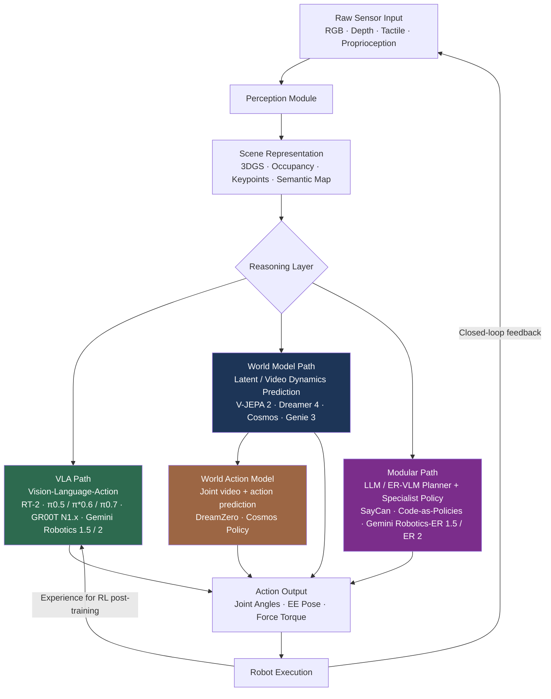

# Embodied AI: Overview and Ecosystem Roadmap

> **Last Updated:** October 2026
> **Level:** Research Frontier
> **Related Sections:**
> - [VLA Models (Vision-Language-Action)](./01_vla_models.md)
> - [3D Vision and Scene Representations](../04_3d_vision_and_scene/00_3d_representations.md)
> - [Multimodal Vision-Language Models](../05_multimodal_vision_language/00_overview.md)
> - [Research Frontier 2024–2026](../12_research_frontier_2024_2026/04_vla_embodied_2025_2026.md)

> **🆕 October 2026 update:**
> - Added a new section on the **2025–2026 paradigm shifts**: RL post-training of VLAs from real-world experience (π\*0.6 / Recap, πRL, SimpleVLA-RL), embodied-reasoning + VLA "agentic" stacks (Gemini Robotics 1.5 / ER 1.5), **World Action Models** (DreamZero, Cosmos Policy), and human-video pretraining at scale (EgoScale in GR00T N1.7).
> - Refreshed the industrial landscape: π0.5 open-sourced, π\*0.6, GR00T N1.5 → N1.6 → N1.7, Gemini Robotics 1.5 / ER 1.5 / On-Device, Figure Helix + Figure 03, TRI Large Behavior Models (with Boston Dynamics Atlas), Hugging Face SmolVLA/LeRobot, Generalist GEN-0/GEN-1, Cosmos 2.5 → Cosmos 3, V-JEPA 2/2.1, Genie 3.
> - Corrected the GR00T N1 parameter count (the paper describes a 2.2B model; no 34B variant is described) and fixed broken cross-links.
> - Added LIBERO-era benchmark rows (now near saturation at ~97–98%) and new Key Papers, Pros & Cons rows, open problems, and Further Reading.
> - Added the 2026 releases **Figure Helix 02** (Jan 2026; System 0/1/2 whole-body control on Figure 03), **π0.7** (Apr 2026; early compositional generalization, one generalist reportedly matching the π\*0.6 RL specialists) and the **Gemini Robotics 2 / ER 2 / On-Device 2** family (Jul 2026; whole-body humanoid VLA, ASIMOV-2 / ASIMOV-Agentic safety evaluation), plus Physical Intelligence's 2025–2026 funding.

---

## Overview

Embodied AI designates systems that perceive their physical environment through sensors, build internal representations of that environment, reason over those representations using learned or symbolic models, and then execute actions that alter the state of the world. Unlike purely perceptual AI (image classifiers, detectors) or purely generative AI (large language models, diffusion models), embodied systems are closed-loop: every action changes future observations, making the learning problem fundamentally non-i.i.d. The field is the convergence of three historically separate disciplines—computer vision, natural language processing, and control theory—and as of 2026 that convergence has accelerated dramatically due to the rise of large-scale robot foundation models and the commoditisation of high-dexterity hardware.

What makes the embodied setting fundamentally hard is the compounding of multiple long-tail distributions. The visual world is open-ended (novel objects, novel scenes, novel lighting), the language of instruction is compositional and ambiguous, and the dynamics of physical interaction introduce contact-rich nonlinearities that resist analytic treatment. A manipulation policy that achieves 97% success on a fixed kitchen counter—as RT-1 did [Brohan2022]—will commonly fail when the counter height changes by ten centimetres or a new cup colour appears. Bridging this brittleness gap is the central research question of the field in 2025–2026.

The field is simultaneously a scientific programme and an industrial race. Academic groups at UC Berkeley BAIR, CMU, Stanford, and ETH Zurich continue to produce the foundational algorithmic advances—from imitation learning and offline RL to world models and diffusion-based policies. Meanwhile, well-capitalised companies including Physical Intelligence (π), Figure AI, 1X Technologies, Boston Dynamics, Agility Robotics, NVIDIA, Google DeepMind, Toyota Research Institute, and Generalist AI are translating those advances into deployable systems. The convergence of large-scale Internet pretraining with robot trajectory data—pioneered by RT-2 [Brohan2023] and now standard practice—means that the gap between academic prototypes and industrial deployments is closing faster than at any previous point in robotics history.

Between mid-2025 and October 2026 the centre of gravity moved in three directions. First, **post-training with reinforcement learning** became practical for multi-billion-parameter VLAs, both in simulation (SimpleVLA-RL, πRL) and on real robots (Physical Intelligence's π\*0.6 with Recap) [PI2025Recap]. Second, **reasoning and acting were split across specialised models**: an embodied-reasoning VLM plans, calls tools and monitors progress, while a VLA executes (Gemini Robotics 1.5 + Gemini Robotics-ER 1.5 [GoogleDeepMind2025b], succeeded in July 2026 by Gemini Robotics 2 + Gemini Robotics ER 2 [GoogleDeepMind2026]). Third, **video world models were turned into policies**: "World Action Models" that jointly predict future video and actions (NVIDIA DreamZero, Cosmos Policy) reached the top of real-world generalist leaderboards in early 2026 [Ye2026]. Simulation benchmarks such as LIBERO are now close to saturation (~97–98% for several open models), pushing evaluation toward distributed real-robot arenas and world-model-based policy evaluation. In 2026 two further trends appeared: single learned stacks began to control **the whole humanoid body**—Figure's Helix 02 (January 2026), with a new ~1 kHz System 0 [FigureAI2026], and Gemini Robotics 2 (July 2026) [GoogleDeepMind2026]—and Physical Intelligence's π0.7 (April 2026) reported early **compositional generalization**, with a single generalist reportedly matching its RL-fine-tuned π\*0.6 specialists [PI2026].

---

## The Perception → Reasoning → Action Pipeline

The canonical decomposition of an embodied agent separates three processing layers, though modern end-to-end approaches intentionally blur the boundaries.



### Perception Module

The perception module transforms raw sensor streams into structured representations that downstream reasoning can consume. In 2022–2023, the dominant paradigm was to treat perception as a learned feature extraction step embedded inside the policy (e.g., the FiLM-conditioned EfficientNet in RT-1 [Brohan2022]). By 2025, the preferred approach is to use a shared pretrained visual encoder—typically a SigLIP or DINOv2 backbone—that produces semantic tokens compatible with a language model backbone, allowing visual representations to benefit from Internet-scale pretraining. Depth sensors and wrist-mounted tactile sensors are increasingly standard; point-cloud and force-torque signals are integrated via lightweight projectors into the token stream.

In 2025–2026 the trend shifted further toward **reusing an entire "physical-AI" VLM as the perception stack**. GR00T N1.6 replaced its Eagle backbone with an NVIDIA Cosmos-Reason-2B variant trained on embodied-reasoning tasks, and GR00T N1.7 uses Cosmos-Reason2-2B (Qwen3-VL architecture) with native-aspect-ratio image encoding [NVIDIA2026]. Self-supervised video encoders (V-JEPA 2 / 2.1 [Assran2025]) and image encoders (DINOv3) are used where dense, temporally consistent features matter more than language alignment.

Scene representations span a spectrum of abstraction:
- **3D Gaussian Splatting (3DGS):** Compact, renderable scene models that support novel-view synthesis and spatial queries; increasingly used for sim-to-real transfer and scene memory [Kerbl2023].
- **Occupancy grids and voxel representations:** Explicit spatial maps used for collision avoidance and reachability planning.
- **Keypoint and object-centric representations:** Sparse but semantically meaningful; used by DIFT-based correspondence methods and transporter networks.
- **Semantic maps:** Top-down layouts augmented with object labels; used by LLM planners for navigation.

### Reasoning Layer

Three architectural families compete at the reasoning layer:

**VLA (Vision-Language-Action) Path.** The end-to-end paradigm. A pretrained vision-language model is extended with an action head that directly outputs robot actions. The key design choices are (a) how to represent actions—discrete token bins [Brohan2023, Kim2024], continuous regression, or flow matching [Black2024]—and (b) whether to generate action chunks (sequences of future actions) or single-step predictions. This path currently achieves the best results on dexterous manipulation benchmarks. Its weakness is the computational cost of running a multi-billion-parameter model at policy frequencies (50 Hz+). Since 2025, VLAs are increasingly trained in **three stages**—large-scale pretraining, supervised post-training on task data, and RL from autonomous experience and human corrections (π\*0.6 / Recap) [PI2025Recap].

**World Model Path.** Rather than mapping directly from observation to action, a world model first learns a latent dynamics model of the environment and then plans actions in latent space. DreamerV3 [Hafner2023] demonstrated that a single world model can master over 150 tasks across diverse domains using model-based RL in "dream" rollouts (published in *Nature* in 2025), and Dreamer 4 (Sept 2025) trained a Minecraft agent to obtain diamonds purely from offline data inside a scalable video world model [Hafner2025]. NVIDIA's Cosmos [2025] extends this to physical AI; its 2026 successor, Cosmos 3, unifies reasoning, world prediction, domain transfer and action generation in a single omnimodal Mixture-of-Transformers family [NVIDIA2026Cosmos3]. The V-JEPA line of work [LeCun group] pursues prediction in joint embedding space rather than pixel space; V-JEPA 2-AC plans pick-and-place zero-shot on Franka arms after post-training on ~62 hours of robot video [Assran2025]. The gap to VLAs narrowed sharply in 2026: **World Action Models** built on video-diffusion backbones (DreamZero, built on Wan2.1-14B; Cosmos Policy, built on Cosmos-Predict2) jointly predict future frames and actions and were reported #1 on the RoboArena and MolmoSpaces leaderboards in February 2026 [Ye2026]. Interactive generative world models such as Genie 3 (Aug 2025) are used mainly as training and evaluation environments for agents rather than as controllers.

**Modular (LLM Planner + Specialist Policy) Path.** LLMs are used as high-level planners that decompose natural-language tasks into sub-goals, which are then executed by trained specialist policies or motion primitives. SayCan [Ahn2022] introduced the key insight of grounding LLM outputs with value function affordances: the LLM scores candidate skill descriptions for plausibility, and a learned affordance function scores them for feasibility, and the product determines the next action. Code as Policies [Liang2023] went further, generating executable Python programs that call perception APIs and motion primitives as library functions, enabling spatial reasoning and loop logic without task-specific training data. The 2025–2026 incarnation of this path uses **embodied-reasoning VLMs** as orchestrators: Gemini Robotics-ER 1.5 (available to developers through the Gemini API) performs spatial grounding, progress estimation and tool calls (e.g., web search) and dispatches natural-language sub-steps to the Gemini Robotics 1.5 VLA [GoogleDeepMind2025b]; NVIDIA's Cosmos Reason 1/2 play the same role in the NVIDIA stack. In July 2026 **Gemini Robotics ER 2** (available in Google AI Studio) took over this orchestrator role for the whole-body Gemini Robotics 2 VLA; it is evaluated on the ASIMOV-2 safety benchmark and on a new ASIMOV-Agentic benchmark that tests agentic behaviours such as asking a human for help when uncertain [GoogleDeepMind2026].

### Action Representation

The action space for a manipulation robot is typically a 7-DoF vector (3D end-effector position, 3D orientation, gripper width) or a full joint-angle vector for humanoids (20–50+ DoF). The key design tension is between expressiveness and training stability:

```
# Discrete tokenization (RT-2, OpenVLA)
action_bins = 256  # per dimension
action_token = discretize(action, bins=action_bins)  # lossy but LM-compatible

# Continuous regression (Octo, simple BC, OpenVLA-OFT uses L1 regression)
action = MLP(latent)  # unimodal, may average over multimodal demonstrations

# Diffusion / Flow Matching (π₀, π0.5, GR00T N1.x, SmolVLA)
# Flow matching learns vector field v_θ(x_t, t) such that
# dx_t/dt = v_θ(x_t, t), integrating from noise x_0 ~ N(0,I) to action x_1
action_chunk = flow_match(latent, noise=torch.randn(H, action_dim))

# Hybrid (π0.5 + Knowledge Insulation, 2025): backbone trained on discrete FAST
# tokens; flow-matching action expert trained with stop-gradient into the VLM
```

Flow matching [Lipman2022] is emerging as the preferred action head design for dexterous manipulation because it avoids discretization artefacts, handles multimodal action distributions naturally, and is faster to sample than score-based diffusion. Two 2025 refinements matter in practice: **Real-Time Chunking (RTC)** [Black2025RTC], which treats the next chunk as an inpainting problem conditioned on the actions already committed so that inference latency no longer causes jerky chunk boundaries; and **relative (state-delta) action spaces** shared across embodiments—including human hands—adopted by GR00T N1.6/N1.7 [NVIDIA2026].

---

## 2025–2026 Paradigm Shifts

### 1. RL Post-Training of VLAs

Imitation learning caps a policy at roughly the demonstrator's level and leaves it brittle to its own mistakes. In 2025 several groups showed that RL fine-tuning of large VLAs is both feasible and beneficial:

- **Simulation RL with outcome rewards.** RL4VLA (NeurIPS 2025) found PPO fine-tuning improves semantic and execution generalisation over SFT; SimpleVLA-RL (built on veRL) and VLA-RL apply GRPO/PPO-style updates to OpenVLA-OFT-class models with sparse success rewards; RIPT-VLA performs interactive post-training from few demonstrations.
- **RL for flow-matching VLAs.** πRL (Oct 2025) makes the deterministic flow ODE tractable for policy-gradient training via a learned noise network (*Flow-Noise*) or an ODE→SDE conversion (*Flow-SDE*), lifting few-shot-SFT π0.5 from 40.1% to 90.9% on a ManiSkill3 multi-task suite [RLinf2025piRL].
- **Real-world RL from experience.** Physical Intelligence's **π\*0.6** (Nov 2025) uses **Recap** (RL with Experience and Corrections via Advantage-conditioned Policies): a value function trained on mixed demonstration, autonomous and human-correction data produces advantages that condition the policy; the company reports more than doubled throughput and roughly halved failure rates on espresso making, laundry folding and box assembly [PI2025Recap].
- **Infrastructure.** RLinf (with RLinf-VLA, RSS 2026) has become a common open framework; by mid-2026 it supported RL for π0/π0.5, GR00T N1.6/N1.7 and world-model-based RL (WoVR), and Isaac Lab 3.0 adopted it for VLA post-training.

### 2. Embodied Reasoning + Agentic Orchestration

Gemini Robotics 1.5 (Sept 2025) introduced a "thinking" VLA that produces natural-language reasoning before acting, and a **Motion Transfer** mechanism that lets one checkpoint control ALOHA, bi-arm Franka and the Apptronik Apollo humanoid; Gemini Robotics-ER 1.5 acts as the high-level brain and is broadly available via the Gemini API [GoogleDeepMind2025b]. The pattern—an ER-VLM planner on top of a VLA executor—echoes Figure's Helix System 2 / System 1 split and NVIDIA's GR00T dual system, but with the planner now a general frontier model capable of tool use.

### 3. Video World Models Become Policies

Video diffusion models pretrained on Internet-scale data already encode rich physical priors. In 2025–2026, they were adapted in three ways: (a) as **synthetic data engines** (NVIDIA DreamGen / GR00T-Dreams, Cosmos-Transfer2.5) [Jang2025]; (b) as **policy evaluators** (Ctrl-World; DeepMind's evaluation of Gemini Robotics policies inside a Veo-based world simulator); and (c) directly as **World Action Models** (Cosmos Policy, DreamZero, Fast-WAM). See [World Models](./02_world_models.md).

### 4. Human Video at Scale

GR00T N1.7 (2026) is pretrained on **20K hours of EgoScale egocentric human video** in addition to robot data; because its relative end-effector action space is shared between humans and robots, manipulation priors transfer from human video [NVIDIA2026]. BeingBeyond's Being-H0.5 and Generalist AI's GEN-0/GEN-1 pursue similar human-centric or very-large-scale real-world data strategies. See [Cross-Embodiment Learning](./04_cross_embodiment.md).

### 5. An Open Model Ecosystem

Open weights are now the norm outside the frontier labs: openpi (π0, π0-FAST, π0.5; PyTorch support since Sept 2025), Isaac GR00T N1.5/N1.6/N1.7 (Apache 2.0 for N1.7), SmolVLA (450M) and the LeRobot policy zoo (which by 2026 also packages X-VLA, WALL-OSS, EO-1, MolmoAct2 and others), OpenVLA-OFT, and Chinese open VLAs (InternVLA-M1, X-VLA, WALL-OSS, Galaxea G0).

### 6. Whole-Body Control and Compositional Generalists (2026)

Through 2025, learned humanoid policies mainly controlled the upper body, leaving locomotion and balance to separate classical or RL controllers. **Figure Helix 02** (late January 2026) is a single learned system on Figure 03 that unifies perception, balance, locomotion and manipulation in three tiers: System 2 for semantic reasoning, System 1 mapping perception to whole-body motion at high frequency, and a new **System 0** running at ~1 kHz for balance and coordination; its flagship demo is ~4 minutes of autonomous dishwasher unloading and reloading [FigureAI2026]. **Gemini Robotics 2** (30 July 2026) likewise moves Google DeepMind's VLA from mostly upper-body control to whole-body humanoid control—walking, crouching and manipulating while reasoning. It ships alongside the ER 2 planner and **Gemini Robotics On-Device 2**, which runs locally and adapts to new embodiments within hours of data; the VLA and On-Device models are limited to early-access partners [GoogleDeepMind2026].

On the generalization axis, **π0.7** (April 2026) shows early **compositional generalization**: it recombines skills learned in different contexts, e.g. folding t-shirts on a UR5e arm with no laundry data for that robot, or operating an air fryer after minimal verbal coaching. Its reported architecture is a Gemma 3 4B VLM backbone plus a ~860M-parameter action expert, trained with richer context (subtask instructions, subgoal images) in the prompt. A single π0.7 generalist reportedly matches the task-specific, RL-fine-tuned π\*0.6 specialists on laundry, espresso and box building, which is direct evidence for the generalist-vs-specialist debate (see [Generalist vs. Specialist](./11_generalist_vs_specialist.md)). However, long tasks still need step-by-step guidance, and there is no standardized external benchmark [PI2026].

---

## The Industrial and Academic Landscape (2025–2026)

### Industrial Labs and Companies

**Physical Intelligence (π)** — Founded 2024 by Sergey Levine, Chelsea Finn, Karol Hausman, Brian Ichter, Pete Florence, and others. Released π₀ (October 2024) [Black2024] and π₀.5 (April 2025) [Hejna2025], the latter achieving meaningful generalisation to entirely new home environments unseen during training. The key technical innovation is flow-matching action generation on top of a PaliGemma backbone. Raised ~$470M by end of 2024. Subsequent work: **Knowledge Insulation** (May 2025) for training the VLM backbone on discrete FAST tokens while insulating it from the action expert's gradients; **Real-Time Chunking** (June 2025, NeurIPS 2025) and a training-time variant (Dec 2025); open-sourcing of **π0.5** weights in openpi (Sept 2025); **π\*0.6** with Recap RL from experience (Nov 2025); and, in 2026, **MEM**, a multi-scale embodied memory for long-horizon VLA control. In April 2026 it released **π0.7**, a steerable generalist (Gemma 3 4B backbone + ~860M action expert) with early compositional generalization [PI2026]. On the funding side, it closed a $600M Series B at a $5.6B valuation in November 2025, and in March 2026 Bloomberg reported talks to raise about $1B at a valuation above $11B (the close has not been confirmed).

**Figure AI** — Released the Helix VLA (February 2025), the first VLA designed for full upper-body humanoid dexterity running entirely on embedded onboard GPUs. Helix pairs a 7B-parameter VLM "System 2" (7–9 Hz) with an 80M-parameter visuomotor "System 1" transformer running at 200 Hz over a 35-DoF upper-body action space. Helix was the first VLA to run simultaneously on two robots sharing a long-horizon task. Deployed Figure 02 robots at BMW's Spartanburg plant, logging 1,250+ runtime hours and loading 90,000+ parts across 30,000 vehicles [FigureAI2025]. Ended its OpenAI partnership in 2025 to operate a fully proprietary AI stack, and launched the redesigned **Figure 03** humanoid in October 2025, aimed at home and commercial use. In late January 2026 it introduced **Helix 02** on Figure 03: a single learned system that unifies perception, balance, locomotion and manipulation through System 2 (semantic reasoning), System 1 (perception to whole-body motion at high frequency) and a new ~1 kHz System 0 (balance and coordination). Figure demonstrated ~4 minutes of autonomous dishwasher unloading and reloading and claims 8-hour shifts without intervention, but has not released throughput or error metrics [FigureAI2026].

**1X Technologies** — Focuses on home-domain humanoids (NEO) and commercial platforms (EVE). OpenAI is an investor and early collaboration partner. Research emphasis on whole-body control and long-horizon task completion from natural language. Opened consumer pre-orders for NEO in October 2025 and uses a learned **1X World Model** for policy evaluation.

**Boston Dynamics** — Electric Atlas (Gen 3) entered initial industrial deployments in 2025. Spot remains the most widely deployed quadruped platform globally. Research focus on model predictive control, parkour-style whole-body locomotion, and integration with VLA-style task planning. In August 2025 Boston Dynamics and TRI demonstrated a **Large Behavior Model** controlling Atlas for long-horizon whole-body manipulation, and at CES 2026 Boston Dynamics announced a partnership with Google DeepMind to bring Gemini Robotics models to Atlas.

**NVIDIA** — Released GR00T N1 (March 2025) [NVIDIA2025], an open dual-system foundation model for humanoid robots; the paper describes the released GR00T-N1-2B model (2.2B parameters, 1.34B of them in the Eagle-2 VLM). This was followed by **GR00T N1.5** (mid-2025: frozen Eagle 2.5 VLM, FLARE objective, DreamGen synthetic trajectories; language following on GR-1 tasks 93.3% vs. 46.6% for N1), **GR00T N1.6** (Cosmos-Reason-2B VLM, 2× larger 32-layer DiT, state-relative action chunks, several thousand additional hours of teleoperation data) and **GR00T N1.7** (2026; Cosmos-Reason2-2B / Qwen3-VL backbone, relative-EEF action space, 20K hours of EgoScale human video, Apache 2.0) [NVIDIA2026]. The Cosmos world-model platform moved from Cosmos-Predict2.5 / Transfer2.5 (Oct 2025) and Cosmos-Reason2 (Dec 2025) to **Cosmos 3** (May–June 2026: Super 64B, Nano 16B, Edge 4B). NVIDIA also shipped the Jetson AGX Thor onboard computer (Aug 2025), the Isaac Lab training framework, and the **DreamZero** World Action Model (Feb 2026).

**Google DeepMind** — The RT series (RT-1, RT-2, RT-X) established the VLA paradigm [Brohan2022, Brohan2023]. In March 2025, DeepMind released Gemini Robotics [GoogleDeepMind2025], a VLA built on Gemini 2.0 with advanced dexterous manipulation capabilities, and Gemini Robotics-ER for embodied spatial reasoning. Gemini Robotics On-Device was released June 2025, requiring only 50–100 demonstrations to adapt to new tasks. **Gemini Robotics 1.5** and **Gemini Robotics-ER 1.5** followed in September 2025 (thinking VLA, Motion Transfer across embodiments, ER model available in the Gemini API) [GoogleDeepMind2025b]. On the world-model side DeepMind released **Genie 3** (August 2025; real-time 720p/24 fps interactive worlds with minute-scale consistency), the SIMA 2 agent (Nov 2025), and a Veo-based world simulator for evaluating Gemini Robotics policies (Dec 2025). On 30 July 2026 DeepMind announced the **Gemini Robotics 2** family: Gemini Robotics 2, a VLA with whole-body humanoid control (walking, crouching and manipulating while reasoning, where the previous version was mostly upper-body); **Gemini Robotics ER 2**, an embodied-reasoning/planning model available in Google AI Studio, which Google describes as its safest robotics model on ASIMOV-2 and which ships with a new ASIMOV-Agentic benchmark; and **Gemini Robotics On-Device 2**, which runs locally and adapts to new embodiments within hours of data. The VLA and On-Device models are available only to early-access partners [GoogleDeepMind2026].

**Toyota Research Institute (TRI)** — Published "A Careful Examination of Large Behavior Models for Multitask Dexterous Manipulation" (July 2025) [TRI2025], a rigorous, statistically powered study of diffusion-transformer LBMs pretrained on ~1,700 hours of robot data, reporting that pretrained LBMs reach a given performance with substantially less task-specific data than single-task policies.

**Hugging Face (LeRobot)** — Released **SmolVLA** (June 2025), a 450M-parameter VLA trained on community-contributed LeRobot datasets and runnable on consumer hardware [Shukor2025], and maintains the LeRobot library and dataset format (v3: Parquet + MP4) that has become a PyTorch-native standard for robot learning data.

**Generalist AI** — Announced **GEN-0** (Nov 2025), an embodied foundation model trained on a very large proprietary corpus of real-world manipulation data with reported scaling-law behaviour, followed by **GEN-1** (April 2026).

**Meta FAIR / AMI Labs** — Meta released V-JEPA 2 / V-JEPA 2-AC (June 2025) and V-JEPA 2.1 (March 2026). Yann LeCun left Meta at the end of 2025 to found AMI Labs (Advanced Machine Intelligence), which reportedly raised a large funding round in 2026 to pursue JEPA-style world models.

**Chinese ecosystem** — AgiBot (GO-1, Genie Envisioner world model), ByteDance Seed (GR-3, July 2025), Shanghai AI Lab (InternVLA-M1), Tsinghua/AIR (X-VLA), X Square Robot (WALL-OSS), Galaxea (G0 + Open-World Dataset), and Unitree hardware form a dense open-weight ecosystem; several of these models are packaged in LeRobot.

**UC Berkeley BAIR** — Home to the research groups behind RT-1/RT-2 (Pieter Abbeel, Sergey Levine before his move to PI), OpenVLA [Kim2024], and foundational work in offline RL, imitation learning, and robot learning. BAIR comprises 50+ faculty and 300+ graduate students.

**CMU Robotics Institute** — Home to foundational work in legged locomotion, planning under uncertainty, and contact-rich manipulation. Dean Pomerleau's self-driving lineage continues through the CMU AV groups.

**Stanford Human-Centered Robotics Lab and IRIS Lab** — Contributors to Diffusion Policy [Chi2023] (with Columbia), OpenVLA-OFT [Kim2025OFT], and active in dexterous hand manipulation, deformable object manipulation, and generalisation benchmarks for VLAs.

---

## Key Open Research Questions (2026)

### Data Efficiency and the Demonstration Bottleneck

Large language models benefited from a fundamentally passive data source—text on the Internet. Robotics has no equivalent. Curated robot trajectories are expensive: collecting the 130k episodes used to train RT-1 required 17 months across 13 robots [Brohan2022]. Closing the ~120,000× gap between robot data and LLM pretraining data is the single largest bottleneck. Current strategies include (a) sim-to-real transfer using physics simulators (Isaac Sim, MuJoCo) with domain randomization, (b) human video pretraining (GR00T N1 used 3M egocentric video clips; GR00T N1.7 adds 20K hours of EgoScale human video), (c) data sharing across embodiments (Open X-Embodiment [OpenXEmbodiment2023]), (d) **video-world-model data engines** (DreamGen, Cosmos-Transfer2.5), and (e) **learning from autonomous experience** via RL (π\*0.6). Company reports of 10⁵-hour-scale proprietary manipulation corpora (Generalist GEN-0) suggest the gap is beginning to narrow for well-funded players, but not for academia.

### Generalisation to Novel Objects and Scenes

State-of-the-art VLAs still exhibit steep performance cliffs on out-of-distribution objects. π₀ loses ~14 percentage points (~19% relative) between in-distribution and novel-object settings; ACT loses ~42 points (~88% relative) [benchmarkpaper2024]. Achieving distribution-shift robustness comparable to humans (who can manipulate a novel object after a few seconds of visual inspection) requires richer scene understanding and possibly physical common-sense priors. Perturbation suites built on LIBERO (e.g., LIBERO-Plus, LIBERO-PRO) show that models scoring ~97% on standard LIBERO can degrade sharply under camera, lighting or layout changes.

### Long-Horizon Task Completion

Most VLA benchmarks involve episodes of 10–30 seconds and 1–3 sub-steps. Real-world housework or factory assembly involves sequences of dozens of steps over minutes or hours, requiring persistent memory, re-planning on failure, and multi-step reasoning. π₀.5 [Hejna2025] made progress here, π\*0.6 ran an espresso task continuously for most of a working day, explicit memory mechanisms (PI's MEM, MemER) emerged in 2026, and Figure's Helix 02 performed ~4 minutes of autonomous whole-body dishwasher unloading and reloading. Even so, long-horizon reliability remains significantly below human ability: π0.7 still needs step-by-step guidance for long tasks, and Figure's claim of 8-hour intervention-free shifts comes without throughput or error metrics.

### Safe Physical Interaction

Robots operating in human environments must avoid injuring people, damaging objects, and violating physical constraints. Current learned policies have no formal safety guarantees, and failure modes can be catastrophic. Control-theoretic safety certificates (Control Barrier Functions), uncertainty-aware planning, and anomaly detection are active research areas; the Gemini Robotics family is additionally evaluated for semantic safety at the planner level with the ASIMOV benchmark introduced alongside the original Gemini Robotics release. Gemini Robotics ER 2 (2026) is reported as Google's safest robotics model on the updated ASIMOV-2 benchmark, and it is also evaluated on the new ASIMOV-Agentic benchmark, which tests behaviours such as asking a human for help when uncertain [GoogleDeepMind2026].

### Real-Time VLA Inference

A 55B-parameter VLA cannot run at 50 Hz on onboard compute without aggressive model compression. Approaches including knowledge distillation, quantization, and speculative decoding are being adapted from LLM serving to VLA deployment. The FAST tokenizer [FAST2025] can compress action sequences in frequency space via Discrete Cosine Transform, matching π₀ performance at 5× reduced training compute. Real-Time Chunking [Black2025RTC] hides inference latency during execution, Jetson AGX Thor (2025) brings Blackwell-class compute onboard, and GR00T N1.7 ships full ONNX/TensorRT export for edge deployment. World Action Models remain expensive (DreamZero reports ~0.6 s per inference on GB200 with DiT caching).

### Multi-Robot Coordination

Most current systems assume a single robot. Real factory and home scenarios increasingly require multiple robots to share tasks, exchange state estimates, and avoid collision. Figure AI's Helix demonstrated two-robot coordination on a shared task [FigureAI2025], but principled multi-agent robot learning remains largely unsolved.

### Sim-to-Real Transfer Fidelity

Physics simulators still fail to accurately model soft-body interactions, liquid dynamics, and contact-rich manipulation (e.g., inserting a USB plug). Closing the sim-to-real gap for these contact modes is critical for data-efficient training. Generative "sim-to-real" augmentation (Cosmos-Transfer2.5 converts simulator renders to photoreal video) reduces the visual gap but not the contact-dynamics gap.

### Evaluation at the Frontier

With LIBERO saturated (π0.5 96.85%, GR00T N1.6 ≈97%, X-VLA 98.1%, OpenVLA-OFT 97.1%), the community is moving to distributed real-robot evaluation (RoboArena), large-scale simulated household benchmarks (BEHAVIOR-1K, RoboCasa) and **world-model-based policy evaluation** (Veo world simulator, Ctrl-World, 1X World Model). Whether such proxies rank policies consistently with real-world deployment is an open question.

---

## Key Papers

| Paper | Authors | Year | Venue | Key Contribution |
|-------|---------|------|-------|-----------------|
| RT-1: Robotics Transformer for Real-World Control at Scale | Brohan et al. | 2022 | CoRL / RSS 2023 | TokenLearner + Transformer on 130k demo dataset; 97% success on 700+ tasks |
| Do As I Can, Not As I Say: Grounding Language in Robotic Affordances (SayCan) | Ahn et al. | 2022 | CoRL | LLM planner grounded by affordance value functions |
| RT-2: Vision-Language-Action Models Transfer Web Knowledge to Robotic Control | Brohan et al. (Zitkovich et al.) | 2023 | CoRL | Co-fine-tuning VLM on robot data; emergent chain-of-thought in robot policies |
| Open X-Embodiment: Robotic Learning Datasets and RT-X Models | Open X-Embodiment Collaboration | 2023 | ICRA 2024 (Best Paper) | 22-embodiment, 527-skill, 160k-episode cross-embodiment dataset and RT-X |
| π₀: A Vision-Language-Action Flow Model for General Robot Control | Black et al. | 2024 | arXiv (Physical Intelligence) | Flow-matching action head on PaliGemma; 50 Hz dexterous manipulation |
| OpenVLA: An Open-Source Vision-Language-Action Model | Kim et al. | 2024 | CoRL | 7B open-weight VLA on Open X-Embodiment; matches RT-2 on BridgeV2 |
| GR00T N1: An Open Foundation Model for Generalist Humanoid Robots | NVIDIA (Bjorck et al.) | 2025 | arXiv 2503.14734 | Dual-system humanoid foundation model (2.2B released) with diffusion-transformer action decoder |
| Gemini Robotics: Bringing AI into the Physical World | Google DeepMind | 2025 | arXiv | Gemini 2.0-based VLA for dexterous manipulation; multi-embodiment transfer |
| π₀.₅: a Vision-Language-Action Model with Open-World Generalization | Physical Intelligence | 2025 | arXiv 2504.16054 | Co-training on heterogeneous tasks + web data for novel-environment generalisation |
| Fine-Tuning Vision-Language-Action Models: Optimizing Speed and Success (OpenVLA-OFT) | Kim, Finn, Liang | 2025 | arXiv 2502.19645 | Parallel decoding + action chunking + L1 regression; 97.1% LIBERO average |
| SmolVLA: A Vision-Language-Action Model for Affordable and Efficient Robotics | Shukor et al. (Hugging Face) | 2025 | arXiv 2506.01844 | 450M-param VLA trained on community data; asynchronous inference |
| V-JEPA 2: Self-Supervised Video Models Enable Understanding, Prediction and Planning | Assran et al. (Meta FAIR) | 2025 | arXiv 2506.09985 | Latent action-conditioned world model; zero-shot Franka pick-and-place |
| A Careful Examination of Large Behavior Models for Multitask Dexterous Manipulation | Toyota Research Institute | 2025 | arXiv 2507.05331 | Rigorous statistical evaluation of diffusion-transformer LBM pretraining |
| Gemini Robotics 1.5: Pushing the Frontier of Generalist Robots with Advanced Embodied Reasoning, Thinking, and Motion Transfer | Google DeepMind | 2025 | arXiv 2510.03342 | Thinking VLA + ER 1.5 orchestrator; Motion Transfer across embodiments |
| πRL: Online RL Fine-tuning for Flow-based Vision-Language-Action Models | RLinf team | 2025 | arXiv 2510.25889 | Flow-Noise / Flow-SDE make flow VLAs amenable to PPO/GRPO |
| π\*0.6: a VLA That Learns From Experience | Physical Intelligence | 2025 | arXiv 2511.14759 | Recap: advantage-conditioned RL from autonomous rollouts + human corrections |
| DreamZero: World Action Models Are Zero-Shot Policies | Ye et al. (NVIDIA) | 2026 | arXiv 2602.15922 | 14B video-diffusion WAM; #1 on RoboArena / MolmoSpaces (Feb 2026) |
| Helix 02 (technical blog) | Figure AI | 2026 | Company blog | System 0/1/2 whole-body control on Figure 03; ~4-min autonomous dishwasher task |
| π0.7: a Steerable Generalist Robotic Foundation Model | Physical Intelligence | 2026 | arXiv 2604.15483 | Gemma 3 4B + ~860M action expert; subtask/subgoal-image prompting; early compositional generalization |
| Gemini Robotics 2 / ER 2 / On-Device 2 | Google DeepMind | 2026 | DeepMind blog + model card | Whole-body humanoid VLA; ER 2 planner (ASIMOV-2, ASIMOV-Agentic); on-device embodiment adaptation |

---

## Benchmark Performance

| System | Benchmark | Metric | Score | Notes |
|--------|-----------|--------|-------|-------|
| RT-1 | In-distribution (700 instructions) | Success rate | 97% | 13 EDR robots, kitchen tasks |
| RT-1 | Unseen instructions | Success rate | 76% | +24% over next-best baseline |
| RT-2-PaLI-X-55B | Unseen objects (hard) | Success rate | 62% | vs. RT-1 baseline ~32% |
| RT-2-PaLM-E-12B | Unseen objects (hard) | Success rate | 62% | Both variants tied on average |
| RT-2-PaLI-X-55B | Language Table (sim) | Success rate | 90% | vs. 77% prior SOTA |
| OpenVLA | Google Robot tasks | Mean success rate | 85.0 ± 4.6% | vs. RT-2-X 78.3 ± 5.4% |
| π₀ | In-distribution (4-task macro avg) | Success rate | ~72% | Clean dish, sponge, bag, shorts |
| π₀ | Unseen objects (instance + spatial OOD) | Success rate | ~59% | ~13 pp drop from ID |
| ACT | In-distribution (same benchmark) | Success rate | ~48% | ~42 pp drop on unseen objects |
| GR00T N1 | Sim + real (combined) | Task success | +40% over baseline | With synthetic + real data mix |
| GR00T N1.5 | GR-1 language-following tasks | Success rate | 93.3% | vs. 46.6% for GR00T N1 (NVIDIA-reported) |
| OpenVLA-OFT | LIBERO (4 suites avg) | Success rate | 97.1% | Fine-tuned per suite |
| π0.5 (openpi) | LIBERO (4 suites avg) | Success rate | 96.85% | Spatial 98.8 / Object 98.2 / Goal 98.0 / Long 92.4 |
| GR00T N1.6 | LIBERO (4 suites avg) | Success rate | ≈97.0% | 97.65 / 98.45 / 97.5 / 94.35 (repo-reported) |
| X-VLA-0.9B | LIBERO | Success rate | 98.1% | Soft-prompted cross-embodiment VLA |
| π0.5 + πRL | ManiSkill3 multi-task | Success rate | 40.1% → 90.9% | Few-shot SFT → RL (Flow-SDE) |
| π\*0.6 (Recap) | Espresso / laundry / box assembly (real) | Throughput | >2× vs. SFT-only | Company-reported; failure rate roughly halved |
| π0.7 (single generalist) | Espresso / laundry / box building (real) | Task performance | ≈ π\*0.6 RL specialists | Company-reported; no standardized external benchmark |

---

## Pros & Cons

| Aspect | Pros | Cons |
|--------|------|------|
| End-to-end VLA approaches | Single model handles perception + language + action; benefits from Internet pretraining; emergent generalisation | Computationally expensive at inference; requires large robot datasets; opaque failure modes |
| Modular (LLM Planner + Skills) | Interpretable plan steps; easy to swap specialist policies; composable skills | Compounding errors across modules; LLM can hallucinate infeasible plans; requires grounding mechanism |
| World-model-based planning | Sample-efficient via latent imagination; enables look-ahead; theoretically principled | Sim-to-real gap in world model; latent planning for contact-rich tasks unsolved; slower to train |
| Sim-to-real training (Isaac Sim / MuJoCo) | Unlimited data generation; safe failure exploration; domain randomization | Physics fidelity gaps (contacts, deformables, liquids); rendering realism lag behind VLM encoders |
| Cross-embodiment datasets (Open X-Embodiment) | Positive transfer across robots; reduces per-robot data requirements; enables generalist policies | Action space heterogeneity complicates joint training; dataset quality varies widely across labs |
| RL post-training of VLAs (Recap, πRL, SimpleVLA-RL) | Surpasses demonstrator performance; improves throughput and recovery; exploits autonomous experience | Requires reward/value models or success detectors; real-world RL is slow and needs resets/human supervision; risk of reward hacking |
| World Action Models (DreamZero, Cosmos Policy) | Inherit physical priors from video pretraining; strong zero-shot generalisation; built-in future prediction for planning | Very large (5–14B+ video backbones); high latency; generated futures may be physically wrong |
| Whole-body humanoid VLAs (Helix 02, Gemini Robotics 2) | One learned stack for balance, locomotion and manipulation; long autonomous sequences (~4-min dishwasher demo) | Company-reported demos without throughput/error metrics; closed or early-access only; movement speed still limited |

---

## Open Problems & Research Gaps

- **Physical common sense without simulation:** How can a robot model the mass, compliance, and fragility of a novel object from vision alone, without any physical interaction, to plan safe grasps?
- **Failure detection and recovery:** Current VLAs execute plans open-loop; robust closed-loop recovery from mid-task failures (dropped objects, failed grasps, unexpected obstacles) requires real-time anomaly detection and re-planning.
- **Tactile-visual-proprioceptive fusion:** Force-torque and tactile signals are critical for fine manipulation (e.g., peg-in-hole, plug insertion) but are rarely integrated into VLA architectures; learned cross-modal attention across heterogeneous sensor modalities is an open problem.
- **Lifelong learning without catastrophic forgetting:** A deployed robot should incorporate new skills without degrading previously learned ones; existing continual learning methods do not scale to the task diversity required by generalist policies.
- **Formal safety verification for learned policies:** Control Barrier Functions and formal methods assume analytic dynamics; extending safety certificates to black-box neural policies acting in partially observable environments is theoretically unsolved.
- **Language grounding for physical quantities:** LLM-based planners reason fluently about objects but struggle with physical magnitudes ("apply 5 Newtons of force," "tilt 15 degrees")—bridging symbolic language and quantitative physical reasoning remains open.
- **Scalable multi-robot coordination:** Extending single-robot VLAs to fleets of heterogeneous robots that share tasks, negotiate roles, and maintain collision-free schedules requires new architectures for inter-agent communication and shared world models.
- **Rewards and values for real-world RL:** Recap-style RL depends on value functions and success labels; learning general, calibrated progress/value estimators across tasks (rather than per-task) is unsolved, and reward hacking in the physical world is costly.
- **Trustworthy proxy evaluation:** As LIBERO-class simulation saturates, it is unknown how well world-model simulators and crowd-sourced arenas predict real-world deployment performance.
- **Efficient World Action Models:** Making video-backbone policies run at control rates on edge hardware (distillation, skipping test-time imagination as studied by Fast-WAM) is an open systems-and-learning problem.
- **Compositional generalization without coaching:** π0.7 shows early skill recombination, but long tasks still require step-by-step guidance, and no standardized external benchmark yet measures compositional generalization across labs.

---

## Further Reading

- [RT-1 project page and paper](https://robotics-transformer1.github.io/) — Original RT-1 paper and dataset details
- [Open X-Embodiment project page](https://robotics-transformer-x.github.io/) — Cross-embodiment dataset and RT-X models
- [Physical Intelligence π₀ blog post](https://www.pi.website/blog/pi0) — Official release post with architecture details and demo videos
- [NVIDIA GR00T N1 whitepaper](https://d1qx31qr3h6wln.cloudfront.net/publications/GR00T%20N1%20Whitepaper.pdf) — Full technical description of dual-system architecture
- [Google DeepMind Gemini Robotics](https://deepmind.google/discover/blog/gemini-robotics-brings-ai-into-the-physical-world/) — March 2025 release with dexterous manipulation results
- [Gemini Robotics arXiv](https://arxiv.org/pdf/2503.20020) — Technical paper for Gemini Robotics and Gemini Robotics-ER
- [Gemini Robotics 1.5 tech report (arXiv 2510.03342)](https://arxiv.org/abs/2510.03342) — Thinking VLA, ER 1.5 and Motion Transfer
- [openpi repository](https://github.com/Physical-Intelligence/openpi) — Open π0 / π0-FAST / π0.5 weights and fine-tuning code
- [π\*0.6 / Recap (arXiv 2511.14759)](https://arxiv.org/abs/2511.14759) — RL from experience and corrections for VLAs
- [Isaac GR00T repository](https://github.com/NVIDIA/Isaac-GR00T) — GR00T N1.5 / N1.6 / N1.7 code, checkpoints and release notes
- [NVIDIA Cosmos (Cosmos 3)](https://github.com/NVIDIA/Cosmos) — Omnimodal world foundation models for physical AI
- [LeRobot](https://github.com/huggingface/lerobot) — Open robot-learning library, dataset format and policy zoo (SmolVLA, π0.5, GR00T, X-VLA …)
- [RLinf](https://github.com/RLinf/RLinf) — Open RL infrastructure for VLA post-training (πRL, RLinf-VLA)
- [TRI Large Behavior Models (arXiv 2507.05331)](https://arxiv.org/abs/2507.05331) — Careful empirical study of multitask diffusion policies
- [DreamZero](https://github.com/dreamzero0/dreamzero) — World Action Model code and checkpoints
- [π0.7 (arXiv 2604.15483)](https://arxiv.org/abs/2604.15483) and [blog](https://www.pi.website/blog/pi07) — Steerable generalist with early compositional generalization
- [Gemini Robotics 2 (DeepMind blog)](https://deepmind.google/blog/gemini-robotics-2-brings-whole-body-intelligence-to-robots/) — Whole-body VLA, ER 2 and On-Device 2
- [Figure Helix 02](https://figure.ai/news/helix-02) — System 0/1/2 whole-body humanoid control
