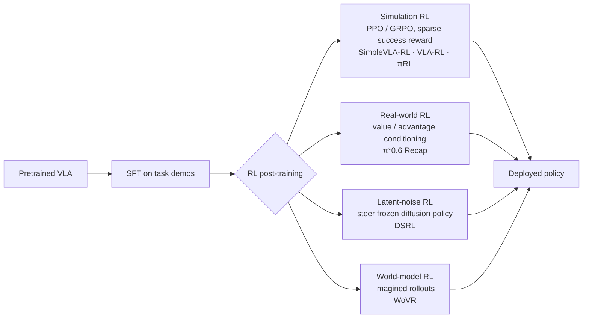

# Vision-Language-Action (VLA) Models

> **Last Updated:** October 2026
> **Level:** Research Frontier
> **Related Sections:**
> - [Embodied AI Overview and Roadmap](./00_overview_roadmap.md)
> - [Multimodal Vision-Language Models](../05_multimodal_vision_language/00_overview.md)
> - [Research Frontier 2024–2026](../12_research_frontier_2024_2026/04_vla_embodied_2025_2026.md)
> - [Datasets and Benchmarks](../11_datasets_and_benchmarks/02_3d_and_robotics_datasets.md)

> **🆕 October 2026 update:**
> - New model summaries for **π0.5 (open-sourced) + Knowledge Insulation**, **π\*0.6 / Recap**, **Gemini Robotics 1.5 / ER 1.5 / On-Device**, **GR00T N1.5 → N1.6 → N1.7**, **SmolVLA**, **OpenVLA-OFT**, **TRI Large Behavior Models**, updated **Figure Helix** details, and a survey of the 2025–2026 open-VLA ecosystem (X-VLA, InternVLA-M1, GR-3, WALL-OSS, MolmoAct2).
> - New section on **RL fine-tuning of VLAs** (RL4VLA, VLA-RL, RIPT-VLA, SimpleVLA-RL, πRL, DSRL, Recap, world-model RL) with a method table.
> - New action-head material: Knowledge Insulation, Real-Time Chunking (RTC), discrete-diffusion action decoding.
> - Corrected GR00T N1 facts (2.2B released model; no 34B variant in the paper; authors Bjorck et al.); added LIBERO-era benchmark rows and noted saturation; refreshed open problems and Further Reading.
> - Added 2026 model summaries for **Figure Helix 02** (System 0/1/2 whole-body control on Figure 03), **π0.7** (Gemma 3 4B + ~860M action expert; early compositional generalization; one generalist reportedly matching the π\*0.6 RL specialists) and the **Gemini Robotics 2 / ER 2 / On-Device 2** family (whole-body humanoid VLA; ASIMOV-2 / ASIMOV-Agentic), with new rows in the backbone, comparative, Key Papers, benchmark and Pros & Cons tables. Corrected the original Helix description (upper-body, not whole-body).

---

## Overview

Vision-Language-Action (VLA) models are neural architectures that condition robot control policies jointly on visual observations and natural-language instructions, generating actions directly as model outputs. The defining characteristic of a VLA is the co-location of perception, language understanding, and action generation within a single differentiable computation graph—as opposed to modular pipelines that treat these as separate subsystems. This design choice is motivated by the hypothesis that large-scale pretraining on Internet vision-language data produces representations that transfer beneficially to robot control [Brohan2023], and by the empirical observation that emergent capabilities (multi-step reasoning, novel-object generalisation) appear in VLAs trained on web data but not in purely robot-trained policies.

Architecturally, every VLA shares three components. First, a **vision encoder** maps one or more RGB images (and sometimes depth, wrist cameras, or proprioceptive readings) into a sequence of visual tokens. Second, a **language model backbone** processes the interleaved visual and text tokens, producing a rich contextual representation. Third, an **action head** maps the final hidden states of the backbone to robot actions. The design choices that differentiate VLAs are: (a) the scale and pretraining regime of the backbone, (b) the architecture and output format of the action head, and (c) the data pipeline that bridges robot trajectories with Internet-scale pretraining data.

The field has moved rapidly. RT-1 [Brohan2022] (late 2022) trained a compact transformer from scratch on 130k in-house demonstrations, achieving impressive results within a fixed kitchen environment but no web pretraining. RT-2 [Brohan2023] (mid-2023) demonstrated that co-fine-tuning a 55B vision-language model on robot data transferred Internet knowledge—including object concepts and chain-of-thought reasoning—to robot policies, more than doubling success on unseen objects relative to RT-1. The 2024–2025 generation introduced flow-matching action heads (π₀ [Black2024]), open-weight models (OpenVLA [Kim2024]), and humanoid-specific dual-system architectures (GR00T N1 [NVIDIA2025]). By mid-2026, VLAs are being deployed in commercial settings—BMW factories, domestic pilots—and the research frontier has shifted to long-horizon generalisation, on-device inference efficiency, and multi-robot coordination. Three developments define the late-2025 to October-2026 period: (i) **RL post-training** of VLAs, culminating in Physical Intelligence's π\*0.6, which improves from its own deployment experience via the Recap algorithm [PI2025Recap]; (ii) the separation of **embodied reasoning** from **action generation** in frontier systems (Gemini Robotics-ER 1.5 orchestrating the Gemini Robotics 1.5 VLA [GoogleDeepMind2025b], and from July 2026 Gemini Robotics ER 2 orchestrating the whole-body Gemini Robotics 2 [GoogleDeepMind2026]); and (iii) a rich **open-weight ecosystem**—π0.5 in openpi, GR00T N1.5/N1.6/N1.7, SmolVLA, OpenVLA-OFT, X-VLA—that has pushed the standard LIBERO benchmark to ~97–98% and forced the field toward harder real-world evaluation (RoboArena) and world-model-based policy evaluation. During 2026 the frontier moved further, to **whole-body** humanoid VLAs (Figure Helix 02, Gemini Robotics 2) and to early **compositional generalization** in a single generalist (π0.7) [FigureAI2026, PI2026].

---

## Architecture Deep-Dive

### Vision Encoder

Early VLAs (RT-1) used FiLM-conditioned EfficientNet-B3 to extract 81 image tokens per frame, conditioning the visual features on language embeddings at each residual layer. This produced task-relevant representations without requiring a pretrained VLM backbone. Modern VLAs instead reuse the vision encoder from a pretrained VLM: SigLIP-400M in PaliGemma (used by π₀ [Black2024]), the fused DINOv2 + SigLIP encoder in OpenVLA [Kim2024], and SigLIP-2 in GR00T N1's Eagle-2 backbone [NVIDIA2025]. The advantage is that these encoders already represent semantic object categories, affordances, and spatial relationships learned from billions of image-caption pairs, reducing the amount of robot-specific visual learning required. The 2025–2026 generation increasingly adopts **embodied-reasoning VLMs** as the whole perception-language stack: GR00T N1.6 uses an internal NVIDIA Cosmos-Reason-2B variant and GR00T N1.7 uses Cosmos-Reason2-2B (Qwen3-VL architecture), both encoding images at native aspect ratio without padding [NVIDIA2026]; SmolVLA uses a truncated SmolVLM2 with reduced visual tokens per frame for efficiency [Shukor2025].

Multi-camera setups are the norm for dexterous manipulation: a head/wrist camera provides global context while a wrist camera provides close-up task-relevant detail. GR00T N1 and π₀ both consume multi-view RGB streams. Camera tokens are typically linearised and prepended to the language tokens before being fed into the transformer backbone.

### Language Model Backbone

The backbone provides the "reasoning engine" of the VLA. Its scale has grown substantially:

| Era | VLA | Backbone | Params |
|-----|-----|----------|--------|
| 2022 | RT-1 | Custom Transformer | 35M |
| 2023 | RT-2 | PaLI-X / PaLM-E | 12B–55B |
| 2024 | OpenVLA | Llama 2 (Prismatic-7B) | 7B |
| 2024 | π₀ | PaliGemma | 3B |
| 2025 | GR00T N1 (GR00T-N1-2B) | Eagle-2 (SigLIP-2 + SmolLM2) | 2.2B total (1.34B VLM) |
| 2025 | π0.5 | PaliGemma-based VLM + action expert | ~3B class |
| 2025 | SmolVLA | SmolVLM2 (truncated) + flow-matching expert | 450M |
| 2025 | GR00T N1.5 | Eagle 2.5 (frozen) + DiT | 3B |
| 2025 | Gemini Robotics 1.5 | Gemini (undisclosed size) | — |
| 2025 | X-VLA | Soft-prompted Transformer encoder + flow matching | 0.9B |
| 2025 | GR00T N1.6 | Cosmos-Reason-2B variant + 32-layer DiT | 3B |
| 2026 | GR00T N1.7 | Cosmos-Reason2-2B (Qwen3-VL) + 16-layer DiT | 3B |
| 2026 | π0.7 | Gemma 3 4B + action expert | 4B + ~0.86B (reported) |
| 2026 | Gemini Robotics 2 | Gemini (undisclosed size) | — |

The backbone processes a flat token sequence: `[image tokens] [task description tokens] [history tokens]`, and its output at the final layer is used by the action head. For discrete-action VLAs (RT-2, OpenVLA), the backbone's language modelling head is repurposed directly to predict action tokens. For continuous-action VLAs (π₀, GR00T N1), the backbone produces a latent vector that conditions a separate generative action head.

### Action Head Design

This is the most architecturally diverse component. Three paradigms dominate:

#### Discrete Tokenization (RT-2, OpenVLA)

Each action dimension is discretised into 256 bins spanning the action range, and each bin maps to a token in the existing LLM vocabulary (tokens are "hijacked" from the least-used vocabulary entries). The backbone then performs autoregressive prediction over action tokens as if they were text tokens, keeping the training procedure identical to standard next-token prediction.

```
# RT-2 / OpenVLA action tokenization
action_range = [-1, 1]   # normalised per dimension
n_bins = 256
bin_id = floor((action + 1) / 2 * n_bins)  # integer in [0, 255]
token_id = vocab_offset + bin_id           # maps into LLM vocabulary
```

**Advantage:** No architectural change; leverages LLM world knowledge for in-context generalisation.  
**Disadvantage:** Lossy discretisation; independent per-dimension sampling ignores action correlations; repurposed tokens may interfere with language representations.

#### Continuous Regression (Octo, ACT)

A lightweight MLP or transformer head maps the backbone's output latent directly to a continuous action vector (or a short action chunk). Typically trained with mean-squared error or behavioural cloning.

```
# Action chunk prediction (ACT-style)
action_chunk = MLP(z_backbone)  # shape: (H, action_dim)
loss = MSE(action_chunk, demonstration_chunk)
```

**Advantage:** Exact continuous outputs; fast inference.  
**Disadvantage:** Unimodal—cannot represent bimodal or multimodal action distributions, causing the "averaging" failure mode on demonstrations that contain multiple valid strategies.

#### Flow Matching (π₀, GR00T N1)

Flow matching [Lipman2022] defines a vector field `v_θ(x_t, t)` that transports samples from a source distribution (Gaussian noise) to the target action distribution along straight-line probability flows. The model is trained by regressing the predicted flow to the conditional flow:

```
# Flow matching training objective
# x_0 ~ N(0, I): noise sample
# x_1: target action from demonstration
# x_t = (1 - t) * x_0 + t * x_1   (linear interpolation, t ~ U[0,1])
# Condition c: visual + language latent from backbone

loss = ||v_θ(x_t, t, c) - (x_1 - x_0)||^2

# Inference: integrate ODE from t=0 to t=1
# dx/dt = v_θ(x_t, t, c)
# In practice, 10 Euler steps suffice for π₀
```

Because flow matching samples the entire action chunk `(H, action_dim)` simultaneously, it captures temporal correlations across the chunk and handles multimodal distributions without mode averaging. π₀ generates H=50 future actions at once, at 50 Hz, giving 1 second of lookahead. The inference time of ~73 ms on a consumer GPU makes this viable for real-time control.

**Advantage:** Continuous, multimodal, temporally coherent action chunks; no discretisation artefacts; fast sampling (single ODE solve, ~10 steps).  
**Disadvantage:** Slightly higher inference latency than one-step regression; requires an additional action expert module (~300M parameters for π₀).

#### Hybrid: Knowledge Insulation (π0.5 + KI, 2025)

Training a randomly initialised action expert jointly with a pretrained VLM lets noisy action-expert gradients flow into the backbone, degrading its semantic knowledge and slowing training. **Knowledge Insulation** [Driess2025] trains the VLM backbone on discrete FAST action tokens (plus web data) with ordinary next-token prediction, while the flow-matching action expert reads the backbone's features under a **stop-gradient**. At inference the fast continuous expert is used. openpi's π0.5-DROID checkpoint is trained this way and is reported to give fast inference with good language following.

```
# Knowledge insulation (schematic)
L = CE(VLM(o, ℓ) -> FAST_tokens(a))            # backbone learns actions as tokens
  + CE(VLM(o, ℓ) -> web/VQA targets)           # preserves VLM knowledge
  + || v_ψ(x_t, t, sg[h_VLM]) - (x_1 - x_0) ||²  # action expert; sg = stop-gradient
```

#### Discrete Diffusion Action Decoding (2025)

A further alternative keeps actions as discrete tokens but decodes them with **masked discrete diffusion** inside the VLM transformer instead of left-to-right autoregression (e.g., Discrete Diffusion VLA, arXiv 2508.20072), enabling parallel, iterative refinement of a whole action chunk while staying within a single cross-entropy-trained backbone.

#### Real-Time Chunking (RTC, 2025)

Action-chunking policies execute open-loop for H steps; if the next chunk takes longer to compute than the control period, naive switching produces pauses or discontinuities. **Real-Time Chunking** [Black2025RTC] (NeurIPS 2025) generates the next chunk *while the current one executes*, freezing the actions that will be executed during the inference delay and **inpainting** the rest with a guided flow-matching sampler; a training-time variant (arXiv 2512.05964) conditions on the committed prefix directly during training, removing inference-time guidance overhead. RTC wrappers were announced with the GR00T N1.6 tooling, and RLinf added RTC support for simulation (LIBERO) and real Franka robots in 2026.

---

## VLA Inference Stack

```mermaid
graph TD
    subgraph Sensors
        CAM1[Head Camera\nRGB 224×224]
        CAM2[Wrist Camera\nRGB 224×224]
        PROP[Proprioception\nJoint angles · velocities]
        LANG[Natural Language\nTask Instruction]
    end

    subgraph VisionEncoder ["Vision Encoder (SigLIP / DINOv2+SigLIP)"]
        VE[Patch Tokenizer\n→ Visual Tokens N×D]
    end

    subgraph LMBackbone ["Language Model Backbone (Llama-2 7B / PaliGemma 3B / Eagle-2 / Cosmos-Reason2-2B)"]
        TOK[Tokenize Instruction]
        CONCAT[Concatenate Tokens\n[visual | text | proprioception]]
        ATTN[Transformer Layers\nCausal + Cross-Attention]
        LATENT[Backbone Latent z\nshape: D_model]
    end

    subgraph ActionHead ["Action Head"]
        DISC[Discrete Path\nNext-token prediction\nRT-2 · OpenVLA]
        FLOW[Flow Matching Path\nODE integration over H steps\nπ₀ · π0.5 · GR00T N1.x System 1 · SmolVLA]
    end

    subgraph Output
        ACT[Action Chunk\nH × action_dim\ne.g., 50 × 7]
        ROBOT[Robot Controller\nJoint-space or EE-space]
    end

    CAM1 --> VE
    CAM2 --> VE
    LANG --> TOK
    VE --> CONCAT
    TOK --> CONCAT
    PROP --> CONCAT
    CONCAT --> ATTN
    ATTN --> LATENT
    LATENT --> DISC
    LATENT --> FLOW
    DISC --> ACT
    FLOW --> ACT
    ACT --> ROBOT

    style FLOW fill:#2d6a4f,color:#fff
    style DISC fill:#1d3557,color:#fff
```

---

## Model-by-Model Technical Summaries

### RT-1 (Brohan et al., 2022, CoRL / RSS 2023)

RT-1 is the first demonstration that a compact (35M parameter) transformer, trained at scale on real robot demonstrations, can achieve broad task coverage within a fixed environment. The architecture applies FiLM conditioning to inject language embeddings into each residual block of an EfficientNet-B3 visual encoder, producing 81 language-conditioned visual tokens per frame. A TokenLearner module then compresses these to 8 tokens via learned weighted pooling, dramatically reducing the sequence length fed to the 8-layer transformer backbone. Six image frames are concatenated (6 × 8 = 48 tokens total), and the transformer outputs an 11-dimensional discrete action token (3D translation, 3D rotation, gripper, base x/y/yaw, episode termination), each discretised to 256 bins.

**Training data:** 130,000 episodes collected over 17 months with 13 EDR robots across a kitchen environment. Natural language instructions were annotated per episode.

**Results:** 97% success on 700+ seen instructions; 76% on unseen instructions (+24% over best baseline); 83% with distractor objects; 59% with background changes.

**Key limitation:** No Internet pretraining; brittle to novel objects, new scenes, or embodiment changes; language conditioning is FiLM-based (early fusion) rather than attention-based, limiting compositional generalisation.

---

### RT-2 (Brohan et al. / Zitkovich et al., 2023, CoRL)

RT-2 is the pivotal paper establishing VLAs as a paradigm. It co-fine-tunes two pretrained vision-language models—PaLI-X (5B and 55B versions) and PaLM-E-12B—on a mixture of robot trajectory data and the original Internet VLM training tasks (visual question answering, image captioning). Actions are represented as text tokens: each action dimension is discretised to 256 bins, and the bins are appended to the VLM's vocabulary as special tokens.

The co-fine-tuning objective is standard next-token prediction over both text and action tokens, making robot trajectories indistinguishable from text sequences to the optimiser. This allows the model to maintain its language and visual understanding while acquiring action generation capability.

**Emergent behaviours:** RT-2 exhibits multi-step chain-of-thought reasoning (e.g., can be prompted to reason about which object is recyclable before picking it), and transfers physical/semantic knowledge from web pretraining (e.g., correctly interprets "pick up the lion toy" when no "lion" appeared in robot training data).

**Results:** Both RT-2-PaLI-X-55B and RT-2-PaLM-E-12B achieve ~62% average success on unseen-object tasks, compared to ~32% for RT-1 baselines. On the Language Table simulation benchmark, RT-2 achieves 90% success vs. 77% for prior state-of-the-art.

**Key limitation:** Discrete action tokenisation introduces lossy quantisation and treats each dimension independently; model weights not released; inference requires serving a 55B model.

---

### Open X-Embodiment / RT-X (Open X-Embodiment Collaboration, 2023, ICRA 2024 — Best Paper)

RT-X is not a single model but a collaborative dataset and model family assembled from 22 different robot embodiments across 21 institutions, covering 527 distinct skills and 160,266 task episodes. The central hypothesis is that cross-embodiment data provides a form of regularisation and coverage that single-embodiment datasets cannot, and that policies trained on this mixture exhibit "positive transfer" — better performance on any single embodiment than a model trained only on that embodiment's data.

Two model variants are released (RT-1-X and RT-2-X), both trained on the full Open X-Embodiment mixture. OpenVLA later demonstrated that a 7B open-weight model trained on the same mixture matches the performance of RT-2-X on several benchmarks [Kim2024].

**Key insight:** Cross-embodiment training can substitute for scale in data-scarce settings; a robot that has seen laundry folding on a Franka arm can transfer some of that structure to a different arm.

---

### π₀ (Black et al., 2024, Physical Intelligence)

π₀ is the first VLA to demonstrate competitive performance on genuinely dexterous manipulation tasks—laundry folding, bag unzipping, tabletop tidying—that require smooth, high-frequency, multi-joint coordination rather than discrete pick-and-place actions. The key architectural innovation is the **action expert**: a separate transformer module of ~300M parameters that processes the PaliGemma backbone's output latent alongside a flow-matching noise vector and outputs a continuous action chunk.

The backbone is PaliGemma (3B parameters, Google's open VLM built on SigLIP + Gemma), which provides the visual and language understanding. The action expert is initialised randomly and trained jointly with the backbone (with the backbone fine-tuned at a lower learning rate). During inference, flow matching is solved via 10 Euler integration steps over the ODE `dx/dt = v_θ(x_t, t, c)`, producing H=50 future actions simultaneously. This yields ~73 ms inference latency on consumer hardware, sufficient for real-time control.

**Training data:** Over 10,000 hours of robot trajectory data collected from multiple robot platforms (single-arm, dual-arm, mobile manipulators), with natural language instruction annotations.

**Results (independent benchmark, [benchmarkpaper2024]):**
- In-distribution (4-task macro avg): ~72% success
- Spatial OOD: ~67% (−5 pp)
- Unseen objects (instance + spatial OOD): ~59% (−13 pp)
- Comparison: ACT achieves 48% in-distribution, drops to ~6% on unseen objects

**Key limitation:** Training data is proprietary and not released; the model itself is not fully open-weight; inference latency (73 ms) precludes operation above ~14 Hz without speculative decoding or distillation.

---

### OpenVLA (Kim et al., 2024, CoRL)

OpenVLA is the first fully open-weight, open-data VLA matching the performance of RT-2 on standard benchmarks. The backbone is Prismatic-7B, which pairs Llama 2 (7B) with a fused vision encoder combining DINOv2-ViT-L (1.1B) and SigLIP-ViT-So400M (400M). The fused encoder produces richer visual representations than either encoder alone, combining DINOv2's spatial/geometric features with SigLIP's semantic language-aligned features. Actions are discretised to 256 bins per dimension (7 dimensions for a 7-DoF manipulator) and predicted autoregressively, matching RT-2's output format.

The model is trained on the full Open X-Embodiment dataset (970k trajectories), making it the most broadly trained open-weight robot policy as of its release. Both model weights and training code are released under permissive licences.

**Results:**
- Google Robot tasks: 85.0 ± 4.6% mean success (vs. RT-2-X: 78.3 ± 5.4%)
- BridgeV2 (zero-shot): 56–65% success on unseen tasks
- Both OpenVLA and RT-2-X significantly outperform RT-1-X and Octo on these benchmarks

**Key limitation:** Discrete action tokenisation limits dexterity; 7B parameter backbone requires a GPU with ≥20 GB VRAM for inference; operates at single-step predictions rather than action chunks.

---

### GR00T N1 (NVIDIA, March 2025, arXiv)

GR00T N1 introduces a dual-system architecture explicitly inspired by the System 1 / System 2 distinction in cognitive science. System 2 (slow, deliberate) is the Eagle-2 VLM (SigLIP-2 vision encoder + SmolLM2 language backbone; 1.34B parameters in the released GR00T-N1-2B model), running at ~10 Hz to interpret multi-view RGB observations and natural language instructions and produce a high-level context vector. System 1 (fast, automatic) is a Diffusion Transformer (DiT) motor controller running at 50+ Hz that generates fluid, continuous joint-position trajectories conditioned on the System 2 context vector and the current proprioceptive state.

The DiT action decoder uses adaptive layer normalisation to condition on both the diffusion timestep and the System 2 context, allowing it to generate embodiment-specific actions via a learned linear projection head (the "Action Decoder") that maps latent trajectories to joint-position commands for variable-DoF humanoids (10-DoF bimanual arms to 50+ DoF full-body systems).

**Training data:** 50,000+ robot trajectories + 3 million egocentric human video clips + synthetic Isaac Sim trajectories. NVIDIA's synthetic data pipeline (GR00T Blueprint) can generate 780k trajectories in 11 hours.

**Results:** +40% task success improvement over baseline when combining synthetic and real training data (on NVIDIA's internal benchmark). The released 2.2B-parameter variant (1.34B VLM + ~860M DiT) is available on Hugging Face. *Correction (Oct 2026):* earlier versions of this file described a 34B "full" GR00T N1; the GR00T N1 paper describes only the 2.2B GR00T-N1-2B model.

**Key strength:** Explicitly designed for humanoid whole-body control; publicly released model weights; strong synthetic data infrastructure; operates at realistic whole-body frequencies.

---

### π₀.5 (Physical Intelligence, April 2025, arXiv 2504.16054)

π₀.5 extends π₀ to achieve meaningful generalisation to entirely novel home environments unseen during training. The core training change is **heterogeneous co-training**: the model is trained simultaneously on robot manipulation trajectories, high-level semantic prediction tasks (predicting what action to take next given an image), and web-scale vision-language data. Ablations show that web data is the single most important factor for out-of-distribution object generalisation, while cross-robot data is critical for general task competence.

Architectural changes from π₀ include replacing MLP-based diffusion timestep fusion with AdaRMSNorm (adaptive RMS normalisation), and discretising the robot state into 256 bins over `[-1, 1]` and incorporating it as discrete tokens in the language prefix (rather than as raw floats), which reportedly stabilises training.

**Key result:** π₀.5 successfully performs household manipulation tasks in entirely new homes (novel furniture, novel objects, novel lighting) with no environment-specific fine-tuning, a capability that previous VLAs could not demonstrate reliably.

**2025 follow-ups.** π0.5 is trained hierarchically: the same model first predicts a high-level semantic sub-task in language, then the low-level action chunk. Its training mixture includes web data (captioning, VQA, detection), verbal instructions, sub-task labels, cross-embodiment robot data, multi-environment static-robot data and ~400 hours of mobile-manipulation data. In September 2025 Physical Intelligence released π0.5 base and fine-tuned checkpoints (LIBERO, DROID) in **openpi**, together with PyTorch support; the π0.5-LIBERO checkpoint reaches 96.85% average success across the four LIBERO suites (98.8 / 98.2 / 98.0 / 92.4 for Spatial / Object / Goal / Long).

---

### Helix (Figure AI, 2025)

Helix (announced February 2025) is Figure AI's proprietary VLA for full upper-body humanoid dexterity on the Figure 02 platform. Architecturally it is a dual system: **System 2** is a 7B-parameter open-weight-derived VLM running at 7–9 Hz for scene and language understanding, and **System 1** is an 80M-parameter cross-attention visuomotor transformer running at 200 Hz that outputs continuous control over a 35-DoF action space, conditioned on a latent vector from System 2. Figure reports training on ~500 hours of teleoperated data with auto-labelled instructions. Its distinguishing features are (a) running entirely on onboard embedded low-power GPUs (no cloud inference), (b) outputting simultaneous continuous control of the full humanoid upper body—wrists, torso, head, and individual fingers at high rate, and (c) enabling two-robot coordination, where two Helix-equipped robots share a long-horizon manipulation task involving objects neither robot has encountered before.

Helix was developed entirely in-house after Figure AI ended its partnership with OpenAI in 2025 to build a fully proprietary AI stack. Commercial deployment at BMW's Spartanburg, South Carolina plant has logged 1,250+ runtime hours and 90,000+ parts loaded across 30,000 vehicles.

Benchmark numbers for Helix have not been publicly reported against standard academic benchmarks. Through 2025 Figure published Helix extensions to logistics package handling and household tasks, and in October 2025 launched the redesigned **Figure 03** humanoid built around Helix (new hand tactile sensing and cameras, home-oriented design); the BMW Figure 02 fleet was retired after its deployment run.

---

### Helix 02 (Figure AI, January 2026)

Helix 02 (announced late January 2026) runs on the **Figure 03** humanoid and replaces the upper-body-only Helix with a **single learned system that unifies perception, balance, locomotion and manipulation** [FigureAI2026]. It extends the dual-system design to three tiers:

- **System 2** performs semantic reasoning over the scene and the instruction, as in Helix.
- **System 1** turns perception into **whole-body motion** at high frequency, now covering locomotion as well as manipulation.
- **System 0** (new) is a learned controller running at **~1 kHz** for balance and whole-body coordination. Figure describes it as trained on 1,000+ hours of human motion data plus sim-to-real RL.

Figure's flagship demo is **~4 minutes of autonomous dishwasher unloading and reloading** across a kitchen, combining walking, balancing and dexterous manipulation without resets or teleoperation. Figure claims Helix 02 can work 8-hour shifts without intervention, but it has released no throughput or error metrics and no academic benchmark numbers. The results should therefore be read as company-reported demonstrations.

---

### OpenVLA-OFT (Kim, Finn, Liang, Feb 2025, arXiv 2502.19645)

OpenVLA-OFT studies **how to fine-tune** a VLA rather than how to pretrain it. Replacing OpenVLA's autoregressive 256-bin decoding with (a) **parallel decoding** of a whole action chunk in one forward pass, (b) **continuous actions with an L1 regression** objective, and (c) FiLM-based language conditioning for multi-view inputs, raises the LIBERO average from 76.5% to **97.1%** and increases action-generation throughput by roughly 26×. The recipe (OFT) is widely reused as the SFT starting point for VLA RL work (SimpleVLA-RL, RLinf).

---

### SmolVLA (Shukor et al., Hugging Face, June 2025, arXiv 2506.01844)

SmolVLA is a **450M-parameter** VLA designed to train on a single GPU and run on consumer hardware. It truncates a SmolVLM2 backbone (using only the lower layers, which the authors find sufficient for control), reduces visual tokens per frame, and adds a flow-matching action expert that interleaves self- and cross-attention. Pretraining uses only community-contributed LeRobot datasets collected on low-cost arms (SO-100/101). An **asynchronous inference** stack decouples action prediction from execution so the robot never idles between chunks. SmolVLA is reported to be competitive with much larger VLAs (π0, OpenVLA) on LIBERO, Meta-World and real SO-100 tasks, and is the default VLA in LeRobot.

---

### GR00T N1.5 / N1.6 / N1.7 (NVIDIA, 2025–2026)

NVIDIA iterated GR00T roughly every six months, with all versions released as ~3B-parameter checkpoints in the Isaac-GR00T repository [NVIDIA2026]:

| Version | VLM backbone | Action head | Data / training changes | Reported effect |
|---|---|---|---|---|
| N1.5 (mid-2025) | Eagle 2.5, **frozen** in pre- and post-training; simplified MLP adapter | Flow-matching DiT | FLARE (future latent representation alignment) on human ego-video; DreamGen synthetic neural trajectories | Language following on GR-1 tasks 93.3% vs. 46.6% (N1); better few-shot and novel-object generalisation |
| N1.6 (late 2025) | Internal Cosmos-Reason-2B variant; top 4 VLM layers unfrozen; native-aspect-ratio images | 2× larger DiT (32 vs. 16 layers) | State-relative action chunks; several thousand extra hours of teleop data (bimanual YAM, AgiBot Genie-1, etc.); RTC/async wrappers | ≈97% LIBERO average; BEHAVIOR-1K and Unitree G1 loco-manipulation checkpoints |
| N1.7 (2026) | Cosmos-Reason2-2B (Qwen3-VL) | Flow-matching DiT (16 layers), action horizon 40, state/action dim 132 | **Relative end-effector action space shared across robots and humans**; 20K hours of EgoScale human video; Apache 2.0; ONNX/TensorRT export to Jetson Thor/Orin | Comparable to N1.6 with improved generalisation and language following |

The trajectory is instructive: NVIDIA moved from a general VLM toward a **physical-reasoning VLM** (Cosmos Reason), from absolute to **relative action spaces**, and from robot-only data toward **human video at scale**.

---

### Gemini Robotics 1.5, ER 1.5 and On-Device (Google DeepMind, 2025)

- **Gemini Robotics On-Device** (June 2025) is a VLA optimised to run locally on the robot with low latency; DeepMind reports adaptation to new tasks from 50–100 demonstrations and transfer to the bi-arm Franka and Apptronik Apollo platforms. Trusted testers access it via the Gemini Robotics SDK (Safari SDK).
- **Gemini Robotics 1.5** (September 2025) is a "thinking" VLA: before acting it can emit an internal natural-language reasoning trace that decomposes the instruction into short-horizon steps, improving multi-step tasks and interpretability. A **Motion Transfer (MT)** training recipe aligns motion across embodiments so that a single checkpoint controls ALOHA, bi-arm Franka and Apollo, and skills demonstrated on one robot transfer zero-shot to others [GoogleDeepMind2025b].
- **Gemini Robotics-ER 1.5** is the embodied-reasoning "orchestrator": it performs pointing, 2D/3D grounding, trajectory and success/progress estimation, can call tools such as web search, and issues natural-language instructions to the VLA. It is the first Gemini Robotics model broadly available to developers through the Gemini API, and DeepMind reports state-of-the-art results on a suite of 15 embodied-reasoning benchmarks.

This **agentic two-model design** (ER planner + VLA executor) generalises the dual-system idea of Helix and GR00T from a fixed latent interface to a language interface with tool use.

---

### Gemini Robotics 2, ER 2 and On-Device 2 (Google DeepMind, July 2026)

Announced on 30 July 2026, the second-generation family keeps the ER-planner + VLA-executor split but extends the executor from mostly upper-body manipulation to the whole humanoid body [GoogleDeepMind2026]:

- **Gemini Robotics 2** is a VLA with **whole-body humanoid control**: it walks, crouches and manipulates while reasoning, whereas the previous version mainly controlled the upper body. It was demonstrated on Apptronik's Apollo 2 humanoid and is available only to early-access partners.
- **Gemini Robotics ER 2** is the embodied-reasoning and planning model. It is available to developers in Google AI Studio, and Google describes it as its safest robotics model on the **ASIMOV-2** safety benchmark. It ships with a new **ASIMOV-Agentic** benchmark, which tests agentic safety behaviours such as asking a human for help when uncertain.
- **Gemini Robotics On-Device 2** runs locally on the robot and adapts to new embodiments within hours of data. Like the VLA, it is limited to early-access partners.

The results so far come from Google's announcement and model card rather than independent evaluation.

---

### π\*0.6 and Recap (Physical Intelligence, November 2025)

π0.6 is an upgraded base VLA (larger backbone and action expert than π0.5); **π\*0.6** is π0.6 further trained with **Recap** (*RL with Experience and Corrections via Advantage-conditioned Policies*) [PI2025Recap]. The pipeline: (1) pretrain with offline RL on diverse data; (2) deploy on a task and collect autonomous episodes plus **expert teleoperated corrections** when the robot errs; (3) train a distributional **value function** (predicting progress / time-to-success) on all data; (4) compute advantages and train the policy conditioned on a binarised **improvement indicator**; at inference, condition on "high advantage".

```
# Advantage-conditioned policy improvement (schematic, after Recap)
A(o_t, a_t) ≈ V(o_{t+k}) - V(o_t) + r_{t:t+k}        # value-based advantage estimate
I_t = 1[A(o_t, a_t) > ε]                              # improvement indicator
L = - log π_θ(a_t | o_t, ℓ, I_t)                       # supervised loss on ALL data,
                                                       # conditioned on I_t
# Inference: sample a ~ π_θ(· | o, ℓ, I = 1) (optionally with CFG-style guidance)
```

Because the policy is trained with a supervised loss on all data rather than a policy gradient, Recap scales to a multi-billion-parameter flow-matching VLA. Physical Intelligence reports that π\*0.6 more than doubles throughput and roughly halves the failure rate on the hardest tasks (espresso making, folding diverse laundry, assembling cardboard boxes), with success rates above 90% and multi-hour continuous operation (e.g., espresso service from early morning to late night). These are company-reported results without an independent benchmark.

---

### π0.7 (Physical Intelligence, April 2026, arXiv 2604.15483)

π0.7 is a steerable generalist VLA [PI2026]. Its reported architecture pairs a **Gemma 3 4B** VLM backbone with an action expert of roughly **860M parameters**. The main change is the training context: prompts carry not only the task description but **richer context**, such as subtask instructions in language and subgoal images. This lets the model absorb heterogeneous robot and non-robot data, and lets users steer it step by step at inference.

- **Early compositional generalization.** π0.7 recombines skills learned in different settings to solve new tasks. Examples include folding t-shirts on a UR5e arm for which no laundry data existed, and operating an air fryer after minimal verbal coaching.
- **Generalist matches specialists.** A single π0.7 model reportedly matches the task-specific π\*0.6 specialists, which were RL-fine-tuned with Recap, on laundry folding, espresso making and box building. This is direct evidence for the generalist side of the [generalist-vs-specialist](./11_generalist_vs_specialist.md) debate.
- **Caveats.** Long tasks still need step-by-step guidance rather than a single command. The results are company-reported, and there is no standardized external benchmark.

---

### Large Behavior Models (TRI, July 2025, arXiv 2507.05331)

TRI's "A Careful Examination of Large Behavior Models for Multitask Dexterous Manipulation" is notable for **methodology**: blind, randomised A/B evaluation with statistical confidence intervals across real and simulated bimanual tasks. Its LBMs are diffusion-transformer policies (language-conditioned, multi-camera) pretrained on ~1,700 hours of robot data (TRI teleoperation, OXE subsets and simulation). Reported findings: pretraining improves robustness and success, and fine-tuned LBMs reach a target performance with substantially less task-specific data than single-task baselines—but gains are smaller than headline demos suggest and require careful evaluation to detect. In August 2025, Boston Dynamics and TRI showed an LBM controlling the electric Atlas humanoid for long-horizon whole-body manipulation.

---

### The 2025–2026 Open-VLA Ecosystem (brief)

| Model | Org | Key idea |
|---|---|---|
| GR-3 (Jul 2025, arXiv 2507.15493) | ByteDance Seed | Large VLA co-trained with web VL data and human VR trajectories; bimanual mobile robot |
| InternVLA-M1 (Oct 2025, arXiv 2510.13778) | Shanghai AI Lab | Spatially guided VLA: spatial grounding pretraining then spatially prompted action post-training |
| X-VLA (Oct 2025, arXiv 2510.10274) | Tsinghua AIR et al. | Per-embodiment **soft prompts**; 0.9B; 98.1% LIBERO; adapts to new robots by learning prompts only |
| WALL-OSS (Sep 2025, arXiv 2509.11766) | X Square Robot | MoE action heads mixing discrete and flow-matching actions; unified cross-level CoT |
| Galaxea G0 (Sep 2025, arXiv 2509.00576) | Galaxea | Dual-system VLA + Galaxea Open-World Dataset |
| MolmoAct2 (2026, arXiv 2605.02881) | Allen AI | Fully open "action reasoning model" family for real-world deployment |
| DreamZero (Feb 2026, arXiv 2602.15922) | NVIDIA | World Action Model (video-diffusion backbone) — see [World Models](./02_world_models.md) |

---

## RL Fine-Tuning of VLAs (2025–2026)

Supervised imitation inherits the demonstrator's ceiling and suffers from compounding errors. RL fine-tuning addresses both, and in 2025 it became the third standard training stage after pretraining and SFT. Key challenges specific to VLAs are (a) **likelihoods**: flow-matching heads have no tractable action log-probability; (b) **rewards**: real-world success detection; and (c) **systems**: rollouts in GPU-parallel simulators or on physical robots must be interleaved with multi-billion-parameter updates.



| Method | Year | Base policy | RL formulation | Highlights |
|---|---|---|---|---|
| RL4VLA ("What Can RL Bring to VLA Generalization?") | 2025 (NeurIPS) | OpenVLA | PPO in simulation | RL improves semantic and execution generalisation over SFT; visual robustness similar |
| VLA-RL | 2025 | OpenVLA | Online PPO with a learned robotic process reward model | Trajectory-level RL as multi-turn conversation |
| RIPT-VLA | 2025 | QueST, OpenVLA-OFT | Interactive post-training with sparse binary rewards (leave-one-out PPO) | Strong gains from very few demonstrations |
| SimpleVLA-RL | 2025 (arXiv 2509.09674) | OpenVLA-OFT | GRPO-style outcome-reward RL on veRL | Large gains under data scarcity on LIBERO / RoboTwin; "pushcut" novel behaviours |
| πRL | 2025 (arXiv 2510.25889) | π0, π0.5 | PPO/GRPO with Flow-Noise or Flow-SDE likelihoods | π0.5 ManiSkill3 multi-task 40.1% → 90.9%; MetaWorld MT50 43.8% → 70.7% |
| DSRL | 2025 (arXiv 2506.15799) | Diffusion / flow policies incl. π0 | SAC in the policy's **latent noise space**; base weights frozen | Black-box, sample-efficient steering |
| Self-Improving Embodied Foundation Models | 2025 (NeurIPS, arXiv 2509.15155) | Google DeepMind EFMs | Steps-to-go reward from the model itself; autonomous practice | Self-improvement more sample-efficient than more imitation data |
| Recap (π\*0.6) | 2025 (arXiv 2511.14759) | π0.6 | Advantage-conditioned policy, distributional value function, human corrections | Real-world throughput >2× on complex tasks |
| WoVR | 2026 (arXiv 2602.13977) | VLAs | RL inside a learned world model as simulator | Reduces real/sim rollout cost |

The open **RLinf** framework (RLinf-VLA, RSS 2026; OSDI 2026 systems paper) supports most of these algorithms across simulators (ManiSkill, LIBERO, RoboTwin, BEHAVIOR, Isaac Lab) and real robots, and was adopted by Isaac Lab 3.0 for VLA post-training.

---

## Comparative Model Table

| Model | Backbone | Action Head | Data Scale | Open Source | Key Strength | Key Weakness |
|-------|----------|-------------|------------|-------------|--------------|--------------|
| RT-1 | FiLM-EfficientNet + custom Transformer (35M) | Discrete 256-bin tokens, 11-dim | 130k episodes, 13 robots, 17 months | No | High success on known tasks (97%); efficient inference at 3 Hz | No web pretraining; brittle to novel objects/scenes |
| RT-2 | PaLI-X 55B or PaLM-E 12B | Discrete action tokens (VLM vocab) | Robot data + Internet VLM data | No | Emergent chain-of-thought; 2× improvement on unseen objects vs. RT-1 | 55B inference cost; discrete actions; proprietary weights |
| OpenVLA | Prismatic-7B (Llama-2 + DINOv2 + SigLIP) | Discrete 256-bin per-dimension tokens | 970k episodes (Open X-Embodiment) | Yes (weights + code) | First open-weight VLA matching RT-2; strong benchmark performance | Discrete action head; no action chunking; 7B inference memory |
| π₀ | PaliGemma 3B | Flow matching action expert (~300M params), H=50 chunk | 10,000+ hrs proprietary multi-robot data | Partial (architecture described; weights not fully released) | Dexterous high-frequency manipulation; multimodal action distribution; 50 Hz | Proprietary data; 73 ms inference latency; limited open-world generalisation |
| GR00T N1 | Eagle-2 (2.2B total, 1.34B VLM) | Diffusion Transformer (DiT) + embodiment-specific Action Decoder | 50k trajectories + 3M egocentric videos + Isaac Sim synthetic | Yes (2.2B on HuggingFace) | Humanoid whole-body control; strong sim-to-real pipeline; variable-DoF support | Benchmark numbers limited to internal evaluation at release |
| π0.5 | PaliGemma-based (~3B class) | Flow-matching expert (+ FAST tokens with KI) | Heterogeneous: robot, mobile manipulation, web, verbal instructions | Yes (openpi, Sept 2025) | Open-world generalisation to unseen homes; hierarchical sub-task prediction | Training data proprietary; long-horizon reliability still limited |
| π\*0.6 | π0.6 (larger than π0.5) | Flow-matching expert, advantage-conditioned | π0.6 data + autonomous experience + human corrections | No | Learns from deployment; >2× throughput on complex tasks | Requires value model, corrections and per-task RL; company-reported results only |
| π0.7 | Gemma 3 4B | Action expert (~860M) | Heterogeneous robot + non-robot data with subtask / subgoal-image context | No | Early compositional generalization; one generalist ≈ π\*0.6 specialists | Needs step-by-step guidance on long tasks; no standardized external benchmark |
| Gemini Robotics 1.5 | Gemini (undisclosed) | Proprietary | Multi-embodiment (ALOHA, Franka, Apollo) | No (ER 1.5 via API) | Thinking before acting; Motion Transfer; ER orchestration with tools | Closed weights; limited third-party evaluation |
| Gemini Robotics 2 | Gemini (undisclosed) | Proprietary, whole-body | Undisclosed | No (ER 2 in AI Studio; VLA and On-Device 2 early access only) | Whole-body humanoid control; ER 2 planner rated safest on ASIMOV-2 | Closed; early-access only; limited third-party evaluation |
| GR00T N1.6 / N1.7 | Cosmos-Reason(2)-2B | Flow-matching DiT, relative actions | 10k+ h robot data; N1.7 adds 20K h human video | Yes (N1.7 Apache 2.0) | Strong open baseline (~97% LIBERO); edge deployment | Humanoid-centric; generalist real-world performance below frontier closed models |
| SmolVLA | SmolVLM2 (truncated), 450M | Flow-matching expert | Community LeRobot datasets | Yes | Runs on consumer GPUs/CPUs; async inference | Lower ceiling on complex dexterous tasks |
| OpenVLA-OFT | Prismatic-7B | Parallel-decoded continuous chunks (L1) | OXE + task data | Yes | 97.1% LIBERO; 26× faster than OpenVLA | 7B memory footprint; single-embodiment fine-tuning |
| Helix (Figure) | 7B VLM (S2) + 80M visuomotor (S1) | Continuous 35-DoF at 200 Hz | ~500 h teleop (reported) | No | Onboard whole-upper-body humanoid control | No academic benchmark numbers |
| Helix 02 (Figure) | VLM (S2) + visuomotor policy (S1) + ~1 kHz controller (S0) | Continuous whole-body control | Undisclosed (teleop + 1,000+ h human motion for S0, reported) | No | One learned stack for balance, locomotion and manipulation; ~4-min autonomous dishwasher demo | No throughput/error metrics or academic benchmarks |

---

## Key Papers

| Paper | Authors | Year | Venue | Key Contribution |
|-------|---------|------|-------|-----------------|
| RT-1: Robotics Transformer for Real-World Control at Scale | Brohan, Brown et al. | 2022 | CoRL / RSS 2023 | First large-scale Transformer robot policy; 130k demo training; 97% on 700+ tasks |
| RT-2: Vision-Language-Action Models Transfer Web Knowledge to Robotic Control | Brohan/Zitkovich et al. | 2023 | CoRL | VLM co-fine-tuning for robot control; action-as-text-token paradigm; emergent chain-of-thought |
| Open X-Embodiment: Robotic Learning Datasets and RT-X Models | Open X-Embodiment Collaboration | 2023 | ICRA 2024 (Best Paper) | 22-embodiment, 527-skill cross-embodiment dataset; positive transfer across robots |
| OpenVLA: An Open-Source Vision-Language-Action Model | Kim et al. | 2024 | CoRL | First open-weight, open-data 7B VLA matching RT-2 on standard benchmarks |
| π₀: A Vision-Language-Action Flow Model for General Robot Control | Black et al. | 2024 | arXiv (Physical Intelligence) | Flow-matching action head; PaliGemma backbone; dexterous 50 Hz manipulation |
| GR00T N1: An Open Foundation Model for Generalist Humanoid Robots | NVIDIA (Bjorck et al.) | 2025 | arXiv 2503.14734 | Dual-system (VLM + DiT) humanoid foundation model; open weights for 2.2B variant |
| π₀.5: a Vision-Language-Action Model with Open-World Generalization | Physical Intelligence | 2025 | arXiv 2504.16054 | Co-training on heterogeneous + web data for novel-home generalisation |
| Gemini Robotics: Bringing AI into the Physical World | Google DeepMind | 2025 | arXiv | Gemini 2.0-based VLA for dexterous manipulation; Gemini-ER for spatial reasoning |
| FAST: Efficient Action Tokenization for Vision-Language-Action Models | Physical Intelligence | 2025 | arXiv | DCT-based frequency-space action tokenizer; 5× training speedup vs. π₀ flow matching |
| Fine-Tuning Vision-Language-Action Models: Optimizing Speed and Success (OpenVLA-OFT) | Kim, Finn, Liang | 2025 | arXiv 2502.19645 | Parallel decoding + chunking + L1 regression; 97.1% LIBERO |
| Knowledge Insulating Vision-Language-Action Models: Train Fast, Run Fast, Generalize Better | Driess et al. (Physical Intelligence) | 2025 | arXiv 2505.23705 | Stop-gradient between VLM (trained on FAST tokens) and flow-matching expert |
| SmolVLA: A Vision-Language-Action Model for Affordable and Efficient Robotics | Shukor et al. | 2025 | arXiv 2506.01844 | 450M VLA; community data; asynchronous inference |
| Real-Time Execution of Action Chunking Flow Policies (RTC) | Black, Galliker, Levine | 2025 | NeurIPS 2025 (arXiv 2506.07339) | Inpainting-based real-time chunking for flow policies |
| A Careful Examination of Large Behavior Models for Multitask Dexterous Manipulation | Toyota Research Institute | 2025 | arXiv 2507.05331 | Statistically rigorous evaluation of diffusion LBM pretraining |
| SimpleVLA-RL: Scaling VLA Training via Reinforcement Learning | Li et al. | 2025 | arXiv 2509.09674 | Outcome-reward RL for VLAs on veRL |
| Gemini Robotics 1.5: Pushing the Frontier of Generalist Robots with Advanced Embodied Reasoning, Thinking, and Motion Transfer | Google DeepMind | 2025 | arXiv 2510.03342 | Thinking VLA, ER 1.5 orchestrator, Motion Transfer |
| X-VLA: Soft-Prompted Transformer as Scalable Cross-Embodiment Vision-Language-Action Model | Zheng et al. | 2025 | arXiv 2510.10274 | Embodiment soft prompts; 0.9B; 98.1% LIBERO |
| πRL: Online RL Fine-tuning for Flow-based Vision-Language-Action Models | RLinf team | 2025 | arXiv 2510.25889 | Flow-Noise / Flow-SDE for PPO/GRPO on π0/π0.5 |
| π\*0.6: a VLA That Learns From Experience | Physical Intelligence | 2025 | arXiv 2511.14759 | Recap advantage-conditioned real-world RL |
| Helix 02 | Figure AI | 2026 | Company blog | System 0/1/2 whole-body humanoid control on Figure 03 |
| π0.7: a Steerable Generalist Robotic Foundation Model | Physical Intelligence | 2026 | arXiv 2604.15483 | Rich-context prompting (subtasks, subgoal images); early compositional generalization; generalist ≈ π\*0.6 specialists |
| Gemini Robotics 2 / ER 2 / On-Device 2 | Google DeepMind | 2026 | DeepMind blog + model card | Whole-body humanoid VLA; ER 2 planner with ASIMOV-2 / ASIMOV-Agentic safety evaluation |

---

## Benchmark Performance

| Model | Dataset / Benchmark | Metric | Score | Notes |
|-------|---------------------|--------|-------|-------|
| RT-1 | 700+ seen tasks (real robot) | Success rate | 97% | 13 EDR robots, kitchen domain |
| RT-1 | Unseen instructions | Success rate | 76% | +24% over best baseline |
| RT-1 | Distractor objects | Success rate | 83% | Same setup, added visual distractors |
| RT-2-PaLI-X-55B | Unseen objects (hard, real robot) | Success rate | 62% | vs. ~32% for RT-1 baseline |
| RT-2-PaLM-E-12B | Unseen objects (hard, real robot) | Success rate | 62% | Average tied with PaLI-X-55B |
| RT-2-PaLI-X-55B | Language Table (simulation) | Success rate | 90% | vs. 77% prior SOTA |
| RT-2-PaLI-X-55B | Symbol understanding (emergent) | Success rate | 82% | Not explicitly trained; transfers from web pretraining |
| OpenVLA | Google Robot tasks | Mean success rate | 85.0 ± 4.6% | vs. RT-2-X: 78.3 ± 5.4% |
| OpenVLA | BridgeV2 (zero-shot) | Success rate | 56–65% | Widow-X robot, unseen task splits |
| π₀ | In-distribution 4-task macro avg | Success rate | ~72% | Clean dish, sponge, bag unzip, shorts fold |
| π₀ | Spatial OOD | Success rate | ~67% | −5 pp from in-distribution |
| π₀ | Unseen objects (instance + spatial OOD) | Success rate | ~59% | −13 pp from in-distribution; vs. ACT −42 pp |
| GR00T N1 | Sim + real combined (internal) | Task success | +40% over baseline | Synthetic + real data combination |
| Helix (Figure AI) | Commercial benchmark (BMW) | Runtime hours | 1,250+ hrs | 90,000+ parts; benchmark numbers not publicly reported vs. academic tasks |
| GR00T N1.5 | GR-1 language following | Success rate | 93.3% | vs. 46.6% for N1 (NVIDIA-reported) |
| OpenVLA-OFT | LIBERO (4-suite avg) | Success rate | 97.1% | vs. 76.5% for OpenVLA fine-tuned |
| π0.5 (openpi) | LIBERO (4-suite avg) | Success rate | 96.85% | 98.8 / 98.2 / 98.0 / 92.4 |
| GR00T N1.6 | LIBERO (4-suite avg) | Success rate | ≈97.0% | 97.65 / 98.45 / 97.5 / 94.35 |
| X-VLA-0.9B | LIBERO / Simpler-WidowX | Success rate | 98.1% / 95.8% | Repo-reported |
| π0 + πRL | MetaWorld MT50 | Success rate | 50.8% → 85.8% | Few-shot SFT → RL (Flow-Noise) |
| π0.5 + πRL | ManiSkill3 multi-task | Success rate | 40.1% → 90.9% | Few-shot SFT → RL (Flow-SDE) |
| π\*0.6 (Recap) | Real espresso / laundry / box tasks | Throughput, failure rate | >2× throughput; ~½ failures | Company-reported |
| π0.7 (single generalist) | Real laundry / espresso / box building | Task performance | ≈ π\*0.6 RL specialists | Company-reported; no standardized external benchmark |
| Helix 02 (Figure AI) | Autonomous dishwasher unload/reload (Figure 03) | Continuous autonomous duration | ~4 min | Company demo; 8-hour shifts claimed without throughput/error metrics |
| DreamZero-DROID | RoboArena (real, crowd-sourced) | Leaderboard rank | #1 (Feb 2026) | World Action Model trained only on DROID |

---

## Pros & Cons

| Aspect | Pros | Cons |
|--------|------|------|
| Discrete action tokenisation (RT-2, OpenVLA) | Architecturally simple; leverages full LLM generation stack; easy to implement; benefits from LLM world knowledge at prediction time | Lossy quantisation; independent per-dimension sampling ignores action correlations; repurposed vocabulary tokens may interfere with semantic representations |
| Flow matching / diffusion action head (π₀, GR00T N1) | Continuous outputs; handles multimodal distributions; temporally coherent action chunks; state-of-the-art dexterous manipulation performance | Additional architectural component (~300M params); 10-step ODE integration adds ~60–70 ms latency; training more complex than cross-entropy |
| Large VLM backbone (RT-2 55B) | Stronger emergent generalisation; richer language understanding; better novel-object recognition | 55B inference cost prohibitive for onboard deployment; requires model parallelism; fine-tuning expensive |
| Open-weight VLAs (OpenVLA, GR00T N1 2.2B) | Reproducible; community fine-tuning; enables academic benchmarking; reduces deployment barrier | Smaller scale limits generalisation; released variants may lag proprietary versions by months–years |
| Cross-embodiment training (Open X-Embodiment) | Positive transfer across robots; reduces per-robot data requirements; more robust representations | Action space heterogeneity (joint angles vs. EE pose vs. delta actions) complicates joint training; dataset quality and annotation consistency vary |
| RL post-training (Recap, πRL, SimpleVLA-RL) | Exceeds demonstrator performance; learns recovery; improves speed/throughput | Needs reward or value models; real-world RL is costly and safety-critical; simulation RL may not transfer |
| Small VLAs (SmolVLA, X-VLA-0.9B) | Train and run on modest hardware; fast iteration; accessible to academia | Lower capacity for semantic generalisation and long-horizon tasks |
| ER-planner + VLA executor (Gemini Robotics 1.5 / 2) | Language interface is interpretable; tool use; reuses frontier-model reasoning | Two-model latency; errors at the language interface; closed models |
| Three-tier whole-body control (Helix 02 System 0/1/2) | Learned ~1 kHz balance layer lets one stack walk and manipulate; long autonomous sequences | No public metrics; proprietary hardware and data; hard to replicate |

---

## Open Problems & Research Gaps

- **Bridging discrete and continuous action representations at scale:** Discrete tokenisation preserves VLM structure but loses action fidelity; flow matching gains fidelity but loses the simplicity of next-token prediction. A principled approach that achieves both simultaneously—possibly via vector-quantised latent action spaces or adaptive tokenisation—is an open problem.
- **On-device inference for large backbones:** Deploying a 7B+ parameter VLA at 50 Hz on embedded hardware (e.g., NVIDIA Jetson Orin, 40 TOPS NPUs) requires aggressive quantisation, speculative decoding, or dedicated inference engines. The Gemini Robotics On-Device releases (2025, and On-Device 2 in 2026, which adapts to new embodiments within hours of data) are significant steps, but generalising the approach across architectures remains unsolved.
- **Contact-rich and deformable manipulation:** VLAs trained primarily on pick-and-place tasks generalise poorly to insertion, peg-in-hole, cloth manipulation, or liquid pouring. These tasks require force feedback integration into the VLA loop, which no current architecture handles robustly.
- **Action distribution shift between human demonstrations and robot execution:** Demonstrations collected via teleoperation exhibit human motion artefacts (hesitation, overshoot, retries) that are suboptimal for the robot to imitate. Learning to extract intent rather than trajectory-level behaviour from imperfect demonstrations is an active research direction (see DAgger variants, implicit behavioural cloning).
- **Principled uncertainty quantification:** VLAs do not have well-calibrated uncertainty estimates. A policy should recognise when it is out-of-distribution and either request human intervention or attempt a conservative fallback—capabilities that current autoregressive and flow-matching heads do not provide. Gemini Robotics ER 2's ASIMOV-Agentic benchmark, which checks whether a model asks a human for help when uncertain, is an early attempt to evaluate this at the planner level.
- **Multi-task interference in shared backbone weights:** Co-fine-tuning a VLM on both text tasks and robot control risks catastrophic forgetting of language capabilities and task interference among robot tasks. The optimal data mixture ratios and training curricula are not well understood theoretically.
- **Evaluation standardisation:** The field lacks a universally adopted benchmark comparable to ImageNet or BOP for manipulation. Each paper uses different robot platforms, tasks, and success criteria, making cross-paper comparisons unreliable. Community-driven efforts (LIBERO, SimplerEnv, RoboSuite) became widely used in 2025, but LIBERO is now saturated (~97–98% for many models) and perturbation variants show brittle generalisation behind those scores. Distributed real-robot evaluation (RoboArena, arXiv 2506.18123), large household simulators (BEHAVIOR-1K, RoboCasa) and world-model-based evaluation (Veo world simulator, Ctrl-World) are the 2026 candidates.
- **Reward, value and success detection for RL:** Recap and related methods hinge on value functions and success labels. General, cross-task progress estimators—possibly provided by ER-VLMs—are needed for RL to scale beyond a handful of hand-picked tasks.
- **Memory and long context:** VLAs typically condition on one or a few frames. Multi-scale memory (PI's MEM, 2026; MemER, ICLR 2026) is an early answer to tasks that require remembering what was done minutes ago.
- **Compositional generalization:** π0.7 shows early skill recombination (e.g. folding laundry on a robot with no laundry data), but it still needs step-by-step coaching on long tasks, and no standardized external benchmark yet measures compositional generalization.

---

## Further Reading

- [RT-1 paper (arXiv 2212.06817)](https://arxiv.org/abs/2212.06817) — Original Robotics Transformer paper with full architecture and training details
- [RT-2 paper (arXiv 2307.15818)](https://arxiv.org/abs/2307.15818) — Co-fine-tuning VLMs for robot control; emergent chain-of-thought in policies
- [π₀ paper (arXiv 2410.24164)](https://arxiv.org/abs/2410.24164) — Flow matching action head; PaliGemma backbone; dexterous manipulation results
- [OpenVLA paper (arXiv 2406.09246)](https://arxiv.org/abs/2406.09246) — Open-weight 7B VLA; full training pipeline and benchmark results
- [GR00T N1 paper (arXiv 2503.14734)](https://arxiv.org/abs/2503.14734) — Dual-system humanoid foundation model; Isaac Sim synthetic data pipeline
- [π₀.5 paper (arXiv 2504.16054)](https://arxiv.org/abs/2504.16054) — Open-world generalisation via heterogeneous co-training
- [openpi repository](https://github.com/Physical-Intelligence/openpi) — Open π0 / π0-FAST / π0.5 checkpoints and LIBERO/DROID results
- [Knowledge Insulation (arXiv 2505.23705)](https://arxiv.org/abs/2505.23705) — Train fast, run fast, generalise better
- [Real-Time Chunking (arXiv 2506.07339)](https://arxiv.org/abs/2506.07339) — Real-time execution of action-chunking flow policies
- [π\*0.6 / Recap (arXiv 2511.14759)](https://arxiv.org/abs/2511.14759) — A VLA that learns from experience
- [Gemini Robotics 1.5 (arXiv 2510.03342)](https://arxiv.org/abs/2510.03342) — Thinking VLA, ER 1.5 and Motion Transfer
- [Gemini Robotics-ER cookbook](https://github.com/google-gemini/cookbook/blob/main/quickstarts/gemini-robotics-er.ipynb) — Using ER 1.5 through the Gemini API
- [Isaac GR00T](https://github.com/NVIDIA/Isaac-GR00T) — GR00T N1.5/N1.6/N1.7 release notes, checkpoints and benchmarks
- [SmolVLA (arXiv 2506.01844)](https://arxiv.org/abs/2506.01844) — Affordable, efficient open VLA
- [OpenVLA-OFT (arXiv 2502.19645)](https://arxiv.org/abs/2502.19645) — Optimized fine-tuning recipe for VLAs
- [πRL (arXiv 2510.25889)](https://arxiv.org/abs/2510.25889) and [RLinf](https://github.com/RLinf/RLinf) — RL fine-tuning of flow-based VLAs
- [SimpleVLA-RL (arXiv 2509.09674)](https://arxiv.org/abs/2509.09674) — Open RL framework for VLAs
- [TRI LBM study (arXiv 2507.05331)](https://arxiv.org/abs/2507.05331) — Careful examination of large behavior models
- [π0.7 (arXiv 2604.15483)](https://arxiv.org/abs/2604.15483) and [blog](https://www.pi.website/blog/pi07) — Steerable generalist with early compositional generalization
- [Gemini Robotics 2 (DeepMind blog)](https://deepmind.google/blog/gemini-robotics-2-brings-whole-body-intelligence-to-robots/) and [ER 2 model card](https://deepmind.google/models/model-cards/gemini-robotics-er-2/) — Whole-body VLA, ER 2 and On-Device 2
- [Figure Helix 02](https://figure.ai/news/helix-02) — System 0/1/2 whole-body humanoid control
