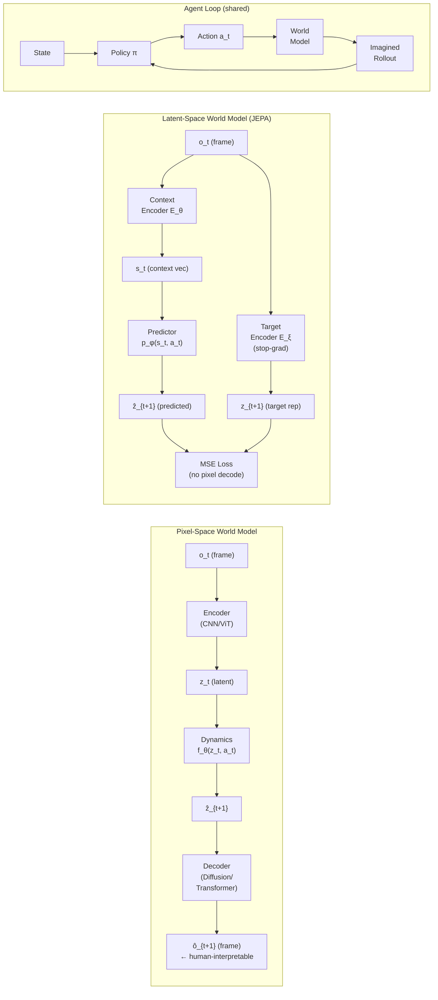

# World Models for Embodied AI

> **Last Updated:** October 2026
> **Level:** Research Frontier
> **Related Sections:**
> - [Vision-Language-Action Models](./01_vla_models.md)
> - [Pros, Cons & Roadmaps](./07_pros_cons_roadmaps.md)
> - [Generative Vision — Video Diffusion & Generation](../10_generative_vision/02_video_generation.md)
> - [Self-Supervised Representation Learning](../03_architectures/03_self_supervised_learning.md)

> **🆕 October 2026 update:**
> - Added **Dreamer 4** (offline-only Minecraft diamonds inside a scalable world model) and noted DreamerV3's 2025 *Nature* publication.
> - Added **Genie 3** (real-time 720p/24 fps interactive worlds, Aug 2025) with Project Genie, SIMA 2 and the Genie-3-based Waymo World Model; noted World Labs Marble.
> - Extended the JEPA line: corrected V-JEPA 2 authorship (Assran et al.), added V-JEPA 2.1 (Mar 2026), JEPA-WMs and LeJEPA; noted AMI Labs.
> - Extended Cosmos: Predict2.5 / Transfer2.5 / Reason 1–2, **Cosmos Policy** and **Cosmos 3** (May–June 2026, unified omnimodal reasoner + generator incl. actions).
> - New sections on **world models for robot data generation and policy evaluation** (DreamGen, Ctrl-World, Veo-based Gemini Robotics evaluation, Genie Envisioner, 1X World Model, WoVR) and on **World Action Models** (UVA, WorldVLA, Cosmos Policy, DreamZero, Fast-WAM).
> - Updated tables, open problems and Further Reading; fixed broken cross-links.

---

## Overview

A **world model** is a learned internal simulator: given a current state $s_t$ and an action $a_t$, it predicts the distribution over future states $s_{t+1}$ — and, by rollout, arbitrary-length futures. The term descends from cognitive science [Craik 1943] but reached modern ML prominence through [Ha & Schmidhuber 2018], who combined a convolutional VAE with an LSTM to let an agent "dream" rollouts entirely in latent space. The central hypothesis is that an agent with a compact, accurate world model can plan efficiently, transfer knowledge across tasks, and acquire skills without exhaustive environment interaction — a potential path toward the sample efficiency and robustness that pure model-free RL lacks.

The field has bifurcated around a foundational architectural tension: **pixel-space prediction** (generate photorealistic future frames) versus **latent-space prediction** (predict abstract representations of future states without decoding to pixels). Pixel-space models — typified by video diffusion approaches such as NVIDIA Cosmos [Agarwal et al. 2025] and DIAMOND [Alonso et al. 2024] — produce human-interpretable rollouts useful for sim-to-real pipelines and debugging, but are computationally expensive and can hallucinate visually plausible yet physically implausible scenes. Latent-space models — typified by the JEPA family [LeCun 2022; Assran et al. 2023; Bardes et al. 2024] and DreamerV3 [Hafner et al. 2023] — discard perceptual detail deliberately, focusing prediction on the causal variables that matter for planning. They are dramatically cheaper per rollout but produce non-interpretable states and must solve the harder problem of defining a representation that is both predictable and action-informative.

Yann LeCun's position paper "A Path Towards Autonomous Machine Intelligence" [LeCun 2022] crystallised the research agenda: world models are the missing ingredient for autonomous agents, and they should be trained via a Joint-Embedding Predictive Architecture (JEPA) with energy-based learning rather than by generative pixel synthesis. This thesis directly challenged the prevailing paradigm of end-to-end Vision-Language-Action (VLA) models and sparked a productive disagreement that continues to organise the field in 2026.

By October 2026 the two camps had partially converged in practice. On the generative side, real-time interactive world models (Genie 3) and multi-billion-parameter physical-AI video models (Cosmos-Predict2.5, Cosmos 3) became **training and evaluation environments** for robot policies, and video-diffusion backbones were fine-tuned into **World Action Models** that jointly predict future frames and actions (Cosmos Policy, DreamZero), which in early 2026 topped real-world generalist-policy leaderboards. On the latent side, V-JEPA 2-AC showed zero-shot planning on real robots from a model pretrained mostly on Internet video, V-JEPA 2.1 improved dense features, and Dreamer 4 showed that agents can be trained purely inside a learned world model from offline data. LeCun's departure from Meta to found AMI Labs (2026) signals that latent world models are now also a commercial bet.

---

## The Pixel-Space vs. Latent-Space Dichotomy

### Pixel-Space World Models

Pixel-space models predict future observations $\hat{o}_{t+1} \approx o_{t+1}$ directly:

```
Objective (pixel reconstruction):
  L_pixel = E[ || o_{t+1} - f_θ(o_t, a_t) ||^2 ]
            or
  L_VDM   = E[ || ε - ε_θ(x_t, t, o_t, a_t) ||^2 ]   (diffusion variant)
```

**Advantages:** generated frames can be used as rendered observations in a downstream planner or as synthetic training data for downstream policies; visual consistency is directly evaluated with FID/FVD. **Disadvantages:** pixel generation is computationally expensive; models frequently violate physical laws while achieving low pixel-reconstruction error; the representation entangles perceptual factors (lighting, texture) with causal factors (object position, velocity).

### Latent-Space World Models

Latent-space models predict future *representations* $\hat{z}_{t+1} \approx \text{sg}(z_{t+1})$ in an embedding space, never decoding to pixels:

```
JEPA Objective (no pixel generation):
  L_JEPA = || s_θ(context) - p_φ(z_{target}) ||^2
            where  z_{target} = E_ξ(x_{target})  (stop-gradient on target encoder E_ξ)
```

```
RSSM Objective (DreamerV3):
  L = E[ -log p_θ(o_t | h_t, z_t)          (recon)
        + β_1 KL[q_φ(z_t|h_t,o_t) || p_θ(z_t|h_t)]   (representation)
        + β_2 L_reward + β_3 L_continue ]
```

The RSSM (Recurrent State Space Model) used in the Dreamer family maintains a deterministic recurrent state $h_t$ (GRU) combined with stochastic categorical latents $z_t$, updated as $h_t = f(h_{t-1}, z_{t-1}, a_{t-1})$.

### Pipeline Comparison (Mermaid)



---

## DreamerV3: Fixed-Hyperparameter World Models at Scale

DreamerV3 [Hafner et al. 2023, arXiv 2301.04104] is the most comprehensive demonstration that a single world model architecture with **fixed hyperparameters** can master over 150 tasks spanning continuous control, Atari, BSuite, Minecraft, and more. Prior Dreamer versions [DreamerV1: Hafner et al. 2020; DreamerV2: Hafner et al. 2021] required domain-specific tuning; DreamerV3 eliminates this via symlog transformations of inputs, KL-balancing, and free-bits regularisation.

**Architecture:** RSSM with a 32-category × 32-class categorical representation ($z_t \in \{0,1\}^{32 \times 32}$), a GRU with hidden size 4096, and separate decoder heads for reconstruction, reward, and episode continuation. The **imagination rollout** uses the RSSM to generate 15-step sequences in latent space for actor-critic updates, never querying the real environment during policy improvement.

**Key results:**

- First algorithm to collect diamonds in Minecraft (item requiring ~20-minute causal action chain) **from scratch without human data or curriculum** — though collection frequency is low (roughly 1 in ~10 episodes at the reported horizon) due to RSSM's bounded horizon
- Atari 100k mean HNS ≈ 112% (normed mean), normed median ≈ 49%
- Consistently reaches or exceeds specialist baselines on DMControl continuous control tasks
- Trains on a single GPU without environment-specific hyperparameter search

**Limitations:** long-horizon credit assignment remains problematic (the Minecraft result is impressive but not reliable per-episode); the RSSM's fixed GRU memory bounds effective planning depth; imagination fidelity degrades for stochastic, visually complex environments.

DreamerV3 was published in *Nature* in 2025 ("Mastering diverse control tasks through world models").

### Dreamer 4 (2025): Training Agents Inside Scalable World Models

Dreamer 4 [Hafner, Yan, Lillicrap 2025, arXiv 2509.24527] replaces the RSSM with a **scalable transformer video world model** trained with a *shortcut forcing* objective that enables few-step, real-time interactive generation on a single GPU, and then trains the agent by RL **purely in imagination**. It is reported as the first agent to obtain diamonds in Minecraft **from offline data alone** (a fixed dataset of human gameplay, without online environment interaction), and the world model accurately captures complex object interactions from relatively little action-labelled data, with most of its knowledge learned from unlabelled video. Dreamer 4 is an important bridge between the "Dreamer" RL lineage and the Genie/Cosmos video-generation lineage, and a template for robotics settings in which online interaction is expensive.

---

## I-JEPA: Prediction in Representation Space for Images

I-JEPA (Image-based Joint-Embedding Predictive Architecture) [Assran et al., CVPR 2023, arXiv 2301.08243] is the first large-scale validation of LeCun's JEPA thesis on images. Rather than reconstructing pixels (as in MAE [He et al. 2022]) or enforcing view-invariance (as in DINO [Caron et al. 2021]), I-JEPA predicts the *representation* of multiple target image patches from a single context patch.

**Architecture:** Two ViT encoders (context encoder $E_\theta$ and exponential-moving-average target encoder $E_\xi$), plus a narrow predictor network $p_\phi$. The context block is a randomly sampled contiguous region; target blocks are 4 non-overlapping regions sampled from the rest of the image. The predictor conditions on positional embeddings of target locations to avoid the trivial solution of ignoring position.

```
Masking strategy:
  Context: 1 large block  (~15% of tokens)
  Targets: 4 blocks       (~85% of tokens)
  Loss: L2 in representation space only — no pixel reconstruction
```

**Benchmark results (ViT-H/14, ImageNet-1K, reported in paper):**

- Linear probing top-1: **77.5%** — outperforms MAE ViT-H (77.2%) on the same architecture while training **10× faster** (under 1,200 GPU-hours vs ~12,000 for MAE ViT-H)
- Training throughput advantage: **2.5× faster** than iBOT ViT-S/16; **>10× faster** than MAE ViT-H/14
- Object counting (CLEVR/Count): outperforms DINO and iBOT by large margins, indicating richer structural representations
- Depth prediction (CLEVR/Dist): similarly strong, suggesting latent prediction captures 3D geometry better than view-invariance methods

The critical insight is that predicting in feature space forces the model to learn *semantic* structure rather than low-level textures; view-based contrastive methods encourage invariance that can discard useful information, while pixel reconstruction wastes capacity on perceptual detail.

---

## V-JEPA: Extending JEPA to Video

V-JEPA [Bardes et al. 2024, arXiv 2404.08471] scales I-JEPA to the temporal domain. Instead of predicting spatial patches, V-JEPA predicts **masked spatiotemporal tubes** in feature space — full 3D volumes of video tokens — using a ViT-based encoder-predictor architecture applied to video without action conditioning.

**Masking strategy:** spatiotemporal masking removes 75–90% of video tokens in tubes aligned along the time axis, forcing the model to reason about motion continuity.

**Benchmark results (ViT-H/16, trained only on video):**

| Benchmark | Metric | V-JEPA Score | Prior Best |
|---|---|---|---|
| Kinetics-400 | Top-1 Acc. | 81.9% | ~78% (video models) |
| Something-Something v2 | Top-1 Acc. | 72.2% | ~62% (video models) |
| ImageNet-1K (no image FT) | Top-1 Acc. | 77.9% | ~72% (video models) |

The +10 point improvement on Something-Something v2 is especially significant: this benchmark rewards **physical dynamics understanding** (e.g., "pulling something from right to left") over static scene recognition, confirming that predicting in representation space encourages emergent physics understanding.

### V-JEPA 2 (2025)

V-JEPA 2 [Assran, Bardes, Fan, Garrido et al., arXiv 2506.09985, Meta FAIR, June 2025] extends the framework to **action-conditioned prediction and robotic planning**. The 1.2B-parameter model undergoes two-stage training: (1) self-supervised video prediction on 1M+ hours of video; (2) action-conditioned fine-tuning (V-JEPA 2-AC) on ~62 hours of unlabeled robot video from the Droid dataset [Khazatsky et al. 2024].

**Key results:**

- Something-Something v2: **77.3%** top-1 (motion understanding)
- Epic-Kitchens-100 action anticipation: **39.7%** recall@5 (state-of-the-art, surpassing task-specific models)
- Zero-shot pick-and-place on Franka arms in two novel lab environments: **65–80% success rate** using goal-image-conditioned planning, with no task-specific data collected from those environments

- Other probes reported in the official repository: Diving48 90.2%; MVP video QA 44.5%; TempCompass 76.9% (when aligned with an LLM)

V-JEPA 2 demonstrates the first plausible evidence that a latent world model trained primarily on passive internet video can transfer to **active robot control** via planning in latent space. Planning uses the cross-entropy method (CEM) over action sequences to minimise the L1 distance between the predicted latent and the latent of a goal image.

### V-JEPA 2.1, JEPA-WMs and LeJEPA (2025–2026)

- **V-JEPA 2.1** (released March 2026 in the official repository) changes the recipe to learn high-quality, temporally consistent **dense** features: a dense predictive loss in which both visible and masked tokens contribute, deep self-supervision at multiple encoder depths, multi-modal (image + video) tokenizers, and further model/data scaling.
- **JEPA-WMs** ("What Drives Success in Physical Planning with Joint-Embedding Predictive World Models?", Meta, arXiv 2512.24497) systematically ablates JEPA world models for planning (encoder choice, predictor, planner) against DINO-WM and V-JEPA 2-AC baselines.
- **LeJEPA** (Balestriero & LeCun, arXiv 2511.08544) provides a theoretically grounded JEPA objective—Sketched Isotropic Gaussian Regularisation (SIGReg) of embeddings—that removes heuristics such as stop-gradient and EMA teachers while scaling stably.

---

## Genie: Generative Interactive Environments from Unlabelled Video

Genie [Bruce et al., ICML 2024 **Best Paper Award**, arXiv 2402.15391] trains an interactive world model entirely from unlabelled internet videos of 2D platformer games, without any ground-truth action labels. At 11B parameters, it is the first **latent action** world model at foundation-model scale.

**Architecture:** Three components:
1. **Spatiotemporal video tokenizer** — converts raw frames to discrete tokens
2. **Latent Action Model (LAM)** — a VQ-VAE that infers a small codebook of discrete latent actions from consecutive frame pairs (encoder sees frames, decoder predicts next frame given history + inferred action)
3. **Autoregressive dynamics model** — predicts future tokens conditioned on latent action tokens

The LAM learns interpretable action primitives (e.g., MOVE_LEFT, JUMP) without supervision, purely from temporal consistency. At inference, users can control the generated environment by selecting latent actions frame-by-frame.

**Significance for robotics:** Genie demonstrates that action-grounded world models can be bootstrapped from passive video, sidestepping the data bottleneck of labelled robot trajectories. The latent action space may transfer to robot embodiments if pre-trained on robot video.

### Genie 2 (December 2024)

Genie 2 [Parker-Holder et al., DeepMind, announced December 4 2024] scales the concept to **3D environments** generated from a single image. Key advances:

- Generates physics-consistent interactive 3D worlds conditioned on a single image input
- Maintains world persistence for 10–60 seconds with emergent behaviours: object interactions, character animation, agent-of-agents modelling
- Trained on a large-scale diverse internet video dataset
- Demonstrates emergent capabilities at scale not present in smaller models

Genie 2 has not been released publicly as of June 2026 and peer-reviewed benchmark numbers are not yet available; the above is based on DeepMind's December 2024 blog announcement.

### Genie 3 (August 2025) and Its Descendants

Genie 3 [Google DeepMind, announced August 5 2025] is the first world model in the series to run **in real time**: it generates navigable, interactive environments from a text prompt at **720p and 24 fps**, maintaining visual consistency for **a few minutes** (with visual memory of regions revisited after about a minute). It adds **promptable world events**—text commands that change weather, introduce objects or characters mid-rollout—making it a counterfactual "what-if" engine. Consistency is emergent from the autoregressive frame-by-frame generation rather than from an explicit 3D representation. DeepMind used Genie 3 environments to train and evaluate its SIMA generalist game agent; SIMA 2 (November 2025, built on Gemini) was likewise demonstrated inside Genie 3-generated worlds.

Access widened in January 2026 through **Project Genie**, an experimental prototype for Google AI Ultra subscribers in the US, and in February 2026 Waymo described a **Waymo World Model** built on Genie 3 to simulate rare driving scenarios. Genie 3 has no public technical report with quantitative benchmarks; the above facts come from DeepMind and Waymo announcements.

**Related 3D-world generators.** World Labs' **Marble** (commercially launched November 2025) generates persistent, downloadable 3D worlds (Gaussian splats / meshes) from text, images or video—an *explicit* 3D alternative to Genie's frame-autoregressive approach that is attractive for robotics simulation because the output can be imported into physics engines.

---

## DIAMOND: Diffusion World Models for Atari

DIAMOND (DIffusion As a Model Of eNvironment Dreams) [Alonso, Jelley, Micheli, Kanervisto, Storkey, Pearce, Fleuret; NeurIPS 2024 Spotlight, arXiv 2405.12399] argues that **visual details matter** for RL inside world models and that standard discrete-latent models (IRIS, DreamerV3) discard information that determines reward outcomes (e.g., bullet positions in Asterix).

**Architecture:** Replaces the discrete latent decoder with a full diffusion model (EDM formulation [Karras et al. 2022]) that generates the next frame conditioned on a history of frames and the action. Rollouts are sequences of denoised frames; the RL agent observes these frames directly.

**Atari 100k results (mean HNS, 26 games):**

| Model | Mean HNS | IQM |
|---|---|---|
| DIAMOND (2024) | **1.46** | **0.64** |
| STORM [Shamsian et al. 2024] | 1.266 | — |
| DreamerV3 [Hafner 2023] | 1.097 | — |
| IRIS [Micheli et al. 2023] | 1.046 | — |

DIAMOND achieves superhuman performance on 11 of 26 games. The EDM formulation is critical: standard DDPM degrades over long rollouts, while EDM's noise-adaptive training maintains visual coherence.

**Limitation:** inference is slow — each environment step requires multiple denoising passes, making real-time robot deployment impractical at present.

---

## NVIDIA Cosmos: Physical AI World Foundation Model

Cosmos [Agarwal et al., NVIDIA, arXiv 2501.03575, announced CES January 2025] is the first commercially-available, openly-licensed world foundation model platform targeting **physical AI** (autonomous vehicles + robotics). Unlike research prototypes, Cosmos ships an end-to-end system:

**Components:**

1. **Cosmos Tokenizer** — causal image/video neural tokenizer; 8× higher compression ratio and 12× faster processing than prior tokenizers; preserves temporal causality (token at time $t$ does not attend to $t+1$)
2. **Autoregressive WFM family** — transformer-based next-token prediction over tokenized video; variants: Nano (edge/real-time), Super (baseline), Ultra (max quality)
3. **Diffusion WFM family** — continuous video diffusion models for high-fidelity generation
4. **Isaac Sim integration** — Cosmos-generated synthetic trajectories feed NVIDIA Isaac Lab's parallel RL training and GR00T-Dreams/GR00T-Mimic data-engine blueprints

**Training data:** 20 million hours of real-world video across robotics, AV, industrial, and human-interaction domains (~9,000 trillion tokens). Licensed under NVIDIA's open model license (commercial use permitted).

**Physical AI positioning:** Cosmos is positioned as a *data engine* — its rollouts provide diverse, physics-consistent synthetic training data to close the real-to-sim gap for robot policy training, rather than as a policy itself. This is a qualitatively different use case from RL-oriented world models like DreamerV3 or DIAMOND.

### Cosmos 2025–2026: Predict2.5, Transfer2.5, Reason, Policy and Cosmos 3

| Release | Date | What it is |
|---|---|---|
| Cosmos-Reason1 (arXiv 2503.15558) | Mar 2025 | Physical-common-sense / embodied-reasoning VLM trained with SFT + RL; long chain-of-thought |
| Cosmos-Transfer1 / Cosmos-Predict2 | H1 2025 | Multi-ControlNet sim-to-real transfer; next-generation video WFMs |
| Cosmos-Predict2.5 (arXiv 2511.00062) | Oct 2025 | **Flow-based** model unifying Text2World, Image2World and Video2World; Cosmos-Reason1 as text encoder; 2B and 14B; robot action-conditioned and multiview (AgiBot) variants; DMD2 distillation |
| Cosmos-Transfer2.5 | Oct 2025 | Multi-ControlNet (edge, depth, segmentation, blur) for sim-to-real and real-to-real augmentation; distilled edge model (Feb 2026) |
| Cosmos-Reason2 (2B, 8B; 32B in Apr 2026) | Dec 2025 | Successor reasoning VLM; Cosmos-Reason2-2B is the VLM backbone of GR00T N1.7 |
| **Cosmos Policy** (arXiv 2601.16163) | Jan 2026 | Fine-tunes Cosmos-Predict2-2B into a visuomotor policy that outputs actions, future states (images + proprioception) and values; supports best-of-N model-based planning; LIBERO, RoboCasa and ALOHA results |
| **Cosmos 3** | May–June 2026 | Omnimodal Mixture-of-Transformers family (Super 64B, Nano 16B, Edge 4B from July 2026). One model exposes a **Reasoner** surface (text out) and a **Generator** surface (vision, sound and action out): world prediction, transfer, action-conditioned forward dynamics and policies (e.g., Cosmos3-Nano-Policy-DROID) |

The trajectory—from separate predict / transfer / reason models in 2025 to a single model that reasons, simulates and acts in 2026—mirrors the convergence of world models and VLAs discussed below.

---

## World Models as Data Engines and Policy Evaluators for Robotics

Beyond planning, three robotics uses of learned world models matured in 2025–2026:

1. **Synthetic trajectory generation.** NVIDIA's **DreamGen** (arXiv 2505.12705; GR00T-Dreams blueprint) fine-tunes a video world model on a target robot, prompts it with new instructions to generate "neural trajectories", labels them with pseudo-actions from an inverse-dynamics or latent-action model, and trains a policy on them—enabling behaviours and environments never teleoperated. GR00T N1.5 incorporated DreamGen data. **Genie Envisioner** (AgiBot, arXiv 2508.05635) packages a video-diffusion world model, an action decoder and a neural simulator into one manipulation platform.
2. **Policy evaluation.** Real-robot evaluation is slow and noisy. **Ctrl-World** (arXiv 2510.10125) is a controllable multi-view world model that rolls out generalist policies (e.g., π0.5) in imagination to rank them and to generate data for policy improvement. Google DeepMind evaluated Gemini Robotics policies, including out-of-distribution and safety scenarios, inside a **Veo-based world simulator** (arXiv 2512.10675). 1X uses its **1X World Model** to evaluate NEO policies.
3. **RL in imagination.** **WoVR** (arXiv 2602.13977) uses a world model as a reliable simulator for RL post-training of VLAs, and Dreamer 4 does so end-to-end in Minecraft.

Large video models also display **emergent zero-shot visual reasoning** ("Video models are zero-shot learners and reasoners", Veo 3, arXiv 2509.20328): segmentation, edge detection, maze solving and simple physical reasoning emerge from generative pretraining, supporting the view that video models can serve as general vision-and-physics foundation models.

---

## World Action Models (2025–2026)

A **World Action Model (WAM)**—also called a video-action model—jointly models future observations and actions, typically by adding action tokens or an action head to a pretrained video-diffusion transformer:

```
WAM objective (schematic):
  p_θ(o_{t+1:t+H}, a_{t:t+H-1} | o_{≤t}, ℓ)
  L = L_video(denoise future latents) + λ · L_action(denoise / regress action chunk)
  Inference: (optionally) imagine future frames, decode actions; or skip imagination
             and decode actions directly from the video backbone's features
```

| Model | Date | Backbone | Notes |
|---|---|---|---|
| UVA — Unified Video Action Model (arXiv 2503.00200) | 2025 (RSS) | Joint latent video-action diffusion | Decoupled decoding lets actions be produced without generating video |
| WorldVLA (arXiv 2506.21539) | 2025 | Autoregressive VLA + world model | Action and image generation in one AR model |
| Cosmos Policy (arXiv 2601.16163) | Jan 2026 | Cosmos-Predict2-2B | Actions, future states and values in latent frames; planning via best-of-N |
| DreamZero (arXiv 2602.15922) | Feb 2026 | Wan2.1-I2V-14B (also Wan2.2-5B) | Trained on DROID only; reported #1 on RoboArena and MolmoSpaces (Feb 2026); ~0.6 s inference on GB200 with DiT caching; few-shot adaptation to new embodiments (AgiBot, YAM) |
| Fast-WAM (arXiv 2603.16666) | Mar 2026 | Video-diffusion WAM | Asks whether test-time future imagination is needed; skipping it greatly reduces latency |
| Being-H0.7 (arXiv 2605.00078) | Apr 2026 | Latent WAM from egocentric human video | Future-aware latent reasoning (NeurIPS 2026) |

By mid-2026, survey papers ("World Action Models: The Next Frontier in Embodied AI", arXiv 2605.12090) treat WAMs as a third family alongside VLAs and planning-based world models. Their appeal is that they inherit physical and temporal priors from Internet video; their costs are size and latency (5–14B+ parameters) and the possibility that imagined futures are physically wrong.

---

## JEPA vs. Generative World Models: The Core Debate

The debate crystallises around two incompatible prior beliefs about what world models should optimise:

| Dimension | JEPA (LeCun school) | Generative / Pixel-space |
|---|---|---|
| **Primary objective** | Predict abstract representations; no pixel synthesis | Predict / generate future observations |
| **Architecture** | Encoder + predictor (no decoder) | Encoder + decoder (diffusion/AR/VQ-VAE) |
| **Collapse avoidance** | EMA target encoder; VICReg/VIC | Reconstruction loss; VQ bottleneck |
| **Interpretability** | Latent space opaque to humans | Generated frames human-readable |
| **Sample efficiency** | High (compact latents, fast rollout) | Lower (decoder training overhead) |
| **Sim-to-real** | Requires latent-to-action mapping | Can generate camera images for downstream |
| **Scaling behaviour** | Improving (V-JEPA 2 at 1.2B params / 1M+ video hours; V-JEPA 2.1 scaling) but few public scaling laws | Demonstrated (Cosmos 20M video hours; Cosmos 3 up to 64B; Genie 3 real-time) |
| **Use as robot policy (2026)** | Goal-image planning (V-JEPA 2-AC, CEM) | World Action Models (DreamZero, Cosmos Policy) |
| **Physical plausibility** | No ground-truth guarantee | FID/FVD optimised; physics may be violated |

**Hybrid trend (2025–2026):** Several groups have merged both paradigms. V-JEPA 2-AC [Assran et al. 2025] predicts in latent space but adds an action-conditioned post-training stage — effectively a JEPA with a thin generative head. DIAMOND [Alonso et al. 2024] generates pixels but uses them as RL observations, not as training targets for the policy backbone. The emerging consensus is that **pure pixel generation is unnecessary** for robot control but that **some form of decoding back to observable space** remains useful for sim data generation and interpretability. The 2026 World Action Model results complicate this picture: generative video pretraining appears to be an excellent *initialisation* for policies even when the generated pixels are discarded at inference (Fast-WAM), suggesting that the debate is less about the training signal's modality than about which representation transfers best to action.

---

## Key Papers

| Paper | Authors | Year | Venue | Key Contribution |
|---|---|---|---|---|
| Mastering Diverse Domains through World Models (DreamerV3) | Hafner, Pasukonis, Ba, Lillicrap | 2023 | arXiv 2301.04104; *Nature* 2025 | Fixed-hyperparameter RSSM world model; first Minecraft diamonds from scratch; 150+ task evaluation |
| Self-Supervised Learning from Images with a Joint-Embedding Predictive Architecture (I-JEPA) | Assran, Duval, Misra et al. | 2023 | CVPR | Predict abstract patch representations, not pixels; beats MAE efficiency; superior object-level features |
| Revisiting Feature Prediction for Learning Visual Representations from Video (V-JEPA) | Bardes, Garrido, Ponce et al. | 2024 | arXiv (Meta AI) | Video JEPA; masked spatiotemporal prediction in feature space; state-of-the-art on SSv2 (+10 pts) |
| Genie: Generative Interactive Environments | Bruce, Dennis, Edwards, Parker-Holder et al. | 2024 | ICML (Best Paper) | 11B-param world model from unlabelled 2D video; unsupervised latent action codebook |
| Diffusion for World Modeling: Visual Details Matter in Atari (DIAMOND) | Alonso, Jelley, Micheli et al. | 2024 | NeurIPS Spotlight | Diffusion world model for Atari; mean HNS 1.46 — new SOTA among world-model-trained agents |
| Cosmos World Foundation Model Platform for Physical AI | Agarwal et al. (NVIDIA) | 2025 | arXiv 2501.03575 | First commercially-open physical AI WFM; 20M video hours; causal tokenizer; AR+diffusion families |
| V-JEPA 2: Self-Supervised Video Models Enable Understanding, Prediction and Planning | Assran, Bardes, Fan, Garrido et al. (Meta FAIR) | 2025 | arXiv 2506.09985 | 1.2B action-conditioned WM; zero-shot robot pick-and-place; SOTA Epic-Kitchens-100 anticipation |
| DreamGen: Unlocking Generalization in Robot Learning through Video World Models | Jang et al. (NVIDIA) | 2025 | arXiv 2505.12705 | Neural trajectories from fine-tuned video WMs as robot training data |
| Genie 3: A New Frontier for World Models | Google DeepMind | 2025 | Blog (Aug 2025) | Real-time 720p/24 fps interactive worlds; promptable world events |
| Training Agents Inside of Scalable World Models (Dreamer 4) | Hafner, Yan, Lillicrap | 2025 | arXiv 2509.24527 | Shortcut-forcing transformer WM; offline-only Minecraft diamonds |
| Video Models are Zero-Shot Learners and Reasoners | Wiedemer et al. (Google DeepMind) | 2025 | arXiv 2509.20328 | Emergent zero-shot vision/physics reasoning in Veo 3 |
| Ctrl-World: A Controllable Generative World Model for Robot Manipulation | Guo et al. | 2025 | arXiv 2510.10125 | World model for evaluating and improving generalist policies |
| World Simulation with Video Foundation Models for Physical AI (Cosmos-Predict2.5) | NVIDIA | 2025 | arXiv 2511.00062 | Flow-based unified Text/Image/Video2World; robot action-conditioned variants |
| LeJEPA: Provable and Scalable Self-Supervised Learning Without the Heuristics | Balestriero, LeCun | 2025 | arXiv 2511.08544 | SIGReg objective; heuristic-free JEPA |
| Evaluating Gemini Robotics Policies in a Veo World Simulator | Google DeepMind | 2025 | arXiv 2512.10675 | Video-model-based policy evaluation incl. safety and OOD |
| Cosmos Policy: Fine-Tuning Video Models for Visuomotor Control and Planning | NVIDIA | 2026 | arXiv 2601.16163 | Video WFM → policy + world model + value function |
| DreamZero: World Action Models Are Zero-Shot Policies | Ye et al. (NVIDIA) | 2026 | arXiv 2602.15922 | 14B WAM; top of RoboArena (Feb 2026) |
| A Path Towards Autonomous Machine Intelligence | LeCun | 2022 | OpenReview (white paper) | Foundational JEPA thesis; H-JEPA + EBM framework; world models as the core of autonomous intelligence |

---

## Benchmark Performance

| Model | Dataset / Task | Metric | Score | Notes |
|---|---|---|---|---|
| DreamerV3 | Atari 100k (26 games) | Mean HNS | ~112% (normed mean) | Fixed hyperparams, single GPU |
| DreamerV3 | Minecraft (diamond) | Task completion | ~1 in 10 episodes | First algorithm to achieve without human data |
| DIAMOND | Atari 100k (26 games) | Mean HNS | **1.46** | NeurIPS 2024 SOTA among WM-trained agents; IQM 0.64 |
| DIAMOND | Atari 100k (26 games) | Superhuman games | 11 / 26 | |
| STORM | Atari 100k | Mean HNS | 1.266 | Previous SOTA |
| I-JEPA (ViT-H/14) | ImageNet-1K | Linear probe top-1 | 77.5% | 10× faster than MAE ViT-H |
| V-JEPA (ViT-H/16) | Kinetics-400 | Top-1 Acc. | 81.9% | Video-only pretraining |
| V-JEPA (ViT-H/16) | Something-Something v2 | Top-1 Acc. | 72.2% | +10 pts over prior video models |
| V-JEPA (ViT-H/16) | ImageNet-1K (no img FT) | Top-1 Acc. | 77.9% | +6 pts over prior video models |
| V-JEPA 2 | Something-Something v2 | Top-1 Acc. | 77.3% | 1.2B params |
| V-JEPA 2 | Epic-Kitchens-100 | Recall@5 (anticipation) | **39.7%** | SOTA, surpasses task-specific models |
| V-JEPA 2-AC | Pick-and-place (Franka, 2 labs) | Success rate | 65–80% | Zero-shot, no env-specific data |
| V-JEPA 2 | Diving48 (probe) | Top-1 Acc. | 90.2% | vs. 86.4% InternVideo2-1B (repo-reported) |
| Dreamer 4 | Minecraft (diamond) | Task completion | Achieved from offline data only | First reported offline-only diamond agent |
| Genie 3 | Interactive generation | Resolution / frame rate | 720p @ 24 fps, minutes of consistency | No public quantitative benchmark |
| DreamZero-DROID | RoboArena / MolmoSpaces | Leaderboard rank | #1 / #1 (Feb 2026) | Trained from scratch on DROID only |

---

## Pros & Cons

| Aspect | Pros | Cons |
|---|---|---|
| **Latent-space WM (JEPA/DreamerV3)** | Extremely fast rollouts; sample-efficient RL; collapse-resistant via EMA targets; scales well per FLOP | Non-interpretable latents; no direct sim-to-real pixel bridge; quality of latent representation depends heavily on pretraining |
| **Pixel-space WM (DIAMOND/Cosmos)** | Human-interpretable generated frames; enables sim data pipelines; visual consistency evaluated with FID/FVD | Slow inference (diffusion denoising adds latency per step); can generate visually plausible but physically incorrect scenes; decoder training overhead |
| **Action-conditioned WM (V-JEPA 2-AC, Genie)** | Bridges passive video pretraining to active control; enables goal-conditioned planning; latent action models require no action labels | Action label scarcity limits fine-tuning signal; latent action spaces may not align to robot morphology; transfer from 2D video to 3D robot workspace uncertain |
| **Generative WM as data engines (Cosmos/Isaac Lab)** | Massively scalable synthetic data; domain randomisation; reduces need for expensive real-world data collection | Sim-to-real gap remains; physical plausibility not guaranteed; training cost enormous (20M video hours for Cosmos) |
| **World Action Models (DreamZero, Cosmos Policy)** | Physical/temporal priors from Internet video; strong zero-shot generalisation; built-in prediction and value for planning | 5–14B+ parameters; sub-second-to-seconds latency without distillation; imagined futures can be wrong |
| **Real-time interactive WMs (Genie 3)** | Unlimited diverse environments for agent training and evaluation; promptable counterfactual events | Closed access; minutes-scale consistency; no guarantee of physical correctness; not action-calibrated to real robots |
| **Evaluation metrics (FVD/FID vs. physical plausibility)** | FVD/FID are standardised and widely used | High FVD does not correlate with planning quality; physics violations invisible to perceptual metrics; new physics-aware benchmarks (WorldModelBench, VideoCon-Physics) not yet standard |

---

## Open Problems & Research Gaps

1. **Evaluation beyond FVD/FID.** Standard video quality metrics (FID, FVD) measure perceptual realism but are uncorrelated with physical plausibility and downstream RL performance [c.f. WorldModelBench 2025]. A standard benchmark for *decision-centric* world model evaluation — analogous to BenchML for representations — does not yet exist.

2. **Passive video → active control transfer.** V-JEPA 2 demonstrates promise but requires ~62 hours of robot data for action conditioning; Genie's latent action approach is untested beyond 2D video domains. Whether world models trained on diverse internet video can be efficiently adapted to novel robot morphologies at near-zero action-label cost is unresolved.

3. **Long-horizon consistency and memory.** DreamerV3's RSSM and Genie's autoregressive transformer both degrade in consistency beyond 15–60 seconds of rollout. Structured state representations (object-centric, graph-based) may help but impose inductive bias that limits generality.

4. **Physical law compliance.** Current pixel-space models violate mass conservation, collision physics, and rigidity constraints in generated rollouts. Integrating physics priors (neuro-symbolic constraints, differentiable simulation) without sacrificing scalability is an open architectural challenge.

5. **Compute trade-off: simulation vs. real data.** Cosmos requires ~9,000 trillion tokens of training data; Isaac Lab simulation generates synthetic data that may not close the reality gap. The optimal mix of real robot data, human video, and simulation for world model pretraining is empirically unknown.

6. **Unified architecture for perception, prediction, and planning.** Current systems separate the representation backbone (ViT), the dynamics model (RSSM/transformer), and the policy network. A single architecture that jointly optimises all three — analogous to how transformers unified language tasks — would simplify training and potentially improve consistency.

7. **Scaling laws for world models.** Unlike language models, no empirical scaling law (compute × data → performance) has been established for world models applicable to embodied AI. The relationship between model size, training data, and downstream robot policy quality is largely unknown.

8. **Do policies need imagination?** World Action Models are trained to predict the future, but Fast-WAM-style results suggest the benefit may come mostly from the pretrained representation rather than from test-time rollouts. When explicit imagination helps (long-horizon, contact-rich, safety-critical tasks) is unresolved.

9. **Validity of world-model-based evaluation.** Veo-, Ctrl-World- and 1X-style policy evaluators are increasingly used to rank policies; establishing when their rankings agree with real-world outcomes—especially for failures and safety events—is an open methodological question.

10. **Latency and edge deployment.** Real-time generation (Genie 3, Cosmos3-Edge, distillation such as DMD2) is progressing, but WAM policies still require data-centre GPUs for sub-second inference.

---

## Further Reading

- [DreamerV3 arXiv](https://arxiv.org/abs/2301.04104) — Hafner et al., "Mastering Diverse Domains through World Models"
- [I-JEPA CVPR 2023](https://openaccess.thecvf.com/content/CVPR2023/html/Assran_Self-Supervised_Learning_From_Images_With_a_Joint-Embedding_Predictive_Architecture_CVPR_2023_paper.html) — Assran et al., official proceedings
- [V-JEPA 2 arXiv](https://arxiv.org/abs/2506.09985) — Assran et al., "V-JEPA 2: Self-Supervised Video Models Enable Understanding, Prediction and Planning" (June 2025)
- [DIAMOND project page](https://diamond-wm.github.io/) — with videos, code, and per-game Atari results
- [NVIDIA Cosmos arXiv](https://arxiv.org/abs/2501.03575) — full technical report on the WFM platform
- [LeCun 2022 white paper](https://openreview.net/pdf?id=BZ5a1r-kVsf) — "A Path Towards Autonomous Machine Intelligence" — the foundational JEPA manifesto
- [V-JEPA 2 / 2.1 code](https://github.com/facebookresearch/vjepa2) — official V-JEPA 2, V-JEPA 2-AC and V-JEPA 2.1 code and checkpoints
- [Dreamer 4 arXiv](https://arxiv.org/abs/2509.24527) — "Training Agents Inside of Scalable World Models"
- [Genie 3 announcement](https://deepmind.google/discover/blog/genie-3-a-new-frontier-for-world-models/) — DeepMind, August 2025
- [Cosmos-Predict2.5](https://github.com/nvidia-cosmos/cosmos-predict2.5) and [Cosmos 3](https://github.com/NVIDIA/Cosmos) — NVIDIA world foundation models
- [Cosmos Policy](https://github.com/NVlabs/cosmos-policy) — video model fine-tuned into a policy + planner
- [DreamZero](https://github.com/dreamzero0/dreamzero) — World Action Model code and checkpoints
- [LeJEPA](https://github.com/rbalestr-lab/lejepa) — heuristic-free JEPA training
- [JEPA-WMs](https://github.com/facebookresearch/jepa-wms) — study of JEPA world models for physical planning
