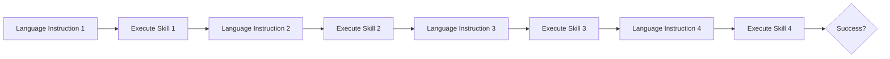
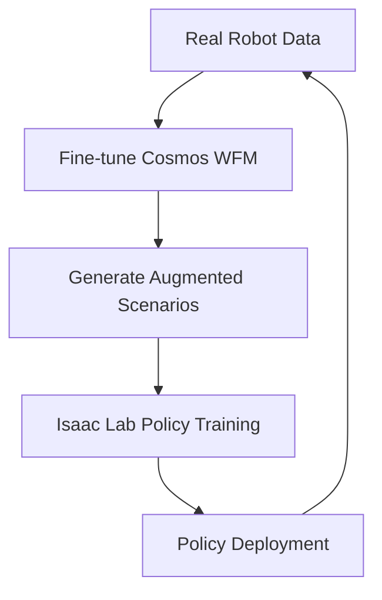

# Simulation & Data for Embodied AI

> **Last Updated:** October 2026
> **Level:** Advanced | Research Frontier
> **Related Sections:** [./02_world_models.md](./02_world_models.md) | [./09_robot_data_and_teleoperation.md](./09_robot_data_and_teleoperation.md) | [./04_cross_embodiment.md](./04_cross_embodiment.md) | [./01_vla_models.md](./01_vla_models.md)

> **🆕 October 2026 update:**
> - **Newton** (Disney Research + Google DeepMind + NVIDIA, a Linux Foundation project since Sept 2025) reached v1.0 on 10 Mar 2026 and v1.7 on 14 Oct 2026. It is a Warp/OpenUSD multi-solver engine whose primary backend is **MuJoCo Warp**. **Isaac Lab 3.0** (Early Access, Sept 2026; GA targeted for end of Oct 2026) becomes a multi-backend framework with PhysX and Newton, and its technical report is out (arXiv:2511.04831).
> - **MuJoCo Playground** (arXiv:2502.08844, RSS 2025 Outstanding Demo Paper) trains sim-to-real locomotion and manipulation policies in minutes on one GPU, and it now runs on MJX or MuJoCo Warp. **Genesis** reached "Genesis World 1.0" (May 2026) and is now backed by the startup Genesis AI.
> - New and refreshed benchmarks include **RoboCasa365** (ICLR 2026, 365 tasks, 2,500+ scenes), **RoboTwin 2.0**, **LIBERO-Plus** (a robustness audit: VLAs fall from ~95% to <30% under camera/initial-state shifts), **Isaac Lab-Arena** for GPU-parallel policy evaluation, and **ManiSkill3** (RSS 2025).
> - World-model data engines: **Cosmos-Predict2.5 / Transfer2.5** (Oct 2025), **DreamGen / GR00T-Dreams**, Cosmos Policy checkpoints (Feb 2026), and the **Cosmos 3** omnimodal family (May 2026; Super 64B, Nano 16B, Edge 4B). The Cosmos 3 date is corrected from the earlier "June 2026".
> - New open problems: benchmark saturation versus robustness, and real-to-sim evaluation fidelity for generalist policies.

---

## Overview

Simulation has become an indispensable component of modern robot learning. It serves as a training environment for reinforcement and imitation learning, and as a scalable source of annotated synthetic data for perception systems. The core challenge in moving from simulation to physical deployment is the **sim-to-real gap**. It comes from mismatches in physics fidelity, visual appearance, contact dynamics, sensor noise models and actuator behavior. Closing this gap takes high-fidelity physics engines, photorealistic rendering and principled domain randomization. Randomization exposes policies to enough distributional variation during training that they generalize to the real world at test time.

The past three years have seen an explosion in GPU-parallel simulation frameworks. Isaac Gym (2021) pioneered running thousands of independent robot environments on a single GPU. Its successor **Isaac Lab** [Mittal2025] formalizes this into a unified framework that combines rigid-body physics, deformable simulation, photorealistic rendering (via NVIDIA Omniverse) and tight integration with reinforcement learning libraries. On the academic side, **Genesis** [Zhou2024], released in December 2024, claims up to 43 million frames per second for a single Franka arm scene on an RTX 4090, roughly 430,000× real time. This marks a qualitative shift: when a locomotion policy trains in 26 seconds of wall-clock time, a hyperparameter sweep over entire policy families becomes tractable.

The 2025–2026 period brought **consolidation around shared physics back-ends**. Google DeepMind and NVIDIA co-develop **MuJoCo Warp (MJWarp)**, a GPU port of MuJoCo written in NVIDIA Warp. **Newton** [Newton2026] is an open, Linux Foundation-governed engine co-founded by Disney Research, Google DeepMind and NVIDIA. It uses MJWarp as its primary backend and adds further solvers for cloth, cables, MPM granular media and closed-chain mechanisms. Isaac Lab 3.0 and MuJoCo Playground [Zakka2025] can both train on these back-ends. Researchers can therefore switch between a MuJoCo-style soft-contact model and PhysX without rewriting their task code.

Complementing physics-based simulators, **world models** have emerged as an alternative way to generate data. NVIDIA **Cosmos** [NVIDIA2025] launched at CES 2025. It is a family of diffusion- and autoregressive-based world foundation models, trained on large video corpora, that synthesize physically plausible video conditioned on text, image or robot action inputs. Coupling Cosmos with Isaac Lab enables a *data flywheel*. Real robot interactions fine-tune Cosmos, which then generates augmented training scenarios that feed back into Isaac Lab for policy learning. The pipeline promises to cut the real-world data burden sharply while keeping physical plausibility. By 2026 the line was extended by Cosmos-Predict2.5/Transfer2.5 and the omnimodal Cosmos 3 family, which also emits actions.

---

## GPU-Parallel Physics Simulators

### Isaac Lab (NVIDIA)

Isaac Lab [Mittal2025] is the official successor to Isaac Gym, built on NVIDIA's PhysX 5 engine and the Omniverse USD scene description format. Key capabilities:

- **Parallel environments:** Thousands of independent environments per GPU, each with independent physics state
- **Multi-modal sensing:** RGB, depth, segmentation, force-torque, proprioception — all GPU-resident
- **Domain randomization:** Programmatic randomization of masses, friction coefficients, visual textures, lighting
- **Tight RL integration:** Native interfaces to RSL_RL, RL_Games, and Stable Baselines 3
- **Imitation learning support:** Data collection pipelines for behavioral cloning

```
GPU Memory
┌──────────────────────────────────────────────────┐
│  Env 0   │  Env 1   │  Env 2   │  ...  │  Env N  │  (N = 4096+ on A100)
│  Physics │  Physics │  Physics │       │  Physics │
│  Render  │  Render  │  Render  │       │  Render  │
└──────────────────────────────────────────────────┘
              ↓ batched observations
         Policy Network (GPU)
              ↓ batched actions
         Environment Step (GPU)
```

**2025–2026 evolution.** The Isaac Lab technical report (arXiv:2511.04831, Nov 2025) covers actuator models, multi-frequency sensor simulation, data collection and domain randomization. It also covers applications from whole-body control to dexterous manipulation. The release line since then:

| Release | Date | Highlights |
|---------|------|-----------|
| v2.3.0 | Oct 2025 | Isaac Sim 5.1; DexSuite dexterous lift/reorient environments (with ADR and PBT); **SkillGen** with cuRobo motion planning for synthetic demonstration generation; G1 loco-manipulation; Vive/Manus teleoperation |
| v2.3.2 | Feb 2026 | Last release of the 2.x line. Visual tactile sensor, multirotor support, OpenArm environments, Newton Beta docs |
| v3.0.0-beta / beta2 | Mar / Jun 2026 | Isaac Sim 6.0. **Factory-based multi-backend architecture**: the `isaaclab_newton` backend (MuJoCo-Warp, runs without the Kit runtime) alongside PhysX; pluggable renderers; Warp-native data; quaternion convention moves to XYZW |
| v3.0.0-EA | 16 Sep 2026 | Isaac Sim 6.1, Newton 1.5.2. One task API across physics, rendering and visualization backends; GA targeted for end of Oct 2026 |

**Isaac Lab-Arena** (alpha, v0.3) sits on top of Isaac Lab 3.0 as a framework for *authoring benchmarks and evaluating policies*. An environment is composed from {scene, embodiment, task}, with relational object placement and atomic-skill chaining. One policy (e.g., GR00T or π0.5 behind a client-server interface) can be evaluated across thousands of parallel environment variations. Sensitivity analysis then exposes robustness gaps.

### Newton and MuJoCo Warp

**Newton** [Newton2026] grew out of the deprecated `warp.sim` module. It was announced at GTC 2025 by NVIDIA, Google DeepMind and Disney Research and contributed to the Linux Foundation in September 2025. Its design goals are GPU-first computation, OpenUSD scene I/O, differentiability and user-extensible solvers. Version **1.0.0 was released on 10 March 2026** (presented at GTC 2026), followed by roughly monthly releases up to **v1.7.0 (14 Oct 2026)**. Its repository ships examples for:

- **Rigid/articulated bodies:** MuJoCo Warp (primary backend) and Featherstone, plus **Kamino** for closed-chain mechanisms such as parallel-linkage legs
- **Deformables:** VBD (vertex block descent) cloth and soft bodies, an ADMM cable solver, Style3D cloth
- **Granular and fluid media:** implicit MPM (sand, snow, viscous fluids), with two-way coupling to rigid robots (e.g., ANYmal walking on granular terrain)

**MuJoCo Warp (MJWarp)** is maintained by Google DeepMind and NVIDIA as part of the Newton project. It is a GPU (Warp) re-implementation of MuJoCo that JAX users can also reach via MJX. A ray-traced batch renderer reaches "millions of frames per second" on NVIDIA GPUs. Not every MuJoCo feature is supported yet: the PGS solver and plugins are missing, flex support is experimental, and differentiability through Warp is not available yet.

> **Interpretation.** The ecosystem has moved from *competing monolithic simulators* toward *shared, interoperable solvers*. The same MuJoCo contact model can now run on CPU MuJoCo, MJX (JAX/TPU), MJWarp (CUDA) and Newton/Isaac Lab. This removes one source of sim-to-sim discrepancy when papers compare results across frameworks.

### Genesis

Genesis [Zhou2024] is a pure-Python physics engine originally built on top of Taichi, delivering:

- **43M+ FPS** for single-arm manipulation (RTX 4090, self-collisions only)
- **27M FPS** with random action perturbation active
- **81× faster** than Isaac Gym on equivalent benchmarks
- Unified solver supporting rigid body, MPM (granular/soft), SPH (fluid), FEM, and stable Newtonian fluids

These headline figures were measured on a single-arm scene with essentially no inter-object contact. Treat them as upper bounds; contact-rich, rendered workloads run far slower on every simulator. In 2025–2026 the project matured from an academic release into an industrially supported codebase:

- The startup **Genesis AI** came out of stealth in July 2025 with a seed round reported by TechCrunch at $105M, co-led by Eclipse and Khosla Ventures. It now officially supports Genesis development.
- The compiler was forked from Taichi into **Quadrants** (June 2025), with CUDA, ROCm, Metal, Vulkan, x86 and ARM64 backends.
- **Genesis World 1.0** was announced on the Genesis AI blog in May 2026. The current codebase couples rigid, FEM, MPM, PBD/SPH and **IPC** (incremental potential contact, via libuipc) solvers in one scene. It adds a SAP contact model, the **Nyx** renderer (including 3D Gaussian Splatting assets) and simulated lidar/IMU/tactile sensors.

### MuJoCo / MJX

MuJoCo remains the reference simulator for contact-rich manipulation research, thanks to its accurate soft-contact model and extensive validation. **MJX** extends MuJoCo to JAX, enabling GPU/TPU-parallel batched simulation:

```python
# MJX batched rollout sketch
import mujoco
from mujoco import mjx
import jax
import jax.numpy as jnp

model = mujoco.MjModel.from_xml_path("robot.xml")
mx = mjx.put_model(model)
dx = jax.vmap(mjx.make_data)(mx)            # N parallel states
step_fn = jax.jit(jax.vmap(mjx.step))       # batched step
dx = step_fn(mx, dx)
```

### MuJoCo Playground

**MuJoCo Playground** [Zakka2025] (arXiv:2502.08844; Outstanding Demo Paper Award at RSS 2025; UC Berkeley, Google DeepMind, Toronto, Cambridge) is a pip-installable suite of GPU-accelerated environments. It covers `dm_control` classics, quadruped and humanoid locomotion (e.g., Unitree G1, Berkeley Humanoid), dexterous in-hand manipulation (LEAP hand) and non-prehensile arm manipulation. It reports **zero-shot sim-to-real transfer from both state and pixel inputs**, with policies trained in minutes on a single GPU. Vision-based training uses a batch renderer, and environments now run on either MJX (JAX) or MuJoCo Warp (`--impl warp`) with JAX-PPO or RSL-RL trainers. Playground has become a de facto reproducible baseline for "minutes-to-policy" locomotion research.

### SAPIEN / ManiSkill3

SAPIEN is a fast articulated-object physics engine developed at UC San Diego. **ManiSkill3** [Tao2025] (arXiv:2410.00425, RSS 2025) builds on SAPIEN to provide:

- GPU-parallel environments with rendering (up to 10,000 FPS for state-based, 2,000 FPS with visual rendering on typical tasks; the authors report collecting **RGBD + segmentation at 30,000+ FPS on an RTX 4090** at the high end)
- **Heterogeneous simulation**: every parallel environment can hold a different scene and object set
- 20+ task families, 2,000+ object models
- GPU-accelerated **real-to-sim evaluation** of real-world policies, claimed to be ~100× faster than real evaluation
- Standardized benchmark API for manipulation skill evaluation

### Habitat 3.0

Facebook AI's Habitat 3.0 focuses on embodied navigation and social navigation with human avatars. It supports both rigid-body agents and articulated humanoids in photorealistic 3D scans of real environments (HM3D, Gibson, Replica datasets).

### ProcTHOR

ProcTHOR [Deitke2022] uses procedural generation to create thousands of visually diverse indoor environments for training navigation and instruction-following agents. The key insight is that diversity at training time transfers well to the real world through distribution coverage, even with simplified rendering.

### RoboCasa / RoboCasa365

RoboCasa [Nasiriany2024] is a large-scale kitchen simulation framework built on Robosuite/MuJoCo, featuring:

- 120 visually diverse kitchen scenes
- 25 atomic tasks, 100 composite tasks
- 1,200 human demonstrations + 72,000 synthetic demonstrations
- AI-generated textures (text-to-image) and assets (text-to-3D)
- Presented at RSS 2024

**RoboCasa365** [Nasiriany2026] (v1.0, released 18 Feb 2026; ICLR 2026) scales the framework into a generalist-robot training and benchmarking platform:

- **365 tasks** authored with LLM guidance, **2,500+ kitchen scenes**, 3,200+ objects
- **600+ hours of human demonstrations plus 1,600+ hours of robot datasets** (2,200+ hours in total)
- A public leaderboard (Apr 2026). v1.0.1 (May 2026) lengthened task horizons 1.5×, and per-frame subtask annotations for composite tasks followed (Jul–Oct 2026)

RoboCasa and its GR1 tabletop variant are now standard evaluation suites in NVIDIA's GR00T model cards.

---

## Sim-to-Real Transfer & Domain Randomization

The fundamental difficulty is that policies trained in simulation meet a real world with different dynamics, appearance and noise characteristics. Bridging strategies fall into three categories:

### Domain Randomization (DR)

Randomize simulation parameters during training so that real-world parameters fall within the training distribution:

```
P(success_real) ≈ E_{ψ ~ P(ψ)}[P(success_sim | ψ)]
```

where `ψ` encodes randomized physical parameters (mass, friction, damping) and visual parameters (texture, lighting, camera pose).

**Visual DR:** Random textures, colors, lighting, distractors. Notable result: OpenAI's Dexterous Hand [OpenAI2019] used extreme visual DR to transfer from simulation to a real Shadow Hand.

**Dynamics DR:** Randomize mass, inertia, joint friction and actuator gains. **Adaptive DR** (ADR) automatically expands the randomization ranges as the policy becomes more competent, which avoids both under- and over-randomization. Isaac Lab's 2025 DexSuite environments combine ADR with population-based training (PBT) for dexterous lift-and-reorient tasks.

### System Identification & Differentiable Simulation

Rather than randomizing blindly, system identification fits simulation parameters to real trajectories. Differentiable simulators (e.g., Warp, DiffTaichi) enable gradient-based parameter optimization:

```math
\hat{\psi} = \arg\min_{\psi} \sum_t \| s_t^{\text{real}} - s_t^{\text{sim}}(\psi) \|^2
```

Newton and Genesis's Quadrants compiler both list differentiability as a design goal. In practice, gradients through contact-rich MuJoCo-Warp rollouts are not yet available (as of Oct 2026), so most 2026 sim-ID pipelines still rely on sampling-based optimizers (CMA-ES, Bayesian optimization).

### Real2Sim2Real with Neural Scene Reconstruction

A third route, which has grown quickly since 2024, reconstructs the *actual* deployment scene from phone or robot captures (3D Gaussian Splatting, NeRF), imports it into a simulator, and trains or evaluates policies there. Isaac Lab's 3.0 betas add neural-reconstruction (NuRec) rendering support, and Genesis's Nyx renderer accepts Gaussian-splat assets. See [Perception for Robotics](./08_perception_for_robotics.md) for SplatSim and RL-GSBridge.

### Reality Gap in Contact Dynamics

Contact simulation (grasping, insertion) remains the hardest domain due to:
- Deformation of real object surfaces
- Friction anisotropy
- Sensor compliance of robot end-effectors
- Environmental variability (dust, humidity)

Newton 1.0 was positioned by NVIDIA explicitly at contact-rich industrial manipulation, with **hydroelastic contact** modeling and solver calibration work with partners. Independent sim-to-real validation of these models is still sparse.

---

## Benchmark Simulation Suites

### RLBench

RLBench [James2020] provides 100 structured manipulation tasks defined on a Franka arm in PyRep/CoppeliaSim. Tasks span simple reaching to bimanual assembly. Widely used for few-shot imitation learning benchmarks.

### Meta-World

Meta-World [Yu2020] provides 50 distinct robotic manipulation tasks for multi-task and meta-reinforcement learning evaluation, enabling measurement of both task-specific and generalized performance.

### CALVIN

CALVIN [Mees2022] is a long-horizon language-conditioned benchmark requiring an agent to execute sequences of 4 instructions in a single episode across novel scene arrangements.



### LIBERO and LIBERO-Plus

LIBERO [Liu2023] focuses on lifelong robot learning, with 130 tasks across four knowledge domains (spatial, object, goal, long-horizon). Tasks are designed to measure forward transfer and catastrophic forgetting.

By 2025, LIBERO had become the default VLA benchmark, and top models report average success in the mid-to-high 90s. **LIBERO-Plus** [Fei2025] (arXiv:2510.13626) audits this saturation by perturbing seven factors: object layout, camera viewpoint, robot initial state, language instruction, lighting, background texture and sensor noise. VLAs prove *highly sensitive to camera viewpoint and robot initial state*: success falls from ~95% to below 30% under modest shifts. On its leaderboard, OpenVLA scores 0.8 under camera perturbation (15.6 overall), and OpenVLA-OFT scores 56.4 (69.6 overall).

### ManiSkill2 / ManiSkill3

ManiSkill2 [Gu2023] (ICLR 2023) includes 20 task families with 4M+ demonstrations. The upgraded ManiSkill3 (2024; RSS 2025) adds GPU-parallel rendering, heterogeneous per-environment scenes and a standardized evaluation API.

### RoboTwin 2.0 (Bimanual)

**RoboTwin 2.0** [Chen2025] (arXiv:2506.18088, released June 2025) is a scalable data generator and benchmark for **dual-arm manipulation** with *strong domain randomization*. It ships ~50 tasks, multiple dual-arm embodiments (default: AgileX ALOHA-style) and 100,000+ pre-collected trajectories. RoboTwin 1.0 was a CVPR 2025 Highlight, and the platform hosted the CVPR 2025 MEIS dual-arm collaboration challenge.

### Household-Scale and Evaluation Platforms

- **BEHAVIOR-1K** [Li2022]: 1,000 everyday household activities in OmniGibson (built on Isaac Sim). It remains the most semantically comprehensive household benchmark and the basis for the Stanford BEHAVIOR challenges.
- **Isaac Lab-Arena** (2026, alpha): composable benchmark authoring and GPU-parallel, large-scale evaluation of generalist policies (see above).
- **RoboArena** (2025): a distributed, *real-world* benchmark for generalist policies on the DROID platform. Policies are served from a remote policy server and evaluated on DROID setups at different sites, with a companion simulated evaluation suite (DROID sim-evals).

---

## Synthetic Data via World Models

NVIDIA **Cosmos** [NVIDIA2025] represents a new paradigm: **world foundation models** trained on massive video corpora that can generate physically plausible synthetic training data:



Key capabilities:
- Text, image, or action-conditioned video generation
- Physics-aware generation (object permanence, contact events)
- Integration with Omniverse for domain randomization augmentation

### Cosmos-Predict2.5 / Transfer2.5 (Oct 2025)

Released on 6 Oct 2025 (technical report arXiv:2511.00062), **Cosmos-Predict2.5** unifies Text2World, Image2World and Video2World in one flow-matching (rectified-flow) model at 2B and 14B scales. It adds robot-specific post-trained variants: *action-conditioned* prediction (Oct 2025), multiview AgiBot generation (Dec 2025) and **Cosmos Policy** checkpoints (Feb 2026). In the policy checkpoints, the video model is post-trained to act directly as a policy on RoboCasa and LIBERO. **Cosmos-Transfer2.5** is a multi-ControlNet "world-to-world" model. It turns simulator outputs (depth, segmentation, edges, blur) into photorealistic video, a learned replacement for hand-designed visual domain randomization. A distilled edge variant followed in Feb 2026.

### DreamGen / GR00T-Dreams

**DreamGen** [Jang2025] (arXiv:2505.12705) is a four-step recipe for producing "neural trajectories":

1. Fine-tune a video world model on the target robot
2. Prompt it with an initial frame and a language instruction to generate rollouts of new behaviors or environments
3. Recover pseudo-actions with an inverse-dynamics model
4. Train a visuomotor policy (GR00T N1) on the result

NVIDIA packages this as the **GR00T-Dreams** blueprint, and DreamGenBench scores generated videos for instruction following and physics alignment. It is one of the first systematic demonstrations that *video-model rollouts can teach a robot verbs it never performed in teleoperation*.

### Cosmos 3 (2026)

**Cosmos 3** was released in late May 2026; the public launch was announced on 1 June 2026. It is an "omnimodal" world-model family built on a unified **Mixture-of-Transformers** architecture with two interfaces:

- **Reasoner:** text + vision → text (world understanding, task planning)
- **Generator:** text + vision + sound + action → vision + sound + action (world simulation and policy learning)

It comes in three tiers. **Cosmos3-Super (64B)** serves synthetic-data generation and acts as a distillation teacher, **Cosmos3-Nano (16B)** is a post-training base, and **Cosmos3-Edge (4B)** (July 2026) targets real-time policies on Jetson AGX Orin/Thor. Example post-trained checkpoints include DROID robot policies. Together these blur the line between "world model as data engine" and "world model as policy" (see [World Models](./02_world_models.md)).

---

## Key Papers

| Paper | Authors | Year | Venue | Key Contribution |
|-------|---------|------|-------|-----------------|
| Isaac Lab: A GPU-Accelerated Simulation Framework for Multi-Modal Robot Learning | Mittal et al. | 2025 | arXiv:2511.04831 (NVIDIA) | Unified GPU-parallel sim+render framework; multi-modal sensor support; extends Isaac Gym; previews Newton integration |
| Genesis: Generative World for General-Purpose Robotics | Zhou et al. | 2024 | Open-source release | 43M FPS pure-Python simulator; unified rigid/soft/fluid solver |
| MuJoCo Playground | Zakka et al. | 2025 | RSS 2025 (Outstanding Demo Paper) | MJX/MJWarp environment suite; minutes-to-policy on one GPU; zero-shot sim-to-real from state and pixels |
| ManiSkill3: GPU Parallelized Robotics Simulation and Rendering for Generalizable Embodied AI | Tao et al. | 2025 | RSS 2025 | Heterogeneous GPU-parallel sim + rendering; 30K+ FPS RGBD+seg; fast real-to-sim evaluation |
| ManiSkill2: Unified Benchmark for Generalizable Manipulation Skills | Gu et al. | 2023 | ICLR 2023 | 20 task families, 4M+ demonstrations, GPU-accelerated evaluation |
| RoboCasa: Large-Scale Simulation of Everyday Tasks | Nasiriany et al. | 2024 | RSS 2024 | 120 kitchen scenes, 100 tasks, AI-generated assets; 72K synthetic demos |
| RoboCasa365: A Large-Scale Simulation Framework for Training and Benchmarking Generalist Robots | Nasiriany et al. | 2026 | ICLR 2026 | 365 tasks, 2,500+ scenes, 2,200+ h of demonstrations; public leaderboard |
| RoboTwin 2.0 | Chen et al. | 2025 | arXiv:2506.18088 | Bimanual data generator + benchmark with strong domain randomization; 100K+ trajectories |
| LIBERO-Plus: In-depth Robustness Analysis of Vision-Language-Action Models | Fei et al. | 2025 | arXiv:2510.13626 | 7-axis perturbation audit; VLAs collapse under camera/initial-state shifts |
| DreamGen: Unlocking Generalization in Robot Learning through Video World Models | Jang et al. | 2025 | arXiv:2505.12705 | Video-world-model rollouts + inverse dynamics → synthetic robot trajectories; DreamGenBench |
| Cosmos-Predict2.5 / Transfer2.5 technical report | NVIDIA | 2025 | arXiv:2511.00062 | Unified flow-based world simulation; action-conditioned and multiview robot variants; multi-control sim-to-real transfer |
| CALVIN: Long-Horizon Language-Conditioned Manipulation | Mees et al. | 2022 | IEEE RA-L | 4-instruction chained manipulation benchmark with novel scenes |
| ProcTHOR: Large-Scale Embodied AI using Procedural Generation | Deitke et al. | 2022 | NeurIPS 2022 | Procedurally generated diverse indoor environments for navigation/instruction following |
| LIBERO: Benchmarking Knowledge Transfer for Lifelong Robot Learning | Liu et al. | 2023 | NeurIPS 2023 | 130 tasks for lifelong learning; measures forward transfer and forgetting |

---

## Benchmark Performance

| Model | Dataset/Benchmark | Metric | Score | Notes |
|-------|------------------|--------|-------|-------|
| Diffusion Policy [Chi2023] | RLBench (10 tasks) | Success Rate | 76.1% | CNN-based; image input |
| ACT [Zhao2023] | ALOHA bimanual tasks | Success Rate | 80–96% | Sim-trained, real transfer |
| SuSIE [Black2023] | CALVIN ABC→D | Avg. chain length | 3.6/4.0 | LLM subgoal synthesis |
| MT-ACT (multi-task) | LIBERO-Long | Success Rate | 72.0% | 10-task sequence |
| DP3 [Ze2024] | ManiSkill2 (point cloud) | Success Rate | 85%+ | 3D diffusion policy |
| Genesis baseline | MuJoCo locomotion | Training time | 26 sec | 430,000× real-time on RTX 4090 |
| ManiSkill3 [Tao2025] | Data collection throughput | FPS | 30,000+ (RGBD + seg) | RTX 4090; authors' high-end figure |
| OpenVLA-OFT | LIBERO-Plus (all perturbations) | Success Rate | 69.6% | 56.4% under camera shifts; vs. ~95%+ on clean LIBERO |
| OpenVLA | LIBERO-Plus (all perturbations) | Success Rate | 15.6% | 0.8% under camera shifts |

---

## Pros & Cons

| Aspect | Pros | Cons |
|--------|------|------|
| **GPU Parallel Sim** | Massive sample throughput; enables RL for complex skills; free scene variation | Physics accuracy degrades for deformable/contact-rich tasks; GPU memory limits episode diversity |
| **Multi-solver open engines (Newton, MJWarp)** | Vendor-neutral governance; same contact model across CPU/JAX/CUDA; rigid + cloth + MPM coupling in one scene | Young APIs with frequent breaking changes (Isaac Lab 3.0 still pre-GA); feature gaps vs. CPU MuJoCo; differentiability not yet end-to-end |
| **Domain Randomization** | Robust sim-to-real transfer for locomotion; no real data needed for initial policy | May produce overly conservative policies; visual DR can hurt semantic understanding |
| **World Model Synthetic Data** | Generates photorealistic video; can extrapolate to unseen scenarios; closed-loop with real data; learned visual DR (Transfer2.5) | Generation artifacts; physics consistency not guaranteed; expensive to train base models; pseudo-action labels from IDMs add noise |
| **Procedural / LLM-authored Scene Generation** | Unlimited visual diversity; targeted coverage of edge cases; LLM-guided task authoring (RoboCasa365) | Procedural scenes may lack real-world semantic coherence; task validity must still be checked |
| **Benchmark Suites (RLBench/CALVIN/LIBERO)** | Standardized evaluation; reproducible; community adoption | Fixed task sets; saturation (LIBERO ≥95%) hides brittleness exposed by LIBERO-Plus; sim-to-real evaluation gap |

---

## Open Problems & Research Gaps

1. **Contact-rich sim-to-real transfer:** Current simulators still fail to accurately model high-frequency contact dynamics (insertion, peg-in-hole). As a result, policies can solve simulated assembly tasks at >90% yet drop below 30% in reality. Hydroelastic and IPC contact models (Newton 1.0, Genesis World 1.0) target this gap, but independent sim-to-real validation is still scarce.

2. **Deformable object simulation at scale:** Cloth, rope and compliant materials need particle- or element-based solvers (MPM/FEM/VBD) that are orders of magnitude slower than rigid-body ones. GPU-parallel deformable simulation at RL-training scale remains an open challenge, though 2026 engines now couple these solvers with articulated robots in a single scene.

3. **Long-horizon task composition in simulation:** Current benchmarks (CALVIN: 4 steps, LIBERO: 6–10 steps) remain far shorter than industrial assembly sequences (100+ steps). Sim environments that support coherent long-horizon state tracking are needed. RoboCasa365's 1.5× horizon extension and subtask annotations are a step in this direction.

4. **Automatic scene and task generation:** Manual authoring of simulation scenes remains a bottleneck. ProcTHOR and RoboCasa use procedural tools, and RoboCasa365 and Isaac Lab-Arena now experiment with LLM-guided task and environment generation. However, *verifying* that auto-generated tasks are feasible, well-posed and correctly rewarded remains unsolved.

5. **Evaluation-sim correlation:** Success rates on ManiSkill or RLBench tasks do not reliably predict real-world performance. A principled method for measuring how simulation benchmark gains correlate with real-robot gains is still missing. Real-to-sim evaluation (ManiSkill3, SimplerEnv-style setups) and distributed real-world evaluation (RoboArena) are complementary 2025–26 attempts.

6. **Sim-to-real for tactile/haptic feedback:** Most simulators treat contacts as rigid point contacts. Integrating GelSight-style tactile simulation, with realistic image synthesis, into GPU-parallel frameworks is an active area with few solutions. Isaac Lab added a visual tactile sensor in v2.3.2.

7. **World model quality metrics:** No consensus metric exists for judging whether world-model-generated training data improves downstream policies in proportion to generation quality. FID and FVD do not correlate well with policy utility. DreamGenBench (instruction following + physics alignment) is an early task-oriented alternative.

8. **Benchmark saturation versus robustness:** LIBERO and similar suites are near ceiling, yet LIBERO-Plus shows the same models collapse under camera or initial-state perturbations. The community needs benchmarks that report *robustness curves* (success versus perturbation magnitude) rather than single clean-split success rates.

9. **Physics back-end dependence of results:** With PhysX, MuJoCo/MJWarp, Newton solvers and Genesis all in use, the same task can yield different policy performance depending on the contact model. Cross-engine reporting standards (which solver, timestep and contact parameters were used) are not yet common practice.

---

## Further Reading

- [Isaac Lab Documentation & Paper (arXiv:2511.04831)](https://arxiv.org/abs/2511.04831)
- [Isaac Lab Releases (3.0 multi-backend)](https://github.com/isaac-sim/IsaacLab/releases)
- [Isaac Lab-Arena (policy evaluation framework)](https://github.com/isaac-sim/IsaacLab-Arena)
- [Newton Physics Engine (Linux Foundation)](https://github.com/newton-physics/newton)
- [MuJoCo Warp (MJWarp)](https://github.com/google-deepmind/mujoco_warp)
- [MuJoCo Playground (arXiv:2502.08844)](https://arxiv.org/abs/2502.08844)
- [Genesis Simulator GitHub](https://github.com/Genesis-Embodied-AI/genesis-world)
- [ManiSkill3 GitHub](https://github.com/haosulab/ManiSkill)
- [RoboCasa Project Page](https://robocasa.ai/)
- [RoboCasa365 / RoboCasa GitHub](https://github.com/robocasa/robocasa)
- [RoboTwin 2.0 (arXiv:2506.18088)](https://arxiv.org/abs/2506.18088)
- [LIBERO-Plus (arXiv:2510.13626)](https://arxiv.org/abs/2510.13626)
- [NVIDIA Cosmos World Foundation Models](https://www.nvidia.com/en-us/ai/cosmos/)
- [Cosmos 3 GitHub](https://github.com/NVIDIA/Cosmos)
- [Cosmos-Predict2.5 / Transfer2.5 report (arXiv:2511.00062)](https://arxiv.org/abs/2511.00062)
- [DreamGen / GR00T-Dreams (arXiv:2505.12705)](https://github.com/NVIDIA/GR00T-Dreams)
- [CALVIN Benchmark](http://calvin.cs.uni-freiburg.de/)
