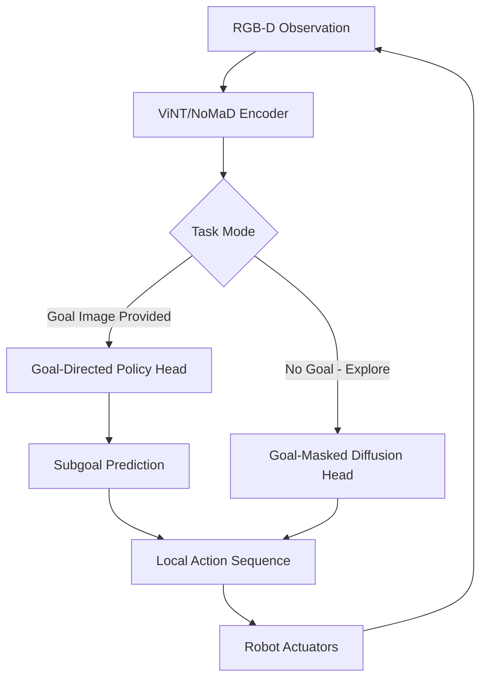
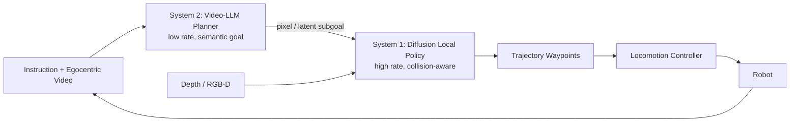

# Robot Manipulation and Navigation

> **Last Updated:** October 2026
> **Level:** Advanced | Research Frontier
> **Related Sections:**
> - [Perception for Robotics](./08_perception_for_robotics.md)
> - [Language-Conditioned Control](./10_language_conditioned_control.md)
> - [Robot Data and Teleoperation](./09_robot_data_and_teleoperation.md)
> - [Hardware and Robot Platforms](./12_hardware_robot_platforms.md)

> **🆕 October 2026 update:**
> - New section on **2025–26 navigation foundation models**: NaVILA and Uni-NaVid (RSS 2025), NavDP, StreamVLN and OmniVLA (ICRA 2026), NavFoM (~8M samples across quadrupeds, drones, wheeled robots and cars), and the dual-system **InternVLA-N1** in the InternNav toolbox.
> - VLN-CE leaderboard refreshed. InternVLA-N1 (DualVLN) reports 64.3 SR / 58.5 SPL on R2R-CE, and StreamVLN reports 56.4 / 50.2. The **VLN-PE** physical-controller gap is documented (SR drops ~12 points).
> - Grasping: **GraspGen** (NVIDIA, ICRA 2026; 57M-grasp dataset, diffusion generator + on-generator discriminator) and **DexGraspVLA** (AAAI 2026; 90%+ zero-shot dexterous grasping in clutter).
> - Mobile manipulation: pointers to π0.5 / Gemini Robotics-style generalist VLAs. New open problems on physically realistic navigation evaluation and unified navigation + manipulation models.

---

## Overview

Robot manipulation and navigation are two foundational capabilities that embodied agents must master before real-world deployment. Manipulation spans the full spectrum from simple parallel-jaw grasping of tabletop objects to dexterous in-hand reorientation, bimanual coordination and interaction with deformable materials. The core challenge is bridging the perception-action gap. The robot must infer stable, executable grasp poses from partial, noisy sensor observations of objects with arbitrary geometry, and then execute those poses robustly under real-world perturbations. The field has shifted steadily from model-based analytic approaches (e.g., GWS wrench analysis, force-closure metrics) toward data-driven methods that learn contact-rich priors from large corpora of 3D scans and human demonstrations.

Navigation is a mobile robot's capacity to move purposefully through unknown or partially known environments. Classical SLAM-based stacks (graph-based SLAM, EKF-SLAM, occupancy grid mapping) provide reliable metric maps, but they require explicit feature engineering and struggle in cluttered, dynamic settings. Learned navigation approaches cast the problem as goal-conditioned policy learning. Given a goal specification (a GPS coordinate for PointGoal, a target object category for ObjectGoal, or a reference image for ImageGoal), a policy trained in simulation must generalize to physical deployment. Vision-Language Navigation (VLN) goes further by grounding natural-language route descriptions in continuous action sequences, which demands tight integration of semantic scene understanding with path planning.

The frontier is long-horizon mobile manipulation: agents that must navigate to an object, grasp it, transport it, and then assemble or place it. This demands unified representations that support both geometric precision (needed for stable grasps) and semantic generalization (needed for instruction following). Navigation foundation models such as ViNT [Shah2023] and NoMaD [Sridhar2024] encode cross-embodiment mobility priors that sharply reduce the data needed to adapt to new platforms. In 2025–2026 a second generation followed: **video-LLM-based navigation VLAs** (NaVILA, Uni-NaVid, StreamVLN, NavFoM, OmniVLA) and **dual-system navigators** (InternVLA-N1) that pair a slow VLM planner with a fast diffusion local policy. Benchmark environments including Habitat [Savva2019], CALVIN [Mees2022], LIBERO [Liu2023] and ManiSkill3 [Tao2024] provide standardized scaffolds for measuring progress on these axes.

---

## Grasping: From Analytic to Learned Approaches

### Problem Formulation

6-DoF grasp detection maps an RGB-D or point-cloud observation $\mathcal{P} \subseteq \mathbb{R}^3$ to a set of grasp poses $\{(R_i, t_i)\}$ together with quality scores $q_i$:

```latex
\mathcal{G}^* = \arg\max_{\mathcal{G}} \sum_i q_i(R_i, t_i \mid \mathcal{P})
\quad \text{s.t.} \quad \text{FC}(R_i, t_i) = 1
```

where FC denotes force-closure satisfaction. Classical analytic methods enumerate candidate grasps and verify closure properties; learned methods regress quality scores directly from data.

### GraspNet-1Billion [Fang2020]

GraspNet-1Billion provides 97,280 RGBD images from 190 cluttered scenes captured by RealSense and Kinect cameras, with dense 6-DoF grasp annotations for each visible object surface point. The benchmark exposes a generalization axis: models are evaluated on scenes containing objects not seen during training. The companion GraspNet model processes point clouds via PointNet++ encoders and scores candidate grasps using a multi-level feature-matching head.

### Contact-GraspNet [Sundermeyer2021]

Contact-GraspNet (ICRA 2021) frames grasp detection as predicting contact points on the object surface rather than scoring pre-sampled approach vectors. A PointNet++ backbone jointly estimates per-point grasp approach directions, width parameters and quality scores. On the ACRONYM benchmark [Eppner2021], Contact-GraspNet reaches a 90%+ grasp success rate in simulation on seen categories, dropping to ~65% on unseen shapes. That drop motivated later work on category-level generalization.

### AnyGrasp [Fang2023]

AnyGrasp scales Contact-GraspNet with a RotationNet architecture that handles arbitrary approach angles and a large-scale training set built from GraspNet-1Billion augmented with synthetic renders. In bin-picking evaluations, AnyGrasp achieves a 93.3% success rate clearing bins containing over 300 novel objects, and sustains >900 Mean Picks Per Hour (MPPH) on a single-arm industrial setup, making it among the strongest published results on the GraspNet-1Billion unseen test split.

### GraspGen [Murali2025] — Diffusion-Based Grasp Generation

**GraspGen** (NVIDIA; arXiv:2507.13097; ICRA 2026) treats 6-DoF grasping as *generative modeling* rather than per-point classification:

- A **diffusion generator** proposes grasp poses conditioned on an object point cloud, which may be partial or complete and either a single object or clutter.
- A **discriminator** scores and ranks the proposals. It is trained with an *on-generator* recipe: it learns from the generator's own (including failing) samples, not only from dataset grasps, which closes the train/test distribution gap of earlier evaluators.
- The released simulated dataset contains **57M+ grasps over 8,515 Objaverse-XL (LVIS) objects** for three end-effectors: Franka Panda, Robotiq-2F-140 and a 30 mm suction cup.

The authors report state-of-the-art results on the FetchBench simulated grasping benchmark (+17% over prior methods), 21× lower memory than prior diffusion grasp generators and ~20 Hz inference before TensorRT. The trend from AnyGrasp to GraspGen mirrors policy learning more broadly: *multimodal generative heads with learned critics* replace regression to a single "best" grasp.

---

## Dexterous and Bimanual Manipulation

### ALOHA and ACT [Zhao2023]

ALOHA (A Low-cost Open-source Hardware System for Bimanual Teleoperation) is a sub-$20k bimanual research platform built from WidowX arms and off-the-shelf servos. It enables collection of fine-grained demonstrations for tasks like threading a needle, zipping a bag, and opening a wine bottle. The companion learning algorithm, ACT (Action Chunking with Transformers), addresses the compounding error problem of behavioral cloning by predicting action chunks of length $k$ rather than single steps:

```latex
\pi_\theta(a_{t:t+k} \mid o_t) = \text{Transformer}(o_t)
```

A CVAE prior is used to model multi-modal action distributions during training; at inference the latent is set to zero. ACT trained with 50 demonstrations achieves task success rates of 80–95% on several fine-manipulation tasks, substantially outperforming single-step BC and LSTM baselines.

**Mobile ALOHA** [Fu2024] extends the platform with a whole-body mobile base, enabling tasks requiring locomotion and manipulation simultaneously: cooking shrimp on a stove, loading a dishwasher, pressing an elevator button. Co-training Mobile ALOHA policies with static ALOHA data provides substantial data efficiency gains through transfer.

**ALOHA Unleashed** (2024) scales the ACT Transformer backbone and trains on 500–1000 demonstrations per task, achieving 78% success on shoelace tying, 85% on shirt-hanging, and 91% on velcro-strap repair.

### Hierarchical VLA for Dexterous Grasping

**DexGraspVLA** [Zhong2025] (arXiv:2502.20900; AAAI 2026 Oral) is a *hierarchical* framework for multi-fingered hands. A pre-trained VLM acts as a high-level planner that grounds the target object and decomposes the instruction. A diffusion-policy low-level controller, operating on domain-invariant foundation-model features, executes the dexterous grasp. The authors report **90%+ success on dexterous grasping in cluttered scenes across thousands of unseen object × lighting × background combinations, zero-shot in the real world**, and also robustness to human disturbance with failure recovery. It is a concrete instance of the slow/fast dual-system pattern discussed in [Paradigms & Roadmaps](./07_pros_cons_roadmaps.md).

### Generalist VLAs as Manipulation Backbones (2025–2026)

By 2025–2026, much of the most visible dexterous and bimanual work came from **generalist VLAs** rather than per-task imitation. Examples include Physical Intelligence's π0.5, which cleans kitchens and bedrooms in homes not seen during training, and the later RL-refined π*0.6, as well as Google DeepMind's Gemini Robotics family on ALOHA 2 and humanoid platforms, and NVIDIA's GR00T N1.x. These models typically still rely on ALOHA-style bimanual data for their hardest skills (folding, packing, assembly). See [VLA Models](./01_vla_models.md) and [Cross-Embodiment](./04_cross_embodiment.md) for architectures and results.

### Deformable Object Manipulation

Deformable objects (ropes, cloth, cables, dough) require representations that track non-rigid deformation. Approaches include explicit mesh simulation coupled with sim-to-real transfer [Lin2022], learned visual descriptors for cloth state [Seita2021], and diffusion-based policies that model multi-modal contact dynamics [Chi2023]. The core difficulty is perceptual: standard depth sensors produce unreliable surfaces on transparent or specular materials, and deformation state is inherently high-dimensional. Bimanual cloth-folding and cable-routing benchmarks in RoboTwin 2.0 and GPU cloth/cable solvers in Newton (see [Simulation & Data](./05_simulation_and_data.md)) now allow these tasks to be studied at simulation scale.

---

## Navigation: Classical to Learned

### Classical SLAM-Based Navigation

Classical navigation pipelines have three parts:

1. A SLAM module (GMapping, Cartographer, RTAB-Map) that fuses odometry and lidar/RGBD into a 2D occupancy grid or 3D point-cloud map
2. A global planner (A*, Dijkstra) over the metric map
3. A local planner (DWA, TEB) for obstacle avoidance

These stacks are reliable in static environments with accurate maps but degrade under dynamic obstacles, perceptual aliasing and novel layouts.

### Learned Goal-Conditioned Navigation

The Habitat platform [Savva2019] standardized evaluation with three task families:

- **PointGoal**: Navigate to GPS+compass coordinates. DD-PPO [Wijmans2020] achieved near-perfect (99.6% SPL) by training with 2.5 billion environment steps across 64 GPUs.
- **ObjectGoal**: Navigate to a target object category (e.g., "find a chair"). Requires semantic reasoning; best models combine semantic maps with object priors.
- **ImageGoal**: Navigate to a location specified by a reference image. Tests visual re-localization under viewpoint change.

### Vision-Language Navigation (VLN)

The R2R (Room-to-Room) benchmark [Anderson2018] asks agents to follow natural-language route descriptions in Matterport3D scans. Recurrent BERT-based backbones (PREVALENT, HAMT) dominated early leaderboards. As of 2024:

- ScaleVLN achieves 81% Success Rate (SR) / 70% SPL on R2R validation-unseen.
- NavGPT-2 (LLM-based agent) achieves 74% SR / 61% SPL.
- RynnBrain-Nav-8B achieves 58.6% SR / 49.6% SPL on VLN-CE (continuous environments).

**2025–2026: continuous environments and physical realism.** Attention has shifted from discrete-graph R2R to **VLN-CE** (continuous Habitat actions) and to **VLN-PE**, which replays VLN episodes with physically simulated robot controllers. Representative results on the R2R-CE val-unseen split:

- **InternVLA-N1 (DualVLN)**: 64.3% SR / 58.5% SPL (61.4 / 51.8 on RxR-CE)
- **StreamVLN**: 56.4% SR / 50.2% SPL with its updated checkpoint (54.4 / 45.4 on RxR-CE)

On VLN-PE [Wang2025] (ICCV 2025, "Rethinking the Embodied Gap in Vision-and-Language Navigation"), the same DualVLN model drops from **63.6% SR (idealized "flash" controller) to 51.6% SR with a physical locomotion controller**. This quantifies how much of the classic VLN gap lies in *execution* rather than language grounding.

### Foundation Models for Navigation

**ViNT** [Shah2023] (CoRL 2023) is a Transformer trained on diverse robot navigation datasets across multiple embodiments (wheeled robots, legged robots, drones). Given a current observation and a goal image, ViNT predicts a subgoal image and a low-level action distribution. Trained jointly on datasets from 8 different platforms, ViNT demonstrates strong out-of-distribution generalization and successful zero-shot transfer to pedestrian-dense environments.

**NoMaD** [Sridhar2024] (ICRA 2024 Best Student Paper Finalist) extends ViNT with a diffusion policy head, enabling unified exploration (goal-masked) and goal-directed behavior. The diffusion head produces multi-modal action distributions suitable for uncertainty-aware planning in partially observed environments.



### Navigation Foundation Models, 2025–2026 Generation

The second generation replaces small task-specific encoders with **video-LLM backbones** and broadens both *goal modalities* and *embodiments*:

| Model | Venue | Core idea | Embodiments / goals |
|-------|-------|-----------|---------------------|
| **NaVILA** [Cheng2025] | RSS 2025 | Two-level: a VLA emits mid-level *language* actions (direction + distance), and an RL locomotion policy executes them with obstacle avoidance | Legged robots (quadrupeds, humanoids); language goals |
| **Uni-NaVid** [Zhang2025a] | RSS 2025 | One video-based VLA unifies VLN (R2R/RxR), ObjectNav, embodied QA and person-following (EVT-Bench); online token merging gives ~5 Hz on one A100 | Language goals |
| **NavDP** [Cai2025] | ICRA 2026 | Mapless navigation **diffusion policy** trained only on an efficient simulation data pipeline, with privileged-information guidance during training; cross-embodiment sim-to-real with **no real robot data**. Follow-up **X-NavDP** (CoRL 2026) adds RL post-training across heterogeneous embodiments | Multiple embodiments; no-goal / point / image goals |
| **StreamVLN** [Wei2025] | ICRA 2026 | Streaming VLN from continuous video on LLaVA-Video. A **SlowFast context** pairs a fast sliding-window KV cache for dialogue turns with a slow token-pruned memory | Language goals; real-robot deployment |
| **NavFoM** [Zhang2025b] | arXiv:2509.12129 | Cross-task, cross-embodiment navigation foundation model trained on **~8M samples**. Temporal-viewpoint indicator (TVI) tokens handle arbitrary camera rigs, and budget-aware temporal sampling (BATS) bounds context length | Quadrupeds, drones, wheeled robots, cars; VLN, object search, tracking, driving |
| **OmniVLA** [Hirose2025] | ICRA 2026 | **Omni-modal goal conditioning**: one policy accepts language, goal image or GPS pose (and combinations) as the goal | Wheeled robots; any goal modality |
| **InternVLA-N1** / DualVLN [Wei2026] | Tech. report (Oct 2025); DualVLN at ICLR 2026 | **Dual-system** ("Ground Slow, Move Fast"): a VLM "System 2" grounds goals at low rate (pixel goals / learned latent plans), and a NavDP diffusion "System 1" produces reactive local trajectories; the two can be jointly tuned | Wheeled, quadruped (Unitree Go2 deployment code) |



Common to all of them: (i) **simulation-heavy training** (Habitat, Isaac Sim, InternScenes), with real-world data used sparingly; (ii) **trajectory or waypoint outputs** consumed by a separate locomotion controller rather than raw motor commands; and (iii) **long-context memory management** (token merging, KV-cache windows, BATS) as the central architectural problem. The original ViNT/NoMaD family remains standard *baselines* inside these toolkits; InternNav ships GNM, ViNT and NoMaD alongside NavDP.

---

## Long-Horizon Mobile Manipulation

Long-horizon mobile manipulation requires composing navigation and manipulation sub-skills within a coherent task plan. Key challenges:

1. **Semantic grounding**: Mapping language instructions ("fetch the red mug from the kitchen") to a sequence of navigation waypoints and grasp targets.
2. **Error recovery**: When a grasp fails or the path is blocked, replanning must occur without full task restart.
3. **Object state tracking**: The agent must maintain a model of which objects have been moved and where.

The CALVIN benchmark [Mees2022] evaluates sequences of up to 5 language-conditioned manipulation tasks in a single episode, requiring the agent to generalize across novel instructions and object arrangements. The LIBERO benchmark [Liu2023] comprises 130 manipulation tasks organized into four suites (LIBERO-Spatial, LIBERO-Object, LIBERO-Goal, LIBERO-100) specifically testing lifelong and continual learning.

Since 2025, three developments have changed this picture:

- **Generalist VLAs operate as end-to-end mobile manipulators.** π0.5, for example, executes multi-minute household tasks in unseen homes by co-training on mobile-manipulator, static-arm and web data, with a high-level subtask predicted in language at each step.
- **Simulation suites have grown to household scale.** BEHAVIOR-1K (1,000 activities) and RoboCasa365 (365 kitchen tasks, 2,200+ h of demonstrations) supply long-horizon composite tasks.
- **Dual-system navigation stacks** (InternVLA-N1) and hierarchical grasping VLAs (DexGraspVLA) make the planner–controller boundary explicit and trainable.

---

## Key Papers

| Paper | Authors | Year | Venue | Key Contribution |
|-------|---------|------|-------|-----------------|
| GraspNet-1Billion | Fang et al. | 2020 | CVPR | Large-scale grasp benchmark; 97K images, 190 scenes, dense 6-DoF annotation |
| Contact-GraspNet | Sundermeyer et al. | 2021 | ICRA | Contact-point grasp representation; PointNet++ backbone; end-to-end 6-DoF detection |
| AnyGrasp | Fang et al. | 2023 | T-RO | Scaled rotational grasp detection; 93.3% bin-picking SR, >900 MPPH |
| GraspGen: A Diffusion-based Framework for 6-DOF Grasping with On-Generator Training | Murali et al. | 2025 | ICRA 2026 | Diffusion grasp generator + on-generator-trained discriminator; 57M-grasp multi-gripper dataset |
| DexGraspVLA | Zhong et al. | 2025 | AAAI 2026 | Hierarchical VLM planner + diffusion controller; 90%+ zero-shot dexterous grasping in clutter |
| ALOHA + ACT | Zhao et al. | 2023 | RSS | Low-cost bimanual platform; action-chunking transformer; 50-demo learning |
| Mobile ALOHA | Fu et al. | 2024 | arXiv | Whole-body bimanual mobile manipulation via co-training |
| ViNT | Shah et al. | 2023 | CoRL | Cross-embodiment visual navigation transformer trained on 8 robot platforms |
| NoMaD | Sridhar et al. | 2024 | ICRA | Diffusion policy head for unified exploration and goal-directed navigation |
| NaVILA: Legged Robot Vision-Language-Action Model for Navigation | Cheng et al. | 2025 | RSS 2025 | VLA emitting language-level actions + RL locomotion policy for legged VLN |
| Uni-NaVid | Zhang et al. | 2025 | RSS 2025 | Single video VLA unifying VLN, ObjectNav, EQA, following |
| NavDP | Cai et al. | 2025 | ICRA 2026 | Sim-only navigation diffusion policy with privileged guidance; zero real data |
| StreamVLN | Wei et al. | 2025 | ICRA 2026 | Streaming VLN with SlowFast context (KV-cache window + pruned memory) |
| Embodied Navigation Foundation Model (NavFoM) | Zhang et al. | 2025 | arXiv:2509.12129 | ~8M-sample cross-embodiment, cross-task navigation model; TVI tokens, BATS |
| OmniVLA | Hirose et al. | 2025 | ICRA 2026 | Omni-modal (language / image / GPS) goal-conditioned navigation VLA |
| DD-PPO | Wijmans et al. | 2020 | ICLR | Decentralized distributed PPO; 99.6% SPL on PointGoal in Habitat |
| CALVIN | Mees et al. | 2022 | RAL | Long-horizon language-conditioned multi-step manipulation benchmark |
| Ground Slow, Move Fast: A Dual-System Foundation Model for Generalizable VLN (InternVLA-N1 / DualVLN) | Wei et al. | 2025 | ICLR 2026 | Slow VLM grounding + fast diffusion local policy for VLN; SOTA on VLN-CE and VLN-PE |
| ManiSkill3 | Tao et al. | 2024 | arXiv / RSS 2025 | GPU-parallelized manipulation benchmark; >4300 samples/sec in simulation |

---

## Benchmark Performance

| Model | Dataset / Task | Metric | Score | Notes |
|-------|---------------|--------|-------|-------|
| AnyGrasp | GraspNet-1Billion (unseen) | AP | SOTA (published 2023) | 93.3% bin-pick SR reported |
| GraspGen | FetchBench (sim) | Grasp success | +17% over prior SOTA | Authors' report; ~20 Hz pre-TensorRT |
| DexGraspVLA | Real-world cluttered dexterous grasping | Success | 90%+ | Thousands of unseen object/lighting/background combos, zero-shot |
| DD-PPO | Habitat PointGoal | SPL | 0.996 | 2.5B env steps, 64 GPUs |
| ScaleVLN | R2R val-unseen | SR / SPL | 81% / 70% | Best supervised backbone (2023) |
| NavGPT-2 | R2R val-unseen | SR / SPL | 74% / 61% | LLM-based agent; no finetuning |
| InternVLA-N1 (DualVLN) | VLN-CE R2R val-unseen | SR / SPL | 64.3% / 58.5% | Dual-system; RxR-CE 61.4 / 51.8 |
| InternVLA-N1 (DualVLN) | VLN-PE R2R unseen (physical controller) | SR / SPL | 51.6% / 42.5% | vs. 63.6 / 56.5 with idealized "flash" controller |
| StreamVLN | VLN-CE R2R val-unseen | SR / SPL | 56.4% / 50.2% | Updated checkpoint (Sept 2025); RxR-CE 54.4 / 45.4 |
| NavDP | ClutteredEnv (visual navigation) | SR / SPL | 89.8% / 87.7% | Sim-only training; InternNav benchmark |
| ACT | ALOHA tasks (avg) | Success | ~80-95% | Per-task; 50 human demos |
| ALOHA Unleashed | Shoelace tying | Success | 78% | 500-1000 demos per task |
| ALOHA Unleashed | Shirt hanging | Success | 85% | 500-1000 demos per task |
| RynnBrain-Nav-8B | VLN-CE R2R | SR / SPL | 58.6% / 49.6% | Open-vocabulary embodied model |
| Diffusion Policy [Chi2023] | CALVIN D→D | 5-task chain SR | not publicly reported | Reference baseline |

---

## Pros & Cons

| Aspect | Pros | Cons |
|--------|------|------|
| Learned Grasping (AnyGrasp) | Handles novel objects without CAD models; real-time inference; strong bin-picking | Degrades on transparent/reflective objects; requires dense point clouds; failure modes opaque |
| Generative Grasping (GraspGen) | Multimodal grasp distributions; multi-gripper; learned critic reduces false positives | Trained on simulated grasp labels; still depth-dependent; clutter-level collision reasoning relies on post-filtering |
| Bimanual Imitation (ALOHA/ACT) | Low hardware cost; high sample efficiency (50 demos); handles contact-rich tasks | Does not generalize across objects/scenes; sensitive to demonstration quality; no task decomposition |
| Foundation Navigation (ViNT/NoMaD) | Cross-embodiment transfer; minimal adaptation data; handles dynamic obstacles | Lower precision than metric SLAM; no map persistence; poor in structure-less environments |
| Video-LLM Navigation VLAs (NaVILA, StreamVLN, NavFoM) | Language and multi-modal goals; cross-task and cross-embodiment; large sim-scale pretraining | Multi-billion-parameter inference (often off-board GPU); context/memory limits; performance drops under physical controllers (VLN-PE) |
| Classical SLAM Navigation | Reliable metric accuracy; interpretable maps; deterministic replanning | Brittle in dynamic scenes; requires map rebuild on layout changes; no semantic understanding |
| Long-Horizon Mobile Manipulation | Enables household-scale tasks | Requires tight perception-action-planning integration; compounding errors across stages |

---

## Open Problems & Research Gaps

1. **Transparent and Specular Object Grasping**: AnyGrasp and GraspNet methods rely on depth completion from RGBD, which fails on glass, liquids and shiny metals. Neither IR-structured-light nor time-of-flight sensors reliably recover depth on such surfaces, and the sim-to-real gap for transparent objects remains unsolved. Learned stereo (FoundationStereo; see [Perception](./08_perception_for_robotics.md)) is the most promising 2025–26 mitigation.

2. **Reactive Bimanual Coordination**: Current bimanual imitation learning methods (ALOHA, ACT) treat both arms as a single policy with doubled action dimension. They lack explicit communication between arms and cannot reactively coordinate when one arm's plan is perturbed—a key requirement for tasks like folding cloth or assembling IKEA furniture.

3. **Zero-Shot Instruction Following in Manipulation**: VLN systems generalize to novel language instructions, but manipulation analogs (e.g., "hang the shirt on the left hook") still require per-task demonstrations. Connecting VLN-style language grounding to contact-rich skill execution is an open research problem.

4. **Graceful Failure and Recovery**: Long-horizon mobile manipulation chains failures—a missed grasp mid-sequence can invalidate subsequent steps. End-to-end policies lack recovery behaviors; hierarchical approaches [SayCan, Inner Monologue] improve this but depend on pre-specified skill libraries.

5. **Map-Free Persistent Navigation**: ViNT and NoMaD keep no persistent metric map, so returning to a previously visited place requires re-traversal. 2025–26 video-LLM navigators manage memory through token pruning, KV-cache windows (StreamVLN) or budgeted temporal sampling (NavFoM). These are *bounded-context* heuristics, however, not persistent spatial memory. Integrating topological or 3D scene-graph memory with foundation navigation models remains underexplored.

6. **Deformable Object State Representation**: There is no agreed-upon compact state representation for cloth, cables, or dough that is simultaneously learnable, physically grounded, and observable from RGB-D. Current methods either overfit to specific textures or require privileged simulation access.

7. **Sim-to-Real Transfer for Contact Dynamics**: Despite GPU-accelerated simulators (ManiSkill3, IsaacSim), the contact dynamics gap between simulation and reality remains a major obstacle for policies that require precise force control, soft-surface interaction, or fast regrasping.

8. **Physically Grounded Navigation Evaluation**: VLN-CE assumes idealized motion. Under physically simulated controllers (VLN-PE), success drops by ~12 points even for the strongest models. Benchmarks that combine language grounding, legged or wheeled dynamics, and dynamic obstacles or humans are needed so that progress reflects deployable capability.

9. **Unified Navigation + Manipulation Foundation Models**: Navigation VLAs (NavFoM, OmniVLA) and manipulation VLAs (π0.5, GR00T) are still largely trained and evaluated separately. A single model that plans a route, approaches, grasps and recovers, with shared memory of object states, is the natural next step, but it lacks both data and benchmarks at scale.

---

## Further Reading

- [GraspNet-1Billion Dataset and Benchmark](https://graspnet.net/)
- [AnyGrasp SDK (GitHub)](https://github.com/graspnet/anygrasp_sdk)
- [GraspGen (NVlabs GitHub, arXiv:2507.13097)](https://github.com/NVlabs/GraspGen)
- [DexGraspVLA (arXiv:2502.20900)](https://github.com/Psi-Robot/DexGraspVLA)
- [General Navigation Models: ViNT, NoMaD, GNM](https://general-navigation-models.github.io/)
- [NaVILA (arXiv:2412.04453)](https://github.com/AnjieCheng/NaVILA)
- [Uni-NaVid (arXiv:2412.06224)](https://github.com/jzhzhang/Uni-NaVid)
- [StreamVLN (arXiv:2507.05240)](https://github.com/InternRobotics/StreamVLN)
- [NavDP (arXiv:2505.08712)](https://github.com/InternRobotics/NavDP)
- [InternNav toolbox (InternVLA-N1, VLN-PE)](https://github.com/InternRobotics/InternNav)
- [X-NavDP: RL post-training for navigation diffusion policies (arXiv:2607.28560)](https://arxiv.org/abs/2607.28560)
- [NavFoM: Embodied Navigation Foundation Model (arXiv:2509.12129)](https://arxiv.org/abs/2509.12129)
- [OmniVLA (arXiv:2509.19480)](https://github.com/NHirose/OmniVLA)
- [ALOHA and ACT Project Page (Tony Zhao, Stanford)](https://tonyzhaozh.github.io/aloha/)
- [Mobile ALOHA Paper (arXiv:2401.02117)](https://arxiv.org/abs/2401.02117)
- [CALVIN Benchmark](http://calvin.cs.uni-freiburg.de/)
