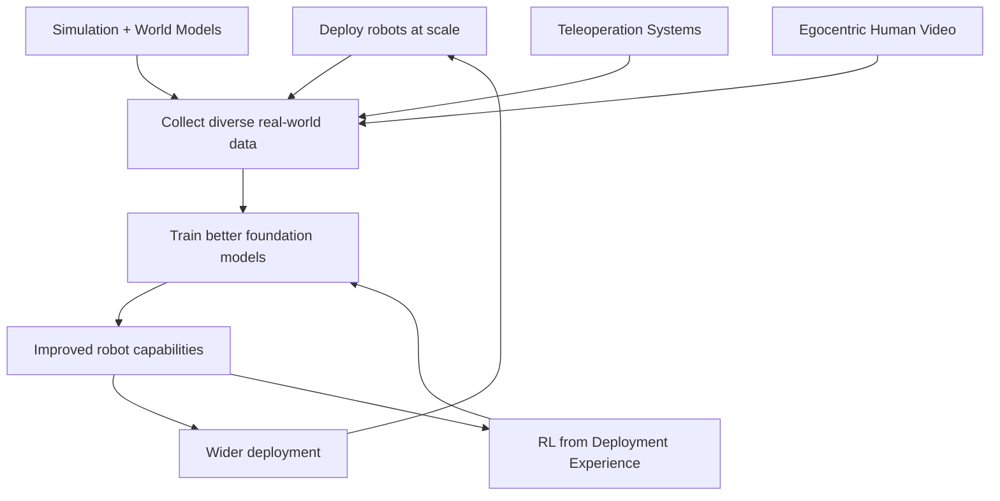
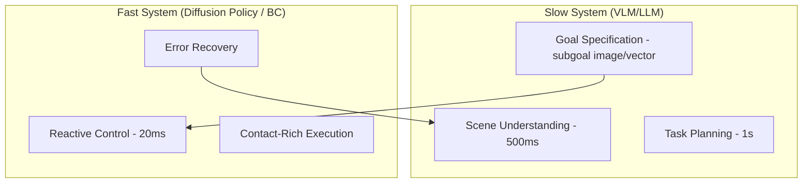

# Paradigms, Pros/Cons, and Roadmaps for Robot Learning (2026)

> **Last Updated:** October 2026
> **Level:** Advanced | Research Frontier
> **Related Sections:** [./01_vla_models.md](./01_vla_models.md) | [./02_world_models.md](./02_world_models.md) | [./11_generalist_vs_specialist.md](./11_generalist_vs_specialist.md) | [./03_diffusion_policy.md](./03_diffusion_policy.md)

> **🆕 October 2026 update:**
> - Roadmaps refreshed against what actually shipped. Physical Intelligence open-sourced π0.5 (Sept 2025) and released RL-refined π*0.6 (Nov 2025). Google DeepMind shipped Gemini Robotics 1.5 / ER 1.5 (Sept 2025). NVIDIA shipped GR00T N1.6 → **N1.7** (3B, Apache 2.0, pretrained with 20K h of human video), **Cosmos 3** (May 2026) and **Newton 1.0** (Mar 2026). On the humanoid side, Figure 03 was unveiled (Oct 2025, earlier than the "2026–27" previously projected) and 1X NEO opened consumer pre-orders.
> - The **dual-system convergence thesis** (Part VII) is now the dominant industrial architecture: Gemini Robotics 1.5 + ER, GR00T System 1/2, Figure Helix, InternVLA-N1 and DexGraspVLA.
> - New evidence for the **bitter-lesson debate**: data scaling laws over environment-object diversity, human-video pretraining at 10⁴-hour scale, and robustness audits (LIBERO-Plus, VLN-PE) showing benchmark gains overstate deployability.
> - World-model-as-policy evidence (V-JEPA 2-AC zero-shot planning, Cosmos Policy), a status check on the 2028 predictions, and new open problems on evaluation and human-to-robot transfer.

---

## Overview

As of 2026, the field of robot learning has coalesced around three competing paradigms. Each has distinct theoretical foundations, empirical track records and practical constraints. This document gives a *Nature Perspectives*-style analysis of the current landscape: where each paradigm succeeds, where it fails, what the field's macro-trajectories suggest, and which open problems remain. It is not a neutral survey. It advances specific theses about convergence, scaling and the limits of benchmark-driven progress.

The three paradigms are:

1. **End-to-end Vision-Language-Action (VLA) models**, which unify perception, language understanding and motor control in a single transformer.
2. **World model-based planning**, where a learned dynamics model enables internal rollout and model-predictive control.
3. **Diffusion Policy and related generative behavior-cloning** methods, which model action distributions as score-matched denoising processes.

A fourth approach, **Modular LLM + Specialist Policy**, is better described as a systems-integration strategy than as a learning paradigm. It occupies a significant deployed industrial footprint and merits inclusion.

The deeper question animating this document is whether robotics will follow the same scaling trajectory as NLP: a "bitter lesson" path where scale and data overwhelm hand-crafted inductive biases, producing general-purpose behavior without domain-specific engineering. The evidence as of 2026 is sharply mixed, and we argue that the correct framing is not "does scale work" but "which aspects of robot competence respond to scale, on what data, and with what sample efficiency."

**What changed between mid-2025 and October 2026.** The paradigm boundaries blurred in three ways:

- **VLAs absorbed diffusion.** Most frontier VLAs now use flow-matching or diffusion action heads: π0/π0.5 and GR00T N1.x, whose DiT head is flow-matching.
- **World models became policies.** V-JEPA 2-AC plans pick-and-place zero-shot in latent space; Cosmos Policy post-trains a video world model to output actions; Cosmos 3's generator emits actions natively.
- **Systems became explicitly hierarchical.** Slow reasoning models drive fast controllers.

The competitive question is therefore shifting from "which paradigm?" to "how should a hybrid stack be partitioned, trained and evaluated?"

---

## Part I — Three Competing Paradigms (2026)

### Paradigm 1: End-to-End VLA Models

VLAs such as RT-2 [Brohan2023], OpenVLA [Kim2024], Octo [Team2024] and π0 [Black2024] treat robot control as a language-modeling problem. Images and instructions are tokenized, and a transformer predicts discrete action tokens auto-regressively or continuous action chunks. The paradigm inherits the data-efficiency gains of large-scale vision-language pretraining. A model pretrained on internet-scale image-text data brings rich semantic priors to manipulation tasks, which sharply reduces the number of robot demonstrations needed for new tasks.

The fundamental limitation is the **latency-accuracy tradeoff** imposed by auto-regressive generation. Generating a 6-DOF action token sequence with a 7B-parameter model takes 50–500 ms on a single A100. That frequency floor rules out reactive control for dynamic tasks such as catching or avoiding moving objects. Architectural mitigations (action chunking, parallel decoding) help but do not fully close the gap. The 2025–26 generation narrows it further. Continuous flow-matching heads generate a full action chunk in a few denoising steps. On-device variants (Gemini Robotics On-Device, June 2025; Cosmos3-Edge 4B, July 2026) target local inference. Small open VLAs (GR00T N1.7 at 3B parameters) trade capacity for deployability.

### Paradigm 2: World Model-Based Planning

World models [Ha2018, Hafner2023] learn a compressed latent dynamics model that enables planning by internal rollout. The paradigm's appeal is sample efficiency: an agent can improve its policy by simulating counterfactuals without additional real-world interaction. DreamerV3 [Hafner2023] demonstrated that a single set of hyperparameters trains effective policies across 150+ tasks spanning diverse observation and action spaces.

The challenge for physical robotics is that world models struggle with **multi-step contact prediction**. After a grasp contact, the distribution of physical futures is high-entropy and depends heavily on object geometry and surface properties that the model may not encode in its latent. Video-generation-based world models (UniSim [Yang2023], Genie [Bruce2024]) improve visual fidelity but had not, as of 2024, demonstrated reliable low-level control.

**2025–26 counter-evidence.** **V-JEPA 2-AC** [Assran2025] is an action-conditioned latent world model post-trained on a small amount of robot interaction data from the DROID dataset. It performs *zero-shot* model-predictive planning on Franka arms in new labs. It reaches 80% on cup pick-and-place versus 10% for Octo and 0% for a Cosmos video-model planner, with no environment-specific data or reward. NVIDIA's **Cosmos Policy** checkpoints (Feb 2026) post-train Cosmos-Predict2.5 into a direct policy on RoboCasa and LIBERO. **DreamGen** uses video world models as *data generators* for new verbs (see [Simulation & Data](./05_simulation_and_data.md)). The paradigm is therefore splitting into two roles: *world model as planner/policy* and *world model as data engine*. Both are now credible, though grasp-level success rates remain well below those of VLAs trained on teleoperation data.

### Paradigm 3: Diffusion Policy and Generative BC

Diffusion Policy [Chi2023] (RSS 2023, IJRR 2025) models the conditional action distribution `p(a_t | o_t)` as a score-matched denoising process. The resulting policies handle **multimodal action distributions** (multiple valid ways to grasp an object), which Gaussian BC methods collapse. The approach outperformed the prior SOTA by 46.9% on average across 15 tasks in the original paper and has become a standard backbone for imitation learning.

DP's limitation is that it does not generalize beyond the support of the demonstration distribution. It has no semantic understanding of the goal the robot is pursuing, which rules out compositional generalization without VLM integration. By 2026, the most common answer is to place a diffusion/flow head *inside* a VLA (π0, GR00T) or *under* a VLM planner (DexGraspVLA, InternVLA-N1's NavDP System 1). The paradigm has survived as a component rather than as a standalone recipe.

---

## Part II — Levels of Generalization Framework

A critical missing dimension in most robot learning evaluations is a precise characterization of *what type* of generalization is being measured. We propose the following taxonomy:

| Level | Name | Definition | Example |
|-------|------|-----------|---------|
| **L1** | Task instance | Same task, different initial conditions (object pose, lighting) | Grasp red cup at random positions on table |
| **L2** | Object | Same task, unseen objects from same category | Grasp novel mugs never seen in training |
| **L3** | Environment | Same task/object distribution, novel layout/background/scene | Kitchen skills in new room |
| **L4** | Task transfer | Related but distinct tasks, zero/few-shot without finetuning | Train on pick-and-place, test on sorting |
| **L5** | Long-horizon compositional | Novel task decomposable from known primitives, chained reasoning required | "Make me breakfast" from scratch |

Most current benchmarks test L1–L2. The VLA paradigm's main claimed advance is L3–L4 via vision-language pretraining. L5 remains largely unsolved by every paradigm. The best results (SayCan [Ahn2022], InnerMonologue [Huang2022]) rely on privileged enumeration of available skills and a closed-world assumption.

**A caveat surfaced in 2025: L1 is not solved either.** LIBERO-Plus [Fei2025] shows that VLAs scoring ~95% on clean LIBERO drop below 30% under modest *camera-viewpoint* or *robot-initial-state* perturbations, which are L1 changes in this taxonomy. Headline L3–L4 claims should therefore be read alongside L1 robustness curves.

---

## Part III — Multi-Axis Paradigm Comparison

| Axis | VLA (e.g., OpenVLA, π0) | World Model (DreamerV3, V-JEPA) | Diffusion Policy | Modular LLM + Policy (SayCan, CaP) |
|------|------------------------|--------------------------------|-----------------|-------------------------------------|
| **Architecture** | Large transformer (3B–70B); VLM backbone + action head | Latent dynamics RSSM or transformer; separate world + actor | U-Net or Transformer score network conditioned on obs | LLM planner + separate skill policies (RL or BC) |
| **Data requirement** | Large cross-robot demonstrations; benefits from internet pretraining | RL environment interactions; benefits from offline video | Moderate expert demonstrations (50–500 per task) | Skill library needs demonstrations; planning uses LLM zero-shot |
| **Inference latency** | **50–500 ms** (autoregressive); limited by model size | **5–50 ms** (latent rollout); compact world model | **10–100 ms** (DDPM: slow; DDIM/consistency: faster) | **100 ms–2 s** (LLM planning + skill call) |
| **Generalization level** | L1–L4 (semantic VLM prior) | L1–L3 (model accuracy degrades OOD) | L1–L2 (pure BC; limited semantic generalization) | L1–L5 (LLM handles compositionality; skills handle execution) |
| **Dexterity ceiling** | Medium; limited by action tokenization resolution | Low; planning in latent space loses high-frequency detail | High; continuous denoising captures fine-grained actions | Low-Medium; dependent on skill policy quality |
| **Sample efficiency** | Low-Medium (needs large robot data); pretraining helps | Medium-High (model-based RL) | Medium (50–500 demos competitive with state-based BC) | High for planning (zero-shot LLM); low for skill acquisition |
| **Interpretability** | Low (black-box end-to-end) | Partial (world model visualizable) | Low (diffusion process opaque) | High (LLM chain-of-thought auditable; modular) |
| **Key failure mode** | Slow inference; fine-grained manipulation; compounding tokenization error | Distribution shift during rollout; contact prediction failure | No semantic understanding; stuck in demonstration support | Tool-calling hallucination; skill boundary mismatch |
| **Hardware requirements** | GPU inference (A100/H100) for large models; edge deployment needs quantization | Modest GPU; compact world model | Modest GPU; DDPM slow on CPU | LLM: cloud/large GPU; skill policies: embedded |
| **Open-source** | OpenVLA (7B), Octo (multi-modal); π0 weights released Feb 2025; π0.5 weights Sept 2025 (openpi); GR00T N1.7 3B (Apache 2.0) | DreamerV3 (JAX); V-JEPA 2 / 2-AC (Meta); Cosmos-Predict2.5 and Cosmos 3 (NVIDIA open models) | Diffusion Policy (Columbia); 3D-DP (Ze2024) | Code-as-Policies (Google); SayCan partially; Gemini Robotics-ER 1.5 via API (not open weights) |
| **Tech Readiness Level (TRL)** | TRL 4–6 | TRL 3–5 | TRL 5–7 | TRL 5–7 |
| **Best use case** | Language-guided pick-and-place; generalizing across scene backgrounds | Long-horizon planning; simulation-heavy training | Precise dexterous manipulation; bimanual tasks with rich demos | Multi-step household instructions; task sequencing |

---

## Part IV — The Bitter Lesson Debate in Robotics

The "bitter lesson" [Sutton2019] holds that general methods that leverage computation eventually outperform methods that leverage human domain knowledge. In NLP, scaling language models on internet text proved this decisively: every hand-crafted feature, grammar or knowledge graph was eventually surpassed by sufficiently large transformers.

### Arguments FOR scaling solving robotics

**[Pro1]** RT-2 [Brohan2023] demonstrated that internet-scale vision-language pretraining transfers semantic reasoning to manipulation. Robots could respond to novel color-shape combinations and cultural references never seen in robot data. This is precisely the bitter-lesson pattern.

**[Pro2]** π0 [Black2024] and its successors showed that scaling robot demonstrations from 100 to 10,000+ tasks improves performance on unseen tasks approximately log-linearly — the same scaling law form observed in NLP.

**[Pro3]** Open X-Embodiment [OXE2023] demonstrated that pooling data from 22 different robot embodiments and 21 institutions improved performance of RT-1-X by ~50% over single-embodiment baselines, suggesting data diversity matters more than data homogeneity.

**[Pro4]** The infrastructure for data collection is maturing rapidly: ALOHA, UMI, GELLO, and Apple Vision Pro teleoperation systems reduce per-demonstration cost by 5–20×; autonomous data collection pipelines reduce it further.

**[Pro5]** *(2024–26)* **Measured scaling laws are appearing.** Lin et al. [Lin2024] found that, in imitation learning, generalization to new environments and objects **scales approximately as a power law in the number of training environment-object pairs**, with diversity mattering more than demonstration count per pair. On the industrial side, Generalist AI reported (company blog, Nov 2025; not peer-reviewed) power-law-like scaling for its GEN-0 models trained on more than 270K hours of real-world manipulation data.

**[Pro6]** *(2025–26)* **Human video is becoming usable robot data.** NVIDIA's GR00T N1.7 (2026) pretrains on **20K hours of EgoScale egocentric human video** alongside robot data. It uses a *relative end-effector action space shared by human and robot embodiments*, and NVIDIA credits this for improved generalization and language following. If human video transfers at scale, the data-cost argument in [Con3] weakens substantially.

### Arguments AGAINST scaling solving robotics

**[Con1]** **The physics bottleneck:** Robot learning requires sample-efficient learning of continuous physical dynamics, not just pattern recognition over discrete tokens. A language model learning to "say" the right action token is not the same as a controller learning to maintain contact force under compliance. Current action tokenization schemes discard the continuous-time physics that makes manipulation hard.

**[Con2]** **The embodiment bottleneck:** Unlike NLP where a single modality (text) covers nearly all tasks, robots have widely varying kinematic chains, sensor suites, and actuation properties. A model trained on Franka arm data does not trivially transfer to a 5-fingered dexterous hand — the "same task" is an entirely different motor control problem [Peng2018].

**[Con3]** **The data collection bottleneck:** Internet-scale text was free; robot trajectory data is expensive. 76,000 demonstrations in DROID [Khazatsky2024] required 12 months of collection by 50 data collectors — a rate of ~170 demos/person/day. At this rate, reaching NLP-scale data diversity (billions of examples) is not plausible without orders-of-magnitude cheaper collection mechanisms.

**[Con4]** **The distribution shift bottleneck:** Unlike text, physical deployments encounter conditions outside any training distribution. A robot that succeeds 95% of the time but catastrophically fails on the remaining 5% (dropping fragile objects, knocking over liquids) is often undeployable. NLP's "hallucinations" are tolerable in most applications; manipulation failures can be costly or dangerous.

**[Con5]** *(2025–26)* **Benchmark gains overstate deployable gains.** LIBERO-Plus shows near-saturated VLAs collapsing under camera and initial-state shifts. VLN-PE [Wang2025] shows navigation success falling by ~12 points when idealized motion is replaced with physical controllers. Scale has raised clean-split scores faster than robustness, so scaling claims measured on saturated benchmarks are weak evidence.

**Synthesis:** Scale will solve the *semantic and compositional* aspects of robot intelligence — the "what to do" layer. It will not by itself solve the *motor execution* layer — the "how to do it precisely and safely." The field's near-term path requires coupling large-scale pretrained semantic priors with specialized high-bandwidth control policies, not a single monolithic scaling solution. The 2025–26 evidence refines this. *Diversity* scaling (environments, objects, human video) looks real. Reinforcement learning from deployment experience, as in π*0.6 and its Recap method, is emerging as the mechanism that converts semantic competence into execution reliability.

---

## Part V — Data Flywheel and Strategic Moat in Physical AI

The competitive dynamics of physical AI in 2026 are shaped by a data flywheel mechanism:

**Strategic moat analysis:**

| Company / Lab | Data source | Data scale (est. 2026) | Flywheel status |
|--------------|-------------|----------------------|----------------|
| Physical Intelligence (π) | Diverse partner deployments; 7-robot training; homes (π0.5) | ~68 tasks at π0 launch, scaling | Active; π0.5 open-sourced (Sept 2025); π*0.6 (Nov 2025) uses RL from real experience and corrections (Recap) |
| Google DeepMind | RT-X OXE; Everyday Robots legacy; ALOHA 2, Apptronik and partner data | 1M+ episodes (OXE) | Active; Gemini Robotics 1.5 + ER 1.5 (Sept 2025), On-Device (June 2025); trusted-tester program |
| NVIDIA | Isaac Lab synthetic; Cosmos augmentation; partner data; EgoScale human video | Largely synthetic + 20K h human video (GR00T N1.7) | Accelerating; Cosmos 3 (May 2026) as data engine; Newton 1.0 physics; open GR00T N1.7 |
| Tesla | Optimus factory deployment (Fremont, Austin) | Millions of cycles in restricted domains | Nascent; battery sorting, parts handling |
| Figure / 1X / Unitree | BMW factory (Figure); home pilots (1X); Amazon (Digit) | Tens of thousands of episodes | Early-stage; Figure 03 (Oct 2025) and 1X NEO consumer pre-orders (Oct 2025) aim to start home-data flywheels |

The moat is not model architecture, which is widely published. It is **proprietary demonstration data collected in real deployment environments**. Since late 2025 it is increasingly also **deployment experience usable for RL** (autonomous rollouts plus human corrections). This is why deployment speed matters independently of policy quality: earlier deployment starts the data-collection flywheel earlier. A countervailing trend is that open weights (π0.5, GR00T N1.7, Cosmos) commoditize the base model, which pushes differentiation further toward data and post-training.

---

## Part VI — Near-Term Roadmaps (2026–2028)

### Physical Intelligence

π0 was released in October 2024. π0.5 (April 2025) introduced open-world generalization in unseen homes, and its weights were open-sourced in openpi (Sept 2025, with knowledge-insulation training and PyTorch support). π*0.6 (November 2025) added RL-from-experience fine-tuning via Recap. The 2026–2028 trajectory plausibly involves:
- Scaling the architecture and data mix using additional partner deployment data (larger backbones are likely; specific sizes are not public)
- Extending to bimanual and mobile manipulation at industrial scale
- RL from autonomous experience and human corrections (the Recap direction) as a standard post-training stage, the robot analogue of RLHF

### NVIDIA (Cosmos + Isaac Lab + GR00T)

NVIDIA's strategy decouples the **data problem** (Cosmos world foundation models) from the **training infrastructure problem** (Isaac Lab + Newton). Status as of October 2026 and the remaining 2026–2028 roadmap:
- **Shipped:** Cosmos-Predict2.5/Transfer2.5 (Oct 2025). **Cosmos 3** (May 2026): an omnimodal Mixture-of-Transformers in Super 64B, Nano 16B and Edge 4B tiers, whose generator outputs actions. Newton 1.0 (Mar 2026). Isaac Lab 3.0 EA (Sept 2026). Jetson Thor developer kits (Aug 2025).
- **GR00T** [Nvidia2024/2025]: N1 (Mar 2025) → N1.5 → N1.6 → **N1.7** (3B, Apache 2.0). N1.7 uses a Cosmos-Reason2-2B (Qwen3-VL architecture) backbone, a flow-matching DiT action head and relative-EEF actions shared with human video.
- **Next:** closing the loop between Cosmos-generated data, Isaac Lab-Arena evaluation and GR00T post-training, and on-robot inference of larger models on Jetson Thor.

### Google DeepMind

Following RT-X, DeepMind's Gemini Robotics integrates Gemini's multimodal reasoning into robot control. Status and direction:
- **Gemini Robotics** (Mar 2025) and **Gemini Robotics-ER** (embodied reasoning)
- **Gemini Robotics On-Device** (June 2025), for local low-latency execution
- **Gemini Robotics 1.5 + ER 1.5** (Sept 2025). The VLA "thinks before acting", and skills transfer across embodiments (ALOHA 2, Franka, Apptronik Apollo). ER 1.5 acts as an orchestrator that can call tools and is available to developers through the Gemini API.
- **2026–2028:** broader embodiment coverage, humanoids via Apptronik, and integration with Google's manufacturing and logistics partners

### Humanoid Platforms: Figure, 1X, Unitree

- **Figure:** Figure 02 (Aug 2024) was deployed at BMW, and the Helix dual-system VLA was introduced in Feb 2025. **Figure 03** was unveiled in Oct 2025, earlier than the previously projected 2026–27. It was redesigned for Helix and home use, with improved hands and tactile sensing.
- **1X NEO:** Consumer-oriented humanoid. Pre-orders opened in Oct 2025 (US$20,000, or a subscription), with deliveries planned for 2026. Early units rely partly on teleoperated "expert mode" assistance, which doubles as data collection.
- **Unitree:** The G1 at about $16K democratizes research hardware, and the lower-cost R1 was announced in 2025. H1/H2-class full-size humanoids target industrial use, and data collection runs at academic scale.

### The 2028 Horizon: Predicted Milestones

Based on current trajectories, reasonable 2028 predictions (not guarantees), with an October 2026 status check:

| # | Prediction | Status (Oct 2026) |
|---|-----------|-------------------|
| 1 | A deployed humanoid robot completes 5+ sequential manipulation tasks in an unstructured home environment with <10% failure rate | Not yet demonstrated under independent evaluation. Consumer humanoids (1X NEO, Figure 03) are entering homes, but with teleoperation fallback |
| 2 | Simulation-trained policies (using world models for augmentation) match teleoperation-trained policies on 80% of standard benchmark tasks | Partial. Sim-only navigation (NavDP) transfers zero-shot, and DreamGen-style neural trajectories teach new verbs, but manipulation still relies on real teleoperation |
| 3 | Diffusion-based action generation achieves <10 ms inference on Jetson Thor, enabling real-time reactive control | Plausible. Edge-tier models (Cosmos3-Edge 4B, GR00T N1.7 with TensorRT export) target Thor; no standardized latency benchmark yet |
| 4 | A data-scaling paper demonstrates quantitative manipulation scaling laws analogous to Chinchilla laws in NLP | Partial. Power-law diversity scaling [Lin2024] and industry-reported scaling (GEN-0) exist, but there is no joint model-size × data-size × diversity law |

---

## Part VII — Hybrid Convergence Thesis

We argue that the near-term SOTA (2026–2028) will be dominated by **dual-system architectures** coupling a slow, high-level semantic system with a fast, reactive low-level policy:

This mirrors the dual-process cognitive architecture (System 1 / System 2 of [Kahneman2011]). It has empirical support in π0's flow-matching head [Black2024], hierarchical diffusion [Ze2024] and the SayCan/VoxPoser pattern.

**By October 2026, this thesis has largely been borne out in industrial systems:**

| System | Slow system | Fast system | Interface |
|--------|-------------|-------------|-----------|
| Figure Helix (Feb 2025) | VLM "System 2" | Visuomotor "System 1" | Latent vector |
| GR00T N1.x (NVIDIA) | VLM backbone (Eagle → Cosmos-Reason2) | Flow-matching DiT action head | Cross-attention over VLM tokens |
| Gemini Robotics 1.5 + ER 1.5 | ER 1.5 orchestrator (planning, tool calls) | Gemini Robotics 1.5 VLA | Natural-language sub-instructions |
| π0.5 | Same VLM predicts a language subtask | Flow-matching action expert | Text subtask + shared backbone |
| InternVLA-N1 (navigation) | Video-LLM System 2 | NavDP diffusion System 1 | Pixel goals / learned latent plans |
| DexGraspVLA | Pre-trained VLM planner | Diffusion grasp controller | Grounded target (mask/box) |

The slow system handles semantic generalization (L3–L5 of our generalization framework). The fast system handles precision execution (L1–L2). Crucially, the two systems operate on different timescales and can be trained with different data regimes:
- Slow system: large-scale internet + robot data, slow update
- Fast system: task-specific demonstrations, fast adaptation via finetuning or in-context imitation

The design space that remains open is the **interface** (see Open Problem 6). Language sub-instructions are auditable but lossy, latent vectors are expressive but opaque, and pixel or mask goals sit in between.

---

## Key Papers

| Paper | Authors | Year | Venue | Key Contribution |
|-------|---------|------|-------|-----------------|
| RT-2: Vision-Language-Action Models Transfer Web Knowledge to Robotic Control | Brohan et al. | 2023 | CoRL 2023 | VLM backbone for robot control; semantic generalization |
| OpenVLA: An Open-Source Vision-Language-Action Model | Kim et al. | 2024 | CoRL 2024 | 7B open-source VLA; strong cross-embodiment generalization |
| π0: A Vision-Language-Action Flow Model for General Robot Control | Black et al. | 2024 | arXiv 2024 | Flow-matching action head on PaliGemma VLM; 68 tasks, 7 robots |
| π0.5: a Vision-Language-Action Model with Open-World Generalization | Physical Intelligence | 2025 | arXiv 2025 | Co-training on heterogeneous data; hierarchical subtask + action inference; unseen-home mobile manipulation |
| GR00T N1: An Open Foundation Model for Generalist Humanoid Robots | NVIDIA | 2025 | arXiv:2503.14734 | Dual-system VLM + flow-matching DiT; open weights; basis of N1.5–N1.7 |
| V-JEPA 2: Self-Supervised Video Models Enable Understanding, Prediction and Planning | Assran et al. | 2025 | arXiv:2506.09985 | Action-conditioned latent world model (V-JEPA 2-AC) for zero-shot robot planning |
| Data Scaling Laws in Imitation Learning for Robotic Manipulation | Lin et al. | 2024 | ICLR 2025 | Power-law generalization in environment-object diversity |
| DreamerV3: Mastering Diverse Domains through World Models | Hafner et al. | 2023 | arXiv / ICML | Single-hyperparameter world model across 150+ tasks; DreamerV3 |
| Diffusion Policy: Visuomotor Policy Learning via Action Diffusion | Chi et al. | 2023 | RSS 2023 / IJRR 2025 | Denoising diffusion for action distribution modeling; 46.9% avg. improvement |
| Do As I Can, Not As I Say: Grounding Language in Robotic Affordances | Ahn et al. | 2022 | arXiv / CoRL | SayCan: LLM planning + value function affordance grounding |
| Open X-Embodiment: Robotic Learning Datasets and RT-X Models | OXE Collab | 2023 | ICRA 2024 | 22-robot, 21-institution dataset; 50% improvement with data pooling |
| LIBERO-Plus: In-depth Robustness Analysis of Vision-Language-Action Models | Fei et al. | 2025 | arXiv:2510.13626 | Shows L1 perturbations collapse saturated VLA benchmark scores |

---

## Benchmark Performance

| Model | Dataset | Metric | Score | Notes |
|-------|---------|--------|-------|-------|
| RT-2-X [Brohan2023] | OXE evaluation embodiment | Success Rate | ~3× improvement over RT-2 single-embodiment baseline | Emergent chained reasoning |
| OpenVLA [Kim2024] | BridgeV2 held-out | Success Rate | 65.7% | 7B open-source; competitive with RT-2 |
| π0 [Black2024] | Cross-robot (68 tasks) | Task completion | Rudimentary proficiency | 7-robot, 68-task foundation model |
| Diffusion Policy [Chi2023] | 15-task aggregate | Success Rate | +46.9% over prior SOTA | CNN-based; includes Push-T, Robomimic, Block Push |
| SayCan [Ahn2022] | Real robot (101 tasks) | Planning success | 84% | 101 complex kitchen tasks |
| DreamerV3 [Hafner2023] | Atari 57 + DMC + others | Human-norm. score | SOTA across all three | Single hyperparameter set |
| V-JEPA 2-AC [Assran2025] | Real Franka, zero-shot pick-and-place (cup) | Success Rate | 80% | vs. Octo 10%, Cosmos planner 0%; no task-specific data |
| OpenVLA-OFT | LIBERO-Plus (7 perturbation axes) | Success Rate | 69.6% | vs. ~95%+ on clean LIBERO; 56.4% under camera shifts |

---

## Pros & Cons

| Aspect | Pros | Cons |
|--------|------|------|
| **VLA paradigm** | Semantic generalization (L3–L4); benefits from internet pretraining; unified architecture | Slow inference (50–500ms); poor dexterity ceiling; large GPU requirement; brittle to L1 perturbations (camera, initial state) |
| **World model paradigm** | Sample efficient; enables mental simulation; latent planning interpretable; doubles as data engine (DreamGen, Cosmos) | Contact prediction failure; sim-to-real gap in learned dynamics; requires RL infrastructure; grasp success still below teleop-trained VLAs |
| **Diffusion policy** | Best-in-class for dexterous imitation; handles multimodal action distributions; fast deployment | No semantic generalization; demo-bound; DDPM inference slow without distillation |
| **Modular LLM + Policy** | Interpretable; compositional reasoning; leverages off-the-shelf LLMs | Skill boundary mismatch; LLM hallucination in tool calls; latency from LLM planning |
| **Dual-system hybrids** (Helix, GR00T, Gemini Robotics 1.5 + ER) | Combine semantic generalization with reactive control; separate data regimes per layer; now industry standard | Interface design ad hoc; credit assignment across layers; failures at the boundary hard to diagnose |
| **Scale as a solution** | Empirical scaling laws encouraging; semantic priors transfer well; industry investment accelerating; human video emerging as a cheap data source | Data collection bottleneck; embodiment diversity hurts transfer; safety failures not tolerated; benchmark saturation masks robustness gaps |

---

## Open Problems & Research Gaps

1. **Quantitative robot scaling laws:** No Chinchilla-equivalent analysis exists for robot learning. How many demonstrations, of what diversity, for a model of what size, achieve what performance on held-out tasks? This is the single most important empirical question for the field. Power-law *diversity* scaling [Lin2024] and industry-reported results are first steps, but a joint law over model size, data volume, diversity and embodiment count is still missing.

2. **Dexterous manipulation at human level:** Current systems achieve pick-and-place at >90% success but in-hand manipulation (re-grasping, pivot grasp, finger gaiting) at <30%. The gap between gross and fine manipulation is not addressed by scale alone.

3. **Safety and failure recovery:** No current paradigm provides systematic guarantees about failure rates or recovery behavior. Deploying a robot with 95% task success but 5% unsafe failure rate is not acceptable in human-occupied spaces.

4. **Causal understanding of physical dynamics:** Current models learn correlations in observation space. A robot that understands *why* objects behave as they do (mass, friction, gravity) would generalize to novel physical configurations far more robustly.

5. **Lifelong learning without catastrophic forgetting:** Robots deployed continuously must accumulate skills without forgetting prior ones. Standard fine-tuning on new tasks degrades performance on prior tasks by 20–50%; this is an unsolved systems problem. RL from deployment experience (π*0.6) makes this more urgent, because each round of on-robot improvement risks regressions elsewhere.

6. **The slow-fast interface:** Dual-system architectures need a principled interface between the semantic planner and the reactive controller. How should subgoals be specified (images, language, latent vectors, masks)? How are failures detected and escalated? The table in Part VII shows that every major 2025–26 system made a different choice, with no comparative study.

7. **Embodiment-agnostic policies:** Despite OXE and OpenVLA, cross-embodiment transfer remains fragile for embodiments with very different kinematics (e.g., 2-finger gripper vs. 5-finger hand). The right representation for embodiment-agnostic action is an open research question. Relative end-effector actions shared with humans (GR00T N1.7) are one candidate, though they do not cover hand articulation.

8. **Evaluation that predicts deployment:** Clean-split benchmark success (LIBERO ≥95%) no longer separates models. Robustness audits (LIBERO-Plus), physically realistic evaluation (VLN-PE), distributed real-world evaluation (RoboArena) and GPU-parallel evaluation frameworks (Isaac Lab-Arena) each address part of the problem. A consensus protocol that reports robustness curves and real-world confidence intervals is still lacking.

9. **Human-to-robot transfer at scale:** Egocentric human video (tens of thousands of hours) is now used in pretraining. It is unknown how much of its benefit is semantic (what to do) versus motor (how to move), and how to handle the morphological gap between human hands and robot end-effectors without per-embodiment retargeting.

---

## Further Reading

- [The Bitter Lesson — Richard Sutton (2019)](http://www.incompleteideas.net/IncIdeas/BitterLesson.html)
- [π0 Technical Report (arXiv:2410.24164)](https://arxiv.org/abs/2410.24164)
- [openpi: π0 / π0-FAST / π0.5 open weights](https://github.com/Physical-Intelligence/openpi)
- [NVIDIA Isaac GR00T (N1.7)](https://github.com/NVIDIA/Isaac-GR00T)
- [NVIDIA Cosmos 3](https://github.com/NVIDIA/Cosmos)
- [V-JEPA 2 / 2-AC (Meta)](https://github.com/facebookresearch/vjepa2)
- [Data Scaling Laws in Imitation Learning (project code)](https://github.com/Fanqi-Lin/Data-Scaling-Laws)
- [Gemini Robotics SDK](https://github.com/google-deepmind/gemini-robotics-sdk)
- [Open X-Embodiment Project Page](https://robotics-transformer-x.github.io/)
- [DreamerV3 Paper (arXiv:2301.04104)](https://arxiv.org/abs/2301.04104)
- [Diffusion Policy Project Page](https://diffusion-policy.cs.columbia.edu/)
- [Physical Intelligence Blog](https://www.pi.website/blog)
