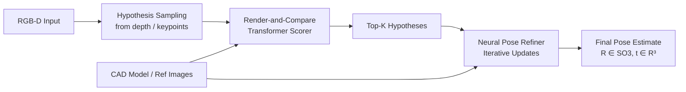
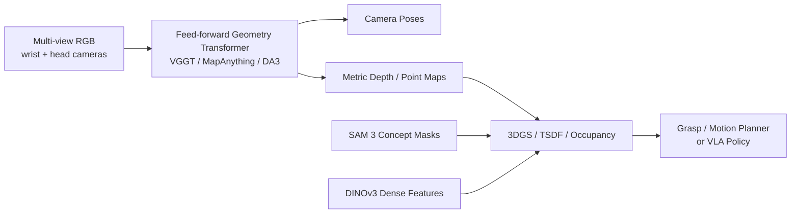
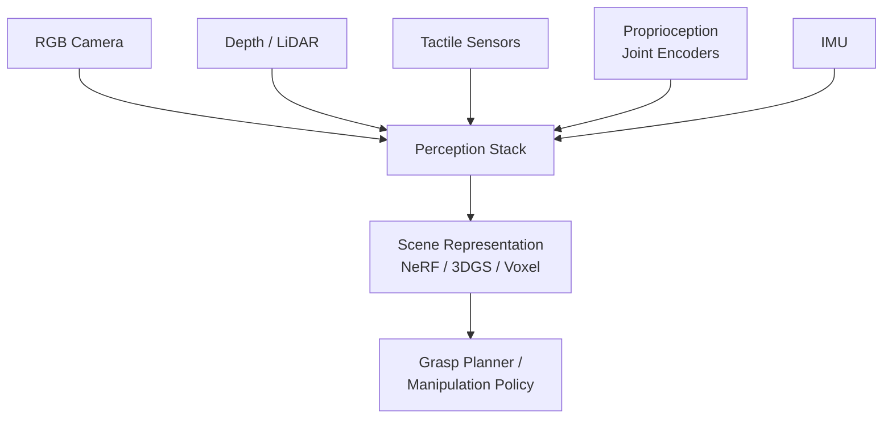

# Perception for Robotics

> **Last Updated:** October 2026
> **Level:** Advanced | Research Frontier
> **Related Sections:**
> - [Manipulation and Navigation](./06_manipulation_navigation.md)
> - [Language-Conditioned Control](./10_language_conditioned_control.md)
> - [Robot Data and Teleoperation](./09_robot_data_and_teleoperation.md)
> - [Hardware and Robot Platforms](./12_hardware_robot_platforms.md)

> **🆕 October 2026 update:**
> - **Vision foundation models as robot front-ends:** **SAM 3** (Meta, Nov 2025; promptable *concept* segmentation and tracking, 848M parameters; SAM 3.1 in Mar 2026), **DINOv3** (Aug 2025; 7B teacher plus distilled ViT/ConvNeXt backbones for dense features) and **SAM 3D** (single-image 3D object reconstruction).
> - **Feed-forward 3D geometry:** VGGT (CVPR 2025 Best Paper), MapAnything (3DV 2026, metric, 12+ tasks), **Depth Anything 3** (Nov 2025, any-view depth + pose), and dynamic-scene reconstruction recognized at CVPR 2026 (D4RT).
> - **Learned stereo depth for robots:** **FoundationStereo** (CVPR 2025 oral, Best Paper nominee; #1 on Middlebury and ETH3D at release) and **Fast-FoundationStereo** (CVPR 2026; >10× faster, ~14–23 ms with TensorRT). This is the most practical 2025–26 answer to the failure of active depth sensors on transparent and specular objects.
> - Model-free 6-DoF pose (**Any6D**, CVPR 2025), self-supervised touch representations (**Sparsh**), a Digit 360 update (~8.3M taxels), new table rows, and new open problems on edge latency and model licensing.

---

## Overview

Perception for robotics is the problem of extracting task-relevant representations from raw sensor streams (RGB images, depth maps, point clouds, tactile signals and proprioception) in a form that supports downstream planning and control. Passive perception tasks such as image classification or video understanding face fewer constraints. Robotic perception must run in real time, handle the sensor noise and partial occlusion common in manipulation workspaces, and produce representations precise enough to guide physical contact. A 1 mm error in estimated object pose can make a grasp fail; a 100 ms latency spike can make a running robot fall.

The field went through a major paradigm shift over 2022–2025. Classical pipelines assembled modular components into handcrafted stacks: object detection, 6-DoF pose estimation via ICP or PnP, occupancy mapping and grasp planning. The new paradigm favors unified scene representations that jointly encode geometry, appearance and semantics in a single differentiable model: 3D Gaussian Splats (3DGS) [Kerbl2023], Neural Radiance Fields (NeRF) [Mildenhall2021] and volumetric occupancy networks. These representations support view synthesis (enabling data augmentation and sim2real transfer), semantic querying via language embeddings and real-time rendering for closed-loop feedback.

A third layer of innovation is open-vocabulary scene understanding. Vision-language models such as CLIP are fused into 3D representations, so that a robot can answer "where is the orange juice?" directly from a continuous feature field. It is not limited to a fixed category vocabulary set at training time. Methods including CLIP-Fields [Shafiullah2022], OpenScene [Peng2023] and LangSplat [Qin2024] show that language-queryable spatial maps can be built incrementally during robot operation with no task-specific labeling.

**2025–2026: perception becomes "foundation-model-first."** The most consequential change for robotics is that general-purpose vision foundation models now cover most of the classic perception stack out of the box:

- **Segmentation:** SAM 3 segments, detects and tracks every instance of a *named concept* in images and video.
- **Dense features:** DINOv3 provides dense self-supervised features that outperform specialized models without fine-tuning.
- **3D geometry:** feed-forward networks (VGGT, MapAnything, Depth Anything 3) recover camera poses, depth and point maps from one to hundreds of images in about a second.
- **Stereo depth:** learned stereo (FoundationStereo) generalizes zero-shot to real scenes where structured-light sensors fail.

The robotics problem has shifted from "can we perceive X?" to **latency, metric accuracy, temporal consistency and licensing on edge hardware**.

---

## 6-DoF Object Pose Estimation

### Problem Statement

Given an RGB or RGB-D observation and a reference model (CAD mesh or a set of reference images), estimate the rotation $R \in SO(3)$ and translation $t \in \mathbb{R}^3$ of the object in the camera frame:

```latex
(R^*, t^*) = \arg\min_{R,t} \mathcal{L}\bigl(\text{render}(M, R, t),\; I_\text{obs}\bigr)
```

The BOP (Benchmark for 6D Object Pose Estimation) Challenge provides standardized evaluation across multiple datasets (YCB-V, LM-O, T-LESS, HB, ITODD) using the Average Recall (AR) metric, which aggregates the VSD, MSSD and MSPD error thresholds.

### MegaPose [Labbe2022]

MegaPose (NeurIPS 2022) addresses generalization to unseen objects by training on >2 million synthetic images of 50K+ diverse objects from Google Scanned Objects and ShapeNetCore. The architecture has a coarse estimator, which regresses pose from a rendered-versus-observed feature comparison, followed by an ICP-style refiner. MegaPose needs no real training images of the target object, only its CAD model at test time. Its synthetic training images were later made available for BOP 2024 pre-training, which turned MegaPose's training data into a community resource.

### FoundationPose [Wen2024]

FoundationPose (CVPR 2024 Highlight, NVLabs) is a unified 6-DoF pose estimation and tracking model. It supports both model-based operation (CAD provided) and model-free operation (reference images provided) without any per-object fine-tuning. Key innovations:

1. A large-scale synthetic training pipeline generating diverse object-scene compositions.
2. A render-and-compare transformer that scores pose hypotheses by comparing rendered and observed feature maps.
3. A neural pose refiner that iteratively updates estimates.

FoundationPose ranked **1st on the BOP leaderboard** as of March 2024 for model-based novel-object pose estimation. It reached AR = 83.3% on the BOP core unseen datasets, a substantial margin above the prior SOTA.



### Any6D [Lee2025] — Model-Free Pose from a Single Anchor

**Any6D** (CVPR 2025; co-authored with the FoundationPose author) removes the requirement for a textured CAD model or multi-view reference captures. It estimates the **6D pose *and metric size*** of an unknown object from a **single RGB-D anchor image**. A joint object-alignment step improves 2D–3D alignment and metric scale. A render-and-compare stage then generates and refines hypotheses, which the authors report is robust to occlusion, non-overlapping views and lighting or environment changes.

A complementary 2025–26 route is **generative reconstruction**. **SAM 3D Objects** (Meta, Nov 2025; arXiv:2511.16624) reconstructs full 3D shape, texture and layout from a *single* image, even under clutter and occlusion. In principle this can supply the mesh that model-based trackers like FoundationPose require. Systematic robotic evaluation of such generated-mesh-then-track pipelines is still limited.

---

## Grasp Detection and Keypoint Representations

### kPAM: KeyPoint Affordances [Manuelli2019]

kPAM formalizes category-level manipulation by representing objects via semantic 3D keypoints (e.g., "mug handle", "mug rim") rather than full 6-DoF pose. Given detected keypoints $\{k_i \in \mathbb{R}^3\}$, a task-parameterized motion plan is solved:

```latex
\min_{T \in SE(3)} \sum_i \| T k_i^{\text{ref}} - k_i^{\text{obs}} \|^2
\quad \text{s.t.} \quad \text{collision-free}(T)
```

kPAM achieves category-level generalization (mugs of different shapes, colors) without requiring dense 6-DoF pose estimation. kPAM 2.0 (RA-L 2020) extends to sequential manipulation.

### Transporter Networks [Zeng2021]

Transporter Networks (CoRL 2021) address pick-and-place tasks by decomposing action prediction into a "what to pick" and "where to place" inference, both framed as spatial cross-correlation operations over deep feature maps:

```latex
Q_\text{place}(p) = \phi_\text{key}(I_t) \star \phi_\text{query}(I_t, \text{pick}_t)
```

This structure exploits spatial translation equivariance, yielding orders-of-magnitude better sample efficiency than standard imitation learning baselines. The method makes no assumptions about object identity, canonical poses, or keypoints, operating directly on image observations.

For 2025–26 diffusion-based 6-DoF grasp generation (GraspGen), see [Manipulation and Navigation](./06_manipulation_navigation.md).

---

## Scene Representations for Manipulation

### Neural Radiance Fields (NeRF)

NeRF [Mildenhall2021] represents a scene as a continuous function $F_\theta: (\mathbf{x}, \mathbf{d}) \mapsto (\mathbf{c}, \sigma)$ mapping 3D coordinates and view direction to color and volume density. Volume rendering:

```latex
\hat{C}(\mathbf{r}) = \int_{t_n}^{t_f} T(t)\,\sigma(\mathbf{r}(t))\,\mathbf{c}(\mathbf{r}(t), \mathbf{d})\,\mathrm{d}t
```

For robotics, NeRF enables novel view synthesis from sparse observations, supporting data augmentation for policy training and high-quality 3D reconstruction for grasping. NeRF2Real [Byravan2023] demonstrated sim2real transfer of legged locomotion policies using NeRF-rendered training environments.

### 3D Gaussian Splatting (3DGS)

3DGS [Kerbl2023] (SIGGRAPH 2023) represents scenes as a set of anisotropic Gaussians $\mathcal{G} = \{(\mu_i, \Sigma_i, \alpha_i, \mathbf{c}_i)\}$, rendered via alpha-compositing:

```latex
C(p) = \sum_{i \in \mathcal{N}} c_i \alpha_i \prod_{j < i}(1 - \alpha_j)
```

3DGS renders at 100+ FPS (vs. seconds for NeRF), enabling real-time feedback during robot operation. For manipulation:
- **SplatSim** (2024) demonstrated zero-shot sim2real transfer of RGB manipulation policies using 3DGS scene reconstruction.
- **ManiGaussian** (2024) extended 3DGS with dynamic scene modeling for multi-task robot manipulation.
- **RL-GSBridge** (2024) uses 3DGS for Real2Sim2Real transfer, building simulation environments from real robot observations.

Since 2025, simulators have begun to consume Gaussian-splat or neural-reconstruction assets directly. Examples are Genesis's Nyx renderer and the neural-reconstruction rendering support in Isaac Lab 3.0's betas (see [Simulation & Data](./05_simulation_and_data.md)), which turns Real2Sim2Real from a research pipeline into a framework feature.

### Feed-Forward 3D Foundation Models (2025–2026)

Per-scene optimization (NeRF/3DGS training, COLMAP SfM) takes minutes to hours. A new family of **feed-forward geometry transformers** produces cameras and 3D structure in a single network pass:

- **VGGT** [Wang2025] (Oxford VGG + Meta; **CVPR 2025 Best Paper**). From one, a few or hundreds of views, it infers camera intrinsics and extrinsics, depth maps, point maps and 3D point tracks, typically in **under one second** per scene. Outputs can be exported to COLMAP format for optional bundle adjustment.
- **MapAnything** [Keetha2025] (Meta; arXiv:2509.13414; 3DV 2026). It regresses **factored metric 3D geometry** from images, optionally conditioned on calibration, pose or depth when they are available, and a single model covers **12+ reconstruction tasks**. Metric scale matters for robots, because up-to-scale reconstructions cannot be used for grasping without an external scale reference.
- **Depth Anything 3** [Lin2025] (ByteDance Seed; arXiv:2511.10647; Nov 2025). It uses a plain DINO-style transformer and a single **depth-ray** representation, trained only on public academic data. One model covers monocular depth, multi-view depth, pose-conditioned depth, camera pose estimation and 3D Gaussian estimation. The authors report it outperforms VGGT on multi-view depth and pose. A metric-depth variant (DA3METRIC-LARGE) and a nested any-view + metric model output metric-scale depth.
- **Dynamic scenes:** the CVPR 2026 Best Paper, "Efficiently Reconstructing Dynamic Scenes One D4RT at a Time", signals that the frontier is moving from static to **4D (dynamic) feed-forward reconstruction**. Robots need this because both the robot and humans move through the scene.



### Voxel and Occupancy Representations

Voxel grids and occupancy networks provide an explicit volumetric alternative:
- **VoxPoser** [Huang2023] generates 3D affordance maps over a voxel workspace using LLM-composed value functions.
- **C-3PO** and occupancy network variants enable real-time collision checking for reactive manipulation planning.

---

## Open-Vocabulary Scene Understanding

### CLIP-Fields [Shafiullah2022]

CLIP-Fields trains a small MLP to map 3D coordinates to CLIP feature vectors, supervised by posed RGB frames whose patches are embedded with a CLIP image encoder. The resulting field can be queried with arbitrary text:

```latex
f^* = \arg\min_f \|\text{CLIP-img}(I_i) - f(x_i)\|^2
```

Robots using CLIP-Fields can navigate to arbitrary language queries ("find the red bottle") without any task-specific training, relying entirely on CLIP's web-trained semantic space.

### OpenScene [Peng2023]

OpenScene (CVPR 2023) distills 2D open-vocabulary features (LSeg, OpenSeg) into 3D point-cloud representations via a 3D distillation objective, enabling zero-shot semantic 3D scene queries with natural language. Unlike CLIP-Fields, OpenScene processes large-scale indoor scans (ScanNet, Matterport3D) at the scene level.

### LangSplat [Qin2024]

LangSplat (CVPR 2024) embeds CLIP language features into 3D Gaussian primitives, achieving real-time language-queryable 3D scenes. LangSplat adds a per-Gaussian CLIP feature vector $\ell_i$ alongside standard Gaussian attributes, rendered using the same alpha-compositing kernel:

```latex
L(p) = \sum_{i \in \mathcal{N}} \ell_i \alpha_i \prod_{j < i}(1 - \alpha_j)
```

This enables open-vocabulary object localization at real-time rates, making it suitable for reactive robot grasping pipelines.

### SAM 3: Promptable Concept Segmentation [Carion2025]

**SAM 3** (Meta; "Segment Anything with Concepts", arXiv:2511.16719; Nov 2025) generalizes SAM's visual prompts to **concept prompts**. Given a short noun phrase (e.g., "red mug") or an image exemplar, it detects, segments and tracks **all instances** of that concept in images and video. Key design points:

- **848M parameters.** A DETR-style detector conditioned on text, geometry and exemplars shares a vision encoder with a SAM 2-style tracker; the decoupled detector-tracker design reduces task interference.
- A **presence token** separates "is this concept present?" from "where is it?", which improves discrimination between closely related prompts.
- The **SA-Co** benchmark has 270K unique concepts (>50× prior benchmarks), and the data engine annotated over 4M unique concepts. SAM 3 reaches cgF1 55.7 on SA-Co/Gold images (humans 74.0), about 75–80% of human performance.
- **SAM 3 Agent** pairs SAM 3 with an MLLM for complex referring expressions. **SAM 3.1 Object Multiplex** (27 Mar 2026) adds shared-memory multi-object tracking that is significantly faster.

For robots, SAM 3 replaces the "open-vocabulary detector + SAM" chains of 2023–24 (e.g., Grounding-DINO + SAM) with a single model. It supplies instance masks that downstream pose estimators, grasp generators and 3D feature fields can consume.

### DINOv3 and Dense Self-Supervised Features [Simeoni2025]

**DINOv3** (Meta; arXiv:2508.10104; Aug 2025) scales self-supervised learning to a **6.7B-parameter ViT-7B/16 teacher**, trained on LVD-1689M web images, with a satellite variant trained on SAT-493M. It introduces **Gram anchoring** to keep dense patch features well-behaved during long training. The teacher is distilled into ViT-S/B/L/H+ (21M–840M) and ConvNeXt-T/S/B/L (29M–198M) backbones that suit robot compute budgets. Its frozen dense features outperform specialized state-of-the-art models on a broad range of tasks without fine-tuning. That makes DINOv3 a natural backbone for feature fields, keypoint correspondence (a learned successor to kPAM-style keypoints) and visuomotor policy encoders. On the video side, **V-JEPA 2.1** (Mar 2026) targets temporally consistent dense video features, which matters for tracking under robot ego-motion.

---

## Depth, Point Cloud, and Sensor Fusion

### RGB-D Processing

Standard RGB-D sensors (Intel RealSense D435, Azure Kinect) provide depth via structured IR projection. Key failure modes for robotics:
- Transparent/specular objects: IR structured light fails; time-of-flight also unreliable.
- Near-field (<0.3 m): Depth accuracy degrades significantly; critical for in-hand manipulation.
- Motion blur: Fast robot motion can cause depth-color misalignment.

PointNet++ [Qi2017] and sparse 3D CNNs (MinkowskiEngine, SpConv) are standard backbones for point-cloud processing tasks including grasp detection, 6-DoF pose estimation, and scene segmentation.

### Learned Stereo Depth: FoundationStereo and Fast-FoundationStereo

A practical 2025–26 shift is replacing the sensor's active depth with **learned stereo matching** on the same IR or RGB stereo pair:

- **FoundationStereo** [Wen2025] (NVIDIA; arXiv:2501.09898; **CVPR 2025 oral, Best Paper nomination**) is trained on ~1M synthetic stereo pairs that are automatically filtered for ambiguity. It uses a **side-tuning backbone that injects monocular priors from vision foundation models** and long-range context reasoning for cost-volume filtering. It is designed for zero-shot generalization without per-domain fine-tuning and ranked **1st on the Middlebury and ETH3D stereo leaderboards** at release. Jetson/TensorRT support followed in July 2025.
- **Fast-FoundationStereo** [Wen2026] (arXiv:2512.11130; **CVPR 2026**) runs **>10× faster** while closely matching FoundationStereo's zero-shot accuracy. On an RTX 3090 at 640×480, reported latencies are about **14–23 ms with TensorRT** (29–49 ms in PyTorch), depending on the checkpoint and iteration count. That is fast enough for closed-loop manipulation.

Because learned stereo infers depth from texture and context rather than from projected-pattern returns, it degrades far more gracefully on glass, glossy metal and dark surfaces. That is the classic failure set for structured light and ToF.

### Tactile Sensing

**GelSight** sensors use an elastomeric gel surface with embedded LEDs and a camera to image deformations when the gel contacts an object, yielding high-resolution surface geometry (micron-level) and shear force estimates. The **DIGIT** sensor [Lambeta2021] miniaturized this to a fingertip form factor at $<$\$30 per unit.

In October 2024, **Digit 360** was announced by Meta AI with GelSight as manufacturing partner. It is a hemispherical fingertip sensor with **~8.3 million taxels** and >18 sensing modalities, including normal force, shear force, vibration and thermal, offering superhuman tactile sensitivity. It is described in "Digitizing Touch with an Artificial Multimodal Fingertip" [Lambeta2024]. Designs and code are open-sourced by Meta AI, which also offered assembled units to researchers through a call for proposals.

**Sparsh** [Higuera2024] (Meta FAIR + CMU; CoRL 2024) is a family of **self-supervised touch encoders** (MAE, DINO and JEPA variants) trained across DIGIT, GelSight'17 and GelSight Mini. It substantially outperforms end-to-end models on the **TacBench** downstream tasks (force estimation, slip detection, pose) and supports data-efficient learning of new tactile tasks. This is the tactile analogue of DINO-style visual pretraining. On the simulation side, Isaac Lab added a visual tactile sensor in v2.3.2 (Feb 2026).

Tactile sensing enables skills beyond vision alone: detecting slip during grasping, estimating object stiffness, and calibrating force during assembly.

### Sensor Fusion

Fusing heterogeneous sensors requires careful temporal synchronization and extrinsic calibration:



Modality fusion approaches include: early fusion (concatenation in feature space), late fusion (ensemble of per-modality predictions), and cross-modal attention mechanisms as used in transformer-based policies.

---

## Real-Time Constraints

| Task | Latency Budget | Common Bottleneck |
|------|---------------|-------------------|
| Grasp detection on point cloud | <100 ms | PointNet++ inference |
| 6-DoF pose tracking | <30 ms | Render-and-compare loop |
| 3DGS view synthesis | <10 ms | GPU rasterization |
| Language-field query | <50 ms | CLIP embedding + field eval |
| SLAM update (RTAB-Map) | <100 ms | Loop closure detection |
| Learned stereo depth (640×480) | <30 ms | Iterative cost-volume refinement (Fast-FoundationStereo: ~14–23 ms TRT on RTX 3090) |
| Feed-forward multi-view reconstruction | ~1 s (scene-level, not per-frame) | Global attention over all views (VGGT) |
| Concept segmentation + tracking | Per-frame, model-size bound | 848M-parameter SAM 3; multi-object memory (SAM 3.1 multiplex) |

NVIDIA Jetson AGX Orin (275 TOPS INT8) is the standard edge platform. The newer **Jetson Thor** (developer kits shipping since August 2025, Blackwell architecture) delivers 2,070 FP4 TFLOPS within a 130 W envelope, enabling on-robot inference of larger perception models. FoundationStereo and Cosmos3-Edge explicitly target Jetson deployment.

---

## Key Papers

| Paper | Authors | Year | Venue | Key Contribution |
|-------|---------|------|-------|-----------------|
| GraspNet-1Billion | Fang et al. | 2020 | CVPR | Large-scale grasp benchmark; baseline model |
| NeRF | Mildenhall et al. | 2020/2021 | ECCV / CACM | Continuous volumetric scene representation |
| kPAM | Manuelli et al. | 2019/2020 | ISRR / RA-L | Semantic keypoint affordances for category-level manipulation |
| Transporter Networks | Zeng et al. | 2021 | CoRL | Spatial cross-correlation for pick-and-place; high sample efficiency |
| DIGIT | Lambeta et al. | 2021 | RA-L | Low-cost (<$30) fingertip tactile sensor |
| CLIP-Fields | Shafiullah et al. | 2022 | arXiv | Language-queryable 3D neural fields for robot navigation |
| MegaPose | Labbe et al. | 2022 | NeurIPS | 6-DoF pose estimation for unseen objects from CAD models |
| 3D Gaussian Splatting | Kerbl et al. | 2023 | SIGGRAPH | Real-time explicit radiance field via anisotropic Gaussians |
| OpenScene | Peng et al. | 2023 | CVPR | Open-vocabulary 3D scene understanding via feature distillation |
| FoundationPose | Wen et al. | 2024 | CVPR | Unified 6-DoF pose+tracking; BOP #1 ranking (AR 83.3%) |
| LangSplat | Qin et al. | 2024 | CVPR | Language-embedded 3DGS for real-time open-vocabulary 3D queries |
| Sparsh: Self-supervised touch representations for vision-based tactile sensing | Higuera et al. | 2024 | CoRL | SSL touch encoders across GelSight/DIGIT; TacBench |
| Digitizing Touch with an Artificial Multimodal Fingertip (Digit 360) | Lambeta et al. | 2024 | arXiv | ~8.3M-taxel multimodal fingertip; open hardware |
| FoundationStereo: Zero-Shot Stereo Matching | Wen et al. | 2025 | CVPR 2025 (oral, Best Paper nominee) | Foundation-prior stereo; #1 Middlebury/ETH3D at release |
| VGGT: Visual Geometry Grounded Transformer | Wang et al. | 2025 | CVPR 2025 (Best Paper) | Feed-forward cameras, depth, point maps, tracks from 1–100s of views |
| Any6D: Model-free 6D Pose Estimation of Novel Objects | Lee et al. | 2025 | CVPR 2025 | 6D pose + metric size from a single RGB-D anchor |
| DINOv3 | Siméoni et al. | 2025 | arXiv:2508.10104 | 7B SSL teacher with Gram anchoring; distilled dense-feature backbones |
| MapAnything: Universal Feed-Forward Metric 3D Reconstruction | Keetha et al. | 2025 | 3DV 2026 | Metric factored geometry; 12+ tasks with optional geometric inputs |
| SAM 3: Segment Anything with Concepts | Carion et al. | 2025 | arXiv:2511.16719 | Promptable concept segmentation/tracking; SA-Co benchmark (270K concepts) |
| SAM 3D: 3Dfy Anything in Images | SAM 3D Team (Meta) | 2025 | arXiv:2511.16624 | Single-image 3D shape, texture and layout reconstruction |
| Depth Anything 3: Recovering the Visual Space from Any Views | Lin et al. | 2025 | arXiv:2511.10647 | Any-view depth + pose with plain transformer and depth-ray target |
| Fast-FoundationStereo: Real-Time Zero-Shot Stereo Matching | Wen et al. | 2025 | CVPR 2026 | >10× faster than FoundationStereo at near-equal zero-shot accuracy |

---

## Benchmark Performance

| Model | Dataset / Task | Metric | Score | Notes |
|-------|---------------|--------|-------|-------|
| FoundationPose | BOP core (unseen, model-based) | AR | 83.3% | CVPR 2024 Highlight; BOP #1 March 2024 |
| MegaPose | BOP (unseen objects) | AR | not publicly reported by single number | Strong baseline; training data made public |
| AnyGrasp | GraspNet-1Billion unseen test | AP | SOTA (2023) | 93.3% bin-pick SR empirically |
| Transporter Networks | CLIPort pick-and-place | Task SR | >90% seen tasks | 100x sample efficiency vs. BC |
| LangSplat | 3D semantic localization | Acc | not publicly reported | Real-time vs. NeRF-based methods |
| SAM 3 | SA-Co/Gold (image concept segmentation) | cgF1 | 55.7 | Human 74.0; ~75–80% of human performance |
| SAM 3 | SA-V test (video concept segmentation) | cgF1 / pHOTA | 30.3 / 58.0 | Human cgF1 53.1 |
| FoundationStereo | Middlebury, ETH3D leaderboards | Rank | #1 (at release, early 2025) | Zero-shot generalization focus |
| Fast-FoundationStereo | 640×480 stereo, RTX 3090 | Latency | ~14–23 ms (TensorRT) | >10× faster than FoundationStereo |
| VGGT | Multi-view scene reconstruction | Runtime | <1 s per scene (typical) | CVPR 2025 Best Paper |
| DIGIT 360 | Tactile sensing modalities | — | >18 sensing features; ~8.3M taxels | Announced October 2024 |

---

## Pros & Cons

| Aspect | Pros | Cons |
|--------|------|------|
| FoundationPose (model-based 6-DoF) | No per-object fine-tuning; model-free fallback; BOP SOTA | Requires CAD model or reference images; fails on symmetric objects without symmetry handling |
| 3DGS Scene Representation | Real-time rendering (100+ FPS); explicit geometry; language-extensible via LangSplat | Memory scales with scene complexity; dynamic object handling still limited; training requires multi-view captures |
| Feed-Forward 3D Models (VGGT, MapAnything, DA3) | No per-scene optimization; poses + depth in ~1 s; metric variants usable for grasping | Scene-level not per-frame latency; static-scene assumption (4D still emerging); some large checkpoints non-commercial (CC BY-NC) |
| Concept Segmentation (SAM 3) | One model for detection + segmentation + tracking of any named concept; exemplar prompts | 848M parameters heavy for edge; still ~25% below human on SA-Co; weak on spatial relations ("the left mug") |
| Learned Stereo (FoundationStereo family) | Robust on transparent/specular/dark surfaces; works with existing stereo/IR pairs; real-time variant | GPU required; accuracy depends on baseline and calibration; failure modes less interpretable than active depth |
| Tactile Sensing (GelSight/DIGIT) | Sub-mm force/geometry sensing; slip detection; enables contact-rich manipulation; SSL encoders (Sparsh) reduce labeling | Fragile in harsh environments; limited contact area; integration into policy learning non-trivial |
| Open-Vocabulary Fields (CLIP-Fields, LangSplat) | Zero-shot language queries; no task-specific labels; incremental map building | CLIP feature resolution limited; query ambiguity for spatially close objects; hallucination risk |
| Classical Depth Processing (PointNet++) | Fast, well-understood; strong open-source ecosystem | Fails on transparent/specular objects; no semantic generalization without large annotated datasets |

---

## Open Problems & Research Gaps

1. **Transparent and Reflective Object Perception**: No current depth sensor or neural reconstruction method reliably recovers the geometry of glass, liquids or polished metals under uncontrolled lighting. Polarization cameras and thermal imaging offer partial solutions but lack large-scale training data. Learned stereo (FoundationStereo, Fast-FoundationStereo) is the strongest 2025–26 mitigation, but liquids and fully transparent thin structures remain hard.

2. **Real-Time Dynamic Scene Reconstruction**: 3DGS assumes a static scene. Robots operate in dynamic environments with moving objects, humans, and their own bodies occluding parts of the scene. Efficient dynamic 3DGS updates during robot motion remain open. Feed-forward 4D reconstruction (the CVPR 2026 Best Paper D4RT) points to a route, but per-frame robot-rate operation is not yet demonstrated.

3. **Tactile-Vision Fusion**: Despite low-cost tactile sensors (DIGIT) and pretrained touch encoders (Sparsh), most manipulation policies still ignore tactile feedback. Fusing tactile, visual and proprioceptive signals into one policy without modality dropout during deployment is underexplored.

4. **Long-Horizon Pose Tracking Under Occlusion**: FoundationPose and similar trackers lose track when objects are fully occluded (e.g., a cup placed in a drawer). Re-detection after occlusion relies on heuristics; principled reasoning about object permanence is needed. SAM 3's memory-based concept tracking helps re-acquire objects by identity in 2D but does not maintain 6-DoF state.

5. **Semantic Precision of Language-Queryable Fields**: CLIP-Fields and LangSplat inherit CLIP's granularity. They can distinguish "mug" from "bowl" but struggle with "the left mug" versus "the right mug", or with material and state properties ("the full bottle" versus "the empty bottle"). SAM 3's concept prompts and presence token sharpen *category* discrimination. Spatial-relational and state queries still require an MLLM in the loop (e.g., SAM 3 Agent).

6. **Sensor Calibration Under Deployment Drift**: Robot RGB-D sensors undergo extrinsic calibration shifts due to thermal expansion, vibration, and collisions. Continuous online self-calibration during robot operation without pausing for manual recalibration is an unsolved engineering and learning challenge. Feed-forward pose estimators (VGGT, MapAnything) could serve as continuous calibration monitors, but this use is largely unexplored.

7. **Sim-to-Real for Contact Dynamics in Perception**: Perception models trained on synthetic data (e.g., via BlenderProc for MegaPose) generalize reasonably for pose estimation but fail for contact-state prediction because simulation does not accurately model surface friction textures, deformations, or lighting near contact regions.

8. **Foundation Perception at Robot Rates on the Edge**: SAM 3 (848M), DINOv3 ViT-7B, VGGT and DA3-Giant are server-class models. Distilled variants exist (DINOv3 ViT-S/B, DA3-Small/Base, Fast-FoundationStereo), but there is no systematic study of the accuracy-latency Pareto front for a full perception stack running at 30 Hz on Jetson-class hardware alongside a VLA policy.

9. **Licensing and Reproducibility for Deployment**: Several of the strongest 2025–26 perception checkpoints carry non-commercial licenses (e.g., the large and giant Depth Anything 3 models and the default MapAnything weights are CC BY-NC 4.0, with Apache-licensed smaller or alternative variants). Industrial robot stacks must therefore often use weaker permissive variants. That makes academic SOTA and deployable SOTA increasingly different targets.

---

## Further Reading

- [FoundationPose (NVLabs GitHub)](https://github.com/NVlabs/FoundationPose)
- [Any6D (CVPR 2025, GitHub)](https://github.com/taeyeopl/Any6D)
- [FoundationStereo (NVLabs GitHub, arXiv:2501.09898)](https://github.com/NVlabs/FoundationStereo)
- [Fast-FoundationStereo (arXiv:2512.11130)](https://github.com/NVlabs/Fast-FoundationStereo)
- [SAM 3: Segment Anything with Concepts (GitHub)](https://github.com/facebookresearch/sam3)
- [SAM 3D Objects (GitHub)](https://github.com/facebookresearch/sam-3d-objects)
- [DINOv3 (GitHub, arXiv:2508.10104)](https://github.com/facebookresearch/dinov3)
- [VGGT (GitHub)](https://github.com/facebookresearch/vggt)
- [MapAnything (GitHub, arXiv:2509.13414)](https://github.com/facebookresearch/map-anything)
- [Depth Anything 3 (GitHub, arXiv:2511.10647)](https://github.com/ByteDance-Seed/Depth-Anything-3)
- [Sparsh tactile representations (GitHub)](https://github.com/facebookresearch/sparsh)
- [Digit 360 (GitHub)](https://github.com/facebookresearch/digit360)
- [GelSight / DIGIT Tactile Sensors](https://www.gelsight.com/)
- [3D Gaussian Splatting Project Page](https://repo-sam.inria.fr/fungraph/3d-gaussian-splatting/)
- [OpenScene: 3D Scene Understanding with Open Vocabularies](https://pengsongyou.github.io/openscene)
- [BOP Challenge 2024 Results](https://bop.felk.cvut.cz/challenges/)
- [CLIP-Fields Paper (arXiv:2210.05663)](https://arxiv.org/abs/2210.05663)
