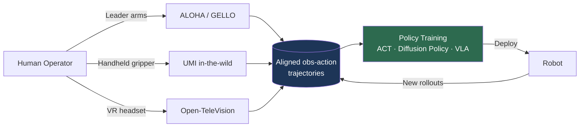
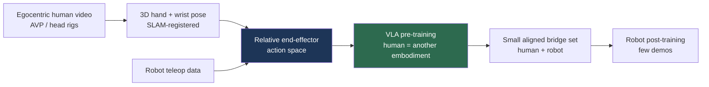

# Robot Data & Teleoperation

> **Last Updated:** October 2026
> **Level:** Advanced
> **Related Sections:**
> - [Cross-Embodiment Learning](./04_cross_embodiment.md)
> - [VLA Models](./01_vla_models.md)
> - [Simulation and Data](./05_simulation_and_data.md)
> - [Pros, Cons & Roadmaps](./07_pros_cons_roadmaps.md)

> **🆕 October 2026 update:**
> - Added the 2025–26 generation of large real-robot corpora: **AgiBot World Colosseo** (1,003,672 trajectories, 100 robots), the **Galaxea Open-World Dataset** (500+ h, single embodiment), and Generalist AI's proprietary **GEN-0** corpus (~270k h, +10k h/week).
> - New subsection on **egocentric human video with 3D hand pose as "actions"**: EgoDex (829 h, ICLR 2026), NVIDIA EgoScale (~20.8k h, log-linear scaling), Physical Intelligence's *emergent* human-to-robot transfer in π0.5, Figure's Project Go-Big, and GR00T N1.7's human-video pre-training. The action-label gap is narrowing rather than closed.
> - Added **DexUMI** (UMI-style exoskeleton for dexterous hands, CoRL 2025 Best Paper finalist) and the rise of industrial "data operations" as a business model.
> - Updated scaling-law evidence (GEN-0 power law and 7B "ossification" threshold; EgoScale) and real-world **distributed evaluation** on the DROID platform (RoboArena, CoRL 2025).
> - New Key Papers/benchmark rows, Pros & Cons rows, open problems (privacy/licensing of in-home data, human-to-robot hand gap) and Further Reading links.

---

## Overview

The central bottleneck in contemporary robot learning is not architecture but **data**. Unlike language and vision—where the Internet supplies effectively unlimited text and image-caption pairs—robot action data must be physically generated, one trajectory at a time, on real or simulated hardware. The defining strategic question of the 2024–2026 era is therefore how to collect, aggregate, and amortize embodied interaction data at a scale comparable to the corpora that produced GPT-class language models and CLIP-class vision encoders. Every VLA discussed in [VLA Models](./01_vla_models.md) is ultimately a function of the data pipeline that fed it.

Robot data exists on a spectrum of *embodiment fidelity* and *collection cost*. At one extreme, **passive human video** (Ego4D, EPIC-KITCHENS) is abundant and cheap but lacks action labels and the precise proprioceptive grounding a policy needs. At the other extreme, **on-robot teleoperation** yields perfectly aligned observation-action trajectories but is expensive, slow, and embodiment-specific. Between these poles sit a growing set of **portable data-collection devices** (UMI's handheld gripper, GELLO's kinematic twin) that decouple demonstration collection from the robot itself, and **simulation** (covered in [Simulation and Data](./05_simulation_and_data.md)) that trades physical realism for throughput.

This file surveys the teleoperation systems and datasets that constitute the modern robot-data ecosystem, the empirical scaling laws emerging from imitation learning, and the unresolved economic and technical tensions—chief among them the *action-label gap* between human video and robot control, and the question of whether robot data collection can ever become a self-reinforcing flywheel rather than a linear cost.

By late 2025 and through 2026 the landscape shifted in two ways. First, **scale moved from academic consortia to industrial data operations**: AgiBot's 100-robot data factory produced a million-trajectory open corpus, and Generalist AI reported a ~270,000-hour proprietary corpus growing by more than 10,000 hours per week [GeneralistAI2025]. Second, **egocentric human video became an action-labeled data source** rather than a mere representation prior: head-mounted capture (Apple Vision Pro, custom rigs) records 3D hand and finger pose that can be treated as an "embodiment" with its own action space, and several 2025–26 results (EgoDex, EgoScale, Physical Intelligence's human-to-robot transfer, GR00T N1.7) show that such data measurably improves robot policies once the robot-side pre-training is large enough.

---

## Teleoperation Systems

Teleoperation is the dominant source of high-quality robot demonstration data. The design axis that matters is the **operator-to-robot mapping**: how human intent is transduced into robot joint or end-effector commands.

### Leader–Follower (Kinematic) Teleoperation

**ALOHA** [Zhao2023] (*A Low-cost Open-source Hardware System for Bimanual Teleoperation*, RSS 2023) established the template for low-cost bimanual data collection. Operators backdrive two leader arms whose joint positions are mirrored onto two follower arms, enabling fine-grained tasks such as threading a zip tie or slotting a battery. The companion algorithm, **Action Chunking with Transformers (ACT)**, predicts chunks of future actions rather than single steps, mitigating the compounding-error problem of step-wise behavior cloning. The full system cost ≈ \$20,000. **Mobile ALOHA** [Fu2024] (CoRL 2024) added a wheeled base and whole-body teleoperation (≈ \$32,000), and demonstrated that **co-training with static ALOHA data boosts mobile-task success by up to 90% with only 50 demonstrations per task**—an early, concrete instance of data co-training paying off.

**GELLO** [Wu2023] (IROS 2024) builds a low-cost leader controller with the *same kinematic structure* as the target arm using 3D-printed parts and inexpensive Dynamixel servos, giving intuitive joint-space mirroring that generalizes across arm types without per-arm redesign.

### Portable / In-the-Wild Collection

The key innovation of 2024 was decoupling data collection from the robot. **UMI (Universal Manipulation Interface)** [Chi2024] (RSS 2024, Best Systems Paper finalist) is a handheld gripper with a wrist-mounted GoPro that records demonstrations *in the wild*—no robot present. Two techniques make the data deployable: **inference-time latency matching** and a **relative-trajectory action representation** that is hardware-agnostic. Policies trained purely on handheld data transfer **zero-shot** across multiple robot platforms, unlocking dynamic, bimanual, and long-horizon behaviors.

**DexUMI** [Xu2025] (CoRL 2025, Best Paper finalist) extends the UMI idea from parallel-jaw grippers to **multi-fingered hands**: the human wears a hand exoskeleton whose linkage is optimized so that fingertip workspaces match a target robot hand (XHand or Inspire Hand), closing the *kinematic* gap; the *visual* gap is closed by segmenting out the human hand and exoskeleton (SAM 2) and inpainting the robot hand into the video, after which a Diffusion Policy is trained on the rendered robot-hand data. Industrial actors have since adopted the same principle—**wearable or handheld capture devices instead of a robot in the loop**—as the basis of large proprietary data operations (e.g. Generalist AI's GEN-0 corpus, collected across "thousands" of homes, warehouses and workplaces [GeneralistAI2025]); consumer-home startups have reported glove-based capture rigs in the same vein, though their data volumes are not independently documented.

### Immersive / VR Teleoperation

**Open-TeleVision** [Cheng2024] (CoRL 2024) uses an Apple Vision Pro to give the operator immersive, first-person stereoscopic feedback from the robot's perspective, validated on long-horizon precise tasks (can sorting/insertion, folding) across two humanoid platforms. The broader trend—VR headsets as teleoperation front-ends—is now standard for humanoid data collection because it captures whole-body, dexterous intent that joystick or leader-arm rigs cannot. By 2025–26 this had become productized: Unitree's open-source `xr_teleoperate` stack, for example, drives its H2, H1/H1-2, G1 and R1 humanoids from commodity XR headsets with integrated data recording, and its `unitree_lerobot` pipeline converts the recordings directly into LeRobot-format training data. Whole-body humanoid teleoperation typically pairs XR hand/head tracking for the upper body with a learned RL **whole-body controller** that keeps the robot balanced while tracking retargeted human motion—e.g. NVIDIA's GEAR-SONIC controller shipped with GR00T N1.7 (see [Generalist vs. Specialist](./11_generalist_vs_specialist.md)).



### Industrial Data Operations (2025–2026)

The economics of teleoperation changed when well-funded companies began running data collection as a dedicated production line:

- **AgiBot data factory.** AgiBot World [AgiBot2025] was collected on **100 real robots** in **100+ one-to-one replicated real-life scenarios across 5 domains** (home, retail, industrial, restaurant, office), with a human-in-the-loop verification pipeline—an organizational template echoed by the government-backed humanoid data-collection "training grounds" that opened in several Chinese cities in 2025.
- **Generalist AI.** GEN-0 [GeneralistAI2025] was pre-trained on ~270,000 hours of real-world manipulation data, with the company reporting >10,000 new hours per week (company-reported; not independently audited).
- **Figure Project Go-Big.** In September 2025 Figure announced a partnership with Brookfield (100,000+ residential units plus office and logistics assets) to collect large-scale egocentric human video in real homes for Helix pre-training [Figure2025GoBig].
- **Tesla.** Business Insider reported in mid-2025 that Tesla's Optimus team had shifted from motion-capture/VR teleoperation toward primarily **video-based** collection of workers performing tasks while wearing camera rigs, citing scalability; Tesla has not published details.

The common thread is that the cost driver moves from *robot-hours* to *human-hours of instrumented activity*, which can be an order of magnitude cheaper and parallelized across many sites.

---

## Datasets

| Dataset | Trajectories | Embodiments | Salient property |
|---------|-------------|-------------|------------------|
| **Open X-Embodiment** [OXE2023] | 1M+ | 22 | 60 pooled datasets, 34 labs; standard VLA pre-training corpus |
| **DROID** [Khazatsky2024] | 76,000 (~350 h) | 1 (Franka) | 564 scenes, 52 buildings, 13 institutions, in-the-wild |
| **BridgeData V2** [Walke2023] | 60,096 | 1 (WidowX) | 24 environments; open-vocab, goal-image/language conditioned |
| **RH20T** [Fang2023] | 110,000+ | multi | Contact-rich; vision + force + audio + action; one-shot focus |
| **RoboMIND** [Wu2024] | 107,000 | 4 | 479 tasks, 96 object classes; includes 5,000 annotated failures |
| **AgiBot World Colosseo** [AgiBot2025] | 1,003,672 (Beta) | AgiBot G1 fleet (100 robots) | 217 tasks, 5 domains; dexterous hands + visuo-tactile; IROS 2025 Best Paper finalist |
| **Galaxea Open-World** [Galaxea2025] | 500+ h | 1 (Galaxea mobile bimanual) | Single uniform embodiment across diverse real-world sites; released with G0 dual-system VLA |
| **GEN-0 corpus** [GeneralistAI2025] | ~270,000 h (proprietary) | multiple (6/7-DoF arms, semi-humanoids) | Collected in 1,000s of real sites; >10k h/week (company-reported) |
| **EgoDex** [Hoque2025] | 829 h human video | human hands (Apple Vision Pro) | 194 tabletop tasks; 3D pose of every hand joint; CC-BY-NC-ND |
| **EgoScale** [EgoScale2026] | ~20,854 h human video | human hands | Action-labeled egocentric data; log-linear scaling in validation loss |

**Open X-Embodiment (OXE)** [OXE2023] is the keystone aggregation effort: ~1M+ trajectories spanning 22 embodiments and 527 skills, pooled from 60 existing datasets across 34 labs. Its central empirical finding—that cross-embodiment co-training improves performance *even on the source embodiment*—is the foundation of the cross-embodiment paradigm (see [Cross-Embodiment Learning](./04_cross_embodiment.md)). **DROID** [Khazatsky2024] standardized the hardware stack (Franka Panda + dual ZED stereo + ZED Mini wrist camera + Oculus Quest teleop) so that 50 collectors across 13 institutions could contribute interoperable data—76,000 trajectories across 564 real-world scenes, the most scene-diverse manipulation dataset of its generation.

**AgiBot World Colosseo** [AgiBot2025] (arXiv:2503.06669; IROS 2025 Best Paper finalist; IEEE T-RO 2026) is the first open real-robot corpus to cross one million trajectories (1,003,672 in the Beta release of March 2025, after a 92,214-trajectory Alpha in December 2024). Unlike OXE it is **single-vendor and quality-controlled**: collected on a fleet of 100 dual-arm mobile robots with dexterous hands and visuo-tactile sensors, covering contact-rich, long-horizon and multi-robot collaborative tasks. The accompanying **GO-1** generalist policy uses a latent-action planner, and the authors report that pre-training on AgiBot World yields ~**30% higher average performance than pre-training on OXE**; GO-1 was open-sourced in September 2025. Note the licence (CC BY-NC-SA 4.0), which limits commercial reuse.

The **Galaxea Open-World Dataset** [Galaxea2025] (arXiv:2509.00576, Sept 2025) takes the opposite trade-off to OXE: 500+ hours collected with **one uniform mobile bimanual embodiment** to avoid cross-embodiment normalization altogether, released with the **G0** dual-system VLA (later G0Plus, Jan 2026, pre-trained on 2k+ hours of real robot data). Together, AgiBot World and Galaxea mark a move from *heterogeneous aggregation* (OXE) toward *homogeneous, curated fleets*—mirroring the shift from web-scraped to curated corpora in vision-language pre-training.

**DROID as an evaluation substrate.** DROID's standardized Franka setup has turned into a shared *evaluation* platform: Physical Intelligence released π0-FAST-DROID and π0.5-DROID checkpoints that perform simple tabletop tasks zero-shot in new DROID scenes, and **RoboArena** [Atreya2025] (CoRL 2025) runs crowd-sourced, double-blind pairwise comparisons of generalist policies on DROID robots at seven institutions, reporting that this distributed scheme ranks policies more accurately than centralized fixed-task evaluation (600+ pairwise real-robot episodes across seven policies in the initial study).

### Human Video as a Data Source

**Ego4D** [Grauman2022] (CVPR 2022, 3,670 hours, 931 participants, 74 locations) and **EPIC-KITCHENS-100** [Damen2022] (IJCV 2022, 97 verbs × 300 nouns) are not robot datasets but are increasingly used to pre-train visual encoders for manipulation. Encoders pre-trained on Ego4D hand-object interaction segments reportedly transfer to manipulation **20–40% better than ImageNet-pretrained encoders** on downstream success rate, motivating their use in VLA pre-training pipelines. The catch is the **action-label gap**: human video contains rich physical priors (contact, affordance, object dynamics) but no robot action labels, so it can pre-train *representations* but not directly supervise *control*. Bridging this gap—via latent action models (Genie-style, see [World Models](./02_world_models.md)), inverse dynamics, or human-to-robot retargeting—is one of the most active research directions of 2025–2026.

### Egocentric Human Video with Hand Pose as Action (2025–2026)

The most consequential data development of the past year is that the action-label gap has been **narrowed by measuring the human hand rather than inferring robot actions**. Head-mounted capture with calibrated cameras and on-device SLAM yields per-frame 3D wrist and finger-joint poses, which can be expressed in the same **relative end-effector action space** as a robot's and co-trained as just another embodiment:

- **EgoDex** [Hoque2025] (Apple; ICLR 2026): 829 hours of 1080p/30 Hz egocentric video recorded on Apple Vision Pro, with 3D pose of every hand joint and language annotations, spanning 194 tabletop tasks (from tying shoelaces to folding laundry). It is the largest openly available dexterous human-manipulation dataset of its kind, but is licensed CC-BY-NC-ND.
- **EgoScale** [EgoScale2026] (NVIDIA, UC Berkeley, UMD; arXiv:2602.16710, Feb 2026): trains a VLA on **~20,854 hours** of action-labeled egocentric video (>20× prior efforts) and reports a **log-linear scaling law between human-data scale and validation loss**, with the loss strongly correlated with downstream real-robot success. A small aligned "bridge" stage (≈50 h human + 4 h robot data) precedes post-training, and the resulting policy improves average success by **54%** over a no-pretraining baseline on a 22-DoF robot hand, transferring also to lower-DoF hands.
- **Emergent human-to-robot transfer** [PI2025H2R] (Physical Intelligence & Georgia Tech; arXiv:2512.22414, Dec 2025): treating human egocentric video as another embodiment (3D hand positions as actions) and co-fine-tuning π0.5 on it roughly **doubled performance** on four generalization scenarios that appeared only in the human data. Crucially, the transfer **strengthens with the amount and diversity of robot pre-training data**, and representation analysis shows human and robot images aligning inside the model as pre-training scales—i.e. human-video usability is itself an emergent property of scale.
- **GR00T N1.7** (NVIDIA, 2026): the open 3B humanoid VLA pre-trains on ~20K hours of EgoScale human video alongside robot demonstrations, using a relative end-effector action space shared across human and robot data—the first major open release to make human video a first-class pre-training source.
- **Figure Project Go-Big** [Figure2025GoBig] (Sept 2025): Figure reports that Helix, trained *exclusively* on egocentric human video, can perform language-conditioned navigation ("go to the fridge") in cluttered homes—a company claim without independent evaluation.



The residual gaps are now narrower but real: human hands have more DoF and different contact mechanics than robot grippers or hands, egocentric video lacks force/torque, and head motion confounds camera-to-hand geometry. Results so far (EgoScale, π0.5 transfer) still require at least some robot data to anchor the mapping.

---

## Data Scaling Laws for Robots

The most consequential empirical result of this subfield is that imitation learning appears to obey **scaling laws** analogous to those in language. *Data Scaling Laws in Imitation Learning for Robotic Manipulation* [Lin2024] (ICLR 2025; CoRL 2024 X-Embodiment Workshop Best Paper) reports a **log-linear relationship between the number of demonstrations and the logit of success rate**, holding across multiple tasks and architectures:

```
logit(success) ≈ a · log(N_demos) + b
  where logit(p) = log(p / (1 - p))
```

With sufficient data diversity (across objects and environments), single-task policies were observed to **zero-shot generalize to any object within a category in any environment**. The principal caveat: the strongest results were obtained in controlled/simulated settings, and real-world replication at scale remains ongoing. A complementary meta-analysis, *Neural Scaling Laws for Embodied AI* [Sartor2024], surveys 327 papers and finds power-law coefficients for robot foundation models closely matching those of CV/NLP models—evidence that the "bitter lesson" may extend to robotics, a debate developed in [Pros, Cons & Roadmaps](./07_pros_cons_roadmaps.md).

**Industrial-scale evidence (2025–2026).** Three results moved the scaling question from controlled settings toward real-world pre-training:

- **GEN-0** [GeneralistAI2025] (Nov 2025) reports a **power law between pre-training data volume and downstream post-training error** on real-robot tasks, which the company combines with model-size scaling to plan data/compute allocation. It also reports an apparent **capacity threshold around 7B parameters**: smaller models "ossify" (stop absorbing new data under heavy pre-training), while larger models keep improving—and that data *quality and mixture* mattered more than raw hours. These are company-reported results without peer review.
- **EgoScale** [EgoScale2026] finds the analogous **log-linear law for human egocentric data** (validation loss vs. hours), with validation loss predictive of real-robot success.
- **TRI's Large Behavior Model study** [TRI2025] (arXiv:2507.05331) ran a statistically careful, blind evaluation of multitask diffusion-transformer policies (with a 49-task simulation suite, `lbm_eval`) and found that fine-tuned LBMs improve steadily with pre-training data and need substantially less task-specific data than single-task baselines—while emphasizing that real-robot comparisons are only meaningful with blind, statistically powered evaluation.

```
GEN-0 (reported):   L_downstream(D) ≈ c · D^(-α),  α > 0   (D = pre-training hours)
EgoScale:           L_val(H) ≈ a − b · log(H)               (H = human-video hours)
```

The emerging picture is that **diversity-weighted hours**, not trajectory counts, are the right unit, and that model capacity must grow with data for the scaling to hold.

---

## Key Papers

| Paper | Authors | Year | Venue | Key Contribution |
|-------|---------|------|-------|-----------------|
| Learning Fine-Grained Bimanual Manipulation with Low-Cost Hardware (ALOHA/ACT) | Zhao, Kumar, Levine, Finn | 2023 | RSS | \$20k bimanual teleop + action chunking transformer |
| Mobile ALOHA | Fu, Zhao, Finn | 2024 | CoRL | Whole-body mobile teleop; static-data co-training +90% |
| Universal Manipulation Interface (UMI) | Chi, Xu, Pan, Cousineau, Burchfiel, Feng, Tedrake, Song | 2024 | RSS | Handheld in-the-wild collection; zero-shot HW transfer |
| DROID | Khazatsky, Pertsch, Nair, et al. | 2024 | RSS | 76k-trajectory, 564-scene standardized dataset |
| Open X-Embodiment | OXE Collaboration | 2023 | arXiv→ICRA 2024 | 1M+ traj, 22 embodiments; cross-embodiment transfer |
| BridgeData V2 | Walke, Black, Lee, Kim, et al. | 2023 | CoRL | 60k traj, language/goal-image conditioned at scale |
| Data Scaling Laws in Imitation Learning | Lin, Hu, Sheng, Wen, You, Gao | 2024 | ICLR 2025 | Log-linear demo-count → success-logit scaling law |
| AgiBot World Colosseo | AgiBot World Contributors | 2025 | IROS 2025 (BP finalist) / T-RO 2026 | 1M+ trajectories from a 100-robot fleet; GO-1 latent-action policy, +30% vs OXE pre-training |
| Galaxea Open-World Dataset & G0 | Galaxea Team | 2025 | arXiv:2509.00576 | 500+ h single-embodiment open-world data; dual-system G0 VLA |
| DexUMI | Xu, Zhang, Hou, Xu, Fan, Veloso, Song | 2025 | CoRL (BP finalist) | Exoskeleton + robot-hand inpainting: human hand as dexterous UMI |
| EgoDex | Hoque, Huang, Yoon, Sivapurapu, Zhang | 2025 | ICLR 2026 | 829 h Vision Pro egocentric video with full 3D hand pose, 194 tasks |
| RoboArena | Atreya, Pertsch, et al. | 2025 | CoRL | Crowd-sourced double-blind pairwise real-world evaluation on DROID |
| Emergence of Human to Robot Transfer in VLAs | Physical Intelligence & Georgia Tech | 2025 | arXiv:2512.22414 | Human video as embodiment; ~2× on human-only scenarios; transfer emerges with scale |
| EgoScale | NVIDIA, UC Berkeley, UMD | 2026 | arXiv:2602.16710 | ~20.8k h action-labeled human video; log-linear scaling; +54% on 22-DoF hand |
| GEN-0 | Generalist AI | 2025 | Technical blog | 270k h real-world pre-training; data power law; 7B ossification threshold |

---

## Benchmark Performance

| Result | Dataset/Setting | Metric | Value | Notes |
|--------|-----------------|--------|-------|-------|
| Mobile ALOHA co-training | Mobile tasks | Success uplift | up to +90% | Only 50 demos/task with static co-training [Fu2024] |
| Ego4D-pretrained encoder | Manipulation transfer | Success rate | +20–40% vs ImageNet | Reported across manipulation benchmarks |
| Data scaling | Multi-task IL | logit(success) | log-linear in N_demos | Mostly sim/controlled; real-world ongoing [Lin2024] |
| DROID scale | Real-world | Scenes / trajectories | 564 / 76,000 | 13 institutions, 52 buildings [Khazatsky2024] |
| AgiBot World pre-training | GO-1 downstream tasks | Avg. performance vs OXE pre-training | ~+30% | Same policy, different pre-training corpus [AgiBot2025] |
| EgoScale human-video pre-training | 22-DoF dexterous hand | Avg. success vs no pre-training | +54% | ~20.8k h human video; also transfers to lower-DoF hands [EgoScale2026] |
| π0.5 + human video co-fine-tuning | 4 human-only generalization scenarios | Task performance | ~2× | Gain grows with robot pre-training scale [PI2025H2R] |
| GEN-0 corpus | Real-world pre-training | Hours / growth rate | ~270k h / >10k h per week | Company-reported [GeneralistAI2025] |
| RoboArena | DROID platform, 7 institutions | Policy-ranking accuracy | > centralized eval | 600+ pairwise episodes, 7 policies [Atreya2025] |

---

## Pros & Cons

| Aspect | Pros | Cons |
|--------|------|------|
| On-robot teleoperation | Perfectly aligned obs-action data; high fidelity | Expensive (~\$2M+ for a DROID-scale set); embodiment-specific; slow |
| Portable collection (UMI/GELLO) | Cheap, fast, in-the-wild; HW-agnostic | Lacks robot proprioception; embodiment-gap at deploy time |
| Human video (Ego4D/EPIC) | Internet-scale, free, rich physical priors | No action labels (action-label gap); domain/viewpoint shift |
| Aggregation (OXE) | Cross-embodiment transfer; reusable corpus | Heterogeneous action/observation spaces require normalization |
| Curated single-vendor fleets (AgiBot World, Galaxea) | Homogeneous, quality-controlled, 1M-trajectory scale | Vendor-specific embodiment; non-commercial licences; costly to replicate |
| Egocentric video + 3D hand pose (EgoDex, EgoScale) | Cheap per hour, very diverse, now action-labeled; log-linear scaling | Human–robot hand gap; no force; still needs a robot "anchor" set |
| Industrial data operations (GEN-0, Go-Big) | 10⁵-hour scale; continuous growth | Proprietary, unaudited; privacy and consent issues in homes |

---

## Open Problems & Research Gaps

- **The action-label gap.** No general method yet reliably converts passive human video into robot-executable action supervision; latent action models and inverse-dynamics approaches are promising but domain-specific. Measured 3D hand pose (EgoDex, EgoScale) narrows the gap for hand-centric manipulation, but not for third-person Internet video, which still lacks reliable 3D action recovery.
- **Data normalization across embodiments.** OXE pools 22 embodiments with incompatible action spaces; principled, lossless normalization (beyond per-dataset rescaling) remains unsolved—see [Cross-Embodiment Learning](./04_cross_embodiment.md).
- **Real-world validation of scaling laws.** The log-linear scaling of [Lin2024] is strongest in controlled settings; whether it holds for contact-rich, long-horizon real tasks is unverified.
- **Quality vs. quantity.** It is unclear how demonstration *quality*, diversity, and curation trade against raw count—the robotics analogue of the DataComp/MetaCLIP debate in vision.
- **The data flywheel question.** Whether deployed-robot data can become self-reinforcing (Tesla-FSD-style) or remains a linear human-labor cost is the central economic uncertainty of the field.
- **Failure data and recovery.** Most datasets contain only successes; RoboMIND's 5,000 annotated failures hint that failure/recovery data may be disproportionately valuable but is rarely collected.
- **Tactile and force data.** Vision-heavy datasets under-represent contact dynamics; scalable collection of aligned force/tactile streams (see [Perception for Robotics](./08_perception_for_robotics.md)) is immature.
- **How much robot data is enough to anchor human video?** EgoScale and the π0.5 transfer study both need a robot "bridge" set, and transfer quality grows with robot pre-training; the minimal ratio of robot to human hours, and whether it shrinks with scale, is unknown.
- **Human–robot hand correspondence.** Retargeting 20+-DoF human hand pose onto grippers or differently-proportioned robot hands loses information; DexUMI-style hardware co-design and learned retargeting are partial answers.
- **Openness, licensing and auditability.** The largest corpora (GEN-0, Go-Big, Tesla) are proprietary and their scaling claims unaudited, while major open sets (AgiBot World, EgoDex) carry non-commercial licences—limiting reproducible science and commercial reuse alike.
- **Privacy and consent for in-home capture.** Egocentric and in-home collection at the 10⁵-hour scale raises unresolved consent, anonymization and data-governance questions.
- **Evaluation at scale.** RoboArena-style distributed evaluation improves ranking fidelity, but standardized, reproducible real-world benchmarks for generalist policies remain scarce.

---

## Further Reading

- [Open X-Embodiment (arXiv:2310.08864)](https://arxiv.org/abs/2310.08864) — the canonical cross-embodiment dataset & RT-X models
- [DROID dataset & paper (arXiv:2403.12945)](https://arxiv.org/abs/2403.12945) — standardized in-the-wild collection
- [UMI: Universal Manipulation Interface (arXiv:2402.10329)](https://arxiv.org/abs/2402.10329) — handheld in-the-wild data
- [ALOHA / ACT (arXiv:2304.13705)](https://arxiv.org/abs/2304.13705) — low-cost bimanual teleoperation
- [Data Scaling Laws in Imitation Learning (arXiv:2410.18647)](https://arxiv.org/abs/2410.18647) — empirical scaling behavior
- [Ego4D (CVPR 2022)](https://ego4d-data.org/) — egocentric video as a manipulation prior
- [AgiBot World Colosseo (arXiv:2503.06669)](https://arxiv.org/abs/2503.06669) and [code/data](https://github.com/OpenDriveLab/AgiBot-World) — million-trajectory open corpus and GO-1
- [Galaxea Open-World Dataset & G0 (arXiv:2509.00576)](https://arxiv.org/abs/2509.00576) — single-embodiment open-world data and dual-system VLA
- [DexUMI](https://github.com/real-stanford/DexUMI) — human hand as a universal manipulation interface for dexterous hands
- [EgoDex (arXiv:2505.11709)](https://arxiv.org/abs/2505.11709) — 829 h egocentric dexterous manipulation with 3D hand pose
- [EgoScale (arXiv:2602.16710)](https://arxiv.org/abs/2602.16710) — scaling dexterous manipulation with ~20k h human data
- [Emergence of Human to Robot Transfer in VLAs (arXiv:2512.22414)](https://arxiv.org/abs/2512.22414) — Physical Intelligence human-video study
- [GEN-0 (Generalist AI blog)](https://generalistai.com/blog/nov-04-2025-GEN-0) — 270k-hour pre-training and robot scaling laws
- [Figure Project Go-Big](https://www.figure.ai/news/project-go-big) — internet-scale humanoid pre-training from human video
- [RoboArena (arXiv:2506.18123)](https://arxiv.org/abs/2506.18123) — distributed real-world evaluation of generalist policies
- [TRI Large Behavior Models (arXiv:2507.05331)](https://arxiv.org/abs/2507.05331) — careful examination of multitask LBMs
