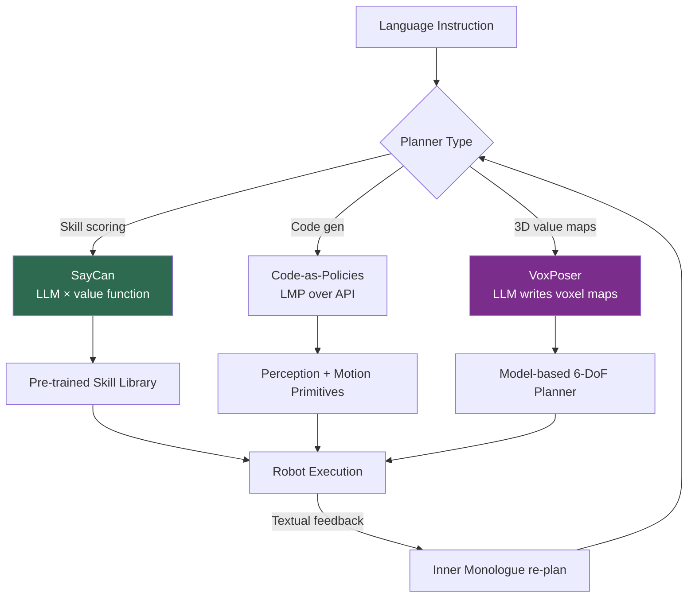
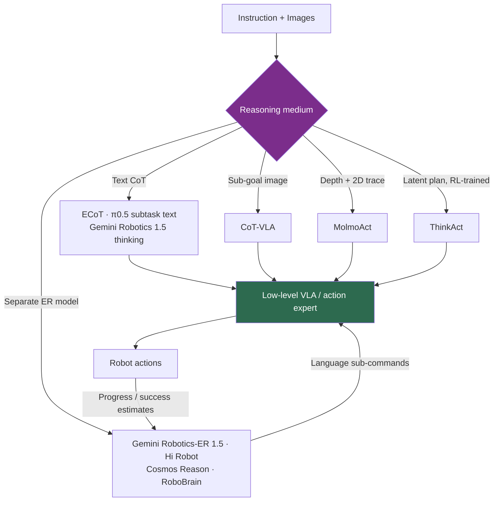

# Language-Conditioned Control

> **Last Updated:** October 2026
> **Level:** Advanced
> **Related Sections:**
> - [VLA Models](./01_vla_models.md)
> - [Generalist vs. Specialist](./11_generalist_vs_specialist.md)
> - [Robot Data & Teleoperation](./09_robot_data_and_teleoperation.md)
> - [Large Vision-Language Models](../05_multimodal_vision_language/02_large_vision_language_models.md)

> **🆕 October 2026 update:**
> - New section on **reasoning-based control**: embodied chain-of-thought (ECoT), visual chain-of-thought (CoT-VLA), spatial "action reasoning" (MolmoAct, MolmoAct2), and RL-trained reasoning VLAs (ThinkAct).
> - The modular planner line now lives on as **embodied-reasoning models orchestrating VLAs**: Gemini Robotics-ER 1.5 + Gemini Robotics 1.5 ("think before acting"), Hi Robot and π0.5's in-model subtask prediction, NVIDIA Cosmos Reason 2 (backbone of GR00T N1.7) and BAAI RoboBrain 2.5.
> - Added new Key Papers and benchmark rows (ECoT +28% over OpenVLA, CoT-VLA +17% real-world, LIBERO saturation, ERQA), Pros & Cons rows, and open problems on reasoning latency, trace faithfulness and semantic safety.

---

## Overview

Language-conditioned control is the problem of mapping a natural-language instruction, together with sensory observations, to robot actions that accomplish the instruction. It sits at the intersection of grounding (linking words to perceptual and physical referents), planning (decomposing abstract goals into executable steps), and control (producing motor commands). The field bifurcated around 2022 into two architectural families that remain in tension today: **modular LLM-as-planner** systems, which use a frozen language model to sequence pre-trained skills or generate code, and **end-to-end VLAs**, which fold language understanding and action generation into a single differentiable network (treated in depth in [VLA Models](./01_vla_models.md)).

The modular line is motivated by a simple observation: large language models possess vast commonsense and procedural knowledge ("to make coffee, first find a mug") but no grounding in a specific robot's affordances or physical state. The engineering problem is therefore *grounding the planner*—constraining the LLM's fluent but physically naive proposals to actions the robot can actually execute. Different systems solve this differently: **SayCan** scores proposals by a learned value function; **Code-as-Policies** has the LLM emit executable programs over a perception/motion API; **Inner Monologue** closes the loop with textual environment feedback; **VoxPoser** has the LLM synthesize 3D value maps that a classical planner optimizes. This file surveys these systems, their grounding mechanisms, and their relationship to the end-to-end VLA paradigm with which they now compete and increasingly converge.

A unifying lens is the **slow-reasoning / fast-control split**: LLM planners operate at seconds-per-decision latency and are unsuitable for reactive control, so they invariably delegate low-level execution to faster learned or scripted primitives. This is the conceptual ancestor of the dual-system VLA architectures (GR00T N1, Helix) discussed in [Generalist vs. Specialist](./11_generalist_vs_specialist.md).

Since 2025 the two families have been **re-merging around explicit reasoning**. Instead of a frozen LLM calling hand-written primitives, a vision-language model trained for *embodied* reasoning (spatial pointing, trajectory sketching, progress estimation, task decomposition) now either (a) **orchestrates** a learned VLA through natural-language sub-instructions (Gemini Robotics-ER 1.5 → Gemini Robotics 1.5; Hi Robot → π0), or (b) is **folded into the VLA** itself, which emits intermediate reasoning—text, sub-goal images, depth tokens or 2D traces—before its actions (ECoT, CoT-VLA, π0.5, MolmoAct). The "say × can" decomposition of SayCan survives, but both terms are now learned from data rather than engineered.

---

## Modular LLM-as-Planner Systems

### Affordance Grounding: SayCan

**SayCan** [Ahn2022] (*Do As I Can, Not As I Say*, CoRL 2022) is the seminal grounding mechanism. An LLM (PaLM-540B) proposes candidate next skills and scores each for *semantic plausibility* given the instruction; a separately learned **value function** scores each for *physical feasibility* given the current state. The executed skill maximizes the product:

```
score(skill) = p_LLM(skill | instruction) · p_affordance(skill | state)
a* = argmax_skill  p_LLM(skill | instruction) · p_affordance(skill | state)
```

On 101 long-horizon kitchen tasks, PaLM-SayCan achieved **84% plan-success and 74% end-to-end execution-success**. The key insight—multiplying a "say" term (what is sensible) by a "can" term (what is possible)—remains the canonical formulation of LLM grounding.

### Programs as Policies: Code-as-Policies

**Code-as-Policies** [Liang2022] (ICRA 2023) reframes the planner output as *executable code*. A code-writing LLM generates Language Model Programs (LMPs) that call perception and motion primitives (`get_obj_pos`, `move_to`, `pick`, `place`), with loops, conditionals, and recursive definition of undefined functions (hierarchical code generation). The resulting policies are **interpretable and auditable**—the control flow is explicit Python—and can express spatial reasoning and iteration that token-prediction policies cannot. Code generation is a one-time ~5–30 s cost at task onset; thereafter the program runs at primitive speed.

### Closed-Loop Feedback: Inner Monologue

**Inner Monologue** [Huang2022a] (CoRL 2022) augments LLM planning with closed-loop textual feedback from three sources: success detectors, passive scene descriptors, and active question-answering. Injecting this feedback back into the LLM prompt lets the planner **re-plan dynamically**, substantially improving instruction completion across tabletop, kitchen, and navigation domains. It established that LLMs can act as adaptive controllers *if* given rich structured environment feedback in language.

### 3D Value Maps: VoxPoser

**VoxPoser** [Huang2023] (CoRL 2023) eliminates the pre-defined-primitive bottleneck. An LLM infers affordances and constraints from the instruction and writes code that queries a VLM to compose **3D voxel value maps** (affordance + constraint fields) over the robot workspace. A model-based planner then **zero-shot synthesizes closed-loop 6-DoF trajectories** from these maps—handling open-set instructions and objects with no task-specific training.



---

## Language-Conditioned Imitation Learning

In parallel with LLM planners, a line of work conditions *low-level* imitation policies directly on language. **CLIPort** [Shridhar2021] (CoRL 2021) fuses CLIP's semantic "what" pathway with Transporter Networks' spatial "where" pathway in a two-stream architecture, learning language-conditioned pick-and-place end-to-end without explicit object poses or segmentation; a single multi-task policy covers 10 simulated + 9 real tasks. **BC-Z** [Jang2022] (CoRL 2022) conditions on pre-trained embeddings of language *or* human-video demonstrations and learns from demonstrations plus interventions, achieving **44% average success on 24 unseen zero-shot tasks**. **PaLM-E** [Driess2023] (ICML 2023, up to 562B parameters) interleaves images, continuous state, and text into "multimodal sentences," showing positive transfer between embodied and non-embodied tasks and emergent multi-step reasoning—a direct precursor to RT-2 and the modern VLA. These systems blur the modular/end-to-end boundary: language conditioning is learned, but control is still a single network, foreshadowing the VLA convergence in [VLA Models](./01_vla_models.md).

---

## Reasoning-Based Control (2024–2026)

The defining trend since mid-2024 is to make the policy **reason explicitly before it acts**, borrowing chain-of-thought (CoT) and test-time reasoning from LLMs. The reasoning medium differs across systems, and that choice determines what grounding the reasoning provides.

### Textual Embodied Chain-of-Thought

**ECoT** [Zawalski2024] (*Robotic Control via Embodied Chain-of-Thought Reasoning*, CoRL 2024) fine-tunes OpenVLA to generate, before each action, a structured reasoning chain: task plan → current sub-task → movement primitive → gripper position and object bounding boxes. Because the intermediate steps are *grounded* (pixel coordinates, boxes) rather than purely linguistic, ECoT raised OpenVLA's absolute success rate by **28%** on challenging generalization tasks and made failures diagnosable—and correctable by editing the reasoning in natural language. Its cost is latency: generating hundreds of reasoning tokens per step slows control, motivating later work that reasons less frequently or asynchronously.

### Visual and Spatial Chain-of-Thought

- **CoT-VLA** [Zhao2025] (CVPR 2025) uses **visual chain-of-thought**: the model first autoregressively predicts a *future sub-goal image* and then the action chunk that reaches it, reporting **+17%** on real-world manipulation and **+6%** in simulation over prior state-of-the-art VLAs.
- **MolmoAct** [Lee2025] (Ai2, Aug 2025, arXiv:2508.07917) is an open "Action Reasoning Model" that reasons *in space*: it emits depth-perception tokens (decodable to a depth map via a VQ-VAE), then a **visual trace**—a sequence of 2D image waypoints—and only then low-level actions. The trace is human-editable, giving a steerability channel between language and motor control. Models and the pre-/mid-training mixtures are fully open; **MolmoAct2** followed in May 2026.
- **ThinkAct** [Huang2025] (NVIDIA, NeurIPS 2025) trains a multimodal LLM with **reinforcement learning** using action-aligned visual rewards to produce long-horizon plans, compressed into a *visual latent plan* that conditions a downstream action model—"thinking" at low frequency, acting at high frequency.

### Embodied-Reasoning Models as Orchestrators

The modern descendant of SayCan/Code-as-Policies is a VLM *specialized* for embodied reasoning that plans, points and monitors, while delegating motor control to a VLA:

- **Hi Robot** [Shi2025] (Physical Intelligence, ICML 2025) places a high-level VLM over π0: it interprets complex prompts and **live user feedback** ("that's not trash") and emits atomic language commands to the low-level policy—Inner Monologue's closed loop, learned end-to-end.
- **π0.5** [PI2025] (Apr 2025, CoRL 2025) folds the hierarchy into *one* model: it first predicts a high-level sub-task in text, then the low-level action chunk, co-trained on web data, verbal instructions and heterogeneous robot data; it cleaned kitchens and bedrooms in **entirely unseen homes**.
- **Gemini Robotics 1.5 / Gemini Robotics-ER 1.5** [GeminiRobotics2025] (Google DeepMind, Sept 2025): ER 1.5 is an embodied-reasoning VLM that acts as the "high-level brain"—spatial pointing, progress/success estimation, multi-step planning and **native tool calls** (e.g. web search for local recycling rules)—and is available to developers through the Gemini API. Gemini Robotics 1.5 is the VLA that **"thinks before acting"**, interleaving natural-language reasoning with actions, and uses *Motion Transfer* to share skills across ALOHA, bi-arm Franka and the Apptronik Apollo humanoid. Google reported state-of-the-art results for ER 1.5 across 15 academic embodied-reasoning benchmarks (e.g. ERQA, Point-Bench).
- **Cosmos Reason** (NVIDIA): a family of physical-AI reasoning VLMs trained with SFT + RL for chain-of-thought about space, time and physics. **Cosmos-Reason2** (2B/8B, Dec 2025; 32B, Apr 2026; Qwen3-VL architecture) is explicitly positioned as a planning model for embodied agents, and its 2B variant is the vision-language backbone of **GR00T N1.7**—making a reasoning VLM the System 2 of an open humanoid VLA.
- **RoboBrain 2.0 / 2.5** (BAAI; 3B–32B, 2025–26): open "embodied brain" models for planning, affordance/pointing and trajectory prediction; version 2.5 (Jan–Mar 2026) adds depth-aware 3D spatial reasoning with metric constraints and **dense temporal value estimation** used as a reward signal for VLA reinforcement learning.



**Assessment.** Reasoning consistently helps on *long-horizon, novel-instruction and semantic-generalization* tests, and gives an interpretable intervention point; it helps little on dexterity-bound tasks where the bottleneck is contact control. Standard simulated suites no longer discriminate well—fine-tuned VLAs such as OpenVLA-OFT exceed 97% average success on LIBERO [Kim2025]—so reasoning claims increasingly rest on real-world and embodied-QA evaluations (ERQA, Point-Bench, RoboArena; see [Robot Data & Teleoperation](./09_robot_data_and_teleoperation.md)).

---

## Key Papers

| Paper | Authors | Year | Venue | Key Contribution |
|-------|---------|------|-------|-----------------|
| Do As I Can, Not As I Say (SayCan) | Ahn, Brohan, Brown, et al. | 2022 | CoRL | Affordance grounding: LLM × value function; 74% exec on 101 tasks |
| Code as Policies | Liang, Huang, Xia, Xu, Hausman, Ichter, Florence, Zeng | 2022 | ICRA 2023 | LLM emits hierarchical executable robot programs |
| Inner Monologue | Huang, Xia, Xiao, et al. | 2022 | CoRL | Closed-loop textual feedback enables LLM re-planning |
| VoxPoser | Huang, Wang, Zhang, Li, Wu, Fei-Fei | 2023 | CoRL | LLM-composed 3D value maps → zero-shot 6-DoF trajectories |
| CLIPort | Shridhar, Manuelli, Fox | 2021 | CoRL | CLIP "what" + Transporter "where" for language pick-and-place |
| PaLM-E | Driess, Xia, Sajjadi, et al. | 2023 | ICML | 562B embodied multimodal LM; multimodal-sentence planning |
| BC-Z | Jang, Irpan, Khansari, et al. | 2022 | CoRL | Language/video-conditioned IL; 44% on 24 unseen tasks |
| Robotic Control via Embodied Chain-of-Thought Reasoning (ECoT) | Zawalski, Chen, Pertsch, Mees, Finn, Levine | 2024 | CoRL | Grounded textual CoT before actions; +28% over OpenVLA |
| CoT-VLA | Zhao et al. | 2025 | CVPR | Visual CoT: predict sub-goal image, then actions |
| Hi Robot | Shi, Ichter, Equi, et al. | 2025 | ICML | Hierarchical VLM over π0; open-ended prompts and live feedback |
| π0.5: a VLA with Open-World Generalization | Physical Intelligence | 2025 | CoRL | Single model predicts sub-task text then actions; unseen homes |
| MolmoAct: Action Reasoning Models that can Reason in Space | Lee, Duan, et al. (Ai2) | 2025 | arXiv:2508.07917 | Depth tokens → editable 2D trace → actions; fully open |
| ThinkAct | Huang et al. (NVIDIA) | 2025 | NeurIPS | RL-trained reasoning MLLM producing visual latent plans |
| Gemini Robotics 1.5 | Gemini Robotics Team (Google DeepMind) | 2025 | Tech. report | ER 1.5 orchestrator + "thinking" VLA; cross-embodiment Motion Transfer |

---

## Benchmark Performance

| System | Setting | Metric | Score | Notes |
|--------|---------|--------|-------|-------|
| PaLM-SayCan | 101 kitchen tasks | Plan / Exec success | 84% / 74% | Long-horizon mobile manipulation [Ahn2022] |
| BC-Z | 24 unseen tasks | Zero-shot success | 44% | Language/video conditioned [Jang2022] |
| CLIPort | 10 sim + 9 real tasks | Multi-task success | matches/exceeds single-task | Two-stream what/where [Shridhar2021] |
| VoxPoser | Open-set tabletop | Zero-shot trajectory synthesis | qualitative SOTA | No task-specific training [Huang2023] |
| ECoT (OpenVLA-based) | Bridge generalization tasks | Absolute success vs OpenVLA | +28% | Grounded reasoning chain [Zawalski2024] |
| CoT-VLA | Real-world / simulation | Success vs prior SOTA VLA | +17% / +6% | Sub-goal-image reasoning [Zhao2025] |
| OpenVLA-OFT | LIBERO (4 suites) | Avg. success | 97.1% | Illustrates LIBERO saturation [Kim2025] |
| Gemini Robotics-ER 1.5 | 15 embodied-reasoning benchmarks (ERQA, Point-Bench, …) | Aggregate | SOTA (Google-reported) | Orchestrator model, Sept 2025 [GeminiRobotics2025] |
| π0.5 | Unseen real homes | Long-horizon cleaning | Qualitative success | Hierarchical in-model reasoning [PI2025] |

---

## Pros & Cons

| Aspect | Pros | Cons |
|--------|------|------|
| LLM-as-planner (SayCan/CaP) | Interpretable, leverages web commonsense, compositional | Seconds-per-decision latency; limited by primitive/skill library |
| Closed-loop feedback (Inner Monologue) | Adaptive re-planning; robust to failures | Requires reliable success detectors / scene describers |
| 3D value maps (VoxPoser) | Open-set, no task data, true 6-DoF | Depends on VLM spatial accuracy; planner brittleness |
| Language-conditioned IL (CLIPort/PaLM-E) | End-to-end, fast at inference | Needs paired language-action data; weaker compositional generalization |
| Textual embodied CoT (ECoT, Gemini Robotics 1.5) | Interpretable, editable, better semantic generalization | Many tokens per step → latency; reasoning may be unfaithful to actions |
| Visual/spatial CoT (CoT-VLA, MolmoAct) | Grounded in pixels/depth; trace is steerable | Sub-goal generation is costly; 2D traces under-specify 6-DoF/contact |
| ER orchestrator + VLA (Gemini Robotics-ER, Hi Robot, Cosmos Reason) | Modular, tool use, success monitoring; reuses frontier VLMs | Interface via language loses detail; two models to align and serve |

---

## Open Problems & Research Gaps

- **Grounding without value functions.** SayCan needs a learned affordance model per skill; scalable, skill-agnostic grounding remains open.
- **Spatial language.** LLM/VLM planners systematically fail on relational spatial instructions (left/right, behind, between)—the spatial-intelligence gap detailed in [Spatial Intelligence](../12_research_frontier_2024_2026/06_spatial_intelligence.md).
- **Latency for reactive language control.** Planner latency (100 ms–2 s) precludes language-in-the-loop reactive control; the dual-system split is a workaround, not a solution.
- **Compositional generalization.** Following *novel compositions* of known instructions ("put the third red block on the leftmost shelf") is still fragile.
- **Primitive bottleneck vs. end-to-end brittleness.** Modular systems are limited by their primitives; end-to-end systems lack interpretability—no architecture yet has both auditability and dexterity.
- **Verification of LLM-generated plans/code.** No reliable method certifies that an LLM-emitted plan or program is safe before execution.
- **Instruction ambiguity and intent.** Specifying human intent precisely enough for safe generalization (see [Future Trends](../12_research_frontier_2024_2026/07_future_trends.md)) is unsolved.
- **Reasoning latency and allocation.** When should a policy "think"? Per-step CoT is too slow for reactive control; principled schemes for adaptive, asynchronous or latent reasoning (ThinkAct-style) are immature.
- **Faithfulness of reasoning traces.** There is little evidence that a VLA's stated reasoning causally determines its actions; editing a trace (ECoT, MolmoAct) helps, but systematic faithfulness tests are missing.
- **Evaluation beyond saturated benchmarks.** LIBERO-class suites are near ceiling; embodied-reasoning QA (ERQA, Point-Bench) measures perception/reasoning but not closed-loop control, so reasoning gains are hard to compare.
- **Semantic safety.** Reasoning models can recognize unsafe instructions (Google's ASIMOV benchmark targets this), but guaranteeing that the low-level policy respects those judgements is open.

---

## Further Reading

- [SayCan (arXiv:2204.01691)](https://arxiv.org/abs/2204.01691) — affordance-grounded LLM planning
- [Code as Policies (arXiv:2209.07753)](https://arxiv.org/abs/2209.07753) — LLM programs for embodied control
- [Inner Monologue (arXiv:2207.05608)](https://arxiv.org/abs/2207.05608) — closed-loop language feedback
- [VoxPoser (arXiv:2307.05973)](https://arxiv.org/abs/2307.05973) — composable 3D value maps
- [PaLM-E (arXiv:2303.03378)](https://arxiv.org/abs/2303.03378) — embodied multimodal language model
- [CLIPort (arXiv:2109.12098)](https://arxiv.org/abs/2109.12098) — what/where pathways for manipulation
- [ECoT (arXiv:2407.08693)](https://arxiv.org/abs/2407.08693) — embodied chain-of-thought for VLAs
- [Hi Robot (arXiv:2502.19417)](https://arxiv.org/abs/2502.19417) — hierarchical VLM-over-VLA with user feedback
- [π0.5 (arXiv:2504.16054)](https://arxiv.org/abs/2504.16054) — in-model sub-task reasoning and open-world generalization
- [MolmoAct (arXiv:2508.07917)](https://arxiv.org/abs/2508.07917) and [code](https://github.com/allenai/MolmoAct) — open action reasoning model
- [Gemini Robotics 1.5 (arXiv:2510.03342)](https://arxiv.org/abs/2510.03342) — embodied reasoning, thinking VLA, Motion Transfer
- [Cosmos-Reason2](https://github.com/nvidia-cosmos/cosmos-reason2) — physical-AI reasoning VLMs (GR00T N1.7 backbone)
- [RoboBrain 2.0/2.5](https://github.com/FlagOpen/RoboBrain2.0) — open embodied-brain models with 3D spatial reasoning
