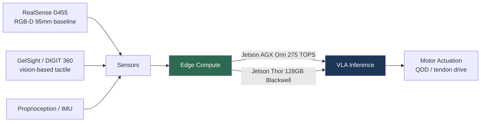

# Hardware & Robot Platforms

> **Last Updated:** October 2026
> **Level:** Advanced
> **Related Sections:**
> - [Embodied AI Overview & Roadmap](./00_overview_roadmap.md)
> - [Perception for Robotics](./08_perception_for_robotics.md)
> - [VLA Models](./01_vla_models.md)
> - [Pros, Cons & Roadmaps](./07_pros_cons_roadmaps.md)

> **🆕 October 2026 update:**
> - New platforms: **Figure 03** (Oct 2025, built for Helix and the home; BotQ factory), **Unitree H2** and the low-cost **Unitree R1**, the product version of **Boston Dynamics' electric Atlas** shown at CES 2026, **UBTech Walker S2** (autonomous battery swap); updated status of Figure 02 (retired from BMW after the pilot), **1X NEO** (consumer pre-orders Oct 2025, $20k or $499/month) and **Tesla Optimus** (Fremont line conversion announced Jan 2026).
> - New section **Industry Status, Funding & Capital Markets**: Figure's $39B Series C, Physical Intelligence and Skild AI rounds, Apptronik's $403M Series A, Unitree's STAR Market IPO process, AgiBot's acquisition of a listed company, Hyundai's Atlas deployment plan.
> - Compute: Jetson Thor general availability (Aug 2025) and on-device VLAs (Gemini Robotics On-Device; TensorRT-exported GR00T N1.7).
> - New open problems: supply-chain exposure (rare-earth magnets), teleoperation-assisted autonomy and privacy in home robots, humanoid safety standards.

---

## Overview

The 2024–2026 embodied-AI boom is as much a hardware story as an algorithms story. The convergence of low-cost actuators, capable edge compute (Jetson Thor), and vision-language-action models has produced an unprecedented wave of humanoid and manipulator platforms moving from lab curiosity to factory pilot. This file catalogs the hardware substrate on which the policies discussed elsewhere in this section actually run, with verified specifications and explicit disclosure-confidence flags—a necessary discipline because much "spec" data in the trade press is manufacturer marketing or third-party estimate rather than published datasheet.

Three hardware trends dominate. First, the **shift to electric quasi-direct-drive (QDD) actuation**, which trades peak torque for backdrivability, impact tolerance, and transparent force control—properties essential for contact-rich manipulation and safe human proximity. Second, **dexterous multi-fingered hands** (16–24 DoF) becoming standard, since the VLA dexterity frontier (laundry folding, articulated-object manipulation) demands them. Third, **edge compute catching up to model size**: NVIDIA's Jetson Thor (128 GB, Blackwell, up to ~2,070 FP4 TFLOPS) makes on-robot inference of multi-billion-parameter dual-system VLAs feasible, closing the loop between the models in [VLA Models](./01_vla_models.md) and the bodies that execute them.

A recurring theme is the **disclosure gap**: research-grade platforms (Unitree, Franka, Universal Robots) publish full datasheets, while flagship humanoids (Boston Dynamics electric Atlas, Figure 02, Apptronik Apollo) withhold key specs—total DoF, price, actuator detail—behind NDA. Specifications below are flagged accordingly.

From late 2025 the story shifted from *prototypes* to *production capacity and capital*: Figure opened its BotQ factory and launched Figure 03, Boston Dynamics showed a product Atlas with a Hyundai deployment plan, 1X opened consumer pre-orders for NEO, Tesla announced the conversion of Fremont vehicle capacity to Optimus, and Chinese vendors (Unitree, UBTech, AgiBot) moved toward or onto public equity markets. Real deployments, however, remain pilots measured in tens to low hundreds of units per site.

---

## Humanoid Platforms

| Robot | Height | Weight | DoF | Payload | Speed | Price | Status (2025–26) |
|-------|--------|--------|-----|---------|-------|-------|------------------|
| Figure 02 | 168 cm | 70 kg | NDA (16/hand) | 25 kg | 1.2 m/s | ~\$150k est. | BMW Spartanburg pilot completed; retired Nov 2025 |
| Figure 03 | NDA | ~9% lighter than F.02 | NDA (tactile fingertips) | NDA | NDA | NDA | Launched Oct 2025; BotQ production; home + commercial |
| Tesla Optimus Gen 2 / V2.5 | 173 cm | 57 kg | 28+ body, 11–22/hand | 20 kg | ~2.2 m/s | ~\$20–30k target | Internal Tesla pilots; V3 and Fremont line announced Jan 2026 |
| Unitree G1 | 127 cm | 35 kg | 43 (w/ hands) | 2–3 kg | 2 m/s | \$13.5k–\$73.9k | Mass production (5,500+ in 2025) |
| Unitree H1 | 180 cm | 47 kg | 19 (H1-2: 27) | 30 kg | 3.3 m/s | \$99.9k | Research / available |
| Unitree H2 | 180 cm | 70 kg | 31 (body) | NDA | NDA | NDA | Announced Oct 2025 |
| Unitree R1 | ~121 cm (reported) | ~25 kg | 26 | NDA | NDA | from ¥39,900 (~\$5.9k) | Announced Jul 2025; lowest-cost full humanoid |
| Boston Dynamics Atlas (electric) | ~150 cm est. | ~89 kg est. | NDA | NDA | NDA | Not for sale | Hyundai / Google DeepMind |
| Boston Dynamics Atlas (product, CES 2026) | NDA | NDA | 56 (reported) | ~50 kg lift (reported) | NDA | Not disclosed | Hyundai Metaplant deployment planned from 2028 |
| UBTech Walker S2 | ~176 cm (reported) | NDA | 52 (reported) | 15 kg (reported) | NDA | NDA | Autonomous battery swap; factory pilots in China |
| Agility Digit v5 | 175 cm | 76 kg | 16+ | 16 kg | 1.5 m/s | ~\$250k | GXO warehouse (100k+ totes) |
| Apptronik Apollo | 173 cm | 72.5 kg | NDA | 25 kg | NDA | NDA | Factory pilots |
| Sanctuary Phoenix (Gen 7) | 170 cm | 70 kg | NDA (20–21/hand) | 25 kg | NDA | ~\$65k est. | Retail / mfg pilots |
| Fourier GR-2 | 175 cm | 65 kg | 53 (12/hand) | 3 kg/arm | NDA | ~\$150k+ | Research / enterprise |
| 1X NEO | ~168 cm | ~30 kg | 75 (22/hand) | ~25 kg carry | 1.4 m/s | \$20k / \$499 mo | Consumer pre-orders Oct 2025; US deliveries 2026 |

**Figure 02** [FigureAI2024] runs the **Helix** VLA (System 2 VLM at 7–9 Hz + System 1 motor policy at 200 Hz, 35 DoF upper body) and assisted production of 30,000+ BMW X3s over a 10-month Spartanburg pilot—the most cited real-world humanoid deployment to date. **Tesla Optimus Gen 2** (57 kg, notably lighter than Gen 1's ~73 kg, 11 fingertip tactile sensors, custom actuators) is deployed internally for battery-cell sorting; Tesla targets ~\$20–30k at scale but no consumer price is set. **Unitree G1** (\$13.5k base) is the most accessible research humanoid and the de-facto academic standard, with 5,500+ units shipped in 2025; **H1** holds the Guinness record for fastest full-size electric humanoid (3.3 m/s). **Agility Digit** is the first humanoid in full-time commercial work (100,000+ totes at a GXO warehouse) but is deliberately low-dexterity—purpose-built for logistics, not manipulation. **1X NEO** is uniquely lightweight (~30 kg) using a patented **tendon-drive** actuator (~22 dB, head-injury-criterion < 250) for safe home use, paired with **Jetson Thor**.

> ⚠️ Boston Dynamics has not published an official spec sheet for the electric Atlas; height/weight/DoF figures above are third-party estimates. Confirmed: joints rotate beyond human range (360° at hip/waist/neck); fleets committed to Hyundai's RMAC and a Google DeepMind partnership.

### New Platforms and Status Changes (Oct 2025 – 2026)

**Figure 03** [Figure2025F03] (announced 9 Oct 2025) is the first flagship humanoid explicitly co-designed around a VLA. Figure states the new camera system has roughly twice the frame rate, one quarter of the latency and a ~60% wider field of view per camera versus Figure 02; each hand adds a palm camera, and fingertip tactile sensors resolve forces of a few grams—sensory inputs aimed directly at Helix's System 1. Other changes are aimed at the home: a soft, washable textile exterior, ~9% lower mass than F.02, and **2 kW wireless inductive charging** through coils in the feet so the robot can dock autonomously. Figure's **BotQ** plant is specified for an initial ~12,000 humanoids per year, with a stated goal of 100,000 units over four years. Figure reported in November 2025 that its Figure 02 fleet had been retired after the BMW Spartanburg deployment, during which the robots worked production shifts, loaded more than 90,000 sheet-metal parts and contributed to the production of 30,000+ X3s (company-reported).

**Boston Dynamics Atlas (product).** At CES 2026 (January 2026), Hyundai and Boston Dynamics presented a production-intent electric Atlas, with Hyundai stating plans to deploy it at its Georgia Metaplant from 2028 and to build U.S. robot-manufacturing capacity, and Boston Dynamics confirming a partnership with Google DeepMind to bring Gemini Robotics models to Atlas. Press coverage of the launch reported 56 DoF, ~50 kg lift capacity and an autonomously swappable battery; Boston Dynamics had still not published a full datasheet at the time of writing. Separately, Boston Dynamics and TRI showed a single language-conditioned **Large Behavior Model** driving Atlas's whole body on long-horizon tasks (Aug 2025; see [Generalist vs. Specialist](./11_generalist_vs_specialist.md)).

**1X NEO** opened consumer pre-orders on 28 Oct 2025 at \$20,000 (or \$499/month subscription), with U.S. deliveries slated for 2026. 1X is explicit that NEO is not fully autonomous at launch: an **"Expert Mode"** lets 1X operators teleoperate the robot (with owner consent) for tasks its Redwood AI model cannot yet perform, both to deliver the service and to collect training data—a home-robot analogue of the safety-driver model in autonomous driving.

**Tesla Optimus.** Tesla showed Optimus "V2.5" during 2025 but did not reach its early-2025 aspiration of thousands of units deployed internally. In November 2025 shareholders approved a CEO award with a milestone of one million Optimus units delivered, and on its Q4-2025 earnings call (Jan 2026) Tesla said it would end Model S/X production and repurpose Fremont capacity for an Optimus line with a long-term target of ~1 million units per year, with the third-generation Optimus to follow. Specifications and production volumes of V3 should be treated as forward-looking until independently observed.

**Unitree** broadened its range at both ends: the **R1** (July 2025, from ¥39,900 ≈ \$5.9k, ~25 kg, 26 joints) is the cheapest full humanoid on the market, and the **H2** (Oct 2025, 180 cm, 70 kg, 31 DoF) is a full-size successor to the H1. Unitree's open-source stack (SDK2 for Go2/B2/H1/G1/H2/R1/A2, XR teleoperation, LeRobot integration) and its open **UnifoLM** VLA/world-model releases make it the reference platform for academic humanoid learning.

**UBTech Walker S2** (2025) introduced **autonomous hot-swappable battery exchange**, letting the robot change its own battery to approach continuous operation—an engineering answer to the runtime limit listed under Open Problems.

---

## Industry Status, Funding & Capital Markets (2025–2026)

Capital flowing into embodied AI in 2025–26 exceeded any previous robotics cycle. The table lists events confirmed by company announcements or major financial press; valuations are post-money where stated.

| Date | Company | Event | Significance |
|------|---------|-------|--------------|
| Feb–Mar 2025 | Apptronik | Series A of \$403M (incl. Google) | Apollo also used as an embodiment in Gemini Robotics |
| Jul 2025 | AgiBot | Acquired controlling stake in STAR-listed Swancor Advanced Materials | Indirect route to China's public markets |
| Jul 2025 | Unitree | Began STAR Market IPO process (pre-listing tutoring filing) | First major Chinese humanoid maker heading for a domestic listing |
| Aug 2025 | NVIDIA | Jetson Thor general availability (dev kit \$3,499) | Standard on-robot compute for humanoid VLAs |
| Sep 2025 | Figure AI | Series C of >\$1B at \$39B post-money; Brookfield partnership | Highest-valued humanoid start-up; funds BotQ and Go-Big data |
| Oct 2025 | 1X | NEO consumer pre-orders (\$20k / \$499 mo) | First mass-market home-humanoid offer in the U.S. |
| Nov 2025 | Physical Intelligence | ~\$600M raise at ~\$5.6B valuation (reported) | Largest "robot-brain" (model-only) company |
| Jan 2026 | Hyundai / Boston Dynamics | Product Atlas at CES; Metaplant deployment from 2028 | Automotive OEM commits to humanoids at production scale |
| Jan 2026 | Tesla | Fremont capacity to be repurposed for Optimus | Vehicle-to-humanoid line conversion |
| Jan 2026 | Skild AI | ~\$1.4B round at ~\$14B valuation (reported) | Cross-embodiment "Skild Brain" foundation model |

Three structural patterns stand out. **(1) Brains vs. bodies:** model-only companies (Physical Intelligence, Skild AI, Generalist AI, Google DeepMind's Gemini Robotics) now raise and are valued on par with hardware makers, betting that the policy, not the body, captures the value. **(2) Vertical integration:** Figure, Tesla and 1X build both bodies and models in-house, arguing that data flywheels require owning the deployed fleet. **(3) China's volume lead:** Unitree, UBTech, AgiBot, Galbot, Fourier and others ship the largest unit volumes at the lowest prices, supported by municipal subsidies, state-backed data-collection centres and public events such as the World Humanoid Robot Games (Beijing, Aug 2025); their path to public markets (Unitree's IPO process, AgiBot's acquisition of a listed company, UBTech's existing Hong Kong listing) gives them access to capital that U.S. peers obtain privately.

> ⚠️ Deployment figures in this space are overwhelmingly company-reported. As of 2026, no humanoid maker has published audited numbers for robots in paid, autonomous, full-shift operation at more than pilot scale.

---

## Manipulators & Dexterous Hands

| Platform | DoF | Payload | Reach | Repeatability | Torque sensing | Price |
|----------|-----|---------|-------|---------------|----------------|-------|
| Franka Research 3 (FR3) | 7 | 3 kg | 855 mm | ±0.1 mm | All 7 joints | ~\$25–30k |
| Universal Robots UR5e | 6 | 5 kg | 850 mm | ±0.03 mm | Optional wrist F/T | ~\$35k |
| Trossen WidowX 250 S | 6 | 250 g | 650 mm | — | No | ~\$3.1k |
| UFACTORY xArm 7 | 7 | 3.5 kg | 700 mm | ±0.02 mm | No | ~\$12k |
| Shadow Dexterous Hand | 24 (20 actuated) | 5 kg grasp | — | — | 100+ sensors | Quote |
| Allegro Hand v4 | 16 | ~1.5 kg | — | — | Per-joint torque | ~\$15k |

The **Franka Research 3** (successor to the Panda) is the dominant manipulation-research arm precisely because of its **per-joint torque sensors** and 1 kHz control loop, enabling external-force estimation for contact-rich tasks. The **WidowX 250 S** (\$3.1k, 250 g payload) is the workhorse of low-cost imitation-learning research and the arm behind BridgeData V2 and many ACT/Diffusion-Policy papers. For dexterity, the **Shadow Dexterous Hand** (24 DoF, tendon-driven, 100+ sensors at up to 1 kHz; its 3-finger **DEX-EE** variant co-developed with Google DeepMind adds stereo-camera tactile fingertips) and the **Allegro Hand** (16 DoF, current-controlled BLDC) are the research standards.

---

## Compute & Sensors

**Compute.** The **Jetson AGX Orin** (up to 275 INT8 TOPS, 64 GB) was the 2022–2025 reference robotics SoC (used in Apptronik Apollo). Its successor **Jetson Thor** (Blackwell GPU, 14-core Neoverse-V3AE, 128 GB, ~2,070 FP4 TFLOPS, 40–130 W; GA August 2025) delivers a claimed **7.5× performance and 3.5× efficiency** over Orin and is the on-robot brain of 1X NEO and the NVIDIA GR00T reference humanoid. Note that **GR00T is a software/AI platform**, not a chip: the GR00T N1 dual-system VLA *runs on* Thor while *trained on* H100/B100 clusters (see [VLA Models](./01_vla_models.md)). Since Thor's general availability in August 2025 (developer kit \$3,499), **on-device VLAs** have become the norm rather than the exception: Google DeepMind released **Gemini Robotics On-Device** (June 2025) as a VLA optimized to run locally on the robot for latency- and connectivity-sensitive settings, and NVIDIA's **GR00T N1.7** (3B) ships with ONNX/TensorRT export and a server–client policy API for Jetson-class deployment. Figure's Helix likewise runs both of its systems on embedded GPUs without cloud dependency.

**Sensors.** **Intel RealSense** D435/D455 remain ubiquitous RGB-D cameras (D455's 95 mm baseline and global-shutter RGB give better depth at range), despite Intel winding down the consumer line. **Vision-based tactile sensors**—**GelSight** (25–50 µm/pixel surface geometry) and **DIGIT** (320×240 @ 60 fps, open-sourced by Meta)—convert touch into image-like signals fusable with RGB-D; the 2024 **Digit 360** (GelSight + Meta) pushes to ~8.3 million taxels with omnidirectional, multimodal sensing. Their role in dexterous manipulation is developed in [Perception for Robotics](./08_perception_for_robotics.md).

**Actuators.** **Quasi-direct-drive (QDD)**—a BLDC motor with a low (≤10:1) planetary reduction—provides backdrivability, high control bandwidth (current = torque, no torque sensor needed), and impact tolerance, at the cost of lower peak torque than harmonic drives. Pioneered in the MIT Cheetah and now standard in Unitree quadrupeds/humanoids; 1X NEO's tendon drive is a related compliant variant. Typical torque density 7–20 N·m/kg (up to ~64 N·m/kg for cycloidal QDD).

---

## Key Papers / Technical References

| Reference | Author/Org | Year | Venue/Type | Key Contribution |
|-----------|-----------|------|------------|-----------------|
| Learning Fine-Grained Bimanual Manipulation (ALOHA) | Zhao, Kumar, Levine, Finn | 2023 | RSS | Low-cost bimanual hardware template |
| DIGIT: low-cost compact tactile sensor | Lambeta et al. (Meta) | 2020 | RA-L / arXiv:2005.14679 | Open-source vision-based fingertip tactile |
| MIT Cheetah 3 (QDD legged design) | Bledt et al. (MIT) | 2018 | IROS | Proprioceptive QDD actuation for legged robots |
| GR00T N1 | NVIDIA | 2025 | arXiv:2503.14734 | Dual-system VLA; 63.9 ms/16-action chunk on L40 |
| Jetson Thor platform | NVIDIA | 2025 | Product (Aug 2025 GA) | 128 GB Blackwell edge compute for humanoids |
| Open-TeleVision | Cheng, Li, Yang, Yang, Wang | 2024 | CoRL | Apple Vision Pro immersive humanoid teleop |
| Introducing Figure 03 | Figure AI | 2025 | Product announcement (Oct 2025) | Humanoid co-designed for a VLA: new cameras, palm cams, tactile fingertips, inductive charging |
| DexUMI | Xu, Zhang, Hou, Xu, Fan, Veloso, Song | 2025 | CoRL | Exoskeleton hardware co-designed with target robot hands for data collection |
| Gemini Robotics On-Device | Google DeepMind | 2025 | Model release (Jun 2025) | VLA running locally on robot hardware |
| GR00T N1.7 | NVIDIA | 2026 | Open model (GitHub) | 3B humanoid VLA with TensorRT export and whole-body controller |

---

## Benchmark / Spec Comparisons

| Platform | Metric | Value | Confidence |
|----------|--------|-------|-----------|
| Unitree H1 | Max speed | 3.3 m/s (record) | High (official) |
| Jetson Thor vs Orin | Perf / efficiency | 7.5× / 3.5× | High (NVIDIA) |
| Franka FR3 | Repeatability / control rate | ±0.1 mm / 1 kHz | High (official) |
| Shadow Hand | DoF / sensor rate | 24 / up to 1 kHz | High (Dec 2024 datasheet) |
| Digit 360 tactile | Taxels | ~8.3 million | High (GelSight/Meta) |
| Agility Digit | Commercial throughput | 100,000+ totes (GXO) | High (reported) |
| Figure 03 vs Figure 02 | Camera frame rate / latency / FOV | ~2× / ~¼ / ~+60% | Medium (company-reported) |
| Figure 03 | Wireless charging power | 2 kW (inductive, via feet) | Medium (company-reported) |
| Figure BotQ | Initial annual capacity | ~12,000 humanoids | Medium (company-reported) |
| Figure 02 @ BMW | Parts loaded / X3s supported | 90,000+ / 30,000+ | Medium (company-reported) |
| Unitree R1 | Entry price | from ¥39,900 (~\$5.9k) | High (official launch price) |
| 1X NEO | Price | \$20,000 or \$499/month | High (official) |
| Boston Dynamics product Atlas | DoF / lift | 56 / ~50 kg | Low–medium (press reports, CES 2026) |

---

## Pros & Cons

| Aspect | Pros | Cons |
|--------|------|------|
| Electric QDD actuation | Backdrivable, impact-tolerant, transparent force control | Lower peak torque than harmonic drives |
| Dexterous multi-finger hands | Enables fine manipulation (folding, articulation) | Costly, fragile, high-DoF control burden |
| Edge compute (Jetson Thor) | On-robot multi-B-param VLA inference | 40–130 W power/thermal budget on a mobile platform |
| Research humanoids (Unitree) | Affordable, full datasheets, reproducible | Lower payload/dexterity than flagship platforms |
| Flagship humanoids (Figure/Atlas) | High capability, real deployments | NDA specs, no public price, limited availability |
| Consumer home humanoids (1X NEO, Figure 03) | Low mass, soft exteriors, subscription pricing; home data flywheel | Teleoperation-assisted autonomy; privacy; unproven reliability |
| Low-cost Chinese humanoids (Unitree R1/G1) | Sub-\$15k (R1 ~\$6k) entry; open SDKs; large volumes | Small payloads, limited dexterity; export-control and supply-chain exposure |

---

## Open Problems & Research Gaps

- **Actuator energy density & runtime.** Most humanoids manage only 1.5–5 h per charge; energy density, not intelligence, often caps deployment duration.
- **Affordable dexterity.** High-DoF hands (Shadow, Allegro) remain \$15k+ and fragile; a cheap, robust dexterous hand is a gating technology for home robots.
- **Tactile standardization.** Vision-based tactile sensors lack a common data format or large-scale datasets, impeding tactile foundation models (see [Future Trends](../12_research_frontier_2024_2026/07_future_trends.md)).
- **Spec transparency.** The NDA culture around flagship humanoids impedes reproducible benchmarking and fair cross-platform comparison.
- **Thermal/power for on-robot VLAs.** Running large dual-system models on Jetson Thor within a mobile thermal envelope forces accuracy/latency trade-offs not yet well characterized.
- **Sim-to-real for new hardware.** Each new embodiment requires re-tuning policies; hardware-agnostic control (cf. UMI, see [Robot Data & Teleoperation](./09_robot_data_and_teleoperation.md)) is immature.
- **Safety certification.** No accepted standard yet certifies a learned policy on a given hardware platform for human-proximate operation. Standards work specific to dynamically stable (legged/humanoid) industrial robots is under way in ISO committees, but was not finalized as of 2026.
- **Supply-chain exposure.** Humanoid actuators depend on rare-earth permanent magnets; China's April 2025 export restrictions on rare-earth magnets were cited by Tesla as affecting Optimus production, highlighting a single-country dependency for most non-Chinese makers.
- **Teleoperation-assisted autonomy.** Home robots launching with remote-operator fallback (1X NEO "Expert Mode") raise privacy, labour and liability questions, and make "autonomy" claims hard to audit.
- **From pilot to fleet.** Announced factory capacities (BotQ ~12k/yr, Tesla's 1M/yr target, Hyundai's plans) far exceed demonstrated deployments; reliability (mean time between failures/interventions) at fleet scale is not publicly reported by any vendor.

---

## Further Reading

- [NVIDIA Jetson Thor announcement (Aug 2025)](https://developer.nvidia.com/blog/introducing-nvidia-jetson-thor-the-ultimate-platform-for-physical-ai/) — edge compute for humanoids
- [Figure Helix / BMW deployment](https://www.figure.ai/news/helix) — System 1/2 humanoid control in production
- [DIGIT tactile sensor (arXiv:2005.14679)](https://arxiv.org/abs/2005.14679) — open-source vision-based touch
- [Shadow Dexterous Hand technical spec (Dec 2024)](https://shadowrobot.com/) — 24-DoF tendon-driven hand
- [Unitree G1 / H1 official specs](https://www.unitree.com/g1/) — accessible research humanoids
- [GR00T N1 (arXiv:2503.14734)](https://arxiv.org/abs/2503.14734) — dual-system VLA on humanoid hardware
- [Introducing Figure 03](https://www.figure.ai/news/introducing-figure-03) — third-generation humanoid designed for Helix and the home
- [1X NEO](https://www.1x.tech/neo) — consumer home humanoid (pre-orders Oct 2025)
- [Boston Dynamics Atlas](https://bostondynamics.com/atlas/) — electric Atlas and Hyundai deployment
- [Unitree open-source SDKs and teleoperation](https://github.com/unitreerobotics) — xr_teleoperate, unitree_lerobot, UnifoLM
- [Isaac GR00T (GitHub)](https://github.com/NVIDIA/Isaac-GR00T) — N1.7 with TensorRT deployment and GEAR-SONIC whole-body control
