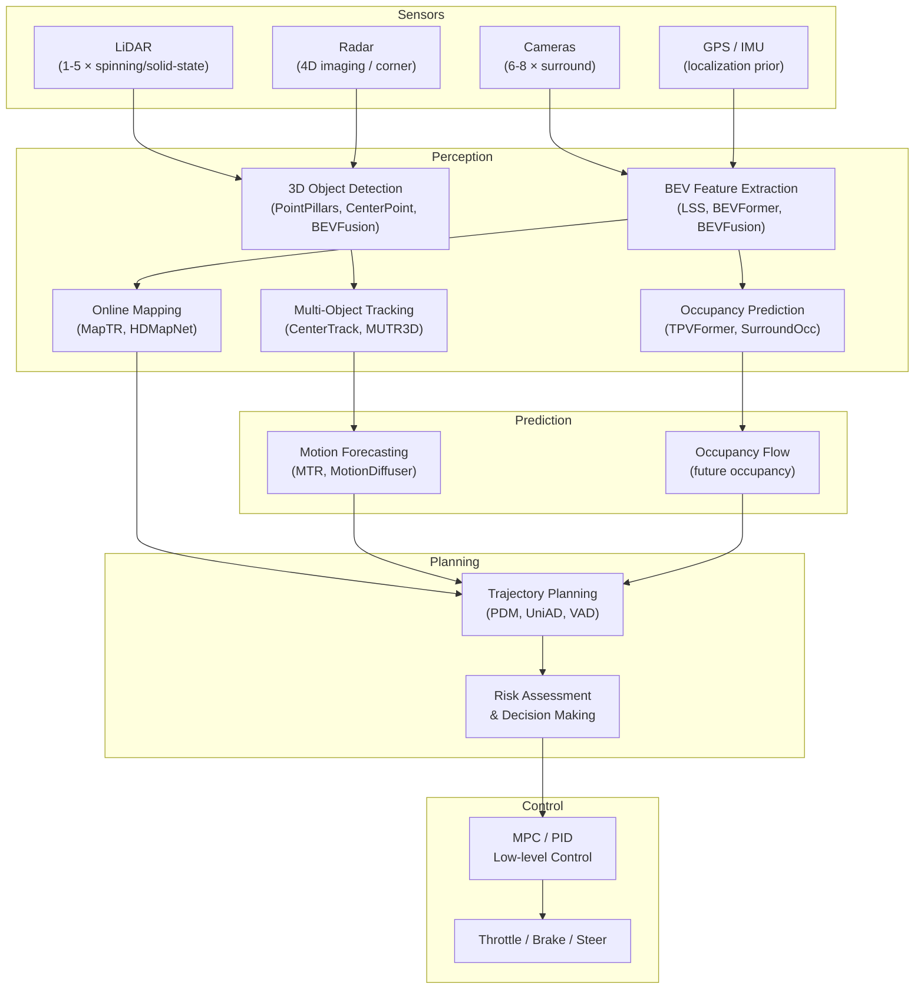
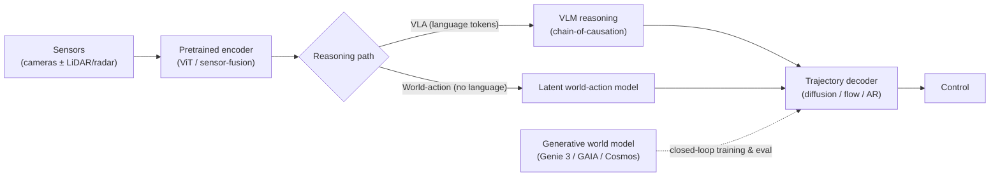

# Autonomous Driving: Stack Overview, Levels of Autonomy, and Key Players

> **Last Updated:** October 2026
> **Level:** Advanced
> **Related Sections:** [Perception Stack](./01_perception_stack.md) · [End-to-End Driving](./03_end_to_end_driving.md) · [Simulation & Data](./04_simulation_and_data.md) · [Robotics World Models](../06_robotics_and_embodied_ai/02_world_models.md) · [VLA Models](../06_robotics_and_embodied_ai/01_vla_models.md)

> **🆕 October 2026 update:**
> - **Key Players table rewritten for October 2026**: Waymo at ~500k paid rides/week across 10+ US metros, with a stated 1M/week target for end-2026; Tesla unsupervised robotaxi rides (Austin from Jan 2026, then Florida cities), and Cybercab production started; Zoox paid service in Las Vegas under the first NHTSA exemption for a purpose-built robotaxi; Cruise wound down; Wayve–Uber supervised rides in London.
> - New section **"Industry Landscape, October 2026"** covering US, Chinese (Baidu Apollo Go, Pony.ai, WeRide, XPeng, Li Auto, Huawei, Momenta) and European players.
> - New section on the **"driving foundation model / VLA" turn**: Waymo EMMA, NVIDIA Alpamayo-R1 / Alpamayo 1, XPeng VLA 2.0, Li Auto's VLA, and Huawei's "world-action" (WEWA) counter-position.
> - SAE section updated: Mercedes DRIVE PILOT at 95 km/h in Germany, BMW Personal Pilot L3, first conditional L3 approvals in China.
> - New Key Papers, Open Problems (VLA reasoning faithfulness, remote assistance at scale) and Further Reading.

---

## Overview

Autonomous driving (AD) is the grand integration challenge of modern computer vision, combining real-time perception, structured prediction, motion planning, and low-level vehicle control under extreme safety requirements. The canonical decomposition of the stack—perception → prediction → planning → control—emerged from the DARPA Urban Challenge era [Thrun2006] and remained the dominant engineering philosophy in deployed systems at Waymo, Mobileye, and Cruise (until GM wound down Cruise's robotaxi program in December 2024). Each module solves a well-scoped sub-problem: perception answers *what is around me*, prediction answers *where will it go*, planning answers *what should I do*, and control answers *how do I actuate it*. The principal attraction of modular stacks is interpretability and safety certifiability; each component can be independently tested, logged, and formally verified to a bounded error specification.

The last five years have witnessed sustained pressure against the modular paradigm from *end-to-end* (E2E) approaches that collapse the entire chain into a single differentiable network trained from raw sensors to control outputs [Chen2023UniAD, Hu2023GAIA1]. The theoretical advantage is joint optimization—gradient information from planning failures back-propagates directly to perceptual representations, eliminating the information-theoretic bottleneck of hand-designed intermediate representations such as 3D bounding boxes or HD map polygons. Tesla's Full Self-Driving v12 (released 2024) is the highest-profile production example: FSD v12 replaced approximately 300,000 lines of C++ rule-based code with a single neural network processing eight camera streams and outputting steering, throttle, and brake torques directly [Elon2024FSD]. The empirical performance uplift was immediate and visible, yet formal safety guarantees remain an open research challenge. Through 2025–2026 the E2E line moved further toward **driving foundation models**: multimodal-LLM-based planners such as Waymo's EMMA [Hwang2024EMMA], reasoning vision-language-action (VLA) models such as NVIDIA's Alpamayo-R1 [Wang2025Alpamayo], and production "VLA" or "world-action" systems from Chinese OEMs (XPeng, Li Auto, Huawei). Tesla's FSD v14 (Oct 2025) now powers unsupervised robotaxi rides in a handful of US cities. At the same time, the deployment frontier is still led by a LiDAR-equipped, structured (not purely end-to-end) stack: Waymo reported about 500,000 paid rides per week by mid-2026.

A critical architectural tension also exists along the sensor axis. Camera-only systems (Tesla, Wayve) rely on monocular depth estimation and BEV lifting operators, offering cost scalability and dense semantic texture but lacking metric depth precision. LiDAR-centric systems (Waymo, Cruise) provide sub-centimeter range accuracy and weather-degraded operation but carry cost and mechanical complexity. Radar is underutilized relative to its all-weather range capability; emerging 4D imaging radar (e.g., Arbe Robotics, Continental ARS 548) may close the gap. Multi-modal fusion—particularly LiDAR-camera BEV fusion as in BEVFusion [Liu2022BEVFusion]—currently provides the best overall accuracy on public benchmarks.

---

## The AV Stack: Modules and Data Flow

The BEV (Bird's-Eye View) representation has become the lingua franca of the modern perception stack because it provides a unified coordinate frame amenable to downstream planning, free of the perspective distortions of image-space representations [Li2022BEVFormer]. Temporal fusion over BEV features allows the network to exploit the static structure of the environment across multiple frames, effectively increasing the effective range of camera-based systems without explicit depth sensors.

---

## SAE Levels of Driving Automation

The Society of Automotive Engineers standard **SAE J 3016-2021** defines six levels of driving automation [SAE2021]:

| Level | Name | Human Role | Example |
|-------|------|-----------|---------|
| 0 | No Automation | Full control at all times | Standard vehicle |
| 1 | Driver Assistance | Monitors driving environment; controls one function | Adaptive cruise control |
| 2 | Partial Automation | Monitors environment; system controls steering + speed | Tesla Autopilot, GM Super Cruise |
| 3 | Conditional Automation | Must intervene on request | Mercedes DRIVE PILOT, BMW Personal Pilot L3 (limited ODD) |
| 4 | High Automation | No intervention within ODD | Waymo, Zoox, Baidu Apollo Go, Pony.ai (geo-fenced robotaxis) |
| 5 | Full Automation | No human needed ever | Not yet deployed at scale |

The distinction between L2 and L3 is legally and liability-critical: at L3 the system (not the driver) assumes primary responsibility within its Operational Design Domain (ODD), while L2 keeps the human in the loop at all times. As of October 2026, certified consumer L3 remains narrow. Mercedes-Benz DRIVE PILOT is approved in Germany (where the KBA approved raising the limit to 95 km/h on the Autobahn in December 2024), California and Nevada. BMW offers Personal Pilot L3 on the 7 Series in Germany. China's MIIT issued its first conditional L3 product approvals in December 2025, restricted to designated roads. Note that most "unsupervised" consumer marketing (e.g., Tesla FSD (Supervised)) is still legally L2. Robotaxis are L4 within their geofence, but in practice they rely on **remote assistance** operators who can advise or temporarily take over in ambiguous situations.

---

## Sensor Suites

### Camera

Surround-view camera systems (typically 6–8 cameras, 60°–120° FOV, 8 MP) provide dense semantic texture, object recognition, and lane-level scene understanding. The principal challenge is metric depth recovery, which requires either explicit depth estimation (BEVDepth [Li2022BEVDepth]) or probabilistic view lifting (LSS [Philion2020LSS]). Cameras are low-cost, do not degrade with speed, but performance degrades in rain, fog, and direct sunlight.

### LiDAR

Spinning LiDARs (Velodyne HDL-64E, Hesai QT128) produce dense 3D point clouds at 10–20 Hz with centimeter-level range accuracy up to 200 m. Solid-state LiDARs (Livox, Ouster OS2) are emerging as cost-reduced alternatives. LiDAR is robust to lighting but sensitive to retroreflective and transparent surfaces, and exhibits degradation in heavy precipitation.

### Radar

Corner radars (4 × automotive radar, 77 GHz) provide velocity-resolved detections through rain, fog, and darkness with $\lesssim 0.1\,\text{m/s}$ Doppler precision. Traditional radar resolution is coarse (~5° azimuth), but 4D imaging radar (Arbe Phoenix: 0.7° azimuth, 1.6° elevation) approaches LiDAR point density. Radar is underexploited in published perception literature relative to its production importance.

### HD Maps vs. Sensor-Only

First-generation AV stacks assumed pre-built, centimeter-accurate HD maps for localization and lane-level planning. Online mapping research (MapTR [Liao2023MapTR], HDMapNet) aims to eliminate offline map dependency, increasing operational flexibility and reducing maintenance cost. A fully map-free stack is a key open problem.

---

## Key Players

| Company | Approach | Sensor Suite | Deployment Status (Oct 2026) |
|---------|----------|-------------|-------------------------------|
| Waymo | Foundation-model-based, structured; LiDAR-primary | LiDAR + Camera + Radar (6th-gen: 13 cam, 4 LiDAR, 6 radar) | L4 robotaxi in 10+ US metros (Phoenix, SF Bay Area, LA, Austin, Atlanta, Miami, Dallas, Houston, San Antonio, Orlando, Las Vegas, etc.); ~500k paid rides/week; London and Tokyo announced |
| Tesla | End-to-end neural, camera-only | 8 × Camera | FSD (Supervised) v14 = L2 for consumers; robotaxi in Austin since Jun 2025, unsupervised rides since Jan 2026, Florida cities added Jul 2026; Cybercab production started 2026 |
| Zoox (Amazon) | Purpose-built bidirectional robotaxi | LiDAR + Camera + Radar | First NHTSA exemption for a purpose-built robotaxi (Jul 2026); paid rides in Las Vegas from Aug 2026 |
| Mobileye | Modular + RSS safety layer | Camera + LiDAR + Radar | L2+ ADAS; L4 pilot (Moovit) |
| Cruise (GM) | Modular, LiDAR-primary | LiDAR + Camera + Radar | Robotaxi program ended Dec 2024; tech folded into GM personal-vehicle ADAS |
| Wayve | End-to-end, camera-first | Camera + Radar | Supervised robotaxi rides with Uber in London (Sep 2026); OEM licensing (Nissan); GAIA-2/GAIA-3 world models |
| NVIDIA | Platform + open models | Full suite | DRIVE Thor/Hyperion supplier; open Alpamayo VLA models, AlpaSim and AV datasets (Jan 2026) |
| Baidu Apollo Go | Modular hybrid | Full suite | L4 robotaxi in Wuhan and other Chinese cities (16 cities worldwide by Aug 2025), expanding to the Middle East and Europe via ride-hailing partners; 2.2M fully driverless rides in Q2 2025 alone |
| Pony.ai | Modular/E2E hybrid | Full suite | Gen-7 robotaxis in fully driverless commercial operation in Beijing, Guangzhou and Shenzhen; >900 vehicles by Nov 2025, target >3,000 by end-2026; Hong Kong dual listing Nov 2025 |
| WeRide | Modular/E2E hybrid | Full suite | Robotaxi/robobus in China and the Middle East; Hong Kong dual listing Nov 2025 |
| XPeng | VLA (VLA 2.0), vision-only | Camera (no LiDAR) + Turing SoCs | L2+ city NGP; VLA 2.0 robotaxi public-road testing since Mar 2026 |
| Huawei (Qiankun ADS 4) | "World-action" (WEWA) E2E | Camera + LiDAR + radar | L2+ on HIMA (Harmony Intelligent Mobility) brands; ADS 4 positioned toward L3 |
| Momenta | Data-driven E2E | Camera + LiDAR | ADAS supplier to many OEMs; L4 testing with Uber in Munich planned for 2026 |

---

## Industry Landscape, October 2026

**United States.** The robotaxi market moved from pilots to scaled commercial operations in 2025–2026. **Waymo** went from three commercial metros at the start of 2025 to roughly 10–11 by mid-2026. It added Austin and Atlanta (via Uber), Miami, Dallas, Houston, San Antonio and Orlando, launched fully driverless operations in Las Vegas in July 2026, and reportedly began paid service in Denver, San Diego and Tampa in September 2026. Waymo reported about **500,000 paid rides per week** (double the 250k reported in April 2025), and co-CEO Tekedra Mawakana set a target of **>1M paid weekly rides by end-2026**. Waymo's public Safety Impact hub reports large reductions in injury-causing and serious-injury crashes relative to human benchmarks over ~96M rider-only miles through June 2025. **Tesla** launched a robotaxi service in Austin in June 2025, initially with in-car safety monitors. It began unsupervised public rides (no one in the vehicle, remote monitoring) on 22 January 2026 using a dedicated "unsupervised" FSD v14 branch. In its Q2 2026 update it reported unsupervised rides in Miami, Orlando and Tampa from July 2026, plus the start of **Cybercab** production at Giga Texas. Tesla does not publish disengagement statistics, and the Austin fleet has drawn NHTSA scrutiny. **Zoox** received NHTSA's first exemption for a purpose-built vehicle without steering wheel or pedals (30 July 2026; ≤2,500 vehicles/year for two years) and began charging fares in Las Vegas in August 2026.

**China.** China is the second large robotaxi market and the most aggressive adopter of VLA-style consumer ADAS. **Baidu Apollo Go** reported 2.2M fully driverless rides in Q2 2025 (+148% YoY) across 16 cities worldwide, and has ride-hailing partnerships for international expansion. **Pony.ai** reached city-wide unit-economics break-even for its Gen-7 robotaxi in Guangzhou. It had >900 vehicles in November 2025 and targets >3,000 by end-2026. Both Pony.ai and **WeRide** completed Hong Kong dual primary listings in November 2025. On the consumer side, **XPeng** ships "VLA 2.0", a vision-only model running on its in-house Turing chips. Its VLA 2.0 robotaxi (4 Turing chips, no LiDAR, no HD map) entered public-road testing in March 2026, and Volkswagen is announced as the first external VLA 2.0 customer. **Li Auto** shipped its VLA driver model (MindVLA lineage) with the i8 in 2025. **Huawei** Qiankun ADS 4 explicitly rejects the language-in-the-loop VLA design in favour of a **"World Engine + World Action" (WEWA)** architecture: a cloud diffusion-based scenario generator plus an on-vehicle world-action model that maps sensors directly to actions. **Momenta** supplies E2E ADAS to many OEMs and plans L4 testing with Uber in Munich from 2026.

**Europe and Japan.** **Wayve** raised about US$1.5B in February 2026 (investors include Uber, Mercedes-Benz, Stellantis and Nissan). With Uber, it launched supervised robotaxi rides in London on 3 September 2026 with a small fleet (<20 vehicles). Waymo has been testing in London (announced for a 2026 launch) and, with GO and Nihon Kotsu, plans a commercial driverless service in Tokyo in 2027. All UK and Japanese timelines depend on pending regulatory authorisation.

---

## The Driving Foundation Model / VLA Turn (2025–2026)

The 2023 debate of modular vs. E2E has been partly superseded by a question of *how much general-purpose pre-training* to put in the loop:

- **MLLM-native planners.** EMMA [Hwang2024EMMA] (Waymo) builds on a Gemini-class multimodal LLM. It represents all non-sensor inputs and outputs (navigation commands, ego history, trajectories, 3D boxes, road-graph elements) as text, and switches tasks via prompts. It reported state-of-the-art nuScenes planning and competitive camera-only 3D detection on WOD. Its stated limitations are few input frames, no LiDAR/radar, and high compute.
- **Reasoning VLAs.** NVIDIA's Alpamayo-R1 [Wang2025Alpamayo] (released openly as **Alpamayo 1**, a 10B-parameter VLA, at CES on 5 January 2026) couples a Cosmos-Reason VLM backbone with a diffusion-based trajectory decoder. It is trained on "Chain of Causation" reasoning traces and RL post-training that aligns reasoning with action. NVIDIA positions it as a *teacher* model to be distilled into on-vehicle stacks.
- **Production VLA / world-action models.** XPeng VLA 2.0, Li Auto's VLA driver and Huawei's WEWA show the industrial split. One camp routes decisions through language-like reasoning tokens; the other (Huawei, and to a degree Tesla) argues language is an unnecessary latency bottleneck and maps sensors directly to actions, with a learned world model used for training and evaluation.
- **World models as simulators.** Waymo's **Waymo World Model** (February 2026) is built on Google DeepMind's Genie 3 and generates both camera and LiDAR data. Wayve's GAIA-2/GAIA-3 and NVIDIA Cosmos/AlpaSim turn generative world models into evaluation infrastructure (see [Simulation & Data](./04_simulation_and_data.md)).

---

## Modular vs. End-to-End: Architectural Trade-offs

The modular stack dominates production deployments primarily because **interpretability** and **independent validation** are tractable. Safety engineers can write formal specifications for each module and test them in isolation. Regulatory bodies (UNECE WP.29, NHTSA) currently favor modular architectures with interpretable decision logs.

End-to-end systems offer three structural advantages: **(1) joint optimization** removes the information bottleneck between stages; **(2) implicit world modeling** allows the network to retain information not captured by explicit representations (e.g., soft occlusions, sensor uncertainty); **(3) scalability with data**—E2E systems improve smoothly with more training data, while modular systems require per-module annotation pipelines.

The hybrid approach—exemplified by UniAD [Hu2023UniAD]—uses structured intermediate representations (BEV queries, object queries, map queries) as soft interfaces between sub-networks, retaining interpretability while enabling E2E training. This hybrid paradigm is likely the production trajectory for the next generation of deployed systems.

Formally, the modular stack factors the driving policy as:

$$\pi(a \mid o) = \pi_c(a \mid p) \cdot \pi_p(p \mid f) \cdot \pi_f(f \mid o)$$

where $o$ is the raw sensor observation, $f$ the perceptual features, $p$ the prediction output, and $a$ the control action. Each factor is optimized independently, breaking the joint Bayesian optimal policy. E2E collapses this to a direct $\pi(a \mid o)$ mapping optimized with a single objective.

---

## Key Papers

| Paper | Authors | Year | Venue | Key Contribution |
|-------|---------|------|-------|-----------------|
| DARPA Urban Challenge overview | Thrun et al. | 2006 | DARPA Technical Report | Established modular AV stack architecture |
| BEVFormer | Li et al. | 2022 | ECCV | Spatial-temporal BEV via deformable attention; 56.9% NDS camera-only on nuScenes |
| BEVFusion | Liu et al. | 2022 | ICRA 2023 | Unified BEV for LiDAR-camera fusion; SOTA nuScenes detection |
| UniAD | Hu et al. | 2023 | CVPR (Best Paper) | Planning-oriented E2E: detection→tracking→mapping→motion→planning in one network |
| GAIA-1 | Hu et al. | 2023 | arXiv 2309.17080 | Generative world model for AV; video token prediction; 9B parameter scaling |
| Lift, Splat, Shoot | Philion & Fidler | 2020 | ECCV | Learned depth distribution for BEV projection; foundational camera-BEV method |
| PointPillars | Lang et al. | 2019 | CVPR | Fast LiDAR detection via pillar-based encoding; real-time 3D detection baseline |
| CenterPoint | Yin et al. | 2021 | CVPR | Center-based heatmap detection; 71.9 mAPH on Waymo |
| EMMA | Hwang et al. (Waymo) | 2024 | arXiv 2410.23262 | Multimodal-LLM (Gemini-based) E2E driving; planning, 3D detection and road graph as text outputs |
| NAVSIM | Dauner et al. | 2024 | NeurIPS (D&B) | Non-reactive "pseudo-closed-loop" planning benchmark with the PDM Score; de facto E2E benchmark of 2025 |
| Bench2Drive | Jia et al. | 2024 | NeurIPS (D&B) | Multi-ability closed-loop E2E benchmark in CARLA v2 (220 routes, 44 interactive scenarios) |
| GAIA-2 | Russell et al. (Wayve) | 2025 | arXiv 2503.20523 | Controllable multi-camera latent-diffusion world model for driving simulation |
| Alpamayo-R1 | Wang et al. (NVIDIA) | 2025 | arXiv 2511.00088 | Reasoning VLA with Chain-of-Causation data, diffusion trajectory decoder, RL alignment; open release as Alpamayo 1 (10B) |

---

## Benchmark Performance

| Model | Dataset | Metric | Score | Notes |
|-------|---------|--------|-------|-------|
| BEVFormer v2 | nuScenes test | NDS | 56.9% | Camera-only; ECCV 2022 |
| BEVFusion (MIT) | nuScenes test | NDS | 73.4% | LiDAR-camera; ICRA 2023 |
| CenterPoint | Waymo val | mAPH L2 | ~66.4% | LiDAR-only; 2021 |
| UniAD | nuScenes val | Planning L2 (3s) | 0.71 m | Full E2E stack; CVPR 2023 Best Paper |
| VAD | nuScenes val | Avg Collision Rate | 0.22% | Vectorized E2E; ICCV 2023 |
| TransFuser (baseline) | NAVSIM navtest | PDMS | 84.0 | NAVSIM reference baseline |
| DiffusionDrive | NAVSIM navtest | PDMS | 88.1 | Truncated diffusion planner; CVPR 2025 |
| UniAD-Base | Bench2Drive | Driving Score | 45.81 | Closed-loop CARLA v2; reported in Bench2Drive paper |

*Note: since 2025 the community has largely moved from nuScenes open-loop L2 to NAVSIM (PDMS/EPDMS) and Bench2Drive (closed-loop Driving Score / Success Rate); see [End-to-End Driving](./03_end_to_end_driving.md).*

---

## Pros & Cons

| Aspect | Modular Stack | End-to-End Stack |
|--------|--------------|-----------------|
| Interpretability | High — each module has explicit outputs | Low — latent representations opaque |
| Joint optimization | No — sequential error propagation | Yes — single gradient through full stack |
| Annotation cost | High — per-module labels required | Moderate — can use driving logs |
| Regulatory acceptance | Favored by current frameworks | Immature safety case methodology |
| Data scalability | Limited by annotation bottleneck | Scales with raw driving video |
| Edge case handling | Explicit rules cover known cases | Better generalization; unknown failures |

---

## Open Problems & Research Gaps

- **Long-tail safety**: Neural stacks fail on rare distributions (construction zones, adversarial pedestrians) that are under-represented in training data. How to achieve $10^{-9}$ failure-per-mile safety targets with learned models remains unresolved.
- **Sensor fusion in adverse weather**: Rain, snow, and fog degrade all modalities differently; robust multi-modal fusion under sensor degradation lacks principled treatment.
- **Map-free localization at scale**: Eliminating HD map dependency while maintaining centimeter-level ego-localization in GPS-denied environments (tunnels, urban canyons) is unsolved.
- **Causal reasoning vs. statistical correlation**: Current models implicitly conflate correlation with causal structure in driving scenarios; they may fail when environment statistics shift (new city, new country).
- **Closed-loop evaluation at scale**: Open-loop metrics (L2, mAP) are poor proxies for real-world safety; scalable, photorealistic closed-loop benchmarks that test full sensor stacks are nascent.
- **Formal verification of neural policies**: Methods for bounding worst-case behavior of large neural networks in the state space relevant to driving remain largely theoretical.
- **V2X and cooperative perception**: Infrastructure-to-vehicle communication and cooperative perception between vehicles is underexplored in deployed systems despite clear safety benefits.
- **Faithfulness of VLA reasoning**: Reasoning VLAs (Alpamayo-R1, XPeng/Li Auto VLAs) produce human-readable rationales, but 2026 probing work questions whether the stated chain of causation actually drives the trajectory. Explanations that are not causally faithful could create false confidence in safety cases.
- **Remote assistance and operations at scale**: L4 fleets depend on remote-assistance staff. How operator-to-vehicle ratios, latency and failure handling scale to millions of weekly rides is a socio-technical problem with little published data.
- **Validating with generative world models**: Waymo World Model, GAIA-3 and Cosmos/AlpaSim are increasingly used for evaluation. We have no established methodology for showing that a generated scenario distribution and its sensor realism are adequate evidence for a safety case.

---

## Further Reading

- [Waymo Safety Report (2023)](https://waymo.com/safety/) — industry safety methodology reference
- [Tesla AI Day 2022 technical presentation](https://www.youtube.com/watch?v=ODSJsviD_SU) — occupancy networks, Dojo supercomputer
- [OpenDriveLab/UniAD GitHub](https://github.com/OpenDriveLab/UniAD) — official implementation, CVPR 2023 Best Paper
- [arXiv:2401.08658 — End-to-End Planning of AV in Industry and Academia 2022-2023](https://arxiv.org/abs/2401.08658) — comprehensive survey
- [SAE J 3016-2021 taxonomy](https://blog.ansi.org/ansi/sae-levels-driving-automation-j-3016-2021/) — official levels definition
- [nuScenes benchmark leaderboard](https://nuscenes.org/object-detection) — live performance tracking
- [arXiv:2410.23262 — EMMA (Waymo)](https://arxiv.org/abs/2410.23262) — multimodal-LLM end-to-end driving
- [arXiv:2511.00088 — Alpamayo-R1 (NVIDIA)](https://arxiv.org/abs/2511.00088) — reasoning VLA for long-tail driving
- [NVIDIA Alpamayo announcement (Jan 2026)](https://investor.nvidia.com/news/press-release-details/2026/NVIDIA-Announces-Alpamayo-Family-of-Open-Source-AI-Models-and-Tools-to-Accelerate-Safe-Reasoning-Based-Autonomous-Vehicle-Development/) — Alpamayo 1, AlpaSim, open AV datasets
- [The Waymo World Model (Feb 2026)](https://waymo.com/blog/2026/02/the-waymo-world-model-a-new-frontier-for-autonomous-driving-simulation) — Genie 3-based driving simulator
- [TechCrunch: Zoox clears final federal hurdle (Jul 2026)](https://techcrunch.com/2026/07/30/zoox-clears-final-federal-hurdle-to-launch-paid-robotaxi-service/) — first NHTSA purpose-built robotaxi exemption
- [XPeng newsroom](https://www.xpeng.com/pressroom/news/019cae5e67b99c0960ee8a028129016a) — VLA 2.0 robotaxi road testing (Mar 2026)
