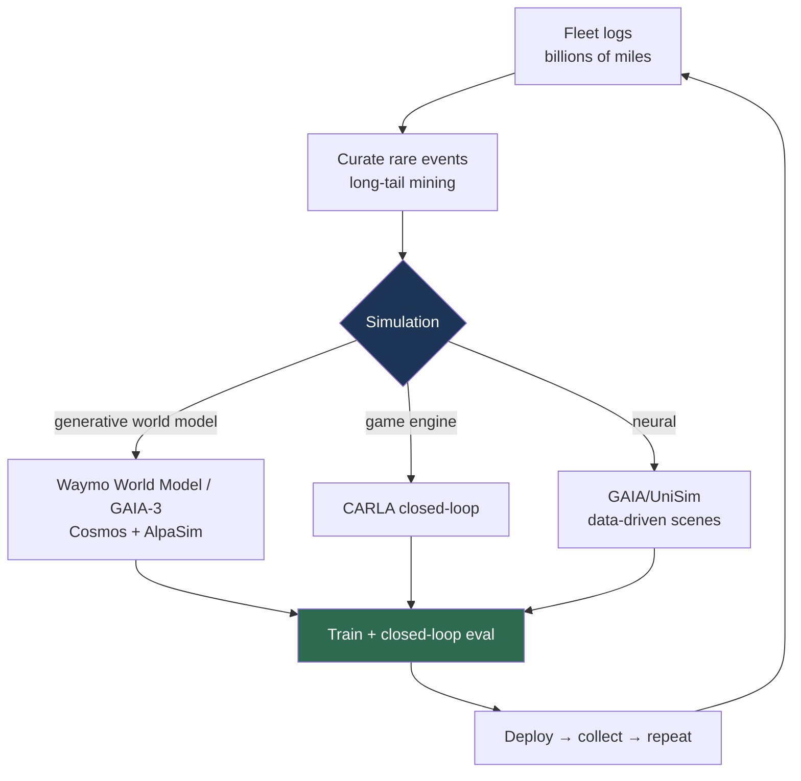

# Simulation & Data for Autonomous Driving

> **Last Updated:** October 2026
> **Level:** Advanced
> **Related Sections:**
> - [End-to-End Driving](./03_end_to_end_driving.md)
> - [Perception Stack](./01_perception_stack.md)
> - [3D & Robotics Datasets](../11_datasets_and_benchmarks/02_3d_and_robotics_datasets.md)
> - [World Models](../06_robotics_and_embodied_ai/02_world_models.md)

> **🆕 October 2026 update:**
> - New section **"Generative World-Model Simulators (2025–2026)"**: the Waymo World Model (built on Genie 3, generates camera + LiDAR, Feb 2026), Wayve GAIA-2/GAIA-3, NVIDIA Cosmos and the open **AlpaSim** simulator (Jan 2026), and Huawei's "world engine".
> - New section on **neural reconstruction simulators** (3D Gaussian splatting: Street Gaussians, OmniRe) and NAVSIM v2 pseudo-simulation.
> - Datasets and benchmarks extended with NAVSIM/OpenScene, Bench2Drive, Waymax, NVIDIA's open Physical AI AV dataset (>1,700 h) and Waymo's end-to-end long-tail challenge data. Corrected UniSim's attribution (Waabi).
> - New Open Problems on world-model physical fidelity and multi-sensor consistency; new Further Reading.

---

## Overview

Data and simulation are the binding constraint on autonomous-driving progress, even more than model architecture. The fundamental problem is the **long tail**: safe driving requires handling rare, safety-critical events (a child darting into the road, unusual debris, sensor-blinding glare) that occur perhaps once in millions of miles, making them nearly impossible to collect at sufficient density from real fleets. This drives a dual strategy: massive **real-world data collection** (Waymo's and Tesla's fleets logging billions of miles) paired with **simulation** to generate, augment, and stress-test against rare scenarios in a controlled, reproducible, and safe manner. The shift toward end-to-end learned driving (see [End-to-End Driving](./03_end_to_end_driving.md)) intensifies the data hunger, since these models learn directly from demonstrations rather than hand-coded rules.

Simulation in AV has itself evolved from **hand-built game-engine environments** (CARLA) toward **neural/data-driven simulation** (GAIA, UniSim) that learns to generate photorealistic, physically plausible driving scenes from logged data—closely related to the world models in [World Models](../06_robotics_and_embodied_ai/02_world_models.md). The central methodological question is **closed-loop evaluation**: a model that imitates logged trajectories well (open-loop) may still fail when its own actions change the future state (the distribution-shift / compounding-error problem), so the field has moved toward closed-loop simulators (nuPlan, CARLA leaderboards) that test policies reactively. By 2026 the leading AV developers have made **generative world models the core of their simulation stacks**. Waymo built its world model on Google DeepMind's Genie 3, Wayve positions GAIA-3 as an evaluation engine, NVIDIA open-sourced AlpaSim alongside Cosmos world foundation models, and Huawei trains ADS 4 against a diffusion-based "world engine". Simulation and world modeling are converging into a single research area. This file surveys the key datasets, simulators, and the sim-to-real and evaluation challenges.

---

## Real-World Datasets

- **KITTI** [Geiger2012] — the pioneering AV benchmark (stereo, flow, detection, odometry); small by modern standards but foundational.
- **nuScenes** [Caesar2020] — 1000 scenes, full 360° sensor suite (6 cameras, LiDAR, 5 radar), 3D boxes; the standard multimodal AV perception benchmark (NDS/mAP).
- **Waymo Open Dataset** — large-scale, high-quality LiDAR+camera with 3D labels; perception and motion-prediction benchmarks.
- **nuPlan** — the first large-scale **closed-loop planning** benchmark (~1500 h), shifting evaluation from open-loop imitation to reactive simulation.
- **Argoverse 1/2, Lyft Level 5, ONCE** — additional perception/forecasting datasets (see [3D & Robotics Datasets](../11_datasets_and_benchmarks/02_3d_and_robotics_datasets.md)).
- **OpenScene / NAVSIM** [Dauner2024NAVSIM] — a compact redistribution of nuPlan sensor logs (with occupancy labels) underpinning the NAVSIM non-reactive planning benchmark (PDMS; v2 adds pseudo-simulation and EPDMS).
- **Bench2Drive** [Jia2024Bench2Drive] — ~2M annotated CARLA v2 frames for E2E training plus a 220-route, 44-scenario closed-loop evaluation protocol.
- **Waymo Open Dataset: end-to-end driving (2025)** — Waymo's 2025 vision-based E2E driving challenge released camera data of rare, long-tail segments, scored with human rater preferences over candidate trajectories rather than L2 to a single log.
- **NVIDIA Physical AI AV datasets (2026)** — released with Alpamayo at CES 2026: >1,700 hours of multi-sensor driving data across many geographies and conditions, among the largest openly available AV corpora.

## Simulators

- **CARLA** [Dosovitskiy2017] — the open-source Unreal-Engine driving simulator; standard for closed-loop policy evaluation (CARLA Leaderboard) and sensor simulation.
- **MetaDrive, SUMMIT, LGSVL** — lightweight/procedural or traffic-focused simulators.
- **Data-driven multi-agent simulators**: **Waymax** [Gulino2023] (Waymo, NeurIPS 2023 D&B) — a JAX-based, hardware-accelerated simulator over WOMD scenarios for large-scale closed-loop planning and RL; agents can be log-replay or reactive (IDM).
- **Neural simulation**: **GAIA-1** [Hu2023] (Wayve) — a generative world model producing realistic driving video from video/text/action prompts; **UniSim** [Yang2023UniSim] (Waabi, CVPR 2023) — a data-driven, neural closed-loop sensor simulator that reconstructs and edits real scenes. These blur the line between simulation and world models (see [World Models](../06_robotics_and_embodied_ai/02_world_models.md)).
- **AlpaSim** (NVIDIA, open source, January 2026) — a closed-loop AV simulator built as Python microservices communicating over gRPC, designed for evaluating and training reasoning-based policies such as Alpamayo on edge-case scenarios.

### Generative World-Model Simulators (2025–2026)

- **Waymo World Model** (February 2026) — built on **Genie 3**, Google DeepMind's general-purpose interactive world model, and adapted to driving. It is steerable by language prompts, driving inputs and scene layouts, and generates **both camera video and LiDAR**. Post-training transfers 2D video knowledge into 3D LiDAR outputs specific to Waymo's sensor suite. It can also convert ordinary dashcam footage into simulation scenes with depth. Waymo uses it to synthesise rare events (floods, tornadoes, animals on the road) that its fleet has never encountered. No benchmark results or independent evaluations accompanied the announcement.
- **GAIA-2 / GAIA-3** (Wayve, March / December 2025) — GAIA-2 is a multi-camera latent-diffusion world model with fine-grained structured control (agents, road layout, weather, geography). GAIA-3 (~15B parameters, ~10× GAIA-2's data) is positioned as an offline evaluation pipeline whose policy rankings Wayve reports to correlate with on-road testing.
- **NVIDIA Cosmos** — world foundation models for physical AI (Predict, Transfer and Reason families; 2.5-series releases in 2025). Used for synthetic driving data generation (e.g., Cosmos-Drive-Dreams) and, through Cosmos-Reason, as the backbone of Alpamayo.
- **Counterfactual and safety-critical generation** — research systems such as CounterScene (arXiv 2603.21104) add counterfactual causal reasoning to generative world models, producing safety-critical variants of logged scenes for closed-loop evaluation.

### Neural Reconstruction Simulators

Generative models invent scenes; **reconstruction-based** simulators re-render *real* logs from novel viewpoints so a planner can deviate from the logged trajectory. 3D Gaussian splatting has displaced NeRF here because it renders in real time. **Street Gaussians** (ECCV 2024) models static background plus per-vehicle tracked Gaussians, and **OmniRe** (ICLR 2025) extends this to deformable actors such as pedestrians and cyclists via scene graphs. NAVSIM v2's pseudo-simulation uses this kind of 3DGS rendering to create follow-up observations from perturbed ego states. The remaining weakness is extrapolation: quality degrades quickly beyond a few metres of lateral deviation, which is where generative models take over. Hybrid "reconstruct then generatively repair" pipelines are an active direction.

---

## Key Papers / Resources

| Name | Authors/Org | Year | Venue | Key Contribution |
|------|-------------|------|-------|-----------------|
| KITTI | Geiger, Lenz, Urtasun | 2012 | CVPR | Pioneering AV benchmark suite |
| nuScenes | Caesar et al. | 2020 | CVPR | 360° multimodal AV perception dataset |
| Waymo Open Dataset | Sun et al. | 2020 | CVPR | Large-scale LiDAR+camera with 3D labels |
| nuPlan | Caesar et al. (Motional) | 2021 | CVPR WS | First closed-loop planning benchmark |
| CARLA | Dosovitskiy et al. | 2017 | CoRL | Open-source driving simulator |
| GAIA-1 | Hu et al. (Wayve) | 2023 | arXiv | Generative world model for driving |
| UniSim | Yang et al. (Waabi) | 2023 | CVPR | Neural closed-loop sensor simulator from real logs |
| Waymax | Gulino et al. (Waymo) | 2023 | NeurIPS D&B | Accelerated JAX multi-agent simulator for planning/RL |
| NAVSIM | Dauner et al. | 2024 | NeurIPS D&B | Non-reactive planning benchmark (PDMS); v2 pseudo-simulation |
| Bench2Drive | Jia et al. | 2024 | NeurIPS D&B | Closed-loop multi-ability E2E benchmark in CARLA v2 |
| Street Gaussians | Yan et al. | 2024 | ECCV | 3DGS reconstruction of dynamic urban scenes |
| GAIA-2 | Russell et al. (Wayve) | 2025 | arXiv 2503.20523 | Controllable multi-camera latent-diffusion world model |
| Waymo World Model | Waymo (with Google DeepMind Genie 3) | 2026 | Blog | Genie 3-based camera + LiDAR world model for rare-event simulation |
| AlpaSim + Physical AI AV data | NVIDIA | 2026 | Open release | Open closed-loop simulator and >1,700 h driving data |

---

## Benchmark Snapshot

| Benchmark | Task | Metric | Notes |
|-----------|------|--------|-------|
| nuScenes | 3D detection | NDS / mAP | Standard perception leaderboard |
| Waymo Open | Detection/forecast | mAP / mAPH | Large-scale, high-quality |
| nuPlan | Planning | closed-loop score | Reactive evaluation |
| CARLA Leaderboard | Driving | route/infraction score | Closed-loop in sim |
| NAVSIM (v1 / v2) | Planning | PDMS / EPDMS | Non-reactive sim; v2 adds pseudo-simulation |
| Bench2Drive | E2E driving | Driving Score / Success Rate | 220 routes, 44 scenarios, CARLA v2 |
| Waymax | Planning / sim agents | collision, off-road, log divergence | Accelerated closed-loop on WOMD |

---

## Pros & Cons (real vs. simulated data)

| Aspect | Real-world data | Simulation |
|--------|-----------------|-----------|
| Realism | Ground truth realism | Sim-to-real gap |
| Rare events | Hard to collect | Can be generated on demand |
| Safety | Risky to collect edge cases | Safe, unlimited |
| Closed-loop eval | Impossible offline | Native (reactive) |
| Cost | High (fleets, labeling) | Lower per-scenario |

---

## Open Problems & Research Gaps

- **Sim-to-real gap.** Game-engine sensors and dynamics differ from reality; neural simulation (GAIA/UniSim) narrows but doesn't close it.
- **Long-tail coverage.** Generating *realistic and relevant* rare safety-critical scenarios remains hard.
- **Closed-loop fidelity.** Reactive agents and self-influenced futures are hard to simulate faithfully (the open-loop/closed-loop gap).
- **Evaluation–safety correlation.** Benchmark scores do not reliably predict real-world safety; validation methodology is unsolved.
- **Neural-sim controllability.** World-model simulators (GAIA) trade controllability for realism (see [World Models](../06_robotics_and_embodied_ai/02_world_models.md)).
- **Data governance & privacy.** Fleet data raises privacy, consent, and regulatory issues.
- **Physical and causal fidelity of generative simulators.** Video world models (Genie 3-based, GAIA, Cosmos) can produce plausible but physically wrong futures (object permanence, contact, braking dynamics). Metrics for whether a generated rollout is *safety-relevant correct* are lacking.
- **Multi-sensor consistency.** Generating LiDAR and radar that are geometrically consistent with generated video (as the Waymo World Model now does for LiDAR) is new and hard to validate.
- **Validity of world-model evaluation.** Claims that rankings in a world model match on-road rankings (GAIA-3) are company-reported. Open, reproducible protocols for checking simulator–reality correlation are needed before such evaluations can support regulatory safety cases.

---

## Further Reading

- [nuScenes (arXiv:1903.11027)](https://arxiv.org/abs/1903.11027) — multimodal AV dataset
- [Waymo Open Dataset](https://waymo.com/open/) — large-scale AV data
- [CARLA (arXiv:1711.03938)](https://arxiv.org/abs/1711.03938) — open driving simulator
- [nuPlan](https://www.nuscenes.org/nuplan) — closed-loop planning benchmark
- [GAIA-1 (arXiv:2309.17080)](https://arxiv.org/abs/2309.17080) — generative driving world model
- [GAIA-2 (arXiv:2503.20523)](https://arxiv.org/abs/2503.20523) — controllable multi-camera world model
- [The Waymo World Model (Feb 2026)](https://waymo.com/blog/2026/02/the-waymo-world-model-a-new-frontier-for-autonomous-driving-simulation) — Genie 3-based driving simulator
- [NVIDIA Alpamayo / AlpaSim announcement](https://investor.nvidia.com/news/press-release-details/2026/NVIDIA-Announces-Alpamayo-Family-of-Open-Source-AI-Models-and-Tools-to-Accelerate-Safe-Reasoning-Based-Autonomous-Vehicle-Development/) — open models, simulator and datasets
- [NAVSIM GitHub](https://github.com/autonomousvision/navsim) — pseudo-simulation benchmark
- [Bench2Drive GitHub](https://github.com/Thinklab-SJTU/Bench2Drive) — closed-loop E2E benchmark
- [Waymax GitHub](https://github.com/waymo-research/waymax) — accelerated data-driven simulator
