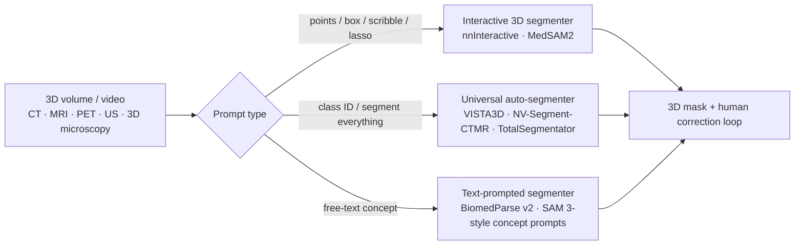

# Medical Imaging: Modalities, Segmentation, and Clinical CV

> **Last Updated:** October 2026
> **Level:** Advanced
> **Related Sections:**
> - [Semantic Segmentation](../02_core_tasks/02_semantic_segmentation.md)
> - [Foundation Models in Medical Imaging](./01_foundation_models_medical.md)
> - [Scientific Imaging](./02_scientific_imaging.md)
> - [Datasets and Benchmarks](../11_datasets_and_benchmarks/00_core_datasets.md)

> **🆕 October 2026 update:**
> - New section on **promptable and universal 3D segmentation** (2025–2026): MedSAM2 (SAM 2.1 adapted to 3D volumes and video), nnInteractive (winner of the CVPR 2025 interactive 3D segmentation challenge), VISTA3D (CVPR 2025) and its CT+MR successor NV-Segment-CTMR, BiomedParse v2 (text-prompted 3D), and the relevance of Meta's SAM 3 / SAM 3.1 concept prompting.
> - Added the **nnU-Net Revisited** (MICCAI 2024) finding that properly tuned CNN U-Nets still match or beat transformer and Mamba segmenters, and TotalSegmentator MRI (Radiology 2025).
> - New section on **3D generative synthetic data** (MAISI v1/v2, NV-Generate-CTMR).
> - New section on **clinical translation and regulation**: the FDA AI-enabled device list passed 1,500 authorizations in 2026, with radiology at ~75–76%; PCCP and lifecycle guidance.
> - Updated Key Papers, Benchmark, Pros & Cons, Open Problems and Further Reading accordingly.

---

## Overview

Medical imaging represents one of the most consequential application domains for computer vision, spanning a heterogeneous collection of physical acquisition modalities each governed by distinct signal physics, spatial resolutions, and noise characteristics. The core challenge is that deep learning systems trained on one institution's scanner configurations, patient demographics, or staining protocols frequently fail to generalize to external sites—a phenomenon known as **domain shift**—while simultaneously being challenged by severe class imbalance (lesions are small relative to background tissue) and the scarcity of expert-annotated data. Unlike natural image benchmarks, ground-truth annotations in medicine require specialized clinical expertise, creating a fundamental bottleneck that shapes the entire field.

From a signal-processing perspective, the five major modalities—X-ray (projection radiography), computed tomography (CT), magnetic resonance imaging (MRI), ultrasound (US), and histopathology (whole-slide images, WSI)—present fundamentally different learning problems. CT encodes Hounsfield Units on a calibrated linear scale and is well-suited to 3D convolutional processing; MRI requires multi-sequence (T1, T2, FLAIR, DWI) fusion where each channel encodes different tissue contrast; ultrasound is plagued by speckle noise and probe-dependent acquisition geometry; WSI operates at gigapixel scale and demands hierarchical or patch-based processing. Histopathology images, typically stained with hematoxylin and eosin (H&E), additionally suffer from stain variation across preparation protocols, motivating stain normalization as a preprocessing step.

The seminal architectural contribution to medical image segmentation is the **U-Net** [Ronneberger2015], which introduced a fully convolutional encoder–decoder with skip connections that preserve fine-grained spatial detail lost during downsampling. This design philosophy—encode global context, decode with preserved local detail—has proven remarkably durable. Its principled extension, **nnU-Net** [Isensee2021], automated the configuration of preprocessing, patch size, normalization, network topology, and post-processing via a dataset fingerprinting mechanism, achieving top performance on 33 of 55 segmentation tasks across 23 public benchmarks without task-specific manual tuning. As of 2026, nnU-Net remains a dominant baseline that specialized methods must beat; the **nnU-Net Revisited** study [Isensee2024] showed that many reported gains of transformer- and Mamba-based segmenters disappear under rigorous validation, and that scaled residual-encoder U-Nets (nnU-Net ResEnc) remain state of the art on standard 3D benchmarks.

Since 2025 the field has moved along two further axes. First, **promptable 3D foundation segmenters** (MedSAM2, nnInteractive, VISTA3D, BiomedParse v2) turn segmentation into an interactive or text-prompted service that covers hundreds of anatomical structures and lesions without per-task retraining. Second, **3D-native vision–language models** for CT and MRI (Merlin, CT-CLIP, Pillar-0, MedGemma 1.5) began to read whole volumes rather than single slices; these are covered in [Foundation Models in Medical Imaging](./01_foundation_models_medical.md).

---

## Imaging Modalities

### X-ray and Computed Radiography

Projection radiography collapses 3D anatomy onto a 2D detector plane, creating overlapping structures and limiting depth discrimination. CNNs adapted from ImageNet pretraining (DenseNet-121 via CheXNet [Rajpurkar2017]) demonstrated radiologist-competitive pneumonia detection on the NIH ChestX-ray14 dataset. Key tasks include: multi-label pathology classification (14-class NIH), pneumothorax segmentation, and bone suppression. Since 2025, longitudinal comparison (current vs. prior study) and anatomical localization have become standard capabilities of open medical VLMs such as MedGemma 1.5.

### Computed Tomography

CT volumes are natural inputs for 3D ConvNets and nnU-Net's 3D full-resolution configuration. The Hounsfield scale provides modality-consistent intensity normalization, enabling straightforward cross-site calibration. Landmark papers include V-Net [Milletari2016] (Dice loss for volumetric segmentation) and the 3D U-Net [Ccieck2016]. Multi-organ segmentation on abdominal CT (liver, spleen, pancreas, kidneys) is a canonical task. **TotalSegmentator** (nnU-Net-based) has become the de facto open tool for whole-body CT anatomy, with a default task of 117 classes plus many specialized subtasks, trained on a public CT dataset of 1,228 subjects.

### Magnetic Resonance Imaging

MRI's multi-modal sequences are intrinsically multi-channel inputs. Brain tumor segmentation (BraTS) requires joint processing of T1, T1ce, T2, and FLAIR volumes. Key challenges include: intensity non-standardness across scanners (MRI lacks the absolute calibration of CT), motion artifacts, and the need for 3D context. Transformer-based methods (Swin-UNETR [Tang2022]) reported gains over pure-CNN baselines on BraTS by capturing long-range spatial dependencies, although later rigorous comparisons [Isensee2024] found that well-tuned CNNs close most of this gap. **TotalSegmentator MRI** [DAntonoli2025] extended sequence-independent whole-body segmentation to MR (50 main classes in the `total_mr` task, trained with a public MR dataset of 616 subjects).

### Ultrasound

Real-time ultrasound applications demand both accuracy and inference speed under ~30 FPS constraints. Speckle noise and anisotropic point-spread functions motivate domain-specific augmentation strategies. Echocardiography segmentation (EchoNet-Dynamic [Ouyang2020]) and thyroid nodule detection are established benchmarks. Video-capable promptable models now propagate a single prompt across the cardiac cycle; MedSAM2 ships a fine-tuned echocardiography variant and was used to annotate 251,550 echocardiogram frames.

### Histopathology / Whole-Slide Imaging

WSI at 40× magnification produces gigapixel images ($\sim 100{,}000 \times 100{,}000$ pixels) that cannot fit in GPU memory. Standard pipelines apply patch extraction at multiple magnifications, followed by aggregation via multiple-instance learning (MIL) or attention-pooling. The **CAMELYON** challenge (lymph node metastasis detection) and **TCGA** pan-cancer cohorts are primary benchmarks. Digital pathology foundation models (CONCH, UNI, PLIP) exploit self-supervised pretraining on millions of patches; the 2025–2026 generation (UNI2-h, Virchow2, H-optimus-1, Prov-GigaPath) and slide-level models (TITAN) are discussed in [Foundation Models in Medical Imaging](./01_foundation_models_medical.md).

---

## Core Architectures

### U-Net [Ronneberger2015]

The U-Net encoder–decoder introduces **long skip connections** concatenating encoder feature maps to corresponding decoder layers:

```
Encoder path:  Conv → MaxPool → ... (contracting)
Skip:          encoder[i] → concat → decoder[i]
Decoder path:  UpConv → Conv → ... (expanding)
Final:         1×1 Conv → Softmax/Sigmoid
```

Loss function combines binary cross-entropy with a Dice overlap term:

$$\mathcal{L} = -\frac{1}{N}\sum_i y_i \log \hat{y}_i + \left(1 - \frac{2\sum_i y_i \hat{y}_i}{\sum_i y_i + \sum_i \hat{y}_i}\right)$$

### nnU-Net [Isensee2021]

nnU-Net's self-configuration pipeline performs:
1. **Dataset fingerprinting**: median image size, spacing, intensity statistics, class frequencies.
2. **Architecture selection**: 2D, 3D full-resolution, or 3D low-resolution (cascade) based on patch-to-image ratio.
3. **Hyperparameter derivation**: patch size, batch size, pooling kernel sizes derived from fingerprint rules.
4. **Post-processing**: connected-component analysis applied if it improves single-fold performance on validation.

On the Medical Segmentation Decathlon, nnU-Net won first place in the original MICCAI 2018 challenge and maintained first rank on the open rolling leaderboard for nearly a year after its December 2019 submission.

**nnU-Net Revisited [Isensee2024].** A MICCAI 2024 study re-benchmarked recent segmentation architectures (transformer hybrids such as SwinUNETR, and Mamba-based U-Nets) under a common, carefully validated protocol. The central findings: (i) many published improvements stem from weak baselines, inadequate datasets, or inconsistent validation; (ii) CNN U-Nets with residual encoders (nnU-Net ResEnc M/L/XL presets, scaled to the available GPU budget) remain state of the art; and (iii) benchmark datasets differ greatly in how well they discriminate between methods. This paper is now a standard reference for evaluation hygiene.

### Attention U-Net and Swin-UNETR

Attention-gating [Oktay2018] introduces soft spatial attention maps to suppress irrelevant background activations. Swin-UNETR [Tang2022] replaces the CNN encoder with a hierarchical Swin Transformer, enabling global self-attention at multiple resolutions and achieving top performance on the BraTS 2021 challenge.

---

## Promptable and Universal 3D Segmentation (2025–2026)

SAM-style interactive segmentation [Kirillov2023] was originally 2D. From 2025 the community produced **volumetric, promptable foundation segmenters** that combine nnU-Net-style 3D engineering with SAM-style prompting, and integrated them into clinical and research viewers (3D Slicer, napari, MITK, ITK-SNAP, OHIF).



- **MedSAM2** [Ma2025] adapts SAM 2.1 to 3D medical images and medical videos by treating slices or frames as a temporal sequence with memory attention. It was trained on over 455,000 3D image–mask pairs and 76,000 video frames. The authors used it in a human-in-the-loop pipeline to annotate 5,000 CT lesions, 3,984 liver MRI lesions and 251,550 echocardiogram frames, and estimate that this reduced manual annotation cost by more than 85%. Weights, a 3D Slicer plugin and an efficient baseline for the FLARE 2025 pan-cancer challenge are public.
- **nnInteractive** [Isensee2025] from DKFZ is a fully 3D interactive, open-set segmenter. It accepts points, scribbles, boxes and a new **lasso** prompt drawn in 2D, and it returns full 3D masks. It was trained on 120+ volumetric datasets (CT, MRI, PET, 3D microscopy). It won first place in the CVPR 2025 *Foundation Models for Interactive 3D Biomedical Image Segmentation* challenge. In 2026 it added a client/server mode and a Docker image for remote GPU inference.
- **VISTA3D** [He2025] (NVIDIA/MONAI, CVPR 2025) unifies automatic "segment everything" over 127 anatomical structures and lesion types (11,454 training volumes) with interactive 3D point correction. Its successor, **NV-Segment-CTMR** (October 2025), was fine-tuned on more than 30K CT and MRI scans and supports more than 300 classes (345 defined) across CT body, MRI body and MRI brain.
- **BiomedParse** [Zhao2025] (Nature Methods 2025) jointly performs segmentation, detection and recognition from text prompts across nine modalities. Its **v2** release (completed October 2025) moves to native 3D (CT, MRI, ultrasound, PET, 3D microscopy; 200+ tasks) with a BoltzFormer decoder for small objects and a built-in object-existence classifier. It ranked first in the CVPR 2025 text-guided 3D biomedical segmentation challenge.
- **SAM 3** (Meta, November 2025) adds *promptable concept segmentation*: noun-phrase or exemplar prompts return all matching instances. The SAM 3.1 checkpoints (March 2026) add faster multi-object tracking. For medicine, the concept-prompt interface is the natural next step after box/point prompting, but the natural-image training data means SAM 3 still needs domain adaptation, as SAM and SAM 2 did. See [Instance & Panoptic Segmentation](../02_core_tasks/03_instance_panoptic_segmentation.md).

---

## Medical Image Registration

Deformable image registration—finding a dense displacement field $\phi$ that maps a moving image $I_M$ to a fixed image $I_F$—is critical for longitudinal monitoring and multi-modal fusion. Classical methods (ANTs, Elastix) are iterative and slow. **VoxelMorph** [Balakrishnan2019] reformulated registration as a learning problem by training a U-Net to predict $\phi$ end-to-end, achieving competitive accuracy at inference speeds orders of magnitude faster than ANTs:

$$\phi^* = \arg\min_\phi \mathcal{L}_{sim}(I_F, I_M \circ \phi) + \lambda \mathcal{L}_{reg}(\phi)$$

where $\mathcal{L}_{sim}$ is local normalized cross-correlation and $\mathcal{L}_{reg}$ penalizes displacement field smoothness via $\|\nabla \phi\|^2$.

---

## Generative Synthetic Data for 3D Medical Imaging

Latent diffusion has made **synthetic 3D training data** practical. NVIDIA's **MAISI** (Medical AI for Synthetic Imaging; WACV 2025) [Guo2025] generates high-resolution CT volumes together with paired segmentation masks, with control over voxel spacing and over organ and tumor size. **MAISI-v2** (AAAI 2026) uses rectified-flow training to speed up generation. The open **NV-Generate-CTMR** release extends this to MRI (multiple contrasts, including a brain-specific model). It produces CT with paired 132-class masks at up to 512×512×768 voxels. Typical uses are augmenting rare lesions, balancing class frequencies, and privacy-preserving data sharing. Downstream gains must be validated on real external test sets, because synthetic data can encode the generator's own biases.

---

## Key Challenges

### Data Scarcity and Label Efficiency

Expert annotation is expensive: a single abdominal CT segmentation takes ~1.5 hours per case [not publicly reported for all tasks]. Semi-supervised approaches (pseudo-labeling, mean-teacher, FixMatch adapted for medical imaging), and few-shot methods are active research areas. Federated learning enables multi-site training without centralizing protected health information. Since 2025, model-in-the-loop annotation with promptable 3D segmenters (MedSAM2, nnInteractive) has become the main practical lever; MedSAM2's authors report more than 85% annotation-cost reduction for lesion and echocardiography datasets.

### Class Imbalance

Small lesions (polyps, microaneurysms, pulmonary nodules) occupy <1% of image voxels, causing naive cross-entropy training to collapse to background prediction. Remedies include: Dice loss, focal loss [Lin2017], asymmetric losses, and hard-example mining. For the Pancreas-CT task in the Decathlon, the pancreas occupies ~0.5% of abdominal volume, making it among the hardest segmentation targets.

### Domain Shift

Scanner manufacturer, magnetic field strength (1.5T vs 3T), acquisition protocol, and site all introduce covariate shift. Adaptation strategies include: domain adversarial training [Ganin2015], instance normalization to remove scanner-specific style, and test-time adaptation with entropy minimization.

---

## Clinical Translation and Regulation (2025–2026)

- **FDA authorizations.** The U.S. FDA's public *AI-Enabled Medical Device List* passed 1,500 cumulative entries in 2026. Trade press reported 1,524 entries as of the spring 2026 update and roughly 1,600 after the mid-2026 update; exact counts vary with the snapshot date and inclusion criteria. Radiology dominates consistently: about 75% of 2025 authorizations and about 76% of the cumulative list (a Cureus analysis through December 2025 reports 76.5%). Large imaging OEMs (GE HealthCare, Siemens Healthineers, Philips) lead the vendor counts, partly because scanners with embedded AI are counted.
- **Regulatory frameworks.** FDA final guidance on **Predetermined Change Control Plans (PCCPs)** for AI-enabled device software (December 2024) lets manufacturers pre-specify how a model may be retrained and updated after clearance. A January 2025 draft guidance covers **lifecycle management and marketing-submission content** for AI-enabled device software functions. In the EU, the AI Act classifies most medical-imaging AI as high-risk, in addition to MDR certification.
- **Evidence gap.** Most cleared devices are 510(k) clearances backed by retrospective, often single-site evidence. Prospective, randomized evaluations remain rare. Open-weight generalist models (e.g., MedGemma 1.5) are explicitly *not* clinical-grade, and their developers state that they need task-specific validation and fine-tuning before any clinical use.

---

## Key Papers

| Paper | Authors | Year | Venue | Key Contribution |
|-------|---------|------|-------|-----------------|
| U-Net: Convolutional Networks for Biomedical Image Segmentation | Ronneberger, Fischer, Brox | 2015 | MICCAI | Encoder–decoder with skip connections; foundational segmentation architecture |
| nnU-Net: A Self-Configuring Method for Deep Learning-Based Biomedical Image Segmentation | Isensee, Jaeger, Kohl et al. | 2021 | Nature Methods | Automated pipeline configuration; first place on 33/55 Decathlon/competition tasks |
| V-Net: Fully Convolutional Neural Networks for Volumetric Medical Image Segmentation | Milletari, Navab, Ahmadi | 2016 | 3DV | 3D volumetric segmentation; Dice loss formulation |
| Attention U-Net: Learning Where to Look for the Pancreas | Oktay et al. | 2018 | MIDL | Soft attention gating in skip connections; pancreas segmentation |
| VoxelMorph: A Learning Framework for Deformable Medical Image Registration | Balakrishnan et al. | 2019 | IEEE TMI | Learned deformable registration; ~100× faster than classical methods |
| Swin-UNETR: Swin Transformers for Semantic Segmentation of Brain Tumors | Tang et al. | 2022 | arXiv/MICCAI | Swin Transformer encoder in U-Net; state-of-art BraTS 2021 |
| CheXNet: Radiologist-Level Pneumonia Detection on Chest X-Rays | Rajpurkar et al. | 2017 | arXiv | DenseNet-121 outperforms mean radiologist F1; multi-label chest X-ray |
| nnU-Net Revisited: A Call for Rigorous Validation in 3D Medical Image Segmentation | Isensee et al. | 2024 | MICCAI | Re-benchmarks transformer/Mamba segmenters; residual-encoder CNN U-Nets remain SOTA |
| TotalSegmentator MRI: Robust Sequence-independent Segmentation of Multiple Anatomic Structures in MRI | D'Antonoli et al. | 2025 | Radiology | Whole-body MR anatomy segmentation; open model and 616-subject MR dataset |
| MAISI: Medical AI for Synthetic Imaging | Guo et al. | 2025 | WACV | 3D latent diffusion for CT volumes with paired masks; controllable synthetic data |
| VISTA3D: A Unified Segmentation Foundation Model for 3D Medical Imaging | He et al. | 2025 | CVPR | Automatic + interactive 3D segmentation of 127 classes from 11,454 CT volumes |
| MedSAM2: Segment Anything in 3D Medical Images and Videos | Ma et al. | 2025 | arXiv | SAM 2.1 adapted to 3D/video; 455K 3D pairs + 76K frames; >85% annotation-cost reduction |
| nnInteractive: Redefining 3D Promptable Segmentation | Isensee, Rokuss, Krämer et al. | 2025 | arXiv | 3D interactive open-set segmentation (points/scribbles/boxes/lasso); CVPR 2025 challenge winner |

---

## Benchmark Performance

| Model | Dataset | Metric | Score | Notes |
|-------|---------|--------|-------|-------|
| nnU-Net (3D) | BraTS 2021 — Whole Tumor | Dice | 0.9265 | Ensemble, top-performing team |
| nnU-Net (3D) | BraTS 2021 — Tumor Core | Dice | 0.8868 | Self-configured, no manual tuning |
| nnU-Net (3D) | BraTS 2021 — Enhancing Tumor | Dice | 0.8600 | Public validation split |
| Swin-UNETR | BraTS 2021 — Whole Tumor | Dice | 0.9328 | Pre-trained on 5,050 CT/MRI scans |
| nnU-Net | MSD Decathlon (avg, 10 tasks) | Dice | First rank | Open leaderboard; held first place Dec 2019 – Oct 2020 |
| CheXNet (DenseNet-121) | NIH ChestX-ray14 | F1 (pneumonia) | 0.435 | Exceeds mean radiologist F1 of 0.387 |
| VoxelMorph | ABIDE brain MRI registration | Dice (35 regions) | 0.729 | ~100× faster than ANTs |
| nnInteractive | CVPR 2025 Interactive 3D Biomedical Segmentation Challenge | Final ranking | 1st place | Multi-modality 3D, interactive prompts |
| BiomedParse (v2) | CVPR 2025 Text-guided 3D Biomedical Segmentation Challenge | Final ranking | 1st place | Text-prompted volumetric segmentation |
| MedSAM2 | Human-in-the-loop annotation (CT lesions, liver MRI, echo video) | Annotation cost | >85% reduction | Authors' estimate vs. manual annotation |

---

## Pros & Cons

| Approach | Pros | Cons |
|----------|------|------|
| U-Net / nnU-Net | Proven baseline; self-configuring; strong on 3D volumetric data | Limited global context; scales poorly to gigapixel WSI |
| Transformer-based (Swin-UNETR) | Long-range dependencies; strong on multi-sequence MRI | High memory; requires large pretraining datasets; gains often vanish against tuned CNN baselines [Isensee2024] |
| Self-supervised pretraining (SimCLR, MAE adapted) | Exploits large unlabeled datasets; label-efficient fine-tuning | Pretraining domain must match target; compute-intensive |
| Semi-supervised (pseudo-label, mean-teacher) | Reduces annotation burden | Confirmation bias; sensitive to hyperparameters |
| Domain adaptation (adversarial, normalization) | Improves cross-site generalization | Adversarial training instability; requires target-domain samples |
| Promptable 3D foundation segmenters (MedSAM2, nnInteractive) | Open-set; one model for many structures; drastically faster annotation; viewer integration | Needs a human in the loop; prompt-dependent quality; limited guarantees on rare anatomy |
| Universal / text-prompted segmenters (VISTA3D, NV-Segment-CTMR, BiomedParse v2) | Hundreds of classes out of the box; automatic plus interactive correction | Fixed or ontology-bound vocabularies; performance uneven across classes and modalities |
| Synthetic 3D data (MAISI, NV-Generate-CTMR) | Controllable rare-lesion augmentation; privacy-friendly sharing | Generator bias; realism ≠ clinical fidelity; must be validated on real external data |

---

## Open Problems & Research Gaps

- **Annotation efficiency at scale**: despite advances in active learning, semi-supervision and promptable 3D segmenters, large-scale 3D annotation (e.g., 1,000+ whole-body CT volumes with 100+ structures) remains expensive, and no method closes the gap to full supervision under <10 labeled cases per rare structure.
- **Reliable uncertainty quantification**: clinical deployment demands calibrated uncertainty (epistemic + aleatoric) rather than point estimates; Bayesian deep learning and conformal prediction for medical segmentation remain underexplored at scale.
- **Causal generalization vs. spurious correlations**: models trained on data from Siemens scanners may exploit scanner-specific artifacts; disentangling clinically meaningful features from acquisition confounders is an open theoretical and practical challenge.
- **Multi-modal fusion across heterogeneous availability**: patients may have CT but not MRI; models that gracefully handle missing modalities at inference via learned imputation or modality-agnostic latent spaces are nascent.
- **Pathology at full resolution**: processing gigapixel WSI end-to-end (rather than patch-based with aggressive downsampling) at clinically relevant resolution remains computationally intractable without new hierarchical architectures or approximate attention mechanisms.
- **Rigorous benchmarking**: as nnU-Net Revisited showed, inconsistent baselines and weak validation inflate reported gains; community-standard protocols, adequately powered test sets and external validation are still not routine.
- **Regulatory and prospective validation**: although the FDA list now exceeds 1,500 AI-enabled devices (about three-quarters in radiology), very few have undergone prospective randomized validation; the gap between benchmark performance and real-world clinical impact persists.
- **Validating promptable and generative tools**: interactive segmenters and synthetic-data generators shift the error budget to the prompt and the generator; standards for measuring inter-user variability, prompt robustness and synthetic-data-induced bias are missing.
- **Continual learning in deployed systems**: as patient populations, scanners, and disease prevalence shift over time, deployed models require continual adaptation without catastrophic forgetting of previously learned anatomy; PCCPs provide a regulatory path but not a technical solution.

---

## Further Reading

- [nnU-Net paper (Nature Methods 2021)](https://www.nature.com/articles/s41592-020-01008-z)
- [nnU-Net Revisited: A Call for Rigorous Validation (MICCAI 2024, arXiv)](https://arxiv.org/abs/2404.09556)
- [Medical Segmentation Decathlon (Nature Communications 2022)](https://www.nature.com/articles/s41467-022-30695-9)
- [BraTS 2023 challenge overview (arXiv)](https://arxiv.org/abs/2305.09011)
- [MedSAM: Segment Anything in Medical Images (Nature Communications 2024)](https://www.nature.com/articles/s41467-024-44824-z)
- [MedSAM2: Segment Anything in 3D Medical Images and Videos (arXiv 2025)](https://arxiv.org/abs/2504.03600)
- [nnInteractive: Redefining 3D Promptable Segmentation (arXiv 2025)](https://arxiv.org/abs/2503.08373)
- [VISTA3D / NV-Segment-CTMR (MONAI VISTA repository)](https://github.com/Project-MONAI/VISTA)
- [BiomedParse v1/v2 (GitHub)](https://github.com/microsoft/BiomedParse)
- [TotalSegmentator (CT and MRI)](https://github.com/wasserth/TotalSegmentator)
- [NV-Generate-CTMR / MAISI synthetic CT & MRI](https://github.com/NVIDIA-Medtech/NV-Generate-CTMR)
- [FDA AI-Enabled Medical Device List](https://www.fda.gov/medical-devices/software-medical-device-samd/artificial-intelligence-enabled-medical-devices)
- [MONAI framework documentation](https://monai.io/)
- [Grand Challenge benchmarking platform](https://grand-challenge.org/)
