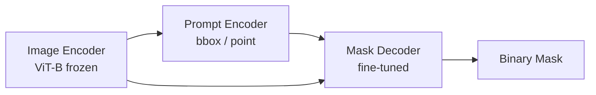
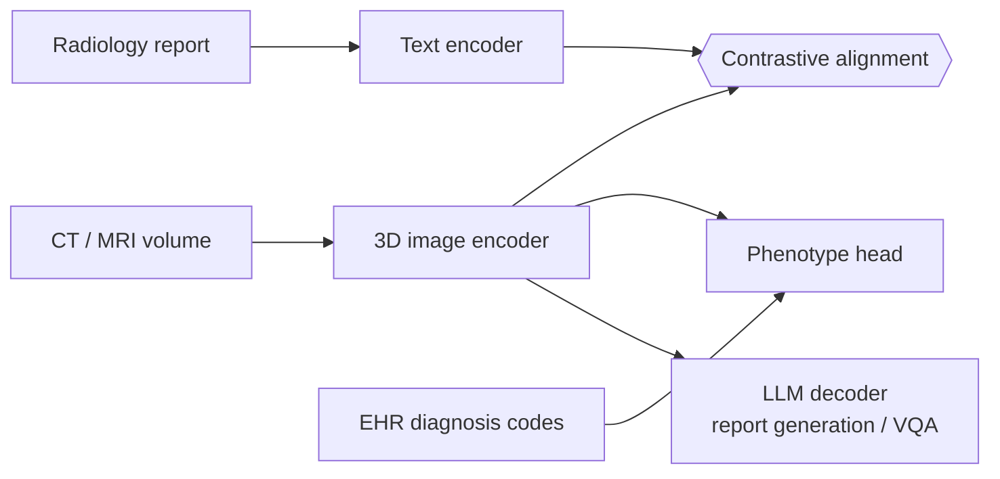

# Foundation Models in Medical Imaging

> **Last Updated:** October 2026
> **Level:** Advanced
> **Related Sections:**
> - [Medical Imaging Modalities](./00_medical_imaging.md)
> - [Any-Model / Generalist Vision Paradigm](../12_research_frontier_2024_2026/02_any_model_paradigm.md)
> - [Multimodal Vision-Language Models](../05_multimodal_vision_language/02_large_vision_language_models.md)
> - [Scientific Imaging](./02_scientific_imaging.md)

> **🆕 October 2026 update:**
> - New **MedGemma / MedSigLIP** subsection: Google's open medical VLMs (May–July 2025) and **MedGemma 1.5** (early 2026), which accepts 3D CT/MRI volumes, whole-slide pathology and longitudinal chest X-rays.
> - New section on **3D CT/MRI vision–language foundation models**: Merlin (Nature, March 2026), CT-CLIP / CT-RATE / CT-CHAT (Nature Biomedical Engineering 2026), Pillar-0 (November 2025).
> - **Pathology** brought up to date: UNI2-h, CONCH v1.5 and **TITAN** (Nature Medicine, November 2025), Prov-GigaPath and GigaTIME (Cell, December 2025), and the Virchow2 / H-optimus-1 benchmark picture.
> - SAM adaptation updated with **MedSAM2**, nnInteractive, BiomedParse v2 and SAM 3; the "3D-native foundation models" open problem was revised to reflect partial progress.

---

## Overview

Foundation models—large neural networks pretrained on broad data distributions and subsequently adapted to downstream tasks—have reshaped medical imaging research since 2022. The central thesis is that self-supervised or weakly supervised pretraining on the vast archives of clinical images (many institutions hold millions of radiology studies and gigapixels of digitized pathology) can produce representations transferable to diverse downstream tasks with dramatically fewer labeled examples than training from scratch. This mirrors the successes of BERT and GPT in NLP and CLIP/DINO in natural images, but medical data introduces unique constraints: patient privacy limits data pooling, image–text pairing is available through radiology reports (creating a natural contrastive pretraining signal), and clinical semantic concepts are not well-described by generic web-crawled image–caption pairs.

Two pretraining paradigms dominate the literature. **Contrastive image–text pretraining** (analogous to CLIP [Radford2021]) aligns paired image and text representations such that matching pairs are closer in embedding space than non-matching pairs. Applied to chest X-ray/report pairs, this yields models (CheXzero [Tiu2022], BioViL [Bannur2023]) capable of zero-shot pathology classification without any labeled images. **Self-supervised visual pretraining** (MAE, DINO, iBOT) applied to pathology patches (UNI [Chen2024], CONCH [Lu2024], PLIP [Huang2023]) produces patch encoders that rival or surpass supervised baselines on slide-level classification, survival prediction, and gene expression estimation, while being pretraining-data-scalable.

The arrival of SAM (Segment Anything Model) [Kirillov2023] opened a third trajectory: adapting interactive, promptable segmentation foundations to medical imaging. MedSAM [Ma2024] fine-tuned SAM on a dataset of 1,570,263 image–mask pairs spanning 10 imaging modalities and 30+ cancer types, yielding the first general-purpose interactive medical segmentation model. However, naive SAM adaptation reveals that the model's original training on natural images does not transfer well to CT/MRI volumetric data without explicit 3D adaptation. Subsequent work (SAM-Med3D, Rep-MedSAM, and in 2025 MedSAM2 and nnInteractive) has addressed efficiency and volumetric generalization.

From mid-2025 to 2026 three further shifts occurred. (1) **Open-weight generalist medical VLMs**: Google's MedGemma family [Sellergren2025] gave the community a downloadable 4B/27B medical VLM with a medically tuned SigLIP encoder. MedGemma 1.5 extended it to 3D CT/MRI and whole-slide inputs. (2) **3D-native CT/MRI vision–language models** trained on paired volumes, reports and EHR codes (Merlin, CT-CLIP, Pillar-0) moved beyond the slice-by-slice paradigm. (3) **Pathology scaled from patches to slides**: encoders grew to ViT-H/ViT-G scale on hundreds of thousands to millions of WSIs, and slide-level multimodal models (TITAN) began generating reports and retrieving rare cases zero-shot.

---

## Contrastive Image–Text Models

### CheXzero [Tiu2022]

CheXzero demonstrated that a CLIP-style model pretrained on 227,827 chest X-ray/report pairs from MIMIC-CXR can achieve zero-shot multi-label pathology classification competitive with fully supervised baselines, without using any labeled images at inference. The key insight is that radiology reports contain structured, clinically validated natural language that acts as a rich supervision signal. CheXzero achieved the highest mean AUC among self-supervised models evaluated, with strong performance on pathologies such as Edema (AUC 0.880), Cardiomegaly (AUC 0.825), and Pneumothorax (AUC 0.764) using 0% labeled data.

### BioViL / BioViL-T [Bannur2023]

BioViL extended contrastive pretraining with local-alignment objectives that associate phrases in radiology reports with spatial regions in X-rays, enabling phrase grounding. BioViL-T additionally models temporal change across serial imaging studies, predicting whether findings have improved, worsened, or are unchanged—a clinically essential capability unaddressed by earlier static models.

### MaCon / KAD and the Report Encoding Challenge

A persistent challenge in chest X-ray pretraining is that radiology reports describe findings negatively ("no pleural effusion"), requiring negation-aware text encoders. ClinicalBERT and specialized encoders handle this better than general-purpose BERT variants.

### MedSigLIP [Sellergren2025]

MedSigLIP is a SigLIP-derived image–text encoder tuned on de-identified medical data (chest X-ray, dermatology, ophthalmology, histopathology, and others). It was released with the MedGemma technical report in July 2025 and serves both as MedGemma's vision encoder and as a standalone zero-shot classifier and retriever. The authors report that, at 448×448 input, its zero-shot chest X-ray classification averages 2.0% (AUC) above the higher-resolution (1280×1280) HAI-DEF CXR Foundation model. They also report better results than the earlier Derm Foundation linear probes on a 79-condition dermatology task.

---

## Pathology Foundation Models

### UNI [Chen2024]

UNI (Universal Histopathology Encoder) is a general-purpose self-supervised vision encoder for computational pathology, pretrained using DINOv2-style training on over 100,000 whole-slide images (WSI) from The Cancer Genome Atlas (TCGA) and other sources—encompassing 20+ cancer types. UNI demonstrated state-of-the-art performance across 34 computational pathology tasks including patch classification, slide-level classification, survival prediction, and mutation prediction, published in Nature Medicine 2024.

**UNI 2 (January 2025).** UNI2-h is a ViT-H/14 (with 8 register tokens) trained on over 200 million H&E and IHC image tiles sampled from more than 350,000 diverse WSIs. It was released with pre-extracted embeddings for 25k+ WSIs from TCGA, CPTAC and PANDA.

### CONCH [Lu2024]

CONCH (CONtrastive learning from Captions for Histopathology) is a vision–language model for pathology trained contrastively on 1.17 million histopathology image–caption pairs derived from textbook figures, PubMed articles, and social media. CONCH supports zero-shot slide-level classification and retrieval from natural language queries. Published in Nature Medicine 2024, it achieves state-of-the-art zero-shot pathology classification across multiple datasets. An improved patch encoder, **CONCH v1.5**, was released in December 2024 as the backbone for TITAN.

### PLIP [Huang2023]

PLIP (Pathology Language and Image Pre-training) was trained on ~208,000 pathology image–text pairs scraped from Twitter (#pathology, #pathologyTwitter), demonstrating that even noisy social media data contains sufficient signal for useful medical representations. PLIP appeared in Nature Medicine 2023.

### Prov-GigaPath [Xu2024] and GigaTIME

Prov-GigaPath (Microsoft Research and Providence; Nature 2024) is a whole-slide foundation model. It pairs a tile encoder with a LongNet-based slide encoder trained on real-world Providence slides, so a slide is modeled as a very long tile sequence rather than through MIL pooling. In December 2025 the same team released **GigaTIME** (Cell). It uses multimodal AI to translate routine H&E into virtual tumor-microenvironment (multiplex-immunofluorescence-like) profiles at population scale, which turns cheap H&E archives into a "virtual population" for TME research. Lightweight **GigaPath-Flash** and **GigaTIME-Flash** variants followed in July 2026.

### TITAN [Ding2025]

TITAN (Transformer-based pathology Image and Text Alignment Network; Nature Medicine, November 2025) is a **multimodal whole-slide** foundation model. It operates on grids of CONCH v1.5 patch features and is pretrained in two ways: visual self-supervised learning on 335,645 internal Mass General Brigham WSIs, and vision–language alignment with more than 182,000 pathology reports and 423,122 synthetic region captions generated by the PathChat copilot. Without fine-tuning, TITAN produces general-purpose slide embeddings, zero-shot classification, rare-cancer retrieval, cross-modal retrieval and draft pathology reports. Like CONCH, it deliberately excludes TCGA/CPTAC/PANDA from pretraining to limit benchmark contamination.

### The 2025–2026 Encoder Landscape

The number of pathology encoders grew quickly in 2025: UNI2-h, **Virchow2** (Paige), **H-optimus-0/1** (Bioptimus), Prov-GigaPath, CONCH v1.5 and others. Independent benchmarks generally place Virchow2, H-optimus-1 and UNI2-h in the top group. One 31-model, 41-task comparison found Virchow2 strongest across TCGA, CPTAC and external tasks. The multi-hospital PathBench evaluation (15,888 WSIs, 10 hospitals) ranked Virchow2 and H-optimus-1 as the most effective overall. Rankings shift by task, so the practical conclusion is that encoder choice matters less than aggregation design and external validation once a top-tier encoder is used.

---

## Retinal and Ophthalmic Models

### RETFound [Zhou2023]

RETFound is a self-supervised foundation model for retinal images pretrained on 1.6 million unlabeled fundus photographs using MAE-style reconstruction. It was published in Nature 2023 (one of the first medical foundation models in Nature). RETFound demonstrated strong few-shot and fine-tuned performance across diabetic retinopathy grading, age-related macular degeneration staging, and systemic disease prediction (cardiovascular disease, Parkinson's disease) from retinal images—the latter enabled by the retina's role as a window to systemic vascular health.

The pretraining objective in RETFound follows the masked autoencoder (MAE) formulation:

$$\mathcal{L}_{MAE} = \frac{1}{|\mathcal{M}|} \sum_{i \in \mathcal{M}} \|x_i - \hat{x}_i\|^2$$

where $\mathcal{M}$ is the set of masked patch indices and $\hat{x}_i$ is the decoder reconstruction.

---

## SAM Adaptation to Medical Imaging

### MedSAM [Ma2024]

MedSAM fine-tuned SAM's mask decoder on 1,570,263 image–mask pairs across 10 modalities (CT, MRI, X-ray, ultrasound, endoscopy, microscopy, dermoscopy, OCT, fundus, mammography) and over 30 cancer types. The image encoder (ViT-B) was kept frozen during fine-tuning to preserve generalist visual features; only the mask decoder was updated. MedSAM supports bounding box and point prompts, enabling interactive segmentation without task-specific model retraining. Published in Nature Communications 2024.

**Key limitation**: MedSAM processes 2D slices independently and does not natively model 3D context, leading to inconsistent inter-slice predictions in volumetric CT/MRI without post-processing.

### SAM-Med3D

SAM-Med3D extends MedSAM by replacing the 2D ViT encoder with a 3D Swin Transformer and adapting the prompt encoder to accept 3D point prompts, enabling spatially coherent volumetric segmentation without slice-by-slice processing.

### MedSAM2 and the 2025 Generation [Ma2025]

**MedSAM2** addresses MedSAM's 2D limitation by building on SAM 2.1, which treats a volume's slices (or a video's frames) as a sequence with streaming memory attention. One prompt on a key slice is propagated through the whole volume. It was trained on more than 455,000 3D image–mask pairs and 76,000 video frames. Related 2025 systems take other routes. **nnInteractive** [Isensee2025] is natively 3D, accepts points, scribbles, boxes and lasso prompts, and won the CVPR 2025 interactive challenge. **BiomedParse** [Zhao2025] (Nature Methods 2025; v2 in 3D) is text-prompted and jointly segments, detects and recognizes objects. Meta's **SAM 3** (November 2025) introduces concept prompts (noun phrases or exemplars → all instances), which are a natural fit for "segment all lesions of type X" once adapted to medical data. Details and benchmark results are in [Medical Imaging](./00_medical_imaging.md).

### Architecture Sketch

---

## 3D CT/MRI Vision–Language Foundation Models

The open problem of "3D-native foundation models" listed in earlier versions of this file saw substantial progress in 2025–2026. The common recipe is a volumetric encoder (3D CNN or ViT on resampled volumes) aligned with radiology report text, sometimes with structured EHR labels as extra supervision, followed by an LLM decoder for report generation or VQA.

### CT-CLIP, CT-RATE and CT-CHAT [Hamamci2026]

**CT-RATE** is a public dataset of 25,692 non-contrast 3D chest CT scans from 21,304 patients, each paired with its radiology report. Multiple reconstructions expand it to 50,188 volumes, more than 14.3 million slices. **CT-CLIP** is trained contrastively on CT-RATE and performs zero-shot multi-abnormality detection (18 abnormalities). In the authors' evaluation it outperforms fully supervised baselines and also supports image or text case retrieval. **CT-CHAT** pairs the CT-CLIP encoder with an LLM fine-tuned on more than 2.7 million CT-RATE-derived question–answer pairs. The work was published in Nature Biomedical Engineering (2026), and data, code and weights are open.

### Merlin [Blankemeier2026]

**Merlin** (Stanford; Nature, March 2026) is a 3D VLM for **abdominal CT**. It is supervised jointly by radiology reports and by structured EHR diagnosis codes. Training used 15,331 CT scans (over 6 million images), more than 1.8 million diagnosis codes and over 6 million report tokens. It was evaluated on 6 task types and 752 individual tasks: zero-shot findings classification, phenotype classification, image–report retrieval, 5-year chronic disease prediction, report generation and 3D organ segmentation. Internal testing used 5,137 scans and external testing used 44,098 scans from 3 independent sites and 2 public datasets. It outperformed 2D VLMs and prior CT foundation models. Code and weights (`pip install merlin-vlm`) and a de-identified abdominal CT dataset are released.

### Pillar-0 [YalaLab2025]

**Pillar-0** (UC Berkeley / UCSF, released November 2025 with the spin-out Voio) is an open radiology foundation model pretrained on 42,990 abdomen-pelvis CTs, 86,411 chest CTs, 14,348 head CTs and 11,543 breast MRIs. It was released with **RATE**, an LLM-based framework that extracts structured labels for 366 radiologic findings from reports. On UCSF held-out data the authors report a mean AUC of 0.87 across 350+ findings, versus 0.76 for MedGemma, 0.75 for Microsoft's MI2 and 0.70 for Alibaba's Lingshu. These comparisons are self-reported.

### MedGemma 1.5 (3D and WSI input)

See the MedGemma subsection below. MedGemma 1.5 accepts multiple CT/MRI slices or multiple WSI patches in a single prompt. It is the first widely available open *generalist* VLM to do so, although its 3D handling is multi-image rather than a dedicated volumetric encoder.

---

## Medical Vision-Language Models (Med-VLMs)

### LLaVA-Med [Li2023]

LLaVA-Med fine-tuned LLaVA (Large Language and Vision Assistant) on biomedical instruction-following data constructed via GPT-4 from PMC-15M image–caption pairs. It achieved 74.2% accuracy on VQA-RAD (radiology visual question answering) and strong performance on PathVQA, enabling conversational interaction with medical images. Published at NeurIPS 2023.

### Med-Flamingo [Moor2023]

Med-Flamingo adapted the Flamingo few-shot multimodal model to medicine by continued pretraining on paired medical image–text data. It demonstrated best performance on 4 out of 7 evaluation metrics including retinal classification and VQA-RAD under few-shot settings (1–4 shots), making it the first medical few-shot learner for multimodal clinical reasoning.

### Med-Gemini [Yang2024]

Med-Gemini, announced by Google in 2024, integrates long-context reasoning (1M token context window) with access to medical knowledge retrieval, enabling multi-image analysis across multiple imaging timepoints or modalities in a single inference call. Med-Gemini-L 1.0 surpassed GPT-4V on MedQA (USMLE-style) and multiple medical VQA benchmarks as of its publication. Specific benchmark scores for individual imaging tasks are not all publicly reported.

### MedGemma and MedGemma 1.5 [Sellergren2025]

**MedGemma** (Google Health AI Developer Foundations; announced May 2025, technical report July 2025) is a family of **open-weight** medical models built on Gemma 3. The 4B multimodal model and 27B text model came first; a 27B multimodal variant and the MedSigLIP encoder followed in July 2025. The vision encoder is MedSigLIP, and the LLM was further trained on radiology, histopathology, ophthalmology, dermatology and medical text. Weights are distributed on Hugging Face and Vertex AI Model Garden under the Health AI Developer Foundations license.

**MedGemma 1.5** (4B, early 2026; released with the MedASR medical speech-to-text model) adds:
- **High-dimensional imaging**: 3D CT and MRI (several slices passed as a multi-image prompt) and whole-slide histopathology (several patches).
- **Longitudinal** chest X-ray comparison and **anatomical localization** (bounding boxes).
- Google-reported gains over MedGemma 1 of 61% vs. 58% accuracy on disease-related CT finding classification, and 65% vs. 51% on MRI finding classification.

Google states explicitly that MedGemma is not clinical-grade and is meant as a starting point for fine-tuning and validation. Its practical significance is that it is a strong, permissively downloadable baseline for academic and startup work that had previously relied on closed APIs.

---

## Self-Supervised Pretraining Strategies for Medical Data

| Strategy | Approach | Key Benefit | Medical Application |
|----------|----------|------------|---------------------|
| MAE (masked autoencoders) | Reconstruct masked patches | Label-efficient; scalable | RETFound, SAM-Med3D |
| DINO / DINOv2 | Self-distillation, momentum encoder | Strong patch features | UNI, pathology |
| DINOv2-style at ViT-H/G scale | Self-distillation with registers on 10⁵–10⁶ WSIs | Top-tier frozen features; strong linear probes | UNI2-h, Virchow2, H-optimus-1 |
| SimCLR / MoCo | Instance contrastive | Good image-level representations | Radiology classification |
| CLIP-style | Image–text contrastive | Zero-shot transfer | CheXzero, CONCH, BioViL, MedSigLIP |
| iBOT | Masked image modeling + self-distillation | Combines local+global | UNI pretraining |
| Slide-level SSL + vision–language alignment | SSL on patch-feature grids, then report/caption alignment | Slide embeddings, zero-shot retrieval and report generation | TITAN |
| Volumetric CLIP + EHR supervision | 3D encoder aligned with reports and diagnosis codes | 3D-native zero-shot findings, phenotypes, prognosis | Merlin, CT-CLIP, Pillar-0 |

---

## Key Papers

| Paper | Authors | Year | Venue | Key Contribution |
|-------|---------|------|-------|-----------------|
| CheXzero: Expert-level Detection of Pathologies from Chest Radiographs with Zero-labeled Data | Tiu et al. | 2022 | Nature Biomedical Engineering | CLIP for chest X-ray; zero-shot competitive with supervised models |
| RETFound: A Foundation Model for Generalizable Disease Detection from Retinal Images | Zhou et al. | 2023 | Nature | MAE pretraining on 1.6M fundus photos; multi-disease foundation |
| A General-Purpose Self-Supervised Model for Computational Pathology (UNI) | Chen et al. | 2024 | Nature Medicine | DINOv2-style on 100K+ WSI; SOTA on 34 pathology tasks |
| A Visual-Language Foundation Model for Pathology Image Analysis (CONCH) | Lu et al. | 2024 | Nature Medicine | 1.17M histopathology image–text pairs; zero-shot pathology classification |
| Segment Anything in Medical Images (MedSAM) | Ma et al. | 2024 | Nature Communications | Fine-tuned SAM on 1.57M medical image–mask pairs; interactive multi-modal segmentation |
| LLaVA-Med: Training a Large Language-and-Vision Assistant for Biomedicine | Li et al. | 2023 | NeurIPS | GPT-4-generated instruction tuning on PMC-15M; 74.2% VQA-RAD accuracy |
| Med-Flamingo: A Multimodal Medical Few-shot Learner | Moor et al. | 2023 | arXiv/ML4H | First medical few-shot multimodal model; retinal and VQA benchmarks |
| A Whole-Slide Foundation Model for Digital Pathology from Real-World Data (Prov-GigaPath) | Xu et al. | 2024 | Nature | LongNet slide encoder over tile sequences; real-world Providence data |
| A Foundation Model for Joint Segmentation, Detection and Recognition of Biomedical Objects Across Nine Modalities (BiomedParse) | Zhao et al. | 2025 | Nature Methods | Text-prompted joint parsing; 6M+ image–mask–text triples; v2 extends to 3D |
| MedGemma Technical Report | Sellergren et al. | 2025 | arXiv | Open Gemma 3-based medical VLMs (4B/27B) and MedSigLIP encoder |
| MedSAM2: Segment Anything in 3D Medical Images and Videos | Ma et al. | 2025 | arXiv | SAM 2.1 adapted to 3D volumes and video with memory attention |
| A Multimodal Whole-Slide Foundation Model for Pathology (TITAN) | Ding et al. | 2025 | Nature Medicine | 335,645 WSIs; SSL + alignment with reports and 423K synthetic captions; zero-shot slide tasks and report generation |
| Pillar-0: A New Frontier for Radiology Foundation Models | YalaLab (UC Berkeley/UCSF) | 2025 | arXiv | Open CT/MRI volumetric foundation model; RATE label extraction for 366 findings |
| Generalist Foundation Models from a Multimodal Dataset for 3D Computed Tomography (CT-CLIP / CT-RATE) | Hamamci et al. | 2026 | Nature Biomedical Engineering | 25,692-scan chest CT–report dataset; 3D CLIP and CT-CHAT |
| Merlin: A Computed Tomography Vision–Language Foundation Model and Dataset | Blankemeier et al. | 2026 | Nature | Abdominal-CT 3D VLM supervised by reports + EHR codes; 752 tasks evaluated |

---

## Benchmark Performance

| Model | Dataset | Metric | Score | Notes |
|-------|---------|--------|-------|-------|
| CheXzero | CheXpert (Edema) | AUC | 0.880 | Zero-shot, 0% labeled training data |
| CheXzero | CheXpert (Cardiomegaly) | AUC | 0.825 | Zero-shot |
| CheXzero | CheXpert (Pneumothorax) | AUC | 0.764 | Zero-shot; highest mean AUC among self-supervised |
| UNI | TCGA 18-cancer classification | AUC (avg) | Not publicly reported (SOTA at pub.) | Slide-level via ABMIL aggregation |
| CONCH | 14 pathology tasks | AUC/Acc avg | SOTA vs. prior methods at publication | Zero-shot and few-shot |
| LLaVA-Med | VQA-RAD | Accuracy | 74.2% | Fine-tuned; conversational medical VQA |
| MedSAM | 10 modalities (avg Dice) | Dice | Not publicly reported as single avg | Modality-specific results in paper |
| MedSigLIP | Chest X-ray zero-shot classification | AUC (avg) | +2.0% vs. HAI-DEF CXR Foundation | 448×448 vs. 1280×1280 input; authors' evaluation |
| MedGemma 1.5 4B | Disease-related CT finding classification | Accuracy | 61% (vs. 58% MedGemma 1) | Google-reported |
| MedGemma 1.5 4B | Disease-related MRI finding classification | Accuracy | 65% (vs. 51% MedGemma 1) | Google-reported |
| Pillar-0 | UCSF CT/MRI, 350+ findings | AUC (mean) | 0.87 | Self-reported; MedGemma 0.76, MI2 0.75, Lingshu 0.70 on the same data |
| Merlin | 752 tasks, 6 task types (internal + 44,098 external scans) | Various | Outperforms 2D VLMs and CT foundation models | No single headline number |
| TITAN | Slide-level linear probe, few/zero-shot, rare-cancer retrieval | Various | Outperforms ROI and slide foundation models | Authors' evaluation (Nature Medicine 2025) |

---

## Pros & Cons

| Approach | Pros | Cons |
|----------|------|------|
| Contrastive image–text (CheXzero, CONCH) | Zero-shot transfer; no manual labels at inference; leverages free-text reports | Requires large paired image–text corpora; negation in clinical text causes errors |
| Self-supervised visual (UNI, RETFound) | Scalable; strong patch-level features; no text needed | Does not encode semantic clinical vocabulary; supervised fine-tuning still needed for new tasks |
| SAM adaptation (MedSAM, SAM-Med3D, MedSAM2) | Interactive; modality-agnostic; no per-task retraining; MedSAM2 adds 3D/video propagation | Prompt engineering burden on radiologist; natural-image priors still need domain adaptation |
| Med-VLMs (LLaVA-Med, Med-Gemini, MedGemma) | Conversational, multi-task; generalizes across modalities via language; MedGemma is open-weight | Hallucination risk in clinical settings; computationally expensive; limited spatial grounding; not clinical-grade |
| Slide-level pathology models (TITAN, Prov-GigaPath) | Patient/slide-level embeddings; zero-shot retrieval and report drafting; helps rare diseases | Heavy compute; single-institution pretraining data; scanner/stain domain shift |
| 3D CT/MRI VLMs (Merlin, CT-CLIP, Pillar-0) | Use full volumetric context; zero-shot findings and prognosis; reports and EHR codes as free supervision | Body-region-specific; large GPU memory; public evaluation sets still small; self-reported comparisons |

---

## Open Problems & Research Gaps

- **Privacy-preserving pretraining at scale**: federated learning and differential privacy for aggregating multi-site medical image corpora without centralizing protected health information remains computationally and statistically costly.
- **Grounding and faithfulness in Med-VLMs**: models like LLaVA-Med generate fluent but occasionally hallucinated clinical descriptions; robust grounding of language outputs to image evidence is an unsolved alignment problem.
- **3D-native foundation models**: 2025–2026 brought the first credible 3D CT/MRI VLMs (Merlin, CT-CLIP, Pillar-0) and 3D input in open generalist VLMs (MedGemma 1.5). However, most are specific to one body region or modality, generalist VLMs still process volumes as multi-image slice sets, and a single whole-body, multi-sequence MRI + CT model with efficient volumetric attention remains open.
- **Fair, contamination-free benchmarking**: dozens of pathology and radiology foundation models now report self-run comparisons on overlapping public datasets (TCGA, MIMIC-CXR). Independent, held-out, multi-site benchmarks (e.g., PathBench-style) and pretraining-data disclosure are needed to separate real gains from evaluation artifacts.
- **Rare disease and low-prevalence pathology**: foundation models pretrained on common diseases underperform on rare conditions (<100 training examples); slide-level retrieval (TITAN) helps, but compositional generalization and meta-learning approaches for rare medical imaging tasks are largely unexplored.
- **Multi-modal clinical fusion**: patients generate text, imaging, genomics, and structured EHR data simultaneously; unifying these heterogeneous modalities in a single foundation model without catastrophic forgetting is unsolved, although Merlin's report + EHR supervision and GigaTIME's H&E-to-TME translation are early steps.
- **Prospective clinical validation and regulatory approval**: benchmark performance does not guarantee clinical utility; rigorous prospective trials for AI-assisted diagnosis remain rare and methodologically challenging, and no open generalist medical VLM is cleared for diagnostic use.
- **Temporal and longitudinal modeling**: most models treat each study independently; MedGemma 1.5 adds longitudinal CXR comparison, but modeling disease progression across serial 3D studies (beyond BioViL-T's binary change detection) requires new architectural and training paradigms.

---

## Further Reading

- [MedSAM Nature Communications 2024](https://www.nature.com/articles/s41467-024-44824-z)
- [MedSAM2 (arXiv 2025)](https://arxiv.org/abs/2504.03600)
- [UNI / CONCH Nature Medicine 2024 — Mass General Brigham press release](https://www.massgeneralbrigham.org/en/about/newsroom/press-releases/mass-general-brigham-researchers-develop-ai-foundation-models-to-advance-pathology)
- [UNI2-h model and benchmarks (GitHub)](https://github.com/mahmoodlab/UNI)
- [TITAN: multimodal whole-slide foundation model (Nature Medicine 2025)](https://www.nature.com/articles/s41591-025-03982-3)
- [Prov-GigaPath and GigaTIME (GitHub)](https://github.com/prov-gigapath/prov-gigapath)
- [MedGemma Technical Report (arXiv 2025)](https://arxiv.org/abs/2507.05201)
- [MedGemma 1.5 and MedASR — Google Research blog](https://research.google/blog/next-generation-medical-image-interpretation-with-medgemma-15-and-medical-speech-to-text-with-medasr/)
- [Merlin: CT vision–language foundation model and dataset (Nature 2026)](https://www.nature.com/articles/s41586-026-10181-8)
- [CT-CLIP / CT-RATE (arXiv; Nature Biomedical Engineering 2026)](https://arxiv.org/abs/2403.17834)
- [Pillar-0 (arXiv 2025)](https://arxiv.org/abs/2511.17803)
- [Foundation Models in Medical Image Analysis: Systematic Review (arXiv 2025)](https://arxiv.org/pdf/2510.16973)
- [Toward Clinically Ready Foundation Models (arXiv 2026)](https://arxiv.org/pdf/2603.14271)
- [MONAI: Medical Open Network for AI](https://monai.io/)
- [PMC-15M dataset for biomedical image–text pretraining](https://huggingface.co/datasets/axiong/pmc_oa)
