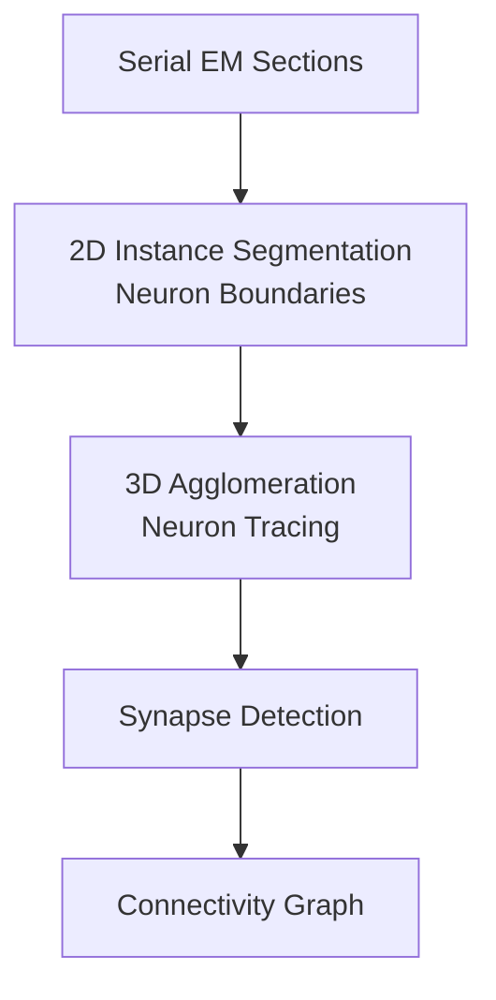
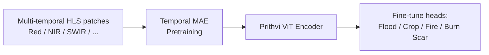
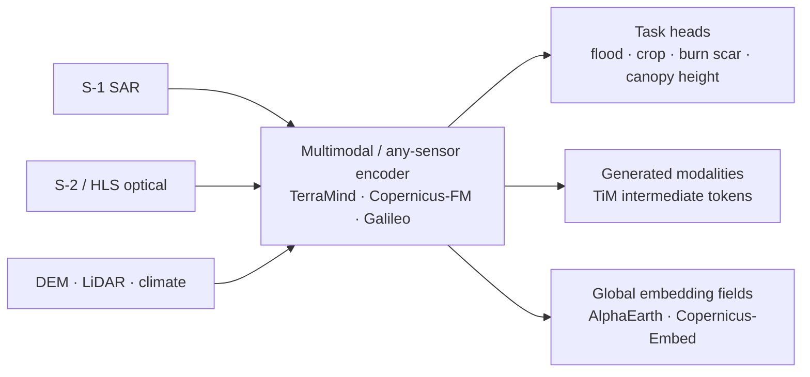

# Scientific Imaging: Microscopy, Connectomics, Cryo-EM, Remote Sensing, and Beyond

> **Last Updated:** October 2026
> **Level:** Advanced
> **Related Sections:**
> - [Medical Imaging Modalities](./00_medical_imaging.md)
> - [Foundation Models in Medical Imaging](./01_foundation_models_medical.md)
> - [3D Vision and Scene Understanding](../04_3d_vision_and_scene/00_3d_representations.md)
> - [Datasets and Benchmarks](../11_datasets_and_benchmarks/00_core_datasets.md)

> **🆕 October 2026 update:**
> - **Microscopy**: Cellpose3 (Nature Methods 2025, image restoration), **Cellpose-SAM** (2025, SAM backbone, "superhuman" generalization), new DINOv3-based Cellpose models (June 2026), and **μSAM** (Segment Anything for Microscopy, Nature Methods 2025).
> - **Connectomics**: the MICrONS cubic-millimeter dataset was formally published in Nature (April 2025) and the FlyWire whole adult fly brain connectome in Nature (2024).
> - **Cryo-EM**: ModelAngelo (Nature 2024) for automated atomic model building, CryoDRGN-ET (2024) and **CryoDRGN-AI** (Nature Methods 2025), and AlphaFold 3 (Nature 2024).
> - **Earth observation foundation models**: Prithvi-EO-2.0, **TerraMind** (ICCV 2025), **Copernicus-FM** (ICCV 2025 oral), Galileo, Google DeepMind's **AlphaEarth Foundations** (July 2025), and DINOv3's satellite ViT-7B with Canopy Height Maps v2 (2026).
> - **Astronomy**: the **AION-1** omnimodal astronomy foundation model (Polymathic AI, 2025).

---

## Overview

Beyond clinical medicine, computer vision increasingly drives discovery across the physical and life sciences—from mapping individual synapses in cubic millimeters of brain tissue to detecting crop stress across continents from orbit. These domains share several structural properties that distinguish them from natural image tasks: images are acquired with domain-specific physical instruments (electron microscopes, radio telescopes, multispectral satellite sensors), ground truth labels are generated by domain experts under strict ontologies, and the scale of data ranges from single gigapixel micrographs to petabyte remote sensing archives. Unlike natural images, scientific imaging typically requires quantitative precision—the exact count of mitotic figures per high-power field is a prognostic biomarker, not an approximate visual quantity.

Fluorescence microscopy, the workhorse of cell biology, quantifies protein distributions, organelle morphology, and dynamic processes in living cells and tissues. Instance segmentation of individual cells or nuclei is the core CV task, enabling downstream quantification of morphological and molecular phenotypes in high-content screening. Electron microscopy (EM), both conventional (SEM/TEM) and cryo-EM, operates at sub-nanometer resolution and is used to reconstruct 3D ultrastructure—from synaptic vesicle arrangement in neural tissue to protein complex architecture. **Connectomics**—reconstructing the complete wiring diagram of a neural circuit from serial EM volumes—is perhaps the most computationally demanding CV task in biology, requiring petabyte-scale 3D dense segmentation with sub-voxel accuracy. Remote sensing CV processes multi-spectral, hyperspectral, SAR, and LiDAR data from satellites and airborne sensors to monitor land cover, disasters, agriculture, and climate-relevant phenomena at planetary scale.

The cross-cutting theme is that domain-specific pretraining and specialized architectures consistently outperform generic ImageNet-initialized models. The most successful paradigm is to pretrain a foundation model on a large domain corpus (millions of microscopy patches, thousands of satellite image tiles) using self-supervised objectives (MAE, DINO, contrastive), then fine-tune with modest task-specific labels. A notable 2025–2026 nuance is that **very large generic foundation backbones**, such as SAM (in Cellpose-SAM and μSAM) and DINOv3 (in new Cellpose models and DINOv3's satellite variant), now serve as strong starting points that are then specialized, which narrows the gap between "generic" and "domain" pretraining.

---

## Fluorescence Microscopy: Cell and Nucleus Segmentation

### Cellpose [Stringer2021]

Cellpose introduced a biologically motivated representation for instance segmentation of cells: rather than predicting bounding boxes or watershed energy, the network predicts a **gradient flow field** that, when integrated, converges particles to cell centers. This representation handles highly irregular cell shapes and crowded arrangements that confound standard instance segmentation methods.

The gradient field $\mathbf{g}(\mathbf{x})$ at pixel $\mathbf{x}$ points toward the centroid of the cell containing $\mathbf{x}$, encoding direction (not magnitude). Instance segmentation proceeds by:
1. Predict per-pixel gradient vectors $\hat{\mathbf{g}}$.
2. Simulate particle advection: $\mathbf{x}_{t+1} = \mathbf{x}_t + \hat{\mathbf{g}}(\mathbf{x}_t)$.
3. Cluster converged particle positions as cell instances.

Cellpose was trained on a curated dataset of 608 manually annotated images spanning 70+ cell types, and generalizes across fluorescence channels, brightfield, and phase-contrast microscopy without retraining. Cellpose 2.0 [Pachitariu2022] introduced human-in-the-loop fine-tuning workflows, further improving accuracy on new cell types.

**Performance**: On a systematic benchmark of 18 instance segmentation methods for microscopy, Cellpose (tuned) achieved Dice coefficient of 0.76 ± 0.03 with 80% training data, versus StarDist (tuned) at 0.72 ± 0.07 under the same conditions.

### Cellpose3, Cellpose-SAM and DINOv3-based Cellpose (2025–2026)

- **Cellpose3** [Stringer2025] (Nature Methods 2025) adds "one-click" **image restoration** (denoising, deblurring, upsampling) trained jointly with the segmentation objective, so restored images are optimized for downstream segmentation rather than perceptual quality.
- **Cellpose-SAM** [Pachitariu2025] (bioRxiv 2025) replaces the Cellpose backbone with SAM's pretrained ViT image encoder while keeping the flow-field output. It is trained for robustness to channel order, cell size, shot noise, downsampling and isotropic/anisotropic blur. The authors report that it exceeds inter-annotator agreement and approaches the human-consensus bound, hence "superhuman generalization". It became the default model in Cellpose 4, with 3D and human-in-the-loop fine-tuning support.
- In **June 2026** (Cellpose v4.2) the team added **DINOv3-based** Cellpose models (`cpdino`, `cpdino-vitb`) and an updated `cpsam_v2` that produces fewer spurious masks in low-contrast regions. All Cellpose models and the annotated dataset are CC-BY-NC.

### Segment Anything for Microscopy (μSAM) [Archit2025]

**μSAM** (Nature Methods, March 2025) fine-tunes SAM into generalist models for **light and electron microscopy**. According to the Göttingen press release, it was retrained on more than 17,000 microscopy images with more than 2 million annotated structures. It is delivered as napari tools for interactive 2D and 3D segmentation (e.g., mitochondria in EM), automatic instance segmentation and interactive tracking. Together with nnInteractive (3D microscopy is part of its training data; see [Medical Imaging](./00_medical_imaging.md)), it made promptable segmentation a standard tool in bioimage analysis.

### StarDist [Schmidt2018, Weigert2022]

StarDist represents nuclei as **star-convex polygons** (2D) or star-convex polyhedra (3D), parameterized by radial distances from the object center in $K$ uniformly sampled directions. A single network predicts both the object probability map and $K$ radial distances per pixel:

$$\hat{\mathbf{r}}(\mathbf{x}) = (r_1, r_2, \ldots, r_K), \quad r_k = \text{distance to boundary in direction } \theta_k$$

Non-maximum suppression in the polygon space resolves overlapping predictions. StarDist is particularly well-suited to tightly packed nuclei where watershed-based methods over-segment. StarDist 3D extends this to volumetric fluorescence imaging.

### Deep Learning in High-Content Screening

High-content screening (HCS) applies automated fluorescence microscopy at scale—often thousands of wells per plate, millions of cells per experiment. **CellProfiler** couples classical image processing with feature extraction; **DeepProfiler** applies CNN-based feature extraction (ResNet50, EfficientNet) to the same images and feeds features to machine learning classifiers. The **Recursion Phenomics** RxRx datasets provided large-scale benchmarks for morphological profiling. Metadata-guided adaptation of generic foundation backbones is an emerging alternative. Meta's 2026 FINO recipe for DINOv3 includes fluorescence-imagery (HPA) reference training that uses only the metadata already attached to images.

---

## Connectomics: Petabyte-Scale 3D Neural Circuit Reconstruction

Connectomics aims to reconstruct the **connectome**—the complete synaptic connectivity graph of a neural circuit—from serial electron microscopy (SEM) stacks. Current volumes include portions of mouse, fly, and human cortex.

### Scale and Challenge

The IARPA MICrONS program (Machine Intelligence from Cortical Networks) produced the largest publicly available mammalian connectomics dataset: a 1.4 mm × 0.87 mm × 0.84 mm volume of mouse visual cortex imaged at 8 nm × 8 nm × 40 nm resolution, containing >200,000 cells, ~120,000 neurons, and >523 million automatically detected synapses. Reconstruction involved two-photon microscopy for functional imaging, microCT for alignment, and serial EM for ultrastructure, all registered to a common coordinate frame.

**2024–2025 milestones.** The MICrONS results were formally published on 9 April 2025 as a package of papers in Nature and Nature Methods, led by *Functional connectomics spanning multiple areas of mouse visual cortex* (Nature 640, 435–447) [MICrONS2025]. The package co-registers wiring with the functional responses of roughly 76,000 neurons recorded while the mouse viewed natural movies. (Press coverage gives neuron counts in the reconstructed volume between ~84,000 and ~120,000 depending on the inclusion criteria.) In October 2024 the **FlyWire** consortium published the first complete connectome of an adult *Drosophila* brain (~140,000 neurons) in Nature [Dorkenwald2024]. It was built by automated segmentation plus large-scale community proofreading.

### Core CV Tasks in Connectomics

**Neuron segmentation** is treated as instance segmentation of mitochondria, axons, dendrites, and cell bodies in densely packed neuropil. Methods based on U-Net-style architectures predict **affinities** (probability that adjacent voxels belong to the same neuron), followed by graph-based agglomeration (MALIS, GASP). **Human proofreading** remains essential for correcting merge errors (two neurons incorrectly joined) and split errors (one neuron fragmented into multiple pieces).

**Synapse detection** localizes pre- and post-synaptic densities: SynEM [Staffler2017] formulated this as border classification, achieving automated detection of ~500 million synapses in the MICrONS dataset.

---

## Cryo-Electron Microscopy: Structure Determination

Cryo-EM determines the 3D structure of proteins and macromolecular complexes at near-atomic resolution by computationally averaging many 2D projection images of flash-frozen particles in random orientations.

### Deep Learning in Cryo-EM Workflows

1. **Particle picking**: identifying candidate particle images in micrographs. TOPAZ [Bepler2019] combined a CNN classifier with a generative model for noise, achieving strong recall on sparse particles. CryoSegNet [Ding2024] framed picking as image segmentation (U-Net encoder–decoder) and integrated SAM-based prompting for improved generalization.

2. **2D class averaging**: clustering particle images by conformation and view orientation. Convolutional autoencoders and variational autoencoders (cryoDRGN [Zhong2021]) model continuous conformational heterogeneity—revealing multiple structural states of dynamic complexes that classical discrete averaging misses.

3. **3D reconstruction refinement**: modern packages (RELION, cryoSPARC) incorporate neural-network-based pose refinement and contrast transfer function (CTF) correction.

4. **Neural *ab initio* reconstruction and in-situ heterogeneity**: **CryoDRGN-ET** [Rangan2024] (Nature Methods 2024) extends heterogeneous reconstruction to cryo-electron *tomography* subtomograms, visualizing dynamic complexes inside cells. **CryoDRGN-AI** [Levy2025] (Nature Methods 2025) performs neural *ab initio* reconstruction, jointly estimating poses and a heterogeneous volume without a consensus model, on challenging cryo-EM and cryo-ET datasets.

5. **Automated atomic model building**: **ModelAngelo** [Jamali2024] (Nature 2024) combines a GNN over map-derived residue candidates with a protein language model to build atomic models directly into cryo-EM maps. For high-resolution maps its models are comparable to those built by experts, which removes one of the most labor-intensive steps of the pipeline.

### AlphaFold2 Context [Jumper2021]

AlphaFold2 (DeepMind, 2021) achieved a landmark in structural biology by predicting protein 3D structure from sequence with near-crystallographic accuracy, winning the CASP14 competition with a median GDT_TS score of 92.4 versus the previous best of ~76. AlphaFold2 uses an Evoformer module that processes multiple sequence alignments (MSA) through attention mechanisms, followed by structure module with invariant point attention (IPA) to produce 3D atomic coordinates. AlphaFold2 is not a traditional CV task (it operates on sequence, not images), but its predictions are increasingly used to initialize or validate cryo-EM-derived structures—exemplifying the blurring boundary between structural biology and learned representations.

**AlphaFold 3** [Abramson2024] (Nature 2024) replaces the structure module with a **diffusion-based** coordinate generator and extends prediction to complexes of proteins, nucleic acids, ligands and ions. Its source code was released in November 2024 under Apache 2.0, with model weights available on request for non-commercial use. For cryo-EM, AF3 complex predictions are now routinely docked into intermediate-resolution maps and refined, and the combination of ModelAngelo-style map-conditioned building with sequence-conditioned priors is an active direction.

---

## Remote Sensing and Satellite Imagery

### Scale and Modality Characteristics

Satellite imagery is multispectral (Sentinel-2: 13 bands, 10–60 m resolution), hyperspectral (AVIRIS: 224 bands), or synthetic aperture radar (SAR: Sentinel-1), with temporal revisit periods enabling change detection. Unlike natural images, satellite data includes non-visible spectral bands (NIR, SWIR, thermal), requires atmospheric correction, and covers enormous geographic extents.

### Foundation Models for Earth Observation

**SatMAE [Cong2022]** extended masked autoencoders (MAE) to multispectral satellite imagery by grouping spectral bands into independent channel groups and masking patches independently per group, enabling pretraining on temporal sequences from the fMoW-Sentinel dataset. SatMAE demonstrated strong transfer to land cover classification, flood mapping, and crop type detection.

**Prithvi-EO-1.0 [Jakubik2023]** (IBM and NASA) was released in August 2023 as a 100M-parameter ViT-based geospatial foundation model pretrained on 1M+ time-series patches of Harmonized Landsat Sentinel-2 (HLS) data using an MAE objective over temporal sequences. For flood mapping, Prithvi achieves ~4% higher mIoU than SatMAE on unseen geographic regions and outperforms transformer baselines trained from scratch. Pretraining required only 93.3 GPU-hours versus 768 GPU-hours for SatMAE (a 8.2× efficiency gain), with correspondingly lower carbon footprint (13.3 vs. 109.44 kg CO₂).

**Prithvi-EO-2.0 [Jakubik2024]** scaled to 600M parameters (6× larger than v1), incorporating multi-temporal encoding, and demonstrated improved performance across wildfire mapping, crop type classification, and multi-hazard assessment.

### The 2025–2026 Generation: Multimodal, Any-Sensor, and Embedding Fields

- **TerraMind** [Jakubik2025] (IBM, ESA Φ-lab and the FAST-EO project; ICCV 2025) is described as the first **any-to-any generative** EO foundation model. It is pretrained across modalities such as optical, SAR, DEM, land cover and other derived layers, and introduces *Thinking-in-Modalities* (TiM): the model generates auxiliary modalities, such as a land-cover map from S-2, as intermediate tokens that improve fine-tuning. Tiny, small, base and large models are open on Hugging Face and integrated into TerraTorch.
- **Copernicus-FM** [Wang2025] (ICCV 2025 oral) extends DOFA's dynamic hypernetworks to process **any spectral or non-spectral sensor** with metadata encoding. It comes with **Copernicus-Pretrain**, 18.7M aligned images from all major Sentinel missions (S1–S5P) on ~310K 0.25° grids, and **Copernicus-Bench** (15 hierarchical tasks).
- **Galileo** [Tseng2025] (NASA Harvest and collaborators, arXiv 2025) learns **global and local features** jointly across many remote-sensing inputs (multispectral, SAR, elevation, weather and other space–time channels) with a masked modeling scheme that uses distinct global and local objectives. Pretrained weights are released in several sizes, starting from a "nano" model.
- **AlphaEarth Foundations** [Brown2025] (Google DeepMind, July 2025) is an **embedding field model**. It assimilates optical, radar, LiDAR, climate and geotagged-text sources into a 64-dimensional embedding for every 10 m × 10 m land pixel. Annual global layers are published as the **Satellite Embedding** dataset in Google Earth Engine (more than 1.4 trillion embedding footprints per year). DeepMind reports about 24% lower error than the next-best approaches on its evaluation suite, with about 16× less storage (press-reported figures).
- **DINOv3** (Meta, August 2025) includes a **satellite-pretrained ViT-7B** (and a distilled ViT-L) trained on SAT-493M. Its first downstream product, **Canopy Height Maps v2** (CHMv2, March 2026), improves global canopy-height mapping over the 2024 release; see [Self-Supervised Learning](../03_architectures/03_self_supervised_learning.md).
- **Clay** is an open (Apache-2.0 code and weights) MAE-based EO foundation model with tooling for wall-to-wall embedding generation.

### Downstream Tasks

| Task | Primary Data | Core CV Challenge |
|------|-------------|------------------|
| Land cover / LULC classification | Sentinel-2, Landsat | Multi-class pixel-wise; class imbalance |
| Flood / disaster mapping | SAR, multispectral | Temporal change; cloudy conditions |
| Crop type mapping | Time-series Sentinel-2 | Phenological variation; fragmented fields |
| Building footprint extraction | Very high resolution (VHR) | Dense instance segmentation |
| Road network extraction | VHR optical / SAR | Thin structures; connectivity |
| Object detection (ships, aircraft) | VHR optical | Small objects; orientation sensitivity |
| Canopy height / biomass estimation | VHR optical + GEDI LiDAR | Monocular height regression; global consistency |
| Embedding-based mapping from sparse labels | Precomputed embedding fields (AlphaEarth, Copernicus-Embed) | Few labels; transfer across years and regions |

---

## Astronomy and Materials Science

### Astronomical Image Analysis

Optical and radio telescope surveys (SDSS, DES, Euclid, SKA) generate surveys of billions of objects. Key CV tasks include: galaxy morphology classification (GalaxyZoo; CNNs match human volunteer accuracy at >10× throughput), strong gravitational lens detection (residual networks on difference imaging), transient event detection (supernovae, gamma-ray bursts), and source separation in radio interferometric images. **Zoobot** [Walmsley2023] combined citizen science labels with active learning to train scalable galaxy morphology classifiers across multiple surveys.

**AION-1** [Polymathic2025] (Polymathic AI, arXiv 2510.17960) is a large **omnimodal** foundation model for astronomy. Modality-specific tokenizers cover 39 data types (multi-band survey images, spectra, catalog scalars such as fluxes and redshift) and feed a unified encoder–decoder transformer trained with a 4M-style multimodal masked-modeling objective. Its embeddings support similarity search, property estimation (e.g., redshift from images) and cross-modal generation; models are released in base, large and xlarge sizes. The start of very high-volume surveys, such as Vera C. Rubin Observatory (first images June 2025) and Euclid, makes such survey-agnostic representations increasingly important.

### Materials Characterization

Scanning transmission electron microscopy (STEM) and atomic force microscopy (AFM) image material microstructure at atomic resolution. CV tasks include defect detection (vacancies, grain boundaries), phase segmentation in polycrystalline materials, and automated characterization of nanoparticle size distributions. Foundation models for materials microscopy are nascent; transfer from Cellpose/nnU-Net, and increasingly from μSAM/SAM-family and DINOv3 backbones, is common, but the domain gap remains large.

---

## Key Papers

| Paper | Authors | Year | Venue | Key Contribution |
|-------|---------|------|-------|-----------------|
| Cellpose: A Generalist Algorithm for Cellular Segmentation | Stringer, Wang, Michaelos, Pachitariu | 2021 | Nature Methods | Gradient flow field for cell instance segmentation; generalist across cell types |
| StarDist: Object Detection with Star-Convex Polygons | Schmidt, Weigert, Broaddus, Myers | 2018 | MICCAI | Star-convex polygon representation for nucleus detection |
| TOPAZ: Positive-Unlabeled CNN for Particle Picking in Cryo-EM | Bepler et al. | 2019 | Nature Methods | PU-learning for sparse cryo-EM particle picking |
| Highly Accurate Protein Structure Prediction with AlphaFold2 | Jumper et al. | 2021 | Nature | CASP14 winner; GDT_TS 92.4; Evoformer + IPA modules |
| SatMAE: Pre-training Transformers for Temporal and Multi-Spectral Satellite Imagery | Cong et al. | 2022 | NeurIPS | MAE adapted for multi-spectral temporal satellite data |
| Prithvi-EO-1.0: A Geospatial Foundation Model | Jakubik et al. | 2023 | arXiv/HuggingFace | 100M ViT MAE on HLS; flood/crop SOTA; NASA-IBM collaboration |
| MICrONS: Large-Scale Cortical Connectomics Dataset | MICrONS Consortium | 2021 | Zenodo / bioRxiv | 1.4mm³ mouse visual cortex; 523M+ synapses; largest public connectome |
| Accurate Structure Prediction of Biomolecular Interactions with AlphaFold 3 | Abramson et al. | 2024 | Nature | Diffusion-based structure generation for proteins, nucleic acids, ligands, ions |
| Automated Model Building and Protein Identification in Cryo-EM Maps (ModelAngelo) | Jamali et al. | 2024 | Nature | GNN + protein language model builds atomic models directly into cryo-EM maps |
| CryoDRGN-ET: Deep Reconstructing Generative Networks for Visualizing Dynamic Biomolecules Inside Cells | Rangan et al. | 2024 | Nature Methods | Heterogeneous subtomogram reconstruction for in-situ cryo-ET |
| Neuronal Wiring Diagram of an Adult Brain (FlyWire) | Dorkenwald et al. | 2024 | Nature | First complete adult *Drosophila* brain connectome (~140K neurons) |
| Functional Connectomics Spanning Multiple Areas of Mouse Visual Cortex | MICrONS Consortium | 2025 | Nature | Published cubic-millimeter EM connectome co-registered with functional imaging |
| Segment Anything for Microscopy (μSAM) | Archit et al. | 2025 | Nature Methods | SAM fine-tuned for light and electron microscopy; napari interactive 2D/3D/tracking |
| Cellpose3: One-Click Image Restoration for Improved Segmentation | Stringer, Pachitariu | 2025 | Nature Methods | Segmentation-aware denoising/deblurring/upsampling |
| Cellpose-SAM: Superhuman Generalization for Cellular Segmentation | Pachitariu, Rariden, Stringer | 2025 | bioRxiv | SAM backbone + flow fields; robustness to channels, size, noise, blur |
| CryoDRGN-AI: Neural ab initio Reconstruction of Challenging Cryo-EM and Cryo-ET Datasets | Levy et al. | 2025 | Nature Methods | Joint pose + heterogeneous volume estimation without a consensus model |
| TerraMind: Large-Scale Generative Multimodality for Earth Observation | Jakubik et al. | 2025 | ICCV | First any-to-any generative EO foundation model; Thinking-in-Modalities |
| Towards a Unified Copernicus Foundation Model for Earth Vision (Copernicus-FM) | Wang et al. | 2025 | ICCV (oral) | Any-sensor hypernetwork FM; 18.7M-image Copernicus-Pretrain; Copernicus-Bench |
| AlphaEarth Foundations: An Embedding Field Model for Accurate and Efficient Global Mapping from Sparse Label Data | Brown et al. | 2025 | arXiv | 64-D global 10 m embedding fields; Earth Engine Satellite Embedding dataset |
| AION-1: Omnimodal Foundation Model for Astronomical Sciences | Polymathic AI | 2025 | arXiv | 39 astronomical data types tokenized; 4M-style multimodal masked modeling |

---

## Benchmark Performance

| Model | Dataset | Metric | Score | Notes |
|-------|---------|--------|-------|-------|
| Cellpose (tuned) | Multi-cell benchmark (80% train) | Dice | 0.76 ± 0.03 | Vs. StarDist (tuned) 0.72 ± 0.07 |
| StarDist (tuned) | Multi-cell benchmark (10% train) | Dice | 0.69 ± 0.02 | More robust under low-data than Cellpose (0.32 ± 0.4) |
| AlphaFold2 | CASP14 | GDT_TS | 92.4 | Median across free modelling targets; prior best ~76 |
| Prithvi-EO-1.0 | Flood mapping (unseen regions) | mIoU | ~4% better than SatMAE | Prithvi trained in 93.3 GPU-h vs. SatMAE 768 GPU-h |
| SatMAE | fMoW-Sentinel (land use) | Top-1 Accuracy | Not publicly reported as single number | Outperforms ImageNet-pretrained ViT at submission |
| Zoobot | GalaxyZoo morphology | Agreement with volunteers | ~94% (not publicly reported as single metric) | Matches human volunteer accuracy |
| Cellpose-SAM | Cellular segmentation generalization benchmark | Error vs. inter-human agreement | Below inter-annotator error; approaches consensus bound | Authors' preprint; no independent replication yet |
| AlphaEarth Foundations | DeepMind mapping evaluation suite (sparse labels) | Error reduction | ~24% lower vs. next-best | Press-reported; ~16× less storage |

---

## Pros & Cons

| Approach | Pros | Cons |
|----------|------|------|
| Cellpose (gradient flow) | Handles irregular shapes; works without fine-tuning on many cell types | Computationally heavier than StarDist; 2D by default |
| StarDist (star-convex) | Analytically constrained, avoids irregular artifacts; fast NMS | Assumes convex-ish shapes; struggles with elongated or highly non-convex cells |
| SAM/DINOv3-backbone microscopy models (Cellpose-SAM, μSAM, cpdino) | Strong out-of-the-box generalization; interactive refinement; 3D support | Large ViT backbones are slower; non-commercial licenses (Cellpose CC-BY-NC); EM generalization still uneven |
| MAE pretraining (SatMAE, Prithvi) | Label-efficient; leverages large unlabeled archive; temporal modeling | Does not capture multi-scale objects well; patch resolution mismatch |
| Any-sensor / generative EO FMs (TerraMind, Copernicus-FM, Galileo) | Handle missing or new sensors; cross-modal generation; multi-scale features | Heavier pretraining; benchmark fragmentation makes comparisons difficult |
| Embedding fields (AlphaEarth, Copernicus-Embed) | No model to run; few-label mapping at planetary scale; compact storage | Fixed resolution and temporal granularity (annual); limited interpretability; opaque training data |
| cryo-EM deep learning (TOPAZ, CryoSegNet, cryoDRGN, ModelAngelo) | Avoids laborious manual picking and model building; resolves continuous heterogeneity | Requires representative training micrographs; false-positive particles degrade downstream 3D reconstruction; model building degrades at low resolution |

---

## Open Problems & Research Gaps

- **Cross-modality generalization in microscopy**: a single model that handles phase contrast, brightfield, electron, and fluorescence microscopy without retraining remains elusive; Cellpose-SAM and μSAM narrow the gap considerably for light microscopy, but EM, label-free and highly anisotropic 3D data still need specialization.
- **Petabyte-scale connectomics**: full reconstruction of even a cubic millimeter of cortex requires years of expert proofreading (MICrONS and FlyWire both relied on large proofreading efforts); automation of merge/split error correction at scale without introducing systematic biases is unsolved, and whole-mouse-brain connectomes remain out of reach.
- **Continuous conformational heterogeneity in cryo-EM**: cryoDRGN and its successors (CryoDRGN-ET, CryoDRGN-AI) model heterogeneity in latent space but convergence and interpretability of learned conformational landscapes remain challenging for large complexes with high-dimensional flexibility, especially in situ.
- **Multi-temporal and multi-sensor fusion in remote sensing**: any-sensor models (Copernicus-FM, TerraMind, Galileo) and embedding fields (AlphaEarth) have made fusion practical, but physically consistent representations under missing modalities (cloud cover, sensor failures) and standardized cross-model benchmarks are still lacking.
- **Sub-grid and physically constrained prediction**: satellite-based crop yield or biomass estimation requires integrating vegetation indices, climate time-series, and soil data; hybrid physics-informed neural networks for Earth observation are nascent.
- **Annotation bottleneck in materials and astronomy**: for defect detection in materials and rare event detection in astronomy, labeled examples are inherently scarce; one-shot and self-supervised detection without task-specific labels remains largely unsolved at production quality, although omnimodal astronomy models (AION-1) offer a promising embedding-based route.
- **Uncertainty-aware scientific inference**: predictions from CV models are fed into downstream scientific analyses; propagating model uncertainty through the scientific inference pipeline (e.g., uncertainty in synapse count → uncertainty in connectivity graph properties) requires new statistical frameworks.

---

## Further Reading

- [Cellpose 2.0 (Nature Methods 2022)](https://www.nature.com/articles/s41592-022-01663-4)
- [Cellpose3 (Nature Methods 2025)](https://www.nature.com/articles/s41592-025-02595-5)
- [Cellpose-SAM (bioRxiv 2025)](https://www.biorxiv.org/content/10.1101/2025.04.28.651001v1)
- [Segment Anything for Microscopy — μSAM (Nature Methods 2025)](https://www.nature.com/articles/s41592-024-02580-4)
- [AlphaFold2 (Nature 2021)](https://www.nature.com/articles/s41586-021-03819-2)
- [AlphaFold 3 (Nature 2024)](https://doi.org/10.1038/s41586-024-07487-w)
- [ModelAngelo (Nature 2024)](https://www.nature.com/articles/s41586-024-07215-4)
- [CryoDRGN-AI (Nature Methods 2025)](https://doi.org/10.1038/s41592-025-02720-4)
- [Prithvi-EO-2.0 (arXiv 2024)](https://arxiv.org/html/2412.02732v3)
- [TerraMind (arXiv / ICCV 2025)](https://arxiv.org/abs/2504.11171)
- [Copernicus-FM (arXiv / ICCV 2025)](https://arxiv.org/abs/2503.11849)
- [Galileo (arXiv 2025)](https://arxiv.org/abs/2502.09356)
- [AlphaEarth Foundations (arXiv 2025)](https://arxiv.org/abs/2507.22291)
- [DINOv3 incl. SAT-493M models and CHMv2 (GitHub)](https://github.com/facebookresearch/dinov3)
- [AION-1 (arXiv 2025)](https://arxiv.org/abs/2510.17960)
- [MICrONS Explorer](https://www.microns-explorer.org/cortical-mm3)
- [SatMAE (NeurIPS 2022)](https://arxiv.org/abs/2207.08051)
- [CryoSegNet / SAM-based cryo-EM picking (PMC 2024)](https://www.ncbi.nlm.nih.gov/pmc/articles/PMC11165428/)
