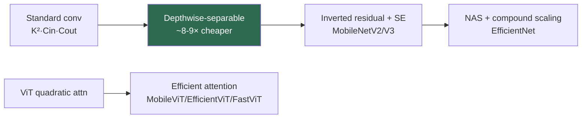

# Efficient Architectures

> **Last Updated:** October 2026
> **Level:** Advanced
> **Related Sections:**
> - [Model Compression](./00_model_compression.md)
> - [Hardware Acceleration](./02_hardware_acceleration.md)
> - [Hybrid Architectures](../03_architectures/02_hybrid_architectures.md)
> - [Edge Deployment](./03_edge_deployment.md)

> **🆕 October 2026 update:**
> - New section on **efficient real-time detectors**: Ultralytics **YOLO26** (NMS-free end-to-end mode) and **RF-DETR** (ICLR 2026; NAS over a DINOv2 backbone), with COCO accuracy/latency numbers from the official repos.
> - New section on **efficient encoders for VLMs**: FastVLM/FastViTHD (CVPR 2025), MobileCLIP2 (TMLR 2025), distilled DINOv3 students, and compact open VLMs (SmolVLM, Moondream, Gemma 4 E2B/E4B, Qwen3.5 0.8B–9B).
> - Noted the spread of **linear-attention hybrids** (Gated DeltaNet + MoE in Qwen3.5) as an efficiency lever for multimodal backbones.

---

## Overview

Efficient architectures are neural networks designed from the ground up to maximize accuracy per unit of compute, memory, or latency—as opposed to compressing an existing large model (covered in [Model Compression](./00_model_compression.md)). The distinction matters: compression starts from a heavy model and removes capacity, whereas efficient-architecture design bakes parsimony into the operators and topology themselves. The field is driven by the deployment reality that most inference happens not in data centers but on phones, cameras, cars, and robots, where power, memory bandwidth, and real-time latency are hard constraints (see [Edge Deployment](./03_edge_deployment.md) and [Hardware Robot Platforms](../06_robotics_and_embodied_ai/12_hardware_robot_platforms.md)).

The central design lever is replacing dense, expensive operators with cheaper approximations that preserve representational power. The seminal idea is the **depthwise-separable convolution** (MobileNet), which factorizes a standard convolution into a per-channel spatial filter plus a 1×1 pointwise mixing, cutting cost by roughly the kernel area. Subsequent work added inverted residuals (MobileNetV2), squeeze-and-excitation and neural architecture search (MobileNetV3, EfficientNet), channel shuffling (ShuffleNet), and efficient attention for ViTs (MobileViT, EfficientViT, FastViT). A recurring lesson is that **FLOPs are a poor proxy for latency**: memory access patterns, operator support, and parallelism often dominate wall-clock time, so efficient design must target real hardware, not just theoretical compute.

---

## Core Techniques

### Depthwise-Separable Convolution

A standard convolution with `K×K` kernel, `C_in` input and `C_out` output channels costs `K²·C_in·C_out·H·W`. **MobileNet** [Howard2017] factorizes it:

```
# Depthwise: one K×K filter per input channel
cost_dw = K² · C_in · H · W
# Pointwise: 1×1 conv mixing channels
cost_pw = C_in · C_out · H · W
# Speedup ≈ 1/C_out + 1/K²  (≈ 8-9× for K=3)
```

**MobileNetV2** [Sandler2018] added **inverted residuals** (expand → depthwise → project) with linear bottlenecks; **MobileNetV3** [Howard2019] combined NAS, squeeze-and-excitation, and hardware-aware tuning. **ShuffleNet** used grouped 1×1 convolutions with channel shuffle; **SqueezeNet** targeted parameter count with fire modules.

### Compound Scaling and NAS

**EfficientNet** [Tan2019] (ICML 2019) used **compound scaling**—jointly scaling depth, width, and resolution by a single coefficient `φ`—atop a NAS-found baseline (EfficientNet-B0), reaching strong accuracy/FLOP trade-offs (B7: 84.4% top-1). Neural architecture search (DARTS, MnasNet, Once-for-All) automated the discovery of efficient topologies under latency constraints.

### Efficient Vision Transformers

ViTs are costly at high resolution (quadratic attention). **MobileViT** [Mehta2022] interleaves MBConv with lightweight global attention; **EfficientViT** uses linear/cascaded attention for high throughput; **FastViT** uses structural reparameterization and a token-mixer hybrid. These bring Transformer accuracy to mobile latency budgets (see [Hybrid Architectures](../03_architectures/02_hybrid_architectures.md)).



### Efficient Real-Time Detectors (2025–2026)

Two design lines now define the accuracy–latency frontier for deployable detection (see [Object Detection](../02_core_tasks/01_object_detection.md)):

- **YOLO26** (Ultralytics, 2026) continues the CNN YOLO line with an edge-first design and an **end-to-end, NMS-free** inference mode (reported as a separate "e2e" mAP column), removing the post-processing step that is awkward to accelerate on NPUs. YOLO26n reaches 40.9 COCO mAP (40.1 end-to-end) with 2.4M parameters and 1.7 ms on a T4 with TensorRT 10.
- **RF-DETR** [Robinson2026] (Roboflow; ICLR 2026) is a real-time DETR built on a DINOv2 backbone (PE-Core-T for the smallest variants), with model sizes found by **weight-sharing neural architecture search** over resolution, patch size and decoder depth. RF-DETR-N reaches 48.4 COCO AP at 2.3 ms; RF-DETR-L reaches 56.5 AP at 6.8 ms (vendor-measured). It demonstrates that a strong SSL foundation backbone plus NAS can beat hand-designed CNN detectors at similar latency, especially on transfer (RF100-VL).
- **YOLOE** (ICCV 2025) shows that open-vocabulary text/visual prompts can be re-parameterised into a standard YOLO head with zero inference overhead (see [Open-Vocabulary Detection](../05_multimodal_vision_language/03_open_vocabulary_detection.md)).

### Efficient Encoders and Compact VLMs (2025–2026)

For vision-language models the bottleneck is the **number of visual tokens** and the encoder's latency at high resolution, not ImageNet FLOPs:

- **FastVLM / FastViTHD** [Vasu2025] (Apple, CVPR 2025): a hybrid conv-transformer encoder that outputs far fewer tokens at high resolution; the smallest variant beats LLaVA-OneVision-0.5B with 85× faster time-to-first-token and a 3.4× smaller encoder, and runs on iPhone.
- **MobileCLIP2** (Apple, TMLR 2025 Featured): MobileCLIP2-S4 matches SigLIP-SO400M/14 zero-shot accuracy with 2× fewer parameters and beats DFN ViT-L/14 at 2.5× lower latency on an iPhone 12 Pro Max.
- **Distilled foundation backbones**: DINOv3's 7B teacher is distilled into ViT-S/B/L/H+ and **ConvNeXt** students (ConvNeXt distillation code released Nov 2025), giving dense features suitable for edge segmentation and depth.
- **Compact VLMs**: SmolVLM (Hugging Face), Moondream 0.5B/2B, Gemma 4 E2B/E4B on-device variants (Apr 2026) and Qwen3.5-0.8B/2B/4B/9B (Mar 2026) bring natively multimodal models to phones and Jetson-class devices.
- **Sub-quadratic sequence mixing**: Qwen3.5 combines Gated DeltaNet linear attention with sparse MoE to cut long-context multimodal inference cost; state-space and linear-attention hybrids are discussed in [State Space Models](../03_architectures/05_state_space_models.md).

---

## Key Papers

| Paper | Authors | Year | Venue | Key Contribution |
|-------|---------|------|-------|-----------------|
| MobileNet | Howard et al. | 2017 | arXiv | Depthwise-separable convolutions |
| MobileNetV2 | Sandler et al. | 2018 | CVPR | Inverted residuals, linear bottlenecks |
| MobileNetV3 | Howard et al. | 2019 | ICCV | NAS + SE + hardware-aware design |
| EfficientNet | Tan, Le | 2019 | ICML | Compound scaling |
| ShuffleNet | Zhang et al. | 2018 | CVPR | Grouped conv + channel shuffle |
| MobileViT | Mehta, Rastegari | 2022 | ICLR | Mobile-friendly vision transformer |
| FastVLM | Vasu et al. (Apple) | 2025 | CVPR | FastViTHD hybrid encoder; fewer tokens, faster TTFT |
| MobileCLIP2 | Faghri, Vasu, Koc, et al. | 2025 | TMLR | Improved multi-modal reinforced training for mobile CLIP |
| RF-DETR | Robinson, Robicheaux, Popov, Ramanan, Peri | 2026 | ICLR | NAS-designed real-time DETR on a DINOv2 backbone |

---

## Benchmark Performance

| Model | Params | FLOPs | ImageNet top-1 | Notes |
|-------|--------|-------|----------------|-------|
| MobileNetV2 | 3.4M | 300M | 72.0% | Inverted residuals |
| MobileNetV3-Large | 5.4M | 219M | ~75.2% | NAS + SE |
| EfficientNet-B0 | 5.3M | 390M | 77.1% | NAS baseline |
| EfficientNet-B7 | 66M | 37G | 84.4% | Compound scaling |
| MobileViT-S | 5.6M | 1.1G | 78.4% | Beats MobileNetV3-L |

**Real-time detection (COCO val2017, official repositories; latency on NVIDIA T4 with TensorRT, vendor-measured):**

| Model | Params | COCO AP50:95 | Latency | Notes |
|-------|--------|--------------|---------|-------|
| YOLO26n | 2.4M | 40.9 (40.1 e2e) | 1.7 ms | NMS-free end-to-end mode available |
| YOLO26s | 9.5M | 48.6 (47.8 e2e) | 2.5 ms | 20.9 GFLOPs |
| YOLO26x | 55.7M | 57.5 (56.9 e2e) | 11.8 ms | 194.4 GFLOPs |
| RF-DETR-N | 30.5M | 48.4 | 2.3 ms | 384×384 input; Apache 2.0 |
| RF-DETR-L | 33.9M | 56.5 | 6.8 ms | 704×704 input |
| RF-DETR-2XL | 126.9M | 60.1 | 17.2 ms | 880×880 input |

*Latency protocols differ between the two repositories (e.g. whether NMS is included), so cross-family comparisons are approximate.*

---

## Pros & Cons

| Aspect | Pros | Cons |
|--------|------|------|
| Depthwise-separable | ~8–9× cheaper convs | Lower per-op arithmetic intensity (memory-bound) |
| NAS-designed | Optimal under constraints | Search cost; hardware-specific |
| Compound scaling | Principled accuracy/FLOP trade-off | FLOPs ≠ latency on all hardware |
| Efficient ViTs | Transformer accuracy at mobile latency | More complex; less mature than CNNs |
| SSL backbone + NAS (RF-DETR) | Strong accuracy and transfer at real-time latency | Larger parameter counts than CNN YOLOs; depends on heavy pretrained backbone |
| Token-efficient VLM encoders (FastViTHD) | Cut time-to-first-token at high resolution | Encoder-specific; must be co-trained with the LLM |

---

## Open Problems & Research Gaps

- **FLOPs–latency mismatch.** Theoretical compute poorly predicts real latency; hardware-in-the-loop design is essential but expensive.
- **Memory-bound regimes.** Depthwise ops are memory-bandwidth-limited, underutilizing compute units.
- **Efficient attention at high resolution.** Sub-quadratic attention with no accuracy loss is unsolved (see [State Space Models](../03_architectures/05_state_space_models.md)).
- **Tiny foundation/VLA models.** Compressing multimodal/VLA capability to sub-1B on-device models is an open frontier (see [Future Trends](../12_research_frontier_2024_2026/07_future_trends.md)).
- **NAS cost.** Architecture search remains compute-intensive and hardware-specific.
- **Accuracy ceiling.** Efficient models still trail large models on hard tasks; the Pareto frontier keeps moving.
- **Latency benchmarking hygiene.** Vendor tables for YOLO26, RF-DETR and others use different input sizes, precisions and NMS handling; a standard, hardware-diverse latency protocol is missing.
- **Encoder–LLM co-design.** Efficient encoders for VLMs must minimise *tokens*, not just FLOPs; joint search over encoder, connector and token budget is largely unexplored.

---

## Further Reading

- [MobileNetV2 (arXiv:1801.04381)](https://arxiv.org/abs/1801.04381) — inverted residuals
- [EfficientNet (arXiv:1905.11946)](https://arxiv.org/abs/1905.11946) — compound scaling
- [MobileViT (arXiv:2110.02178)](https://arxiv.org/abs/2110.02178) — efficient vision transformer
- [Once-for-All (arXiv:1908.09791)](https://arxiv.org/abs/1908.09791) — train once, specialize
- [FastViT (arXiv:2303.14189)](https://arxiv.org/abs/2303.14189) — reparameterized efficient ViT
- [FastVLM (arXiv:2412.13303)](https://arxiv.org/abs/2412.13303) — efficient vision encoding for VLMs
- [MobileCLIP2 (arXiv:2508.20691)](https://arxiv.org/abs/2508.20691) — improved multi-modal reinforced training
- [RF-DETR (arXiv:2511.09554)](https://arxiv.org/abs/2511.09554) — real-time detection transformer with NAS
- [Ultralytics YOLO26 documentation](https://docs.ultralytics.com/models/yolo26) — NMS-free edge-oriented YOLO
