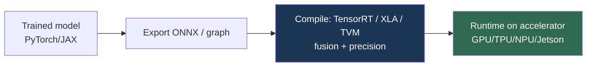

# Hardware Acceleration

> **Last Updated:** October 2026
> **Level:** Advanced
> **Related Sections:**
> - [Edge Deployment](./03_edge_deployment.md)
> - [Model Compression](./00_model_compression.md)
> - [Efficient Architectures](./01_efficient_architectures.md)
> - [Hardware Robot Platforms](../06_robotics_and_embodied_ai/12_hardware_robot_platforms.md)

> **🆕 October 2026 update:**
> - **FP4 becomes a first-class inference precision**: NVFP4 on Blackwell / Blackwell Ultra data-center GPUs, RTX 50-series and the Jetson AGX Thor (SM110) edge module.
> - Added the 2025–2026 hardware wave: Jetson AGX Thor general availability (Aug 2025, JetPack 7 / CUDA 13), DGX Spark desktop Grace-Blackwell (Oct 2025), Google TPU v7 Ironwood (inference-first), Apple M5 GPU neural accelerators.
> - Software stack additions: TensorRT Edge-LLM (VLM/VLA runtime for Jetson, DRIVE and DGX Spark), NVIDIA Model Optimizer, and unified Arm SBSA CUDA across Thor and Orin.

---

## Overview

Hardware acceleration is the substrate on which all of modern computer vision runs: the dramatic capability gains of the past decade are inseparable from the parallel-compute hardware (GPUs, then TPUs and NPUs) that made training and inference of large neural networks economical. For a researcher, hardware literacy is not optional—it determines what models are trainable, what batch sizes and resolutions are feasible, and crucially what can be deployed within a target latency and power envelope. The field spans a hierarchy from data-center training accelerators (NVIDIA H100/B200, Google TPU) to edge inference chips (Jetson, Coral, Hailo) embedded in cameras, cars, and robots (see [Hardware Robot Platforms](../06_robotics_and_embodied_ai/12_hardware_robot_platforms.md)).

The central performance principle is the **roofline model**: a kernel is either *compute-bound* (limited by arithmetic throughput, FLOPS) or *memory-bound* (limited by memory bandwidth, GB/s), and which regime it falls in determines how to optimize it. Modern accelerators provide enormous compute (tensor cores doing fused matrix-multiply-accumulate at low precision) but comparatively scarce memory bandwidth, so many vision workloads—especially depthwise convolutions and attention—are memory-bound, and the dominant optimization techniques (operator fusion, quantization, mixed precision) target *data movement* as much as arithmetic. This file surveys the accelerator landscape, the software stack that maps models onto it (TensorRT, ONNX, XLA), and the bottlenecks that govern real performance.

---

## Accelerator Landscape

- **GPUs** — the workhorse. NVIDIA GPUs dominate via CUDA and **Tensor Cores** (mixed-precision matrix units supporting FP16/BF16/FP8/INT8). Data-center: A100/H100/B200 (Hopper/Blackwell); workstation: RTX 4090/5090. High throughput + flexibility.
- **TPUs** (Google) — systolic-array ASICs optimized for large matrix multiplies; excellent for large-scale training (ViT-22B) via JAX/XLA; pod-scale interconnect.
- **NPUs / AI accelerators** — Apple Neural Engine, Qualcomm Hexagon, mobile NPUs; integrated into SoCs for on-device inference.
- **Edge accelerators** — NVIDIA Jetson (Orin: up to 275 INT8 TOPS; Thor: Blackwell, 128 GB), Google Coral (Edge TPU), Hailo-8/15, Intel Movidius. Power-constrained inference for robotics/cameras (see [Edge Deployment](./03_edge_deployment.md)).
- **FPGAs** — reconfigurable; low-latency, deterministic inference for specialized pipelines; harder to program.

### 2025–2026 Hardware Wave

- **Blackwell / Blackwell Ultra (B200 → B300 / GB300 NVL72, 2025).** Fifth-generation Tensor Cores add native **FP4** (NVFP4 and MXFP4) alongside FP8, so 4-bit weights *and* activations run on tensor cores (see [Model Compression](./00_model_compression.md)). NVIDIA has announced the Rubin generation as its 2026 successor platform.
- **DGX Spark (GB10 Grace-Blackwell, shipped Oct 2025).** A desktop system with 128 GB of unified CPU-GPU memory and up to ~1 PFLOP of sparse FP4, sized for local inference and fine-tuning of VLMs up to roughly 200B parameters; two units can be linked (TensorRT Edge-LLM added experimental tensor-parallel inference across dual DGX Spark in 2026).
- **Jetson AGX Thor (general availability Aug 2025).** Blackwell-architecture GPU (compute capability **SM110**) with up to ~2,070 sparse FP4 TFLOPS, 128 GB memory and a 40–130 W envelope; NVIDIA quotes ~7.5× the AI compute of Jetson AGX Orin. It runs JetPack 7 (CUDA 13); from CUDA 13.2 / JetPack 7.2 the same Arm SBSA CUDA toolkit covers Thor, Orin and server Grace systems. It targets on-robot VLMs and VLAs such as GR00T and π0.5 (see [Edge Deployment](./03_edge_deployment.md)).
- **Google TPU v7 "Ironwood" (announced Apr 2025, generally available late 2025).** Google's first TPU positioned primarily for inference, with 192 GB HBM per chip and pods of up to 9,216 chips.
- **Client SoCs.** Apple's M5 (Oct 2025) adds a neural accelerator to every GPU core, which Apple says gives over 4× the peak GPU compute for AI of M4; phone NPUs (Qualcomm Hexagon, Apple Neural Engine, MediaTek APU) now routinely run 1–4B-parameter multimodal models.

## The Roofline & Precision

```
# Roofline: attainable performance
P = min( Peak_FLOPS,  Bandwidth × Arithmetic_Intensity )
# Arithmetic Intensity = FLOPs / Bytes moved
# Low AI (depthwise conv, attention) → memory-bound
```

**Reduced precision** is the primary throughput lever: FP32 → FP16/BF16 (training), → INT8/FP8/INT4 (inference), and since Blackwell → **FP4** (NVFP4/MXFP4) in hardware. Tensor Cores deliver multiplicative speedups at lower precision, and quantization (see [Model Compression](./00_model_compression.md)) both reduces memory traffic and unlocks these units. Block-scaled formats move part of the dequantisation into the MMA instruction itself, so the scale factors cost almost no extra memory traffic:

```
Effective bits per weight (storage incl. scales):
  BF16 = 16      FP8 = 8      MXFP4 = 4 + 8/32 = 4.25      NVFP4 = 4 + 8/16 (+ tiny per-tensor FP32) ~ 4.5
Bandwidth-bound decode speedup vs BF16 (ideal) ~ 16 / bits  ->  ~3.5x for NVFP4
```

## The Software Stack

Mapping a model to hardware efficiently requires a compilation/runtime stack:

- **TensorRT** (NVIDIA) — graph optimization, layer/operator fusion, precision calibration, kernel auto-tuning for GPU/Jetson inference.
- **ONNX / ONNX Runtime** — interchange format + cross-platform runtime with execution providers.
- **XLA** (TensorFlow/JAX) and **torch.compile / TorchInductor** — graph compilers that fuse operators and generate optimized kernels.
- **TVM**, **OpenVINO** (Intel), vendor SDKs — hardware-specific compilation.
- **NVIDIA Model Optimizer** (renamed from TensorRT Model Optimizer, Dec 2025) — produces FP8/NVFP4/INT4 checkpoints (PTQ, QAT, QAD), pruning and distillation, exported to TensorRT, TensorRT-LLM, vLLM or SGLang.
- **TensorRT Edge-LLM** — NVIDIA's C++ runtime for text, vision, audio and action models on Jetson, DRIVE and DGX Spark, with Thor-specific NVFP4 kernels, FP8 KV cache, speculative decoding, and support for VLMs (Qwen3-VL/3.5, Gemma 4) and experimental VLA policies (π0.5).
- **vLLM / SGLang** — the de-facto open serving engines for VLMs in the data center, with multimodal prefix caching and FP8/FP4 kernels.

**Operator fusion** (combining elementwise/normalization ops into one kernel to avoid round-trips to HBM) and **kernel auto-tuning** are the highest-leverage optimizations, attacking the memory-bound bottleneck directly.



---

## Key References

| Reference | Org/Authors | Year | Type | Key Contribution |
|-----------|-------------|------|------|-----------------|
| Roofline Model | Williams, Waterman, Patterson | 2009 | CACM | Compute- vs memory-bound analysis |
| Tensor Cores / Mixed Precision | Micikevicius et al. (NVIDIA) | 2018 | ICLR | FP16 training at scale |
| TPU | Jouppi et al. (Google) | 2017 | ISCA | In-datacenter systolic-array accelerator |
| FlashAttention | Dao et al. | 2022 | NeurIPS | IO-aware exact attention; memory-bound fix |
| Jetson Thor | NVIDIA | 2025 | Product | Blackwell edge compute for robotics; GA Aug 2025; SM110; FP4 |
| OCP Microscaling (MX) Formats | Open Compute Project (AMD, Arm, Intel, Meta, Microsoft, NVIDIA, Qualcomm) | 2023 | Specification | Block-scaled FP8/FP6/FP4 formats |
| NVFP4 | NVIDIA | 2025 | Format / blog | 16-element E4M3-scaled FP4 blocks for W4A4 inference |
| DGX Spark | NVIDIA | 2025 | Product | Desktop Grace-Blackwell, 128 GB unified memory |
| TPU v7 Ironwood | Google | 2025 | Product | Inference-first TPU generation |
| TensorRT Edge-LLM | NVIDIA | 2025–2026 | Runtime | On-device LLM/VLM/VLA inference for Jetson/DRIVE/Spark |

---

## Pros & Cons (accelerator choice)

| Aspect | GPU | TPU | Edge NPU/Jetson |
|--------|-----|-----|-----------------|
| Flexibility | High (CUDA ecosystem) | Lower (XLA-bound) | Limited operator support |
| Throughput | Very high | Very high (large MM) | Power-bounded |
| Deployment | Data center/workstation | Data center (Google) | On-device, robotics |
| Precision support | FP16/FP8/INT8; FP4 (Blackwell+) | BF16/INT8; FP8 (recent generations) | INT8/INT4 emphasis; FP8/FP4 on Jetson Thor |

---

## Open Problems & Research Gaps

- **Memory wall.** Bandwidth scales slower than compute; many vision/attention kernels are memory-bound (FlashAttention-style IO-aware design is partial).
- **Operator coverage on edge.** Edge accelerators support a limited operator set, forcing model redesign (see [Edge Deployment](./03_edge_deployment.md)).
- **Compiler maturity.** Auto-tuning/fusion (TVM, Inductor) still leaves performance on the table vs. hand-tuned kernels.
- **Precision robustness.** INT4/FP8 inference can degrade accuracy unpredictably for some vision models.
- **Energy efficiency.** Power, not FLOPS, increasingly bounds deployment (robotics runtime; data-center cost).
- **Heterogeneous scheduling.** Efficiently partitioning models across CPU/GPU/NPU on SoCs is unsolved.
- **FP4 for vision.** NVFP4 accuracy is well characterised for LLM decoders but much less for vision encoders, dense prediction heads and diffusion/world models; per-layer precision assignment (e.g. AutoQuantize-style search) is still heuristic.
- **Format fragmentation.** MXFP4, NVFP4, vendor INT4 schemes and FP8 variants are not interchangeable across GPUs, NPUs and TPUs, complicating portable deployment.

---

## Further Reading

- [FlashAttention (arXiv:2205.14135)](https://arxiv.org/abs/2205.14135) — IO-aware attention
- [Mixed Precision Training (arXiv:1710.03740)](https://arxiv.org/abs/1710.03740) — FP16 training
- [TensorRT documentation](https://developer.nvidia.com/tensorrt) — inference optimization
- [In-Datacenter TPU (arXiv:1704.04760)](https://arxiv.org/abs/1704.04760) — TPU architecture
- [Roofline Model (CACM 2009)](https://dl.acm.org/doi/10.1145/1498765.1498785) — performance analysis
- [Introducing NVFP4 (NVIDIA blog, 2025)](https://developer.nvidia.com/blog/introducing-nvfp4-for-efficient-and-accurate-low-precision-inference/) — block-scaled FP4 on Blackwell
- [OCP Microscaling Formats v1.0](https://www.opencompute.org/documents/ocp-microscaling-formats-mx-v1-0-spec-final-pdf) — MXFP8/MXFP6/MXFP4 specification
- [TensorRT Edge-LLM](https://github.com/NVIDIA/TensorRT-Edge-LLM) — edge runtime for LLMs, VLMs and VLAs
- [NVIDIA Model Optimizer](https://github.com/NVIDIA/Model-Optimizer) — quantization/pruning/distillation toolkit
