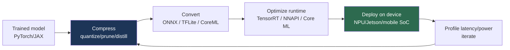
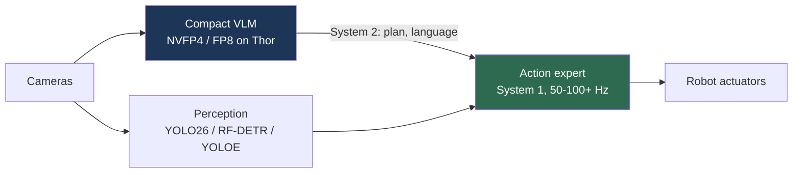

# Edge Deployment

> **Last Updated:** October 2026
> **Level:** Advanced
> **Related Sections:**
> - [Hardware Acceleration](./02_hardware_acceleration.md)
> - [Model Compression](./00_model_compression.md)
> - [Efficient Architectures](./01_efficient_architectures.md)
> - [Hardware Robot Platforms](../06_robotics_and_embodied_ai/12_hardware_robot_platforms.md)

> **🆕 October 2026 update:**
> - **Jetson AGX Thor** is now generally available (Aug 2025): JetPack 7, NVFP4-capable Blackwell GPU, and the new **TensorRT Edge-LLM** runtime that runs VLMs (Qwen3-VL/3.5, Gemma 4) and experimental VLA policies (π0.5) on-device.
> - New subsection on **on-device multimodal models in 2026**: Gemma 4 E2B/E4B, Qwen3.5 0.8B–9B, FastVLM, SmolVLM/Moondream, and NVFP4/FP8 checkpoints released by model vendors.
> - Runtime updates: ExecuTorch (Gemma 4 multimodal, YOLO26 examples), LiteRT-LM / LiteRT.js, and NMS-free detectors (YOLO26) that simplify NPU deployment.
> - New rows in Key References and the constraint table; Open Problems revised.

---

## Overview

Edge deployment is the practice of running vision models *on-device*—on phones, cameras, vehicles, drones, and robots—rather than in the cloud. It is where the rubber meets the road for applied computer vision: latency, power, memory, privacy, and connectivity constraints that are irrelevant in a data center become binding, and a model that achieves SOTA accuracy is useless if it cannot meet a 30 ms real-time budget within a few watts. Edge deployment is increasingly central to the field because the highest-value applications—autonomous driving, robotics, AR, smart cameras—are inherently embedded and often safety-critical, demanding deterministic, offline-capable inference (see [Hardware Robot Platforms](../06_robotics_and_embodied_ai/12_hardware_robot_platforms.md) and [Autonomous Driving](../07_autonomous_driving/00_overview.md)).

The discipline combines the three pillars covered in this section: **efficient architectures** (designing cheap models; see [Efficient Architectures](./01_efficient_architectures.md)), **model compression** (quantization, pruning, distillation; see [Model Compression](./00_model_compression.md)), and **hardware acceleration** (mapping to NPUs/Jetson via optimized runtimes; see [Hardware Acceleration](./02_hardware_acceleration.md)). The defining 2024–2026 challenge is deploying *foundation-scale* models—VLMs and VLAs with billions of parameters—on edge hardware, which has driven a wave of "tiny" multimodal and embodied models (MobileVLM, distilled VLAs) and motivated capable edge SoCs like the NVIDIA Jetson Thor that can host multi-billion-parameter dual-system policies on a robot.

---

## The Edge Deployment Pipeline

A model travels from a training framework to an on-device runtime through a chain of conversions and optimizations:

### On-Device Runtimes

- **TensorFlow Lite (LiteRT)** — the dominant mobile runtime; INT8/INT4 quantization, delegate APIs (GPU, NNAPI, Core ML, Hexagon).
- **Core ML** (Apple) — runs on the Apple Neural Engine; tight iOS integration.
- **ONNX Runtime Mobile**, **NCNN / MNN** (Tencent/Alibaba; popular in mobile vision), **TVM**, **ExecuTorch** (PyTorch's on-device runtime).
- **TensorRT** (Jetson) — the standard for NVIDIA edge robotics inference; **TensorRT Edge-LLM** (2025–2026) extends it to LLMs, VLMs, speech and action models on Jetson Orin/Thor, DRIVE and DGX Spark via an ONNX-export → C++ engine path.
- **LiteRT-LM / LiteRT.js** (Google) — on-device GenAI runtime and WebGPU/WASM browser inference built on LiteRT.
- **ExecuTorch** — as of 2026 ships multimodal runners (e.g. Gemma 4 text+image+audio), detectors (YOLO26) and promptable segmentation examples, and powers on-device AI in Meta's apps and Ray-Ban Meta glasses.

### Optimization Levers

Edge deployment leans heavily on **INT8/INT4 quantization** (often post-training with calibration), **operator fusion**, **static shapes** (avoiding dynamic-shape overhead), and **hardware-aware architecture choices** (operators the target NPU supports natively). A model frequently must be *redesigned*, not just compressed, because edge accelerators support a limited operator set. A recent example is the trend to **NMS-free, end-to-end detectors** (YOLO26's end-to-end mode, DETR-family models such as RF-DETR): removing non-maximum suppression eliminates a data-dependent, control-flow-heavy post-processing step that many NPUs execute poorly or must hand back to the CPU.

---

## Foundation Models at the Edge

The frontier challenge is shrinking VLMs/VLAs to edge budgets. **MobileVLM** and similar compact multimodal models target sub-3B parameters with lightweight projectors; **distilled/efficient VLAs** aim to run policies on Jetson Orin/Thor for on-robot inference (see [Future Trends](../12_research_frontier_2024_2026/07_future_trends.md)). OpenVLA-OFT's 26× inference speedup (to ~110 Hz) exemplifies the latency engineering required to make a 7B VLA real-time on constrained hardware (see [VLA & Embodied 2025–2026](../12_research_frontier_2024_2026/04_vla_embodied_2025_2026.md)).

### On-Device Multimodal Models in 2026

The picture changed markedly between mid-2025 and October 2026:

- **Purpose-built small multimodal models.** Google's **Gemma 4** (Apr 2026, Apache 2.0) includes E2B/E4B variants aimed at phones and laptops with image and audio input; Alibaba's **Qwen3.5** family adds natively multimodal 0.8B/2B/4B/9B dense models (Mar 2026); Apple's **FastVLM** (CVPR 2025) demonstrates an iPhone VLM whose high-resolution encoder emits few tokens; **SmolVLM** and **Moondream** (0.5B/2B) target CPUs and low-power edge SoCs.
- **Vendor-released low-precision checkpoints.** Instead of users quantising models themselves, vendors increasingly publish FP8 / NVFP4 / AWQ checkpoints (Qwen3-VL FP8, olmOCR-2 FP8, Rex-Omni AWQ, NVIDIA Nemotron NVFP4), which shortens the deploy pipeline above to "download → compile → run".
- **Jetson Thor as an on-robot VLA computer.** With up to ~2,070 sparse FP4 TFLOPS and 128 GB memory, Thor can host a multi-billion-parameter VLM "System 2" and a fast action "System 1" on one module; NVIDIA's GR00T N1.6 uses a native-resolution Eagle VLM backbone, and TensorRT Edge-LLM added experimental π0.5 support in 2026. Thor-specific NVFP4 kernels and FP8 KV cache (~50% KV memory reduction) are the main levers.
- **Faster perception primitives.** SAM 3.1's Object Multiplex (~7× faster multi-object tracking at 128 objects on an H100) and real-time open-vocabulary detectors (YOLOE) make concept-level perception more realistic on edge budgets, though full SAM 3 (~848M parameters) is still a workstation/Thor-class model.

---

## Key References

| Reference | Org/Authors | Year | Type | Key Contribution |
|-----------|-------------|------|------|-----------------|
| TensorFlow Lite | Google | 2017 | Framework | Mobile inference runtime |
| MCUNet | Lin et al. | 2020 | NeurIPS | Deep learning on microcontrollers (TinyML) |
| MobileVLM | Chu et al. | 2023 | arXiv | Compact VLM for mobile/edge |
| OpenVLA-OFT | Kim, Pertsch, et al. | 2025 | arXiv | 26× VLA inference speedup |
| Jetson Thor | NVIDIA | 2025 | Product | Edge compute for on-robot foundation models; GA Aug 2025 |
| FastVLM | Vasu et al. (Apple) | 2025 | CVPR | On-device VLM with token-efficient high-res encoder |
| TensorRT Edge-LLM | NVIDIA | 2025–2026 | Runtime | LLM/VLM/VLA inference on Jetson, DRIVE, DGX Spark |
| Gemma 4 (E2B/E4B) | Google DeepMind | 2026 | Open models | On-device natively multimodal models, Apache 2.0 |
| YOLO26 | Ultralytics | 2026 | Model family | Edge-oriented, NMS-free end-to-end detection |

---

## Benchmark / Constraint Comparison

| Target | Compute | Power | Typical budget | Use case |
|--------|---------|-------|----------------|----------|
| Mobile SoC (NPU) | ~5–50 TOPS | 1–5 W | 10–30 ms | Phone vision, AR |
| Jetson Orin | up to 275 TOPS | 15–60 W | real-time | Robotics, cameras |
| Jetson Thor | ~2,070 FP4 TFLOPS (sparse) | 40–130 W | real-time VLA | Humanoid on-robot inference |
| DGX Spark (desktop edge) | ~1 PFLOP FP4 (sparse), 128 GB unified | desktop PSU | interactive | Local VLM development and inference |
| Microcontroller (TinyML) | <1 TOPS | <0.1 W | event-driven | Always-on sensing |

---

## Pros & Cons (edge vs. cloud inference)

| Aspect | Edge | Cloud |
|--------|------|-------|
| Latency | Low, deterministic | Network-dependent |
| Privacy | Data stays on-device | Data leaves device |
| Connectivity | Offline-capable | Requires network |
| Model size | Constrained | Effectively unbounded |
| Cost | Per-device hardware | Per-query compute |

---

## Open Problems & Research Gaps

- **Foundation models on-device.** Running multi-billion-parameter VLMs/VLAs within edge power/thermal budgets is largely unsolved (see [Future Trends](../12_research_frontier_2024_2026/07_future_trends.md)).
- **Accuracy under aggressive quantization.** INT4/lower quantization can degrade vision models unpredictably.
- **Operator-set fragmentation.** Diverse NPUs support different operators, forcing per-target redesign and re-validation.
- **Thermal throttling.** Sustained inference on passively cooled devices triggers throttling not captured by peak-TOPS specs.
- **Safety certification.** Deploying learned models in safety-critical edge systems (cars, robots) lacks accepted verification standards.
- **On-device adaptation.** Efficient continual/personalized learning at the edge remains immature.
- **Edge benchmarks for multimodal agents.** Standard suites (MLPerf Edge and newer agentic workloads) are only beginning to cover VLM/VLA latency, energy and accuracy jointly; vendor-reported speedups are hard to compare.
- **FP4 on small models.** NVFP4 works well for large LLMs, but compact VLMs and vision encoders (sub-2B) have less redundancy, and their FP4 accuracy is poorly characterised.

---

## Further Reading

- [LiteRT / TensorFlow Lite](https://ai.google.dev/edge/litert) — mobile/edge runtime
- [MCUNet (arXiv:2007.10319)](https://arxiv.org/abs/2007.10319) — TinyML on microcontrollers
- [ExecuTorch](https://pytorch.org/executorch/) — PyTorch on-device runtime
- [MobileVLM (arXiv:2312.16886)](https://arxiv.org/abs/2312.16886) — compact vision-language model
- [NVIDIA Jetson](https://developer.nvidia.com/embedded-computing) — edge robotics platforms
- [TensorRT Edge-LLM](https://github.com/NVIDIA/TensorRT-Edge-LLM) — on-device LLM/VLM/VLA runtime for Jetson Thor and DRIVE
- [FastVLM (arXiv:2412.13303)](https://arxiv.org/abs/2412.13303) — efficient vision encoding for on-device VLMs
- [LiteRT-LM](https://github.com/google-ai-edge/LiteRT-LM) — on-device GenAI runtime
- [jetson-containers](https://github.com/dusty-nv/jetson-containers) — JetPack 6/7 container builds for edge AI
