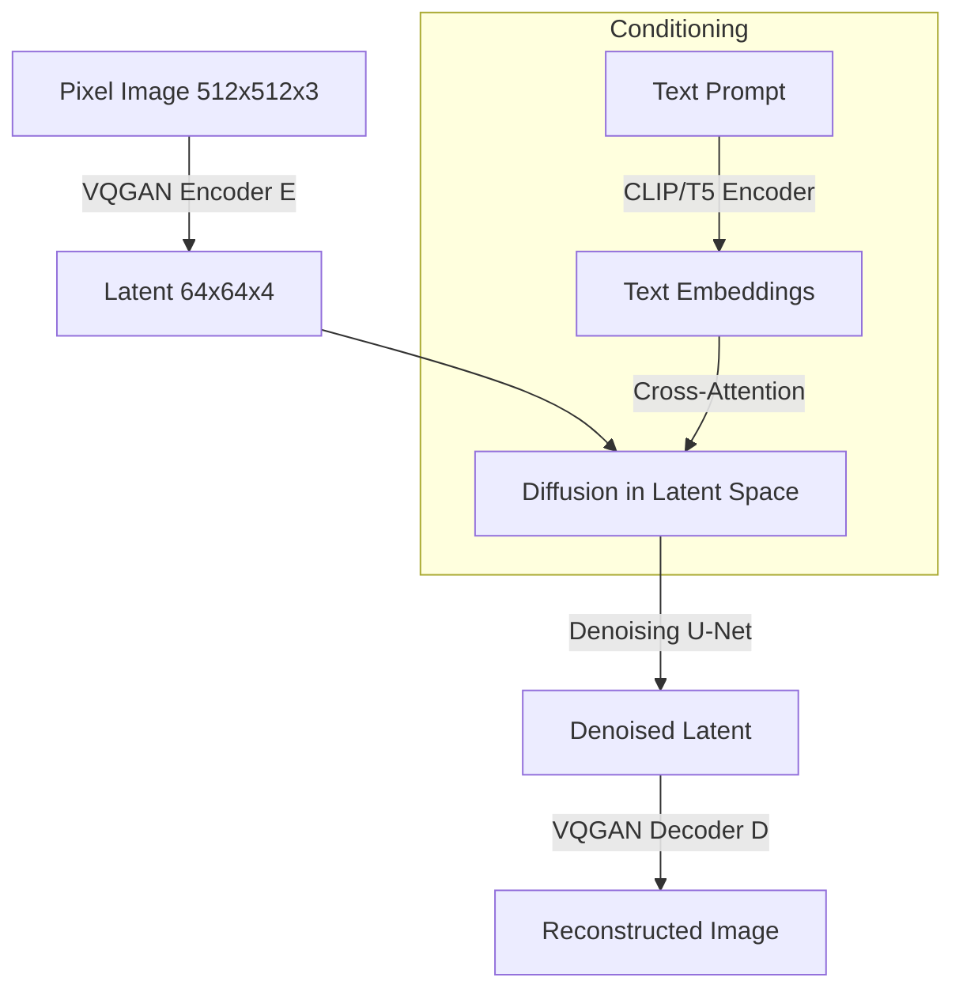

# Diffusion Models: DDPM to Flow Matching and Stable Diffusion

> **Last Updated:** October 2026
> **Level:** Advanced
> **Related Sections:** [GANs and VAEs](./00_gans_and_vaes.md) | [Video Generation](./02_video_generation.md) | [Evaluation and Safety](./04_evaluation_and_safety.md) | [3D Generation](./03_3d_generation.md)

> **🆕 October 2026 update:**
> - New section on frontier text-to-image/editing systems released Aug 2025–Sep 2026: Nano Banana → Nano Banana Pro → Nano Banana 2 (Google), GPT Image 1.5 → GPT Image 2 → Images 2.5 (OpenAI), FLUX.2 / FLUX.2 [klein] (Black Forest Labs), Qwen-Image, Seedream 4.0/5.0, HunyuanImage 3.0, Z-Image.
> - New section on one-step / few-step generation (sCM, DMD2, shortcut models, MeanFlow, adversarial post-training) with the MeanFlow identity.
> - New section on representation-aligned training and latent spaces (REPA, VA-VAE, RAE, pixel-space JiT) and RL post-training of flow models (Flow-GRPO, DanceGRPO).
> - Overview's "current state of the art" corrected; Key Papers, Benchmark, Pros & Cons, Open Problems and Further Reading extended.

---

## Overview

Diffusion probabilistic models define a generative process by learning to reverse a fixed Markov chain that gradually corrupts data with Gaussian noise. The foundational work of Ho et al. [Ho2020] recast the score-matching perspective of [Sohl-Dickstein2015] into a tractable training objective — a weighted MSE on the predicted noise — and demonstrated that DDPM could generate images competitive with GANs while training stably and without mode collapse. Within two years, diffusion models became the dominant paradigm for image, audio, video, and 3D generation.

The trajectory from DDPM to modern systems involves three major transitions. First, DDIM [Song2021] showed that the same trained DDPM model could be sampled deterministically in as few as 20–50 steps (vs. 1000), making inference practical. Second, Classifier-Free Guidance (CFG) [Ho2022] enabled high-quality text-conditional generation by jointly training a conditional and unconditional model and combining their score estimates at inference. Third, the Latent Diffusion Model (LDM) framework [Rombach2022] moved the diffusion process into the latent space of a pre-trained VQGAN tokenizer, reducing pixel-space compute by ~4–16× while preserving perceptual quality. This last step produced Stable Diffusion — the first open-source billion-parameter text-to-image model — and launched an ecosystem of fine-tuning methods (LoRA, DreamBooth, ControlNet) that democratized generative image production.

The most recent wave (2023–2025) replaces the score-matching / DDPM framework with **flow matching** [Lipman2022; Liu2022], which defines a straight-line ODE between noise and data rather than a curved diffusion path, enabling faster sampling and better scaling. Stable Diffusion 3 [Esser2024] and FLUX.1 [BlackForest2024] adopt rectified-flow matching on a Multimodal Diffusion Transformer (MM-DiT) backbone, which set the 2024 state of the art in open text-to-image generation.

From mid-2025 to late 2026 the frontier moved again along four axes: (i) **VLM/LLM-conditioned generators** in which a large vision-language model replaces CLIP/T5 as the text (and reference-image) encoder — Qwen-Image [QwenImage2025] uses Qwen2.5-VL, FLUX.2 [BFL2025FLUX2] couples a Mistral-3 24B VLM with a 32B rectified-flow transformer; (ii) **unified generation + editing + multi-reference composition** in a single model (Nano Banana, Seedream 4.0, FLUX.2, GPT Image); (iii) **"thinking" and web-grounded generation**, in which a reasoning model plans layouts, text and facts before rendering (Nano Banana Pro, GPT Image 2 thinking mode, FLUX.2 [max], Seedream 5.0); and (iv) **few-step sampling** via consistency/mean-flow objectives and adversarial distillation, making 1–8-step generation standard in deployed systems.

---

## Forward and Reverse Process (DDPM)

The forward process gradually adds Gaussian noise over $T$ steps (typically $T=1000$):

```
q(x_t | x_{t-1}) = N(x_t; sqrt(1 - beta_t) * x_{t-1}, beta_t * I)

Closed-form marginal (reparameterized):
  q(x_t | x_0) = N(x_t; sqrt(alpha_bar_t) * x_0, (1 - alpha_bar_t) * I)

where:
  alpha_t = 1 - beta_t
  alpha_bar_t = prod_{s=1}^{t} alpha_s

Sampling shortcut:
  x_t = sqrt(alpha_bar_t) * x_0 + sqrt(1 - alpha_bar_t) * epsilon,
  epsilon ~ N(0, I)
```

The simplified training objective of [Ho2020] (derived from the ELBO by dropping weighting terms) is:

```
L_simple = E_{t, x_0, epsilon} [|| epsilon - epsilon_theta(x_t, t) ||^2]

where:
  t ~ U{1, ..., T}
  x_0 ~ q(x_0)
  epsilon ~ N(0, I)
  x_t = sqrt(alpha_bar_t) * x_0 + sqrt(1 - alpha_bar_t) * epsilon
```

At inference, the learned reverse process is:

```
p_theta(x_{t-1} | x_t) = N(x_{t-1}; mu_theta(x_t, t), sigma_t^2 * I)

mu_theta(x_t, t) = (1 / sqrt(alpha_t)) *
                   (x_t - (beta_t / sqrt(1 - alpha_bar_t)) * epsilon_theta(x_t, t))
```

---

## DDIM: Deterministic Sampling

Song et al. [Song2021] derived a non-Markovian generalization of the forward process that yields the same marginals as DDPM but admits a deterministic reverse ODE:

```
x_{t-1} = sqrt(alpha_bar_{t-1}) *
           ( (x_t - sqrt(1 - alpha_bar_t) * epsilon_theta(x_t, t))
             / sqrt(alpha_bar_t) )
         + sqrt(1 - alpha_bar_{t-1} - sigma_t^2) * epsilon_theta(x_t, t)
         + sigma_t * epsilon_t

With sigma_t = 0 (DDIM): fully deterministic, supports inversion.
With sigma_t = sqrt(beta_t): recovers DDPM.

Key result: DDIM with 50 steps achieves comparable FID to DDPM with 1000 steps.
DDIM inversion: run forward ODE to get x_T from x_0 (near-lossless for real images).
```

---

## Classifier-Free Guidance

[Ho2022] proposed training a single model that is simultaneously conditional ($\epsilon_\theta(x_t, c)$) and unconditional ($\epsilon_\theta(x_t, \emptyset)$) by randomly dropping the conditioning $c$ with probability $p_{uncond}$ (typically 0.1–0.2). At inference:

```
epsilon_hat(x_t, c) = epsilon_theta(x_t, null)
                     + w * (epsilon_theta(x_t, c) - epsilon_theta(x_t, null))

where w = guidance_scale (typically 7.5 for SD1.5, 3.5-5.0 for SDXL)

w = 0: unconditional sample
w = 1: standard conditional sample
w > 1: high-fidelity, low-diversity "sharpened" samples
```

CFG became the universal mechanism for text-to-image alignment. It effectively implements a form of implicit classifier guidance without requiring a separate classifier, and its guidance scale serves as the primary quality-diversity dial in all deployed text-to-image systems.

---

## Latent Diffusion Models (Stable Diffusion)

[Rombach2022] decoupled perceptual compression from diffusion learning:



The latent space compresses $512 \times 512 \times 3$ images to $64 \times 64 \times 4$ features (8× spatial downscaling, with a small regularization KL penalty or VQ). The diffusion U-Net operates on these latents, using cross-attention to inject text conditioning at multiple resolution levels. The result is that training and inference run at 1/64th the pixel-space cost while maintaining full perceptual quality after decoding.

**Stable Diffusion 1.5** (Runway / CompVis, 2022): 860M U-Net, CLIP ViT-L/14 text encoder, trained on LAION-5B.

**SDXL** (Stability AI, 2023): 3.5B dual-stream U-Net, dual text encoders (CLIP ViT-L and OpenCLIP ViT-bigG), 1024px native resolution, two-stage pipeline with refiner.

**Stable Diffusion 3** (Esser et al., 2024): Replaces U-Net with a Multimodal Diffusion Transformer (MM-DiT); uses flow matching instead of DDPM; 16-channel latent space; scales from 800M to 8B parameters.

---

## ControlNet

Zhang & Agrawala [Zhang2023] proposed ControlNet, which adds spatial conditioning (edges, depth maps, poses, segmentation masks) to frozen diffusion U-Nets by cloning the encoder blocks and connecting them via zero-initialized 1×1 convolutions:

```
c_f = trainable_conv_zero(c_raw)      # Zero init -> no-op at start
y = frozen_unet(x) + c_f             # Additive injection

Training: freeze original U-Net weights, train only the cloned encoder.
Supported conditions: Canny edges, HED, depth, normal, pose (OpenPose),
  segmentation (ADE20K), line art, scribble, reference image.
```

Zero initialization ensures that ControlNet starts as an identity and only gradually learns to steer generation, preventing gradient explosion. ControlNet enabled precise spatial layout control that CFG alone cannot provide.

---

## DreamBooth and LoRA

**DreamBooth** [Ruiz2023] fine-tunes the entire diffusion U-Net to associate a rare text token with a specific subject concept, using a prior-preservation loss to prevent language drift:

```
L = E[||epsilon - epsilon_theta(x_t, f("a [V] dog"))||^2]
  + lambda * E[||epsilon - epsilon_theta(x'^_t, f("a dog"))||^2]

where [V] is the rare identifier token (e.g., "sks"),
      x = subject images (~3-25 photos),
      x' = class images generated by the original model.
```

**LoRA** (Low-Rank Adaptation) [Hu2022] injects trainable low-rank decompositions into weight matrices without storing full fine-tuned weights:

```
W' = W_0 + delta_W = W_0 + B * A,
  B in R^{d x r}, A in R^{r x k}, rank r << min(d, k)

Typical: r = 4-64, reducing trainable parameters by 100-10000x.
LoRA + diffusion: applied to Q, K, V, Out projections of cross-attention.
File size: ~4-144MB vs. ~4GB for full model.
```

---

## Flow Matching (FLUX.1 and SD3)

Flow matching [Lipman2022; Liu2022] defines a conditional ODE from noise $p_0 = \mathcal{N}(0,I)$ to data $p_1 = p_{data}$ with straight-line paths, yielding a simpler loss than DDPM:

```
Conditional Flow Matching (CFM) loss:
  L_CFM = E_{t, x_0, x_1} [|| v_theta(x_t, t) - (x_1 - x_0) ||^2]

where:
  x_t = t * x_1 + (1 - t) * x_0,   t ~ U[0, 1]
  x_0 ~ N(0, I),  x_1 ~ p_data

Inference ODE:
  dx = v_theta(x, t) dt
  Solved by Euler / Heun / DPM-Solver with as few as 4-8 function evaluations.
```

Flow matching achieves more uniform loss weighting across noise levels (compared to DDPM's quadratic weighting toward low-noise steps), and straight paths reduce truncation error in ODE solvers. **FLUX.1** [BlackForestLabs2024] extends this with a dual-stream MM-DiT architecture (separate transformer streams for text and image tokens that interact via attention), achieving state-of-the-art text faithfulness and photorealism.

---

## DPM-Solver

DPM-Solver [Lu2022] provides high-order ODE solvers tailored to the semi-linear structure of diffusion model ODEs, achieving 10–20× speed improvement over naive Euler sampling:

```
Semi-linear ODE:
  dx = [f(t)*x - g^2(t)*score(x,t)/2] dt

DPM-Solver-2 update (2nd order):
  x_{t-h} = (alpha_{t-h}/alpha_t) * x_t
           - sigma_{t-h} * (e^h - 1) * D_theta(x_t, t)
           + sigma_{t-h} * (e^h - 1 - h) * (D1_theta) / h

Typical: 10-20 steps with DPM-Solver++ achieves quality comparable
         to 1000-step DDPM.
```

---

## Frontier Text-to-Image and Editing Systems (2025–2026)

| Model | Organization | Released | Weights | Notes |
|-------|-------------|----------|---------|-------|
| GPT Image 1 | OpenAI | Apr 2025 (API) | Closed | Native image generation of the GPT-4o family (Mar 2025 in ChatGPT); strong instruction following and text rendering |
| Qwen-Image | Alibaba Qwen | Aug 2025 | Open (Apache-2.0) | 20B MMDiT conditioned on Qwen2.5-VL; best-in-class Chinese/English text rendering; Qwen-Image-Edit variants [QwenImage2025] |
| Gemini 2.5 Flash Image ("Nano Banana") | Google DeepMind | Aug 2025 | Closed | Conversational multi-turn editing, multi-image blending, character consistency |
| Seedream 4.0 | ByteDance Seed | Sep 2025 | Closed | Unified T2I + editing + multi-image composition; high-compression VAE + DiT; native 1K–4K; ~1.4 s per 2K image after adversarial distillation, quantization and speculative decoding [Seedream2025] |
| HunyuanImage 3.0 | Tencent | Sep 2025 | Open | Native multimodal autoregressive MoE (≈80B total, ≈13B active parameters) unifying understanding and generation |
| Gemini 3 Pro Image ("Nano Banana Pro") | Google DeepMind | 20 Nov 2025 | Closed | Built on Gemini 3 Pro reasoning; up to 4K output; blends up to 14 reference images; SynthID on every output |
| FLUX.2 [pro/flex/dev] | Black Forest Labs | Nov 2025 | [dev] open (non-commercial) | 32B rectified-flow transformer + Mistral-3 24B VLM; up to 10 references; 4MP editing; Apache-2.0 VAE [BFL2025FLUX2] |
| Z-Image (Turbo) | Alibaba Tongyi-MAI | Nov 2025 | Open | 6B single-stream DiT; distilled Turbo variant targets ~8-step sampling on consumer GPUs |
| GPT Image 1.5 | OpenAI | Dec 2025 | Closed | New ChatGPT Images model; ~4× faster, more faithful localized edits, denser text |
| FLUX.2 [klein] 4B / 9B | Black Forest Labs | Early 2026 | 4B Apache-2.0; 9B non-commercial | Distilled sub-second generation + editing on consumer GPUs |
| Gemini 3.1 Flash Image ("Nano Banana 2") | Google DeepMind | 26 Feb 2026 | Closed | Pro-level quality at Flash speed; 512px–4K; web-grounded world knowledge; in-image text translation; SynthID + C2PA |
| Seedream 5.0 Lite | ByteDance | Feb 2026 (reported) | Closed | Reported as first Seedream to reason before rendering and to ground generation in live web search |
| GPT Image 2 ("ChatGPT Images 2.0") | OpenAI | 21 Apr 2026 | Closed | "Images with thinking" mode (plans/refines before generating); up to 2K; multilingual text; diagrams/infographics; ranked #1 on Image Arena at launch (vendor-reported) |
| Nano Banana 2 Lite | Google DeepMind | 30 Jun 2026 | Closed | Fastest/cheapest Gemini image model (gemini-3.1-flash-lite-image) |
| GPT Image 2.5 ("ChatGPT Images 2.5") | OpenAI | 8 Sep 2026 | Closed | Two API tiers (GPT-Image-2.5 Sunburst / Flare) |

Three structural observations follow from this table. **First**, the proprietary frontier is increasingly *autoregressive or hybrid* (GPT Image family, HunyuanImage 3.0, Gemini image models are generated by multimodal LLMs, with undisclosed decoders), whereas the open frontier remains *flow-matching DiTs* conditioned on a VLM. **Second**, text rendering — a canonical failure mode until 2024 — is now largely solved for short and medium text in Latin and CJK scripts; evaluation has moved to dense infographics, multilingual layouts and factual correctness. **Third**, reasoning and retrieval are being inserted *before* the generator, making prompt-adherence and factual grounding partly an LLM problem rather than a diffusion problem.

---

## One-Step and Few-Step Generation

Inference cost was the main practical weakness of diffusion. By 2025–2026, distillation and new training objectives brought high-quality sampling down to 1–4 network evaluations (NFE):

| Family | Representative methods | Mechanism |
|--------|------------------------|-----------|
| Consistency models | CM, LCM, **sCM** [LuSong2025sCM], rCM | Learn $f_	heta(x_t,t)pprox x_0$ consistent along each PF-ODE trajectory; sCM stabilizes continuous-time training (TrigFlow parameterization) and scales to 1.5B params |
| Distribution matching | DMD, **DMD2** [Yin2024DMD2] | Match the student's output distribution to the teacher via the difference of two score functions, plus a GAN loss |
| Adversarial distillation | ADD, LADD, Seaweed-APT | Discriminator on DINOv2 / teacher / real-data features (see [GANs and VAEs](./00_gans_and_vaes.md)) |
| Flow-map / shortcut models | Shortcut models [Frans2025], **MeanFlow** [Geng2025MeanFlow], IMM | Learn the *jump* between two times $(r,t)$ instead of the instantaneous velocity, enabling one-step sampling trained from scratch |

**MeanFlow** [Geng2025MeanFlow] is the cleanest example. With the interpolation $z_t=(1-t)\,x+t\,\epsilon$ (so $t=1$ is noise), it models the *average* velocity over an interval rather than the instantaneous velocity:

```
Average velocity:
  u(z_t, r, t) = (1 / (t - r)) * integral_r^t v(z_tau, tau) d tau

MeanFlow identity (differentiate (t - r) * u w.r.t. t):
  u(z_t, r, t) = v(z_t, t) - (t - r) * d/dt u(z_t, r, t)
  d/dt u = v(z_t, t) * partial_z u + partial_t u      (one Jacobian-vector product)

Training target (stop-gradient):
  u_tgt = v_t - (t - r) * (v_t * partial_z u_theta + partial_t u_theta)
  L = E || u_theta(z_t, r, t) - sg(u_tgt) ||^2,  with v_t = epsilon - x

One-step sampling:
  x = z_1 - u_theta(z_1, r=0, t=1),   z_1 ~ N(0, I)
```

MeanFlow reports a 1-NFE FID of 3.43 on ImageNet 256×256 trained from scratch, without distillation; sCM reports a 2-step FID of 1.88 on ImageNet 512×512. In production, Seedream 4.0, Z-Image-Turbo and FLUX.2 [klein] all ship distilled few-step variants, and NVIDIA's rCM extends continuous-time consistency distillation to 10B+ text-to-image and text-to-video teachers.

---

## Representation Alignment, Latent Spaces and RL Post-Training

**Representation alignment.** REPA [Yu2025REPA] adds an auxiliary loss aligning intermediate DiT/SiT hidden states with frozen DINOv2 features of the clean image, accelerating training by more than an order of magnitude and reaching FID 1.42 on ImageNet 256 with guidance. VA-VAE [Yao2025VAVAE] instead aligns the *tokenizer* latent with a foundation model (LightningDiT: FID 1.35), and RAE [Zheng2025RAE] uses a frozen representation encoder directly as the latent space. JiT [LiHe2025JiT] goes the other way — plain large-patch Transformers trained with x-prediction in pixel space — showing that predicting the clean image (rather than noise or velocity) keeps high-dimensional pixel diffusion well-posed.

```
REPA auxiliary loss:
  L = L_FM + lambda * E[ - (1/N) * sum_n sim( y_n , h_phi(h_t^{[n]}) ) ]
  y_n      = frozen DINOv2 patch feature n of the clean image x_0
  h_t^{[n]} = DiT hidden state of patch n at noise level t (early layer)
  h_phi    = small trainable MLP projector; sim = cosine similarity
```

**RL post-training of flow models.** Following RLHF for LLMs, Flow-GRPO [Liu2025FlowGRPO] and DanceGRPO convert the deterministic flow ODE into an equivalent SDE so that per-step log-probabilities exist, then apply Group Relative Policy Optimization with rewards such as GenEval-style detectors, OCR accuracy or human-preference models. Flow-GRPO lifts SD3.5-Medium's GenEval score from 0.63 to 0.95, illustrating both the power of RL post-training and how close compositional benchmarks are to saturation (see [Evaluation and Safety](./04_evaluation_and_safety.md)).

---

## Key Papers

| Paper | Authors | Year | Venue | Key Contribution |
|-------|---------|------|-------|-----------------|
| Denoising Diffusion Probabilistic Models (DDPM) | Ho et al. | 2020 | NeurIPS | Simplified noise prediction loss; cosine schedule; FID 3.17 on CIFAR-10 |
| Denoising Diffusion Implicit Models (DDIM) | Song et al. | 2021 | ICLR | Deterministic non-Markovian sampling; 50-step inference; lossless inversion |
| Diffusion Models Beat GANs on Image Synthesis | Dhariwal & Nichol | 2021 | NeurIPS | Classifier guidance; U-Net improvements; FID 3.94 ImageNet 256px |
| Classifier-Free Diffusion Guidance | Ho & Salimans | 2022 | NeurIPS Workshop | CFG; joint conditional/unconditional training; guidance scale |
| High-Resolution Image Synthesis with LDMs | Rombach et al. | 2022 | CVPR | Latent diffusion; cross-attention conditioning; Stable Diffusion |
| Adding Conditional Control (ControlNet) | Zhang & Agrawala | 2023 | ICCV | Spatial conditioning via zero-init cloned encoder; pluggable control |
| DreamBooth | Ruiz et al. | 2023 | CVPR | Few-shot subject-specific fine-tuning; prior-preservation loss |
| LoRA | Hu et al. | 2022 | ICLR | Low-rank weight adaptation; 100–10000× parameter reduction |
| Flow Matching for Generative Modeling | Lipman et al. | 2022 | ICLR 2023 | CFM loss; straight-line ODE paths; fast sampling |
| Scaling Rectified Flow (SD3) | Esser et al. | 2024 | ICML | MM-DiT + flow matching; 800M–8B params; multi-aspect training |
| DPM-Solver | Lu et al. | 2022 | NeurIPS | High-order ODE solvers for DDPM; 10-step generation |
| SDXL | Podell et al. | 2023 | ICLR 2024 | 3.5B dual U-Net; 1024px; two-stage refiner; CLIP+OpenCLIP |
| Improved Distribution Matching Distillation (DMD2) | Yin et al. | 2024 | NeurIPS | Two-time-scale DMD + GAN loss; few-step SDXL; ImageNet-64 FID 1.28 |
| Simplifying, Stabilizing and Scaling Continuous-Time Consistency Models (sCM) | Lu & Song | 2024 | ICLR 2025 | TrigFlow; stable continuous-time CMs to 1.5B params; 2-step ImageNet-512 FID 1.88 |
| Representation Alignment for Generation (REPA) | Yu et al. | 2024 | ICLR 2025 | Align DiT hidden states with DINOv2; >17× faster training |
| Mean Flows for One-step Generative Modeling (MeanFlow) | Geng et al. | 2025 | NeurIPS | Average-velocity field + MeanFlow identity; 1-NFE FID 3.43 on ImageNet 256 from scratch |
| Flow-GRPO | Liu et al. | 2025 | NeurIPS | Online RL (GRPO) for flow-matching models via ODE→SDE conversion |
| Qwen-Image Technical Report | Qwen Team | 2025 | arXiv | 20B MMDiT; Qwen2.5-VL conditioning; curriculum for complex text rendering; unified editing |
| Seedream 4.0 | ByteDance Seed | 2025 | arXiv | Unified T2I/editing/multi-image; efficient DiT + high-compression VAE; 1K–4K; adversarial distillation |
| Back to Basics: Let Denoising Generative Models Denoise (JiT) | Li & He | 2025 | arXiv | x-prediction with plain large-patch Transformers in pixel space |

---

## Benchmark Performance

| Model | Dataset | Metric | Score | Notes |
|-------|---------|--------|-------|-------|
| DDPM | CIFAR-10 | FID | 3.17 | 1000 NFE; unconditional |
| DDIM | CIFAR-10 | FID | 3.24 | 50 NFE; deterministic |
| ADM-G (Dhariwal) | ImageNet 256px | FID | 3.94 | Classifier guidance |
| LDM-8 | ImageNet 256px | FID | 7.76 | Latent diffusion, 8× compression |
| SD 1.5 | MS-COCO 30K | FID | ~14 | CLIP ViT-L; open weights |
| SDXL | MS-COCO 30K | FID | ~11 | 1024px native; refiner |
| DALL-E 3 | GenEval overall | Accuracy | 0.67 | Compositional generation benchmark |
| FLUX.1-dev | GenEval overall | Accuracy | 0.66 | Flow matching; open weights |
| SD3-Medium | T2I-CompBench overall | Score | not publicly reported | 8-channel latent; MM-DiT |
| FLUX.1-schnell | MS-COCO 30K | FID | ~8.5 | 4-step distilled model |
| SiT-XL/2 + REPA | ImageNet 256px | FID | 1.42 | With CFG; representation alignment |
| LightningDiT + VA-VAE | ImageNet 256px | FID | 1.35 | Foundation-model-aligned latent |
| MeanFlow-XL/2 | ImageNet 256px | FID (1 NFE) | 3.43 | One-step, trained from scratch |
| sCM (XXL) | ImageNet 512px | FID (2 NFE) | 1.88 | Continuous-time consistency model |
| SD3.5-M + Flow-GRPO | GenEval overall | Accuracy | 0.95 | RL post-training (base 0.63); indicates benchmark saturation |
| GPT Image 2 | Image Arena (LMArena) | Rank | #1 at launch | Apr 2026; vendor-reported human-preference ranking |

---

## Pros & Cons

| Aspect | Pros | Cons |
|--------|------|------|
| **Training stability** | Simple MSE loss; no adversarial instability; scales cleanly with data/compute | Very slow training (1000+ denoising steps per gradient); large datasets required |
| **Sample quality & diversity** | State-of-the-art FID, IS, human preference; full coverage of training distribution | Classifier-free guidance trades diversity for fidelity; high-guidance samples are "over-polished" |
| **Inference speed** | DDIM/DPM-Solver enable 10–50 NFE; distillation (LCM, SDXL-Turbo, DMD2, sCM) and MeanFlow-style objectives achieve 1–4 steps; sub-second 4B–6B open models (FLUX.2 [klein], Z-Image-Turbo) | Few-step students lose some diversity; reasoning/"thinking" stages added before generation re-introduce seconds of latency |
| **Conditioning flexibility** | CFG works zero-shot for any text/class; ControlNet adds spatial control without retraining | Complex multi-concept compositions still challenging; attribute binding errors common |
| **Ecosystem & fine-tuning** | Huge open ecosystem (LoRA, DreamBooth, ControlNet, IP-Adapter); Hugging Face Diffusers | Fine-tuning can cause catastrophic forgetting; LoRA merging can degrade base quality |

---

## Open Problems & Research Gaps

- **Inference efficiency**: The gap has narrowed sharply (sCM 2-step FID 1.88 on ImageNet 512; MeanFlow 1-NFE FID 3.43 from scratch), but one-step models still trail multi-step teachers on diversity and on text-heavy, high-resolution prompts; a theory of when flow-map objectives match multi-step quality is missing.
- **Reasoning-conditioned generation**: Frontier systems (Nano Banana Pro/2, GPT Image 2, FLUX.2 [max], Seedream 5.0) insert an LLM planning or web-retrieval stage before rendering. How to train generator and planner jointly, evaluate factual correctness of generated infographics, and attribute errors to planner vs. renderer is open.
- **Consistent multi-turn editing**: Unified generate-and-edit models still exhibit identity drift, colour shift and resolution loss over many editing turns; reference-image fidelity across 10+ inputs is not reliably measured.
- **Compositional generation**: Text-to-image models still fail at counting, precise spatial relations (left/right), and multi-subject attribute binding — tasks humans find trivially easy. T2I-CompBench scores plateau well below human performance.
- **Video consistency**: Extending diffusion to video (temporal coherence, camera motion, physics) requires architectural innovations beyond frame-by-frame generation; see [Video Generation](./02_video_generation.md).
- **Training data efficiency**: State-of-the-art models require LAION-scale (billions of images) pretraining. Few-shot fine-tuning (DreamBooth with 3 images) works but generalizes poorly; data-efficient pretraining is unexplored.
- **Inversion faithfulness**: DDIM inversion works near-exactly only for the null-text case; real text-guided editing via inversion introduces semantic drift. Null-text inversion [Mokady2022] and its successors partially address this but remain fragile.
- **Flow matching vs. score matching**: The theoretical equivalence under specific parameterizations is established, but empirical advantages of flow matching (fewer NFE, better scaling) lack a complete theoretical account; the design space of ODE paths, schedules, and loss weighting is actively explored.
- **Memorization and privacy**: Diffusion models memorize training examples at measurable rates, raising copyright and privacy concerns. Mitigating memorization without hurting generation quality is an active open problem; see [Evaluation and Safety](./04_evaluation_and_safety.md).

---

## Further Reading

- [Ho et al. (2020), "Denoising Diffusion Probabilistic Models," NeurIPS 2020](https://arxiv.org/abs/2006.11239)
- [Song et al. (2021), "Denoising Diffusion Implicit Models," ICLR 2021](https://arxiv.org/abs/2010.02502)
- [Rombach et al. (2022), "High-Resolution Image Synthesis with Latent Diffusion Models," CVPR 2022](https://arxiv.org/abs/2112.10752)
- [Ho & Salimans (2022), "Classifier-Free Diffusion Guidance," NeurIPS 2022 Workshop](https://arxiv.org/abs/2207.12598)
- [Lipman et al. (2022), "Flow Matching for Generative Modeling," ICLR 2023](https://arxiv.org/abs/2210.02747)
- [Esser et al. (2024), "Scaling Rectified Flow Transformers for High-Resolution Image Synthesis," ICML 2024](https://arxiv.org/abs/2403.03206)
- [Qwen Team (2025), "Qwen-Image Technical Report"](https://arxiv.org/abs/2508.02324)
- [ByteDance Seed (2025), "Seedream 4.0: Toward Next-generation Multimodal Image Generation"](https://arxiv.org/abs/2509.20427)
- [Black Forest Labs (2025), "FLUX.2: Frontier Visual Intelligence"](https://bfl.ai/blog/flux-2) and [official FLUX.2 inference repo](https://github.com/black-forest-labs/flux2)
- [Black Forest Labs (2026), "FLUX.2 [klein]: Towards Interactive Visual Intelligence"](https://bfl.ai/blog/flux2-klein-towards-interactive-visual-intelligence)
- [Google (2025), "Introducing Gemini 2.5 Flash Image"](https://developers.googleblog.com/en/introducing-gemini-2-5-flash-image/), [Nano Banana Pro](https://blog.google/innovation-and-ai/products/nano-banana-pro/) and [Nano Banana 2 (2026)](https://blog.google/innovation-and-ai/technology/ai/nano-banana-2/)
- [OpenAI (2026), "Introducing ChatGPT Images 2.0"](https://openai.com/index/introducing-chatgpt-images-2-0/) and ["Introducing ChatGPT Images 2.5"](https://openai.com/index/introducing-chatgpt-images-2-5/)
- [Geng et al. (2025), "Mean Flows for One-step Generative Modeling"](https://arxiv.org/abs/2505.13447)
- [Lu & Song (2024), "Simplifying, Stabilizing and Scaling Continuous-Time Consistency Models," ICLR 2025](https://arxiv.org/abs/2410.11081)
- [Yin et al. (2024), "Improved Distribution Matching Distillation for Fast Image Synthesis," NeurIPS 2024](https://arxiv.org/abs/2405.14867)
- [Yu et al. (2024), "Representation Alignment for Generation: Training Diffusion Transformers Is Easier Than You Think," ICLR 2025](https://arxiv.org/abs/2410.06940)
- [Liu et al. (2025), "Flow-GRPO: Training Flow Matching Models via Online RL"](https://arxiv.org/abs/2505.05470)
